<!-- source: apnt209.pdf; pages=1-6; translation batch 1 -->
<a id="src-p1"></a>

# 使用 Cortex-M3/M4/M7 故障异常 {#title}

{.logo}

MDK 教程

AN209，2017 年夏季，V 5.0　　feedback@keil.com

Copyright © 2017 ARM Ltd. 保留所有权利。

[www.keil.com/appnotes/docs/apnt_209.asp](http://www.keil.com/appnotes/docs/apnt_209.asp)

## 摘要 {#abstract}

ARM® Cortex®-M 处理器实现了一种高效的异常模型（exception model），能够捕获非法内存访问以及多种不正确的程序状态。本应用笔记从程序员的角度描述 Cortex-M 故障异常（fault exception），并说明它们在软件开发周期中的用法。文中还包含一个 HardFault 处理程序示例，用于报告底层故障的相关信息。

<!-- toc:start -->
## 目录 {#contents}

- [使用 Cortex-M3/M4/M7 故障异常（原文第 1 页）](#title)
- [摘要（原文第 1 页）](#abstract)
- [简介（原文第 2 页）](#introduction)
- [前提条件（原文第 2 页）](#prerequisites)
- [故障异常处理程序（原文第 2 页）](#fault-handlers)
  - [故障异常编号和优先级（原文第 2 页）](#exception-priority)
  - [优先级升级（原文第 3 页）](#escalation)
  - [同步和异步 BusFault（原文第 3 页）](#synchronous-asynchronous)
  - [故障类型（原文第 3 页）](#fault-types)
- [故障异常寄存器（原文第 4 页）](#fault-registers)
  - [故障异常的控制寄存器（原文第 4 页）](#control-registers)
    - [配置和控制寄存器 CCR（原文第 5 页）](#ccr)
    - [系统处理程序优先级寄存器 SHP（原文第 5 页）](#shp)
    - [系统处理程序控制和状态寄存器 SHCSR（原文第 6 页）](#shcsr)
  - [故障异常的状态和地址寄存器（原文第 7 页）](#status-address)
    - [HardFault 状态寄存器 HSFR〔待确认〕（原文第 7 页）](#hsfr)
    - [可配置故障状态寄存器 CFSR（原文第 8 页）](#cfsr)
    - [MemManage 故障状态和地址寄存器（MMFSR；MMFAR）（原文第 8 页）](#memmanage-registers)
    - [BusFault 状态和地址寄存器（BFSR；BFAR）（原文第 9 页）](#busfault-registers)
    - [UsageFault 状态寄存器（UFSR）（原文第 11 页）](#ufsr)
    - [辅助总线故障状态寄存器 ABFSR（仅限 Cortex-M7）（原文第 12 页）](#abfsr)
- [实现故障处理程序（原文第 13 页）](#implementing)
  - [HardFault 处理程序示例（原文第 13 页）](#handler-example)
  - [ARM Cortex-M7 的故障处理注意事项（原文第 14 页）](#m7-considerations)
- [使用 µVision® 调试故障（原文第 15 页）](#debugging)
  - [确定发生了哪种异常（原文第 15 页）](#which-exception)
    - [从 Peripherals 菜单访问 Fault Reports 对话框（原文第 16 页）](#fault-reports)
  - [确定异常发生的位置（原文第 17 页）](#where-exception)
- [更多文档（原文第 18 页）](#further-documentation)
- [修订历史（原文第 18 页）](#revision-history)
<!-- toc:end -->

<a id="src-p2"></a>

## 简介 {#introduction}

为了尽早检测到问题，所有 Cortex-M 处理器都包含故障异常机制。如果检测到故障，就会触发相应的故障异常，并执行某个故障异常处理程序（fault exception handler）。本应用笔记介绍故障异常的用法，列出系统控制块（System Control Block，SCB）中用于控制故障异常或提供其原因信息的外设寄存器。软件示例展示了在程序调试期间，或从应用软件错误中恢复时，如何使用故障异常。

## 前提条件 {#prerequisites}

本应用笔记附带一个示例工程，其中包含一个 HardFault 处理程序示例。该示例要求开发环境中已安装 CMSIS 5.0.0 或更高版本。请从 [www.keil.com/appnotes/docs/apnt_209.asp](http://www.keil.com/appnotes/docs/apnt_209.asp) 下载示例。

## 故障异常处理程序 {#fault-handlers}

故障异常捕获非法内存访问和非法程序行为。故障异常处理程序可检测以下情况：

- **HardFault（硬故障）**：默认异常，可由异常处理过程中的错误触发，也可在其他异常机制均无法处理某个异常时触发。
- **MemManage（内存管理故障）**：检测对内存管理单元（Memory Management Unit，MPU）〔待确认〕所定义区域的内存访问违规；例如，从只允许读/写访问的内存区域执行代码。
- **BusFault（总线故障）**：检测取指、数据读/写、中断向量读取，以及中断（进入/退出）时寄存器入栈（保存/恢复）过程中的内存访问错误。
- **UsageFault（用法故障）**：检测未定义指令的执行，以及多寄存器加载/存储时的非对齐内存访问。启用相应功能后，还可以检测除零和其他非对齐内存访问。

### 故障异常编号和优先级 {#exception-priority}

每个异常都有相应的异常编号和优先级编号。为简化软件层，CMSIS 只使用 IRQ 编号，因此对中断以外的异常使用负值。下表按优先级顺序列出故障异常。

| 异常 | 异常编号 | 优先级 | IRQ 编号 | 激活方式 |
|:---|:---:|:---:|:---:|:---|
| HardFault | 3 | -1 | -13 | - |
| MemManage 故障 | 4 | 可配置 | -12 | 同步 |
| BusFault | 5 | 可配置 | -11 | 精确时为同步，非精确时为异步。 |
| UsageFault | 6 | 可配置 | -10 | 同步 |

HardFault 异常始终启用，具有固定优先级（高于其他中断和异常，但低于不可屏蔽中断（Non-Maskable Interrupt，NMI））。因此，在某个故障异常被禁用，或在执行故障异常处理程序期间发生故障时，会执行 HardFault 异常。

其他所有故障异常（MemManage 故障、BusFault 和 UsageFault）的优先级均可编程。复位后，这些异常处于禁用状态，可以由系统软件或应用软件使用系统控制块（SCB）中的寄存器将其启用。

<a id="src-p3"></a>

### 优先级升级 {#escalation}

通常，异常优先级与异常屏蔽寄存器的值共同决定处理器是否进入故障处理程序，以及一个故障处理程序能否抢占另一个故障处理程序。

在某些情况下，具有可配置优先级的故障会被作为 HardFault 处理。这称为优先级升级（priority escalation），该故障也被称为升级为 HardFault。以下情况会发生向 HardFault 的升级：

- 某个故障处理程序引发了与其正在处理的故障相同类型的故障。之所以升级为 HardFault，是因为处理程序无法抢占自身（它的优先级必然与当前优先级相同）。
- 某个故障处理程序引发了优先级与其正在处理的故障相同或更低的故障。这是因为新故障的处理程序无法抢占当前正在执行的故障处理程序。
- 某个异常处理程序引发了优先级与当前正在执行的异常相同或更低的故障。
- 发生了某个故障，但该故障的处理程序尚未启用。

如果在进入 BusFault 处理程序时的压栈过程中发生 BusFault，则该 BusFault 不会升级为 HardFault。这意味着，如果损坏的栈引发故障，即使处理程序的压栈操作失败，故障处理程序也会执行。故障处理程序仍会运行，但栈内容已损坏。

注意：只有 Reset 和 NMI 能够抢占固定优先级的 HardFault。HardFault 可以抢占除 Reset、NMI 或另一个 HardFault 以外的任何异常。

### 同步和异步 BusFault {#synchronous-asynchronous}

BusFault 分为两类：同步总线故障（synchronous bus fault）和异步总线故障（asynchronous bus fault）。故障处理程序可以使用 BFSR 来判断故障是异步（IMPRECISERR）还是同步（PRECISERR）。

同步总线故障也称为精确总线故障（precise bus fault），是指在总线传输完成后立即发生的异常。如果同步 BusFault 发生在 NMI 或 HardFault 处理程序内部，则可能升级为锁死（lockup）。缓存维护操作也可能触发 BusFault。

调试访问也可能触发 BusFault。调试器的加载或存储访问是同步的，并且只对调试器接口可见。

异步总线故障也称为非精确总线故障（imprecise bus fault），可能发生在处理器设计包含写缓冲的情况下。其结果是，在观察到总线错误响应之前，处理器流水线已继续执行后续指令。当异步总线故障被触发时，BusFault 异常会被置于挂起状态。如果此时同时到达另一个优先级更高的中断事件，则先执行该更高优先级的中断处理程序，随后才发生 BusFault 异常。如果 BusFault 处理程序未启用，则改为将 HardFault 异常置于挂起状态。由异步 BusFault 引起的 HardFault 永远不会升级为锁死。异步故障通常无法恢复，因为无法知道是哪段代码引发了错误。

### 故障类型 {#fault-types}

下表列出了故障类型、故障处理程序、故障状态寄存器，以及用于指示发生了何种故障的寄存器位名称。这些位名称与 µVision 调试器 Fault Reports（故障报告）对话框中显示的字段对应。更多细节将在寄存器说明一节中介绍。

| 故障类型 | 处理程序 | 状态寄存器 | 位名称 |
|:---|:---|:---|:---|
| 向量读取错误中的总线错误 | HardFault | HFSR | VECTTBL |
| 升级为硬故障的故障 | | | FORCED |
| 断点升级时发生的故障 | | | DEBUGEVT |
| 指令访问时发生的故障 | MemManage | MMFSR | IACCVIOL |
| 直接数据访问时发生的故障 | | | DACCVIOL |
| 因 MPU 访问违规而在上下文入栈时发生的故障 | | | MSTKERR |
| 因 MPU 访问违规而在上下文出栈时发生的故障 | | | MUNSTKERR |
| 在浮点状态延迟保存期间 | | | MLSPERR |
| 在异常入栈期间 | BusFault | BFSR | STKERR |
| 在异常出栈期间 | | | UNSTKERR |
| 在指令预取期间，精确 | | | IBUSERR |
| 在浮点状态延迟保存期间 | | | LSPERR |
| 精确数据访问错误，精确 | | | PRECISERR |
| 非精确数据访问错误，非精确 | | | IMPRECISERR |
| 未定义指令 | UsageFault | UFSR | UNDEFINSTR |
| 尝试进入无效的指令集状态 | | | INVSTATE |
| 异常返回时完整性检查失败 | | | INVPC |
| 尝试访问不存在的协处理器 | | | NOCPC〔待确认〕 |
| 非法的非对齐加载或存储 | | | UNALIGNED |
| 栈溢出 | | | STKOF〔待确认〕 |
| 除以 0 | | | DIVBYZERO |

<a id="src-p4"></a>

## 故障异常寄存器 {#fault-registers}

### 故障异常的控制寄存器 {#control-registers}

系统控制块（SCB）提供系统实现信息以及系统控制功能，包括系统异常的配置、控制和报告。其中一些寄存器用于控制故障异常：

- 配置和控制寄存器（Configuration and Control Register，CCR）控制除零和非对齐内存访问所引发的 UsageFault 的行为。
- 系统处理程序优先级寄存器（System Handler Priority Registers，SHP）控制异常优先级。
- 系统处理程序控制和状态寄存器（System Handler Control and State Register，SHCSR）启用系统处理程序，并指示 BusFault、MemManage 故障和 SVC 异常的挂起状态。

| 地址 / 访问 | 寄存器 | 复位值 | 说明 |
|:---|:---|:---|:---|
| 0xE000ED14<br>RW，特权访问 | CCR | 0x00000000 | 配置和控制寄存器：包含使能位，用于通过 UsageFault 捕获除零和非对齐访问。 |
| 0xE000ED18<br>RW，特权访问 | SHP[12] | 0x00 | 系统处理程序优先级寄存器：控制异常处理程序的优先级。 |
| 0xE000ED24<br>RW，特权访问 | SHCSR | 0x00000000 | HardFault 状态寄存器：包含指示 HardFault 原因的位。〔待确认〕 |

<a id="src-p5"></a>

#### 配置和控制寄存器 CCR {#ccr}

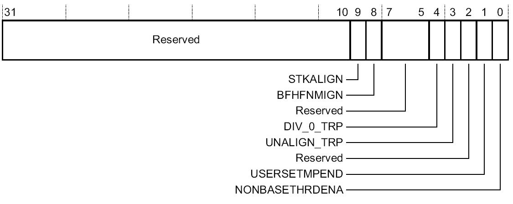

图中文字：Reserved：保留。

CCR 寄存器中的以下位控制 UsageFault 的行为：

**DIV_0_TRP：** 当处理器执行除数为 0 的 SDIV 或 UDIV 指令时启用 UsageFault：

- 0 = 不捕获除以 0；除以 0 所返回的商为 0。
- 1 = 捕获除以 0。

**UNALIGN_TRP：** 当对非对齐地址进行内存访问时启用 UsageFault：

- 0 = 不捕获非对齐的半字和字访问。
- 1 = 捕获非对齐的半字和字访问；非对齐访问会产生 UsageFault。

注意，即使 UNALIGN_TRP 被设置为 0，LDM、STM、LDRD 和 STRD 指令的非对齐访问也始终会产生 UsageFault。

#### 系统处理程序优先级寄存器 SHP {#shp}

SHP 寄存器设置异常处理程序的优先级。通过以下寄存器控制故障异常：

- **SHP[0]：** 内存管理故障（Memory Management Fault）的优先级。
- **SHP[1]：** BusFault 的优先级。
- **SHP[2]：** UsageFault 的优先级。

为了对中断和异常的优先级进行编程，CMSIS 提供了 NVIC_SetPriority 和 NVIC_GetPriority 函数。可以按如下方式更改故障异常的优先级：

```
                 : 
  NVIC_SetPriority (MemoryManagement_IRQn, 0x0F); 
  NVIC_SetPriority (BusFault_IRQn, 0x08); 
  NVIC_SetPriority (UsageFault_IRQn, 0x01); 
                 : 
  UsageFault_prio = NVIC_GetPriority (UsageFault_IRQn); 
                 : 
```

<a id="src-p6"></a>

#### 系统处理程序控制和状态寄存器 SHCSR {#shcsr}

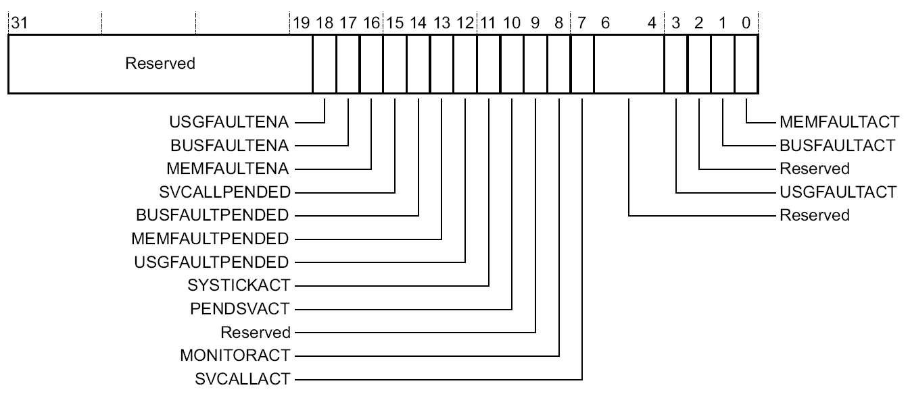

图中文字：Reserved：保留。

SHCSR 寄存器中的以下位与故障异常有关：

- **MEMFAULTACT：** 内存管理故障异常活动位；若异常处于活动状态，读出值为 1。
- **BUSFAULTACT：** BusFault 异常活动位；若异常处于活动状态，读出值为 1。
- **USGFAULTACT：** UsageFault 异常活动位；若异常处于活动状态，读出值为 1。
- **USGFAULTPENDED：** UsageFault 异常挂起位；若异常处于挂起状态，读出值为 1。
- **MEMFAULTPENDED：** 内存管理故障异常挂起位；若异常处于挂起状态，读出值为 1。
- **BUSFAULTPENDED：** BusFault 异常挂起位；若异常处于挂起状态，读出值为 1。
- **MEMFAULTENA：** 内存管理故障异常使能位；置 1 以启用，置 0 以禁用。
- **BUSFAULTENA：** BusFault 异常使能位；置 1 以启用，置 0 以禁用。
- **USGFAULTENA：** UsageFault 异常使能位；置 1 以启用，置 0 以禁用。

虽然可以写入 SHCSR 寄存器的所有位，但在大多数软件应用中，只有写入使能位才有意义。可以使用以下语句启用内存管理故障、BusFault 和 UsageFault 异常：

```
SCB->SHCSR |= SCB_SHCSR_USGFAULTENA_Msk  
           |  SCB_SHCSR_BUSFAULTENA_Msk 
           |  SCB_SHCSR_MEMFAULTENA_Msk; //enable Usage-/Bus-/MPU Fault 
```


<!-- source: apnt209.pdf; pages=7-12; translation batch 2 -->
<a id="src-p7"></a>

### 故障异常的状态和地址寄存器 {#status-address}

下表列出了故障状态寄存器和故障地址寄存器的名称，并给出了每个寄存器的内存地址。

| 处理程序 | 状态寄存器 | 地址寄存器 | 地址 | 说明 |
|:---|:---:|:---:|:---|:---|
| HardFault | HFSR | | 0xE000ED2C | HardFault 状态寄存器 |
| MemManage | MMFSR | | 0xE000ED28 | MemManage 故障状态寄存器 |
| | | MMFAR | 0xE000ED34 | MemManage 故障地址寄存器 |
| BusFault | BFSR | | 0xE000ED29 | BusFault 状态寄存器 |
| | | BFAR | 0xE000ED38 | BusFault 地址寄存器 |
| UsageFault | UFSR | | 0xE000ED2A | UsageFault 状态寄存器 |
| | AFSR | | 0xE000ED3C | 辅助故障状态寄存器。内容由实现定义。 |
| | ABFSR | | 0xE000ED3C〔待确认〕 | 辅助 BusFault 状态寄存器。仅适用于 Cortex-M7。 |

#### HardFault 状态寄存器 HSFR〔待确认〕 {#hsfr}

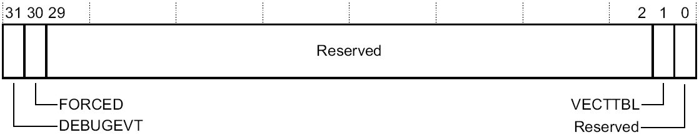

图中文字：Reserved：保留。

HardFault 状态寄存器指示 CPU 指令的不正确使用情况〔待确认〕，包含以下状态位：

**VECTTBL：** 指示异常处理期间读取向量表时发生的 BusFault：

- 0 = 读取向量表时未发生 BusFault。
- 1 = 读取向量表时发生了 BusFault。

此位置位时，为异常返回而压栈的 PC 值指向被该异常抢占的指令。此错误始终为 HardFault。

**FORCED：** 指示强制 HardFault，它由一个具有可配置优先级的故障升级而来；该故障由于优先级原因或由于被禁用而无法处理：

- 0 = 无强制 HardFault。
- 1 = 强制 HardFault。

此位置位时，HardFault 处理程序必须读取其他故障状态寄存器，以找出故障原因。

**DEBUGEVT：** 保留供调试使用。写入此寄存器时，必须向该位写入 0，否则行为不可预测。

<a id="src-p8"></a>

#### 可配置故障状态寄存器 CFSR {#cfsr}

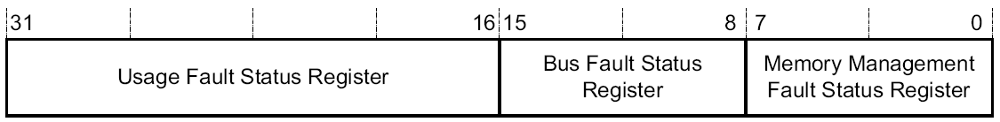

图中文字：Usage Fault Status Register：UsageFault 状态寄存器；Bus Fault Status Register：BusFault 状态寄存器；Memory Management Fault Status Register：内存管理故障状态寄存器。

CSFR〔待确认〕寄存器可以分成三个状态寄存器，分别用于 UsageFault、BusFault 和内存管理故障。

#### MemManage 故障状态和地址寄存器（MMFSR；MMFAR） {#memmanage-registers}

##### MemManage 状态寄存器（MMFSR） {#mmfsr}

MemManage 故障状态寄存器（MemManage Fault Status Register，MMFSR）指示内存保护单元（Memory Protection Unit，MPU）检测到的内存访问违规。只允许特权访问。非特权访问会产生 BusFault。

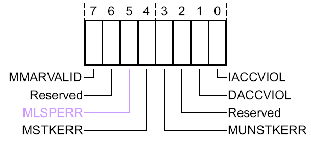

图中文字：Reserved：保留。

MMFSR 包含以下状态位：

**IACCVIOL：** 指令访问违规标志：

- 0 = 无指令访问违规故障。
- 1 = 处理器尝试从不允许执行的位置取指。

为异常返回而压栈的 PC 值指向引发故障的指令。处理器未向 MMFAR 写入故障地址。任何尝试从 XN（eXecute Never，禁止执行）区域取指的操作都会产生此故障条件，即使 MPU 被禁用或不存在也不例外。可能的原因：

a) 跳转到 MPU 中未定义的区域，或被定义为不可执行的区域。  
b) 栈内容损坏导致无效返回。  
c) 异常向量表中的条目不正确。

**DACCVIOL：** 数据访问违规标志：

- 0 = 无数据访问违规故障。
- 1 = 处理器尝试在不允许相应操作的位置执行加载或存储。

为异常返回而压栈的 PC 值指向引发故障的指令。处理器已将尝试访问的地址装入 MMFAR。

**MUNSTKERR：** 从异常返回时，在出栈过程中发生的 MemManage 故障：

- 0 = 无出栈故障。
- 1 = 异常返回时的出栈操作引发了一次或多次访问违规。

此故障以链式方式转入处理程序，这意味着原来的返回栈仍然存在。处理器未对失败返回操作中的 SP 进行调整，也未执行新的保存操作。处理器未向 MMFAR 写入故障地址。可能的原因：

a) 栈指针已损坏。  
b) 在执行异常处理程序期间，栈所在的 MPU 区域发生了变化。

**MSTKERR：** 进入异常时，在入栈过程中发生的 MemManage 故障：

- 0 = 无入栈故障。
- 1 = 进入异常时的入栈操作引发了一次或多次访问违规。

<a id="src-p9"></a>

SP 仍然会被调整，但栈上上下文区域中的值可能不正确。处理器未向 MMFAR 写入故障地址。可能的原因：

a) 栈指针已损坏或未初始化。  
b) 栈正在到达未被 MPU 定义为可读/写内存的区域。

**MLSPERR：** 在浮点状态延迟保存（floating-point lazy state preservation）期间发生的 MemManage 故障（仅限带 FPU 的 Cortex-M4）〔待确认〕：

- 0 = 浮点状态延迟保存期间未发生故障。
- 1 = 浮点状态延迟保存期间发生了故障。

**MMARVALID：** MemManage 故障地址寄存器（MemManage Fault Address Register，MMFAR）有效标志：

- 0 = SCB->MMFAR 中的值不是有效的故障地址。
- 1 = SCB->MMFAR 保存着有效的故障地址。

如果发生 MemManage 故障，并因优先级原因升级为 HardFault，则 HardFault 处理程序必须将此位置 0。这样可避免在返回到一个已入栈且处于活动状态的 MemManage 故障处理程序时出现问题，因为该处理程序的 SCB->MMFAR 值已被覆盖。

##### MemManage 地址寄存器（MMFAR） {#mmfar}

BFAR 地址与精确数据访问 BusFault 相关联。〔待确认〕只允许特权访问。非特权访问会产生 BusFault。


图中文字：ADDRESS：地址。

**ADDRESS：** MemManage 故障的数据地址。该寄存器会更新为产生 MemManage 故障的位置地址。MMFSR 指示故障原因。此字段仅在 MMFSR.MMARVALID 置位时有效。在没有各自独立的 BFAR 和 MMFAR 寄存器的实现中，如果 BFSR.BFARVALID 置位，则该寄存器的值为 UNKNOWN（未知）。

#### BusFault 状态和地址寄存器（BFSR；BFAR） {#busfault-registers}

##### BusFault 状态寄存器（BFSR） {#bfsr}

BusFault 状态寄存器（BusFault Status Register，BFSR）显示由取指和数据访问产生的总线错误状态，并指示在总线操作期间检测到的内存访问故障。只允许特权访问。非特权访问会产生 BusFault。

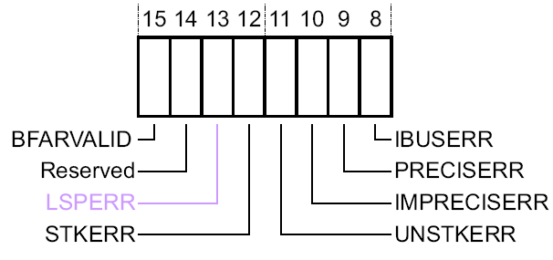

图中文字：Reserved：保留。

BFSR 的状态位如下：

**IBUSERR：** 指令总线错误。记录在指令预取时是否发生过 BusFault。

- 0 = 无指令总线错误。
- 1 = 指令总线错误。

处理器在预取指令时检测到指令总线错误，但只有在尝试发射引发故障的指令时，才将 IBUSERR 标志置 1。当处理器将此位置位时，不会向 BFAR 写入故障地址。可能的原因：

<a id="src-p10"></a>

a) 跳转到无效内存区域，例如由不正确的函数指针引起。  
b) 栈指针或栈内容损坏导致无效返回。  
c) 异常向量表中的条目不正确。

**PRECISERR：** 精确数据总线错误：

- 0 = 无精确数据总线错误。
- 1 = 发生了数据总线错误，为异常返回而压栈的 PC 值指向引发故障的指令。

当处理器将此位置位时，会将引发故障的地址写入 BFAR。

**IMPRECISERR：** 非精确数据总线错误：

- 0 = 无非精确数据总线错误。
- 1 = 发生了数据总线错误，但栈帧中的返回地址与引发错误的指令无关。

当处理器将此位置位时，不会向 BFAR 写入故障地址。这是异步故障。因此，如果检测到该故障时当前过程的优先级高于 BusFault 的优先级，则 BusFault 会进入挂起状态，只有在处理器从所有更高优先级的过程返回后才会进入活动状态。如果在处理器进入非精确 BusFault 的处理程序之前发生精确故障，则处理程序会检测到 IMPRECISERR 被置为 1，同时某个精确故障状态位也被置为 1。

**UNSTKERR：** 从异常返回时，在出栈过程中发生的 BusFault：

- 0 = 无出栈故障。
- 1 = 异常返回时的出栈操作引发了一次或多次 BusFault。

此故障以链式方式转入处理程序。这意味着当处理器将此位置位时，原来的返回栈仍然存在。处理器不会对失败返回操作中的 SP 进行调整，不会执行新的保存操作，也不会向 BFAR 写入故障地址。

**STKERR：** 进入异常时，在入栈过程中发生的 BusFault：

- 0 = 无入栈故障。
- 1 = 进入异常时的入栈操作引发了一次或多次 BusFault。

当处理器将此位置位时，SP 仍然会被调整，但栈上上下文区域中的值可能不正确。处理器不会向 BFAR 写入故障地址。可能的原因：

a) 栈指针已损坏或未初始化。  
b) 栈正在到达未定义的内存区域。

**LSPERR：** 在浮点状态延迟保存期间发生的 BusFault（仅在存在 FPU 时）：

- 0 = 浮点状态延迟保存期间未发生故障。
- 1 = 浮点状态延迟保存期间发生了故障。

**BFARVALID：** BusFault 地址寄存器（BusFault Address Register，BFAR）有效标志：

- 0 = BFAR 中的值不是有效的故障地址。
- 1 = BFAR 保存着有效的故障地址。

处理器会在地址已知的 BusFault 发生后将此位置位。其他故障可能会将此位清为 0，例如随后发生的 MemManage 故障。如果发生 BusFault，并因优先级原因升级为 HardFault，则 HardFault 处理程序必须将此位置 0。这样可避免在返回到一个已入栈且处于活动状态的 BusFault 处理程序时出现问题，因为该处理程序的 BFAR 值已被覆盖。

<a id="src-p11"></a>

##### BusFault 地址寄存器（BFAR） {#bfar}

BFAR 地址与精确数据访问 BusFault 相关联。只允许特权访问。非特权访问会产生 BusFault。

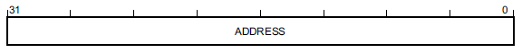

图中文字：ADDRESS：地址。

**ADDRESS：** 精确 BusFault 的数据地址。该寄存器会更新为产生 BusFault 的位置地址。BFSR 指示故障原因。此字段仅在 BFSR.BFARVALID 置位时有效。在没有各自独立的 BFAR 和 MMFAR 寄存器的实现中，如果 MMFSR.MMARVALID 置位，则该寄存器的值为 UNKNOWN（未知）。

#### UsageFault 状态寄存器（UFSR） {#ufsr}

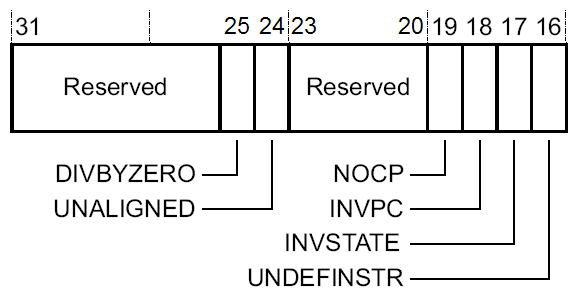

图中文字：Reserved：保留。

UsageFault 状态寄存器（UsageFault Status Register，UFSR）包含一些指令执行故障以及数据访问的状态。只允许特权访问。非特权访问会产生 BusFault。

该寄存器的位分配如下：

**UNDEFINSTR：** 未定义指令。

- 0 = 无未定义指令。
- 1 = 处理器尝试执行未定义的指令。

此位置位时，为异常返回而压栈的 PC 值指向该未定义指令。未定义指令是处理器无法解码的指令。可能的原因：

a) 使用了 Cortex-M 器件不支持的指令。  
b) 内存内容错误或损坏。

**INVSTATE：** 无效状态：

- 0 = 无无效状态。
- 1 = 处理器尝试执行一条非法使用执行程序状态寄存器（Execution Program Status Register，EPSR）的指令。

此位置位时，为异常返回而压栈的 PC 值指向尝试非法使用 EPSR 的指令。可能的原因：

a) 向 PC 加载一个 LSB=0 的分支目标地址。  
b) 在处理异常或中断期间，已入栈的 PSR 被损坏。  
c) 向量表中包含一个 LSB=0 的向量地址。

**INVPC：** 无效 PC 加载 UsageFault，由无效的 EXC_RETURN 值引起：

- 0 = 无无效 PC 加载。
- 1 = 由于无效的上下文切换，处理器尝试向 PC 加载一个非法的 EXC_RETURN 值。

此位置位时，为异常返回而压栈的 PC 值指向尝试执行非法 PC 加载的指令。可能的原因：

<a id="src-p12"></a>

a) 栈指针、链接寄存器（link register，LR）或栈内容损坏导致无效返回。  
b) PSR 中的 ICI/IT 位对某条指令而言无效。

**NOCP：** 无协处理器。处理器不支持协处理器指令：

- 0 = 未因尝试访问协处理器而产生 UsageFault。
- 1 = 处理器尝试访问不存在的协处理器。

**UNALIGNED：** 非对齐访问 UsageFault：

- 0 = 无非对齐访问故障，或未启用非对齐访问捕获。
- 1 = 处理器进行了非对齐内存访问。

通过设置 CCR 中的 UNALIGN_TRP 位，可启用非对齐访问捕获。无论 UNALIGN_TRP 位如何设置，非对齐的 LDM、STM、LDRD 和 STRD 指令始终会引发故障。

**DIVBYZERO：** 除零 UsageFault：

- 0 = 无除零故障，或未启用除零捕获。
- 1 = 处理器执行了一条除数为 0 的 SDIV 或 UDIV 指令。

当处理器将此位置 1 时，为异常返回而压栈的 PC 值指向执行除零运算的指令。通过将 CCR 中的 DIV_0_TRP 位置 1，可启用除零捕获。

注意，UsageFault 状态寄存器的各个位具有粘滞性（sticky）。这意味着，在发生一个或多个故障时，相应位会被置为 1。已置为 1 的位只有通过向该位写入 1，或通过复位，才能清为 0。

#### 辅助总线故障状态寄存器 ABFSR（仅限 Cortex-M7） {#abfsr}

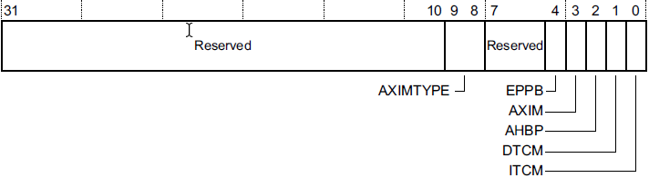

图中文字：Reserved：保留。

辅助总线故障状态寄存器（Auxiliary Bus Fault Status Register，ABFSR）保存异步总线故障来源的信息。如果发生 BusFault，故障处理程序可以读取此寄存器，以确定哪个总线接口触发了故障；如果来源是 AXIM 接口，还可以确定收到的是哪一种错误类型。ABFSR[4:0] 字段会保持有效，直到向 ABFSR 写入任意值将其清除。ASBFSR〔待确认〕的位分配如下：

**AXIMTYPE：** 指示 AXIM 接口上的故障类型。这些值仅在 AXIM=1 时有效。

- 0b00 = OKAY
- 0b01 = EXOKAY
- 0b10 = SLVERR
- 0b11= DECERR

**EPPB：** EPPB 接口上的异步故障。

**AXIM：** AXIM 接口上的异步故障。

**AHBP：** AHBP 接口上的异步故障。

**DTCM：** DTCM 接口上的异步故障。

**ITCM：** ITCM 接口上的异步故障。

注意：在您的实现中，可能不存在这些接口。


<!-- source: apnt209.pdf; pages=13-18; translation batch 3 -->
<a id="src-p13"></a>

## 实现故障处理程序 {#implementing}

故障处理程序有多种用途。可以使用它们安全地关闭系统，向用户告知遇到的问题，或触发整个系统的自检。

符合 CMSIS 的启动文件（startup_device.s）定义了器件的所有异常向量和中断向量。这些向量定义了异常或中断处理函数的入口地址。以下清单展示了一个典型的向量表，其中故障异常向量以蓝色显示。

```
__Vectors       DCD     __initial_sp              ; Top of Stack 
                DCD     Reset_Handler             ; Reset Handler 
                DCD     NMI_Handler               ; NMI Handler 
                DCD     HardFault_Handler         ; Hard Fault Handler 
                DCD     MemManage_Handler         ; MPU Fault Handler 
                DCD     BusFault_Handler          ; Bus Fault Handler 
                DCD     UsageFault_Handler        ; Usage Fault Handler 
                DCD     0                         ; Reserved 
                 : 
```

调试期间，故障处理程序可以只是一条 BKPT（断点）指令，用于使调试器停止。一般而言，所有故障都会升级为 HardFault，因此只需在 HardFault 处理程序中添加断点指令即可。使用 MDK 和符合 CMSIS 的器件包含文件时，可以用自己的代码覆盖 HardFault 处理程序。

### HardFault 处理程序示例 {#handler-example}

AN209_Faults_and_Handler.zip 中包含一个示例工程，其中的 HardFault 处理程序示例会保存内核寄存器的内容，并使用 printf 语句将其显示出来。此自定义处理程序由两部分组成：

- 处理程序封装层使用汇编语言编写，它提取栈帧的位置，并以指针形式将其传递给用 C 语言编写的处理程序。
- 用 C 语言编写的处理程序利用汇编封装层提供的信息提取相关信息，并通过 printf 语句显示出来（输出示例见图 11）。

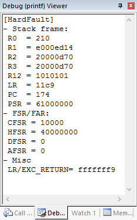

图中文字：Debug (printf) Viewer：调试（printf）查看器。输出中的代码、寄存器名和值保留原样。

对于最终应用，可以实现执行以下操作的故障处理程序：

- **系统复位：** 将应用中断和复位控制寄存器（Application Interrupt and Reset Control Register，AIRCR）中的位 2（SYSRESETREQ）置位。这会复位系统中除调试逻辑以外的大部分组件。如果不想复位整个系统，只需将 AIRCR 中的位 0（VECTRESET）置位，这只会引发处理器复位。
- **恢复：** 在某些情况下，可以解决引发故障异常的问题。例如，对于协处理器指令，处理程序可以用软件来模拟该指令。
- **任务终止：** 对于运行实时操作系统（real-time operating system，RTOS）的系统，可以终止引发故障的任务，并在需要时将其重新启动。

注意：要为 MemFault、BusFault 和 UsageFault 启用各自独立的故障处理程序，需要在初始化代码中加入以下 C 语句：

```
SCB->SHCSR |= SCB_SHCSR_USGFAULTENA_Msk  
           |  SCB_SHCSR_BUSFAULTENA_Msk 
           |  SCB_SHCSR_MEMFAULTENA_Msk; // enable Usage-/Bus-/MPU Fault 
```

<a id="src-p14"></a>

### ARM Cortex-M7 的故障处理注意事项 {#m7-considerations}

1. 缓存维护操作可能导致 BusFault。这类故障事件是异步的（非精确的）。此类 BusFault：
   a. 在已启用 BusFault 处理程序时，不会引发向 HardFault 的升级。
   b. 永远不会导致锁死。

   由于故障事件是异步的，缓存维护操作的软件代码必须在操作完成时使用内存屏障指令，例如 DSB，以便立即观察到故障事件。

2. Cortex-M7 的缓存支持 ECC（Error Correction Code，纠错码）。发生不可纠正的 ECC 错误时，会触发 BusFault，软件可以使用指令错误组寄存器（Instruction Error Bank Register，IEBR0-1）和数据错误组寄存器（Data Error Bank Register，DEBR0-1）来管理 ECC。

3. 由于总线接口的设计不同，总线错误的行为存在一些差异：
   a. 在 Cortex-M3 和 Cortex-M4 中，如果内存操作是向强序（strongly ordered）内存区域写入，则总线错误是精确的。在 Cortex-M7 上，同样的操作可能触发非精确总线错误。
   b. 在 Cortex-M3 和 Cortex-M4 中，异常序列会在尚未完成的缓冲写入完成后开始。因此，如果发生总线错误，已压栈的 PC 与引发总线错误的代码具有相同的上下文。在 Cortex-M7 中，异常处理序列可能在写缓冲区排空之前就开始。在这种情况下，已压栈的 PC 可能指示另一个上下文（例如，在缓冲写入发生后不久触发的 IRQ 处理程序）。因此，在 Cortex-M7 上，如果 BusFault 是异步的，BusFault 处理程序就不能依靠已压栈的 PC 来确定故障位置。

<a id="src-p15"></a>

## 使用 µVision® 调试故障 {#debugging}

示例工程（[www.keil.com/appnotes/docs/apnt_209.asp](http://www.keil.com/appnotes/docs/apnt_209.asp)）演示了三种不同的故障异常：

- 调用一条不属于 ARM 指令集的指令，会引发未定义指令 UsageFault（UNDEFINSTR）。
- 跳转到有效的内存地址，但未设置 Thumb 位，会导致无效状态 UsageFault（INVSTATE）。
- 将任意给定数字除以零，会触发除零 UsageFault（DIVBYZERO）。

安装软件包，并将示例工程“AN209 Fault Exception Examples”复制到本地驱动器。使用 project_configuration.h 文件的 Configuration Wizard（配置向导）视图，可以配置要触发哪一种故障异常。如果启用 HardFault 处理程序，Debug (printf) View（调试（printf）视图）窗口中就会显示有用的信息。更多信息请参阅[原文第 13 页的 HardFault 处理程序示例](#handler-example)。

### 确定发生了哪种异常 {#which-exception}

本示例说明一种典型的意外异常的行为，并展示如何使用 µVision 调试器分析问题原因。在执行期间，应用程序失去响应，看起来像是挂起了。使用调试器停止应用程序：

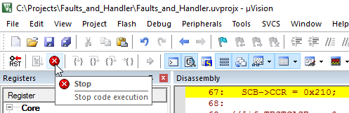

图中文字：File：文件；Edit：编辑；View：视图；Project：工程；Flash：闪存；Debug：调试；Peripherals：外设；Tools：工具；SVCS：SVCS；Window：窗口；Help：帮助；Registers：寄存器；Register：寄存器；Core：内核；Disassembly：反汇编；Stop：停止；Stop code execution：停止代码执行。

由于尚未提供应用程序专用的 HardFault 处理程序，应用程序位于默认 HardFault 处理程序的无限循环中：

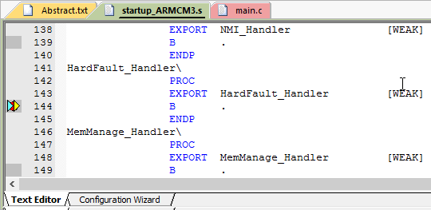

图中文字：Text Editor：文本编辑器；Configuration Wizard：配置向导。文件名与汇编代码保留原样。

<a id="src-p16"></a>

#### 从 Peripherals 菜单访问 Fault Reports 对话框 {#fault-reports}

ARM Cortex-M 故障寄存器会准确地指示发生了哪一种异常。µVision 在 Fault Reports 对话框中提供所有故障寄存器的当前值；可以通过 Peripherals - Core Peripherals（外设 - 内核外设）菜单打开该对话框：

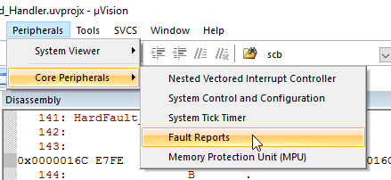

图中文字：Peripherals：外设；Tools：工具；SVCS：SVCS；Window：窗口；Help：帮助；System Viewer：系统查看器；Core Peripherals：内核外设；Disassembly：反汇编；Nested Vectored Interrupt Controller：嵌套向量中断控制器；System Control and Configuration：系统控制与配置；System Tick Timer：系统滴答定时器；Fault Reports：故障报告；Memory Protection Unit (MPU)：内存保护单元（MPU）。

Fault Reports 对话框提供已发生异常的详细信息。在本例中（软件包示例工程中的 TESTCASE INVSTATE），一次尝试切换到无效状态（ARM 状态）的操作引发了 UsageFault；由于未启用 UsageFault 处理程序，该故障升级为 HardFault。

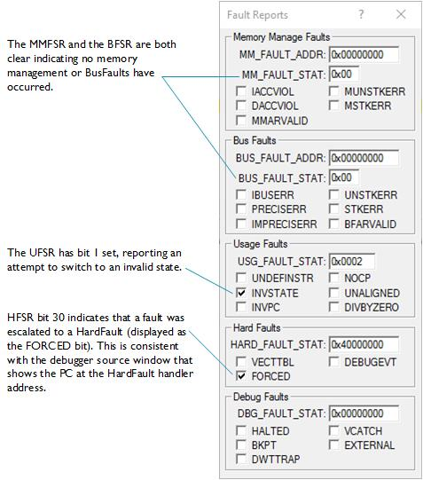

图中说明文字：

- MMFSR 和 BFSR 均为清零状态，表明没有发生内存管理故障或 BusFault。
- UFSR 的位 1 已置位，报告曾尝试切换到无效状态。
- HFSR 的位 30 指示某个故障已升级为 HardFault（显示为 FORCED 位）。这与调试器源代码窗口中的情况一致，该窗口显示 PC 位于 HardFault 处理程序的地址。

图中界面文字：Fault Reports：故障报告；Memory Manage Faults：内存管理故障；Bus Faults：总线故障；Usage Faults：用法故障；Hard Faults：硬故障；Debug Faults：调试故障。

此 Fault Reports 对话框是分析故障异常的一种快捷方式。如果您的调试器不支持此类对话框，可以通过内存窗口查看这些值。

<a id="src-p17"></a>

### 确定异常发生的位置 {#where-exception}

在示例工程中启用 DIVBYZERO UsageFault，并运行应用程序，直到它进入 HardFault。在 Call Stack + Locals（调用栈 + 局部变量）窗口中右键单击 HardFault Handler，然后选择 Show Caller Code（显示调用者代码），以突出显示故障发生时的执行上下文：

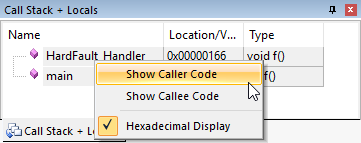

图中文字：Call Stack + Locals：调用栈 + 局部变量；Name：名称；Location/V...：位置/V...〔原图截断〕；Type：类型；Show Caller Code：显示调用者代码；Show Callee Code：显示被调用者代码；Hexadecimal Display：十六进制显示。

根据异常类型的不同，调试器会突出显示引发异常的指令，或紧随引发故障的指令之后的那条指令。这取决于引发异常的指令是否确实完成了执行。

在 main.c 中，以下行会被突出显示：

```
i =i/j;   // i and j are 0 initialized -> Div/0 
```

异常会保存寄存器 R0-R3、R12、PC 和 LR 的状态，以及 MSP 或 PSP 中的一个（取决于发生异常时使用的是哪个栈）〔待确认〕。当前链接寄存器 LR 包含正在处理的异常的 EXC_RETURN 值，该值指示哪个栈保存了应用程序上下文中的寄存器值。如果 EXC_RETURN 的位 2 为零，则使用的是主栈（保存的是 MSP）；否则，使用的是进程栈。

Registers 窗口提供所需的信息：

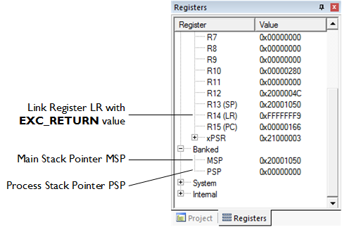

图中说明文字：Link Register LR with EXC_RETURN value：保存 EXC_RETURN 值的链接寄存器 LR；Main Stack Pointer MSP：主栈指针 MSP；Process Stack Pointer PSP：进程栈指针 PSP。

图中界面文字：Registers：寄存器；Register：寄存器；Value：值；Banked：分组寄存器；System：系统；Internal：内部；Project：工程。

在本例中，EXC_RETURN 的值为：

```
0xfffffff9 = b_11111111111111111111111111111001 – bit 2 = 0 
```

这表明主栈包含最近保存的寄存器值。此处也可以看到 MSP 和 PSP 的地址。

<a id="src-p18"></a>

MSP 指向 0x20001050。可以使用内存窗口确定此前的执行上下文：

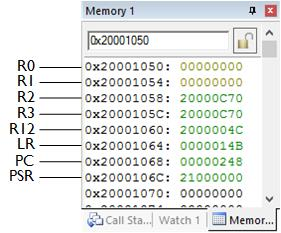

图中文字：Memory 1：内存 1；Watch 1：监视 1。

这与我们先前从调试器看到的信息相对应：

| 寄存器信息 | 说明 |
|:---|:---|
| PC = 0x00000248 | 下一条将引发 UsageFault 的指令（此处为 SDIV）。 |
| R0-R3 & R12 | 这些是异常发生前各寄存器中的值。 |

通过使用故障状态寄存器和相应栈中的详细信息，调试器提供了确定发生了哪种异常及其发生位置所需的信息。要进一步调试此特定问题，必须在正在被破坏的函数指针上设置监视点，并复位系统。〔待确认〕这样将揭示问题的根本原因。

## 更多文档 {#further-documentation}

有关 ARM Cortex-M3、Cortex-M4 或 Cortex-M7 的中止和异常模型的信息，请参阅设备通用用户指南（Devices Generic User Guides），获取路径为 [https://developer.arm.com/docs](https://developer.arm.com/docs) → Processors → Cortex-M。

一本很好的参考书是 Joseph Yiu 著的《The Definitive Guide to the ARM Cortex-M3 and Cortex-M4 Processors》（《ARM Cortex-M3 与 Cortex-M4 处理器权威指南》），ISBN 978-0-12-408082-9。

## 修订历史 {#revision-history}

- 2013 年 11 月，1.0：
  - 初始版本。
- 2016 年 1 月，2.0：
  - 系统处理程序优先级寄存器：更正了 NVIC_SetPriority() 的参数。
  - 系统处理程序控制和状态寄存器：将错误的 SHCSR 值 0x00070000 更正为 0x00007000。
  - Error! Reference source not found.（错误！未找到引用源。）〔待确认〕：将 __breakpoint (0) 更改为 __BKPT (0)。
  - Error! Reference source not found.（错误！未找到引用源。）〔待确认〕：将错误的 SHCSR 值 0x00070000 更正为 0x00007000。
- 2016 年 3 月，3.0：
  - 将第 5 页和第 10 页的 SCB->SHCSR 设置为：

```
SCB->SHCSR |= SCB_SHCSR_USGFAULTENA_Msk  
                     |  SCB_SHCSR_BUSFAULTENA_Msk 
                     |  SCB_SHCSR_MEMFAULTENA_Msk;  
```

- 2016 年 9 月，4.0：
  - 更正：将 PRECISEERR 改为 PRECISERR。
  - 更正：第 14 页的寄存器窗口图片。
  - 调整：通过“Call Stack + Locals”窗口处理硬故障。
- 2017 年 8 月，5.0：
  - 全面修订应用笔记，并添加示例工程。

原文末页页脚：AN251 - 为软件组件创建软件包；Copyright © 2017 Arm Ltd. 保留所有权利；18；[www.keil.com/appnotes/docs/apnt_251.asp](http://www.keil.com/appnotes/docs/apnt_251.asp)。〔待确认〕
