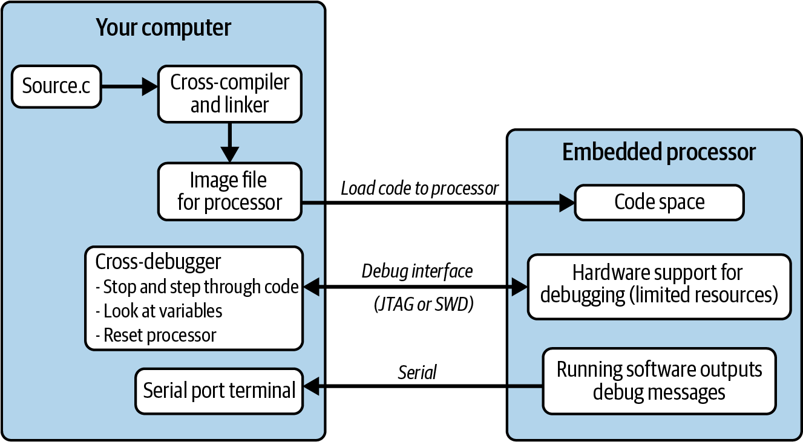

<!-- source: pdf=21; section=1; unit=p0021_b000_u00 -->

<a id="src-p21"></a>

# 第 1 章 引言 {#ch01}

<!-- source: pdf=21; section=1; unit=p0021_b001_u00 -->
不同的人对嵌入式系统（embedded system）有不同的理解。对一直从事服务器开发的人来说，为手机开发的应用就是嵌入式系统。对曾为小型 8 位微处理器编写代码的人来说，凡是带操作系统的东西，似乎都不怎么“嵌入式”。我通常会对非技术人员说，嵌入式系统就是微波炉、汽车之类运行着软件、却不是计算机的东西。（大多数人认为计算机是一种通用设备。）也许，不纠缠于技术细节的一个简单定义是：

<!-- source: pdf=21; section=1; unit=p0021_b002_u00 -->
> 嵌入式系统是为其应用专门构建的计算机化系统。

<!-- source: pdf=21; section=1; unit=p0021_b003_u00 -->
由于承担的任务比通用计算机更专一，嵌入式系统对那些与当前任务无关的事情，提供的支持也更少。硬件往往受到限制。例如，CPU 可能为了节省电池电量而以较低速度运行；系统可能为了降低制造成本而采用较少的存储器；处理器也可能只有特定几种速度，或者只支持部分外设（peripheral）。

<!-- source: pdf=21; section=1; unit=p0021_b004_u00 -->
系统中受到限制的不只是硬件。有些系统要求软件具有确定性（deterministic，每次的行为完全一致），或者具有实时性（real-time，总能足够迅速地响应事件）。有些系统要求软件能够容错，在发生错误时平稳降级。例如，有些系统的软件出了故障、硬件损坏后，可能根本无法维修，比如卫星或鲸鱼身上的跟踪标签。另一些系统则要求软件一发现异常迹象就停止运行，通常还要给出明确的错误信息，例如，心脏监护仪不能悄无声息地失效。

<!-- source: pdf=21-22; section=1; unit=p0021_b005_u00,p0022_b000_u00 -->

<a id="src-p22"></a>

这简短的一章将从宏观上介绍嵌入式系统。说实话，你也可以去读维基百科上的条目，不过，这也是我们彼此熟悉的一种方式。遗憾的是，本章主要谈的是开发嵌入式系统有多难。由于编译器、调试器和资源限制各不相同，我们设计、实现代码的方式也与其他类型的软件不同。有些人也许会说，这个领域有点落后，但事实并非如此；大多数时候，我们致力于解决的是不同的问题。不过，有些有用的软件工程技术确实遭到了忽视，这也是本书其余章节要谈的内容。

<!-- source: pdf=22; section=1; unit=p0022_b001_u00 -->
创客运动是嵌入式系统领域最美好的事情之一。谁都喜欢闪闪发光的灯，于是有人开始对以底层软件为职业产生兴趣。如果你就是这样的人，欢迎你。不过，我得承认，我预期的读者是有硬件或软件经验，希望知道怎样把两者之间的那部分工作做得既好又高效的人。

<!-- source: pdf=22; section=1; unit=p0022_b002_u00 -->
每章末尾，我都放了一道与本章内容略有关联的面试题。在我的职业生涯中，学会为团队招聘而面试他人，是让我更上一层楼的一件事。我曾因找不到教人如何面试的资料而大失所望，所以这里收录了我最喜欢的面试题，以及我作为面试官会关注什么。这些题目有点古怪，但希望你和我一样喜欢它们。

<!-- source: pdf=22; section=1; unit=p0022_b003_u00 -->
当然，我也希望你像我一样，喜欢嵌入式系统开发的方方面面。挑战是有的，但乐趣也正在于此。

<!-- source: pdf=22; section=1.1; unit=p0022_b004_u00 -->
## 嵌入式系统开发 {#ch01-toc-001}

<!-- source: pdf=22; section=1.1; unit=p0022_b005_u00 -->
嵌入式系统很特别，会给开发者带来独特的挑战。大多数嵌入式软件工程师都会积累一套应对限制的工具。在开始为你打造这套工具之前，先看看开发嵌入式系统有哪些困难。等你了解了自己的嵌入式系统可能受到哪些限制，我们就会介绍一些原则，帮助我们找到更好的解决办法。

<!-- source: pdf=22; section=1.1.1; unit=p0022_b006_u00 -->
### 编译器与语言 {#ch01-toc-002}

<!-- source: pdf=22; section=1.1.1; unit=p0022_b007_u00 -->
嵌入式系统使用交叉编译器（cross-compiler）。交叉编译器虽然运行在你的台式机或笔记本电脑上，但它生成的代码却不在那台计算机上运行。交叉编译生成的映像运行在目标嵌入式系统上。由于代码需要在你的嵌入式处理器上运行，目标系统的供应商通常会出售交叉编译器，或者提供一份可供选择的交叉编译器清单。许多较大型的处理器使用 GNU 工具系列中的交叉编译器，例如 GCC。

<!-- source: pdf=22; section=1.1.1; unit=p0022_b008_u00 -->
嵌入式软件编译器通常只支持 C，或者支持 C 和 C++。此外，有些嵌入式 C++ 编译器只实现了这门语言的一个子集，常常不支持多重继承、异常和模板。其他语言正逐渐流行起来，但 C 和 C++ 仍然最为普遍。

<!-- source: pdf=23; section=1.1.1; unit=p0023_b000_u00 -->

<a id="src-p23"></a>

无论软件必须使用哪种语言，你都可以实践面向对象设计（object-oriented design）。封装、模块化和数据抽象这些设计原则，几乎可以应用于任何语言编写的任何应用。目标是让设计稳健、易于维护、灵活。面向对象阵营能提供的帮助，我们都应该善加利用。

<!-- source: pdf=23; section=1.1.1; unit=p0023_b001_u00 -->
从整体来看，一个嵌入式系统可以等同于一个对象，尤其是它作为更大系统的一部分工作时，例如，与智能电视通信的遥控器、工厂中的分布式控制系统，或汽车中的安全气囊触发传感器。从更高的层次看，一切本来就是面向对象的，把这一思路向下延伸到嵌入式软件中也合乎逻辑。

<!-- source: pdf=23; section=1.1.1; unit=p0023_b002_u00 -->
另一方面，我并不建议严格遵守所有面向对象设计原则。嵌入式系统需要兼顾的方面太多，无法奉行这样一条铁律。认识到其中的取舍之后，你才能在软件设计目标和系统设计目标之间取得平衡。

<!-- source: pdf=23; section=1.1.1; unit=p0023_b003_u00 -->
本书的大多数示例使用 C 或 C++。在我看来，语言不如概念重要，所以即使不熟悉语法，也请看看代码。本书不会教你任何编程语言，只有少量汇编语言例外，不过，好的设计原则可以超越语言。

<!-- source: pdf=23; section=1.1.2; unit=p0023_b004_u00 -->
### 调试 {#ch01-toc-003}

<!-- source: pdf=23; section=1.1.2; unit=p0023_b005_u00 -->
如果要调试在计算机上运行的软件，你可以直接在那台计算机上编译、调试。系统有足够的资源同时运行程序并支持调试。实际上，硬件根本不会知道你正在调试应用，因为这一切都是由软件完成的。

<!-- source: pdf=23; section=1.1.2; unit=p0023_b006_u00 -->
嵌入式系统却不是这样。除了交叉编译器，你还需要交叉调试器（cross-debugger）。调试器运行在你的计算机上，通过处理器的一种专用接口与目标处理器通信，见图 1-1。这个接口专门让外部工具能够在处理器工作时窥探其内部情况。无论它实际上是否实现了那项广泛使用的标准，人们往往都把这个接口称为 JTAG，读作“jay-tag”。

<!-- source: pdf=23-24; section=1.1.2; unit=p0023_b007_u00,p0024_b000_u00 -->

<a id="src-p24"></a>

处理器必须拿出一部分资源支持调试接口，允许调试器暂停正在运行的处理器，并提供通常的各类调试信息。支持调试操作会增加处理器的成本。为了控制成本，有些处理器只支持有限的一部分功能。例如，添加一个断点，会使处理器修改已经加载到存储器中的代码，告诉它“在这里停下”。不过，如果代码是在闪存（flash）或其他任何只读存储器中执行的，处理器就不能修改代码，而是必须设置一个内部寄存器，即硬件断点（hardware breakpoint），在每个执行周期将它与正在运行的代码地址比较，两者相同时就停止。这可能改变代码的时序，造成一些恼人的缺陷：只有在调试时，或者反而在不调试时，才会出现。内部寄存器也会占用资源，因此可用的硬件断点数量往往有限，常常只有两个。

<!-- source: pdf=24; section=1.1.2; unit=p0024_b002_u00 -->


图 1-1 计算机与目标处理器

图中文字：Your computer＝你的计算机；Source.c 保留为文件名；Cross-compiler and linker＝交叉编译器与链接器；Image file for processor＝处理器映像文件；Load code to processor＝将代码加载到处理器；Embedded processor＝嵌入式处理器；Code space＝代码空间；Cross-debugger＝交叉调试器；Stop and step through code＝停止并单步执行代码；Look at variables＝查看变量；Reset processor＝复位处理器；Debug interface (JTAG or SWD)＝调试接口（JTAG 或 SWD）；Hardware support for debugging (limited resources)＝调试硬件支持（资源有限）；Serial port terminal＝串口终端；Serial＝串行通信；Running software outputs debug messages＝运行中的软件输出调试信息。

<!-- source: pdf=24; section=1.1.2; unit=p0024_b003_u00 -->
总之，处理器支持调试，但如果你来自非嵌入式软件领域，这种支持不一定能达到你已经习惯的程度。

<!-- source: pdf=24; section=1.1.2; unit=p0024_b004_u00 -->
在 PC 与嵌入式处理器之间负责通信的设备，通常称为硬件调试器（hardware debugger）、编程器（programmer）、调试探针（debug probe）、在线仿真器（in-circuit emulator，ICE）或 JTAG 适配器。这些名称可能不太准确地指向同一个东西，也可能指不同的设备。调试器是针对某个处理器或处理器系列的，所以不能拿着为一个项目购买的调试器，就认定它也能用于另一个项目。调试器的成本会不断累积，尤其是你收集了很多种，或者有一个很大的团队共同开发系统时。

<!-- source: pdf=24; section=1.1.2; unit=p0024_b005_u00 -->
为了避免购买调试器，或避免应对处理器的限制，许多嵌入式系统在设计时就打算主要通过 printf，或某种更轻量的日志机制，把信息输出到一个原本闲置的通信端口来调试。虽然这种方法极其有用，但也会改变系统时序，有些缺陷可能直到关闭调试输出之后才暴露出来。

<!-- source: pdf=24; section=1.1.2; unit=p0024_b006_u00 -->
为嵌入式系统编写软件可能颇为棘手，因为你必须兼顾系统需求与硬件限制。现在，你的待办事项里还得再加一项：让软件在一个不怎么友好的环境中也能被调试。第 2 章会进一步讨论这个问题。

<!-- source: pdf=25; section=1.1.3; unit=p0025_b000_u00 -->

<a id="src-p25"></a>

### 资源限制 {#ch01-toc-004}

<!-- source: pdf=25; section=1.1.3; unit=p0025_b001_u00 -->
嵌入式系统被设计用于完成特定任务，因此会去掉完成任务不需要的资源。需要考虑的资源包括：

<!-- source: pdf=25; section=1.1.3; unit=p0025_b002_u00,p0025_b003_u00,p0025_b004_u00,p0025_b005_u00,p0025_b006_u00 -->
- 存储器（RAM）
- 代码空间（ROM 或闪存）
- 处理器周期或速度
- 功耗（power consumption，体现为电池续航时间）
- 处理器外设

<!-- source: pdf=25; section=1.1.3; unit=p0025_b007_u00 -->
在一定程度上，这些资源可以互相交换。例如，你可以用代码空间换取处理器周期，把一部分代码写得更占空间，却运行得更快。也可以降低处理器速度，以减少功耗。如果缺少某种外设接口，也许能利用 I/O 线和处理器周期，在软件中实现它。然而，即使可以取舍，每一种资源的供应仍然有限。资源受限是嵌入式系统最迫切的挑战之一。

<!-- source: pdf=25; section=1.1.3; unit=p0025_b008_u00 -->
另一类挑战来自与硬件打交道。交叉调试带来的额外负担可能令人沮丧。在电路板初始调试（board bring-up）期间，不确定缺陷究竟出在硬件还是软件，会让问题难以解决。与平常使用的计算机不同，你编写的软件可能真的会损坏硬件。最重要的是，你必须了解硬件及其能力。这些知识未必适用于你接下来开发的系统，因此你得能够快速学习。

<!-- source: pdf=25; section=1.1.3; unit=p0025_b009_u00 -->
开发和测试结束后，系统就会进入制造阶段，这是大多数纯软件工程师从来不必考虑的事情。然而，设计出能够以合理成本制造的系统，是嵌入式软件工程师和硬件工程师都必须牢记的目标。为制造提供支持，是确保你创建的系统能够被高度忠实地复制出来的一种方式。

<!-- source: pdf=25; section=1.1.3; unit=p0025_b010_u00 -->
制造完成后，设备便投入实际使用。对于消费产品，这意味着它们将进入数百万个家庭，你制造的任何缺陷都会由许多人一起“享用”。对于医疗、航空或其他关键产品，你的缺陷可能带来灾难性后果，这也是为什么你得做那么多文书工作。对于科学仪器或监测设备，使用现场可能是设备永远无法取回的地方，或者只有冒着极大风险、付出高昂代价才能取回，想想放在火山口里的设备吧。因此，它最好能正常工作。设计软件时，你必须考虑系统离开你之后将经历怎样的一生。

<!-- source: pdf=26; section=1.1.3; unit=p0026_b000_u00 -->

<a id="src-p26"></a>

即便你已经弄清所有这些问题，并确定了系统中的应对办法，还有一个最大的挑战，也是一切工程领域共同面对的挑战：变化。不仅产品目标会改变，项目需求也会在整个生命周期中不断变化。起初，也许你只想迅速拼出个东西试试看。随着你更加认真地对待项目，更加了解并明确产品目标和所用硬件，你会开始搭建更多基础设施，使软件易于调试、稳健且灵活。在资源受限的环境中，你需要从开发时间、RAM、代码空间和处理器周期几个方面，确定自己能为多少基础设施付出代价。最初开始构建的东西，不会等同于开发完成时最终得到的东西。况且，开发几乎从来不会真正完成。

<!-- source: pdf=26; section=1.1.3; unit=p0026_b001_u00 -->
为某种应用专门构建系统有一个不幸的副作用：随着应用发生变化，系统可能无法支持相应的改变。嵌入式系统工程不只是应付严格限制，以及考虑系统最终怎样使用。目标是判断哪些限制会在产品开发后期成为问题。你需要预测最有可能发生的变化方向，并尽量把软件设计得足够灵活，无论应用走向哪条路，都能适应。拿出你的水晶球吧。

<!-- source: pdf=26; section=1.1.4; unit=p0026_b002_u00 -->
### 应对这些挑战的原则 {#ch01-toc-005}

<!-- source: pdf=26; section=1.1.4; unit=p0026_b003_u00 -->
嵌入式系统很像拼图，各个部件相互咬合，而且只能按一种方式拼在一起。有时你可以硬把某些部件拼上去，但得到的画面可能就不是盒子上印的那幅了。不过，我们应该抛弃这样一种想法：最终成果就是项目结束时交付的某一个代码版本。

<!-- source: pdf=26; section=1.1.4; unit=p0026_b004_u00 -->
不妨设想这幅拼图还有一个时间维度，贯穿它的整个生命周期：构思、原型制作、电路板初始调试、调试、测试、发布、维护，然后重复。灵活性不仅关乎代码现在能做什么，也关乎它如何应对整个生命周期。我们的目标是，在处理资源限制以及嵌入式系统固有的其他问题时，仍保持足够的灵活性来满足产品目标。

<!-- source: pdf=26; section=1.1.4; unit=p0026_b005_u00 -->
软件设计中的一些优秀原则可以让系统更加灵活。通过模块化（modularity），我们把功能划分为多个子系统，并隐藏各个子系统使用的数据。通过封装（encapsulation），我们在子系统之间建立接口，让它们无须过多了解彼此。当子系统实现松耦合（loosely coupled）后，你若愿意也可以把它们称作对象，我们就可以放心地修改软件中的某个部分，而不影响其他部分。这样，需要时就能把系统拆开，换一种稍有不同的方式重新组装。

<!-- source: pdf=27; section=1.1.4; unit=p0027_b000_u00 -->

<a id="src-p27"></a>

判断应该在哪里把系统拆分为不同部分，需要实践。一个很好的经验法则是，考虑哪些部分可以独立变化。在嵌入式系统中，现成的物理对象有助于你作出判断。如果传感器 X 通过通信通道 Y 通信，它们就是两种不同的东西，很适合分别成为独立子系统和代码模块。

<!-- source: pdf=27; section=1.1.4; unit=p0027_b001_u00 -->
如果把系统拆成对象，就可以对它们进行一些测试。在一些项目中，我很幸运，拥有优秀的质量保证（QA）团队；在另一些项目中，我的代码和即将使用系统的人之间没有任何人把关。我发现，在软件发布前发现的缺陷就像礼物。越早发现错误，修复成本就越低，对所有人也越有利。

<!-- source: pdf=27; section=1.1.4; unit=p0027_b002_u00 -->
你不必等别人来送礼。测试与质量密不可分。当你思考一段代码该怎样编写时，也花点时间考虑该怎样测试它。为系统编写测试代码，会改善系统，为代码提供一些文档，还会让别人觉得你写的软件很棒。

<!-- source: pdf=27; section=1.1.4; unit=p0027_b003_u00 -->
给代码写文档是另一种减少缺陷的方法。为代码添加注释时，往往很难把握应该详细到什么程度：

<!-- source: pdf=27; section=1.1.4; unit=p0027_b004_u00 -->
```c
i++; // increment the index
```

<!-- source: pdf=27; section=1.1.4; unit=p0027_b005_u00 -->
不，不是这样。这样的代码行几乎根本不需要注释。你的目标，是为一个和你一样、却在你写下代码一年之后才阅读它的人写注释。到那时，未来的你很可能已经在做别的工作，忘记了过去的自己究竟想出了什么巧妙方案。未来的你甚至可能不记得写过这段代码，所以给自己一点背景提示吧。不过，一般而言，可以假定读者拥有与你相同的智力和一般知识背景，因此要说明代码做什么，而不是它怎样做。

<!-- source: pdf=27; section=1.1.4; unit=p0027_b006_u00 -->
最后，在资源受限的系统中，人们很容易忍不住提早优化代码，而且不断优化。克制这种冲动。先实现功能，让它们正常工作，完成测试，然后再根据需要把代码变小或变快。

<!-- source: pdf=27; section=1.1.4; unit=p0027_b007_u00 -->
你的时间有限：先让子系统正常工作，再找出资源消耗较大的地方，把精力放在能带来更大收益的改进上。如果一个函数很少运行，而另一个频繁运行的函数所用的时间远远超过它，那么优化前者的速度并没有什么好处。当然，应对系统限制确实需要一些优化。只是，在开始调优之前，一定要先弄清资源都用在了哪里。

<!-- source: pdf=27; section=1.1.4; unit=p0027_b008_u00,p0027_b009_u00 -->
> 我们应该忘掉那些微小的效率提升，譬如说，97% 的时候都应如此：过早优化是万恶之源。
>
> ——Donald Knuth

<!-- source: pdf=28; section=1.2; unit=p0028_b000_u00 -->

<a id="src-p28"></a>

## 原型与创客开发板 {#ch01-toc-006}

<!-- source: pdf=28; section=1.2; unit=p0028_b001_u00 -->
“且慢，”你说，“我已经用 Arduino 或 Raspberry Pi Pico 做出了一个能工作的系统。我只需要弄清楚怎样把它交付出去。”

<!-- source: pdf=28; section=1.2; unit=p0028_b002_u00 -->
我明白。系统几乎已经能做你希望它做的一切，项目看起来马上就要完成了。现成的开发板很了不起，尤其是那些对创客友好的开发板。它们让原型制作变得更容易。然而，原型并不是产品。

<!-- source: pdf=28; section=1.2; unit=p0028_b003_u00 -->
在这个阶段，人们常常忘记许多工作。固件（firmware）将如何更新？系统是否需要休眠来降低功耗？是否需要看门狗（watchdog），以防出现灾难性错误？为了将来的缺陷修复和改进，需要预留多少空间、多少处理周期？怎样才能制造出许多台设备，而不只是一台手工装配的样机？安全性要怎样测试？莫名其妙的用户命令呢？边界情况呢？硬件损坏呢？

<!-- source: pdf=28; section=1.2; unit=p0028_b004_u00 -->
先不说软件，当现成的开发板不能满足需求时，往往就需要定制电路板。开发板可能过于娇弱，靠脆弱的导线连接；对目标市场而言，它们可能太贵，或者功耗过高；它们的尺寸或形状可能不合适；也可能无法承受预期的环境条件，例如车内温度变化、受潮，或者进入太空。

<!-- source: pdf=28; section=1.2; unit=p0028_b005_u00 -->
无论为什么需要定制电路板，通常都意味着要去掉处理器开发板自带的编程和调试硬件。

<!-- source: pdf=28; section=1.2; unit=p0028_b006_u00 -->
定制硬件也会促使你离开某些简化的开发环境和软件框架。把微处理器供应商提供的硬件抽象层（hardware abstraction layer）与传统编译器配合使用，可以得到体积更小的代码，而且往往运行得更快。你和处理器之间不再隔着其他东西，就能实现具有确定性和实时性的处理。你也可能得以使用和配置实时操作系统（real-time operating system，RTOS）。对于所用库中代码的许可条款，你也更容易弄清楚。

<!-- source: pdf=28; section=1.2; unit=p0028_b007_u00 -->
加入外部编程器／调试器后，你的调试能力便超越了 printf，可以看到代码内部的情况。用艰难的方法折腾了那么久之后，这种感觉简直像魔法。

<!-- source: pdf=28; section=1.2; unit=p0028_b008_u00 -->
不过，从原型到可交付设备，从维护桌面上的一台设备，到支持现场的一千台或一百万台设备，中间仍然横亘着一道鸿沟。不要仅仅因为所有功能终于都正常工作了一次，而且还是在理想条件下，就放松警惕，认为项目已经完成。

<!-- source: pdf=29; section=1.2; unit=p0029_b000_u00 -->

<a id="src-p29"></a>

开发板和简化的开发环境非常适合制作原型，也有助于选择处理器。但总有一天，设备需要更小、更快和／或更便宜。到那时，资源限制就会成为现实，你就需要像本书这样的书来帮助你。

<!-- source: pdf=29; section=1.3; unit=p0029_b001_u00 -->
## 延伸阅读 {#ch01-toc-007}

<!-- source: pdf=29; section=1.3; unit=p0029_b002_u00 -->
关于设计模式（design pattern），有许多优秀的参考书。下面是我最喜欢的几本：

<!-- source: pdf=29; section=1.3; unit=p0029_b003_u00,p0029_b004_u00 -->
- 第一部是 Erich Gamma 等人所著的《设计模式：可复用面向对象软件的基础》（Design Patterns: Elements of Reusable Object-Oriented Software，Addison-Wesley）。本书最初出版于 1995 年，掀起了软件设计模式革命。因为由四位作者合著，它通常被称为“四人帮”（Gang of Four）之书，标准的设计模式也可能被称为 GoF 模式。
- 第二部是 Eric T. Freeman 等人所著的[《Head First 设计模式》（Head First Design Patterns，O’Reilly）](https://www.oreilly.com/library/view/head-first-design/9781492077992/)。这本书比最初的 GoF 著作好读得多，其中具体的例子对我来说更容易记住。

<!-- source: pdf=29; section=1.3; unit=p0029_b005_u00 -->
如果想进一步了解如何从原型走向可交付产品，我推荐 Alan Cohen 的[《从原型到产品：产品上市实用指南》（Prototype to Product: A Practical Guide for Getting to Market，O’Reilly）](https://www.oreilly.com/library/view/prototype-to-product/9781449362959/)。

<!-- source: pdf=29-30; section=1.4; unit=p0029_b006_u00 -->

<a id="src-p30"></a>

## 面试题：Hello World

<!-- source: pdf=29; section=1.4; unit=p0029_b007_u00 -->
这里有一台装着编译器和编辑器的计算机。请实现“hello world”。基本版本能运行后，再添加从命令行获取姓名的功能。最后，请告诉我，你的代码执行之前，也就是 main() 函数执行之前，发生了什么。（感谢 Phillip King 提供这道题。）

<!-- source: pdf=29; section=1.4; unit=p0029_b008_u00 -->
在许多嵌入式系统项目中，你必须从零开始开发系统。通过这个任务的第一部分，我想寻找这样一位应聘者：即使面对不熟悉的环境，也能从一片空白开始，完成基本功能。我希望对方足够熟练地掌握编程，觉得这道题很直接。

<!-- source: pdf=29; section=1.4; unit=p0029_b009_u00 -->
这是一道实实在在的编程题，所以你最好了解自己简历上写的语言。任何一种都可能被用来回答这道题。当我要求实现“hello world”时，我关注的是具体语言的细节，例如在 C 和 C++ 中，要知道应包含哪个头文件，以及如何使用命令行参数。我希望应聘者能够根据编译器的错误信息找到并修正语法错误。不过，如果有人能把整个程序一次敲完，连打字错误都没有，我还是会佩服得有点过头。

<!-- source: pdf=30; section=1.4; unit=p0030_b001_u00 -->
 **提示**：独自打字时，我打得还不错；但只要有人站在身后盯着看，我几乎每隔一个字母就会打错。没关系，很多人都是这样。别因此慌了神。把注意力放在键盘和代码上，不要纠结自己的打字水平。

<!-- source: pdf=30; section=1.4; unit=p0030_b002_u00 -->
题目的后半部分才开始进入嵌入式系统领域。纯粹的计算机科学工作者往往把计算机视为一个想象中的理想盒子，用来执行自己漂亮的算法。当被问到 main 函数之前发生什么时，他们往往会回答“就是程序运行起来了嘛”之类的话，却并不理解这意味着什么。

<!-- source: pdf=30; section=1.4; unit=p0030_b003_u00 -->
不过，如果他们提到“start”或“cstart”，这场面试就已经走在正确的方向上了。一般来说，我希望他们知道，无论什么平台，程序都需要完成一些源代码中看不到的初始化工作。我希望听到的包括：设置用于处理中断（interrupt）的异常向量、初始化关键外设、初始化栈（stack）、初始化变量，以及在存在 C++ 对象时调用这些对象的构造函数。如果还能说明哪些事情由编译器隐式完成，哪些事情在初始化代码中显式完成，就更好了。

<!-- source: pdf=30; section=1.4; unit=p0030_b004_u00 -->
最好的回答会逐步描述可能发生的一切，并解释这些步骤为什么重要，以及在嵌入式系统中如何发生。有经验的嵌入式工程师通常会从向量表中的复位向量讲起，接着谈系统的上电行为。这些内容会在本书后面介绍，因此，如果这些术语对你来说还很陌生，不必担心。

<!-- source: pdf=30; section=1.4; unit=p0030_b005_u00 -->
如果提问的是电气工程师（electrical engineer，EE），那么在进一步讨论上电行为时，应聘者若能解释为什么嵌入式系统不可能在合上开关后 1 微秒就启动并运行，就会得到额外加分。电气工程师关注的是应聘者是否理解电源时序、电源爬升时间、时钟稳定时间，以及处理器复位／初始化延迟。