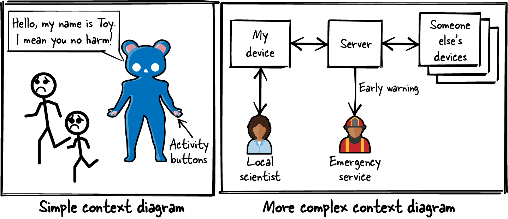
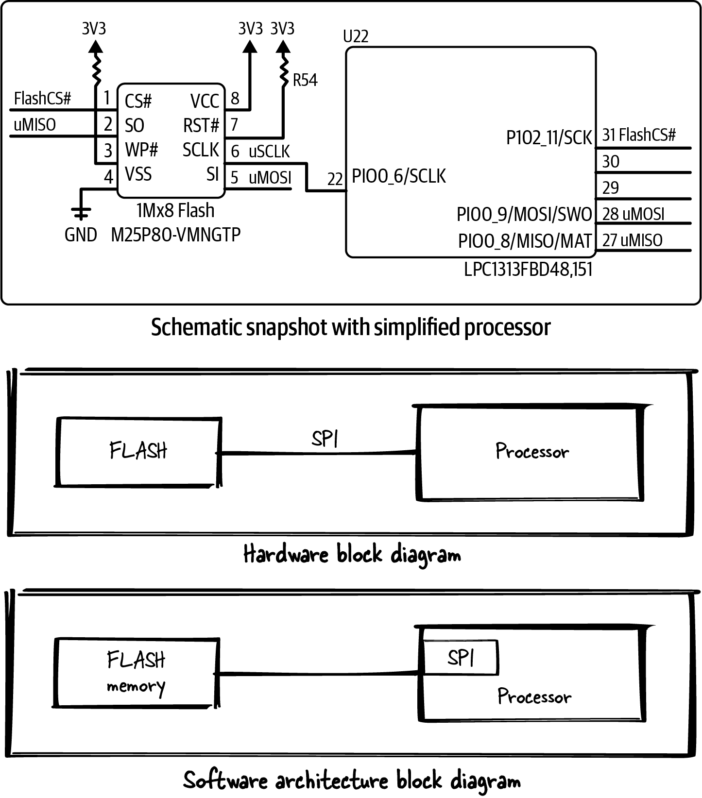
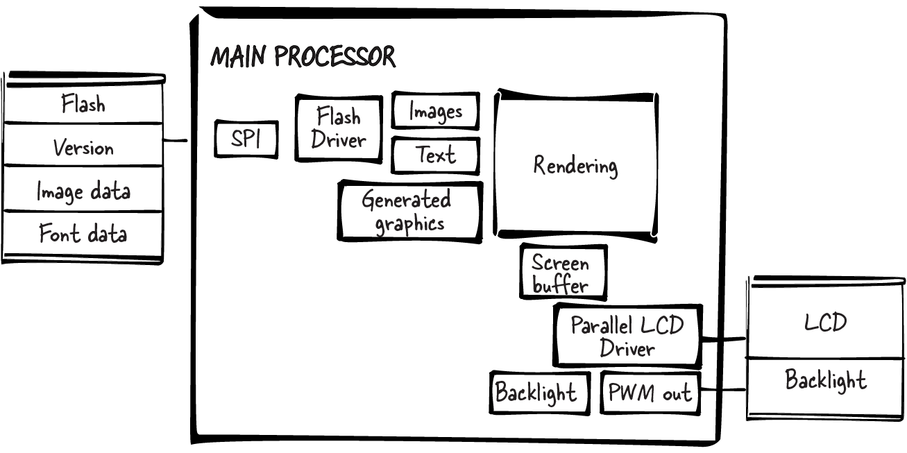
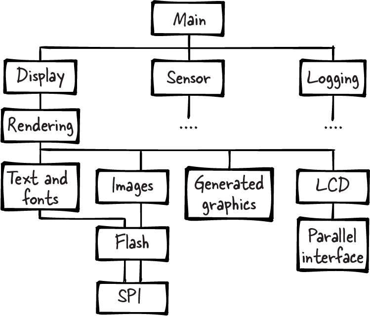
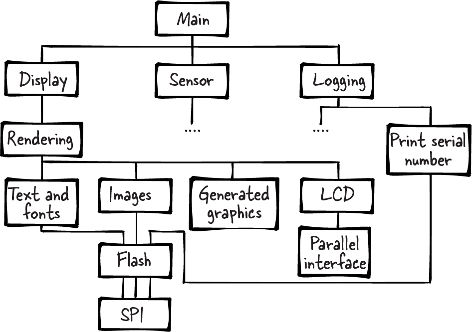
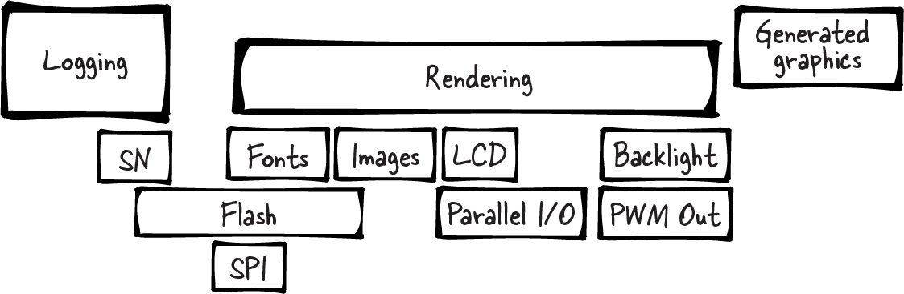
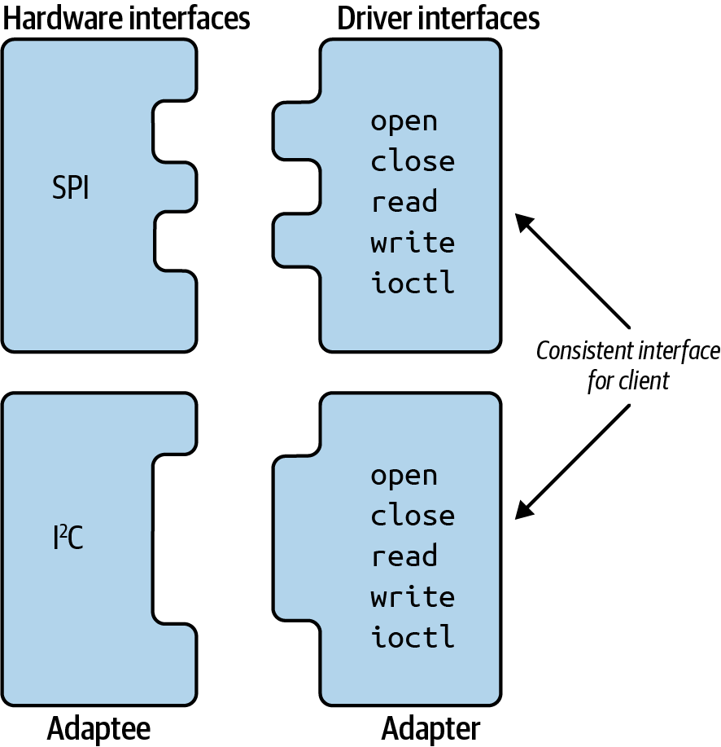
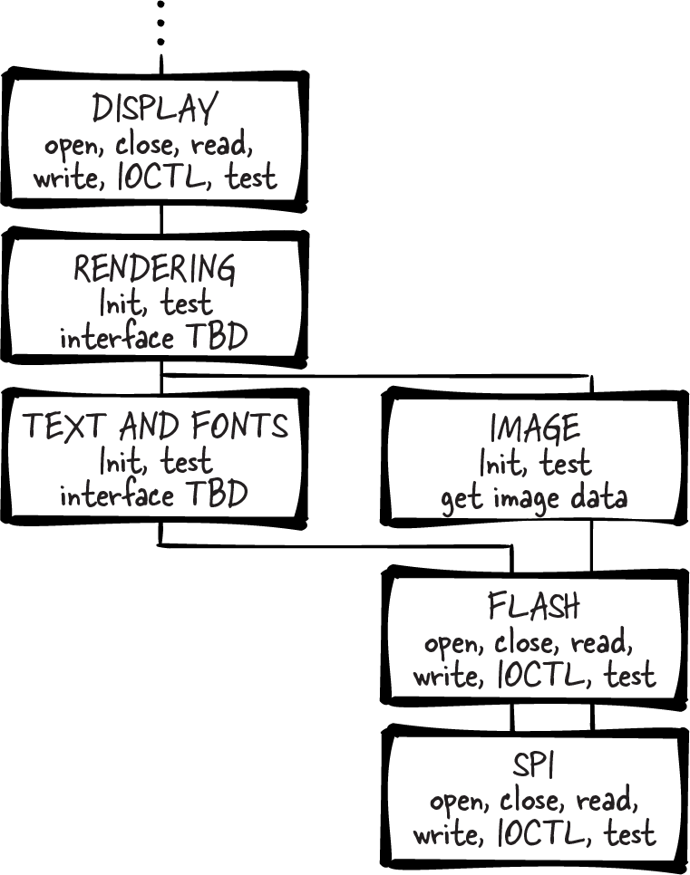
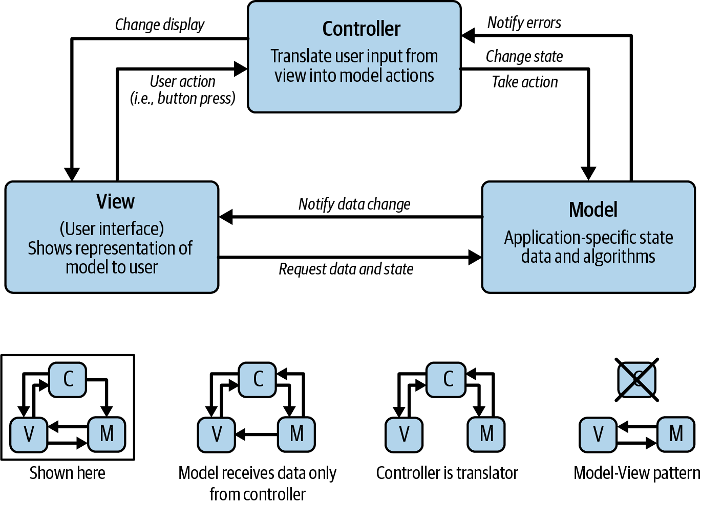
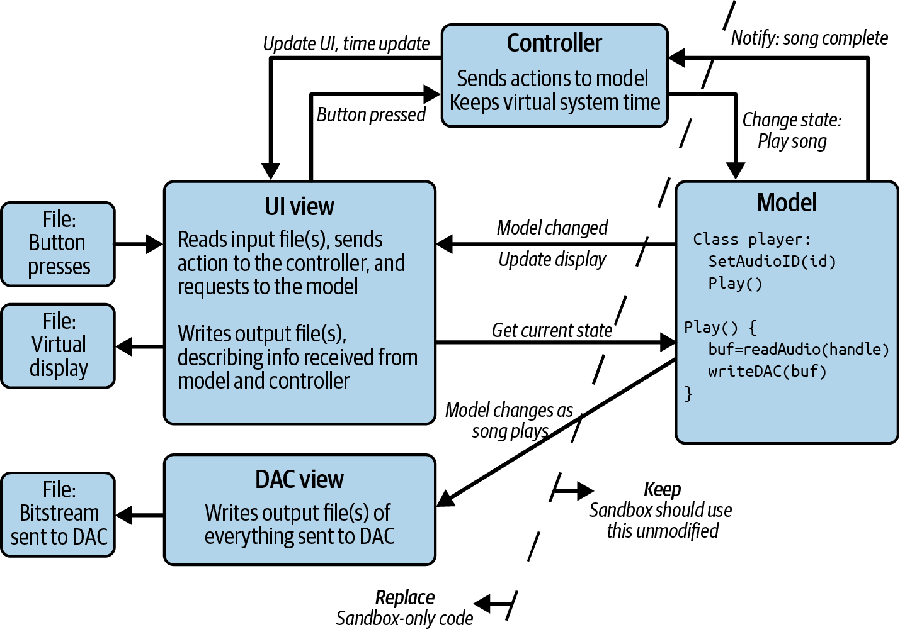

<!-- source: pdf=31; section=2; unit=p0031_b000_u00 -->

<a id="src-p31"></a>

# 第 2 章 创建系统架构 {#ch02}

<!-- source: pdf=31; section=2; unit=p0031_b001_u00 -->
即使很小的嵌入式系统（embedded system）也有大量细节，使人难以看清哪里可以应用模式。你需要对整个系统有清晰的认识，才能理解哪些部分有直接的解决办法，哪些部分藏着依赖关系。好的设计是从一个还不错的设计出发，不断改进得到的；最好在开始实现之前，就完成这些改进。系统架构图（system architecture diagram）是观察系统、开始设计软件的好方法，也能帮助你理解别人交给你的那一堆代码。

<!-- source: pdf=31; section=2; unit=p0031_b002_u00 -->
产品定义很少在一开始就固定下来，所以你可能需要反复推敲，才能把想法敲定。一旦在白板上勾勒出产品功能，就可以开始考虑软件架构。硬件工程师也在做同样的事，希望他们会与你这个软件设计者一起开展工作，尽管关注点可能稍有不同。不久之后，你就会有一份软件架构和一份原理图（schematic）草稿。根据你的经验水平，最初设计的几个项目很可能会参考其他项目，因此硬件也会在现有平台上作一些修改。

<!-- source: pdf=31; section=2; unit=p0031_b003_u00 -->
本章将从不同角度观察系统，以便设计出更好的嵌入式软件。我们会画几种图，描述系统的样子，并确定应该如何组织软件架构。除了加深对系统的理解，画图的目的还在于找出能适应需求和硬件变化的架构方法，例如封装、信息隐藏，以及在模块之间建立良好的接口。

<!-- source: pdf=31; section=2; unit=p0031_b004_u00 -->
嵌入式系统高度依赖硬件。不稳定的硬件会让软件显得缺陷百出、不可靠。我们要从这里入手，确保能够把硬件的变化与软件中的缺陷区分开来。

<!-- source: pdf=32; section=2; unit=p0032_b000_u00 -->

<a id="src-p32"></a>

也可以反过来，先考察系统功能，再确定需要什么硬件来支持它们，通常这样做还更好。不过，我主要会从与硬件交互的底层软件入手，以强调这样一点：产品依赖于稳定、可用的硬件功能。

<!-- source: pdf=32; section=2; unit=p0032_b001_u00 -->
采用这里所描述的自底向上设计时，要明白，此时指定的硬件只是概念上的典型硬件。虽然最终需要了解硬件的具体细节，但开始时可以先假定，存在某种硬件能够满足你的要求，也就是有某种处理器能够完成你需要的一切。以此为基础，先制定系统、软件和硬件架构，再深入细节。

<!-- source: pdf=32; section=2.1; unit=p0032_b002_u00 -->
## 从何入手 {#ch02-toc-001}

<!-- source: pdf=32; section=2.1; unit=p0032_b003_u00 -->
构建系统架构有两种方式。一种是从一片空白开始，只有一个想法或最终目标，其他什么都没有。这叫组合（composition）。从零开始绘制这些系统图可能令人望而生畏，空白的纸面仿佛无边无际。

<!-- source: pdf=32; section=2.1; unit=p0032_b004_u00 -->
另一种是从已有产品推导架构，拿别人组装好的东西来理解其内部。这样的逆向工程称为分解（decomposition），即把东西拆成较小的部分。加入团队时，你有时一上来就会面对迫近的截止日期、一堆代码、少得可怜的文档，而且根本没时间补写。

<!-- source: pdf=32; section=2.1; unit=p0032_b005_u00 -->
图示会帮助你理解系统。看清整体结构的能力，有助于你编写自己负责的那部分系统，并始终朝着提供优质代码、按期完成工作的目标前进。

<!-- source: pdf=32; section=2.1; unit=p0032_b006_u00 -->
你可能需要考虑绘制两张架构图：一张针对自己正在处理的代码，展示局部；另一张描述整个产品，展示全局，让你看清自己的部分如何融入其中。

<!-- source: pdf=32; section=2.1; unit=p0032_b007_u00 -->
随着理解加深，图会越来越大，对成熟设计尤其如此。如果图太复杂，就把几个框合并成一个框，再在另一张图中展开。

<!-- source: pdf=32; section=2.1; unit=p0032_b008_u00 -->
有些系统用这种图更容易理解，有些则适合另一种，这取决于原来的架构设计者如何思考他们的工作。

<!-- source: pdf=32; section=2.1; unit=p0032_b009_u00 -->
接下来几节，我会请你从头为一个系统画几种图。为了简单起见，我们不看已有系统，因为任何好的系统都比我在这里能展示的更复杂。

<!-- source: pdf=33; section=2.1; unit=p0033_b000_u00 -->

<a id="src-p33"></a>

我用草图展示这些图，是因为我也希望你这样做。不同的图，是观察系统及其可以如何构建、应该如何构建，或者实际如何构建的不同方式。我们不是在编写系统文档，而是通过这些草图，从不同角度思考系统。

<!-- source: pdf=33; section=2.1; unit=p0033_b001_u00 -->
草图不妨画得潦草一点，这样即使必须全部重来，也不至于让你想放弃。你愿意的话可以用绘图工具，不过我最喜欢的还是纸和铅笔。它们让我专注于信息，而不是画图的方法。

<!-- source: pdf=33; section=2.2; unit=p0033_b002_u00 -->
## 绘制系统图 {#ch02-toc-002}

<!-- source: pdf=33; section=2.2; unit=p0033_b003_u00 -->
就像硬件设计者绘制原理图一样，你也应该画出一系列图，展示软件各部分之间的关系。这些图能让你看到整个系统，帮助识别依赖关系，并为新功能的设计提供启发。

<!-- source: pdf=33; section=2.2; unit=p0033_b004_u00 -->
我推荐四种图：上下文图（context diagram）、框图（block diagram）、组织结构图（organigram）和分层图（layering diagram）。

<!-- source: pdf=33; section=2.2.1; unit=p0033_b005_u00 -->
### 上下文图 {#ch02-toc-003}

<!-- source: pdf=33; section=2.2.1; unit=p0033_b006_u00 -->
第一张图概述系统如何融入外部世界。如果是儿童玩具，图可能很简单：一个简笔画小人，加上玩具上的几个按钮。如果设备要为地震传感器网络提供信息，还要向当地科学家输出数据，那么系统就复杂一些，超出了你正在负责的那一部分。见图 2-1。

<!-- source: pdf=33; section=2.2.1; unit=p0033_b008_u00 -->


图 2-1 复杂程度不同的两张上下文图

图中文字：Hello, my name is Toy. I mean you no harm!＝你好，我叫玩具。我没有恶意！；Activity buttons＝活动按钮；Simple context diagram＝简单的上下文图；My device＝我的设备；Server＝服务器；Someone else’s devices＝其他人的设备；Early warning＝预警；Local scientist＝当地科学家；Emergency service＝应急服务；More complex context diagram＝更复杂的上下文图。

<!-- source: pdf=34; section=2.2.1; unit=p0034_b000_u00 -->

<a id="src-p34"></a>

这里的目标，是从宏观上呈现客户将如何使用系统。不必关心各个框里面有什么，包括你正在设计的那个框。图中应着重表现设备、用户、服务器、其他设备及其他实体之间的关系。

<!-- source: pdf=34; section=2.2.1; unit=p0034_b001_u00 -->
它要解决什么问题？系统有哪些输入和输出？用户有哪些输入和输出？整个大系统又有哪些输入和输出？把注意力放在用例和面向外部世界的交互上。

<!-- source: pdf=34; section=2.2.1; unit=p0034_b002_u00 -->
理想情况下，这种图有助于定义系统需求，并设想可能发生的变化。更现实地说，当你逐渐深入软件设计时，它能很好地提醒你不要忘记设备的目标。

<!-- source: pdf=34; section=2.2.2; unit=p0034_b003_u00 -->
### 框图 {#ch02-toc-004}

<!-- source: pdf=34; section=2.2.2; unit=p0034_b004_u00 -->
设计刚开始时很直接，因为此时考虑的是系统中的物理元素，无论是否使用面向对象语言，都可以用面向对象的方式围绕这些物理元素为软件建模。连接到处理器的每块芯片都是一个对象。连接芯片和处理器的导线，也就是通信方式，可以看作另一组对象。

<!-- source: pdf=34; section=2.2.2; unit=p0034_b005_u00 -->
设计时，先把这些元素画成框：处理器放在中间，通信对象放在处理器内部，每个外部部件都连接到某个通信对象。

<!-- source: pdf=34; section=2.2.2; unit=p0034_b006_u00 -->
在这个例子中，我将介绍一种称为闪存（flash memory）的存储器。具体细节在这里并不重要，它是一种成本相对低廉、广泛用于各种设备的存储器。许多闪存芯片通过 SPI 总线通信。SPI 是串行外设接口（Serial Peripheral Interface，通常读作“spy”），属于串行通信的一种，第 7 章会详细介绍。大多数处理器不能通过 SPI 执行代码，所以这里的闪存用作处理器外部的存储空间。图 2-2 顶部的原理图显示，我们有一块通过 SPI 与处理器连接的闪存。别被原理图吓住！第 3 章会进一步介绍。

<!-- source: pdf=34; section=2.2.2; unit=p0034_b007_u00 -->
理想情况下，电气工程师会在提供原理图的同时，附上一张硬件框图，让你简明地了解硬件。如果没有，在着手绘制软件框图的过程中，可能需要先自己画一张。

<!-- source: pdf=34; section=2.2.2; unit=p0034_b008_u00 -->
在软件框图中，我们把闪存作为一个设备加入，也就是在处理器外画一个框，再在处理器内画一个 SPI 框，表示需要编写一些 SPI 代码。在这个阶段，软件图看起来与硬件原理图非常相似，但随着我们识别出更多软件组件，两者就会逐渐不同。

<!-- source: pdf=35; section=2.2.2; unit=p0035_b001_u00 -->

<a id="src-p35"></a>



图 2-2 原理图与初步硬件、软件框图的比较

图中文字：Schematic snapshot with simplified processor＝处理器已简化的原理图片段；1Mx8 Flash＝1Mx8 闪存；FLASH／FLASH memory＝闪存；Processor＝处理器；Hardware block diagram＝硬件框图；Software architecture block diagram＝软件架构框图。SPI、3V3、GND、芯片型号、器件位号、引脚号及信号名称均按原图保留。

<!-- source: pdf=35; section=2.2.2; unit=p0035_b002_u00 -->
下一步是在处理器内增加一个闪存框，表示需要编写一些闪存专用代码。把通信方式与外部部件分开很有价值；如果有多块芯片通过同一种方式连接，它们都应该连接到处理器内同一个通信模块。此时，这张图会提醒我们，共享这项资源时要格外谨慎，考虑共享带来的性能与资源争用问题。

<!-- source: pdf=36; section=2.2.2; unit=p0036_b000_u00 -->

<a id="src-p36"></a>

图 2-2 展示了一部分原理图，以及软件框图的雏形。注意，原理图要详细得多。在设计的这个阶段，我们希望看到高层项目，以确定需要创建哪些对象，以及它们如何配合。把细节记在心里，或者另记在一张纸上，尤其是那些可能影响整个系统的细节，但尽可能不要把它们放进图里。目标是把完整系统拆成大小适中的部分，每一部分都能概括成一个框。

<!-- source: pdf=36; section=2.2.2; unit=p0036_b001_u00 -->
下一步是添加更高层的功能。每块外部芯片用来做什么？如果每块芯片只有一种用途，这很容易。例如，假设闪存用于存储要显示在屏幕上的位图，就可以在架构图中放一个框，代表显示资源（display assets）。它没有对应的片外部件，所以这个框放在处理器内部。我们还需要屏幕及其通信方式的框，以及另一个把闪存中的显示资源传给屏幕的框。在这个阶段，框宁可多一些，也不要太少。以后可以再合并。

<!-- source: pdf=36; section=2.2.2; unit=p0036_b002_u00 -->
把能想到的其他软件结构也加进去：数据库、缓冲系统、命令处理程序、算法、状态机（state machine）等。你可能还不清楚它们具体需要什么，本书后面会进一步讨论其中一些，但请尽量把从硬件到产品功能的所有内容都体现在图中。见图 2-3。

<!-- source: pdf=36; section=2.2.2; unit=p0036_b004_u00 -->


图 2-3 更详细的软件框图

图中文字：MAIN PROCESSOR＝主处理器；Flash＝闪存；Version＝版本；Image data＝图像数据；Font data＝字体数据；Flash Driver＝闪存驱动程序；Images＝图像；Text＝文本；Generated graphics＝生成的图形；Rendering＝渲染；Screen buffer＝屏幕缓冲区；Parallel LCD Driver＝并行 LCD 驱动程序；Backlight＝背光；PWM out＝PWM 输出。SPI、LCD 保留原标识。

<!-- source: pdf=36; section=2.2.2; unit=p0036_b005_u00 -->
在纸上或白板上画好这张草图后，你可能觉得已经做得够多了。说不定已经重画了好几次，因为框总是不够大，位置也总是不合适。不过，其他类型的图往往还能带来进一步的认识。

<!-- source: pdf=37; section=2.2.2; unit=p0037_b001_u00 -->

<a id="src-p37"></a>

 **提示**：如果你正试图理解现有代码库，先列出代码文件。如果文件太多，就使用目录名和库名。既然有人决定把它们组织成模块，甚至可能尝试把它们视为对象，我们就把它们画成图中的框。

<!-- source: pdf=37; section=2.2.2; unit=p0037_b002_u00 -->
这些框放在哪里、按什么顺序排列，是个难题，可能需要花一阵子才能想清楚。

<!-- source: pdf=37; section=2.2.2; unit=p0037_b003_u00 -->
观察其他类型的图，可能会暴露一些隐藏的棘手之处：关键瓶颈、没有充分理解的需求，或者设计本身就无法在预定平台上实现产品功能。这些缺陷往往只有从某一个角度才看得见，或者体现在不同图之间变化最大的那些框上。理想情况下，从合适的角度观察，就能找出难处理的模块，也能看见通向良好解决方案的道路。

<!-- source: pdf=37; section=2.2.3; unit=p0037_b004_u00 -->
### 组织结构图 {#ch02-toc-005}

<!-- source: pdf=37; section=2.2.3; unit=p0037_b005_u00 -->
下一种软件架构图是组织结构图，看起来就像公司的组织架构图。事实上，我正希望你这样理解它。上层组件像经理一样，告诉下层组件该做什么。通信并不是，也不应该是单向的！下层组件会尽其所能执行命令，提供所请求的信息，并在出现错误时通知上级。把系统看成一个层级结构，这张图展示的就是控制关系和依赖关系。

<!-- source: pdf=37; section=2.2.3; unit=p0037_b006_u00 -->
图 2-4 展示各个独立组件，以及哪些组件调用其他组件。整个系统形成层级结构，main 位于最顶层。如果已经规划好设备的算法，知道算法会如何使用各个部分，就可以在下一层填入与算法相关的对象。如果你认为它们不会变化，可以从与产品相关的功能开始，再向下延伸到已经了解的部分，把最复杂的放在上面。接着，填入被高层对象使用的底层对象。例如，SPI 对象被闪存对象使用，闪存对象又被显示资源对象使用，依此类推。这里可能需要添加一些先前没想到的部分。你还应该判断，这些部分是否也要放进框图里，多半是需要的。


<!-- source: pdf=38; section=2.2.3; unit=p0038_b001_u00 -->

<a id="src-p38"></a>



图 2-4 软件架构的组织结构图

图中文字：Main＝主程序；Display＝显示；Sensor＝传感器；Logging＝日志；Rendering＝渲染；Text and fonts＝文本与字体；Images＝图像；Generated graphics＝生成的图形；Flash＝闪存；Parallel interface＝并行接口。LCD、SPI 保留原标识。

<!-- source: pdf=38; section=2.2.3; unit=p0038_b002_u00 -->
不过，尽管我们希望一个组件只承担一种功能，比如让闪存只存放显示资源，系统在成本、速度等方面的限制却不总允许这样做。最终往往不得不把多个不怎么相容的功能塞进同一个组件或同一条通信通路。

<!-- source: pdf=38; section=2.2.3; unit=p0038_b003_u00 -->
从图中可以看出，文本和图像共享闪存驱动程序，以及它下属的 SPI 驱动程序。这样的共享往往不可避免，但也是设计中的警示信号，因为你必须特别留意，避免对资源的争用，并保证需要时资源可用。幸好，这张图表明，渲染代码同时控制两者，能够确保在任何一个时刻，只需要文本或图像中的一种资源，因此两者不太可能发生冲突。

<!-- source: pdf=38; section=2.2.3; unit=p0038_b004_u00 -->
假设团队决定，我们正在设计的系统，每台设备都需要一个序列号。序列号在制造时写入，收到请求时发送出去。我们可以再增加一块存储芯片，但这会增加成本、电路板复杂度和软件复杂度。现有闪存足够大，能放下序列号。这样，就只需要增加软件复杂度了。唉。

<!-- source: pdf=38; section=2.2.3; unit=p0038_b005_u00 -->
在图 2-5 中，我们从先前专用于显示资源的闪存中取得系统序列号，并打印出来。如果日志子系统需要以相对于显示资源访问异步的方式读取序列号，例如有两个线程，或者显示资源在中断中被使用，软件就必须避免冲突，以及由此造成的数据损坏。

<!-- source: pdf=39; section=2.2.3; unit=p0039_b002_u00 -->

<a id="src-p39"></a>



图 2-5 含共享资源的组织结构图

图中文字：Main＝主程序；Display＝显示；Sensor＝传感器；Logging＝日志；Rendering＝渲染；Text and fonts＝文本与字体；Images＝图像；Generated graphics＝生成的图形；Flash＝闪存；Parallel interface＝并行接口；Print serial number＝打印序列号。LCD、SPI 保留原标识。

<!-- source: pdf=39; section=2.2.3; unit=p0039_b003_u00 -->
每次加入类似的东西，也就是某个小部分在使用 A 和 B 时，还必须考虑与 C 的潜在交互，系统就会变得不那么稳健。这种额外需要记住的关联很难写进文档，而共享资源会在项目的设计、实现和维护阶段都带来麻烦。这里的例子用一个标志就很容易解决，但遇到任何共享资源，都应该想一想它的后果。

<!-- source: pdf=39; section=2.2.3; unit=p0039_b004_u00 -->
再回到组织架构的比喻：同时受两个上级管理的人，会面对互相矛盾的指令和优先级。虽然最好避免这种情况，但有时也需要自己作一些协调，才能应对工作的复杂性。

<!-- source: pdf=39; section=2.2.3; unit=p0039_b005_u00 -->
 **提示**：如果想理解现有代码库，可以在调试器中沿着代码走一遍，以此绘制组织结构图。从 main() 开始，逐步进入值得关注的函数，尽量不要迷失在细节里。

<!-- source: pdf=39; section=2.2.3; unit=p0039_b006_u00 -->
可能需要重复几遍，但目标是对代码流程走向哪里、如何到达那里建立直观认识。

<!-- source: pdf=40; section=2.2.4; unit=p0040_b000_u00 -->

<a id="src-p40"></a>

### 分层图 {#ch02-toc-006}

<!-- source: pdf=40; section=2.2.4; unit=p0040_b001_u00 -->
最后一种架构图用于寻找层次，并按估计的规模来表示对象，如图 2-6。这种图同样适合先用纸和铅笔来画。从纸的底部开始，为连接到处理器外部的部分画框，例如前面的通信框。如果预计其中某个部分实现起来更复杂，就把它画大一点。不确定的话，就把它们画成同样大小。

<!-- source: pdf=40; section=2.2.4; unit=p0040_b002_u00 -->
接着，在图中加入使用最底层的各个部分。如果一个底层对象被多个对象使用，这些使用者都应该与它接触，这可能意味着要把底层组件画大一些。同样，每个使用下层组件的对象，都应该尽可能与它所使用的全部组件接触。

<!-- source: pdf=40; section=2.2.4; unit=p0040_b003_u00 -->
我刚才耍了个小花招。先说对象大小应取决于复杂度，又说一个对象有多个使用者时，要把它画大。正如上一节所述，共享资源会增加复杂度。所以，当一种资源被许多东西共享时，它的框就会变大，以便接触所有上层模块。即使这个模块看起来很简单，这仍然反映了复杂度的增加。这种问题不只出现在底层。在图中，我最初把渲染框画得小得多，因为把数据从闪存搬到 LCD 很容易。但是，当渲染框必须控制下面所有零零碎碎的东西时，它就变大了。果不其然，在我提取这个例子的那个项目里，渲染最终成了一个相当大的模块，后来又拆成了两个模块。

<!-- source: pdf=40; section=2.2.4; unit=p0040_b004_u00 -->
最终，分层图会显示代码中各层的位置，让你能够把始终一起使用的资源归为一组。例如，LCD 框和并行 I/O 框只彼此接触。如果这就是最终的图，也许可以把它们合并为一个模块。背光和 PWM 输出也是一样。

<!-- source: pdf=40; section=2.2.4; unit=p0040_b005_u00 -->
也看看水平方向上的分组。字体和图像与上层、下层的连接相同。它们看起来有相同的输入和输出，因此也许应该合并为一个模块。这张图的目的，就是找到这些地方，并思考以不同方式合并框的影响。你可能因此得到一个更简单的设计。

<!-- source: pdf=40; section=2.2.4; unit=p0040_b006_u00 -->
最后，如果多个模块都试图接触同一个底层部件，也许值得花些时间，把那项资源拆开。如果有一个只处理序列号的闪存驱动程序，会有帮助吗？也许它只在初始化时读取序列号，之后再也不读，这样显示子系统就能一直掌控闪存？要理解设计的复杂度，以及可以通过哪些系统设计方案改变这种复杂度。良好的设计能在实现和维护阶段节省时间与金钱。

<!-- source: pdf=41; section=2.2.4; unit=p0041_b001_u00 -->

<a id="src-p41"></a>



图 2-6 软件架构分层图

图中文字：Logging＝日志；Rendering＝渲染；Generated graphics＝生成的图形；SN＝序列号；Fonts＝字体；Images＝图像；Backlight＝背光；Flash＝闪存；Parallel I/O＝并行 I/O；PWM Out＝PWM 输出。LCD、SPI 保留原标识。

<!-- source: pdf=41; section=2.3; unit=p0041_b002_u00 -->
## 为变化而设计 {#ch02-toc-007}

<!-- source: pdf=41; section=2.3; unit=p0041_b003_u00 -->
现在，面前摆着不同的架构图，接下来该往哪里走？也许你已经发现，有几段代码是起初没有想到的。也许你对模块之间如何交互也有了更多认识。在考虑这些交互，也就是接口之前，还有一件非常值得花时间的事：什么会发生变化？在这个阶段，一切都处于试验状态，因此这幅系统拼图中的任何一块都有可能改变。不过，我们的目标，是让最初的架构和代码能够更好地承受系统功能或实际硬件可能发生的变化。

<!-- source: pdf=41; section=2.3; unit=p0041_b004_u00 -->
根据产品需求，你可能有把握认为系统的某些功能不会改变。我们的示例无论用来做什么，都需要显示屏，而向显示屏提供位图的最好办法似乎是使用闪存。许多闪存芯片采用 SPI，所以采用 SPI 看起来也是个稳妥的选择。不过，究竟采用哪块闪存芯片，很可能会变。LCD、图像或字体数据也可能改变，甚至存储图像或字体数据的方式也可能改变。图中的框应该表示每种事物的柏拉图式理想形态，而不是某种具体实现。

<!-- source: pdf=41; section=2.3.1; unit=p0041_b005_u00 -->
### 封装模块 {#ch02-toc-008}

<!-- source: pdf=41; section=2.3.1; unit=p0041_b006_u00 -->
绘图过程会引导我们得到不具体依赖所连接模块的内容或行为的接口，这就是封装（encapsulation）！我们利用不同的架构图，找出最适合设置这些接口的位置。每个框很可能都有自己的接口。也许可以把它们揉成一个对象，但有什么充分理由现在就这样做，而不是留到以后呢？

<!-- source: pdf=41; section=2.3.1; unit=p0041_b007_u00 -->
有时确实有。如果能够在不过多牺牲未来灵活性的前提下，降低图中的复杂度，那么合并某些依赖树也许值得。

<!-- source: pdf=42; section=2.3.1; unit=p0042_b000_u00 -->

<a id="src-p42"></a>

以下是一些值得留意的地方：

<!-- source: pdf=42; section=2.3.1; unit=p0042_b001_u00 -->
- 在组织结构图中，寻找只被另一个对象使用的对象。两者都是固定的吗？如果它们不太可能改变，或者在系统演进时很可能一起改变，可以考虑合并。如果它们会独立变化，就不适合考虑将它们封装在一起。

<!-- source: pdf=42; section=2.3.1; unit=p0042_b002_u00 -->
- 在分层图中，寻找始终一起使用的对象集合。能否把它们组织到更高层的接口下，由该接口管理这些对象？这样就建立了一个硬件抽象层（hardware abstraction layer）。

<!-- source: pdf=42; section=2.3.1; unit=p0042_b003_u00 -->
- 哪些模块有大量相互依赖？能否把它们拆开并简化？或者，能否把这些依赖关系归为一组？

<!-- source: pdf=42; section=2.3.1; unit=p0042_b004_u00 -->
- 上下相邻模块之间的接口，能否用几句话描述清楚？如果可以，这就是适合进行封装、建立接口的地方，无论是为了让别人重用你的代码，还是为了方便测试。

<!-- source: pdf=42; section=2.3.1; unit=p0042_b005_u00 -->
在示例系统中，LCD 连接到并行接口。在每一张图里，它都很简单，没有额外依赖，也没有其他子系统需要访问并行接口。你不必公开并行接口，可以把它封装，也就是隐藏在 LCD 模块内部。

<!-- source: pdf=42; section=2.3.1; unit=p0042_b006_u00 -->
反过来，设想系统没有渲染模块来封装显示子系统。分层图也许最能说明问题，见图 2-5。字体、图像、LCD 和背光都会试图彼此接触，把图搞得一团糟。

<!-- source: pdf=42; section=2.3.1; unit=p0042_b007_u00 -->
最后留下的每个框，都很可能成为一个模块或对象。看看这张图，怎样才能让它更简单？软件中的封装会使架构图更清晰，反过来也一样。

<!-- source: pdf=42; section=2.3.2; unit=p0042_b008_u00 -->
### 任务委派 {#ch02-toc-009}

<!-- source: pdf=42; section=2.3.2; unit=p0042_b009_u00 -->
这些图还可以帮助你拆分工作，把它们分派给帮手。系统中哪些部分可以拆成独立、可描述的单元，交给别人实现？

<!-- source: pdf=42; section=2.3.2; unit=p0042_b010_u00 -->
我们往往希望帮手去做枯燥的工作，把所有有趣的部分留给自己。“来，小跟班，写好我的测试代码，补好我的文档，再把我的衣服叠了。”这不仅会赶走优秀的帮手，还往往会降低产品质量。相反，要考虑可以把哪个完整的框，或者哪棵完整的子树，交给别人。当你试着向想象中的帮手说明相互依赖关系时，可能会发现，它们比图中表现的还糟。也可能发现，一个简单的标志，例如信号量（semaphore），用来表示当前是谁拥有资源，就足以让工作起步。

<!-- source: pdf=43; section=2.3.2; unit=p0043_b002_u00 -->

<a id="src-p43"></a>

 **提示**：如果根本不可能有帮手呢？仍然应该走一遍这个思考过程。你要尽可能减少相互依赖，这可能会促使你重新设计系统。而对于无法减少的相互依赖，至少在编写代码时可以保持警惕。

<!-- source: pdf=43; section=2.3.2; unit=p0043_b003_u00 -->
寻找可以拆出来交给别人完成的部分，有助于识别哪些代码之间可以建立简单接口。而且，当市场部门问怎样才能加快这个项目时，你也已经准备好了答案。不过，想象中的帮手还提供了另一点帮助：假设对方能力略有不足，你需要保护自己和自己的代码，不受这个不太靠谱的帮手写出的糟糕代码影响。

<!-- source: pdf=43; section=2.3.2; unit=p0043_b004_u00 -->
你能设想在模块之间建立怎样的防御结构？想象一下模块之间传递的数据。在框与框，或者框组与框组之间，最少需要传递多少数据？把一个框加入某个组，是否意味着传递的数据会显著减少？怎样存储数据，才能既保证安全，又让所有需要它的部分都能使用？

<!-- source: pdf=43; section=2.3.2; unit=p0043_b005_u00 -->
尽量减少框与框之间，或者至少框组与框组之间的复杂度，会让项目更加顺利。帮手们的工作越能限定在各自的代码范围内，接口越清楚，大家就越容易独立测试和开发自己的代码。

<!-- source: pdf=43; section=2.3.3; unit=p0043_b006_u00 -->
### 驱动程序接口：Open、Close、Read、Write、IOCTL {#ch02-toc-010}

<!-- source: pdf=43; section=2.3.3; unit=p0043_b007_u00 -->
上一节从自顶向下的角度看待模块接口，训练你考虑封装，并思考哪些地方可以获得他人的帮助。自底向上也同样可行。这里的底层，是与硬件通信的模块，也就是驱动程序（driver）。

<!-- source: pdf=43; section=2.3.3; unit=p0043_b008_u00 -->
 **说明**：自顶向下设计，是先考虑想要什么，再深入探究实现目标需要什么。自底向上设计，是先考虑手头有什么，再以此构建能够构建的东西。

<!-- source: pdf=43; section=2.3.3; unit=p0043_b009_u00 -->
通常，我最终会把两者结合起来使用：悠悠球式设计。

<!-- source: pdf=43; section=2.3.3; unit=p0043_b010_u00 -->
嵌入式系统中的许多驱动程序，都以 Unix 系统中调用设备所用的 POSIX API 为基础。为什么？因为这种模型在许多情形下都很好用，能让你不必每次访问硬件时都重新发明轮子。

<!-- source: pdf=44; section=2.3.3; unit=p0044_b001_u00 -->

<a id="src-p44"></a>

Unix 驱动程序的接口很直接：

<!-- source: pdf=44; section=2.3.3; unit=p0044_b002_u00,p0044_b002_u01 -->
- open：打开驱动程序以供使用。与 init 类似，有时也由 init 代替。

<!-- source: pdf=44; section=2.3.3; unit=p0044_b003_u00,p0044_b003_u01 -->
- close：使用完后清理驱动程序。

<!-- source: pdf=44; section=2.3.3; unit=p0044_b004_u00,p0044_b004_u01 -->
- read：从设备读取数据。

<!-- source: pdf=44; section=2.3.3; unit=p0044_b005_u00,p0044_b005_u01 -->
- write：向设备发送数据。

<!-- source: pdf=44; section=2.3.3; unit=p0044_b006_u00 -->
- ioctl，读作“eye-octal”或“eye-oh-control”：表示输入／输出（I/O）控制，用来处理接口其他部分未涵盖的功能。由于缺乏结构，内核程序员对它的使用多少有些不赞成，但它仍然很流行。

<!-- source: pdf=44; section=2.3.3; unit=p0044_b007_u00 -->
在 Unix 中，驱动程序是内核的一部分。上述每个函数都会接收一个带有文件描述符的参数，文件描述符代表对应的驱动程序，例如 /dev/tty01 表示系统中的第一个终端。对于没有操作系统的嵌入式系统，这样做相当笨重。我们的思路，是参照 Unix 驱动程序来组织自己的驱动程序。嵌入式系统设备的功能示例，可能采用下面任意一种形式：[^ch02-1]

<!-- source: pdf=44; section=2.3.3; unit=p0044_b008_u00 -->
- `spi.open()`

<!-- source: pdf=44; section=2.3.3; unit=p0044_b009_u00 -->
- `spi_open()`

<!-- source: pdf=44; section=2.3.3; unit=p0044_b010_u00 -->
- `SpiOpen(WITH_LOCK)`

<!-- source: pdf=44; section=2.3.3; unit=p0044_b011_u00 -->
- `spi.ioctl_changeFrequency(THIRTY_MHz)`

<!-- source: pdf=44; section=2.3.3; unit=p0044_b012_u00 -->
- `SpiIoctl(kChangeFrequency, THIRTY_MHz)`

<!-- source: pdf=44; section=2.3.3; unit=p0044_b013_u00 -->
这种接口能理顺驱动程序层面可能出现的别扭之处，让驱动程序不那么依赖具体应用，从而形成可重用代码。此外，别人接触你的代码时，如果看到驱动程序具备这些函数，就会知道该期待什么。

<!-- source: pdf=44; section=2.3.3; unit=p0044_b000_u00 -->
[^ch02-1]: 风格很重要。编码规范能够节省调试时间，也不会扼杀你的创造力。如果还没有风格指南，可以看看 Google 为开源项目推荐的指南，搜索“Google Style Guides”即可。它们对各种选择背后原因的解释，也许能帮助你制定自己的指南。

<!-- source: pdf=45; section=2.3.3; unit=p0045_b001_u00 -->

<a id="src-p45"></a>

 Unix 的驱动程序模型有时还包含两个较新的函数。第一个是 select，或者 poll，它等待设备改变状态。以前，这种功能通过读到空数据，或者轮询 ioctl 消息来实现，现在则有了自己的函数。第二个是 mmap，它控制驱动程序与调用它的代码共享的存储器映射。

<!-- source: pdf=45; section=2.3.3; unit=p0045_b002_u00 -->
如果你的圆榫塞不进这个符合 POSIX 的方孔，就别硬塞。不过，如果看起来有可能适合，从这个标准接口开始，能让设计稍微更好一些，也更容易维护。

<!-- source: pdf=45; section=2.3.4; unit=p0045_b003_u00 -->
### 适配器模式 {#ch02-toc-011}

<!-- source: pdf=45; section=2.3.4; unit=p0045_b004_u00 -->
有一种传统的软件设计模式，称为适配器（adapter），有时也称包装器（wrapper）。它把对象的接口转换成更方便客户端，也就是更高层模块使用的接口。适配器经常写在软件 API 之上，用来隐藏难用的接口或可能变化的库。

<!-- source: pdf=45; section=2.3.4; unit=p0045_b005_u00 -->
许多硬件接口就像笨拙的软件接口。因此，每个驱动程序都是适配器，如图 2-7。如果为驱动程序建立统一接口，即使不是 open、close、read、write、ioctl 这一套，硬件接口变化时，上层软件也可以不变。理想情况下，即使完全换个平台，也只需要重新实现底层基础部分。

<!-- source: pdf=45; section=2.3.4; unit=p0045_b007_u00 -->


图 2-7 驱动程序实现适配器模式

图中文字：Hardware interfaces＝硬件接口；Driver interfaces＝驱动程序接口；Consistent interface for client＝面向客户端的一致接口；Adaptee＝被适配者；Adapter＝适配器。SPI、I²C 及 open、close、read、write、ioctl 接口名称保留原文。

<!-- source: pdf=46; section=2.3.4; unit=p0046_b000_u00 -->

<a id="src-p46"></a>

注意，驱动程序可以叠加，如图 2-7。在我们的示例中，显示功能使用闪存，而闪存又使用 SPI 通信。当你为显示模块调用 open 时，它会调用各个子系统的初始化代码，后者调用闪存的 open，再由闪存调用 SPI 驱动程序的 open。这里有三层适配器，都是为了可移植性和可维护性。

<!-- source: pdf=46; section=2.3.4; unit=p0046_b001_u00 -->
分层和适配器会增加实现的复杂度，也可能需要更多存储器，或为代码增加延迟。这是一种取舍。付出一点代价，你就能得到更简单的架构，以及良好的可维护性、可测试性、可移植性等。除非系统的资源极其受限，否则通常很值得。

<!-- source: pdf=46; section=2.3.4; unit=p0046_b002_u00 -->
如果各层接口保持一致，高层代码就基本不受变化影响。例如，如果 SPI 闪存换成 I²C EEPROM，也就是换了通信总线和存储器类型，显示驱动程序可能完全不需要修改，或者只需把闪存函数换成 EEPROM，即电可擦可编程只读存储器（electrically erasable programmable read-only memory）的函数。

<!-- source: pdf=46; section=2.3.4; unit=p0046_b003_u00 -->
在图 2-8 中，我给每个模块的接口都加了一个名为 test 的函数。第 3 章会讨论选择自动化测试的一些策略，让代码更加稳健。现在，这些函数还只是占位。

<!-- source: pdf=46; section=2.3.4; unit=p0046_b005_u00 -->


图 2-8 显示子系统及其下层模块的接口

图中文字：DISPLAY＝显示；RENDERING＝渲染；TEXT AND FONTS＝文本与字体；IMAGE＝图像；FLASH＝闪存；interface TBD＝接口待定；get image data＝获取图像数据。SPI 以及 open、close、read、write、IOCTL、Init、test 函数名称保留原文。

<!-- source: pdf=47; section=2.4; unit=p0047_b002_u00 -->

<a id="src-p47"></a>

## 创建接口 {#ch02-toc-012}

<!-- source: pdf=47; section=2.4; unit=p0047_b003_u00 -->
离开驱动程序之后，模块接口如何定义，取决于系统的具体情况。可以相当有把握地说，大多数模块也需要初始化函数，尽管驱动程序通常用 open 来做这件事。初始化可能在启动期间实例化对象时进行，也可能通过系统初始化时调用的函数来完成。为了保持模块的封装性，并让它们更容易重用，高层函数应负责初始化它们所依赖的模块。如果多个子系统会使用某个 init 函数，一个好的 init 函数应当能够被多次调用。一个非常好的 init 函数，还能在系统部分失效时，把子系统或硬件资源恢复到已知的正常状态。

<!-- source: pdf=47; section=2.4; unit=p0047_b004_u00 -->
现在，面前已经不再是一片空白，为各个框补全接口也许会容易一些。考虑怎样保持自己模块的封装性，考虑假想帮手所负责的部分和驱动程序模型，然后开始明确架构图中每个框的职责。

<!-- source: pdf=47; section=2.4; unit=p0047_b005_u00 -->
 **提示**：既然已经绘制了不同视角的架构图，你大概不会想把每张图都一直维护下去。补充接口时，可以专注于对自己最有用的那一张，或者对上司或帮手来说最清楚的那一张。

<!-- source: pdf=47; section=2.5; unit=p0047_b006_u00 -->
## 示例：日志接口 {#ch02-toc-013}

<!-- source: pdf=47; section=2.5; unit=p0047_b007_u00 -->
日志模块的目标，是实现一个稳健、可重用的日志系统。本节先定义接口需求，再探讨接口及其局部存储的一些方案。采用什么通信方式并不重要。面对限制时仍面向接口编程，就为将来在其他系统中重用代码保留了可能。

<!-- source: pdf=47; section=2.5; unit=p0047_b008_u00 -->
 **警告**：记录调试输出可能显著拖慢处理器。如果开启和关闭日志时，代码行为发生变化，要考虑各个子系统的时序是如何相互配合的。

<!-- source: pdf=47; section=2.5; unit=p0047_b009_u00 -->
具体实现取决于系统。有时，你能做的最好办法，就是翻转一根连接着 LED 的 I/O 线，用摩尔斯电码发送消息，我可没开玩笑。不过，大多数时候，还是可以把文本调试消息写到某个接口。让系统易于调试，是让它易于维护的一部分。即使你的代码完美无缺，后来接手的人添加新需求时，也未必有这么好的运气。日志子系统不仅能在开发期间帮助你，在维护期间也是极为宝贵的工具。

<!-- source: pdf=48; section=2.5; unit=p0048_b000_u00 -->

<a id="src-p48"></a>

好的日志接口会隐藏实际记录日志的细节，使你能够隐藏变化和复杂度。日志需求可能随着开发周期而变化。例如，在初期，开发套件可能有一个额外串口，可以把日志信息传到计算机上。到了后期，这个串口可能不再可用，于是你不得不把输出缩减到一两个 LED。

<!-- source: pdf=48; section=2.5; unit=p0048_b001_u00 -->
系统行为古怪时，我有时真希望能与它彻底心意相通。可惜，资源永远不足以输出你想看到的一切。此外，随着产品开发推进，记录日志的方法也可能改变。在这个地方，你应该把会变化的部分封装起来，隐藏那些由主接口调用的函数。增加的少量开销，会换来更大的灵活性。只要能面向接口编程，底层通道的变化就无关紧要。

<!-- source: pdf=48; section=2.5; unit=p0048_b002_u00 -->
通常，你希望通过一条相对狭窄的通道输出大量信息。系统越大，这条通道就显得越小。通道可能是连接到计算机的简单串口，也可能是必须借助特殊硬件才能使用的路径；可能是通过网络发送的一种特殊调试数据包。数据也可能存储在外部 RAM 中，只有暂停处理器后，才能通过 JTAG 读取。日志可能只有在开发套件上运行时才可用，在定制硬件上却没有。因此，这个模块的第一个主要需求是：日志接口应能支持不同的底层实现。

<!-- source: pdf=48; section=2.5; unit=p0048_b003_u00 -->
第二，一次处理系统中的某个部分时，你可能不需要，也不想看到其他部分的消息。因此，日志方法应能针对不同子系统分别处理。当然，其他子系统出现灾难性问题时，你仍然需要知道。

<!-- source: pdf=48; section=2.5; unit=p0048_b004_u00 -->
第三个需求是优先级，它能让你调试当前子系统的细枝末节，同时又不漏掉代码其他部分的关键信息。

<!-- source: pdf=48; section=2.5.1; unit=p0048_b005_u00 -->
### 从需求到接口

<!-- source: pdf=48; section=2.5.1; unit=p0048_b006_u00 -->
定义模块的主要接口需求，往往就已经足够，尤其在设计阶段。不过，前面这么多文字，其实可以用一行代码概括：

<!-- source: pdf=48; section=2.5.1; unit=p0048_b007_u00 -->
```c
void Log(enum eLogSubSystem sys, enum eLogLevel level, char *msg);
```

<!-- source: pdf=48; section=2.5.1; unit=p0048_b008_u00 -->
这个函数原型不是一成不变的，可能随着接口的发展而改变，但它为其他开发者提供了一种有用的简洁表达。

<!-- source: pdf=48; section=2.5.1; unit=p0048_b009_u00 -->
日志级别可以包括不记录、仅信息、调试、警告、错误和严重错误。子系统则取决于你的系统，可能包括通信、显示、系统、传感器、固件更新等。

<!-- source: pdf=49; section=2.5.1; unit=p0049_b000_u00 -->

<a id="src-p49"></a>

注意，这里的日志消息接收一个字符串，不像 printf 或 iostream 那样接收可变参数。如果有需要，总可以用库提供类似的格式化功能，甚至可变参数功能。然而，当系统需要腾出更多代码空间和存储器时，printf 和 iostream 系列函数往往最先被裁掉。如果是这种情况，你最终很可能要自行实现最需要的功能，因此这个接口应只包含最低限度的必需内容。除了打印字符串，通常还需要至少能够一次打印一个数字：

<!-- source: pdf=49; section=2.5.1; unit=p0049_b001_u00 -->
```c
void LogWithNum(enum eLogSubSystem sys, enum eLogLevel level, char *msg, 
int number);
```

<!-- source: pdf=49; section=2.5.1; unit=p0049_b002_u00 -->
使用子系统标识符和优先级，可以远程更改调试选项，前提是系统允许这样做。调试某个问题时，可以先把所有子系统设为输出详细信息的优先级，例如 debug；排除某个子系统的问题后，再提高它的优先级，例如 error。这样，就能在需要时收到想要的消息。因此，我们需要一个接口，允许按子系统和优先级进行灵活配置：

<!-- source: pdf=49; section=2.5.1; unit=p0049_b003_u00 -->
```c
void LogSetOutputLevel(enum eLogSubSystem sys, enum eLogLevel level)
```

<!-- source: pdf=49; section=2.5.1; unit=p0049_b004_u00 -->
调用方代码既然不关心底层实现，就不应该能够直接访问它。所有日志功能都应通过这个日志接口。理想情况下，底层接口不会与其他模块共享；如果并非如此，架构图会告诉你。日志初始化函数应调用它所依赖的一切，无论是初始化串口驱动程序，还是设置 I/O 线。

<!-- source: pdf=49; section=2.5.1; unit=p0049_b005_u00 -->
因为日志可能改变系统时序，有时需要从全局关闭日志系统。这样，你就能比较有把握地说，调试子系统没有以任何方式干扰代码的其他部分。虽然可能不常用，但在接口中加入一个开关非常有价值：

<!-- source: pdf=49; section=2.5.1; unit=p0049_b006_u00 -->
```c
void LogGlobalOn();
void LogGlobalOff();
```

<!-- source: pdf=49; section=2.5.version; unit=p0049_b007_u00 -->
### 为代码标注版本

<!-- source: pdf=49; section=2.5.version; unit=p0049_b008_u00 -->
总有一天，会有人需要准确知道当前运行的是哪个修订版本的代码。在应用软件领域，把版本字符串放在“帮助／关于”对话框里很简单。在嵌入式领域，应能通过主要通信通道获取版本，例如 USB、WiFi、UART 或其他总线。如果可能，应该在启动时自动打印版本。如果做不到，就尽量提供查询。如果连查询也做不到，就应该把版本编译到单独的目标文件中，放在指定地址，以便检查。

<!-- source: pdf=50; section=2.5.version; unit=p0050_b000_u00 -->

<a id="src-p50"></a>

考虑采用语义化版本（semantic versioning），版本形式为 A.B.C.：

<!-- source: pdf=50; section=2.5.version; unit=p0050_b001_u00 -->
- A 是主版本号（1 字节）。

<!-- source: pdf=50; section=2.5.version; unit=p0050_b002_u00 -->
- B 是次版本号（1 字节）。

<!-- source: pdf=50; section=2.5.version; unit=p0050_b003_u00 -->
- C 是构建标识（2 字节）。

<!-- source: pdf=50; section=2.5.version; unit=p0050_b004_u00 -->
如果构建标识不会自动递增，你就应该经常手动增加，数字不值钱。根据输出方式和系统的显示风格，你可能想给日志代码增加一个接口，妥当地显示版本：

<!-- source: pdf=50; section=2.5.version; unit=p0050_b005_u00 -->
```c
void LogVersion(struct sFirmwareVersion *v)
```

<!-- source: pdf=50; section=2.5.version; unit=p0050_b006_u00 -->
系统中应当带版本的不只是运行代码。每个单独构建或更新的部分，都应该有一个版本，并将它纳入协议。例如，如果 EEPROM 在制造过程中被编程，里面就应该有版本信息，代码在使用 EEPROM 之前应检查它。有时，你没有足够的空间或处理能力让系统向后兼容，但务必保证各个组成部分当前能够相互兼容。

<!-- source: pdf=50; section=2.5.1; unit=p0050_b007_u00 -->
其他子系统的设计并不依赖，也不应该依赖日志究竟如何实现。如果你也能对自己的模块接口作出这样的描述：“其他子系统不依赖 XYZ 的实现方式，只调用规定的接口”，那么你就成功设计了系统接口。

<!-- source: pdf=50; section=2.5.2; unit=p0050_b008_u00 -->
### 日志模块的状态

<!-- source: pdf=50; section=2.5.2; unit=p0050_b009_u00 -->
设计架构时，有些部分比其他部分更容易定义，尤其是你以前做过类似东西的时候。定义接口时，也许灵感会突然涌现，让你觉得实现起来会很容易，甚至很有趣，但前提是立刻动手。

<!-- source: pdf=50; section=2.5.2; unit=p0050_b010_u00 -->
产生这种直接投入实现的冲动时，先稍微克制一下，尽量让所有部分保持在相同的推进程度。如果在定义另一个模块的接口之前，就把一个模块精雕细琢到极致，可能会发现两者不怎么合得来。

<!-- source: pdf=50; section=2.5.2; unit=p0050_b011_u00 -->
等系统的所有模块都再推进一些，就可以考虑各个模块所关联的状态了。一般来说，模块保存的状态越少越好，这样每次调用函数时，它们就会做同样的事。然而，完全消除所有状态通常是不可避免的，或者至少极其繁琐。〔待确认：原文为“eliminating all state is generally unavoidable”，其“不可避免”与上下文存在语义矛盾，译文未擅自修正。〕

<!-- source: pdf=50; section=2.5.2; unit=p0050_b012_u00 -->
回到日志模块：你能看出它需要哪些内部状态吗？LogGlobalOn 和 LogGlobalOff 分别设置和清除同一个变量。LogSetOutputLevel 则需要为每个子系统保存一个级别。

<!-- source: pdf=51; section=2.5.2; unit=p0051_b001_u00 -->

<a id="src-p51"></a>

实现这些变量有几种选择。如果希望消除局部状态，可以把它们放进一个结构体或对象，所有调用日志模块的函数都需要持有它。不过，这意味着必须把日志对象传给每个可能需要记录日志的函数，还要传给每个会调用需要记录日志的函数的函数。

<!-- source: pdf=51; section=2.5.2; unit=p0051_b002_u00 -->
 你可能觉得，这样把状态传来传去太绕了。对于日志，我也同意。不过，你有没有想过，代码打开文件时返回的文件句柄里面究竟是什么？打开的文件包含大量状态信息，包括当前读写位置、缓冲区，以及指向文件在驱动器上所在位置的句柄。

<!-- source: pdf=51; section=2.5.2; unit=p0051_b003_u00 -->
也许，把这些参数到处传递并不是个好主意。怎样才能让日志子系统的每个使用者都能访问它？正如“用 C 进行面向对象编程”旁栏所述，只要多做一点工作，即使 C 也能创建对象，使这个参数传递问题更简单。即便使用更面向对象的语言，也可以让模块中的函数全局可用，把状态保存在局部对象中。不过，还有另一种办法，可以在不完全敞开模块的情况下，让人访问日志对象。

<!-- source: pdf=51; section=2.5.cobjects; unit=p0051_b004_u00 -->
### 用 C 进行面向对象编程

<!-- source: pdf=51; section=2.5.cobjects; unit=p0051_b005_u00 -->
为什么不用 C++？大多数系统都有相当不错的嵌入式 C++ 编译器。不过，已经有大量代码是用 C 写成的，有时你需要与现有代码保持一致。又或者，你就是喜欢 C 的速度。这并不意味着应该抛开面向对象原则。

<!-- source: pdf=51; section=2.5.cobjects; unit=p0051_b006_u00 -->
最重要、最应保留的理念之一，是数据隐藏。在面向对象语言中，对象或类可以包含私有变量。这是委婉的说法，意思是它们拥有其他人看不到的内部状态。C 中有不同类型的全局变量。通过适当设置变量作用域，可以模仿私有变量的概念，甚至可以模仿友元对象。先从 C 中相当于公有变量的形式开始：在函数外声明，通常位于 C 文件顶部：

<!-- source: pdf=51; section=2.5.cobjects; unit=p0051_b007_u00 -->
```c
// Anyone can see this global if they have 
// "extern tBoolean gLogOnPublic;"
tBoolean gLogOnPublic;
```

<!-- source: pdf=51; section=2.5.cobjects; unit=p0051_b008_u00 -->
意大利面条式代码，就是建立在这样的全局变量之上的。尽量避免使用它们。私有变量使用 static 关键字声明，也是在函数外，通常位于 C 文件顶部：

<!-- source: pdf=51; section=2.5.cobjects; unit=p0051_b009_u00 -->
```c
// file variables are globals with some encapsulation
static tBoolean gLogOnPrivate;
```

<!-- source: pdf=52; section=2.5.cobjects; unit=p0052_b001_u00 -->

<a id="src-p52"></a>

 static 关键字在不同位置含义不同，这一点其实挺烦人的。对于函数和函数外的变量，它的意思是“把我藏起来，别让其他文件看见”，并限制作用域。对于函数内部的变量，static 会在两次调用之间保留它的值，就像一个作用域仅限于声明它的函数的全局变量。

<!-- source: pdf=52; section=2.5.cobjects; unit=p0052_b002_u00 -->
一组零散变量有些难以管理，因此可以考虑用一个结构体，把模块的私有变量装在一起：

<!-- source: pdf=52; section=2.5.cobjects; unit=p0052_b003_u00 -->
```c
// contain all the global variables into a structure:
struct {
  tBoolean logOn;
  enum eLogLevel outputLevel[NUM_LOG_SUBSYSTEMS];
} sLogStruct;
static struct sLogStruct gLogData;
```

<!-- source: pdf=52; section=2.5.cobjects; unit=p0052_b004_u00 -->
如果希望 C 代码更像对象，这个结构体就不应直接作为模块的一部分，而应在初始化期间创建，也就是通过 malloc 分配，对于本章讨论的日志系统，就是在 LogInit 中完成，然后像下面这样返回给调用者：

<!-- source: pdf=52; section=2.5.cobjects; unit=p0052_b005_u00 -->
```c
struct sLogStruct* LogInit(){
  int i;
  struct sLogStruct *logData = malloc(sizeof(*logData));
  logData->logOn = FALSE;
  for (i=0; i < NUM_LOG_SUBSYSTEMS; i++) {
    logData-> outputLevel[i] = eNoLogging;
  }
  return logData;
}
```

<!-- source: pdf=52; section=2.5.cobjects; unit=p0052_b006_u00 -->
这个结构体可以像对象一样传来传去。当然，还需要提供释放对象的方法，只要再往接口中加一个函数就行。

<!-- source: pdf=52; section=2.5.3; unit=p0052_b007_u00 -->
### 模式：单例

<!-- source: pdf=52; section=2.5.3; unit=p0052_b008_u00 -->
要确保系统的每个部分都能访问同一个日志对象，还可以使用另一种设计模式：单例（singleton）。

<!-- source: pdf=52; section=2.5.3; unit=p0052_b009_u00 -->
当一个类必须恰好只有一个实例时，通常会使用单例模式。在面向对象语言中，单例负责拦截创建新对象的请求，以维持自身的唯一性。资源可以被全局访问，任何人都能使用，但所有访问都经过这个唯一实例。它没有公有构造函数。在 C++ 中，写法如下：

<!-- source: pdf=52-53; section=2.5.3; unit=p0052_b010_u00,p0053_b000_u00,p0053_b001_u00,p0053_b002_u00 -->

<a id="src-p53"></a>

```cpp
class Singleton {
public:
  static Singleton* GetInstance() {
    if (instance_ == NULL) {
      instance_ = new Singleton;
    }
    return instance_;
  }
protected:
  Singleton(); // no one can create this except itself

private:
  static Singleton* instance_; // the one single instance
};

// Define the one and only Singleton pointer
Singleton* Singleton::instance_ = nullptr;
```

<!-- source: pdf=53; section=2.5.3; unit=p0053_b003_u00 -->
对于日志，单例让整个系统都能访问日志子系统，同时只实例化一次。当有一个单一资源，例如串口，需要由系统的不同部分共同使用时，单例往往有助于避免冲突。

<!-- source: pdf=53; section=2.5.3; unit=p0053_b004_u00 -->
在面向对象语言中，单例还允许延迟分配和初始化，使从未使用的模块不消耗资源。

<!-- source: pdf=53; section=2.5.4; unit=p0053_b005_u00 -->
### 共享私有全局变量

<!-- source: pdf=53; section=2.5.4; unit=p0053_b006_u00 -->
即使在 C 这样的过程式语言中，单例的概念也有用武之地。“用 C 进行面向对象编程”一栏已经介绍了面向对象设计中数据隐藏的好处。保护模块变量，防止其他文件修改或使用它们，会使解决方案更加稳健。

<!-- source: pdf=53; section=2.5.4; unit=p0053_b007_u00 -->
不过，有时需要一道后门来访问信息，可能是因为要把 RAM 挪作他用，见第 8 章，也可能是因为需要从模块外部测试它，见第 3 章。在 C++ 中，可以使用友元类来访问原本隐藏的内部内容。

<!-- source: pdf=53; section=2.5.4; unit=p0053_b008_u00 -->
在 C 中，不必通过去掉 static 关键字，把模块变量变成真正的全局变量。可以稍微取个巧，返回指向私有变量的指针：

<!-- source: pdf=53; section=2.5.4; unit=p0053_b009_u00 -->
```c
static struct sLogStruct gLogData;
struct sLogStruct* LogInternalState() {
  return &gLogData;
}
```

<!-- source: pdf=53; section=2.5.4; unit=p0053_b010_u00 -->
这并不是保持封装和数据隐藏的好方法，所以应慎用。可以考虑在正常开发期间增加保护，防止这样访问：

<!-- source: pdf=53-54; section=2.5.4; unit=p0053_b011_u00,p0054_b000_u00 -->

<a id="src-p54"></a>

```c
static struct sLogStruct gLogData;
struct sLogStruct* LogInternalState() {
#if PRODUCTION
  #error "Internal state of logging protected!"
#else
  return &gLogData;
#endif /* PRODUCTION */
}
```

<!-- source: pdf=54; section=2.5.4; unit=p0054_b001_u00 -->
设计接口、考虑模块中将包含哪些状态信息时，也要记住，你还需要验证系统的方法。

<!-- source: pdf=54; section=2.6; unit=p0054_b002_u00 -->
## 可供施展的沙箱 {#ch02-toc-014}

<!-- source: pdf=54; section=2.6; unit=p0054_b003_u00 -->
至此，低层和中层的框基本都谈到了，不过，还有一些算法框需要考虑。良好架构的目标之一，是尽可能把算法隔离出来。常见的模型—视图—控制器（model-view-controller，MVC）模式，非常适合用在这里。这种模式旨在把应用黏糊糊的核心与用户界面隔离，让它们能够独立开发和测试。

<!-- source: pdf=54; section=2.6; unit=p0054_b004_u00 -->
通常，MVC 用来支持不同的显示方式、接口和平台实现。不过，它也能让应用和算法独立于硬件开发。在这个模式中，视图是与用户交互的接口，包括输入和输出。在我们的设备里，用户未必是人，可能是硬件传感器作为输入，屏幕作为输出。实际上，如果系统没有屏幕，而是通过网络发送数据，视图可能根本没有视觉方面的内容，但仍作为输入和输出形式存在于系统中。模型则是特定领域的数据和逻辑。这一部分接收原始输入数据，生成有用的结果，往往会用到让产品独具特色的算法。控制器是模型与视图之间的黏合剂：它负责把输入送给模型处理，再从模型取得数据，用于显示或对外通信。这三者有标准的交互方式，不过现在，只要理解功能的分离就够了。

<!-- source: pdf=54; section=2.6.mvc; unit=p0054_b005_u00 -->
### 模型—视图—控制器的不同侧面

<!-- source: pdf=54; section=2.6.mvc; unit=p0054_b006_u00 -->
关于 MVC，好消息是，几乎所有人都同意它由三个部分组成。坏消息是，这可能就是大家唯一达成共识的地方。

<!-- source: pdf=54; section=2.6.mvc; unit=p0054_b007_u00 -->
模型保存数据、状态和应用逻辑。如果你在构建气象站，模型就包含温度监测代码和预测模型。对于 MP3 播放器，模型包含音乐数据库，以及播放音乐所需的编解码器。

<!-- source: pdf=54; section=2.6.mvc; unit=p0054_b008_u00 -->
传统上，视图是在有屏幕的场景中讨论的，代表处理显示的功能。视图是用户所看到的模型呈现。它可以是一幅太阳图案，也可以是气象服务统计数据的详细读数。这两者都是对同一份信息的不同呈现。

<!-- source: pdf=55; section=2.6.mvc; unit=p0055_b000_u00 -->

<a id="src-p55"></a>

控制器像一团有些模糊的云，位于模型和视图之间，或者附近，帮助两者协作。控制器的目标，是让视图与模型彼此独立，从而各自能够重用。对于那个 MP3 播放器，即使音频播放硬件重新设计，公司也可能希望保持一致的界面。又或者硬件不变，但市场部门希望让系统看起来更适合儿童。怎样才能在尽量少改代码的情况下，同时满足这两种需要？控制器通过提供诸如把用户按键转换为模型事件之类的服务，使模型与视图分离成为可能。

<!-- source: pdf=55; section=2.6.mvc; unit=p0055_b001_u00 -->
图 2-9 展示了 MVC 的一种基本解释，以及几种常见变体。组合它们的方式有很多，有些看起来甚至相互矛盾。“MVC”这个词有点像英语形容词 sanguine，既可以表示嗜血，也可以表示乐观开朗。你可能得靠上下文线索才能知道是哪一种，但无论如何，大概都是在谈某人的情绪。


<!-- source: pdf=55; section=2.6.mvc; unit=p0055_b003_u00 -->


图 2-9 模型—视图—控制器模式概览

图中文字：Controller＝控制器；Translate user input from view into model actions＝把来自视图的用户输入转换为模型操作；View (User interface)＝视图（用户界面）；Shows representation of model to user＝向用户呈现模型；Model＝模型；Application-specific state data and algorithms＝应用专有的状态数据和算法；Change display＝改变显示；User action (i.e., button press)＝用户操作（如按下按钮）；Notify errors＝通知错误；Change state＝改变状态；Take action＝执行操作；Notify data change＝通知数据变化；Request data and state＝请求数据与状态。下方变体：Shown here＝此处所示形式；Model receives data only from controller＝模型仅从控制器接收数据；Controller is translator＝控制器充当转换者；Model-View pattern＝模型—视图模式。C、V、M 分别代表控制器、视图、模型。

<!-- source: pdf=55; section=2.6; unit=p0055_b004_u00 -->
MVC 模式还有另一种用法，对开发和验证嵌入式系统算法非常有价值：使用一个虚拟盒子，也就是沙箱（sandbox）。算法越复杂，沙箱就越有必要。

<!-- source: pdf=55; section=2.6; unit=p0055_b005_u00 -->
如果能把算法框的所有输入整理起来，统一通过一个接口送入，就能在 PC 上的文件与实际系统之间来回切换。

<!-- source: pdf=56; section=2.6; unit=p0056_b000_u00 -->

<a id="src-p56"></a>

同样，如果能把算法输出重定向到文件，就可以在 PC 上测试算法，PC 的调试环境可能比嵌入式系统好得多，还可以反复运行同一份数据，直到将任何异常行为隔离出来并修复。这是做回归测试的好办法，可以验证算法中的小改动是否产生了意料之外的副作用。

<!-- source: pdf=56; section=2.6; unit=p0056_b001_u00 -->
在沙箱环境中，文件以及读入数据的方式，构成 MVC 的视图部分。正在测试的算法是模型，它不应改变。把算法放到 PC 上时，控制器是需要改变的部分。想想 MP3 播放器，见图 2-10，以及加入沙箱后 MVC 图可能是什么样子。注意，视图和控制器都将有相对严格的 API，因为从虚拟设备转移到实际设备时，需要替换这两部分。

<!-- source: pdf=56; section=2.6; unit=p0056_b003_u00 -->


图 2-10 沙箱中的模型—视图—控制器

图中文字：Controller＝控制器；Sends actions to model＝向模型发送操作；Keeps virtual system time＝维护虚拟系统时间；UI View＝用户界面视图；Reads input file(s), sends action to the controller, and requests to the model＝读取输入文件，向控制器发送操作，并向模型发送请求；Writes output file(s), describing info received from model and controller＝写出输出文件，描述从模型和控制器收到的信息；DAC view＝DAC 视图；Writes output file(s) of everything sent to DAC＝把发送给 DAC 的全部内容写入输出文件；Model＝模型；File: Button presses＝文件：按键操作；File: Virtual display＝文件：虚拟显示；File: Bitstream sent to DAC＝文件：发送给 DAC 的比特流；Update UI, time update＝更新用户界面、更新时间；Button pressed＝按钮被按下；Notify: song complete＝通知：歌曲播放完毕；Change state: Play song＝改变状态：播放歌曲；Model changed／Update display＝模型已改变／更新显示；Get current state＝获取当前状态；Model changes as song plays＝模型随歌曲播放而变化；Keep／Sandbox should use this unmodified＝保留／沙箱应原样使用这部分；Replace／Sandbox-only code＝替换／仅供沙箱使用的代码。

图中模型的代码原样保留如下：

```text
class player:
  SetAudioID(id)
  Play()

Play() {
  buf=readAudio(handle)
  writeDAC(buf)
}
```

<!-- source: pdf=56; section=2.6; unit=p0056_b004_u00 -->
输入视图文件可以像电影剧本一样，指导沙箱模仿用户行为。第一个字段是时间，表示何时触发第二个字段所指定的系统方法：

<!-- source: pdf=56; section=2.6; unit=p0056_b005_u00 -->
```text
Time, Action, Variable arguments // comment
00:00.00, PowerOnClean          // do all of the initialization
00:01.00, PlayPressed           // no action, no song loaded
00:02.00, Search, "Still Alive" // expect list back based on available matches
00:02.50, PlayPressed           // expect song to be played
```

<!-- source: pdf=57; section=2.6; unit=p0057_b000_u00 -->

<a id="src-p57"></a>

输出文件可以采用任何你想要的形式。例如，可以有多个输出文件，一个描述状态，以及控制器和模型发送给用户界面的变化；另一个输出模型原本会发送给数模转换器（digital-to-analog converter，DAC）的内容。第一个输出文件可能如下：

<!-- source: pdf=57; section=2.6; unit=p0057_b001_u00 -->
```text
Time, Subsystem, Log message
00:00.01, System, Initialization: sandbox version 1.3.45
00:01.02, Controller, Minor error: no song loaded
00:02.02, Controller, 4 songs found for "Still Alive" search, selecting ID 0x1234
00:02.51, Controller, Loading player class to play ID 0x1234
```

<!-- source: pdf=57; section=2.6; unit=p0057_b002_u00 -->
还是那句话，格式由你定义，以满足自己的需求，而这些需求很可能会变化。例如，如果有一个缺陷导致播放器播放了错误的歌曲，沙箱就可以在每一行都输出歌曲 ID。

<!-- source: pdf=57; section=2.6; unit=p0057_b003_u00 -->
这里的模型—视图—控制器是一种很高层的模式，具体说，是系统级模式。一旦开始这样拆分系统，你可能会发现它具有分形特征。例如，如果只想测试从存储器读取文件并输出到 DAC 的那部分代码，该怎么办？文件名以及将送往 DAC 的结果比特流，可以看作视图。视图由输入和输出组成，即使没有人参与也是如此。转换文件所需的逻辑与数据就是模型，而文件处理程序可以是控制器，因为换平台时它需要改变。

<!-- source: pdf=57; section=2.6; unit=p0057_b004_u00 -->
带着分离与沙箱的思路，再看看架构图，数一数算法有多少个输入。如果不止一个，建立专门的接口对象是否合理？有时，用多个文件表示同时发生的不同事情会更好。再深入看看图，把沙箱放到更低的层次，而不仅限于产品功能算法，是否有意义？这会扩大模型的范围，更重要的是，让你能在受控环境中测试更多代码。

<!-- source: pdf=57; section=2.6; unit=p0057_b005_u00 -->
开发沙箱的成本可能很高，因此不一定要立即着手实现。尤其是，沙箱中的变量大小可能不同，编译器的行为也可能不同，所以除非算法很复杂，或者硬件还要等很久才会到位，否则可能应该暂缓构建。开发沙箱所需的时间，与它卓越的可调试性和可测试性之间，需要权衡。不过，在设计时明确如何构建沙箱，并在制定架构时始终记住这条路，会让你在出问题时更有回旋余地。

<!-- source: pdf=58; section=2.7; unit=p0058_b000_u00 -->

<a id="src-p58"></a>

## 回到画板前 {#ch02-toc-015}

<!-- source: pdf=58; section=2.7; unit=p0058_b001_u00 -->
我请你为系统画了四张草图。记住，草图很便宜！在作出决定前，可以轻松试验不同想法和不同选项。修改草图，比修改整个系统的源代码容易得多。

<!-- source: pdf=58; section=2.7; unit=p0058_b002_u00 -->
带着封装、数据隐藏、接口和设计模式这些概念来看草图，你看到了什么？我选择这些图，是为了让你从不同角度审视系统。它们结合起来，会向架构提出问题，让你在更早的时候思考这些问题，也就是在设计阶段，而不是开发阶段。

<!-- source: pdf=58; section=2.7; unit=p0058_b003_u00 -->
没有任何设计会一成不变。设计的目标，是从系统角度理解事情。这不意味着每次变化都要更新图。有些图可能会成为文档的一部分，需要持续维护；但这些草图首先是给你自己用的，用来提高你对系统的理解，以及与团队沟通的能力。

<!-- source: pdf=58; section=2.7; unit=p0058_b004_u00 -->
上下文图就像一张标着“你在这里”的地图，帮助你始终沿着应该做的事情前进。讨论系统需求时，它很可能派得上用场。

<!-- source: pdf=58; section=2.7; unit=p0058_b005_u00 -->
框图展示硬件和软件的各个部分。它既显示可用资源，也用能放进一个框的简短描述，说明这些资源的预定用途。整体视角有助于识别必须完成的任务。我建议一开始先画不指明具体型号的组件框；这些框所代表的芯片会改变，那么怎样才能让代码更好地抵御这种变化？框图是最常见的图，和同事交流时很可能非常有用。

<!-- source: pdf=58; section=2.7; unit=p0058_b006_u00 -->
组织结构图显示控制流向哪里，以及多个子系统试图访问同一资源时，哪些地方会发生冲突。它有助于封装那些不需要彼此通信的模块，或者虽然需要通信、却不应该直接通信的模块。这种图可能比较难理解，但我发现，管理关系有助于思考：究竟是谁在指挥这个组件？这种图最适合用来理解系统细节，以及调试古怪的错误。

<!-- source: pdf=58; section=2.7; unit=p0058_b007_u00 -->
分层图显示如何把模块组合起来，提供接口和抽象层。它有助于识别哪些信息可以隐藏，也能指出哪些模块太大、需要拆分。这种视角能帮助你降低复杂度、重用代码，或者理解供应商提供的那些层次很深的硬件抽象层。

<!-- source: pdf=59; section=2.7; unit=p0059_b000_u00 -->

<a id="src-p59"></a>

前面介绍的每一种图，都是从整个系统的层面展开的。不过，系统由子系统构成，子系统又由更小的子系统构成。让高层图过于详细，很容易失去对整个系统的把握。有时，需要把一个大框移到新的一页上，再详细展开；设计和理解这个子系统时，也需要进一步思考。

<!-- source: pdf=59; section=2.7; unit=p0059_b001_u00 -->
如果你觉得画图有用，但我介绍的这些图不适合你，可以查查用于可视化软件架构的 C4 模型，或者 4+1 架构视图模型，两者都是很好的替代方案。至于绘图程序，准备把草图正式整理出来时，我喜欢使用 [mermaid.live](http://mermaid.live)，因为它以文字为基础，能够放进大多数 Markdown 文档。

<!-- source: pdf=59; section=2.8; unit=p0059_b002_u00 -->
## 延伸阅读 {#ch02-toc-016}

<!-- source: pdf=59; section=2.8; unit=p0059_b003_u00 -->
本章介绍了众多设计模式中的几种。本书其余部分也会涉及设计模式，但这本书讲的是嵌入式系统，而不是设计模式。如果想进一步了解标准软件模式，可以考虑以下资源：

<!-- source: pdf=59; section=2.8; unit=p0059_b004_u00 -->
- 《设计模式：可复用面向对象软件的基础》（Design Patterns: Elements of Reusable Object-Oriented Software）。这是设计模式领域最初的开创性著作，以 C++ 为参考语言。

<!-- source: pdf=59; section=2.8; unit=p0059_b005_u00 -->
- [《Head First 设计模式》（Head First Design Patterns）](https://www.oreilly.com/library/view/head-first-design/9781492077992/)。本书以 Java 为示例语言，用引人入胜的风格呈现了出色的示例。

<!-- source: pdf=59; section=2.8; unit=p0059_b006_u00 -->
- 在维基百科中搜索“software design patterns”。

<!-- source: pdf=59; section=2.8; unit=p0059_b007_u00 -->
我已经概述了架构以及如何用草图表达架构，但如果系统更加复杂，或者这些图需要纳入安全认证流程，还有其他优秀资源：

<!-- source: pdf=59; section=2.8; unit=p0059_b008_u00 -->
- Len Bass 等人的《软件架构文档化》（Documenting Software Architectures，Addison-Wesley）是一本很好的书，涵盖不同架构风格及其对应的可视化模型。

<!-- source: pdf=59; section=2.8; unit=p0059_b009_u00 -->
- Hassan Gomaa 的《嵌入式系统实时软件设计》（Real-Time Software Design for Embedded Systems，Cambridge University Press）讨论了可以用来勾勒系统的不同模型和图。

<!-- source: pdf=59; section=2.8; unit=p0059_b010_u00 -->
虽然本书后面还会进一步介绍模块开发，但如果想提前了解，或想在这里简短的日志代码之外继续深入，可以看看 Embedded Artistry 的 [Arduino Logging Library](https://embeddedartistry.com/arduino-logger)。作者展示了开发过程，最后给出了可以直接使用的代码。访问时也不妨点一下 [Welcome 链接](https://oreil.ly/siMLU)，因为 Embedded Artistry 有丰富的代码和资料。

<!-- source: pdf=60; section=2.9; unit=p0060_b000_u00 -->

<a id="src-p60"></a>

## 面试题：创建架构

<!-- source: pdf=60; section=2.9; unit=p0060_b001_u00 -->
描述一下这个东西的架构。[在房间里挑选一个物品。]

<!-- source: pdf=60; section=2.9; unit=p0060_b002_u00 -->
在面试场所四下寻找合适物品，往往不太容易，因为这类地方通常没什么有趣的东西。会议电话经常被选中，因为它有时就是房间里最复杂的系统。投影仪也是一个不错的选择。

<!-- source: pdf=60; section=2.9; unit=p0060_b003_u00 -->
问这个问题时，我想知道应聘者能否把问题拆成几个部分。我希望看到对方在头脑中拆解一个物品的过程。一般来说，从输入和输出开始比较稳妥。对于会议电话，扬声器和显示屏是输出，按钮和麦克风是输入。我希望看到这些内容被画成纸上的框。应聘者不必害怕拿起物品，看看它有哪些连接，这些也都是输入和输出。明确物理硬件之后，就可以通过问自己每个部件如何工作，开始建立它们之间的关系：电源按钮如何工作，软件可能怎样与它交互？麦克风如何工作，它意味着系统中还需要哪些部分，例如是否有模数转换器？

<!-- source: pdf=60; section=2.9; unit=p0060_b004_u00 -->
应聘者如果提到良好的软件设计实践，会得到加分。把最底层的框称为驱动程序，把上一层的框称为对象，就是个不错的开始。如果还能谈谈系统中哪些部分可能在未来的电话产品中重用，以及怎样保持它们的封装性，也很好。

<!-- source: pdf=60; section=2.9; unit=p0060_b005_u00 -->
我希望他们会询问具体功能或可能的设计目标，例如成本。不过，他们也有很大的自由来设定细节。想谈联网？就假定这是一部网络语音协议（voice over internet protocol，VoIP）电话。想完全跳过联网？那就专注于它可能怎样用一个小型数据库或链表存储号码。我很乐意听他们谈自己感兴趣的事情，尤其是面试其他部分中我漏问的领域。

<!-- source: pdf=60; section=2.9; unit=p0060_b006_u00 -->
同样，虽然我希望看到对整个系统的良好概述，但也不介意应聘者选择深入某一个领域。这道题给了对方很大的发挥空间，说明自己的特定经验如何帮助设计一部电话。我提问时，并不介意对方承认某些方面不懂，转而谈自己更熟悉的内容。

<!-- source: pdf=60; section=2.9; unit=p0060_b007_u00 -->
向应聘者询问架构，并不是为了得到技术细节完美无缺的答案。关键是动手画出一些东西，哪怕只是勉强能看懂。这道题的用意，是让应聘者展现解决问题的热情，并有效表达自己的想法。