<!-- source: pdf=61; section=3; unit=ch03-001; source_ids=p0061_b000_u00,p0061_b001_u00 -->

<a id="src-p61"></a>

# 第 3 章 亲手接触硬件 {#ch03}

开始从事嵌入式系统工作并不容易。大多数软件工程师需要速成一下电子工程，而大多数电子工程师需要速成一下软件设计。与另一领域的工程师密切合作，会让你进入嵌入式领域轻松得多。我最好的朋友中，就有几位是电子工程师。

<!-- source: pdf=61; section=3; unit=ch03-002; source_ids=p0061_b002_u00,p0061_b003_u00,p0061_b004_u00,p0061_b005_u00,p0061_b006_u00,p0061_b007_u00 -->
如果你从未经历过涉及硬件的开发周期，想凭直觉弄清自己的角色和职责，可能会有些无从下手。本章首先概述项目通常如何推进，然后更详细地介绍一些技能，帮助你在团队中尽好自己的职责，包括：

- 阅读数据手册
- 熟悉一款新处理器
- 读懂原理图
- 建立自己的调试工具箱
- 测试硬件（和软件）

<!-- source: pdf=61; section=3.1; unit=ch03-003; source_ids=p0061_b008_u00,p0061_b009_u00 -->
## 硬件与软件集成 {#ch03-toc-001}

产品起于一个想法，或一种有待满足的需求。有人根据功能、成本和上市时间，制定产品的高层设计。此时通常会制定一份进度计划，列出主要里程碑和活动（见图3-1）。

<!-- source: pdf=62; section=3.1; unit=ch03-004; source_ids=p0062_b001_u00 -->

<a id="src-p62"></a>

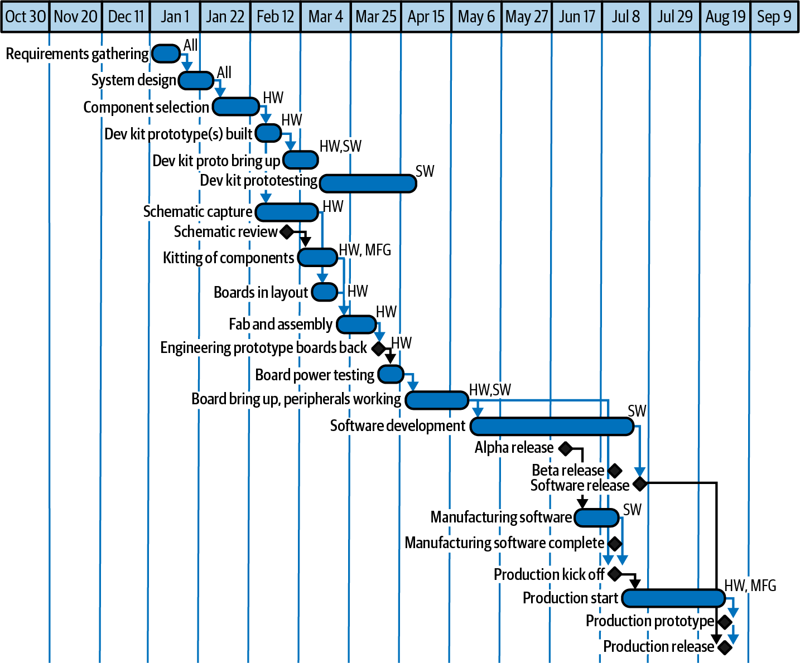

图3-1 理想项目进度计划示例

图中文字：时间轴依次为10月30日、11月20日、12月11日、1月1日、1月22日、2月12日、3月4日、3月25日、4月15日、5月6日、5月27日、6月17日、7月8日、7月29日、8月19日、9月9日。任务依次包括：需求收集、系统设计、元器件选型、搭建开发套件原型、开发套件原型初始调试、开发套件原型测试、绘制原理图、原理图评审、元器件齐套、电路板布局布线、制板和组装、工程原型板返回、电路板电源测试、电路板初始调试及外设运行、软件开发、alpha 版本发布、beta 版本发布、软件发布、制造软件、制造软件完成、生产启动会、开始生产、生产原型、生产发布。责任方标记 All 为“全体”，HW 为“硬件”，SW 为“软件”，MFG 为“制造”。

<!-- source: pdf=62; section=3.1.1; unit=ch03-005; source_ids=p0062_b002_u00,p0062_b003_u00 -->
### 理想的项目流程 {#ch03-toc-002}

这种进度计划，通常由工程经理（或技术负责人）讨论目标，再估算项目所需的时间和资源而成。这只是整体计划的一部分，不包括机械工程、服务器端软件、市场发布，以及许多其他活动。不过，这一部分很可能涵盖硬件与嵌入式软件，因此也很可能列出了你和直属团队的工作。

<!-- source: pdf=62; section=3.1.1; unit=ch03-006; source_ids=p0062_b004_u00 -->
图3-1展示的是瀑布式开发：一项活动接着另一项活动。制作电路板之前必须先评审原理图，这很合理。当然，在嵌入式软件开发发布 alpha 版本之前，电路板就已经做好了。

<!-- source: pdf=62-63; section=3.1.1; unit=ch03-007; source_ids=p0062_b005_u00,p0063_b000_u00 -->

<a id="src-p63"></a>

然而，这不会是实际执行的进度。你花了大量时间制作这幅杰作，它却还没完成就已经过时，这可能相当令人沮丧。规划的目的是找出依赖关系。如果制作电路板需要12周，开发嵌入式软件需要14周，那么整个项目14周就能完成，对吧？并不是：软件很可能还需要更多时间，在制作完成的电路板上开发。不过，希望整个项目也不至于要花26周（12 + 14）。

<!-- source: pdf=63; section=3.1.1; unit=ch03-008; source_ids=p0063_b001_u00 -->
制定进度计划的一大部分工作，就是弄清哪些任务可以并行开展，哪些必须等硬件完成后才能进行。人们往往过分关注结束日期，也就是那个至关重要的交付日期，但进度计划还包含更多信息：依赖关系、人力资源需求，以及何时需要支出现金（工资以外的支出）。

<!-- source: pdf=63; section=3.1.1; unit=ch03-009; source_ids=p0063_b002_u00 -->
当然，无论你做多少排期和规划，事情都不会完全按计划进行。总会有超期和返工。规划这个过程能帮助你弄清哪些地方需要谨慎，以及从长远看哪些依赖关系重要、哪些不重要。

<!-- source: pdf=63; section=3.1.1; unit=ch03-010; source_ids=p0063_b003_u00 -->
遗憾的是，嵌入式软件往往处在流程的末端，不得不设法弥补需求变更或硬件修复造成的延误。你会利用不完整的硬件、原型电路板进行开发，并编写良好的初始调试测试，以便电路板终于到货时，自己已经准备就绪。

<!-- source: pdf=63; section=3.1.1; unit=ch03-011; source_ids=p0063_b004_u00 -->
你也许会采用敏捷方法而非瀑布方法，让发布更加频繁、迅速。不过，在开发能够实际出货的实体产品时，你很可能仍需要在某个层面考察固件所依赖的各个部分，以及它们是如何开发出来的。

<!-- source: pdf=63; section=3.1.2; unit=ch03-012; source_ids=p0063_b005_u00,p0063_b006_u00 -->
### 硬件设计 {#ch03-toc-003}

确定要构建什么以后，硬件团队会阅读数据手册（datasheet）和参考设计，选择元器件，理想情况下也会征求嵌入式软件团队的意见。通常会为系统中风险最大的部分购买开发套件，这些部分一般是处理器和大家最不熟悉的外设（peripheral）（稍后会详细介绍处理器与外设）。

<!-- source: pdf=63; section=3.1.2; unit=ch03-013; source_ids=p0063_b007_u00 -->
硬件团队绘制原理图（schematic），软件团队则在开发板上开展工作。看起来，硬件团队似乎要花好几周甚至好几个月画一张图，但其中大部分时间其实是在海量数据手册中寻找合适的元器件：满足产品所需功能、价格合适、外形尺寸正确、温度范围适宜，等等。在这段时间里，嵌入式软件团队则在寻找（或构建）包含编译器和调试器的工具链、建立调试子系统、试用一些外设，还可能搭建用于测试算法的沙箱。

<!-- source: pdf=63-64; section=3.1.2; unit=ch03-014; source_ids=p0063_b008_u00,p0064_b001_u00 -->

<a id="src-p64"></a>

原理图通过原理图绘制程序（也称 CAD 软件包）录入。这些程序通常许可费用昂贵，使用也很繁琐，因此硬件工程师通常会在检查节点或评审时生成 PDF 原理图，供你使用。虽然你应该花时间检查整份原理图（见“阅读原理图”一节），但对你影响最大的部分是处理器，以及它所能看到的系统。硬件工程师了解这一点，所以大多数人都会生成一份 I/O 映射表，说明处理器每个引脚连接的信号。（第4章建议根据 I/O 映射表制作一个头文件。）

<!-- source: pdf=64; section=3.1.2; unit=ch03-015; source_ids=p0064_b002_u00 -->
原理图展示电气连接，却并未明确指定电路板上究竟需要哪些具体零件。它可能画出一个有十个引脚的排针，但要组装电路板，制造商就必须知道到底是哪一种排针，通常还需要一个数据手册链接，其中规定它的所有细节。全部元器件都会列入物料清单（bill of materials，BOM），这份清单在绘制原理图时就开始编制了。

<!-- source: pdf=64; section=3.1.2; unit=ch03-016; source_ids=p0064_b003_u00 -->
原理图完成后（而且开发套件已表明处理器和那些高风险外设很可能适用），就可以进行电路板布局布线（layout）。在这个阶段，原理图中的连接会转化成电路板上实际走线的图形，按原理图连接各个元器件。

<!-- source: pdf=64; section=3.1.2; unit=ch03-017; source_ids=p0064_b004_u00 -->
>  电路板布局布线常常是一项独立于电子工程的专业技能。因此，如果负责布局布线的不是你的硬件工程师，也不必惊讶。

<!-- source: pdf=64; section=3.1.2; unit=ch03-018; source_ids=p0064_b005_u00 -->
布局布线完成后，电路板进入制板（fabrication，fab）环节，制造出印刷电路板（printed circuit board，PCB）。随后，把所有元器件装到板上。为开始组装而备齐 BOM 中的元器件，称为齐套。交期较长的零件可能很难凑齐，因而延误组装。完成组装的电路板称为 PCBA（printed circuit board assembly，印刷电路板组件），也简称 PCA，这就是最终会摆到你桌上的东西。

<!-- source: pdf=64; section=3.1.2; unit=ch03-019; source_ids=p0064_b006_u00 -->
当原理图完成、布局布线开始时，嵌入式软件团队的主要任务是确定硬件测试项目，并趁制作电路板的时间把测试写好。开发面向用户的代码似乎更有成效，但是等电路板从制造商那里回来，如果不先完成电路板初始调试（board bring-up），软件就无法继续推进。硬件测试不仅能让初始调试更顺利，也能使系统在开发阶段（和生产阶段）更稳定。编写硬件测试时，要问电子工程师哪些部分风险最大。优先为这些子系统开发测试（如有可能，也在开发套件上试一试）。

<!-- source: pdf=64; section=3.1.2; unit=ch03-020; source_ids=p0064_b007_u00 -->
电路板回来后，硬件工程师会先上电，确认没有供电问题，也可能检查其他纯硬件子系统。随后你就能拿到一块板子（终于！），开始初始调试。

<!-- source: pdf=65; section=3.1.3; unit=ch03-021; source_ids=p0065_b001_u00,p0065_b002_u00 -->

<a id="src-p65"></a>

### 电路板初始调试 {#ch03-toc-004}

这段时间可以很有趣，你能向技能与你不同的工程师学习。也可能变成一场吵架大战，双方团队互相指责对方无能、居心不良。由你选择。

<!-- source: pdf=65; section=3.1.3; unit=ch03-022; source_ids=p0065_b003_u00 -->
你收到的电路板可能错误百出，也可能没有。电子工程师没有机会像写软件那样，编译代码、试一试、改一改，再重新编译。制作电路板并不是一个可以反复迭代很多次的过程。记住，人都会犯错，而且错误越低级，找到并修好它可能就越费时间（你曾经花过最长时间调试的错误，最后却发现只是个拼写错误，那次究竟花了多久？）。

<!-- source: pdf=65; section=3.1.3; unit=ch03-023; source_ids=p0065_b004_u00 -->
不过，不要害怕提问，也不要害怕请别人帮忙查找你的问题（没错，就这样措辞）。也许只要一位电子工程师坐到你身边，你就能看出哪里出了问题。

<!-- source: pdf=65; section=3.1.3; unit=ch03-024; source_ids=p0065_b005_u00 -->
在设计早期发现一个硬件（或软件）错误，就像收到一份礼物。发现得越早，你就越高兴。产品团队的错误也关系到你的声誉，所以要愿意投入时间和编程技能，协助解决问题。这不只是礼貌和职业素养，也是身为团队成员必须做到的事。如果由于地域或组织上的隔阂，向硬件工程师求助得费尽周折，不妨考虑私下沟通（也可以请人吃午饭）。短期内可能让你的钱包缩水，但把事情办成会让你成为英雄，长远前景也会很好。

<!-- source: pdf=65; section=3.1.3; unit=ch03-025; source_ids=p0065_b006_u00 -->
>  别人在你的工作中指出错误时，不要难为情，要心存感激。如果对方与你同属一个团队或公司，这个错误就还没有流入现场、被客户看到。

<!-- source: pdf=65; section=3.1.3; unit=ch03-026; source_ids=p0065_b007_u00 -->
为了让你和硬件工程师都更容易进行初始调试，首先要让每个元器件都能够单独测试。如果代码空间不足，就另外建立一个软件子项目，存放硬件测试代码（但尽量共用底层模块）。

<!-- source: pdf=65; section=3.1.3; unit=ch03-027; source_ids=p0065_b008_u00 -->
其次，拿到 PCBA 后，要从最低层的部分开始，采取尽可能小的步骤。例如，不要一上来就试验你那套高级电机控制器软件，而应该先让一个 I/O 器件短暂开启，并接上一个 LED，确认它会闪烁。然后（仍然一步一步来），只做让电机运动（或至少动一下）所必需的最少操作。

<!-- source: pdf=65-66; section=3.1.3; unit=ch03-028; source_ids=p0065_b009_u00,p0066_b001_u00 -->

<a id="src-p66"></a>

最后，要让你的工具不必由你亲自在场操作，这样其他人也能复现问题。只要问题可以复现，即使原因还不确定，也能尝试修复。（有时候修复方法反而能解释原因。）编写良好测试所花的时间会带来回报。这些硬件验证代码很可能会保留相当长一段时间，下一批电路板回来时，你多半还会需要它们。而且，这些测试常常会演变为生产过程中用于检查电路板功能的制造测试。

<!-- source: pdf=66; section=3.1.3; unit=ch03-029; source_ids=p0066_b002_u00 -->
怎么知道需要编写哪些测试？首先要深入了解处理器和外设。这就引出了阅读数据手册的话题。

<!-- source: pdf=66; section=3.2; unit=ch03-030; source_ids=p0066_b003_u00,p0066_b004_u00 -->
## 阅读数据手册 {#ch03-toc-005}

在产品发布压力之下，往往很难放慢脚步，认真阅读元器件的数据手册、用户手册和应用笔记。更糟的是，你可能感觉自己已经读过了（毕竟每一页都翻了），却什么也没记住，因为看起来就像外语。代码不工作时，你就很想抱怨硬件坏了。

<!-- source: pdf=66; section=3.2; unit=ch03-031; source_ids=p0066_b005_u00 -->
如果你是软件工程师，不妨把每颗芯片都当作一个独立的软件库。想一想，学习一个软件包（Qt、OpenCV、Zephyr、Unity、TensorFlow 等）需要投入多少精力。熟悉处理器及其外设，大致也需要那么长时间。处理器甚至还会以一些类似 API 的方式与外设通信。与使用软件库一样，你往往只读部分文档也能解决问题，但最好在掉进某个深坑之前，就弄清哪部分对你最重要。

<!-- source: pdf=66; section=3.2; unit=ch03-032; source_ids=p0066_b006_u00 -->
数据手册就是外设的 API 手册。在我告诉你哪些内容该读两遍、哪些可以等用到时再读之前，先确认你拿到的是最新版本（查一下制造商网站，再在网上搜索一下，确保无误）。

<!-- source: pdf=66; section=3.2; unit=ch03-033; source_ids=p0066_b007_u00 -->
>  遗憾的是，有些制造商只有在签署保密协议（NDA）后才会提供数据手册，所以它们的网站上只有产品概述或摘要。

<!-- source: pdf=66; section=3.2; unit=ch03-034; source_ids=p0066_b008_u00 -->
硬件元器件由数据手册加以描述。数据手册可能令人望而生畏，因为里面的信息高度密集。阅读数据手册是一门艺术，需要经验和耐心。首先要明白，它们其实并不是为你写的，而是为电子工程师写的。更准确地说，是为已经熟悉这种元器件或它的近亲的电子工程师写的。

<!-- source: pdf=67; section=3.2; unit=ch03-035; source_ids=p0067_b000_u00 -->

<a id="src-p67"></a>

从某种意义上说，阅读数据手册就像在一场技术谈话进行到一半时加入。看看图3-2，它很像一份真正的数据手册，尽管这不是你在软件中可能会连接的元器件（它是一个史前的腿部执行器步态控制器）。

<!-- source: pdf=67; section=3.2; unit=ch03-036; source_ids=p0067_b001_u00 -->
每份数据手册靠近开头的位置，都有概述或功能列表。这是芯片的摘要，但如果你此前没有用过数据手册与这份手册有85%内容相同的元器件，那么这份概述多半帮不上什么忙。反过来，一旦你用过三四种模拟三角龙（或者加速度计，或者你正在研究的其他东西），下次就可以只读概述，判断这颗芯片与你过去用过的相比有哪些相同和不同。如果数据手册花篇幅解释初学者想了解的一切，每份都会写成一本书（而且大部分内容彼此相同）。此外，大批采购元器件的也不是初学者，而是已经熟悉这些器件的资深工程师。

<!-- source: pdf=67; section=3.2; unit=ch03-037; source_ids=p0067_b003_u00 -->


图3-2 Dino Industries 的模拟三角龙数据手册首页上部

图中文字：Dino Industries；T. HORRIDUS；T. PRORSUS；模拟三角龙。

功能：
- 角龙科的一个属
- 三蹄手
- 颈盾无窗孔
- 超小型脑
- 电源范围：2.7 V 至5 V

描述：三角龙是角龙科的一属草食性恐龙，生活于晚白垩世的马斯特里赫特期晚期，大约6800万至6500万年前，分布于今天的北美洲。

<!-- source: pdf=67; section=3.2; unit=ch03-038; source_ids=p0067_b004_u00 -->
所以，我建议跳过开头的概述（至少先放下，稍后再看）。

<!-- source: pdf=67; section=3.2; unit=ch03-039; source_ids=p0067_b005_u00 -->
我喜欢通常出现在第一页的功能框图，但它们与概述很相似。如果你不知道要找什么，框图多半也不会让你豁然开朗。所以，应该从描述部分开始。这部分通常占第一页的大约一半，有时稍稍延伸到第二页。

<!-- source: pdf=67; section=3.2; unit=ch03-040; source_ids=p0067_b006_u00 -->
描述部分不适合看几个字就跳到下一段。它的信息很密集，而且大概还不到一页。务必仔细读透。可以大声朗读、给重要信息画线（也许大部分信息都很重要），或者试着向别人解释一遍（我在办公室里放了一只泰迪熊，专门干这件事；也有人会找电子工程师来听）。

<!-- source: pdf=68; section=3.2.1; unit=ch03-041; source_ids=p0068_b000_u00,p0068_b001_u00,p0068_b002_u00 -->

<a id="src-p68"></a>

### 出问题时需要查阅的数据手册章节 {#ch03-toc-006}

第一页之后，每份数据手册的信息排列顺序各不相同，也不是每份手册都有所有章节。不过，你不该仔细钻研那些对软件毫无帮助的内容。略过绝对最大额定值、推荐工作条件、电气特性、封装信息、布局布线和机械方面的注意事项，可以节省时间，减少脑力消耗。硬件团队已经读过这部分了，要相信他们会做好自己的工作。

<!-- source: pdf=68; section=3.2.1; unit=ch03-042; source_ids=p0068_b003_u00 -->
虽然现在可以跳过下面这些部分，但要记得它们的存在。出现问题时，你可能就会用到：比如必须拿出示波器，查明驱动程序为何不工作；更糟的是，器件看似在工作，却达不到所宣传的表现。知道有这些内容就行，需要时再回来查，第一次读时放心略过。

<!-- source: pdf=68; section=3.2.1.1; unit=ch03-043; source_ids=p0068_b004_u00,p0068_b005_u00 -->
#### 每种可选封装的引脚排列

如果调试时需要用探头测量芯片，就必须知道引脚排列。理想情况下，这并不重要，因为软件正常工作，你也就不需要探测芯片。

<!-- source: pdf=68; section=3.2.1.1; unit=ch03-044; source_ids=p0068_b006_u00,p0068_b008_u00 -->
引脚配置图中的一些引脚名称上方带有横线（图3-3）。

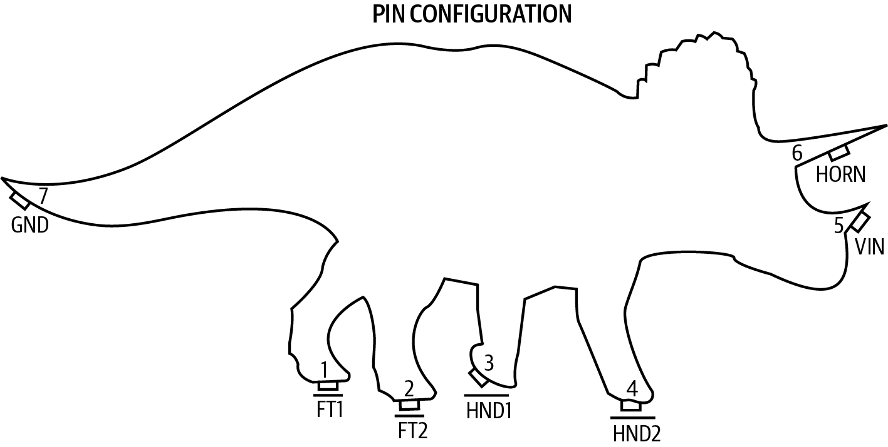

图3-3 模拟三角龙的引脚排列

图中文字：PIN CONFIGURATION 为“引脚配置”。1、2、3、4号引脚分别为低电平有效的 FT1、FT2、HND1、HND2；5号为 VIN；6号为 HORN；7号为 GND。

<!-- source: pdf=68-69; section=3.2.1.1; unit=ch03-045; source_ids=p0068_b009_u00,p0069_b000_u00 -->

<a id="src-p69"></a>

这些横线表示引脚低电平有效（active low），也就是说，电压低时引脚才处于有效状态。在引脚说明中，低电平有效的引脚名称前面有一条斜线。你还可能看到其他表示低电平有效信号的写法。如果大部分引脚都采用 NAME 这样的名字，就要留意 nNAME、#NAME、_NAME、NAME*、NAME_N 等带修饰的形式。总之，只要名字旁边带有修饰，就要查一查它是否低电平有效；引脚说明中应该会注明。

<!-- source: pdf=69; section=3.2.1.1; unit=ch03-046; source_ids=p0069_b001_u00 -->
如果这些对你来说都是全新的知识，不妨找一本电子学入门书，比如“延伸阅读”中列出的那些。

<!-- source: pdf=69; section=3.2.1.2; unit=ch03-047; source_ids=p0069_b002_u00,p0069_b003_u00,p0069_b005_u00 -->
#### 引脚说明

这是一张类似图3-4的表格。需要这些信息时再回来查看，例如检查信号线是否应该低电平有效，或者试图让示波器显示出与数据手册时序图一致的波形时。

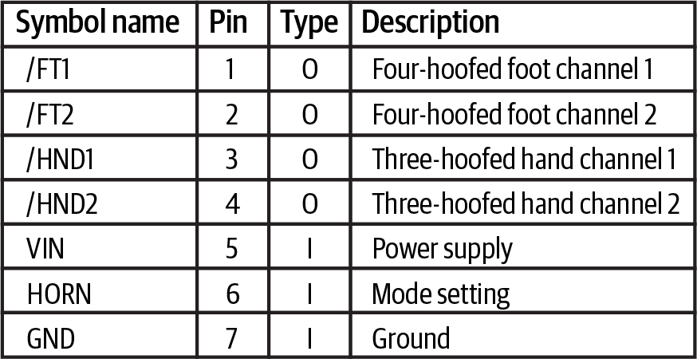

图3-4 模拟三角龙的引脚说明

图中表格的中文对应项如下；符号名与 I/O 类型原样保留：

| 符号名 | 引脚 | 类型 | 说明 |
|---|---:|:---:|---|
| /FT1 | 1 | O | 四蹄脚通道1 |
| /FT2 | 2 | O | 四蹄脚通道2 |
| /HND1 | 3 | O | 三蹄手通道1 |
| /HND2 | 4 | O | 三蹄手通道2 |
| VIN | 5 | I | 电源 |
| HORN | 6 | I | 模式设置 |
| GND | 7 | I | 地 |

<!-- source: pdf=69; section=3.2.1.3; unit=ch03-048; source_ids=p0069_b006_u00,p0069_b007_u00 -->
#### 性能特性

这些表格和曲线精确描述元器件的行为，对于第一次阅读来说，细节太多。不过，如果元器件能够通信却不能正常工作，性能特性可以帮助你判断其中是否有原因（例如，器件的额定工作温度范围是0°C–70°C，却紧挨着极热的处理器；又或者，外设在输入电压恰好合适时正常工作，但输入稍微超出规定范围，准确度就下降）。

<!-- source: pdf=69; section=3.2.1.4; unit=ch03-049; source_ids=p0069_b008_u00,p0069_b009_u00 -->
#### 示例原理图

有时，你拿到的驱动代码正好满足需求，最终几乎不用改动，甚至完全不用改。示例原理图就是电子工程领域的驱动代码。当器件表现异常时，看到示例原理图与你的原理图类似，会让人安心一些。不过，与厂商提供的驱动代码一样，实际实现与示例不同，也可能有很多充分的理由。如果某个器件出了问题，而原理图又与示例不一致，就向电子工程师询问这些差异。它们也许无关紧要，但也可能很重要。

<!-- source: pdf=70; section=3.2.2; unit=ch03-050; source_ids=p0070_b001_u00,p0070_b002_u00 -->

<a id="src-p70"></a>

### 软件开发者需要阅读的数据手册章节 {#ch03-toc-007}

读到某个地方，也许已经到了手册中间，你终于会看到一些正文（图3-5）。标题可能是“应用信息”，也可能是“工作原理”；也可能没有标题，只是从表格、曲线图转为文字和示意图。这就是应该开始阅读的部分。可以先浏览一遍，看看自己需要的信息在哪里，但最终确实需要从头到尾认真读。还有个额外好处：这里的文字可能会指向有价值的应用笔记和用户手册。阅读数据手册时，要考虑将如何为自己的系统实现驱动程序。器件如何通信？需要怎样初始化？软件必须做什么才能有效使用它？是否有严格的时序要求，处理器又能如何满足这些要求？

<!-- source: pdf=70; section=3.2.2; unit=ch03-051; source_ids=p0070_b004_u00 -->
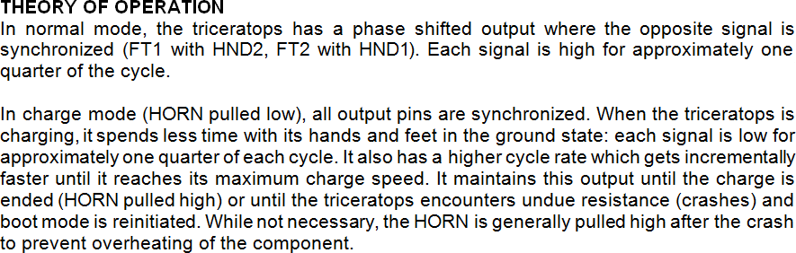

图3-5 模拟三角龙的工作原理

图中文字完整译文：

工作原理

在正常模式下，三角龙的输出具有相位偏移，对侧信号保持同步（FT1 与 HND2 同步，FT2 与 HND1 同步）。每个信号约在周期的四分之一时间内保持高电平。

在冲锋模式下（HORN 被拉低），所有输出引脚都同步。三角龙冲锋时，手脚处于接地状态的时间更短：每个信号约在每个周期的四分之一时间内保持低电平。循环频率也更高，而且会逐步加快，直到达到最大冲锋速度。它会维持这种输出，直到冲锋结束（HORN 被拉高），或者三角龙遇到过大的阻力（撞上东西）并重新进入启动模式。虽然并非必须，撞击后通常会把 HORN 拉高，以免元器件过热。

<!-- source: pdf=70; section=3.2.2; unit=ch03-052; source_ids=p0070_b005_u00 -->
阅读时，标出可能影响代码的内容，方便以后回来查看。时序图是停下来缓口气的好地方（图3-6）。试着把时序图与正文、以及你打算采用的实现方式联系起来。“时序图如何帮助软件开发者”旁栏会提供更多有关时序图的信息。

<!-- source: pdf=70; section=3.2.2; unit=ch03-053; source_ids=p0070_b006_u00 -->
除了确保拿到元器件最新的数据手册之外，还要在制造商网页上查找勘误（errata），其中会对数据手册的错误作出更正。在网页上搜索器件型号和“errata”（图3-7）。勘误可能涉及数据手册的错误，也可能涉及器件本身的错误。大多数器件都或多或少有些勘误。

<!-- source: pdf=70; section=3.2.2; unit=ch03-054; source_ids=p0070_b007_u00 -->
>  数据手册可能有修订版本，元器件也可能有修订版本。应获取与你所用元器件版本对应的最新数据手册。

<!-- source: pdf=71; section=3.2.2; unit=ch03-055; source_ids=p0071_b001_u00 -->

<a id="src-p71"></a>

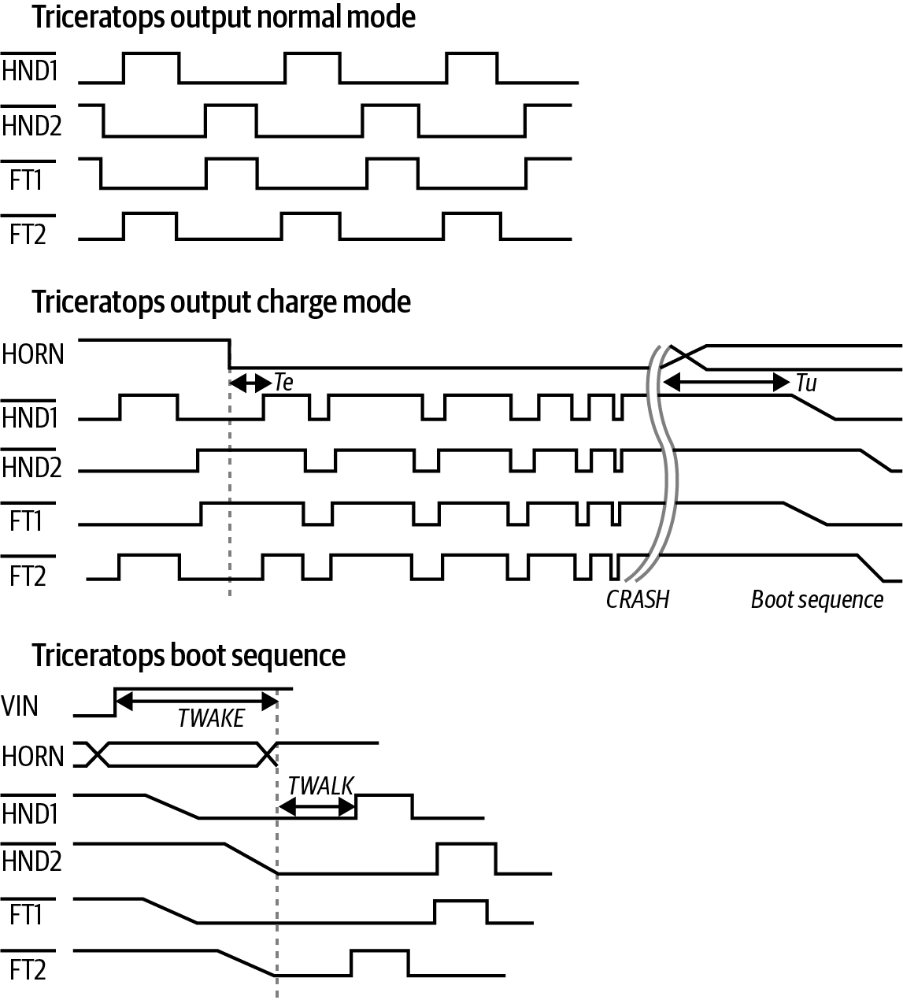

图3-6 模拟三角龙的时序图

图中文字：Triceratops output normal mode 为“三角龙正常模式输出”；Triceratops output charge mode 为“三角龙冲锋模式输出”；Triceratops boot sequence 为“三角龙启动序列”；CRASH 为“撞击”；Boot sequence 为“启动序列”。信号名称 HND1、HND2、FT1、FT2、HORN、VIN 以及时序参数 Te、Tu、TWAKE、TWALK 保持原样；手脚信号名称上方的横线表示低电平有效。

<!-- source: pdf=71; section=3.2.2; unit=ch03-056; source_ids=p0071_b002_u00 -->
读完以后，如果你非常熟练，或者非常幸运，就已经获得使用这颗芯片所需的信息。通常，大多数人会开始编写芯片驱动，并在编写芯片接口、通信方法，直到最后真正使用芯片的过程中，不断回头重读手册中的某些部分。阅读数据手册是一场龟兔赛跑，而这一次乌龟肯定会赢。

<!-- source: pdf=71; section=3.2.2; unit=ch03-057; source_ids=p0071_b003_u00 -->
等驱动全部写好并正常工作后，再读一下数据手册开头的功能摘要，因为你现在已经掌握了这一类元器件，能够更好地理解摘要。即使如此，实现类似功能时，你大概仍需要阅读部分手册，但这会更容易，而且手册首页的摘要也能让你获得好得多的整体认识。

<!-- source: pdf=72; section=3.2.2; unit=ch03-058; source_ids=p0072_b001_u00 -->

<a id="src-p72"></a>

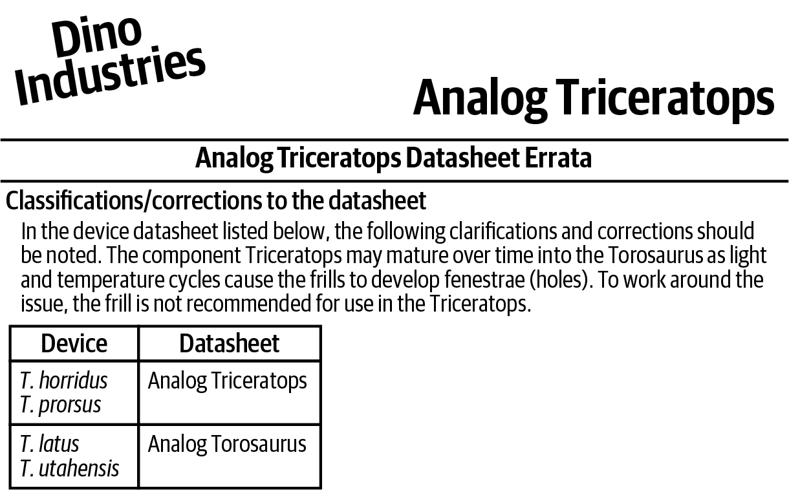

图3-7 模拟三角龙的勘误

图中文字完整译文：

Dino Industries。模拟三角龙。模拟三角龙数据手册勘误。

数据手册的分类与更正

对于下列器件的数据手册，应注意以下澄清和更正。光照和温度循环会使颈盾产生窗孔（孔洞），因此三角龙元器件可能随时间逐渐成熟为牛角龙。为避开这个问题，不建议在三角龙中使用颈盾。

| 器件 | 数据手册 |
|---|---|
| T. horridus；T. prorsus | 模拟三角龙 |
| T. latus；T. utahensis | 模拟牛角龙 |

<!-- source: pdf=72; section=3.2.2; unit=ch03-059; source_ids=p0072_b002_u00,p0072_b003_u00,p0072_b004_u00,p0072_b005_u00,p0072_b006_u00 -->
使用外设时，还可能找到其他资源：

- 如果芯片有用户手册，一定要看看。
- 应用笔记通常包含一些你可能感兴趣的具体用例，往往还附有厂商示例代码。也要找一找厂商的代码仓库。
- 在 GitHub 或网上搜索器件型号。其他使用者的示例代码能让你知道该怎样做。

埋头动手之前，先四处找找；那些你还不知道的问题，答案也许已经在那里了。

<!-- source: pdf=72-73; section=3.2.2.sidebar; unit=ch03-060; source_ids=p0072_b007_u00,p0072_b008_u00,p0072_b009_u00,p0073_b001_u00,p0073_b002_u00 -->

<a id="src-p73"></a>

#### 旁栏：时序图如何帮助软件开发者

时序图展示跳变之间的关系。有些跳变可能发生在同一个信号上；时序图也可能展示不同信号跳变之间的关系。例如，图3-6顶部正常模式下两只手（HND1 和 HND2）交替变化的状态，表明一只手放下后不久，另一只手就会抬起。阅读时序图时，从左侧的信号名称开始。时间从左向右推进。

大多数时序图着重展示数字状态，告诉你信号何时为高电平、何时为低电平（别忘了检查名称中是否有表示低电平有效的修饰）。有些图会画出斜坡（例如图3-6启动序列中的手脚信号），表示信号处于过渡状态。你也可能看到同时画成高、低电平的信号（例如图3-6启动序列中的角信号）；这表示信号处于不确定的逻辑状态（对于输出），或者此时未被监测（对于输入）。

重要的时间特性会用带箭头的线标出来，通常还会在表格中详细规定。另外，还要留意信号先后顺序的标示（通常用虚线表示）和因果关系（通常用从一个信号指向另一个信号的箭头表示）。最后，图中的脚注往往包含关键信息。

<!-- source: pdf=73; section=3.2.3; unit=ch03-061; source_ids=p0073_b003_u00,p0073_b004_u00 -->
### 根据数据手册评估元器件 {#ch03-toc-008}

在介绍完实现之后，才谈如何评估元器件，看起来可能有些奇怪。项目的实际顺序并非如此，但工程师的成长过程却往往如此。通常，在能够选择系统组成部分之前，你得先通过实现别人设计的系统来积累经验。因此，评估元器件是一项比阅读数据手册更高级的技能，而电子工程师一般会比软件工程师更早掌握它。

<!-- source: pdf=73; section=3.2.3; unit=ch03-062; source_ids=p0073_b005_u00 -->
评估元器件时，目标是迅速排除不适用的器件。如果一个元器件需要120 V交流电，而你的系统只有5 V直流电，那么它根本不能使用，别再浪费宝贵的时间研究它究竟如何实现功能 X。先列出必须具备的条件，再列出希望具备的条件。随后形成一个潜在候选器件集合，供进一步调查。

<!-- source: pdf=73; section=3.2.3; unit=ch03-063; source_ids=p0073_b006_u00 -->
深入调查之前，先谈谈数据手册里没有的东西。它们通常不标价格，因为价格取决于许多因素，尤其是订购数量。数据手册也不会给出交货期，所以要谨慎，不要围绕一个“完美”的器件展开设计后，才发现它要等六个月才能到货。除非在线下单，否则你需要与厂商或分销商沟通。

<!-- source: pdf=73; section=3.2.3; unit=ch03-064; source_ids=p0073_b007_u00 -->
与厂商交谈，也是询问他们是否有器件使用指导、初始化代码、应用笔记、白皮书、论坛，或其他能帮助你推进工作的材料的好机会。厂商知道这些也能成为卖点，因此其应用工程师通常愿意帮忙。分销商甚至可能协助比较各种可选方案的异同。

<!-- source: pdf=73; section=3.2.3; unit=ch03-065; source_ids=p0073_b008_u00 -->
>  即使你正在与分销商合作，[DigiKey](https://digikey.com) 也常常是了解大致价格和交货期的好途径。

<!-- source: pdf=74; section=3.2.3; unit=ch03-066; source_ids=p0074_b000_u00 -->

<a id="src-p74"></a>

回到数据手册。之前略过的一些信息密集的章节，现在就很重要了。先看绝对最大额定值和电气特性（见图3-8）。如果它们不能达到或超过你的标准，就把这份手册放到一边。眼下的目标是迅速筛过这一堆手册；如果某个器件不满足基本标准，就记录它不符合哪项要求，然后继续。（记笔记很有用，否则你可能会反复淘汰同一份手册。）还可以根据它们与要求的差距大小来排序。如果最后没有任何一款能达到你的高标准，就可以重新检查那些最接近的，看看能否设法使用。

<!-- source: pdf=74; section=3.2.3; unit=ch03-067; source_ids=p0074_b001_u00 -->
一旦满足基本的电气和机械要求，下一步就是考察典型特性，确定它是否正是你所需的器件。具体细节我帮不上太多忙，因为它们取决于系统需求和具体元器件。这一层面的常见问题与功能参数有关：速度够不够快？输出是否达到或超过系统要求？如果是传感器，噪声是否可以接受？

<!-- source: pdf=74; section=3.2.3; unit=ch03-068; source_ids=p0074_b003_u00 -->
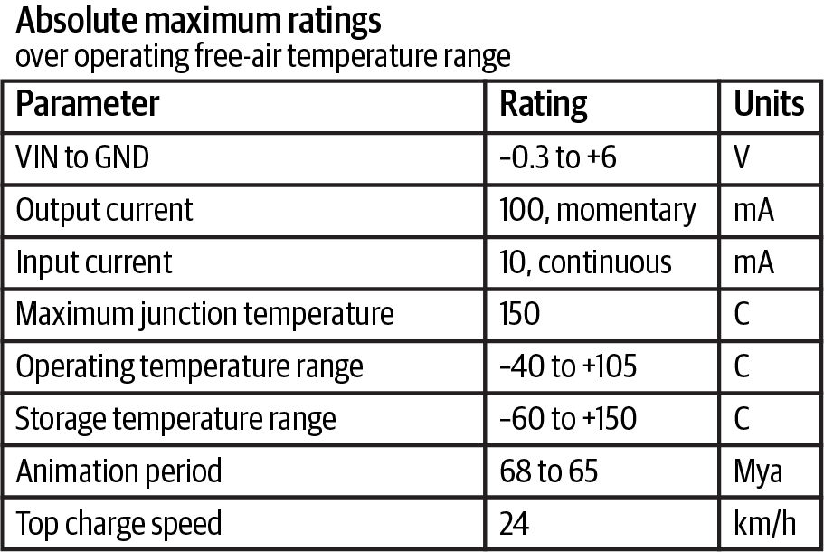

图3-8 模拟三角龙的绝对最大额定值

图中文字：在工作环境空气温度范围内的绝对最大额定值。

| 参数 | 额定值 | 单位 |
|---|---|---|
| VIN 相对于 GND | −0.3 至 +6 | V |
| 输出电流 | 100，瞬时 | mA |
| 输入电流 | 10，连续 | mA |
| 最大结温 | 150 | C |
| 工作温度范围 | −40 至 +105 | C |
| 存储温度范围 | −60 至 +150 | C |
| 活动年代 | 68 至 65 | Mya |
| 最大冲锋速度 | 24 | km/h |

<!-- source: pdf=74; section=3.2.3; unit=ch03-069; source_ids=p0074_b004_u00 -->
当有两三份数据手册通过第一轮检查后，就进一步研究。如果有应用一节，从那里开始很合适。这些应用是否与你的应用相似？如果是，就继续；如果不是，就要稍微警惕一点。第一个以某种方式使用外设，大概并无大碍，但如果器件专门针对水下传感器网络，而你想把它用在超级智能烤面包机里，就该弄清为什么厂商把应用范围限定得这么窄。认真地说，推荐应用没有覆盖所有用途，可能有其原因。例如，面向汽车应用的芯片可能不接受小批量采购。数据手册的目的是把产品卖给已经在使用类似产品的人，因此应用范围有限，也许有充分理由。

<!-- source: pdf=75; section=3.2.3; unit=ch03-070; source_ids=p0075_b000_u00 -->

<a id="src-p75"></a>

接下来，查看性能特性，确定是否满足需求。读这一部分时，常常会发现新的要求，例如意识到系统需要 A 器件的温度响应、B 器件的电源电压响应，以及 C 器件的抗噪能力。把这些纳入筛选标准，淘汰不满足需求的器件（但也要给标准排出优先级，免得把自己逼进死胡同）。

<!-- source: pdf=75; section=3.2.3; unit=ch03-071; source_ids=p0075_b001_u00 -->
此时，每一种所需器件应该至少留下两份、至多四份数据手册。如果超过四份，就向周围打听，看看哪家厂商在采购部门中口碑更好、交货期更短，或价格更优。以后可能还要回头考虑其余候选，但眼下先选出四个看起来不错的。

<!-- source: pdf=75; section=3.2.3; unit=ch03-072; source_ids=p0075_b002_u00 -->
如果所有手册都被淘汰了，或者只剩下一份，不要就此停下。这并不意味着所有器件都不能用（或者只有一个能用），也可能说明你的标准太严格，需要进一步了解可用选项。因此，选出最好的两个器件，即使其中一个或两个都达不到你最严格的标准。

<!-- source: pdf=75; section=3.2.3; unit=ch03-073; source_ids=p0075_b003_u00 -->
对于留下的每份手册，要弄清实现中棘手的部分，并判断元器件在你的系统里会表现如何。此时，处理类似器件的经验会很有帮助。你要像真的准备写代码那样阅读手册。事实上，如果没有使用相当类似器件的经验，最好真写一些代码，让想法具体起来。能用真实硬件做原型验证当然很好；如果不能，仍然可以在脑中做原型，逐步推演实现过程，估计会发生什么。

<!-- source: pdf=75; section=3.2.3; unit=ch03-074; source_ids=p0075_b004_u00,p0075_b005_u00 -->
虽然你会为两到四个器件都做这些工作，最后却大概只用其中一个，但一旦确定选型，这些工作就能让代码开发先行一步。如此深入的分析会花费不少时间，却能降低器件无法正常工作的风险。原型验证做到什么程度，由你自己（和进度安排）决定。

<!-- source: pdf=75; section=3.2.3; unit=ch03-075; source_ids=p0075_b005_u00 -->
如果仍有多个选择，就考察元器件所属的系列。如果某项资源不够用了（空间、引脚或量程），同系列中是否有引脚完全兼容的器件（最好软件接口也相同）？留有余量会非常方便。

<!-- source: pdf=75; section=3.2.3; unit=ch03-076; source_ids=p0075_b006_u00 -->
最后，选定元器件之后，功能摘要就变成了一道比较阅读题。现在，你已经读过好几份类似器件的数据手册，正是开头概述所面向的读者。如果还有其他手册需要评估，就从这里开始。把已经研究过的与新手册作比较，迅速了解每颗芯片的功能，以及不同参数如何相互影响（例如，速度越快，成本很可能也越高）。

<!-- source: pdf=76; section=3.3; unit=ch03-077; source_ids=p0076_b001_u00,p0076_b002_u00,p0076_b003_u00 -->

<a id="src-p76"></a>

## 处理器也是一门语言 {#ch03-toc-009}

最重要的元器件，就是运行你软件的那个：处理器。有些厂商（ST、TI、Microchip、NXP 等）使用相同的内核（例如 Arm Cortex-M4F），却提供不同的片上外设。代码与定时器或各种通信方式的交互接口会变化。内核相同，会让迁移比从微小的8位处理器转到强大的64位处理器容易一些，但你仍应预料到它们之间有差异。

<!-- source: pdf=76; section=3.3; unit=ch03-078; source_ids=p0076_b004_u00 -->
熟悉一款新处理器，所需的精力几乎相当于学习一门新的编程语言。也像学语言一样，如果以前用过类似的东西，学新的就会容易些。当你学过几门编程语言或用过几款处理器以后，再学新的，就会越来越容易。

<!-- source: pdf=76; section=3.3; unit=ch03-079; source_ids=p0076_b005_u00 -->
虽然这个比喻能让你对需要吸收的信息量有个概念，但处理器本身实际上更像一个接口古怪的大型库。“与硬件交谈”这个说法并不准确。你的软件实际上是在通过称为寄存器（register）的特殊接口，与处理器的软件交谈；第4章会更详细地介绍寄存器。寄存器就像语言中的关键字。你通常先熟悉几个（if、else、while），然后再认识几个（enum、do、sizeof），最后成为专家（static、volatile、union）。

<!-- source: pdf=76; section=3.3; unit=ch03-080; source_ids=p0076_b006_u00 -->
处理器越复杂，相关文档就越多。你的首要目标是学会完成工作所需的内容。面对海量信息，你得决定哪些文档值得投入宝贵的时间和注意力。可以寻找以下文档：

<!-- source: pdf=76-77; section=3.3; unit=ch03-081; source_ids=p0076_b007_u00,p0076_b008_u00,p0076_b009_u00,p0077_b000_u00,p0077_b001_u00 -->

<a id="src-p77"></a>

**处理器厂商提供的用户手册（User Manual、User Guide 或 Reference Manual）**

用户手册往往篇幅庞大，但会提供大部分你需要了解的信息。阅读简介有助于了解处理器的能力（例如有多少个定时器、基本的存储器结构是什么）。

>  为什么要找厂商提供的用户手册？以采用 Arm Cortex-M3 内核的 STM32F103 处理器为例。使用 F103 时，你不会想去读 Arm 的用户手册，因为 Arm 手册中88%的信息与你无关，10%的信息会出现在 STM32F10x 手册中，剩下那几个百分点，你大概永远也用不上。

这些手册通常面向一个处理器系列。因此，如果要用 STM32F103，你需要找 STM32F10x 手册，并留意区分不同处理器的说明。读完简介后，大概就该跳到系统中会用到的那些部分。各章通常也有自己的简介，在进入繁杂细节之前，先提供有用的引导。

用户手册会告诉你如何使用芯片，但未必能帮助你把整个系统搭起来并运行。

<!-- source: pdf=77; section=3.3; unit=ch03-082; source_ids=p0077_b002_u00 -->
**开发套件的入门指南或用户手册**

使用新处理器时，开发套件（development kit，dev kit）往往是起点。用开发套件可以在定制硬件到货之前，放心地配置编译器和调试器（如果自己的硬件不能立刻工作，也能有一个对照）。开发套件一般是推销处理器的工具，所以价格不会太高，而且通常配有出色的文档，指导你从零搭建系统。套件会推荐编译器、调试器和所需硬件，甚至教你如何连接所有线缆。开发套件的文档旨在帮助程序员入门，所以即使你不购买套件，相关文档也可能帮助你了解该处理器的生态。

<!-- source: pdf=77; section=3.3; unit=ch03-083; source_ids=p0077_b003_u00 -->
**入门指南（幻灯片）**

这种文档同时面向电子工程师和软件开发者，介绍如何开始使用处理器。虽然有趣、读起来也快，但这些幻灯片一般无法回答“该如何使用处理器”的具体问题。在评估某款处理器是否适合项目时，它可能很有帮助，因为它介绍了处理器是什么，以及常见应用。它也可能让你了解有哪些开发套件可选。

<!-- source: pdf=77; section=3.3; unit=ch03-084; source_ids=p0077_b004_u00 -->
**应用笔记（Application Notes，App Notes）**

你想用系统完成的那件复杂事情，很可能已经有人做过。更妙的是，厂商也许已经厌倦了反复回答同样的问题，于是写成了一份说明。应用笔记就像开发中的通关秘籍。用户手册介绍处理器的方方面面，而应用笔记通常更加具体，说明如何实现不同目标，也常常附有代码。

<!-- source: pdf=77; section=3.3; unit=ch03-085; source_ids=p0077_b005_u00,p0077_b006_u00 -->
**Wiki 和论坛**

处理器在维基百科上的主页面，大概不足以提供编写代码所需的信息，但可能给你一个总体认识（不过用户手册的简介通常更有用）。维基百科页面也许有一些很有价值的链接，指向使用该处理器的论坛和社区；你可以在那里搜索自己可能遇到的问题，看看别人如何解决。

厂商也可能设有专门面向该处理器的 Wiki 页面或论坛。它们能从另一个角度说明用户手册或入门指南中的信息，因此很有价值。这些资源通常容易搜索，并链接到许多示例。

<!-- source: pdf=78; section=3.3; unit=ch03-086; source_ids=p0078_b000_u00 -->

<a id="src-p78"></a>

**厂商或分销商来访**

去旁听一下。他们可能不会提供多少立即有用的信息，但以后你要索取代码或寻求支持时，这些联系会很有帮助。

<!-- source: pdf=78; section=3.3; unit=ch03-087; source_ids=p0078_b001_u00 -->
**处理器数据手册**

处理器的数据手册通常更侧重电气方面。既然你要编写软件，就需要更偏重软件的材料。因此，对于处理器，除非要查询电气规格，否则应跳过数据手册，直接阅读用户手册（或用户指南）。

<!-- source: pdf=78; section=3.3; unit=ch03-088; source_ids=p0078_b002_u00 -->
**勘误**

勘误比信息密集的数据手册还难读，但仍然需要浏览，了解芯片哪些部分有缺陷。例如，如果勘误提到了七个独立的 I²C 错误，而你又要使用 I²C，就知道应该深入查一查。

<!-- source: pdf=78; section=3.3; unit=ch03-089; source_ids=p0078_b003_u00 -->
如今，大多数处理器都配有许多示例，包括大量驱动代码。有时这些代码很好，有时则不然。即便代码不怎么好，有个示例可供起步也不错。虽然示例通常能实现其说明的功能，但稳健性和效率可能达不到你的要求。如果打算使用它，这些代码就变成了你必须负责的代码，因此一定要理解它。

<!-- source: pdf=78; section=3.3; unit=ch03-090; source_ids=p0078_b004_u00 -->
熟悉基本情况之后，最好已经让开发套件运行起来，然后就静下心来，阅读用户手册中关于你要使用的每一个接口的章节（即使厂商提供的示例代码已经能满足需求，也要读）。随着后面具体讨论嵌入式系统，我们会进一步说明用户手册中有关输入输出、中断、看门狗、通信等章节应该包含什么。眼下，先回到即将开始初始调试的系统，看看它的全貌。

<!-- source: pdf=78; section=3.4; unit=ch03-091; source_ids=p0078_b005_u00,p0078_b006_u00 -->
## 阅读原理图 {#ch03-toc-010}

如果你来自传统软件领域，原理图看起来可能像一张布满象形文字的视力表，其间还穿插着奇怪的方框和纠缠的线条。和数据手册一样，光是弄清从哪里开始，就可能令人望而却步。从多页原理图的第一页开始读，不一定明智，因为许多电子工程师会把电源处理硬件放在那里，而这未必是你关心的内容。图3-9展示了一页原理图的局部。

<!-- source: pdf=78; section=3.4; unit=ch03-092; source_ids=p0078_b007_u00 -->
有些原理图会有大段文字（通常在某个页角）。那是注释，要仔细阅读，尤其当标题是“处理器 I/O”之类有用的内容时。它们就像代码中的块注释：并非总能遇到。所以，如果电子工程师的原理图注释写得很好，你应该请对方吃顿午饭。

<!-- source: pdf=79; section=3.4; unit=ch03-093; source_ids=p0079_b001_u00 -->

<a id="src-p79"></a>

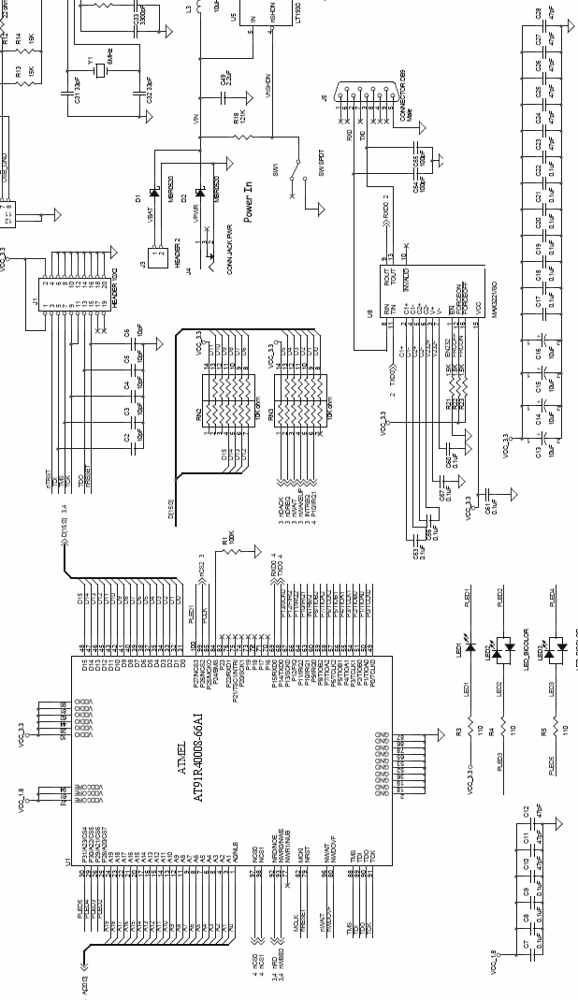

图3-9 原理图局部示例

图中文字：Power In 为“电源输入”；SW SPDT 为“单刀双掷开关”；HEADER 为“排针”；CON JACK PWR 为“电源插座”；LED BLOCK 为“LED 组件”；ATMEL 为厂商名称。器件型号、位号、引脚名、网络标号及数值均保留在原图中。

<!-- source: pdf=80; section=3.4; unit=ch03-094; source_ids=p0080_b001_u00 -->

<a id="src-p80"></a>

>  大多数时候，你会拿到一份硬件框图，帮助解读原理图。不过，我在好几次面试中都被问过：“这张原理图是做什么的？”所以，本节既提供应对这类问题的技巧，也帮助你阅读那些更友好的原理图。

<!-- source: pdf=80; section=3.4; unit=ch03-095; source_ids=p0080_b002_u00 -->
第一次阅读原理图时，先找连接特别多的方框。这个方法往往还能进一步简化：由于原理图中方框的大小与连线数量成比例，所以找最大的方框就行。处理器很可能就在其中。因为处理器是软件世界的中心，找到它，就有助于找到你最关心的外设。

<!-- source: pdf=80; section=3.4; unit=ch03-096; source_ids=p0080_b003_u00 -->
方框上方是元器件位号（U1），通常也印在 PCB 上。方框内部或下方通常是器件型号。如图3-9所示，这个型号未必是你熟悉的形式。例如，处理器手册可能写着 Atmel AT91R40008，原理图上却写 AT91R40008-66AI，更长、更拗口。不过，原理图不仅说明怎样在印刷电路板上制作走线，也说明怎样用正确的元器件组装电路板。处理器型号多出来的字母，描述的是处理器的封装，以及它如何安装到电路板上。

<!-- source: pdf=80; section=3.4; unit=ch03-097; source_ids=p0080_b004_u00 -->
到这里，你已经找到两到四个最大和／或连接最多的元器件。查看型号，确定它们究竟是什么。希望你已经找到处理器了。（如果没有，就继续找。）你可能还找到了一些存储器。以前，存储器接在地址总线上，所以连接数量几乎与处理器一样多，通常有8条或更多地址线，以及16条数据线，如图3-9所示。许多较新的处理器内置的存储器已经足够，不再需要外部 RAM 或闪存，因此除了处理器，你可能找不到其他大型元器件。

<!-- source: pdf=80; section=3.4; unit=ch03-098; source_ids=p0080_b005_u00 -->
接下来，找连接器，它们可能画成方框或长方形。它们的位号用 J 而不是 U（例如 J3）。系统应该有一个电源连接器（至少两个引脚：电源和地）。大概还有一个用于调试处理器的连接器（图3-9中的 J1）。其余连接器也能透露不少电路板的信息，因为外部世界正是通过它们与电路板接触的。是否有一个信号很多的连接器，暗示存在子板？是否有连接器带着 RS-232 信号，表明存在串口？是否有连接器的网络标号（线的名称）全部以 USB 或 LCD 开头？这些名称本来就是用来给你提示的。

<!-- source: pdf=80; section=3.4; unit=ch03-099; source_ids=p0080_b006_u00 -->
识别出连接器和较大的芯片之后，就可以开始在脑中建立系统模型（如果还没有硬件框图，也可以画一份）。再回头看那些方框，试试能否通过名称猜出它们的功能。寻找 SENSOR 或 ADC 之类的名称可能会有帮助。第7章还会介绍一些其他信号名称，帮助你找到值得关注的外设。

<!-- source: pdf=81; section=3.4; unit=ch03-100; source_ids=p0081_b001_u00 -->

<a id="src-p81"></a>

>  原理图中的导线可以交叉而不相连。要看交点处是否有圆点，圆点表示连接。原理图很少在十字交叉处放圆点，因为打印出来后，很难看清那里究竟有没有点。

<!-- source: pdf=81; section=3.4; unit=ch03-101; source_ids=p0081_b002_u00 -->
到目前为止，我们一直忽略那些不是方框形状的元器件。虽然看懂电阻网络、模拟滤波器或运算放大器电路很有用，但你不必马上就会。图3-10展示了一些常见的原理图元器件及其名称，不过它们在你的原理图里可能画得略有不同。有了这些知识，你就能有针对性地询问某个电阻的作用。“延伸阅读”中有一些增进硬件知识的建议。

<!-- source: pdf=81; section=3.4; unit=ch03-102; source_ids=p0081_b004_u00 -->
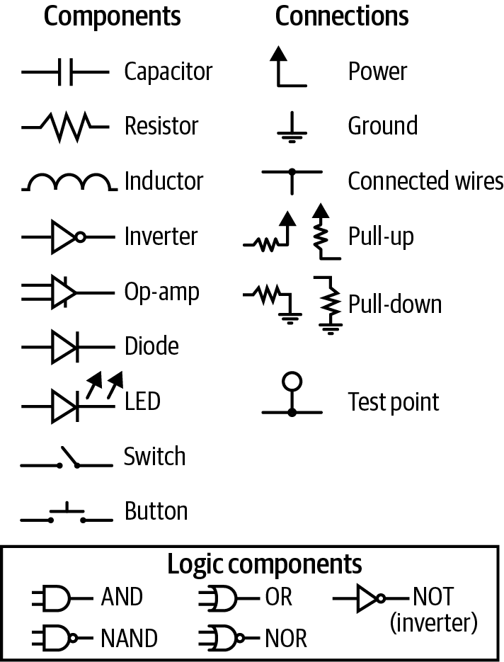

图3-10 常见的原理图元器件

图中文字：

- 元器件（Components）：电容（Capacitor）、电阻（Resistor）、电感（Inductor）、反相器（Inverter）、运算放大器（Op-amp）、二极管（Diode）、发光二极管（LED）、开关（Switch）、按钮（Button）。
- 连接（Connections）：电源（Power）、地（Ground）、相连的导线（Connected wires）、上拉（Pull-up）、下拉（Pull-down）、测试点（Test point）。
- 逻辑元件（Logic components）：与门（AND）、与非门（NAND）、或门（OR）、或非门（NOR）、非门／反相器（NOT / inverter）。

<!-- source: pdf=81; section=3.4; unit=ch03-103; source_ids=p0081_b005_u00 -->
我建议忽略方框之外的所有东西，但有两个例外。首先，LED、开关和按钮通常都与处理器相连。原理图会告诉你，这类元器件接到了处理器的哪条信号线上，让你知道该从哪里读取开关状态，或怎样点亮 LED。

<!-- source: pdf=81-82; section=3.4; unit=ch03-104; source_ids=p0081_b006_u00,p0082_b000_u00,p0082_b001_u00 -->

<a id="src-p82"></a>

另一类值得注意的元器件，是接在处理器和电源之间的电阻，称为上拉电阻（pull-up resistor），因为它们把电压向上拉（拉向电源电压）。通常，上拉的作用相对较弱（电阻值较大），所以处理器仍然能把被上拉的 I/O 线驱动为低电平。上拉意味着，处理器未驱动这条线时，线上信号会被确定为高电平。处理器可能有内部上拉，使其输入即使没有外部连接，也具备默认状态。还要注意，也有下拉电阻（pull-down resistor），也就是接地的电阻。关于上拉的说明同样适用于下拉，只是默认逻辑电平为低，而非高。既不上拉也不下拉的输入，没有被驱动为逻辑高或逻辑低，因此处于悬空（floating）状态（也称 hi-Z、高阻态或三态）。

<!-- source: pdf=82; section=3.5; unit=ch03-105; source_ids=p0082_b002_u00,p0082_b003_u00,p0082_b004_u00 -->
## 原理图阅读练习：Arduino！ {#ch03-toc-011}

Arduino 是很棒的小电路板，设计宗旨就是易于使用，让艺术家、学生，乃至所有人都能接触电子技术。对许多人而言，Arduino 是进入嵌入式系统世界的大门，也是他们第一次编程控制的硬件。我想展示的是，怎样把眼中的 Arduino 从一个不透明的系统，变成一块原理图看得懂的电路板。

<!-- source: pdf=82; section=3.5; unit=ch03-106; source_ids=p0082_b005_u00 -->
图3-11是 Arduino UNO 原理图所对应的硬件框图。右下角是微控制器。这是电路板面向最终用户的核心部分。I/O 引脚直接来自微控制器，但在电路板上又相对独立（而且是系统的一项重要功能），所以单独画成一个方框。

<!-- source: pdf=82; section=3.5; unit=ch03-107; source_ids=p0082_b007_u00 -->
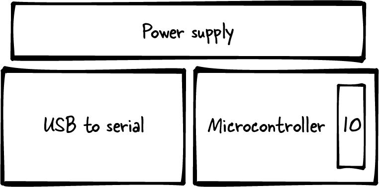

图3-11 Arduino 硬件框图

图中文字：Power supply 为“电源”，USB to serial 为“USB 转串口”，Microcontroller 为“微控制器”，IO 为“输入／输出”。

<!-- source: pdf=82; section=3.5; unit=ch03-108; source_ids=p0082_b008_u00 -->
微控制器左边有一个 USB 转 UART（或 USB 转串口）方框，表示负责在计算机所说的“语言”和微控制器所理解的“语言”之间转换的硬件。它既用于把新代码烧写到电路板，也用于在代码运行时打印数据。在大多数框图里，这部分只会是个小方框；它是次要功能，有时甚至只是线缆的一部分。不过，我正准备引出原理图，所以这里让它的大小与原理图中所占的空间大致相当。

<!-- source: pdf=82; section=3.5; unit=ch03-109; source_ids=p0082_b009_u00 -->
最上面的最后一个方框是电源子系统。Arduino 板有点特别，因为既可以接 USB，也可以接5 V直流墙插电源适配器。想想身边的电子设备（手机、鼠标、网络摄像头），通常只能二选一。但这块板子两种电源都接上也不会烧毁。正因为这种灵活性，它的电源子系统更加复杂。

<!-- source: pdf=83; section=3.5; unit=ch03-110; source_ids=p0083_b000_u00,p0083_b002_u00 -->

<a id="src-p83"></a>

看看图3-12。最好自己打印一份，再拿出几支彩色铅笔。

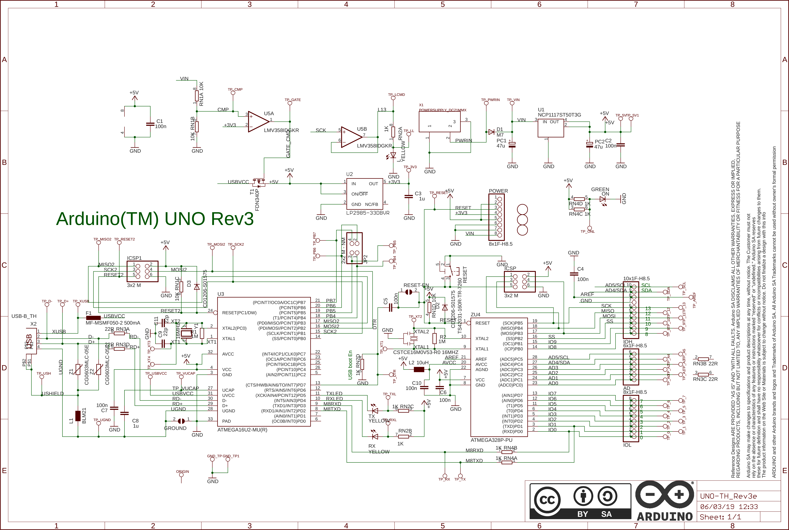

图3-12 Arduino 原理图，取自 <https://content.arduino.cc/assets/UNO-TH_Rev3e_sch.pdf>

图中文字对应：Arduino(TM) UNO Rev3 为产品名称；POWER 为“电源”；GREEN 为“绿色”；YELLOW 为“黄色”；ON 为“开启”；RESET 为“复位”；GROUND / GND 为“地”；USB boot En 为“USB 引导使能”；IN、OUT 分别为“输入”“输出”；ON/OFF 为“开／关”；Sheet: 1/1 为“图纸：1/1”。型号、元件位号、信号名、接口缩写、引脚号、电压、频率和元件数值保持原样。图纸标识为 UNO-TH_Rev3e，时间标记为06/03/19 12:33；许可图标为 CC BY SA。

图中声明完整译文：参考设计按“现状”并“包含所有缺陷”提供。Arduino SA 不对产品作出任何其他明示或默示保证，包括但不限于适销性或特定用途适用性的默示保证。

Arduino SA 可随时修改规格和产品说明，恕不另行通知。客户不得依赖标为“保留”或“未定义”的任何功能或指令是否存在，或其具有何种特性。Arduino SA 保留这些内容供今后定义，对未来修改造成的任何冲突或不兼容概不负责。网站或材料中的产品信息可能变更，恕不另行通知。请勿依据这些信息完成设计定稿。

ARDUINO 及其他 Arduino 品牌、标识是 Arduino SA 的商标。未经所有者正式许可，不得使用 Arduino SA 的任何商标。

<!-- source: pdf=83; section=3.5; unit=ch03-111; source_ids=p0083_b003_u00 -->
在原理图上叠画硬件框图。微控制器在右下方，I/O 引脚在最右侧。接着是一些无源元件（我们不关心，所以跳过那些烦人的符号）。它们左边是 USB 转 UART 部分（再往左还有更多烦人的无源元件，以及 X2 处的 USB 连接器）。

<!-- source: pdf=83; section=3.5; unit=ch03-112; source_ids=p0083_b004_u00 -->
最上面是电源子系统。找一个标着 POWER 的连接器，它上方的所有东西都与电源有关。最后，你用彩色铅笔画出的图应该与图3-11类似。

<!-- source: pdf=83-84; section=3.5; unit=ch03-113; source_ids=p0083_b005_u00,p0083_b006_u00,p0083_b007_u00,p0084_b000_u00 -->

<a id="src-p84"></a>

原理图上还能找到什么？

- 如果采用“越大的东西越有意思”的方法，就会找到 ATMEGA16U2-MU(R) 和 ATMEGA328P-PU 这两颗大芯片。根据我给出的框图，ATMEGA328P-PU 是供用户使用的微控制器，另一颗属于 USB 转 UART 部分。
- 能找到 LED 吗？除了名称中包含颜色，还可以找带箭头的三角形符号。在你自己的原理图上，这些都很有用。
- 找找 ICSP 和 ICSP1（在芯片上方）。这些连接器用于制造时对电路板进行编程。如果你有一块 Arduino UNO，能在板上找到它们吗？它们与通用 I/O 连接器有何不同？

<!-- source: pdf=84; section=3.5; unit=ch03-114; source_ids=p0084_b001_u00 -->
如果你花点时间找 ATMEGA328 的数据手册，会发现开头有两页信息密集、甚至可能难以读懂的摘要。接下来是引脚说明，看起来与你板上的实体处理器相似。手册会比较不同但相近的处理器，也会介绍处理器内核（AVRCore）。这为了解微控制器设计提供了一个有趣视角，不过编译器会借助编程语言的魔法，把其中大部分细节隐藏起来。手册会有一章讲存储器，包括 Flash、RAM、EEPROM，然后分别介绍各个子系统和通信协议。基本信息都在里面。

<!-- source: pdf=84; section=3.5; unit=ch03-115; source_ids=p0084_b002_u00 -->
如果一直跟着看，你可能已经注意到，这颗芯片的厂商是 Microchip。在 Microchip 网站上找到这款处理器后，会发现一页又一页更深入的文档和应用笔记（ADC 基础、参考手册、勘误，以及其他几十种材料）。厂商提供这些信息，是因为他们想卖芯片。

<!-- source: pdf=84; section=3.6; unit=ch03-116; source_ids=p0084_b003_u00,p0084_b004_u00 -->
## 保护好你的电路板 {#ch03-toc-012}

数据手册、用户手册和原理图都只是纸张（或电子形式的纸张）。现在来碰一碰硬件吧。等一下：伸手拿之前，要知道，触摸硬件可能造成静电放电，把它损坏（尤其是在干燥天气里刚脱下抓绒外套的时候）。

<!-- source: pdf=84; section=3.6; unit=ch03-117; source_ids=p0084_b005_u00 -->
向硬件工程师索取保护电路板的工具。留意电路板放在什么表面上（支撑柱能让电路板远离那些可能淌着咖啡的桌面！）。搬动时始终把它放回原来的袋子；那个袋子很可能由防静电材料制成，能保护电路板。防静电垫价格便宜，也会迫使你在桌上专门留出一块地方放硬件（即使不用防静电腕带，也比让一本掉落的书砸到硬件，或者让咖啡洒在上面强）。

<!-- source: pdf=84; section=3.6; unit=ch03-118; source_ids=p0084_b006_u00 -->
如果可能，给电路板加线时，除了焊接，也用胶把线固定住。返修飞线断裂，曾浪费过人们很多时间。同样，如果连接器没有防呆设计、并非只能以一种方向插入，就拍一张电路板照片，或记下连接器的正确插接方向。

<!-- source: pdf=84; section=3.6; unit=ch03-119; source_ids=p0084_b007_u00 -->
我喜欢把硬件接到可以一键断电的插排上（最好别让计算机也接在同一个插排上）。有一套能紧急停止所有东西的办法，真的很有用。还要记住灭火器在哪儿，以防万一。

<!-- source: pdf=85; section=3.6; unit=ch03-120; source_ids=p0085_b001_u00 -->

<a id="src-p85"></a>

说真的，通常并不会起火，更多时候只是冒出一小缕烟。不过，无论你做了什么，损坏一块电路板大概都不会让人喜欢你。经理或硬件工程师问嵌入式软件要分配多少块板子时，一定要多要一两块备用。名义上，这是为了确认硬件测试能在不止一块板子上正常工作。而且，一旦系统开始初见成效，你的板子最有可能被拿走，给别人展示。至少，这些才是你申请备用板时该说的理由，而不是因为你很可能会弄坏第一块（或者前两块）。

<!-- source: pdf=85; section=3.6; unit=ch03-121; source_ids=p0085_b002_u00 -->
>  制造错误也很常见，尤其是在高密度电路板设计的早期。裸 PCB 会做连通性测试，但要验证焊接连接正确、没有断路也没有短路，能做的终究有限，尤其对于新设计。如果某项功能在一块硬件上不工作，有第二块可供尝试很有用；如果两块结果不同，再有第三块来作判断就更好了。

<!-- source: pdf=85; section=3.7; unit=ch03-122; source_ids=p0085_b003_u00,p0085_b004_u00,p0085_b005_u00,p0085_b006_u00,p0085_b007_u00,p0085_b008_u00,p0085_b009_u00,p0085_b010_u00,p0085_b011_u00,p0085_b012_u00,p0085_b013_u00,p0085_b014_u00,p0085_b015_u00,p0085_b016_u00 -->
## 建立自己的调试工具箱 {#ch03-toc-013}

我很喜欢自己的工具箱，因为它让我在一定程度上不必依赖硬件工程师。工具箱放在桌边，我就能以更安全的方式对电路板做些小改动（用尖嘴钳移动跳线帽，比用手指更不容易损坏电路板）。不算多年积攒的各种跳线、RS-232 公母转接头和半死不活的电池，我的工具箱里有：

- 尖嘴钳
- 镊子（一把当小钳子用，一把真正当镊子用）
- 美工刀
- 数字万用表（马上会详细介绍）
- 电工胶带
- 剪线钳（有剥线钳更好）
- Sharpie 记号笔
- 各种螺丝刀（或一把配多个批头的螺丝刀）
- 手电筒
- 放大镜
- 护目镜
- 扎带（魔术贴式和尼龙束带）

<!-- source: pdf=86; section=3.7; unit=ch03-123; source_ids=p0086_b001_u00 -->

<a id="src-p86"></a>

如果公司有不错的实验室，而且有人把工具按标签归位，那就用实验室的工具（不过自己也要备一套）。如果没有，去一趟五金店，可能会省去以后的许多烦恼。

<!-- source: pdf=86; section=3.7.1; unit=ch03-124; source_ids=p0086_b002_u00,p0086_b003_u00 -->
### 数字万用表 {#ch03-toc-014}

即使不打算置办完整工具箱，我也强烈建议你买一块数字万用表（digital multimeter，DMM）。

<!-- source: pdf=86; section=3.7.1; unit=ch03-125; source_ids=p0086_b004_u00 -->
大约花一顿不错的午饭的钱，就能买到覆盖基本功能的便宜型号。当然，你也可以花掉整整一周的伙食预算，买一块很好的 DMM，但应该没这个必要。作为嵌入式软件工程师，你只需要几种功能。

<!-- source: pdf=86; section=3.7.1; unit=ch03-126; source_ids=p0086_b005_u00 -->
首先，需要电压测量模式。理想情况下，DMM 至少应能以0.1 V的分辨率测量0–20 V，并以0.01 V的分辨率测量0–2 V。使用 DMM 的电压模式，通常只是为了回答一个简单问题：那里到底有没有电压？具备1 mV分辨率的 DMM 偶尔也许不错，但80%的使用场合，都只是在回答这个更粗略的问题：“芯片或元器件究竟有没有供电？”

<!-- source: pdf=86; section=3.7.1; unit=ch03-127; source_ids=p0086_b006_u00 -->
第二重要的是电阻检查模式，通常用欧姆符号（Ω）和三条弧线表示。你大概并不需要知道某个电阻到底有多大；这个模式真正的用途，是判断两个地方是否相连。正如电压模式检查某处有没有电，这个模式回答的是：“这些东西究竟连起来了没有？”

<!-- source: pdf=86; section=3.7.1; unit=ch03-128; source_ids=p0086_b007_u00 -->
为了测量电路板上两点之间的电阻，DMM 会在测试点之间施加很小的电流。只要电路板断电，这就是安全的。除非你清楚自己在做什么，否则不要在电路板通电时使用电阻模式。

<!-- source: pdf=86; section=3.7.1; unit=ch03-129; source_ids=p0086_b008_u00 -->
>  注意只接触要测试的那两个点。沿着排针滑动表笔，寻找会鸣叫的那个引脚，诱惑确实很大（相信我，我懂），但如果同时连到了三个点，这点小电流也可能造成问题。粗暴操作还可能弄坏处理器细小的引脚。动作轻一点！

<!-- source: pdf=86; section=3.7.1; unit=ch03-130; source_ids=p0086_b009_u00 -->
DMM 鸣叫时，表示两支表笔之间没有明显电阻，也就是两点相连（把两支表笔碰在一起，就能确认蜂鸣功能是否打开）。用这个模式，可以迅速判断线缆或走线是否断了。

<!-- source: pdf=86-87; section=3.7.1; unit=ch03-131; source_ids=p0086_b010_u00,p0087_b000_u00 -->

<a id="src-p87"></a>

最后，需要带电流模式的 DMM，用安培或毫安符号（A 或 mA）标示，用来测量系统的耗电情况。性能好的电流模式会让 DMM 贵上不少。不过也有个好消息：如果你需要开发超低功耗产品所必需的精细分辨率，那就需要超出 DMM 能力范围的工具。买一块能测毫安的 DMM 就行；要知道，纳安级型号更贵，大概并不值得。第13章会更详细地介绍低功耗编程及所需工具。

<!-- source: pdf=87; section=3.7.2; unit=ch03-132; source_ids=p0087_b001_u00,p0087_b002_u00 -->
### 示波器与逻辑分析仪 {#ch03-toc-015}

有时，你需要知道电路板上的电信号在做什么。以下三类仪器可以帮助你观察变化中的信号：

<!-- source: pdf=87; section=3.7.2; unit=ch03-133; source_ids=p0087_b003_u00 -->
**传统示波器**

测量模拟信号，通常一次测量两路或四路。数字信号也能作为模拟信号来测，但只看到它在两个位置之间切换，会有些无聊。当然，如果数字信号既不高也不低，而是处在中间，示波器就会帮上大忙。

<!-- source: pdf=87; section=3.7.2; unit=ch03-134; source_ids=p0087_b004_u00 -->
**逻辑分析仪**

只测量数字信号，通常能同时测量很多路（16、32或64路）。过去，逻辑分析仪是庞然大物，设置要花好几天，但设置完成后，往往几个小时就能找到问题。许多现代逻辑分析仪连接计算机，还会协助配置，因此这一步只需很短时间。此外，许多逻辑分析仪带有协议分析器，能解读数字总线，让你方便地看出处理器在输出什么。因此，如果用 SPI 通信总线发送一串字节，协议分析器就会解读总线上的信息。网络分析仪是一种专门的协议分析器，关注网络上的复杂流量。（不过，射频网络分析仪是完全不同的东西，它测量器件在射频范围内的响应特性。）

<!-- source: pdf=87; section=3.7.2; unit=ch03-135; source_ids=p0087_b005_u00 -->
**混合信号示波器**

把传统示波器与逻辑分析仪的功能结合起来，具有两路模拟通道，以及8路或16路数字通道。我个人很喜欢混合信号示波器，因为它能同时观察不同种类的信息。

<!-- source: pdf=87; section=3.7.2; unit=ch03-136; source_ids=p0087_b006_u00 -->
这些仪器相对昂贵，所以通常由大家共用。也可以买到价格合理、连接计算机使用的型号，但它们的功能有时存在不容易察觉的限制。一般来说，一分钱一分货。考虑到它们能节省的调试时间，这是值得的投资。

<!-- source: pdf=87-88; section=3.7.3; unit=ch03-137; source_ids=p0087_b007_u00,p0087_b008_u00,p0088_b000_u00 -->

<a id="src-p88"></a>

### 设置示波器 {#ch03-toc-016}

第一步，确定哪些信号有助于查明问题。接下来，把示波器的地夹接到地。如果有不止一种地（交流地、直流地、模拟地），而你不确定示波器该接哪一个，就问电子工程师。接错地可能损坏示波器。

<!-- source: pdf=88; section=3.7.3; unit=ch03-138; source_ids=p0088_b001_u00 -->
然后，把探头接到感兴趣的信号上。许多处理器的引脚非常小，需要专用探头。另一方面，许多硬件工程师知道软件团队可能要接触某些信号进行调试，因此会在板上设置测试点。也可以请人在所需信号的位置焊上导线，再把探头接到导线上。

<!-- source: pdf=88; section=3.7.3; unit=ch03-139; source_ids=p0088_b002_u00 -->
如果从没设置过示波器，使用时可能会有些畏难。不同示波器的手册各不相同，但它们是寻求帮助的最佳起点（而且大部分可以在线找到）。没有一本通用手册能适用于所有示波器，因此我只能告诉你，翻阅手册时应寻找哪些关键词。

<!-- source: pdf=88; section=3.7.3; unit=ch03-140; source_ids=p0088_b003_u00,p0088_b005_u00 -->
图3-13展示了一种典型的示波器屏幕。最重要的是：时间沿 x 轴推进，电压沿 y 轴变化。这两个轴的刻度都可以配置。

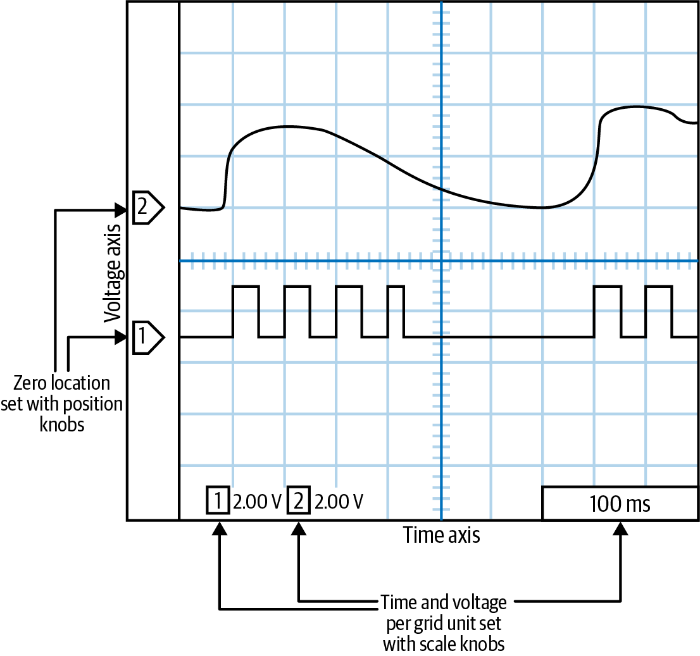

图3-13 简化的示波器屏幕截图

图中文字：Voltage axis 为“电压轴”；Time axis 为“时间轴”；Zero location set with position knobs 为“用位置旋钮设置零点”；Time and voltage per grid unit set with scale knobs 为“用刻度旋钮设置每格的时间和电压”。通道1、2的电压刻度均为2.00 V，时间刻度为100 ms。

<!-- source: pdf=88-89; section=3.7.3; unit=ch03-141; source_ids=p0088_b006_u00,p0089_b002_u00 -->

<a id="src-p89"></a>

示波器的面板上应该有一个调节时间刻度的旋钮。向右旋转后，每一水平格所代表的时间会从比如1 s变成0.5 s（再继续减小到毫秒或微秒范围）。这控制的是整个屏幕的时间尺度。调试时，目标是在能够显示所需内容的前提下，从尽可能大的时基开始。

<!-- source: pdf=89; section=3.7.3; unit=ch03-142; source_ids=p0089_b003_u00 -->
>  如果放大得过头，你会看到奇怪的现象：那些据说是数字信号的东西，会显露出它们真正的（而且古怪的）模拟本色。

<!-- source: pdf=89; section=3.7.3; unit=ch03-143; source_ids=p0089_b004_u00 -->
设好时基后，就要设置电压轴的刻度。有的示波器只有一个旋钮控制所有通道（或探头），需要以其他方式切换通道；有的则每个通道各有一个旋钮。无论哪种，向右转时，每一竖格对应的电压范围都会缩小，波形则被放大（从5 V到2 V，再到毫伏）。

<!-- source: pdf=89; section=3.7.3; unit=ch03-144; source_ids=p0089_b005_u00 -->
如果不确定，就先把时间刻度设为每格约100 ms，电压分辨率设为每格约2 V。之后再根据需要放大或缩小。

<!-- source: pdf=89; section=3.7.3; unit=ch03-145; source_ids=p0089_b006_u00 -->
另一个旋钮设置各通道在屏幕上的位置，也就是它的零电平线。图3-13在屏幕左侧标出了各通道的零电平线。可能每个通道都有一个旋钮，也可能通过切换，让所有通道共用一个。把通道彼此稍微错开，才能看清每一路。（不用的通道可以关闭，大概是按某个按钮。）

<!-- source: pdf=89; section=3.7.3; unit=ch03-146; source_ids=p0089_b007_u00 -->
接下来，寻找设置时间轴零点的旋钮。转动时，一条竖线会在屏幕上左右移动。把它设在中间附近。如果想看某个事件之后发生的情况，也可以放到屏幕左侧；如果想看事件之前发生了什么，就放到右侧。

<!-- source: pdf=89; section=3.7.3; unit=ch03-147; source_ids=p0089_b008_u00 -->
现在，大概可以打开系统，看到一条线在动了。它可能一闪而过，快得看不清具体变化，但这已是个开始。如果什么也没发生，就找标着 Run/Stop 的按钮。你需要让示波器处于 Run（运行）模式。Stop（停止）模式会把显示冻结在某个时刻，让你有机会仔细思考观察结果。Run/Stop 附近可能有个 Single（单次）按钮，它会等待一次触发，然后进入 Stop 模式。也可能有 Auto（自动）按钮，让系统持续触发。

<!-- source: pdf=89; section=3.7.3; unit=ch03-148; source_ids=p0089_b009_u00 -->
>  如果有 Auto 按钮，按之前一定要谨慎。先查清它表示自动触发（auto trigger），还是自动设置（auto set）。前者很有用，后者则会试着替你自动配置示波器。我发现它往往会把配置重设得莫名其妙。

<!-- source: pdf=89-90; section=3.7.3; unit=ch03-149; source_ids=p0089_b010_u00,p0090_b001_u00 -->

<a id="src-p90"></a>

要设置触发，就找触发旋钮。它会显示一条水平线，指示触发电压电平。触发与通道有关，但与其他按通道调节的旋钮不同，通常不能为每个通道分别设置一个触发。相反，还需要额外配置，一般通过屏幕菜单和按钮完成。应该选择那个恰好在感兴趣事件开始（或结束）时发生变化的通道作为触发源。还要选择在上升沿还是下降沿触发，以及示波器触发的频率。如果想观察第一次变化，就设置较长的超时时间；如果想观察最后一次变化，就设置较短的超时时间。

<!-- source: pdf=90; section=3.7.3; unit=ch03-150; source_ids=p0090_b002_u00 -->
还有几件事要注意。除非清楚自己在做什么，否则不要把示波器设为 AC 模式。另外，探头给出的信号与屏幕显示值之间可能相差10倍（或1/10）。这取决于探头，所以如果数值相差一个数量级，就找找10x标记，并切换其设置。

<!-- source: pdf=90; section=3.7.3; unit=ch03-151; source_ids=p0090_b003_u00 -->
如果已经按照我的说明（以及示波器手册）完成设置，却仍然达不到想要的效果，就请更有经验的人帮忙。示波器是强大而有用的工具，但要用好，需要大量练习。刚开始有些挫折，也别灰心。

<!-- source: pdf=90; section=3.8; unit=ch03-152; source_ids=p0090_b004_u00,p0090_b005_u00 -->
## 测试硬件（和软件） {#ch03-toc-017}

我强烈建议你做好拿出工具箱、DMM 和示波器的准备，不过，如果还没准备好独立操作，合理地交给硬件工程师也可以。身为软件人员，更重要的是尽可能写好用于测试硬件的软件，而且测试方式要便于调试。

<!-- source: pdf=90; section=3.8; unit=ch03-153; source_ids=p0090_b006_u00 -->
嵌入式系统中常见三类测试。第一类是上电自检（power-on self-test，POST），每次系统启动时都会运行，即使代码已经发布也一样。它会确认所有硬件元器件工作正常，并检查安全运行系统所需的其他条件。POST 检查的内容越多，启动时间就越长，因此这里存在可能影响客户的权衡。POST 完成后，系统就准备好供客户使用了。

<!-- source: pdf=90; section=3.8; unit=ch03-154; source_ids=p0090_b007_u00 -->
>  理想情况下，启动时打印出的所有 POST 调试消息，都应该在之后仍可访问。无论是软件版本字符串，还是连接的传感器类型，总会有你需要这些信息、却不想重新断电上电的时候。

<!-- source: pdf=90; section=3.8; unit=ch03-155; source_ids=p0090_b008_u00 -->
第二类是单元测试（unit test）。每次软件发布之前都应该运行单元测试，但它们未必适合每次启动时都执行，也许是因为耗时太长、会把系统恢复为出厂默认状态，或者会在屏幕上显示不好看的测试图案。这些测试用于确认软硬件能够按预期协同工作。

<!-- source: pdf=91; section=3.8; unit=ch03-156; source_ids=p0091_b001_u00 -->

<a id="src-p91"></a>

“单元测试”对不同的人意味着不同的东西。对我而言，单元测试是验证某个源代码单元已可供使用的自动化测试代码。有些开发者希望测试覆盖代码中所有可能的执行路径。这会让单元测试套件庞大而笨重，也就成了人们在嵌入式系统中不做单元测试的理由。我所说的单元测试，旨在检查基本功能，以及最有可能遇到的边界情况。这样的做法让我能把测试纳入开发过程，并在交付后继续保留。

<!-- source: pdf=91; section=3.8; unit=ch03-157; source_ids=p0091_b002_u00 -->
>  了解所在行业（或管理层）对单元测试的期望。如果他们希望检查所有软件路径，要确保你和他们都明白，这需要多少工作和代码。

<!-- source: pdf=91; section=3.8; unit=ch03-158; source_ids=p0091_b003_u00 -->
有些单元测试可以在系统硬件之外运行（例如按照第2章的建议，在沙箱中验证算法）。对于必须在硬件上运行的测试，如果条件允许，我鼓励你把它们保留在量产代码里，并允许在现场满足某组特殊条件后运行（例如，“系统启动时，按住这两个按钮，再把眼睛对成斗鸡眼”）。这样不仅质量部门可以使用这些测试，而且你可能发现，把单元测试作为现场的第一道检查，就能判断系统硬件是否表现异常。

<!-- source: pdf=91; section=3.8; unit=ch03-159; source_ids=p0091_b004_u00 -->
第三类，也是最后一类，是初始调试过程中编写的测试，通常是因为某个子系统没有按预期工作。它们有时是一次性的检查，后来会被更全面的测试取代，或纳入单元测试。临时的初始调试代码完全可以接受。整个过程的目标不是写出传世源代码，而是构建系统。而且，只要这类代码已经提交到版本控制系统，删除也没关系，因为以后发现还需要时，随时可以恢复那个文件。

<!-- source: pdf=91; section=3.8.1; unit=ch03-160; source_ids=p0091_b005_u00,p0091_b006_u00 -->
### 编写测试 {#ch03-toc-018}

如前所述，控制外设的代码（以及相关测试）通常会在原理图完成的过程中编写。好消息是，你刚刚花时间读过数据手册，已经大致知道如何实现这些代码。坏消息是，在等待电路板到货期间，你可能已经为六种外设写好了驱动，才终于有机会让软件与硬件集成。

<!-- source: pdf=92; section=3.8.1; unit=ch03-161; source_ids=p0092_b001_u00,p0092_b002_u00,p0092_b003_u00,p0092_b004_u00 -->

<a id="src-p92"></a>

第2章中，我们有一个通过 SPI 通信协议连接闪存器件的系统（图3-14再次展示了它的部分原理图）。我们需要测试什么，又需要哪些工具来验证结果？

- I/O 线受软件控制（用 DMM 进行外部验证）。
- SPI 能够收发字节（用逻辑分析仪进行外部验证）。
- 闪存能够读写（内部验证；通过调试子系统输出结果）。

<!-- source: pdf=92; section=3.8.1; unit=ch03-162; source_ids=p0092_b006_u00 -->
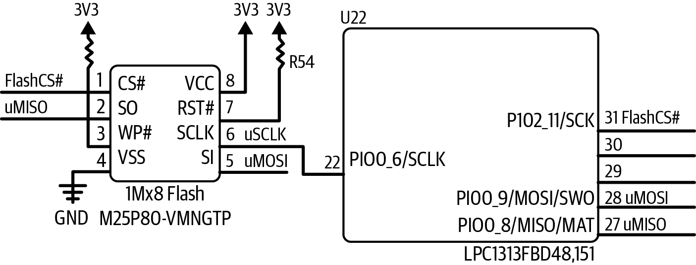

图3-14 闪存原理图局部

图中文字：1Mx8 Flash 为“1M×8闪存”；GND 为“地”。闪存型号 M25P80-VMNGTP、处理器型号 LPC1313FBD48,151，以及全部信号名、引脚名、位号和数值保持原样。

<!-- source: pdf=92; section=3.8.1; unit=ch03-163; source_ids=p0092_b007_u00 -->
为了让初始调试容易进行，你需要能够分别完成以上每一项。也许你会先运行包揽所有检查的闪存测试。如果成功，就知道另外两项也正常。但如果失败，就需要在必要时用另外两项协助调试。

<!-- source: pdf=92; section=3.8.1; unit=ch03-164; source_ids=p0092_b008_u00 -->
其他章节会介绍如何控制 I/O 线（第4章），以及更多有关 SPI 的内容（第7章），因此眼下先专注于可以为闪存编写哪些测试。闪存的工作原理并不是这里的重点，不过，你可以阅读 Macronix MX25V8035 闪存的数据手册，检验自己的数据手册阅读能力（在 Google、DigiKey 或厂商网站上搜索这个型号）。

<!-- source: pdf=92; section=3.8.2; unit=ch03-165; source_ids=p0092_b009_u00,p0092_b010_u00 -->
### 闪存测试示例 {#ch03-toc-019}

闪存是一种非易失性存储器（nonvolatile memory），所以断电后内容不会被清除。其他非易失性存储器还包括 ROM（只读存储器）和电可擦可编程只读存储器（EEPROM）。

<!-- source: pdf=92; section=3.8.2; unit=ch03-166; source_ids=p0092_b011_u00 -->
>  易失性存储器在断电重新上电后不会保留原有值。易失性存储器有不同种类，但都属于某种 RAM。

<!-- source: pdf=93; section=3.8.2; unit=ch03-167; source_ids=p0093_b000_u00 -->

<a id="src-p93"></a>

与 EEPROM 一样，闪存也可以擦除和写入。不过，大多数 EEPROM 允许一次擦除、写入一个字节。闪存也许能一次写入一个字节，但写之前必须擦除整个扇区。扇区大小取决于闪存（通常闪存容量越大，每个扇区也越大）。本例测试的器件，每个扇区为4千字节（即4,096字节），整颗芯片容量为8 Mb（1 MB，或256个扇区）。闪存通常比 EEPROM 容量更大、功耗更低。不过，EEPROM 有更小容量的型号，因此仍然有用。

<!-- source: pdf=93; section=3.8.2; unit=ch03-168; source_ids=p0093_b001_u00 -->
编写初始调试测试时，闪存芯片中没有什么内容需要保留。对于 POST，则确实不应该修改闪存，因为系统可能正在使用它（存储版本和图形数据）。对于单元测试，我们希望测试后恢复原状，但也许可以对此设定一些限制条件。

<!-- source: pdf=93; section=3.8.2; unit=ch03-169; source_ids=p0093_b002_u00,p0093_b003_u00 -->
测试通常接受三个参数：目标闪存地址，以便在未使用（或非关键）的扇区上测试；一个内存指针；以及内存长度。内存长度就是闪存测试将保存到 RAM 中的数据量。如果内存与扇区一样大，就不会丢失闪存中的数据。下面的函数原型展示了三种测试：一个运行其他测试的总测试（返回遇到的错误数量），一个尝试从闪存读取数据的测试（返回实际读到的字节数），以及一个尝试向闪存写入数据的测试（返回写入的字节数）：

```c
int FlashTest(uint32_t address, uint8_t *memory, uint16_t memLength);
uint16_t FlashRead(uint32_t addr, uint8_t *data, uint16_t dataLen);
uint16_t FlashWrite(uint32_t addr, uint8_t *data, uint16_t dataLen);
```

<!-- source: pdf=93; section=3.8.2; unit=ch03-170; source_ids=p0093_b004_u00 -->
初始调试期间，我们会大量使用 FlashTest，随后把它纳入单元测试，在发生变更或准备发布时按需启用。我们不希望把这个测试作为 POST 的一部分。闪存在经历一定次数的擦写后会磨损（通常为100,000次；数据手册中有这项信息）。此外，上述测试中至少有两个可能破坏数据。

<!-- source: pdf=93; section=3.8.2; unit=ch03-171; source_ids=p0093_b005_u00 -->
而且，启动时也没有必要做这些测试。如果处理器能够与闪存通信，就有理由相信闪存可以正常工作。（可以在闪存中写入包含已知关键值、版本号和／或校验和的头部，检查基本通信。）

<!-- source: pdf=93; section=3.8.2; unit=ch03-172; source_ids=p0093_b006_u00 -->
访问这款闪存有两种方式：单字节访问和多字节块访问。以后运行正式代码时，大概会想用速度更快的块访问。在最初的初始调试和测试阶段，可能应该先用更简单的字节方式，为驱动打好基础。

<!-- source: pdf=93; section=3.8.2.1; unit=ch03-173; source_ids=p0093_b007_u00,p0093_b008_u00 -->
#### 测试1：读取已有数据

验证能够从闪存读取数据，实际上也就验证了 I/O 线已配置为 SPI 端口、SPI 端口配置正确，以及你理解闪存命令协议的基本内容。

<!-- source: pdf=94; section=3.8.2.1; unit=ch03-174; source_ids=p0094_b000_u00,p0094_b001_u00 -->

<a id="src-p94"></a>

这项测试会从扇区中尽可能多地读出数据，以便之后写回。下面是 FlashTest 的开头：

```c
// Test 1: Read existing data in a block to make sure it’s possible
dataLen = FlashRead(startAddress, memory, memLength);
if (dataLen != memLength) {
  // read less than desired, note error
  Log(LogUnitTest, LogLevelError, "Flash test: truncation on byte read");
  memLength = dataLen;
  error++;
}
```

<!-- source: pdf=94; section=3.8.2.1; unit=ch03-175; source_ids=p0094_b002_u00 -->
注意，这里不验证数据内容，因为我们不知道调用这个函数时，闪存芯片是否为空。如果编写的是 POST，就可以执行这次读取，再检查数据是否有效（然后停止测试，因为这已足够完成上电检查）。

<!-- source: pdf=94; section=3.8.2.2; unit=ch03-176; source_ids=p0094_b003_u00,p0094_b004_u00,p0094_b005_u00,p0094_b006_u00 -->
#### 测试2：字节访问

下一个测试先擦除扇区中的数据，然后一次写一个字节，把闪存填上数据。我们要写入会变化的内容，这样才能确认命令确实有效。我喜欢写入基于地址、加上一个偏移量的值。（有这个偏移量，就能知道自己不是误把地址读回来了。）

```c
FlashEraseSector(startAddress);

// want to put in an incrementing value but don't want it to be
// the address
addValue = 0x55;
for (i=0; i< memLength; i++) {
  value = i + addValue;
  dataLen = FlashWrite(startAddress + i, &value, 1);
  if (dataLen != 1) {
    Log (LogUnitTest, LogLevelError, "Flash test: byte write error.");
    error++;
  }
}
```

<!-- source: pdf=94; section=3.8.2.2; unit=ch03-177; source_ids=p0094_b007_u00 -->
完成这项检查，还需要逐字节读回数据，并验证每个地址的值都符合预期（address + addValue）。

<!-- source: pdf=94-95; section=3.8.2.3; unit=ch03-178; source_ids=p0094_b008_u00,p0094_b009_u00,p0095_b001_u00 -->

<a id="src-p95"></a>

#### 测试3：块访问

现在，闪存里已经有了刚写入的数据。接下来，通过写回原始数据，确认块访问正常。这意味着首先还要再擦除一次扇区：

```c
FlashEraseSector(startAddress);
dataLen = FlashWrite(startAddress, memory, memLength);
if (dataLen != memLength) {
  LogWithNum(LogUnitTest, LogLevelError,
    "Flash test: block write error, len ", dataLen);
  error++;
}
```

<!-- source: pdf=95; section=3.8.2.3; unit=ch03-179; source_ids=p0095_b002_u00 -->
最后，再逐字节读取，验证这些数据。通过测试2，我们已经知道这种读取方式正常。如果结果正确，就知道本项测试中的块写入正常，测试1中的块读取也正常。最后把错误数量返回给上层验证代码。

<!-- source: pdf=95; section=3.8.2.3; unit=ch03-180; source_ids=p0095_b003_u00 -->
>  这项测试检查的是闪存驱动软件，并没有检查闪存是否存在卡死位（本应变化却始终不变的位）。制造测试可以确认所有位都能变化，不过，大多数闪存在交到你手上之前就已经这样检查过了。

<!-- source: pdf=95; section=3.8.2.4; unit=ch03-181; source_ids=p0095_b004_u00,p0095_b005_u00 -->
#### 测试小结

如果电路板通过这三项测试，就可以确信闪存硬件和软件都能正常工作，满足初始调试测试和单元测试的需要。

<!-- source: pdf=95; section=3.8.2.4; unit=ch03-182; source_ids=p0095_b006_u00,p0095_b007_u00,p0095_b008_u00,p0095_b009_u00,p0095_b010_u00,p0095_b011_u00 -->
对于大多数类型的存储器，这里展示的模式是一个良好的起点：

1. 读取原始数据。
2. 写入会变化、但遵循某种公式的数据。
3. 验证数据。
4. 写回原始数据。
5. 验证原始数据。

<!-- source: pdf=95; section=3.8.2.4; unit=ch03-183; source_ids=p0095_b012_u00 -->
不过，外设还有许多其他类型，这里无法全部介绍。虽然自动化测试最好，但某些测试需要外部验证，例如在 LCD 上显示由色块和线条组成的图案，验证它的驱动。有些测试需要模拟外部输入，才能检查传感元件。

<!-- source: pdf=95; section=3.8.2.4; unit=ch03-184; source_ids=p0095_b013_u00 -->
对于每一个外设和软件子系统，都应想一想，哪些测试能让你确信它可靠地按预期工作。这听起来不难，实际上却可能很难。设计良好的测试，是让软件变得出色的要素之一。

<!-- source: pdf=96; section=3.8.3; unit=ch03-185; source_ids=p0096_b000_u00,p0096_b001_u00 -->

<a id="src-p96"></a>

### 命令与响应 {#ch03-toc-020}

假设你采纳了上一节的建议，为每一部分硬件都编写了测试函数。初始调试时，你制作了一个特殊固件映像，在上电后逐一执行测试。如果其中某项失败，你和硬件工程师可能只想反复运行这一项，于是重新编译、重新加载。接着，又想对另一项测试做同样的事，于是再次编译、加载。再换一项，又来一遍。这种“重新编译—重新加载”的循环越来越烦人。要是能直接向嵌入式系统发送命令，让它按需运行测试，岂不是更轻松？

<!-- source: pdf=96; section=3.8.3; unit=ch03-186; source_ids=p0096_b002_u00 -->
嵌入式系统往往没有计算机（甚至智能手机）那样丰富的用户界面。许多系统通过命令行控制，甚至带屏幕的系统也常用命令行接口调试。本节首先介绍如何在 C 中，利用命令处理跳转表中的函数指针发送命令。这个巧妙的问题及其解法，让我有机会介绍经典的命令模式（command pattern）；无论使用哪种语言，这都是值得了解的模式。

<!-- source: pdf=96; section=3.8.3; unit=ch03-187; source_ids=p0096_b003_u00,p0096_b005_u00 -->
图3-15展示了自动化命令处理器的一些高层目标：让我们能从 PC 上的串口终端发送命令，并从被测单元获得响应。

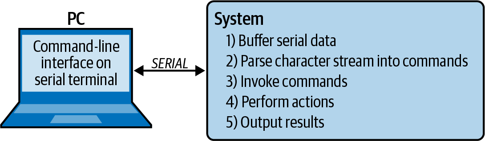

图3-15 命令处理器的目标

图中文字：PC 端是“串口终端上的命令行接口”，经 SERIAL（串行连接）与 System（系统）双向通信。系统执行：1）缓冲串口数据；2）把字符流解析为命令；3）调用命令；4）执行动作；5）输出结果。

<!-- source: pdf=96; section=3.8.3; unit=ch03-188; source_ids=p0096_b006_u00 -->
读入一些数据以后，代码就需要判断该调用哪个函数。一个带命令表的小型解释器，能让周围人的工作轻松不少。把接口与实际测试代码分离，也更便于今后朝事先没有预料到的方向扩展。

<!-- source: pdf=96-97; section=3.8.3.1; unit=ch03-189; source_ids=p0096_b007_u00,p0096_b008_u00,p0096_b009_u00,p0096_b010_u00,p0096_b011_u00,p0097_b000_u00,p0097_b001_u00 -->

<a id="src-p97"></a>

#### 创建命令

先列出一小组想实现的命令：

- **代码版本**：输出版本信息。
- **测试闪存**：运行闪存单元测试，完成后打印错误数量。
- **闪烁 LED**：让 LED 按给定频率闪烁。
- **帮助**：列出可用命令，并为每条命令提供一行说明。

<!-- source: pdf=97; section=3.8.3.1; unit=ch03-190; source_ids=p0097_b002_u00 -->
实现几个命令之后，随着开发推进，继续添加命令应该相当容易。

<!-- source: pdf=97; section=3.8.3.1; unit=ch03-191; source_ids=p0097_b003_u00 -->
我将展示如何用 C 实现，因为这大概是最让人发怵的实现方式。C++、Java 等面向对象语言，可以利用对象以更友好的方式实现这些功能。不过，C 的实现通常更小，而且一般也更快，所以选择实现方式时，要把这一点考虑进去。如果不熟悉 C 的函数指针，可以先看“函数指针没那么可怕”旁栏。

<!-- source: pdf=97; section=3.8.3.1; unit=ch03-192; source_ids=p0097_b004_u00,p0097_b005_u00 -->
每个可调用的命令，都由一个名称、一个待调用的函数，以及一条帮助字符串组成：

```c
typedef void(*functionPointerType)(void);
struct commandStruct {
  char const *name;
  functionPointerType execute;
  char const *help;
};
```

<!-- source: pdf=97; section=3.8.3.1; unit=ch03-193; source_ids=p0097_b006_u00,p0097_b007_u00 -->
用这些结构组成数组，就得到了命令列表：

```c
const struct commandStruct commands[] ={
  {"ver", CmdVersion,
    "Display firmware version"},
  {"flashTest", CmdFlashTest,
    "Runs the flash unit test, prints number of errors upon completion"},
  {"blinkLed", CmdBlinkLed,
    "Sets the LED to blink at a desired rate (parameter: frequency (Hz))"},
  {"help", CmdHelp,
    "Prints out help messages"},
  {"",0,""} //End of table indicator. MUST BE LAST!!!
};
```

<!-- source: pdf=97; section=3.8.3.1; unit=ch03-194; source_ids=p0097_b008_u00,p0097_b009_u00 -->
命令执行函数 CmdVersion、CmdFlashTest、CmdBlinkLed 和 CmdHelp 在别处实现。需要参数的命令，必须与解析器配合，从字符流中取得参数。这不仅简化了这里的代码，也带来更大灵活性，让各条命令自行规定使用条件，比如参数的数量和类型。注意，帮助命令有些特殊：它会把表中所有项的名称和帮助字符串都打印出来。

<!-- source: pdf=98; section=3.8.3.sidebar; unit=ch03-195; source_ids=p0098_b000_u00,p0098_b001_u00,p0098_b002_u00 -->

<a id="src-p98"></a>

#### 旁栏：函数指针没那么可怕

你能想象一种情况：直到程序已经运行，才知道自己想运行哪个函数吗？例如，你想对来自传感器的数据，选用几种信号处理算法中的某一种。最初可以采用由一个变量控制的 switch 语句：

```c
  switch (algorithm) {
    case kFIRFilter:
      return fir(data, dataLen);
    case kIIRFilter:
      return iir(data, dataLen);
    ...
  }
```

<!-- source: pdf=98; section=3.8.3.sidebar; unit=ch03-196; source_ids=p0098_b003_u00 -->
现在，想改变算法时，就发送命令或按下按钮，让 algorithm 变量发生变化。如果数据处理持续进行，即使没有更换算法，系统仍然需要执行 switch 语句。

<!-- source: pdf=98; section=3.8.3.sidebar; unit=ch03-197; source_ids=p0098_b004_u00 -->
在面向对象语言中，可以使用指向接口的引用。每个算法对象都实现一个同名函数（在这个信号处理例子里，我们把它叫作 filter）。需要改变算法时，调用方对象就会变化。根据所用语言，接口实现可能通过关键字或继承来表示。

<!-- source: pdf=98; section=3.8.3.sidebar; unit=ch03-198; source_ids=p0098_b005_u00 -->
C 没有这些特性（而且由于编译器限制，你的系统也可能禁止在 C++ 中使用继承）。于是就轮到函数指针登场了，它们能做同样的事。

<!-- source: pdf=98; section=3.8.3.sidebar; unit=ch03-199; source_ids=p0098_b006_u00,p0098_b007_u00 -->
声明函数指针，需要先知道将要放进去的函数的原型。对于我们的 switch 语句，这个函数应接受数据指针和数据长度，不返回任何值。不过，它可以通过修改第一个参数所指向的内容来给出结果。其中一个函数的原型如下：

```c
void fir(uint16_t* data, uint16_t dataLen);
```

<!-- source: pdf=98; section=3.8.3.sidebar; unit=ch03-200; source_ids=p0098_b008_u00,p0098_b009_u00 -->
现在，去掉函数名，换成一个星号和一个通用名称，再用括号括起来：

```c
void (*filter)(uint16_t* data, uint16_t dataLen);
```

<!-- source: pdf=98; section=3.8.3.sidebar; unit=ch03-201; source_ids=p0098_b010_u00,p0098_b011_u00 -->
不必再修改 algorithm 变量、调用 switch 语句选择函数，而是只在需要时更换算法，然后调用函数指针。这有两种写法：隐式写法（下面左边）和显式写法（右边）。它们等价，只是语法形式不同：

```c
  filter = fir;           // or filter = &fir;
  filter(data, dataLen);  // or (*filter)(data,dataLen);
```

<!-- source: pdf=98-99; section=3.8.3.sidebar; unit=ch03-202; source_ids=p0098_b012_u00,p0099_b000_u00 -->

<a id="src-p99"></a>

熟悉函数指针的概念之后，当代码需要适应运行环境时，它会成为有力的工具。函数指针的一些常见用途包括：本章介绍的命令结构、用于通知事件完成的回调，以及将按钮按下映射为与当前上下文有关的动作。

<!-- source: pdf=99; section=3.8.3.sidebar; unit=ch03-203; source_ids=p0099_b001_u00 -->
有一点要注意：过度滥用函数指针可能让处理器变慢。有些处理器会试着预测代码接下来往哪里走，并提前加载相应指令。函数指针会妨碍分支预测，因为处理器无法猜出调用之后会执行哪里。不过，如果你已经在考虑如此程度的代码优化，也许可以直接跳到第11章。

<!-- source: pdf=99; section=3.8.3.sidebar; unit=ch03-204; source_ids=p0099_b002_u00 -->
但是，其他在运行时选择函数调用的方法，同样会干扰分支预测（比如开头的 switch 语句）。除非已经到了手工调整汇编代码的阶段，否则通常没必要为函数指针这项强大能力带来的一点点减速而担忧。

<!-- source: pdf=99; section=3.8.3.2; unit=ch03-205; source_ids=p0099_b003_u00,p0099_b004_u00 -->
#### 调用命令

命令行客户端发送字符串，指明要运行哪条命令以后，你需要选出这条命令并执行。做法是遍历表格，查找匹配的字符串。找到后，就调用函数指针，执行相应函数。

<!-- source: pdf=99; section=3.8.3.2; unit=ch03-206; source_ids=p0099_b005_u00 -->
与上一节相比，这一部分似乎简单得有些过分。这正是目的所在。嵌入式系统有严格的约束和隐藏的依赖关系，本来就很复杂，有时甚至复杂得可怕。这个模式（以及其他许多模式）的目的，就是把复杂性隔离起来。复杂性不可能彻底消失；一个什么也不做的系统倒是不复杂，但也没什么用。建立表格、编写使用它的解析代码，仍然相当复杂，只不过这些细节可以限制在各自的范围内。

<!-- source: pdf=99; section=3.8.4; unit=ch03-207; source_ids=p0099_b006_u00,p0099_b007_u00 -->
### 命令模式 {#ch03-toc-021}

我们刚才讨论的，是一种正式的经典设计模式。前面介绍的命令处理器，是针对具体问题的战术性解法；而命令模式，则是指导它及其他类似设计的策略。

<!-- source: pdf=99; section=3.8.4; unit=ch03-208; source_ids=p0099_b008_u00 -->
这个模式的总目标，是把命令处理与实际执行的动作解耦。命令模式提供一个用于执行操作的接口。只要系统的某个部分需要向另一部分发出请求，而中间环节又无需知道请求的内容，就可以考虑命令模式。如图3-16所示，它有四个组成部分：

<!-- source: pdf=99-100; section=3.8.4; unit=ch03-209; source_ids=p0099_b009_u00,p0100_b000_u00 -->

<a id="src-p100"></a>

**客户端（Client）**

将接收者映射到命令的表。客户端创建具体命令对象，并建立接收者与命令对象之间的关联。客户端可以在初始化时运行（就像例子里创建数组那样），也可以在运行时动态建立关联。

<!-- source: pdf=100; section=3.8.4; unit=ch03-210; source_ids=p0100_b001_u00 -->
**调用者（Invoker）**

判断何时需要运行命令，并执行命令的解析代码。它对接收者一无所知，对每条命令一视同仁。

<!-- source: pdf=100; section=3.8.4; unit=ch03-211; source_ids=p0100_b002_u00 -->
**命令（Command）**

客户端表中的一项，是执行某个操作的接口。它可以是一个 C++ 类、一个 Java 接口，或一个带有函数指针的 C 结构体。命令接口的一个实例，称为具体命令（concrete command）。

<!-- source: pdf=100; section=3.8.4; unit=ch03-212; source_ids=p0100_b003_u00 -->
**接收者（Receiver）**

知道如何处理请求的函数。发送命令的人（或其他设备），目的就是运行接收者的代码。

<!-- source: pdf=100; section=3.8.4; unit=ch03-213; source_ids=p0100_b005_u00 -->
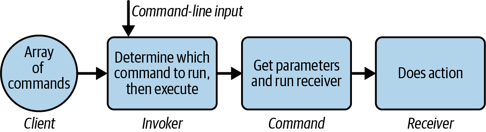

图3-16 命令处理器的工作方式

图中文字与流程：客户端（Client）提供“命令数组”（Array of commands）；调用者（Invoker）接收“命令行输入”（Command-line input），并“确定运行哪条命令，然后执行”；命令（Command）“获取参数并运行接收者”；接收者（Receiver）“执行动作”。

<!-- source: pdf=100; section=3.8.4; unit=ch03-214; source_ids=p0100_b006_u00,p0100_b008_u00 -->
图3-17展示了命令模式各元素的作用。

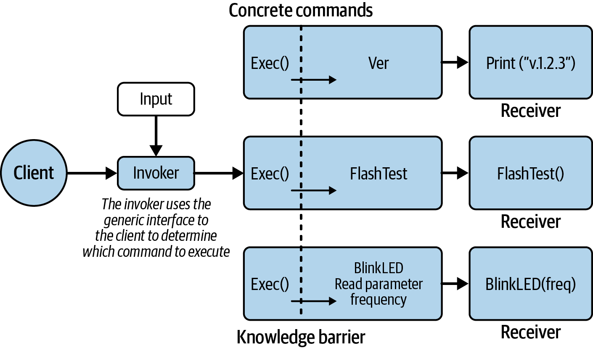

图3-17 命令模式与知识边界

图中文字：客户端（Client）、输入（Input）、调用者（Invoker）、具体命令（Concrete commands）、接收者（Receiver）、知识边界（Knowledge barrier）。说明文字为：“调用者通过与客户端交互的通用接口，确定执行哪条命令。”三个具体命令都暴露 Exec() 接口：Ver 使接收者执行 Print (“v1.2.3”)；FlashTest 使接收者执行 FlashTest()；BlinkLED 先读取 frequency 参数，再使接收者执行 BlinkLED(freq)。

<!-- source: pdf=101; section=3.8.4; unit=ch03-215; source_ids=p0101_b001_u00 -->

<a id="src-p101"></a>

>  可以把客户端看成保护系统秘密的角色：它把所有命令都包装成同一种模样。这样就让命令与你的代码解耦，今后扩展起来会容易得多（而你肯定会需要扩展）。

<!-- source: pdf=101; section=3.9; unit=ch03-216; source_ids=p0101_b002_u00,p0101_b003_u00 -->
## 处理错误 {#ch03-toc-022}

代码的寿命总让我吃惊。尽管有时感觉我们只是在换着方式重写那些老东西，但某一天，你可能会发现，自己十多年前在一家初创公司写的代码，竟然还在一家《财富》500强企业里使用。既然已经足够好用，为什么还要改动深层代码呢？

<!-- source: pdf=101; section=3.9; unit=ch03-217; source_ids=p0101_b004_u00 -->
想到代码总有一天会出故障，就更让人心惊了。无论是你写的代码有问题，还是环境出现了意外状况，错误总会发生。处理错误有两种方式。第一种，系统进入平稳降级（graceful degradation）状态，软件尽力维持能做的事情。另一种，则是立即进入故障状态，并明确地报出故障。长期运行的传感器类系统需要前者，医疗系统则需要后者。无论哪种，系统都应以安全的方式失效。

<!-- source: pdf=101; section=3.9; unit=ch03-218; source_ids=p0101_b005_u00 -->
可是，这两种方式该如何实现？更重要的是，应该依据什么标准，决定哪些子系统采用哪种错误处理方法？具体做法取决于产品；我的目标，是让你在设计期间就开始考虑错误处理。

<!-- source: pdf=101; section=3.9.1; unit=ch03-219; source_ids=p0101_b006_u00,p0101_b007_u00 -->
### 一致的方法 {#ch03-toc-023}

函数应该尽力处理错误。例如，如果变量可能超出范围，就应将它修正到有效范围内，并酌情记录错误。函数可以返回错误，让调用者处理问题。调用者应该检查并处理这个错误；对于多层应用，这可能意味着继续把它向上传递。在许多情况下，如果某个错误不重要到需要检查，也就不重要到值得返回。但另一方面，有时你希望返回仅供测试使用的诊断代码。这时可以在注释中说明，该错误返回码不用于正常操作，或只应在 assert() 调用中使用。

<!-- source: pdf=101; section=3.9.1; unit=ch03-220; source_ids=p0101_b008_u00 -->
嵌入式系统并不总是实现 assert()，不过，按照系统特点实现它并不困难。可以在调试器控制台打印消息，在系统控制台或日志中输出信息，执行 BKPT 之类的断点指令，甚至在出错时翻转一条 I/O 线或一个 LED。打印会改变嵌入式系统的时序，因此，把错误信息输出的函数分离出来，以便采用其他输出方式（例如 LED），通常很有好处。

<!-- source: pdf=102; section=3.9.1; unit=ch03-221; source_ids=p0102_b001_u00,p0102_b002_u00,p0102_b002_u01 -->

<a id="src-p102"></a>

>  连接了调试器时，断点指令会让处理器停止运行。程序中设置的断点可以编译进代码，通常是一个汇编函数，常被包在宏里：

```c
#define BKPT() __asm__(“BKPT”)
#define BKPT() __asm__(“bkpt #0”)
#define BKPT() __asm__(“break”)
```

> 这些断点会编译进代码（不占用数量有限的硬件断点资源！）。它们能让逐步检查代码更容易，尤其是错误只在特定条件下出现的时候。

<!-- source: pdf=102; section=3.9.1; unit=ch03-222; source_ids=p0102_b003_u00,p0102_b004_u00,p0102_b005_u00,p0102_b006_u00,p0102_b007_u00,p0102_b008_u00,p0102_b009_u00 -->
应用或系统的错误返回码应该在整个代码库中统一。可以建立一个高层的 errorCodes.h 文件（或类似文件），用枚举提供一致的错误码。以下是一些建议：

- 无错误（始终应为0）
- 未知错误（或无法识别的错误）
- 参数错误
- 索引错误（指针超出范围或为空）
- 变量或子系统未初始化
- 灾难性故障（可能导致处理器复位；如果处于开发模式，则很可能触发断点或进入空转循环）

<!-- source: pdf=102; section=3.9.1; unit=ch03-223; source_ids=p0102_b010_u00 -->
错误种类应尽量少，并采用通用错误，这样应用才容易解释它们。虽然可以使用 UART_FAILED_TO_INIT_SECOND_PARAM_TOO_HIGH 之类的名称，但适当概括能让错误处理更容易。如果某个子系统报告 PARAMETER_BAD 错误，你已经有了一个很好的查找起点。

<!-- source: pdf=102; section=3.9.1; unit=ch03-224; source_ids=p0102_b010_u00 -->
总之，保持简单，就能确保把最重要的信息（存在一个错误）交给开发者；至于错误在哪里、为什么发生，可以在后续调试中深入查明。

<!-- source: pdf=102-103; section=3.9.2; unit=ch03-225; source_ids=p0102_b011_u00,p0102_b012_u00 -->

<a id="src-p103"></a>

### 错误检查流程 {#ch03-toc-024}

如果错误没有得到处理，返回错误对谁都没好处。我们太常只为正常情况写代码，却忽略其他路径。难道是在指望错误永远不会发生吗？这可太傻了。

<!-- source: pdf=102-103; section=3.9.2; unit=ch03-226; source_ids=p0102_b013_u00,p0103_b001_u00,p0103_b002_u00 -->
另一方面，如果函数理应跳到结尾、返回自己的错误，把问题向上层传递，那么逐个处理错误也相当繁琐。有些人采用嵌套的 if/else 语句，而我通常更喜欢让执行流程顺着函数向下走，重复进行错误判断，使得阅读正常执行路径时大体上可以忽略这些判断：

```c
error = FunctionSay();
if (error == NO_ERROR) {
  error = FunctionHello();
}
if (error == NO_ERROR) {
  error = FunctionWorld();
}
if (error != NO_ERROR) {
  // handle error state
}
return error;
```

<!-- source: pdf=103; section=3.9.2; unit=ch03-227; source_ids=p0103_b003_u00 -->
这样可以接连调用几个函数，在最后集中检查错误，而不是每次调用后都检查。

<!-- source: pdf=103; section=3.9.3; unit=ch03-228; source_ids=p0103_b004_u00,p0103_b005_u00,p0103_b006_u00,p0103_b007_u00,p0103_b008_u00 -->
### 错误处理库 {#ch03-toc-025}

另一个选择是错误处理库：

```c
ErrorSet(&globalErrorCode, error);
```

或：

```c
ErrorSet(&globalErrorCode, FunctionFoo());
```

<!-- source: pdf=103; section=3.9.3; unit=ch03-229; source_ids=p0103_b009_u00 -->
如果这次调用没有失败，ErrorSet 函数就不应覆盖之前的错误状态。与前面一样，这样可以接连调用几个函数，最后再检查错误，而不是每次调用后都检查。

<!-- source: pdf=103; section=3.9.3; unit=ch03-230; source_ids=p0103_b010_u00 -->
这样的错误处理库会有四个函数，按应用的需要来实现和使用：ErrorSet、ErrorGet、ErrorPrint 和 ErrorClear。这个库应为调试和测试而设计，但即使开发结束，也应保留这套机制。例如，ErrorPrint 最初可能通过串口输出信息日志，后来则变成一个只翻转 I/O 线的小函数。这种错误并不是让最终用户处理的，而是留给面对异常量产设备的开发者。

<!-- source: pdf=103; section=3.9.3; unit=ch03-231; source_ids=p0103_b011_u00 -->
>  如果觉得似曾相识，可能是因为标准 C/C++ 库就是这么做的。如果 fopen 打开文件失败，它不仅返回 NULL，告诉你发生了错误，也会把一个错误码写入 errno，提供更多故障信息。即使对于大多数嵌入式系统，也可以使用 perror 和 strerror，获得错误码对应的文字说明。当然，与前面我介绍的版本一样，如果不清除 errno，看到的可能仍是旧错误。

<!-- source: pdf=104; section=3.9.4; unit=ch03-232; source_ids=p0104_b000_u00,p0104_b001_u00 -->

<a id="src-p104"></a>

### 调试时序错误 {#ch03-toc-026}

调试软硬件交互（或任何时间关键的软件）时，日志、printf 等串口输出可能改变代码时序。很多时候，时序问题是否出现（或消失），取决于输出语句和／或断点放在哪里。当工具本身干扰问题时，调试就变得困难了。

<!-- source: pdf=104; section=3.9.4; unit=ch03-233; source_ids=p0104_b002_u00 -->
使用错误库（或第2章介绍的日志库）的一个好处，是不必立即输出数据，可以先存入本地 RAM，这通常快得多。事实上，如果遇到时序问题，可以考虑创建一个小缓冲区（4–16字节，取决于可用 RAM），存储来自软件的标记（每条一两个字节）。在代码中，在值得关注的触发点（例如 ASSERT 或 ErrorSet）填入缓冲区。等代码离开对时间敏感的区域，再把缓冲区内容全部输出。如果最关心最后一次错误，就使用环形缓冲区，持续保留最近几个事件（第7章会更详细地讨论环形缓冲区）。

<!-- source: pdf=104; section=3.9.4; unit=ch03-234; source_ids=p0104_b003_u00 -->
另一种办法是，如果你能参与电路板设计，我强烈建议争取在板上预留处理器 I/O，并通过排针方便地访问。它们会在调试时派上用场（尤其是串口输出会破坏时序的棘手问题），也能在测试时展示系统状态，以及对处理器周期进行性能分析。这些称为测试点。优秀的电子工程师在绘制原理图时就会问你需要多少个。第11章会进一步介绍它们的用法。

<!-- source: pdf=104; section=3.10; unit=ch03-235; source_ids=p0104_b004_u00,p0104_b005_u00 -->
## 延伸阅读 {#ch03-toc-027}

如果想进一步了解如何安全操作硬件、阅读原理图和焊接，我建议找 Charles Platt 的《[Make: Electronics](https://www.oreilly.com/library/view/make-electronics/9781449377267/)》（O’Reilly）最新版本。这本循序渐进的入门书很容易读；如果手边有元器件，边读边做，效果会更好。

<!-- source: pdf=104; section=3.10; unit=ch03-236; source_ids=p0104_b006_u00 -->
想进一步了解如何从原型走向可交付产品，我推荐 Alan Cohen 的《[Prototype to Product: A Practical Guide for Getting to Market](https://www.oreilly.com/library/view/prototype-to-product/9781449362959/)》（O’Reilly）。它介绍了从餐巾纸上的草图到实际产品所需的全部步骤。

<!-- source: pdf=104; section=3.10; unit=ch03-237; source_ids=p0104_b007_u00 -->
类似主题、但更侧重个人职业发展的，是 Camille Fournier 的《[The Manager’s Path: A Guide for Tech Leaders Navigating Growth & Change](https://www.oreilly.com/library/view/the-managers-path/9781491973882/)》（O’Reilly）。即使你不是管理者，这本书讨论的管理者必备知识，也会帮助你理解该如何展示自己的工作。对我来说，这类书适合先读几章，放回书架，等升职后再读接下来的几章。

<!-- source: pdf=105; section=3.10; unit=ch03-238; source_ids=p0105_b000_u00 -->

<a id="src-p105"></a>

Adafruit 和 SparkFun 都是极好的资源，拥有大量文档完善、结合软硬件的教程。更妙的是，它们庞大的 GitHub 仓库里有很好的代码。如果它们为与你所用器件类似的元器件写过代码，其中可能就藏着让你的驱动运行起来的关键。

<!-- source: pdf=105; section=3.10.sidebar; unit=ch03-239; source_ids=p0105_b001_u00,p0105_b002_u00 -->
### 面试问题：谈谈失败

请讲一个你参与过的成功项目，再讲一个不那么成功的项目。发生了什么？你是怎样应对的？（感谢 Kristin Anderson 提供这个问题。）

<!-- source: pdf=105; section=3.10.sidebar; unit=ch03-240; source_ids=p0105_b003_u00 -->
这个问题的真正目标，并不是评判应聘者以往的成败。之所以从这里问起，是因为导致成功（或失败）的过程，取决于知识、信息和沟通。谈论成败时，应聘者会展示自己如何从已有信息中学习、如何寻找信息，以及如何把重要信息传达给团队其他成员。如果能理解全局并分析项目进展，就更有可能为团队作出贡献。

<!-- source: pdf=105; section=3.10.sidebar; unit=ch03-241; source_ids=p0105_b004_u00 -->
听人谈成功的那一半很有意思，尤其是受访者对自己的项目充满兴奋和热情时。我想听的是，他在项目成功中发挥了什么作用，以及采用了怎样的过程。不过，与许多更偏技术的问题一样，前半部分其实是为了引出后半部分：失败。

<!-- source: pdf=105; section=3.10.sidebar; unit=ch03-242; source_ids=p0105_b005_u00 -->
开始项目前，他们是否理解了所有需求？市场团队提出的需求与工程师制定的计划之间，是否可能存在沟通缺口？应聘者制定进度之前，有没有考虑所有任务，甚至考虑墨菲定律，然后为风险留出一些时间？

<!-- source: pdf=105; section=3.10.sidebar; unit=ch03-243; source_ids=p0105_b006_u00 -->
他们有没有提到所面临的风险或问题，以及考虑过的缓解策略？其中一些词属于项目群管理术语，我并不期待工程师把所有流行术语都用得恰到好处。但我确实希望他们不只谈技术，还能告诉我，成功项目有哪些其他因素。

<!-- source: pdf=105; section=3.10.sidebar; unit=ch03-244; source_ids=p0105_b007_u00 -->
谈到成功项目时，应聘者往往会说，自己理解需求，知道怎样开发出正确的项目，让大家满意。有这些就足够继续下一个问题了。

<!-- source: pdf=105; section=3.10.sidebar; unit=ch03-245; source_ids=p0105_b008_u00 -->
接下来，问到哪里出了问题时，我真正想听的是：为了争取项目成功，应聘者如何评估各种相关因素；以及他能否说明，自己认为项目为什么失败（沟通不畅、目标不明确、需求不清晰、缺少管理支持等）。这没有标准的对错答案；我关心的是，他们怎样分析项目、解释问题所在。（不过，如果只顾着责怪周围所有人，我确实会担心。）

<!-- source: pdf=106; section=3.10.sidebar; unit=ch03-246; source_ids=p0106_b000_u00 -->

<a id="src-p106"></a>

如果应聘者想不出一个不成功的项目，我会失望，因为没有哪个项目是十全十美的，所以我往往会认为，他们没有关注项目全局。工程师如果不只理解自己必须完成的技术工作，就能成为更优秀的工程师。