<!-- source: pdf=107; section=4; unit=ch04-intro -->

<a id="src-p107"></a>

<!-- source-units: p0107_b000_u00, p0107_b001_u00, p0107_b002_u00 -->
# 第 4 章 输入、输出与定时器 {#ch04}

输入、输出和定时器构成了嵌入式系统几乎一切功能的基础。就连与其他组件交互的通信方式，也是由它们组成的（见第7章中的软件模拟时序驱动程序）。本章将带你经历一个产品开发示例。目标会不断变化，让你仿佛置身真实世界。这也能让我们探索如何从一个让灯闪烁的简单系统，逐步走向按钮去抖和 LED 调光。沿途我们将深入了解定时器，并看到它的作用远不止测量时间。

不过，在开始征服世界之前，呃，我是说，开始产品开发之前，你得先了解一点寄存器的知识。寄存器是软件与处理器之间的接口。

<!-- source: pdf=107; section=4.1; unit=ch04-registers -->
<!-- source-units: p0107_b003_u00, p0107_b004_u00 -->
## 操作寄存器 {#ch04-toc-001}

要对一条 I/O 线路进行任何操作，我们都需要访问相应的寄存器（register）。正如“处理器也是一门语言”一节所述，你可以把寄存器看作硬件的 API。芯片用户手册中介绍的寄存器各式各样，用来配置处理器和控制外设。寄存器采用存储器映射（memory-mapped）方式，因此，向某个特定地址写入数据，就能修改相应的寄存器。通常，寄存器的每一位都有特定含义，这就意味着我们需要开始使用二进制数，来观察各个位的值。

<!-- source: pdf=107-109; section=4.1.1; unit=ch04-binary-hex -->

<a id="src-p108"></a>


<a id="src-p109"></a>

<!-- source-units: p0107_b005_u00, p0107_b006_u00, p0108_b000_u00, p0108_b001_u00, p0108_b002_u00, p0108_b003_u01, p0108_b003_u00, p0108_b004_u01, p0108_b004_u00, p0108_b005_u01, p0108_b005_u00, p0108_b006_u01, p0108_b006_u00, p0108_b007_u01, p0108_b007_u00, p0108_b008_u01, p0108_b008_u00, p0108_b009_u01, p0108_b009_u00, p0108_b009_u02, p0108_b010_u01, p0108_b010_u00, p0108_b011_u01, p0108_b011_u00, p0108_b011_u02, p0108_b012_u01, p0108_b012_u00, p0108_b013_u01, p0108_b013_u00, p0108_b014_u01, p0108_b014_u00, p0108_b015_u01, p0108_b015_u00, p0108_b016_u01, p0108_b016_u00, p0108_b017_u01, p0108_b017_u00, p0108_b018_u01, p0108_b018_u00, p0108_b019_u00, p0108_b020_u00, p0108_b021_u00, p0108_b022_u00, p0109_b001_u00 -->
### 二进制和十六进制运算 {#ch04-toc-002}

熟悉基本的二进制和十六进制（hex）运算，会让你的嵌入式系统职业生涯愉快得多。只需要修改一两个位置时，对单个位进行移位很有用。但如果需要修改整个变量，十六进制就派上用场了，因为每一位十六进制数字都对应一个二进制的半字节（nibble，四个位），见表4-1。（没错，nibble 当然就是 byte 的一半。嵌入式工程师就是喜欢这种文字游戏。）

表4-1 二进制和十六进制运算

| 二进制 | 十六进制 | 十进制 | 记住这个数 |
|---|---|---|---|
| 0000 | 0 | 0 | 这个很容易。 |
| 0001 | 1 | 1 | 这是 (1 << 0)。 |
| 0010 | 2 | 2 | 这是 (1 << 1)。移位相当于乘以 2<sup>shiftValue</sup>。 |
| 0011 | 3 | 3 | 注意，在二进制中，它就是一与二的和。 |
| 0100 | 4 | 4 | (1 << 2) 就是把 1 向左移两位，后面补两个零。 |
| 0101 | 5 | 5 | 这是个有意思的数，因为它每隔一位就有一位被置位。 |
| 0110 | 6 | 6 | 看出来了吗？它看起来就像把三向左移了一位。它可以写成 ((1 << 2)\|(1 << 1))，也可以写成 ((1 << 2) + (1 << 1))，或者最常见的 (3 << 1)。 |
| 0111 | 7 | 7 | 观察二进制位的规律，它们重复性很强。掌握这种规律，需要时你就能自己列出这张表。 |
| 1000 | 8 | 8 | (1 << 3)。看出移位与零的个数之间的关系了吗？如果没有，再看看 2 和 4 的二进制表示。 |
| 1001 | 9 | 9 | 我们就要超出通常的十进制数字范围了。十六进制需要更多数字符号，所以得向字母表借几个。在那之前，9 就是 8 + 1。 |
| 1010 | A | 10 | 这又是一个每隔一位就有一位被置位的特殊数。 |
| 1011 | B | 11 | 注意到最后一位如何在 0 和 1 之间来回变化了吗？它表示奇偶性。 |
| 1100 | C | 12 | 注意到 C 在二进制中就是把 8 和 4 合在一起了吗？所以它当然等于 12。 |
| 1101 | D | 13 | 从右边数第二位，也在 0 和 1 之间来回变化，但速度是第一位的一半：先是 0，再是 0，然后是 1，再是 1，如此重复。 |
| 1110 | E | 14 | 第三位同样来回变化，不过变化速率是第二位的一半。 |
| 1111 | F | 15 | 所有位都被置位。这个数很重要，要记住。 |

注意，用四个位（一位十六进制数字）可以表示 16 个数，但不能表示数值 16。嵌入式系统中的很多事物都从零开始编号，包括地址，因此它们与二进制或十六进制数很契合。

一个字节由两个半字节组成，左边的半字节相对于右边的半字节向高位（左）移动了四位。所以 0x80 就是 (0x8 << 4)。

一个 16 位的字由两个字节组成。把最高有效字节向高位移动 8 位，再加上低字节，就能得到它：

```text
0x1234 = (0x12 << 8) + (0x34)
```

一个 32 位的字用十六进制表示时长 8 个字符，用十进制表示时却长 10 个字符。虽然这种紧凑的表示方法对调试打印很有帮助，但我们使用十六进制的真正原因，是为了更方便地处理二进制。

<!-- source: pdf=109; section=4.1.1; unit=ch04-hex-note -->
<!-- source-units: p0109_b002_u00 -->
>  内存通常以十六进制形式查看，因此，一些特定数值会被用来标识内存中的异常。尤其要留意（并使用）0xDEADBEEF 或 0xDEADC0DE 作为标记（它们的十六进制形式比十进制形式容易记得多）。另两个重要的字节是 0xAA 和 0x55。这两个数的二进制位交替变化，因此在示波器上很容易辨认；当你想在测试时看到数值发生大量变化，它们也是很好的选择。

<!-- source: pdf=109; section=4.1.2; unit=ch04-bitwise -->
<!-- source-units: p0109_b003_u00, p0109_b004_u00, p0109_b005_u00, p0109_b006_u00, p0109_b007_u00, p0109_b008_u00, p0109_b009_u00, p0109_b009_u01, p0109_b009_u02, p0109_b009_u03, p0109_b009_u04, p0109_b009_u05, p0109_b009_u06, p0109_b009_u07 -->
### 按位运算 {#ch04-toc-003}

使用寄存器时，你需要从位的层面思考问题。你常常需要将特定的位打开或关闭。如果还没有用过按位运算，现在就该学习了。在逻辑运算中，&& 通常表示 AND（与），! 表示 NOT（非），|| 表示 OR（或）；这些运算遵循零为假、任何非零值为真的规则。

按位运算（bitwise operation）则逐位进行运算（见表4-2）。对于按位与，如果两个输入的同一位都已置位，输出的这一位也会被置位。输出的其他位均为零。对于按位或，如果两个输入中至少有一个在某一位上置位，输出的这一位也会被置位。

表4-2 按位运算

| 按位运算 | 含义 | 语法 | 示例 |
|---|---|---|---|
| AND（与） | 如果两个输入的同一位都已置位，输出的这一位也会被置位。 | & | 0x01 & 0x02 = 0x00<br>0x01 & 0x03 = 0x01<br>0xF0 & 0xAA = 0xA0 |
| OR（或） | 如果两个输入中至少有一个在某一位上置位，输出的这一位也会被置位。 | \| | 0x01 \| 0x02 = 0x03<br>0x01 \| 0x03 = 0x03<br>0xFF \| 0x00 = 0xFF |
| XOR（异或） | 如果两个输入中只有一个在某一位上置位，输出的这一位才会被置位。 | ^ | 0x01 ^ 0x02 = 0x03<br>0x01 ^ 0x03 = 0x02<br>0xAA ^ 0xF5 = 0x5F |
| NOT（非） | 每一位都变为与原来相反的值。 | ~ | ~0x01 = 0xFE<br>~0x00 = 0xFF<br>~0x55 = 0xAA |

<!-- source: pdf=110; section=4.1.2; unit=ch04-xor-sidebar -->

<a id="src-p110"></a>

<!-- source-units: p0110_b000_u00, p0110_b001_u00, p0110_b002_u00, p0110_b003_u00, p0110_b005_u00, p0110_b006_u00, p0110_b007_u00, p0110_b008_u00, p0110_b009_u00, p0110_b009_u01 -->
#### 异或

XOR（exclusive or，异或）是一种有点神奇的按位运算。它没有对应的逻辑运算符，使用频率也不像前面见过的几种运算那么高，因此可能不太容易记住。

想象一下，你的死对头在博客上说，他今晚要去看电影，而你恰好也有这个打算。如果你们都避开不去，电影就不会放映，因为没有观众。你们可以有一个人去看电影。但如果两个人都去，电影也不会放映（影院对你们上次闹出的乱子仍耿耿于怀）。这就是 XOR 运算符的工作方式。

XOR 常用维恩图表示，如图4-1所示。注意，在每个圆内部，XOR 为真，但在两个圆重叠的部分不为真。

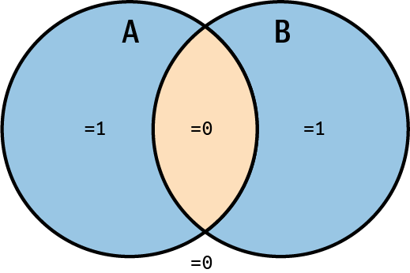

图4-1 XOR 维恩图

<!-- figure-labels: 4-1 -->
图中文字：A、B 为两个集合；仅在其中一个集合内时值为 1，交集内及两个集合之外的值为 0。

XOR 在计算机图形学和查找溢出（数学错误）方面有一些巧妙的应用。

如果它是输入 A（If it is Input A）〔待确认〕，我们就只使用表4-3的下半部分。如果寄存器（输入 B）已经将那个引脚对应的位置位，输出会是什么？

表4-3 XOR 的真值表

| 输入 A | 输入 B | 输出 |
|---|---|---|
| 0 | 0 | 0 |
| 0 | 1 | 1 |
| 1 | 0 | 1 |
| 1 | 1 | 0 |

<!-- source: pdf=111; section=4.1.3; unit=ch04-test-set-clear-toggle -->

<a id="src-p111"></a>

<!-- source-units: p0111_b000_u00, p0111_b001_u00, p0111_b002_u00, p0111_b003_u00, p0111_b004_u00, p0111_b005_u00, p0111_b006_u00, p0111_b007_u00, p0111_b008_u00, p0111_b009_u00, p0111_b010_u00, p0111_b011_u00, p0111_b012_u00, p0111_b013_u00 -->
### 测试、置位、清零与翻转 {#ch04-toc-004}

十六进制和按位运算都是为了能与寄存器交互而做的准备。想知道某一位是否被置位，就需要将寄存器与该位进行按位与运算：

```c
test = register & bit;
test = register & (1 << 3); // check 3rd bit in the register
test = register & 0x08;     // same, different syntax
```

注意，test 变量的值要么是零（寄存器中的这一位未置位），要么是 0x08（这一位已置位）。它的值并不是 true 和 false，不过仍可以在普通的条件判断中使用，因为条件判断只检查值为零还是非零。

如果要将寄存器中的某一位置位，就把它与寄存器进行或运算：

```c
register = register | bit;
register = register | (1 << 3); // turn on the 3rd bit in the register
register |= 0x08;               // same, different syntax
```

清除某一位就要费解得多，因为你希望寄存器中的其他位保持不变。通常的做法是用按位非（~）将要清除的位取反，再将取反后的值与寄存器进行与运算。这样，其他位就会保持不变：

```c
register = register & ~bit;
register = register & ~(1 << 3); // turn off the 3rd bit in the register
register &= ~0x08;               // same, different syntax
```

如果要翻转某一位，可以先检查它的值，再根据需要将它置位或清零。例如：

```c
test = register & bit;
if (test) {                      // bit is set, need to clear it
    register = register & ~bit;
} else {                         // bit is not set, need to set it
    register = register | bit;
}
```

不过，还有一种翻转位的方法，就是使用 XOR 运算：

```c
register = register ^ bit;
register = register ^ (1 << 3);
```

如果寄存器中的 0x08 位已置位，XOR 看到的就是两个一，因此在这一位上输出零。如果寄存器中的这一位没有置位，XOR 看到的就是一个一和一个零，于是在这一位上输出一。寄存器的其他位不会改变，因为第二个输入中只有这一个位被置位，其余位都是零。

复习就到这里。使用寄存器时，你需要掌握这些运算。如果还不熟悉它们，可以使用本章末尾提供的资源进一步学习或练习。

<!-- source: pdf=112; section=4.2; unit=ch04-toggle-output -->

<a id="src-p112"></a>

<!-- source-units: p0112_b000_u00, p0112_b001_u00, p0112_b002_u00, p0112_b003_u00, p0112_b004_u00, p0112_b005_u00 -->
## 翻转输出 {#ch04-toc-005}

市场部门带着一个产品点子找上了你。拨开他们那套天花乱坠的说辞，你发现他们需要的不过就是让一盏灯闪烁。

大多数处理器都有可以由软件读取其数字状态（输入）或设置其数字状态（输出）的引脚。它们被称为 I/O 引脚、通用 I/O（general-purpose I/O，GPIO）、数字 I/O（digital I/O，DIO），偶尔也叫 general I/O（GIO）。至少在接了 LED 的情况下，基本用法通常很直接：

1. 将引脚初始化为输出（作为 I/O 引脚，它既可以输入，也可以输出）。
2. 想点亮 LED 时，将引脚设为高电平；想熄灭 LED 时，将引脚设为低电平。（虽然也可以把 LED 接成引脚低电平时点亮，但本例不使用反相逻辑。）

本章会举出来自三份不同用户手册的示例，让你了解在自己所用处理器的文档中大致会看到什么。Microchip 的 ATtiny AVR 微控制器手册介绍了一款拥有丰富外设的 8 位微控制器。TI 的 MSP430x2xx 用户指南介绍了一款面向超低功耗设计的 16 位 RISC 处理器。STMicroelectronics 的 STM32F103xx 参考手册介绍了一款 32 位 Arm Cortex 微控制器。阅读本章不需要准备这些文档，不过我想你可能会想知道，这些示例是基于哪些处理器的。

<!-- source: pdf=112-114; section=4.2.1; unit=ch04-output-direction -->

<a id="src-p113"></a>


<a id="src-p114"></a>

<!-- source-units: p0112_b006_u00, p0112_b007_u00, p0112_b009_u00, p0113_b000_u00, p0113_b001_u00, p0113_b002_u00, p0113_b003_u00, p0113_b004_u00, p0113_b005_u00, p0113_b006_u00, p0113_b006_u01, p0113_b007_u00, p0113_b007_u01, p0113_b008_u00, p0113_b008_u01, p0113_b009_u00, p0113_b010_u00, p0114_b000_u00 -->
### 将引脚设置为输出 {#ch04-toc-006}

回到市场部门要求让 LED 翻转的需求。大多数 I/O 引脚既可以作为输入，也可以作为输出。首先需要设置控制引脚方向的寄存器，使该引脚成为输出。先确定要修改哪个引脚。要修改引脚，你需要知道的是引脚名称（例如“I/O 引脚 2”），而不是它在处理器封装上的引脚编号（例如第 12 脚）。在原理图中，名称通常写在处理器方框内部，而引脚编号写在方框外部（如图4-2所示）。

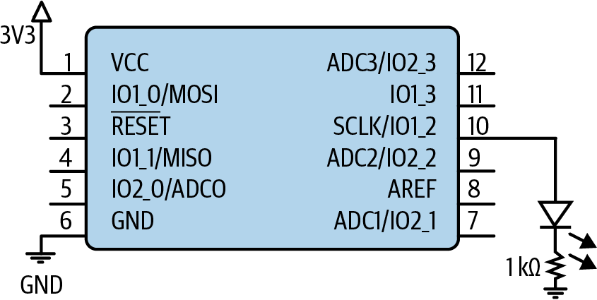

图4-2 连接了 LED 的处理器原理图

<!-- figure-labels: 4-2 -->
图中文字：3V3 表示 3.3 V 电源；VCC 为电源，GND 为地，RESET 为复位，AREF 为模拟参考。其余引脚名称及 1 kΩ 电阻标值按原图保留。

引脚名称中可能有多个数字，分别表示端口（或组）以及该端口中的引脚。（端口也可能用字母而不是数字表示。）图中的 LED 连接到处理器第 10 脚，名称为“SCLK/IO1_2”。这个引脚由 SPI 端口（记住，这是一种通信方式，第7章会讨论）和 I/O 子系统（IO1_2）共用。用户手册会告诉你，该引脚默认是 I/O 还是 SPI 引脚，以及如何在两者之间切换。可能还需要设置另一个寄存器来指定引脚用途。多数厂商会做好引脚设置的交叉引用，但如果引脚由多个外设共用，你可能需要去相应的外设章节查看，关闭不需要的功能。在本例中，假定该引脚默认作为 I/O。

在 I/O 子系统中，它是第 1 组（1）的第 2 个引脚（2）。我们需要记住这一点，并确保该引脚用作 I/O，而不是 SPI。

处理器用户手册会提供更多说明。寻找名称类似“I/O Configuration”“Digital I/O Introduction”或“I/O Ports”的章节。如果找不到这样的名称，就搜索“direction”，因为这个词通常用来说明引脚应该作为输入还是输出。

在手册里找到相应寄存器后，就能判断应该把方向寄存器中的某一位置位还是清零。多数情况下，将该位置位就能使引脚成为输出。你可以查出地址，然后把结果硬编码进去：

```c
*((int*)0x0070C1) |= (1 << 2);
```

但请不要这样做。

处理器厂商或编译器厂商几乎总会提供头文件，或包含头文件的硬件抽象层（hardware abstraction layer，HAL），用它来隐藏芯片的内存映射，这样你就可以把寄存器当成全局变量使用。如果厂商没有提供头文件，就自己写一个，让代码更接近下面这些形式：

STM32F103 处理器

```c
GPIOA->CRL |= 1 << 2;  // set IOA_2 to be an output
```

MSP430 处理器

```c
P1DIR |= BIT2;         // set IO1_2 to be an output
```

ATtiny 处理器

```c
DDRB |= 0x4;           // set IOB_2 to be an output
```

注意，各个处理器的寄存器名称不同，但每行代码的作用相同。对于设置字节（或字）中的第 2 位，不同处理器提供了不同的写法。

每个示例中的代码都会先读取寄存器当前值，修改它，再把结果写回寄存器。这个读—修改—写（read-modify-write）周期必须作为原子操作执行，也就是说，各步骤之间不能被打断，也不能插入其他处理。如果先读取数值，修改它，然后在写回寄存器之前又做了其他事情，就有可能发生寄存器已经改变、即将写入的值已经过时的情况。此次寄存器修改会改变目标位，但也可能产生意想不到的后果。

<!-- source: pdf=114-115; section=4.2.2; unit=ch04-led-on -->

<a id="src-p115"></a>

<!-- source-units: p0114_b001_u00, p0114_b002_u00, p0114_b003_u00, p0114_b003_u01, p0114_b004_u00, p0114_b004_u01, p0114_b005_u00, p0114_b005_u01, p0114_b006_u00, p0114_b007_u00, p0114_b008_u00, p0114_b009_u00, p0114_b010_u00, p0114_b011_u00, p0114_b011_u01, p0115_b000_u00, p0115_b000_u01, p0115_b001_u00, p0115_b001_u01 -->
### 点亮 LED {#ch04-toc-007}

下一步是点亮 LED。同样，我们需要在用户手册中找到合适的寄存器：

STM32F103 处理器

```c
GPIOA->ODR |= (1 << 2);    // IOA_2 high
```

MSP430 处理器

```c
P1OUT |= BIT2;             // IO1_2 high
```

ATtiny 处理器

```c
PORTB |= 0x4;              // IOB_2 high
```

处理器厂商提供的 GPIO 硬件抽象层头文件，展示了如何用一些便利的编程手段隐藏原始地址。在 STM32F103x6 中，I/O 寄存器通过位于某个地址的结构体访问（我对文件进行了重组和简化）：

```c
typedef struct
{
  __IO uint32_t CRL;  // Port configuration (low)
  __IO uint32_t CRH;  // Port configuration (high)
  __IO uint32_t IDR;  // Input data register
  __IO uint32_t ODR;  // Output data register
  __IO uint32_t BSRR; // Bit set/reset register
  __IO uint32_t BRR;  // Bit reset register
  __IO uint32_t LCKR; // Port configuration lock
} GPIO_TypeDef;

#define PERIPH_BASE       0x40000000UL
#define APB2PERIPH_BASE   (PERIPH_BASE + 0x00010000UL)
#define GPIOA_BASE        (APB2PERIPH_BASE + 0x00000800UL)
#define GPIOA             ((GPIO_TypeDef *)GPIOA_BASE)
```

这个头文件还描述了许多我们尚未见过的寄存器。用户手册相应章节中也有它们的介绍，而且解释得详细得多。我更喜欢通过结构体访问寄存器，因为这种方式会把相关功能组织在一起，往往还能让不同端口互换使用。

点亮 LED 后，还需要再次将它熄灭。只要清除相同的那些位就行，如“测试、置位、清零与翻转”一节所示：

STM32F103 处理器

```c
GPIOA->ODR &= ~(1 << 2);       // IO1_2 low
```

MSP430 处理器

```c
P1OUT &= ~(BIT2);              // IO1_2 low
```

ATtiny 处理器

```c
PORTB &= ~0x4;                 // IOB_2 low
```

<!-- source: pdf=115; section=4.2.3; unit=ch04-led-blink -->
<!-- source-units: p0115_b002_u00, p0115_b003_u00, p0115_b004_u00, p0115_b005_u00 -->
### 让 LED 闪烁 {#ch04-toc-008}

要完成程序，只需把这些操作组合起来。伪代码如下：

```text
main:
  initialize the direction of the I/O pin to be an output
loop:
  set the LED on
  do nothing for some period of time
  set the LED off
  do nothing for the same period of time
  repeat loop
```

为处理器写好程序后，就应该编译、加载并测试它。你可能需要调整延时循环，让 LED 的闪烁看起来合适。延时可能需要数万个处理器周期，否则 LED 闪烁得太快，人眼就察觉不到了。

<!-- source: pdf=115-116; section=4.2.4; unit=ch04-led-troubleshooting -->

<a id="src-p116"></a>

<!-- source-units: p0115_b006_u00, p0115_b007_u00, p0115_b008_u00, p0115_b009_u00, p0115_b010_u00, p0115_b011_u00, p0116_b000_u00, p0116_b001_u00, p0116_b002_u00, p0116_b003_u00, p0116_b004_u00, p0116_b005_u00 -->
### 故障排查 {#ch04-toc-009}

如果已经搭好了 JTAG 之类的调试系统，找出 LED 无法点亮的原因往往很直接。否则，你可能就得用排除法。

首先，重新核对计算。即使你对十六进制和位移运算非常熟悉，也总有可能打错字。根据我的经验，输入错误是最难找出的 bug，往往比内存损坏还难。检查使用的是否是原理图上的正确引脚，并确认电路板已经供电。（你可能觉得这条建议很好笑，但这类问题出现的频率会让你吃惊！）

接下来，检查引脚是否由不同的外设共用。虽然前面假定该引脚默认用作 I/O，但如果出现问题，还是应检查配置寄存器中是否设置了某项复用功能。

既然手册已经打开，就顺便确认引脚配置是否正确。如果 LED 没有反应，就需要阅读用户手册的外设章节。处理器各不相同，因此要检查引脚是否需要额外配置（例如电源控制输出），或者是否有某项功能默认开启（别一不小心把 GPIO 配成了中断）。

大多数处理器默认使用 I/O，因为这是让用户（也就是我们！）验证处理器是否连接正确的最简单方式。不过，特别是对于低功耗处理器，你会希望关闭所有未使用的子系统，避免消耗电能。（其他专用处理器也可能采用别的默认功能。）用户手册会详细说明默认配置以及如何更改。通常还会有一些寄存器，需要将其中某位置位或清零，才能让引脚作为 I/O 工作。

有时还需要配置时钟，才能让 I/O 子系统正常工作，或者让延时函数慢到足以让你看见翻转。如果仍有问题，就寻找厂商示例，找出其中的差异。

接下来，确认系统运行的确实是你的代码。有没有其他办法验证，正在运行的就是你编译出的代码？如果有调试串口，可以试着递增版本号，确认代码确实被加载了。如果这也不行，就检查构建系统是否为目标选用了正确的处理器。

尽量简化代码，确保处理器正在运行控制 LED 的函数。删掉所有非必要的外设初始化，以免系统因等待一个根本不存在的外部设备而被拖住。关闭中断和断言，并确认看门狗已经关闭（见“看门狗”一节）。

许多微控制器的引脚能够灌入的电流，大于能够拉出（提供）的电流。因此，把引脚接在 LED 的阴极而非阳极并不少见。这时，写入零而不是一才能点亮 LED。这称为反相逻辑（inverted logic）。检查原理图，看看是否属于这种情况。

如果输出仍然不起作用，就考虑是否存在硬件问题。首先，再次确认 LED 连接的确实是你认为的那个芯片引脚。然后，如果条件允许，在多块电路板上运行软件，排除组装缺陷。即使是硬件问题，原因也可能很简单（LED 很容易装反）。也可能是设计问题，例如处理器引脚无法提供足够的电流来驱动 LED；数据手册（或用户手册）或许能告诉你这一点。电路板本身也可能有问题，例如某个元件损坏或连接断开。大多数处理器的引脚密度很高，很容易出现引脚之间短路。找人帮忙，或者拿出万用表（或示波器）检查吧。

<!-- source: pdf=116-117; section=4.3; unit=ch04-separate-hardware -->

<a id="src-p117"></a>

<!-- source-units: p0116_b006_u00, p0116_b007_u00, p0117_b000_u00 -->
## 将硬件与动作分离 {#ch04-toc-010}

市场部门喜欢你的第一个原型，不过以后可能还需要做些小调整。系统从原型板转到了 PCB。在这个过程中，不知怎么的，引脚编号变成了 IO1_3。两个版本的系统都需要能够运行。

在这个项目中，修改代码轻而易举；但在更大的系统中，为了给新功能腾地方，引脚分配可能会被重新打乱。我们来看看如何让修改更容易。

<!-- source: pdf=117-118; section=4.3.1; unit=ch04-board-header -->

<a id="src-p118"></a>

<!-- source-units: p0117_b001_u00, p0117_b002_u00, p0117_b003_u00, p0117_b004_u00, p0117_b005_u00, p0117_b006_u00, p0117_b007_u00, p0117_b008_u00, p0117_b009_u00, p0117_b010_u00, p0118_b001_u00 -->
### 电路板专用头文件 {#ch04-toc-011}

使用电路板专用头文件，就能避免将引脚硬编码。如果有了头文件，只需修改其中一个值，而不必遍历代码，把每一处引用都改掉。头文件可以像这样：

```c
#define LED_SET_DIRECTION  (P1DIR)
#define LED_REGISTER       (P1OUT)
#define LED_BIT            (1 << 3)
```

配置和闪烁 LED 的代码就可以不依赖具体处理器：

```c
LED_SET_DIRECTION |= LED_BIT; // set the I/O to be output
LED_REGISTER |= LED_BIT;      // turn the LED on
LED_REGISTER &= ~LED_BIT;     // turn the LED off
```

如果有很多条 I/O 线路，或者需要使用其他寄存器，这种方式可能会变得有点笨重。如果只提供端口（1）和端口中的位置（3），剩下的让代码自己处理，或许会更好。代码可能更复杂，但很可能节省时间，并减少 bug。这样，头文件就会变成：

```c
// ioMapping_v2.h
#define LED_PORT 1
#define LED_PIN 3
```

如果希望通过重新编译，为不同的电路板生成不同版本，可以使用三个头文件。第一个保存旧电路板的引脚分配（ioMapping_v1.h）。接着，为新引脚分配创建一个头文件（ioMapping_v2.h）。我们可以在主 .c 文件中包含所需的那一个，但这会违背尽量少修改主代码的目标。如果让主文件始终包含一个通用的 ioMapping.h，就可以通过包含正确的头文件，切换主文件所用的版本：

```c
// ioMapping.h
#if COMPILING_FOR_V1
#include "ioMapping_v1.h"
#elif COMPILING_FOR_V2
#include "ioMapping_v2.h"
#else
#error "No I/O map selected for the board. What is your target?"
#endif /* COMPILING_FOR_*/
```

使用电路板专用头文件，能让开发流程更从容地应对今后的硬件变化。把电路板专用信息与系统功能隔离开来，就能构建耦合更松、灵活性更高的代码库。

>  用 Excel 保存 I/O 映射，是硬件和软件工程师就引脚定义达成一致的一种常见方法。稍微花点心思写个脚本，就能从 CSV 文件生成相应版本的 I/O 映射，确保引脚标识符与原理图一致。

<!-- source: pdf=118-119; section=4.3.2; unit=ch04-io-handling -->

<a id="src-p119"></a>

<!-- source-units: p0118_b002_u00, p0118_b003_u00, p0118_b004_u00, p0118_b005_u00, p0118_b006_u00, p0118_b007_u00, p0118_b008_u00, p0118_b009_u00, p0119_b000_u00, p0119_b001_u00 -->
### I/O 处理代码 {#ch04-toc-012}

我们需要用通用方式处理多个端口，而不再在代码中直接写寄存器。目前，需要将引脚初始化为输出，设置引脚为高电平以点亮 LED，以及设置引脚为低电平以熄灭 LED。有意思的是，即使接口如此简单，我们在如何组织这些操作上仍然有大量选择。

在实现中，初始化函数会把引脚配置为输出，必要时还会把它设为 I/O 引脚，而不是外设引脚。如果有多个引脚，你可能想把所有初始化都放在一起，但这会破坏系统的模块化。

虽然代码会占用稍多一点的空间，但让每个子系统初始化自己需要的 I/O 会更好。这样，在移除或复用某个模块时，需要的东西都在同一个地方。不过，我们已经见过一个不应该把接口拆分进各个子系统的情况：I/O 映射头文件。那里把所有引脚集中在一起，是为了更方便地沟通与硬件的接口。

继续看 I/O 子系统接口。把引脚设置为高电平或低电平，可以由一个函数完成：IOWrite(port, pin, high/low)。也可以拆成两个函数：IOSet(port, pin) 和 IOClear(port, pin)。两种方法都可行。想象一下，采用这两种方法时，主函数分别会是什么样子。

目标是让 LED 翻转。如果使用 IOWrite，可以设置一个在高低电平之间切换的变量。如果使用 IOSet 和 IOClear，就需要保存这个变量，并在主循环中检查它，决定调用哪一个函数。另一种方法是把 IOSet 和 IOClear 隐藏在另一个名为 IOToggle 的函数里面。这里的硬件没有特别的约束，所以在这个示例中，无须考虑代码优化。不过，为了学习，不妨想想这些候选接口分别带来了哪些选择。

IOWrite 方案在一个函数中完成全部工作，因此占用的代码空间更少。但是，它的参数更多，所以占用的栈空间更多，而栈来自 RAM。此外，它还需要保留一个状态变量，同样占用 RAM。

采用 IOSet/IOClear/IOToggle 方案时，函数更多（占用更多代码空间），但参数更少，而且可能不需要任何变量（占用更少 RAM）。注意，从处理器周期数来看，翻转函数的开销并不比置位和清零函数更大。

这种评估要求你从另一个维度思考接口。第11章将进一步介绍如何针对各个方面进行优化。在原型阶段，优化代码还为时过早，但考虑如何设计代码，以便日后优化，却永远不算太早。

<!-- source: pdf=119; section=4.3.3; unit=ch04-main-loop -->
<!-- source-units: p0119_b002_u00, p0119_b003_u00, p0119_b004_u00, p0119_b005_u00, p0119_b006_u00, p0119_b008_u00 -->
### 主循环 {#ch04-toc-013}

前面几节的修改，把 I/O 处理代码放进了独立模块，但主循环的基本内容没有改变。实现可能如下：

```c
void main(void){
  IOSetDir(LED_PORT, LED_PIN, OUTPUT);
  while (1) {    // spin forever
    IOToggle(LED_PORT, LED_PIN);
    DelayMs(DELAY_TIME);
  }
}
```

主函数不再直接依赖处理器。达到这种解耦程度后，代码更有可能被其他项目复用。图4-3的（a）显示了最初的软件架构，它唯一依赖的是处理器 HAL。中间的（b）是当前版本。它更复杂了，但关注点的分离也更明显。注意，头文件放在一侧，用来表示它们为这些依赖关系提供输入。

下一次重组将建立一个更加灵活、可复用的架构，如（c）所示。

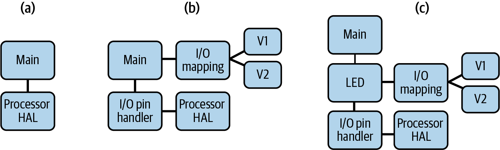

图4-3 按抽象程度递增排列的不同架构比较

<!-- figure-labels: 4-3 -->
图中文字：Main＝主函数；Processor HAL＝处理器硬件抽象层；I/O pin handler＝I/O 引脚处理程序；I/O mapping＝I/O 映射；V1、V2＝版本 1、版本 2；LED 保留原标识。

<!-- source: pdf=119-120; section=4.3.4; unit=ch04-facade -->

<a id="src-p120"></a>

<!-- source-units: p0119_b009_u00, p0119_b010_u00, p0120_b000_u00, p0120_b001_u00, p0120_b002_u00, p0120_b003_u00, p0120_b004_u00, p0120_b004_u01, p0120_b005_u00, p0120_b005_u01, p0120_b006_u00 -->
### 外观模式 {#ch04-toc-014}

可以想象，随着产品功能扩展，I/O 接口会越来越复杂。（目前只有一个输出引脚，实在不可能更简单了。）从长远来看，我们希望隐藏各个子系统的细节。有一种标准的软件设计模式叫外观模式（facade pattern），它为一段代码提供简化的接口。外观模式的目标是让软件库更容易使用。本书一直采用这样一个比喻：与处理器交互，类似于使用软件库。沿着这个比喻，使用外观模式隐藏处理器和硬件的某些细节就很合理。

在“为变化而设计”一节中，我们见过适配器模式，它是外观模式的一个更通用的版本。适配器模式在两层之间起翻译作用，而外观模式则通过简化下面一层来实现这一点。假如你担任科学家与外星人之间的口译，可能需要翻译“x = y + 2，其中 y = 1”。如果你是适配器模式，就会原封不动地转述相同的信息。如果你是外观模式，大概会说“x = 3”，因为这样更简单，而且那些细节对于使用这条信息并不重要。

把细节隐藏在子系统中，是良好设计的重要部分。它使代码更易读，也更容易测试。此外，调用方代码不依赖子系统的内部实现，所以底层代码可以改变，而外观接口保持不变。

对于闪烁 LED 的程序，外观可以通过创建一个 LED 子系统，将 I/O 引脚这一概念对调用方隐藏起来，如图4-3右侧所示。考虑到使用者需要了解的 LED 子系统信息很少，这个外观只需两个函数即可实现：

- LEDInit()：为 LED 引脚调用 I/O 初始化函数，替代 IOSetDir(…)。
- LEDBlink()：使 LED 闪烁，替代 IOToggle(…)。

当需求不可避免地发生变化时，加入外观会让代码更容易扩展和修改。

<!-- source: pdf=120; section=4.4; unit=ch04-input-intro -->
<!-- source-units: p0120_b007_u00, p0120_b008_u00, p0120_b009_u00 -->
## I/O 中的输入 {#ch04-toc-015}

市场部门想让系统根据按钮改变闪烁方式。现在，只要按住按钮，系统就应该完全停止闪烁。

加入按钮后，原理图并没有复杂多少（见图4-4）。注意，按钮使用 IO2_2（I/O 端口 2，引脚 2），在原理图中用 S1（开关 1）表示。开关的图形符号挺直观：按下时，它会跨过图中所示的间隙导通。在这里，按下开关后，引脚就会接地。

<!-- source: pdf=121-122; section=4.4; unit=ch04-input-setup -->

<a id="src-p121"></a>


<a id="src-p122"></a>

<!-- source-units: p0121_b001_u00, p0121_b003_u00, p0121_b004_u00, p0121_b005_u00, p0121_b006_u00, p0121_b007_u00, p0121_b008_u00, p0121_b009_u00, p0121_b010_u00, p0121_b011_u00, p0121_b012_u00, p0121_b013_u00, p0122_b001_u00, p0122_b002_u00, p0122_b002_u01, p0122_b003_u00, p0122_b003_u01, p0122_b004_u00, p0122_b006_u00, p0122_b007_u00, p0122_b008_u00, p0122_b009_u00, p0122_b010_u00 -->
许多处理器的 I/O 引脚带有内部上拉电阻（pull-up resistor）。引脚作为输出时，上拉电阻不起作用；但引脚作为输入时，即使什么都没有连接，上拉电阻也能让它保持一个确定的值（1）。是否启用上拉以及上拉的强弱可能可以配置，具体取决于处理器，甚至可能取决于某个特定引脚。多数处理器还提供为引脚启用内部下拉电阻的选项。那样的话，我们的开关就可以接电源，而不是接地。

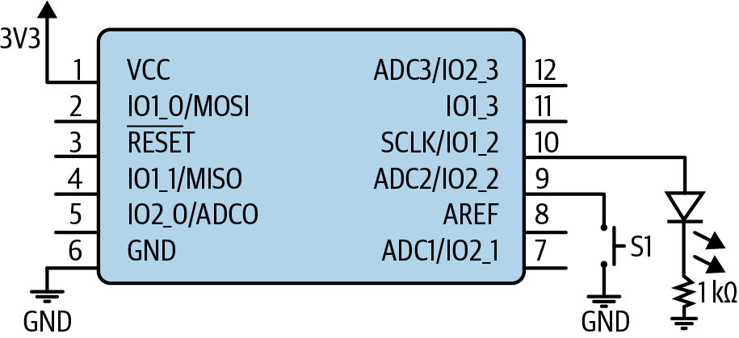

图4-4 带有 LED 和按钮的原理图

<!-- figure-labels: 4-4 -->
图中文字：3V3 表示 3.3 V 电源；VCC 为电源，GND 为地，RESET 为复位，AREF 为模拟参考；S1 为开关 1。其余引脚名称及 1 kΩ 电阻标值按原图保留。

>  启用了内部上拉的输入会消耗一点电流。因此，如果系统需要节省几微安，你可能会选择关闭不需要的上拉（或下拉）。

处理器用户手册会说明引脚有哪些选项。基本的设置步骤如下：

1. 将引脚加入 I/O 映射头文件。
2. 将它配置为输入，并确认它不是另一个外设的一部分。
3. 必要时，显式配置上拉。

把 I/O 引脚设为输入后，需要增加一个函数来使用它。这个函数能够返回引脚状态：高电平（true）或低电平（false）：

```c
boolean IOGet(uint8_t port, uint8_t pin);
```

按下按钮时，引脚会接地。这个信号是低电平有效（active low）的，也就是说，按钮处于被按住的有效状态时，信号为低电平。

为了隐藏系统细节，我们希望建立一个使用 I/O 处理模块的按钮子系统。在 I/O 函数之上，再加一层外观，就能让按钮子系统具有简单的接口。

I/O 函数返回的是引脚电平，但我们想知道的是用户有没有采取动作。不必让按钮接口返回电平，而可以把信号反相，判断按钮当前是否被按下。接口可以是：

- void ButtonInit()：为按钮调用 I/O 初始化函数。
- boolean ButtonPressed()：按钮按下时返回 true。

如图4-5所示，LED 子系统和按钮子系统都使用 I/O 子系统及 I/O 映射头文件。这个简单的例子说明了本章前面进行的模块化如何实现复用。

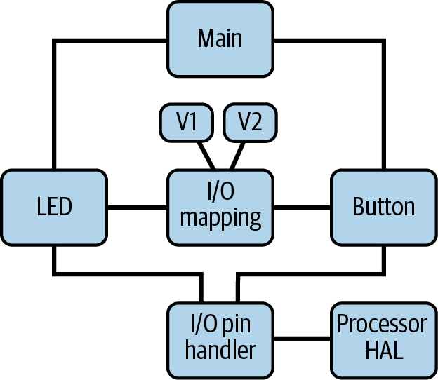

图4-5 新增按钮后的架构

<!-- figure-labels: 4-5 -->
图中文字：Main＝主函数；Button＝按钮；I/O mapping＝I/O 映射；I/O pin handler＝I/O 引脚处理程序；Processor HAL＝处理器硬件抽象层；V1、V2＝版本 1、版本 2。

从更高层来看，主函数有几种实现方法。下面是其中一种：

```text
main:
  initialize LED
  initialize button
loop:
  if button pressed, turn LED off
  else toggle LED
  do nothing for a period of time
  repeat
```

使用这段代码，LED 不会立即熄灭，而要等到延时结束。用户可能会察觉到按下按钮与 LED 熄灭之间存在延迟。

>  如果系统不能在四分之一秒（250 ms）以内响应按钮按下，使用起来就会显得迟钝、不顺手。100 ms 的响应时间好得多，但急性子的用户仍然能察觉到。低于 50 ms 的响应时间则会让人感觉非常灵敏。

<!-- source: pdf=123; section=4.4; unit=ch04-input-polling-interrupt -->

<a id="src-p123"></a>

<!-- source-units: p0123_b000_u00, p0123_b001_u00, p0123_b002_u00, p0123_b003_u00, p0123_b004_u00, p0123_b005_u00, p0123_b006_u00 -->
为了缩短响应时间，可以不停检查按钮是否被按下：

```text
loop:
  if button pressed, turn LED off
  else
    if enough time has passed,
      toggle LED
      clear how much time has passed
  repeat
```

这两种方法都会检查按钮，判断它是否被按下。这种持续查询称为轮询（polling），代码逻辑很容易理解。不过，如果需要尽可能快地熄灭 LED，你也许会希望按钮中断正常的执行流程。

等等！“中断”（interrupt）这个词非常重要。我相信你以前听说过，我们很快就会深入讨论，第5章还会进一步介绍。在那之前，先看看使用中断捕获并处理按钮按下后，主循环能有多简单：

```text
loop:
  if button not pressed, toggle LED
  do nothing for a period of time
  repeat
```

中断代码，也就是 ISR（interrupt service routine，中断服务程序），会调用熄灭 LED 的函数。不过，这会让按钮与 LED 子系统相互依赖，以一种不明显的方式把它们耦合在一起。有时，你不得不这么做，嵌入式系统才能足够快地处理事件。

第5章会更详细地说明如何使用中断，以及何时使用。本章仍然只从较高层面讨论它们。

<!-- source: pdf=123; section=4.5; unit=ch04-momentary-intro -->
<!-- source-units: p0123_b007_u00, p0123_b008_u00, p0123_b009_u00 -->
## 短按按钮 {#ch04-toc-016}

市场部门不想再用按钮让 LED 停止，而是希望通过轻按按钮测试不同的闪烁速率。每按一次按钮，系统就应将延时缩短 50%，直到接近零，此时再回到最初的延时。

上一个任务只需要检查按钮是否处于按下状态。这一次，你必须同时知道按钮何时被按下，以及何时被松开。理想情况下，我们希望开关信号像图4-6上半部分那样。如果果真如此，只需让系统留意信号的上升沿，并在那里采取动作。

<!-- source: pdf=124; section=4.5.1; unit=ch04-button-interrupt -->

<a id="src-p124"></a>

<!-- source-units: p0124_b001_u00, p0124_b002_u00, p0124_b003_u00, p0124_b004_u00, p0124_b005_u00, p0124_b006_u00 -->
### 按下按钮时触发中断 {#ch04-toc-017}

这可能又是一个适合用中断捕获用户输入的地方，这样主循环就不必如此频繁地轮询 I/O 引脚。如果用一个全局变量来获知按钮按下事件，主循环就会变得很直观：

```text
interrupt when the user presses the button:
  set global button pressed = true

loop:
  if global button pressed,
    set the delay period (reset or decrease it)
    set global button pressed = false
    turn LED off
  if enough time has passed,
    toggle LED
    clear how much time has passed
  repeat
```

许多处理器的输入引脚可以配置成：当引脚信号处于某个电平（高或低）时，或者信号发生变化（上升沿或下降沿）时，产生中断。如果按钮信号像图4-6上方的理想信号那样，你希望在哪个位置产生中断？如果在低电平时中断，那么用户一直按住按钮时，可能会多次触发。我更喜欢在上升沿产生中断，这样用户按下按钮时不会发生任何事情，直到松开才会响应。

>  在这种情况下，要准确检查全局变量，就需要使用 C 的 volatile 关键字；此前用 C 和 C++ 开发软件时，你可能从未需要过它。这个关键字告诉编译器，变量或对象的值可能意外改变，因此绝不能把对它的访问优化掉。所有寄存器，以及所有由中断和普通代码共享的全局变量，都应该标记为 volatile。如果代码在关闭优化时工作正常，一开启优化就出错，应检查相应的全局变量和寄存器是否已标记为 volatile。

<!-- source: pdf=124-125; section=4.5.2; unit=ch04-configure-interrupt -->

<a id="src-p125"></a>

<!-- source-units: p0124_b007_u00, p0124_b008_u00, p0125_b000_u00, p0125_b001_u00, p0125_b001_u01, p0125_b002_u00, p0125_b002_u01, p0125_b003_u00, p0125_b003_u01, p0125_b004_u00 -->
### 配置中断 {#ch04-toc-018}

把引脚配置为能够触发中断，通常与把它配置为输入是分开的。虽然两者都属于初始化步骤，但我们希望把中断配置与已有的初始化函数分离。这样，就只需让那些确实需要中断的引脚承担中断配置的复杂性，第5章还会进一步讨论。

为了把引脚配置成可以中断处理器，需要向 I/O 子系统增加三个函数：

- IOConfigureInterrupt(port, pin, trigger type, trigger state)：将引脚配置为中断源。当检测到指定的触发类型，例如边沿或电平，中断就会触发。对于边沿触发，可以在上升沿或下降沿中断；对于电平触发，可以在高电平或低电平时中断。有些系统还提供一个回调（callback）参数，即中断发生时要调用的函数；其他系统则把回调硬编码为某个固定函数名，你需要将代码写到那个函数里面。
- IOInterruptEnable(port, pin)：使能与指定引脚关联的中断。
- IOInterruptDisable(port, pin)：禁用与指定引脚关联的中断。

如果中断不是按引脚分配，而是按组分配，那么处理器可能为每一组提供一个通用 I/O 中断。这时，ISR 就需要辨别到底是哪个引脚引起了中断。具体情况取决于处理器。如果每个 I/O 引脚都能拥有自己的中断，模块之间的耦合就可以更松。

<!-- source: pdf=125-128; section=4.5.3; unit=ch04-debouncing -->

<a id="src-p126"></a>


<a id="src-p127"></a>


<a id="src-p128"></a>

<!-- source-units: p0125_b005_u00, p0125_b006_u00, p0125_b007_u00, p0126_b002_u00, p0126_b003_u00, p0126_b004_u00, p0126_b005_u00, p0126_b006_u00, p0127_b001_u00, p0127_b002_u00, p0127_b003_u00, p0127_b004_u00, p0127_b005_u00, p0127_b006_u00, p0127_b007_u00, p0127_b008_u00, p0127_b009_u00, p0127_b010_u00, p0127_b011_u00, p0128_b000_u00, p0128_b001_u00, p0128_b002_u00 -->
### 开关去抖 {#ch04-toc-019}

许多按钮无法提供图4-6上半部分理想按钮信号那样干净的信号，而更接近标为“有抖动的数字按钮信号”的波形。如果在这种信号上触发中断，系统可能会因按钮按下开始和结束时的毛刺而反复中断，浪费处理器周期。开关抖动可能由机械效应或电气效应引起。

图4-6还从模拟信号的角度，展示了按钮按下后缓慢生效时可能发生的情况。（实际情况可能复杂得多，取决于抖动主要由机械原因还是电气原因引起。）注意，模拟信号有些部分既不是高电平，也不是低电平，而是介于两者之间。由于 I/O 线路表示的是数字信号，无法表示这种不确定的值，因此可能出现异常行为。一个布满边沿的数字信号，会让代码误以为用户的一次动作对应了多次按下。结果不一致，用户也会感到沮丧。更糟糕的是，在这种信号上触发中断可能导致处理器不稳定，所以我们还是回到轮询信号的方法。

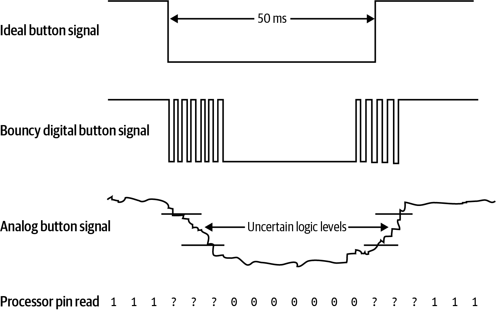

图4-6 从不同角度观察按钮信号

<!-- figure-labels: 4-6 -->
图中文字：Ideal button signal＝理想按钮信号；Bouncy digital button signal＝有抖动的数字按钮信号；Analog button signal＝模拟按钮信号；Uncertain logic levels＝不确定的逻辑电平；Processor pin read＝处理器引脚读数。理想按下持续时间标为 50 ms；最下行的 1、0 和问号对应每次读数。

去抖（debouncing）是消除虚假边沿的技术。它既可以用硬件实现，也可以用软件实现，这里重点讨论软件方法。硬件解决方案可参阅 Jack Ganssle 那篇出色的开关去抖网页文章，列于本章“延伸阅读”中。

>  许多现代开关的不确定阶段非常短。开关也有数据手册，应查看厂商针对你所用开关的建议。要注意，仅凭实验来判断是否需要去抖可能还不够，因为不同批次的开关表现可能不同。

你仍然需要寻找信号的上升沿，也就是用户松开按钮的时刻。为了避开上升沿和下降沿附近的杂乱信号，需要寻找一段相对较长且保持稳定的信号。究竟多长，取决于开关，以及你希望多快响应用户。

为了给开关去抖，应以固定时间间隔多次读取引脚，即采样（sample），采样速度应比所需响应速度快几倍。当出现若干次连续且一致的采样结果后，再通知系统其他部分：按钮状态发生了变化。参见图4-6；目标是取得足够多次读数，防止不确定的逻辑电平引发虚假的按钮按下事件。

需要三个变量：

- I/O 线路当前的原始读数
- 用于判断原始读数已保持一致多长时间的计数器
- 供其余代码使用的、去抖后的按钮值

去抖需要多长时间，以及系统响应用户需要多长时间，取决于计数器累计到多大后，才把去抖后的按钮变量改为当前原始状态。应根据开关的特性设置计数器，让去抖在合理的时间内完成。

如果产品没有对此给出规格要求，可以想想键盘按键被按下的速度。假设熟练打字员每分钟输入 120 个单词，每词平均五个字符，那么他们大约每秒按键（按钮）10 次。再假设按钮有一半时间处于按下状态，就需要检测持续约 50 ms 的按下。（如果你真在做键盘，大概需要更严格的时间容差，因为还有人打字更快。）

在我们的系统中，假想开关的虚构数据手册说，开关在按下或松开时，振铃不会超过 12.5 ms。如果目标是响应持续 50 ms 或以上的按下，可以每 10 ms 采样一次（100 Hz），并寻找五个连续一致的采样。

要求五个连续一致的采样是相当保守的。你可以调整轮询引脚电平的频率，让三个连续一致的采样就足以表明按钮状态发生了变化。

>  选择去抖方法时要取得平衡：考虑判断出错的代价，是令人烦恼还是酿成灾难；同时也要考虑响应用户较慢的代价。

在前面使用下降沿中断处理按钮按下的方法中，比起按钮状态本身，我们更关心状态的变化。为此，我们再增加第四个变量，以简化主循环：

```text
read button:
  if raw reading is the same as debounced button value,
    reset the counter
  else
    decrement the counter
    if the counter is zero,
      set debounced button value to raw reading
      set changed to true
      reset the counter

main loop:
  if time to read button,
    read button
    if button changed and button is no longer pressed,
      set button changed to false
      set the delay period (reset or halve it)
  if time to toggle the LED,
    toggle LED
  repeat
```

注意，这只是代码的基本形式。根据系统需求，还有许多可选方案。例如，你是否希望快速响应按下，但较慢地响应松开？去抖计数器完全没有必要两边对称。

在前面的伪代码中，主循环又回到了轮询按钮，而没有使用中断。不过，许多处理器都有可以配置为产生中断的定时器。可以在定时器中读取按钮，以简化主函数；LED 的翻转也可以放在定时器中。很快就会详细讨论定时器，但在那之前，市场部门又有新要求了。

<!-- source: pdf=128; section=4.6; unit=ch04-runtime-intro -->
<!-- source-units: p0128_b003_u00, p0128_b004_u00, p0128_b005_u00, p0128_b006_u00, p0128_b007_u00 -->
## 运行时的不确定性 {#ch04-toc-020}

市场部门有好几个 LED 想试一试。这些 LED 连接到不同引脚。请用按钮在这些选项之间循环切换。

按钮按下已经处理好了，但 LED 子系统只知道 v1 电路板上引脚 1_2 的输出，或者 v2 电路板上引脚 1_3 的输出。把所有 LED 都初始化为输出后，可以在主循环中加入条件语句（或 switch 语句）：

```text
if count button presses == 0, toggle blue LED
if count button presses == 1, toggle red LED
if count button presses == 2, toggle yellow LED
```

要实现它，你需要三个不同的 LED 子系统；或者更可能的是，让 LED 翻转函数接受一个参数。前者意味着大量复制的代码，几乎总是不好的；后者意味着 LED 函数每次翻转 LED，都需要把颜色映射为 I/O 引脚，会消耗处理器周期。

<!-- source: pdf=128-129; section=4.6.1; unit=ch04-code-flexibility -->

<a id="src-p129"></a>

<!-- source-units: p0128_b008_u00, p0128_b009_u00, p0129_b000_u00, p0129_b001_u00, p0129_b002_u00 -->
### 提高代码灵活性 {#ch04-toc-021}

这里的目标，是建立一种方法，从若干可能的对象中使用某一个选项。你不必每次都在主循环或 LED 函数中选择，可以在按钮按下时选好所需的 LED。这样，LED 翻转函数就无须关心自己改变的是哪一个 LED：

```text
main loop:
  if time to read button,
    read button
    if button changed and button is no longer pressed,
      set button changed to false
      change LED variable

  if time to toggle the LED,
    toggle LED
  repeat
```

增加一个状态变量，就能用少量 RAM 换取一些处理器周期。状态变量往往会让系统难以理解，尤其是代码中 change LED variable 与 toggle LED 两部分相隔较远时。对于试图修复 bug 的人来说，梳理代码、弄清状态变量如何控制选项，可能是一件繁琐的事，注释会有帮助！状态变量能显著简化 LED 翻转函数，因此有时，它带来的便利值得付出这些复杂性的代价。

<!-- source: pdf=129-130; section=4.6.2; unit=ch04-dependency-injection -->

<a id="src-p130"></a>

<!-- source-units: p0129_b003_u00, p0129_b004_u00, p0129_b005_u00, p0129_b007_u00, p0130_b001_u00, p0130_b002_u00, p0130_b003_u00, p0130_b004_u00, p0130_b005_u00, p0130_b006_u00, p0130_b007_u00 -->
### 依赖注入 {#ch04-toc-022}

不过，我们还可以超越状态变量，采用更灵活的方式。前面看到，把 I/O 引脚从电路板中抽象出来，可以让我们在电路板改变时不必重写代码。同样，也可以用抽象应对动态变化，例如决定使用哪一个 LED。为此，我们将采用一种称为依赖注入（dependency injection）的技术。

此前，我们把 I/O 引脚隐藏在 LED 代码中，构成了一套只依赖下层的函数层级。采用依赖注入后，我们会把 I/O 处理程序作为参数传给 LED 初始化代码，从而移除这种依赖。I/O 处理程序知道应该改变哪个引脚，以及如何改变；而 LED 代码只知道如何调用 I/O 处理程序。见图4-7。

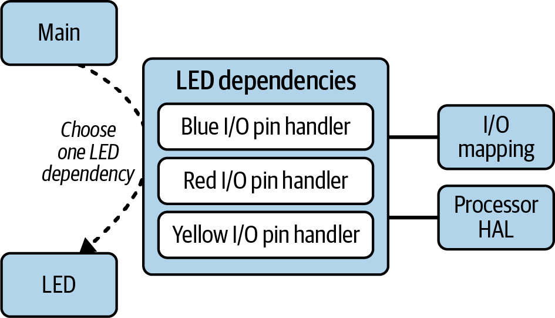

图4-7 应对运行时不确定性的依赖注入架构

<!-- figure-labels: 4-7 -->
图中文字：Main＝主函数；Choose one LED dependency＝选择一种 LED 依赖；LED dependencies＝LED 的依赖项；Blue、Red、Yellow I/O pin handler 分别为蓝色、红色、黄色 LED 的 I/O 引脚处理程序；I/O mapping＝I/O 映射；Processor HAL＝处理器硬件抽象层。

讲解依赖注入时，经常会用汽车与发动机的关系作例子。汽车作为最终产品，依赖发动机才能移动。汽车和发动机都由制造商制造。虽然汽车不能选择安装哪一台发动机，但制造商可以注入任何可供汽车行驶的依赖选项，例如 800 马力的发动机，或 20 马力的发动机。

回到 LED 的例子，LED 代码就像汽车，依赖 I/O 引脚才能工作，正如汽车依赖发动机一样。不过，LED 代码可以做得足够通用，避免依赖某个特定的 I/O 引脚。这样，主函数，也就是这里的制造商，就能按实际情况安装合适的 I/O 引脚，而不是在编译时把依赖硬编码。通过这种技术，可以在运行时组合系统的工作方式。

在 C++ 或其他面向对象语言中，为了注入依赖，每当按钮被按下，我们就把一个新的 I/O 引脚处理对象传给 LED。LED 模块完全不必知道自己正在改变哪个引脚，或者如何改变。用于隐藏这些信息的变量在初始化时设置，但别忘了，它们依旧是变量，会消耗 RAM，也会让代码更杂乱。

>  在 C 中，通常会使用由函数指针组成的结构体来达到同样的目的。

依赖注入是一种非常强大的技术，尤其是在 LED 模块承担更复杂的任务时，例如输出莫尔斯电码。如果传入 I/O 引脚处理程序，就可以在任何处理器上复用这个用 LED 输出莫尔斯电码的例程。此外，在测试时，I/O 引脚处理程序可以打印 LED 模块对它的每次调用，代替改变输出引脚，或者在改变引脚的同时打印。

不过，汽车发动机的例子也说明了依赖注入的一个主要问题：复杂性。如果只需要更换发动机，它很好用；但一旦开始注入车轮、转向柱、座套、变速器、仪表盘和车身，汽车模块就会变得相当复杂，而自身固有的用途却所剩无几。

依赖注入旨在提供灵活性，这与外观模式降低复杂性的目标相反。在嵌入式系统中，依赖注入会占用更多 RAM，也会多用一些处理器周期。外观模式则几乎总会占用更多代码空间。你需要结合系统的需求和资源，找到合理的平衡。

<!-- source: pdf=131; section=4.7; unit=ch04-timer-intro -->

<a id="src-p131"></a>

<!-- source-units: p0131_b000_u00, p0131_b001_u00, p0131_b002_u00 -->
## 使用定时器 {#ch04-toc-023}

用按钮改变闪烁速度很有帮助，但市场部门发现，闪烁速率存在不确定性，成了问题。现在，他们不想再让 LED 的速度减半，而希望用按钮在一组精确的闪烁速率之间循环切换：每秒 6.5 次（Hz）、8.5 Hz 和 10 Hz。

这个要求看似简单，却是我们第一次需要精确计时。此前，系统可以在大体方便的时候处理按钮、翻转 LED。现在，系统需要实时处理 LED。能够多接近“精确”，取决于系统参数，主要是处理器输入时钟的准确度和精密度。我们先使用处理器上的定时器，让它比以前更精确，再看看市场部门是否能接受。

<!-- source: pdf=131; section=4.7.1; unit=ch04-timer-pieces -->
<!-- source-units: p0131_b003_u00, p0131_b004_u00, p0131_b005_u00 -->
### 定时器的组成 {#ch04-toc-024}

从原理上讲，定时器就是一个简单的计数器，通过累计时钟节拍来测量时间。主时钟越稳定确定，定时器就越精确。定时器独立于软件执行，在后台工作，完全不会拖慢代码。用技术语言来说，这些工作发生在微控制器内部的硅逻辑门中。

要设置定时器频率，首先需要确定时钟输入。它可能是处理器时钟，也叫系统时钟或主时钟；也可能是来自另一个子系统的其他时钟，例如，许多处理器都具有外设时钟。

<!-- source: pdf=131-132; section=4.7.1; unit=ch04-system-stats-sidebar -->

<a id="src-p132"></a>

<!-- source-units: p0131_b006_u00, p0131_b007_u00, p0131_b008_u00, p0131_b009_u00, p0131_b010_u00, p0131_b011_u00, p0132_b001_u00, p0132_b002_u00 -->
#### 系统参数

嵌入式系统工程师向其他工程师介绍系统参数时，往往采用一种简写，包括厂商、处理器及其内核、每条指令的位数，以及系统时钟速度。本章前面给出了 STM32F103xx、MSP430 和 ATtiny 处理器系列的寄存器示例。采用这些处理器的系统，参数可能如下：

- STM32F103（Cortex-M3），32 位，72 MHz
- Texas Instruments MSP430 G2201，16 位，16 MHz
- Atmel ATtiny45，8 位，4 MHz

最后那个数字是处理器时钟，描述处理器理论上每秒能够处理的指令数。如果内存访问跟不上，实际性能可能更慢；如果能利用处理器功能绕过某些开销，实际性能也可能更快。系统时钟与电路板上的振荡器频率并不相同，假如板上有振荡器的话。借助内部 PLL 电路，处理器速度可能远高于板载振荡器的频率。PLL 是锁相环（phase lock loop）的缩写，它表示一种让处理器把较慢的时钟，也就是低速振荡器的时钟，倍频成较快的处理器时钟的方法。低速振荡器通常比高速振荡器便宜，而且功耗更低，因此 PLL 无处不在。

许多小型微控制器使用内部 RC 振荡器作为时钟源。虽然这让硬件设计人员省了事，但准确度还有很大提升空间。随着时间推移，可能积累相当明显的漂移，从而导致通信和某些实时应用出错。

<!-- source: pdf=132-134; section=4.7.1; unit=ch04-timer-registers -->

<a id="src-p133"></a>


<a id="src-p134"></a>

<!-- source-units: p0132_b003_u00, p0132_b004_u00, p0132_b005_u00, p0132_b006_u00, p0132_b007_u00, p0132_b008_u00, p0133_b000_u00, p0133_b001_u00, p0133_b002_u00, p0133_b003_u00, p0133_b004_u00, p0133_b005_u00, p0133_b006_u00, p0133_b007_u00, p0133_b008_u00, p0133_b010_u00, p0134_b001_u00, p0134_b002_u00 -->
例如，ATtiny45 的最高处理器时钟为 4 MHz。我们希望 LED 能以 10 Hz 闪烁，但这意味着需要以 20 Hz 中断，一次中断将它点亮，再一次中断将它熄灭。也就是说，需要进行 200,000 分频。ATtiny45 是一款 8 位处理器，具有两个 8 位定时器和一个 16 位定时器。它们都无法计数到这么大，参见“系统参数”旁栏。不过，芯片设计者考虑到了这个问题，给了我们另一个工具：预分频寄存器（prescaler register）。它对时钟分频，让计数器以更慢的速率递增。

>  许多定时器从零计数，而不是从一计数。因此，要让预分频器进行 2 分频，需要向预分频寄存器写入 1。定时器本来就够复杂了，上面的计算便不再一直带着这个差一的问题。请查阅处理器手册，了解哪些定时器寄存器从零开始。

预分频寄存器的作用如图4-8所示。系统时钟规律地翻转。预分频值为二时，预分频后的时钟，也就是定时器子系统的输入，以系统时钟一半的速度翻转。定时器向上计数。处理器会检测定时器是否与比较寄存器匹配，图中比较寄存器设为 3。匹配时，定时器可能继续向上计数，也可能复位，具体取决于处理器和配置设置。

在继续讨论 ATtiny45 的定时器之前，先了解一下，要让定时器工作，通常需要以下寄存器：

- 定时器计数器（timer counter）：保存不断变化的定时器值，即自上次复位以来经过的时钟节拍数。
- 比较寄存器（compare register），也叫捕获比较寄存器或匹配寄存器：定时器计数器等于该寄存器时，执行某项动作。每个定时器可能具有多个比较寄存器。
- 动作寄存器（action register），或自动重装载寄存器（auto-reload register）：设置定时器与比较寄存器相等时要执行的动作。有些定时器在溢出时也可执行这些动作，相当于存在一个值设为定时器计数器最大值的比较寄存器。可配置的动作有四类，可以同时发生一种或多种：
  - 中断
  - 停止或继续计数
  - 重新装载计数器
  - 将输出引脚设为高电平、低电平、翻转，或保持不变
- 时钟配置寄存器（clock configure register，可选）：告诉子系统使用哪个时钟源，默认可能是系统时钟。有些处理器的定时器甚至允许把时钟连接到输入引脚。通常还可以选择向上或向下计数；这些示例都使用向上计数，但向下计数的过程类似。
- 预分频寄存器：如图4-8所示，将快速的输入时钟降速，从而允许定时器处理较慢的事件。
- 控制寄存器（control register）：配置完成后，通过它启动定时器计数。控制寄存器通常也提供复位定时器的方法。
- 中断寄存器（interrupt register，可能不止一个）：如果使用定时器中断，就需要用相应的中断寄存器，使能、清除并检查各个定时器中断的状态。

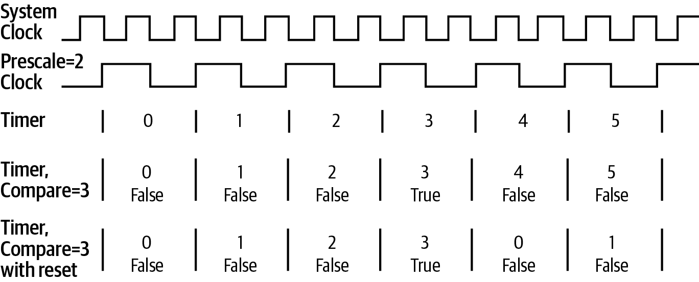

图4-8 定时器预分频与匹配

<!-- figure-labels: 4-8 -->
图中文字：System Clock＝系统时钟；Prescale=2 Clock＝预分频值为 2 的时钟；Timer＝定时器；Timer, Compare=3＝定时器，比较值为 3；Timer, Compare=3 with reset＝定时器，比较值为 3，并在匹配后复位；False＝假，True＝真。

定时器设置与具体处理器有关；用户手册通常会指导你配置上述各个寄存器。处理器手册使用的寄存器名称可能略有不同。理解定时器用法的一个好办法，是查看芯片厂商的示例代码，里面通常会有几个用不同方式配置定时器的例子。应把数据手册摆在面前，逐行阅读示例代码，确保理解定时器是如何配置的。

>  你的处理器也许没有比较寄存器，而只允许在定时器溢出时触发动作。这相当于一个隐含的匹配值：2 的定时器寄存器位数次方，再减 1。例如，8 位定时器的值为 (2⁸) − 1 = 255。通过调整预分频器，大多数定时值都能实现，而且误差不会太大。

<!-- source: pdf=134; section=4.7.2; unit=ch04-timer-math -->
<!-- source-units: p0134_b003_u00, p0134_b004_u00, p0134_b005_u00, p0134_b006_u00, p0134_b007_u00, p0134_b008_u00 -->
### 进行计算 {#ch04-toc-025}

接下来，我会展示配置定时器所需的计算。你可以快速浏览，或者直接跳到“使用脉宽调制”一节，需要计算时再回来。另外，也可以查看[本书的 GitHub 仓库](https://github.com/eleciawhite/making-embedded-systems)，其中有一些计算工具，不用跟着这里的代数推导，也能完成这些计算。

定时器是为处理物理时间尺度而设计的，因此，需要把一系列寄存器值与实际时间联系起来。记住，频率，例如 10 Hz，与周期，例如 0.1 秒，互为倒数。

中断频率、时钟输入、预分频器和比较寄存器之间的基本关系式是：

```text
interruptFrequency = clockIn / (prescaler * compare)
```

这是个优化问题。已知 clockIn 和目标 interruptFrequency，需要调整 prescaler 和 compare 寄存器，直到中断频率足够接近目标。若没有其他限制，这个问题很容易解决，但事情并不总是那么简单。

<!-- source: pdf=134-135; section=4.7.2; unit=ch04-how-many-bits-sidebar -->

<a id="src-p135"></a>

<!-- source-units: p0134_b009_u00, p0134_b010_u00, p0134_b011_u00, p0135_b000_u00, p0135_b001_u00, p0135_b001_u01, p0135_b002_u00, p0135_b003_u00 -->
#### 这个数需要多少位？

我常常靠计算二的幂入睡，比数羊更管用。如果你没有这个习惯，也确实应该记住二的某些幂。

一个变量能够具有的不同取值个数，是 2 的位数次方。例如，8 位提供 2⁸ 种取值，因此 8 位变量可以包含 256 个不同的值。不过，其中也必须容纳 0，所以 8 位变量的最大值为 2⁸−1，也就是 255。而且，这还只对无符号变量成立。有符号变量用一位表示正负号（+/−），因此 8 位变量只剩七位来表示数值。其最大值为 2⁷−1，即 127。零只需要表示一次，因此有符号 8 位变量的最小值为 −128。

| 位数 | 二的幂 | 最大值 | 含义 |
|---|---|---|---|
| 4 | 2⁴ = 16 | 15 | 一个半字节 |
| 7 | 2⁷ = 128 | 127 | 有符号 8 位变量 |
| 8 | 2⁸ = 256 | 255 | 字节和无符号 8 位变量 |
| 10 | 2¹⁰ = 1,024 | 1,023 | 许多外设是 10 位的 |
| 12 | 2¹² = 4,096 | 4,095 | 许多外设是 12 位的 |
| 15 | 2¹⁵ = 32,768 | 32,767 | 有符号 16 位变量 |
| 16 | 2¹⁶ = 65,536 | 65,535 | 无符号 16 位变量 |
| 24 | 2²⁴ = 16,777,216 | 约 1.6 百万 | 颜色通常是 24 位的 |
| 31 | 2³¹ = 2,147,483,648 | 约 2 十亿 | 有符号 32 位变量 |
| 32 | 2³² = 4,294,967,296 | 约 4 十亿 | 无符号 32 位变量 |

我通常算不到 2²⁰ 就睡着了，所以更高位的数只记得大致大小。有时，32 位数也不足以容纳所需信息。即使 64 位数，在你制造一台机器来做洗牌这样看似简单的事情时，也可能不够用。

记住，变量和寄存器都有大小限制，而且这些大小很重要。

<!-- source: pdf=135-137; section=4.7.2; unit=ch04-timer-math-constraints -->

<a id="src-p136"></a>


<a id="src-p137"></a>

<!-- source-units: p0135_b004_u00, p0135_b005_u00, p0135_b006_u00, p0135_b007_u00, p0135_b008_u00, p0135_b009_u00, p0136_b001_u00, p0136_b003_u00, p0136_b004_u00, p0136_b005_u00, p0136_b006_u00, p0136_b007_u00, p0137_b000_u00, p0137_b001_u00, p0137_b002_u00, p0137_b003_u00 -->
回到 ATtiny45 的 8 位定时器、4 MHz 系统时钟，以及 20 Hz 的目标频率，我们可以列出解方程时需要使用的约束：

- 这些都是整数值，因此预分频器和比较寄存器必须是整数。任何处理器都受到这一约束。
- 比较寄存器的取值必须在 0 到 255 之间，因为定时器寄存器的大小是八位。
- ATtiny45 的预分频器为 10 位，因此最大预分频值为 1,023。你的预分频器位数可能不同。

这个子系统的预分频器不与其他外设共用，因此，在当前解法中，还不必考虑这种潜在约束。

有几种启发式方法，可以找到提供所需中断频率的预分频器和比较寄存器值，见图4-9。

>  我曾问过两位数学教授，如何用通用方法解决这个问题。他们的回答很有意思。最有趣的是，我得知这个问题属于 NP 完全问题，原因有两个：它涉及整数，而且是一个非线性的双变量问题。感谢 Ross 教授和 Patton 教授！

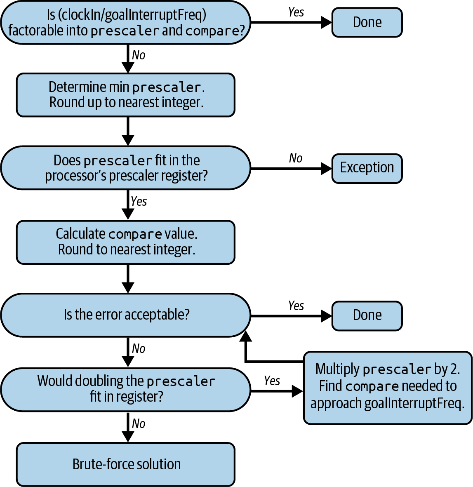

图4-9 寻找目标中断频率对应寄存器值的启发式方法

<!-- figure-labels: 4-9 -->
图中流程文字：

1. (clockIn/goalInterruptFreq) 能否分解为 prescaler 与 compare 的乘积？是：完成；否：继续。
2. 确定最小 prescaler，向上取整到最近的整数。
3. prescaler 能否装入处理器的预分频寄存器？否：异常；是：继续。
4. 计算 compare 值，四舍五入到最近的整数。
5. 误差是否可以接受？是：完成；否：继续。
6. prescaler 加倍后能否装入寄存器？否：暴力求解；是：将 prescaler 乘以 2，找到接近 goalInterruptFreq 所需的 compare，然后返回“误差是否可以接受？”这一判断。

重新整理方程，并将比较寄存器设为最大值，就能求出最小预分频值：

```text
prescaler = clockIn / (compare * interruptFrequency)
      = 4 MHz / (255 * 20 Hz)
```

遗憾的是，得到的预分频值是浮点数 784.31。如果向上取整为 785，得到的中断频率就是 19.98 Hz，误差小于千分之一。

如果将预分频值向下取整为 784，中断频率会高于目标值，你也许能够减小比较寄存器，使定时器频率接近目标。prescaler = 784、compare = 255 时，误差为 0.04%。不过，市场部门要求高精度，而我们还有办法找到更好的预分频值。

首先，注意我们希望预分频器与比较寄存器的乘积，等于时钟输入除以目标频率：

```text
prescaler * compare = clockIn / interruptFrequency = 4 MHz/20 Hz = 200,000
```

这是个很漂亮的整数，容易分解成 1,000（预分频器）和 200（比较寄存器）。这就是优化 prescaler 和 compare 最好也最简单的方法：求出 (clockIn/interruptFrequency) 的因数，再将它们分配给 prescaler 和 compare。不过，这要求 (clockIn/interruptFrequency) 是整数，而且因数能方便地分配到寄存器允许的范围内。这种方法并非总能使用。

<!-- source: pdf=137-139; section=4.7.3; unit=ch04-difficult-frequency -->

<a id="src-p138"></a>


<a id="src-p139"></a>

<!-- source-units: p0137_b004_u00, p0137_b005_u00, p0137_b006_u00, p0137_b007_u00, p0137_b008_u00, p0137_b009_u00, p0137_b010_u00, p0137_b011_u00, p0137_b012_u00, p0138_b000_u00, p0138_b001_u00, p0138_b002_u00, p0138_b003_u00, p0138_b004_u00, p0138_b005_u00, p0138_b006_u00, p0138_b007_u00, p0138_b008_u00, p0138_b009_u00, p0138_b010_u00, p0138_b011_u00, p0138_b012_u01, p0138_b012_u03, p0138_b012_u00, p0138_b012_u04, p0138_b012_u02, p0138_b013_u00, p0138_b014_u00, p0138_b015_u00, p0139_b000_u00 -->
### 更多计算：棘手的目标频率 {#ch04-toc-026}

接着处理市场部门要求的另一个闪烁频率：8.5 Hz，也就是 17 Hz 的中断频率。新目标为：

```text
prescaler * compare = clockIn / interruptFrequency = 4 MHz/17 Hz = 235294.1
```

这个浮点数无法简单地分解因数。可以通过计算最小预分频值，验证是否存在可行的结果；前面已经做过，就是把比较寄存器设为最大值。结果 923 可以装进 10 位寄存器。百分比误差可按下式计算：

```text
error = 100 * (goal interrupt frequency - actual) / goal
```

使用最小预分频值，得到的误差为 0.03%。已经相当接近了，但或许还能更接近。

把预分频器设为最大值，看看有哪些选择。在本例中，预分频值为 1,023 时，比较值为 230，误差小于 0.02%，稍好一些。但还能进一步降低误差吗？

对于位数更大的定时器，可以尝试用二分搜索寻找合适的值，从最小预分频值开始。将它加倍，再考察预分频值上下相差 1 的值，寻找最接近整数的比较寄存器值。如果所得频率仍不够接近，就对调整后的预分频值继续加倍。遗憾的是，在我们的示例中，预分频值一旦加倍，就超出了 10 位数的范围。

最后，还可以使用脚本或程序，例如 MATLAB 或 Excel，暴力尝试各个选项，如下面的步骤所示。先找出预分频器的最小值和最大值，求最大值时将比较寄存器设为 1。限定最大、最小值，使其为整数，并能放入相应位数。然后，对该范围内的每个整数，计算目标中断频率所需的比较寄存器值。将比较值四舍五入到最近的整数，再计算实际中断频率。采用这种方法，得到预分频值 997、比较寄存器值 236，误差仅为 0.0009%。这种暴力求解会得到最小误差，但可能耗费最多的开发时间。先确定可以接受的误差，一旦达到目标，就继续做其他事情。

用暴力法寻找误差最小的中断频率寄存器值：

1. 计算预分频器的最小值和最大值：

   minPrescaler = clockInput / (goalFrequency × maxCompare)
   
   = 4 MHz / (17 Hz × 255) = 922
   
   maxPrescaler = clockInput / (goalFrequency × maxCompare)
   
   = 4 MHz / (17 Hz × 1) = 235,294 → 超过最大值
   
   = 2¹⁰ − 1 = 1,023

2. 对 922 到 1,023 之间的每个预分频值，计算比较值：

   compare = clockInput / (goalFrequency × prescaler) = 4 MHz / (20 Hz × 922) = 255.2
   
   = round(255.2) ⇒ 255
   
   使用算出的比较值，求出这些设置对应的中断频率：
   
   interruptFrequency = clockInput / (prescaler * compare) = 4 mHz / (923 * 255) = 17.013 Hz
   
   计算误差：
   
   error% = 100 × abs(goalFrequency − interruptFrequency) / goalFrequency
   
   = 100 × abs(17 Hz − 17.013) / 17 Hz
   
   = 0.08%

3. 找出误差最小的预分频器和比较寄存器值。

<!-- source: pdf=139; section=4.7.4; unit=ch04-long-wait -->
<!-- source-units: p0139_b001_u00, p0139_b002_u00, p0139_b003_u00 -->
### 定时器节拍之间的长时间等待 {#ch04-toc-027}

暴力法对 17 Hz 很有效，但对于 13 Hz 的目标输出，也就是市场部门的新目标 2 × 6.5 Hz，算出的最小预分频值需要超过 10 位。所需定时值无法放进 8 位定时器。流程图（图4-9）将这种情况列为异常。最简单的解决办法，是在可能的情况下使用位数更大的定时器。ATtiny45 的 16 位定时器可以缓解这个问题，因为它的最大比较值为 65,535，而不是 8 位的 255，所以可以使用更小的预分频值。

如果没有更大的定时器，另一种办法是断开 I/O 线路与定时器的直接关联，在定时器到期时产生中断。中断可以递增一个变量，等变量足够大时再采取动作。例如，要得到 13 Hz，可以让定时器以 26 Hz 工作，每两次中断翻转一次 LED。这种方法精度较低，因为其他中断可能造成延迟。

<!-- source: pdf=139; section=4.7.5; unit=ch04-timer-use-steps -->
<!-- source-units: p0139_b004_u00, p0139_b005_u00, p0139_b006_u00, p0139_b007_u00, p0139_b008_u00, p0139_b009_u00 -->
### 使用定时器 {#ch04-toc-028}

确定设置后，最困难的部分就过去了，但还有几件事要做：

- 删除主函数中翻转 LED 的代码。现在主循环只需要保留几组预分频器和比较寄存器值，在按钮按下时循环切换。
- 编写翻转 LED 的中断处理程序。
- 配置引脚。有些处理器可以把任意定时器连接到任意输出，而另一些处理器只有在特殊设置下才允许定时器改变引脚。如果处理器不支持该引脚上的定时器功能，就需要在代码中编写中断处理程序，只翻转目标引脚。
- 配置定时器设置并启动定时器。

<!-- source: pdf=139-140; section=4.8; unit=ch04-pwm-intro -->

<a id="src-p140"></a>

<!-- source-units: p0139_b010_u00, p0139_b011_u00, p0139_b012_u00, p0140_b000_u00, p0140_b001_u00, p0140_b002_u00, p0140_b004_u00 -->
## 使用脉宽调制 {#ch04-toc-029}

市场调查表明，潜在客户受不了 LED 的亮度，说它亮得像激光，晃得人睁不开眼。市场部门想试几种不同的亮度设置：100%、80%、70% 和 50%，并用按钮在这些选项间切换。

这个任务给了我们一个很好的机会，来探索脉宽调制（pulse-width modulation，PWM）。PWM 决定引脚在翻转之前，保持高电平或低电平多长时间。PWM 连续运行，按固定节奏打开再关闭外设。周期通常很短，约为毫秒量级，或者说频率为几百 Hz。

PWM 信号常用于驱动电动机和 LED，不过电动机需要更多一点的硬件支持。借助 PWM，处理器可以控制硬件获得的功率。通过一些便宜的电子电路，可以把 PWM 引脚输出平滑成平均信号。不过，对于 LED，不需要任何额外电子电路。亮度与每个周期中 LED 点亮的时间占比有关。

定时器产生一串完全相同的脉冲，因此，定时器信号有 50% 的时间为高电平、50% 的时间为低电平，这称为 50% 占空比（duty cycle）。在 PWM 中，脉冲宽度会根据情况改变，所以可以具有不同的比例。占空比为 100% 的 PWM 始终开启，就像输出引脚保持高电平。占空比为 0% 则表示引脚被驱动或拉到低电平。占空比表示信号的平均值，如图4-10中的虚线所示。

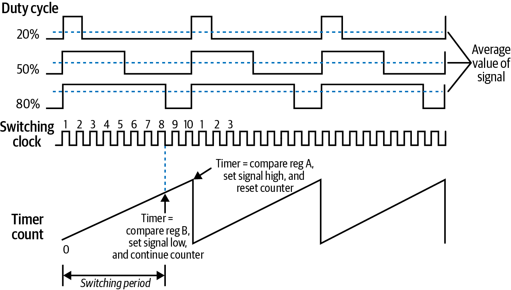

图4-10 PWM 占空比：20%、50% 和 80%

<!-- figure-labels: 4-10 -->
图中文字：Duty cycle＝占空比；Average value of signal＝信号平均值；Switching clock＝开关时钟；Timer count＝定时器计数；Switching period＝开关周期。定时器等于比较寄存器 B 时，将信号设为低电平并继续计数；定时器等于比较寄存器 A 时，将信号设为高电平并复位计数器。

<!-- source: pdf=140-141; section=4.8; unit=ch04-pwm-implementation -->

<a id="src-p141"></a>

<!-- source-units: p0140_b005_u00, p0141_b000_u00, p0141_b001_u00, p0141_b002_u00, p0141_b003_u00, p0141_b004_u00, p0141_b005_u00, p0141_b006_u00, p0141_b007_u00, p0141_b008_u00, p0141_b009_u00, p0141_b010_u00, p0141_b011_u00, p0141_b012_u00, p0141_b013_u00 -->
使用前面“使用定时器”一节中的定时器，可以通过中断实现 PWM。在 20 Hz 的 LED 示例中，比较寄存器值为 200，因此每经过 200 个节拍，定时器中断就会采取动作，也就是翻转 LED。如果希望使用 20 Hz 定时器时，LED 有 80% 的时间点亮，而不是前面的 50%，就可以在两个中断之间交替，每次都重新设置比较寄存器：

- 定时器中断 1
  - 点亮 LED。
  - 将比较寄存器设为 160，即 200 的 80%。
  - 复位定时器。
- 定时器中断 2
  - 熄灭 LED。
  - 将比较寄存器设为 40，即 200 的 20%。
  - 复位定时器。

使用 20 Hz 定时器时，看起来可能是一连串很快的闪光，而不是一盏变暗的 LED。问题在于 20 Hz 太慢。频率越高，LED 看起来就越像是变暗了，而不是在闪烁。不过，频率更高就意味着更多中断。

处理器可以用另一种方式完成这一过程。在前一节中，可配置的动作包括是否复位计数器，以及如何设置引脚。许多定时器具有多个比较寄存器，并允许为每一个设置不同动作。因此，可以用两个比较寄存器建立 PWM 输出，一个控制开关频率，另一个控制占空比。

例如，图4-10底部显示了定时器不断向上计数并被复位的过程。这表示由某个比较寄存器设定的开关频率。我们把它称为比较寄存器 A，并将其设为 100。计数达到这个值时，复位定时器并点亮 LED。占空比由另一个寄存器设置，即设为 80 的比较寄存器 B，它会熄灭 LED，但允许定时器继续计数。

哪些引脚可以作为 PWM 输出，取决于处理器，不过它们通常是可作为定时器输出的引脚中的一部分。处理器用户手册的 PWM 章节可能与定时器章节分开。此外，还有不同的 PWM 控制器配置，通常针对特定应用，电动机往往对所需的 PWM 类型颇为挑剔。

对于我们的 LED，一旦 PWM 配置完成，代码只需在按钮按下时修改占空比。与定时器一样，主函数完全不直接控制 LED。

虽然市场部门要求的是 LED 调光，但你还可以尝试其他有趣的应用。要做出 LED 渐亮渐暗的呼吸效果，需要逐步修改占空比。如果有三色 LED，可以用 PWM 控制将三种 LED 颜色设为不同亮度，得到丰富的颜色选择。

<!-- source: pdf=142-143; section=4.9; unit=ch04-shipping -->

<a id="src-p142"></a>


<a id="src-p143"></a>

<!-- source-units: p0142_b000_u00, p0142_b001_u00, p0142_b002_u00, p0142_b003_u00, p0142_b004_u00, p0142_b006_u00, p0142_b007_u00, p0143_b000_u00, p0143_b001_u00, p0143_b002_u00 -->
## 交付产品 {#ch04-toc-030}

市场部门已经找到了完美的 LED（蓝色）、闪烁速率（8 Hz）和亮度（100%），只等你设置好参数，就准备交付产品了。

看起来，只需设置参数并交付代码，一切就这么简单。但现在的代码到底是什么样？定时器代码是否已经演变为 PWM 代码，还是定时器中断仍然保留着？亮度为 100% 时，已经不需要 PWM 代码。实际上，按钮代码也可以去掉。运行时选择 LED 的能力不再需要，以后也可以忘掉旧的电路板布局。在交付代码、冻结开发之前，我们先试着把这团乱麻理顺一些。

产品从一个想法起步，往往经过几轮迭代，才逐渐变为明确的现实。工程师通常很善于想象事物将如何工作。并不是每个人都这么幸运，因此，一个好的原型对明确目标会有很大帮助。

然而，保留不需要的代码会让代码库杂乱不堪，见图4-11左侧。未使用的代码，更糟的是被注释掉的代码，会让后来接手却不知道它们为什么被移除的人感到困扰。应尽量避免这种情况。相信版本控制系统能够找回旧代码。不要怕打标签、建分支，或者在内部发布开发版本。这样，在为了交付而精简代码之后，你仍能找到被移除的功能。

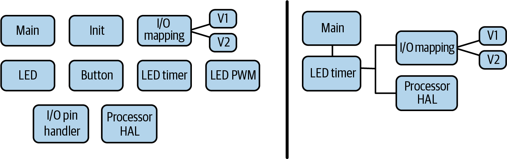

图4-11 纠缠的原型代码与较简洁设计的比较

<!-- figure-labels: 4-11 -->
图中文字：Main＝主函数；Init＝初始化；Button＝按钮；LED timer＝LED 定时器；LED PWM＝LED 脉宽调制；I/O mapping＝I/O 映射；I/O pin handler＝I/O 引脚处理程序；Processor HAL＝处理器硬件抽象层；V1、V2＝版本 1、版本 2。

在这个示例中，很多东西很容易删除，因为它们就是不再需要了。比较难决定的是依赖注入。它为未来的变化增加了灵活性，这是保留它的好理由。不过，当必须把某个具体定时器分配给某个具体 I/O 引脚时，系统配置会更加依赖处理器，也更加固定。如果试图建立一个处理所有可能情况的文件，强行保持灵活性的代价可能很高。在这里，我考虑了这种做法，权衡了两方面：一方面是写出一个自己都不愿给别人看的文件，另一方面是降低在 I/O 子系统中引入 bug 的概率。我的选择是让文件更易读，即使开始时可能有几个 bug，不过，两种选择我都尊重。

图4-11右侧的代码库经过了精简，只保留所需模块。I/O 映射头文件保留了下来，连旧电路板的定义也保留着，因为代价很低：它们位于单独文件中，容易维护，也不占用额外处理器周期。嵌入式系统工程师往往最后拿到的是最老的硬件，大概是项目开始时我们拿到最新硬件的因果报应。未来开发时，你可能还需要旧电路板的头文件。几乎所有其他非关键内容，都可以先放进版本控制，再从项目中删除。

看到自己的努力被丢弃，难免心疼。但其实并没有白费！所有其他代码，都是制作那些原型所必需的，而那些原型又是完成产品所必需的。代码帮助了市场部门，你也在编写和测试的过程中学到了很多。开发原型代码最棒的一点在于：正因为探索过各种选项，最终代码才可以显得如此干净。

你需要在保留所有代码所带来的灵活性，与易于理解的代码库所带来的可维护性之间取得平衡。既然已经写过一次，就相信未来的自己在必要时还能再写一次。

<!-- source: pdf=143; section=4.10; unit=ch04-further-reading -->
<!-- source-units: p0143_b003_u00, p0143_b004_u00, p0143_b005_u00, p0143_b006_u00, p0143_b007_u00, p0143_b008_u00, p0143_b009_u00 -->
## 延伸阅读 {#ch04-toc-031}

- [Jack Ganssle 网站](http://ganssle.com)上的 [A Guide to Debouncing（《去抖指南》）](http://ganssle.com/debouncing.htm)介绍了去抖的机理、实际实验、其他软件去抖实现方法，以及一些很出色的硬件去抖方案，让你把处理器周期留给更有意思的事情。他的整个网站都值得花些时间看看。
- [STM32F101xx、STM32F102xx、STM32F103xx、STM32F105xx 和 STM32F107xx 参考手册（RM0008）](https://oreil.ly/PMKTr)，修订版 21，2021 年 2 月。
- [MSP430F2xx、MSP430G2xx 系列用户指南（SLAU144K）](https://oreil.ly/6tqZE)，2022 年 8 月。
- Atmel 用户手册：[带 2/4/8K 字节可在系统编程闪存的 8 位微控制器（ATtiny25/V、ATtiny45/V、ATtiny85/V）](https://oreil.ly/ziPWV)，修订版 2586Q–AVR–08/2013。
- Atmel 应用笔记：[AVR 130: Setup and Use the AVR Timers（《AVR 130：配置和使用 AVR 定时器》）](https://oreil.ly/Jhfyh)。
- 如果按位运算对你来说还是新知识，有几款游戏能帮助你建立更直观的理解。Turing Complete 是我目前最喜欢的一款。其他建议可查看[本书的 GitHub 仓库](https://github.com/eleciawhite/making-embedded-systems)。

<!-- source: pdf=144; section=4.11; unit=ch04-interview-register -->

<a id="src-p144"></a>

<!-- source-units: p0144_b000_u00, p0144_b001_u00, p0144_b002_u00, p0144_b003_u00, p0144_b004_u00, p0144_b005_u00 -->
## 面试题：等待寄存器变化

这段代码有什么问题？

```c
void IOWaitForRegChange(unsigned int* reg, unsigned int bitmask){
  unsigned int orig = *reg & bitmask;
  while (orig == (*reg & bitmask)) { /* do nothing */ ; }
}
```

“这段代码有什么问题？”是个难题，因为你要猜出面试官认为问题在哪里。对于这段代码，我能想象求职者可能会琢磨，是不是应该为函数加一段注释；也可能思考，真的应该存在这样一个永远等待、没有任何超时或错误处理的函数吗？

如果求职者毫无头绪，只是指出一些非关键问题，我会告诉他们：即使通过示波器观察到寄存器发生了变化，这个函数也始终不返回。如果他们仍然找不到方向，我会进一步说明，代码是在开启优化的情况下编译的。

说到底，这不是考察思考方式的问题，而是有一个唯一正确答案：代码缺少 volatile 关键字。要通过嵌入式系统面试，就必须知道这个关键字的作用；它在 C、C++ 和 Java 中的作用类似。