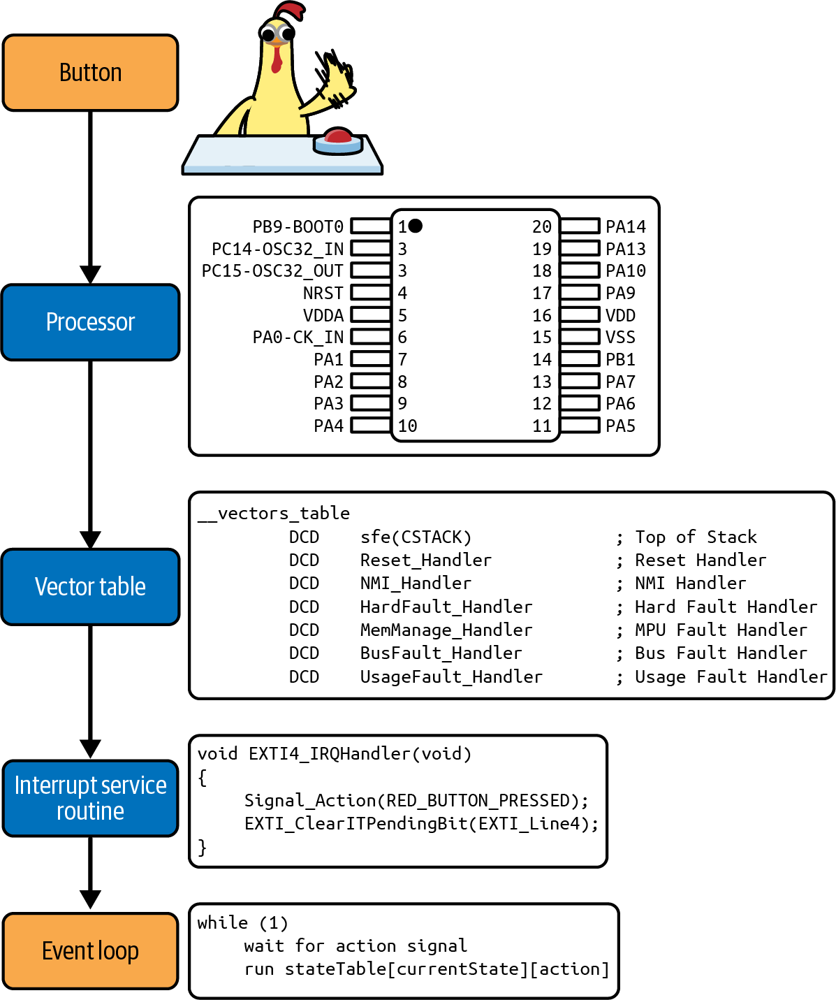
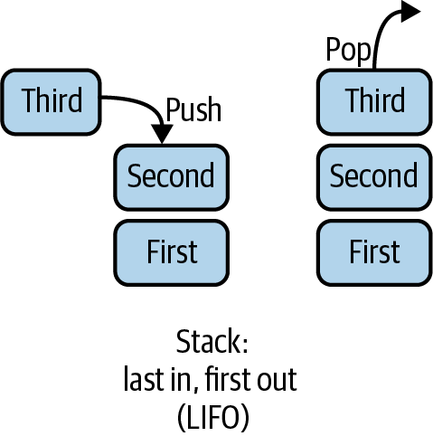
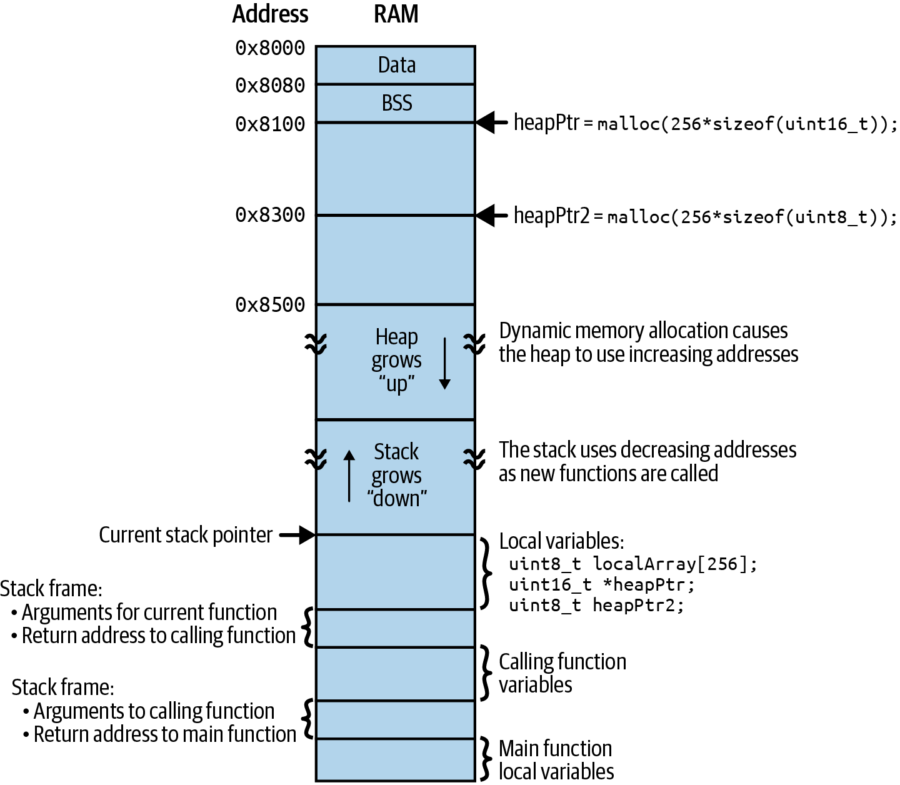
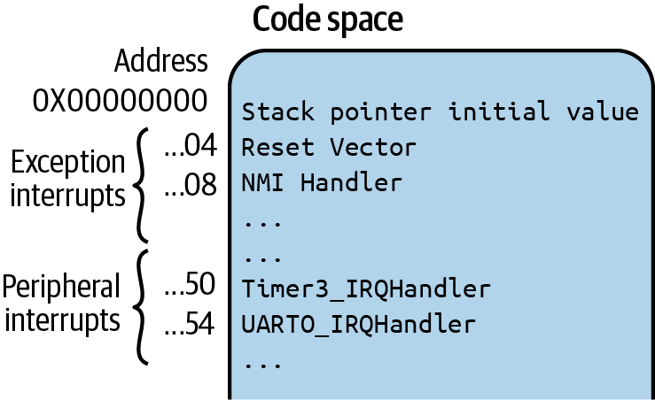
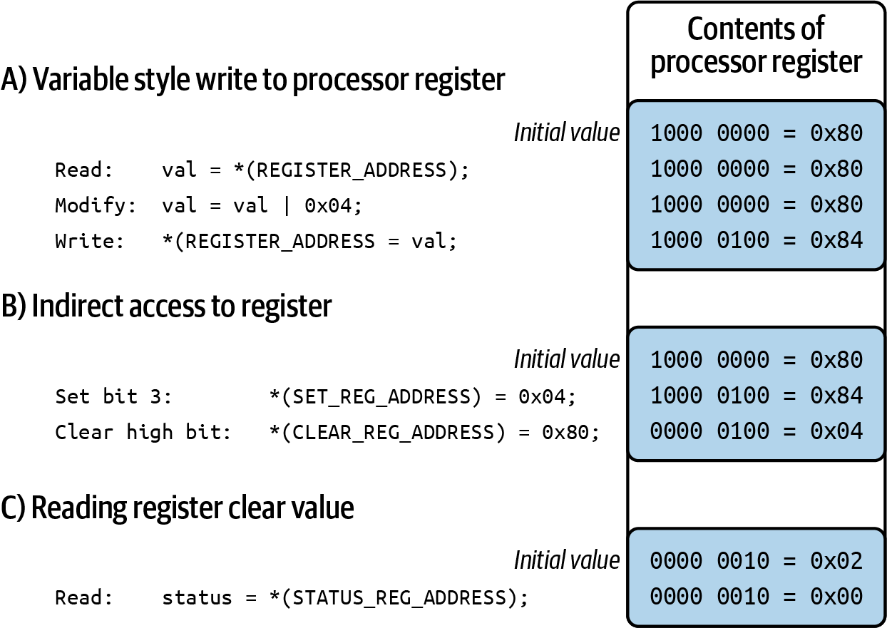
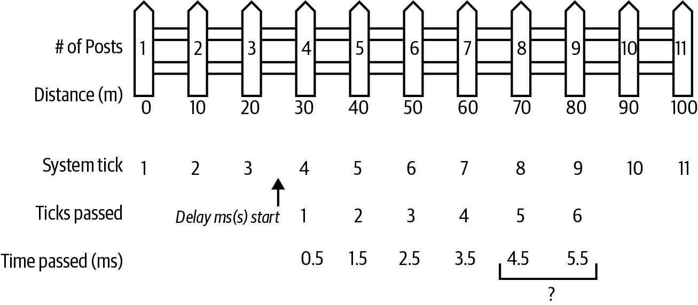
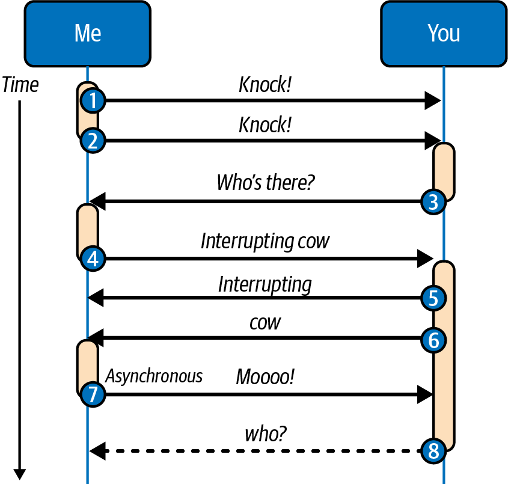

<!-- source: pdf=145; section=5; unit=ch05-intro -->

<a id="src-p145"></a>

<!-- source-units: p0145_b001_u00, p0145_b002_u00, p0145_b003_u00 -->
# 第 5 章 中断 {#ch05}

中断可能令人望而生畏。它是让嵌入式系统区别于传统应用软件的因素之一。中断会不知从哪里突然冒出来，改变代码的执行流程。它只能安全地调用某些函数，通常不包括调试函数。中断必须很快，快到这部分代码直到现在偶尔还会用汇编语言编写。而且，中断中的 bug 往往非常难找，因为按照定义，中断就是异步发生的，也就是发生在正常执行流程之外。

不过，中断并没有传说中那么可怕。如果理解了中断发生时究竟会出现什么，你就会知道它可以在哪些地方成为软件设计中的有用部分。

<!-- source: pdf=145-147; section=5.1; unit=ch05-chicken -->

<a id="src-p146"></a>


<a id="src-p147"></a>

<!-- source-units: p0145_b004_u00, p0145_b005_u00, p0145_b000_u00, p0146_b001_u00, p0146_b002_u00, p0146_b003_u00, p0147_b000_u00, p0147_b001_u00, p0147_b002_u00, p0147_b003_u00, p0147_b004_u00, p0147_b005_u00 -->
## 一只鸡按下按钮 {#ch05-toc-001}

把中断想成一台鲁布·戈德堡机械装置（Rube Goldberg machine）[^ch5-1]，它的目标是告诉软件：正常代码流程之外发生了一件事。来看看图5-1中的这只鸡。

[^ch5-1]: 鲁布·戈德堡机械装置是一种过度复杂的装置，用来完成相对简单的事情。这类装置，无论真实的还是比喻意义上的，往往由一系列简单、彼此无关的元素组成，每个元素的动作触发下一个元素，直到完成目标动作。



图5-1 一只鸡按下按钮，引发一连串动作，最终由事件循环中的代码采取行动

<!-- figure-labels: 5-1 -->
图中文字：Button＝按钮；Processor＝处理器；Vector table＝向量表；Interrupt service routine＝中断服务程序；Event loop＝事件循环。芯片引脚名称和编号保持原图所示。图中代码如下，英文注释保留：

```asm
__vectors_table
        DCD    sfe(CSTACK)          ; Top of Stack
        DCD    Reset_Handler        ; Reset Handler
        DCD    NMI_Handler          ; NMI Handler
        DCD    HardFault_Handler    ; Hard Fault Handler
        DCD    MemManage_Handler    ; MPU Fault Handler
        DCD    BusFault_Handler     ; Bus Fault Handler
        DCD    UsageFault_Handler   ; Usage Fault Handler
```

```c
void EXTI4_IRQHandler(void)
{
    Signal_Action(RED_BUTTON_PRESSED);
    EXTI_ClearITPendingBit(EXTI_Line4);
}
```

```text
while (1)
    wait for action signal
    run stateTable[currentState][action]
```

鸡按下按钮。中断信号传到处理器。处理器保存当前执行位置，然后查找要调用的代码。处理器调用这段代码，代码做一些事，比如设置一个变量。中断结束，处理器回到这一切发生前的位置。普通代码继续运行，但现在出现了一个仿佛凭空而来的变量变化或其他信号。

换一种说法。首先，请记住：处理器和接口就像软件 API，见“阅读数据手册”一节；函数指针也不可怕，见“函数指针没那么可怕”旁栏。在逐步分析中断发生时的过程时，你需要把这两个概念放在心里：

1. 处理器内部产生中断请求（interrupt request，IRQ），触发源可能是外部组件、软件，或者系统故障。
2. 处理器保存上下文，包括原先的执行位置和局部变量。
3. 处理器从向量表中找到与该中断关联的函数。
4. 回调函数运行，也就是中断服务程序（interrupt service routine，ISR），或中断处理程序。
5. 处理器恢复保存的上下文，返回中断发生前的位置，程序继续运行。

我们先更详细地看一遍中断处理过程，然后讨论如何设置这些中断，让它们按你的要求工作。

<!-- source: pdf=147-148; section=5.2; unit=ch05-irq-happens -->

<a id="src-p148"></a>

<!-- source-units: p0147_b006_u00, p0147_b007_u00, p0147_b008_u00, p0147_b009_u00, p0147_b010_u00, p0147_b011_u00, p0148_b000_u00 -->
## IRQ 发生 {#ch05-toc-002}

有些中断就像小型的高优先级任务。ISR 执行完毕后，处理器恢复保存的上下文，继续执行，仿佛什么也没发生过。大多数外设中断都属于这一类：输入线路、通信通路、定时器、外设、ADC（模数转换器）等。

另一些中断更像异常，用于处理系统故障，之后不会恢复正常执行。例如，出现内存错误、除以零错误、处理器尝试执行无效指令，或者供电水平不足以让处理器正常运行，即欠压检测（brownout detection）时，都可能发生中断。这些错误意味着发生了严重问题，处理器无法正常运行。通常，这类中断会让系统进入无限循环，或者复位处理器。

你需要处理的大多数中断更像任务，而不是异常。它们让处理器能够运行多个任务，看起来仿佛并行执行。

通常，中断请求之所以发生，是因为你配置过这个中断。如果不是你做的，那很可能是厂商的启动代码做了这项工作。虽然高层语言程序员往往看不到启动代码，但它会配置一些与硬件有关的内容，例如设置默认中断，通常是故障中断，以及配置系统时钟。

对于任务型中断，可以在初始化代码中将它们配置为在指定条件下发生。具体有哪些条件，取决于处理器。处理器用户手册对于设置中断至关重要。先介绍完中断本身的各个部分后，本章后面的“配置中断”一节将进一步讨论配置。

处理器各不相同，因此，我将重点使用 STM32F103xx。它的中断处理复杂度处于中等水平；Microchip 的 ATtiny AVR 要简单得多，而 TI MSP430x2xx 则更复杂。

<!-- source: pdf=148; section=5.2.1; unit=ch05-nmi -->
<!-- source-units: p0148_b001_u00, p0148_b002_u00, p0148_b003_u00 -->
### 不可屏蔽中断 {#ch05-toc-003}

有些处理器认为某些中断太重要，不能被禁用，于是把它们定义为不可屏蔽中断（nonmaskable interrupt，NMI）。（大概“不能被禁用的中断”说起来太拗口了。）

前面提到的处理器故障就是一种 NMI。通常有一个 I/O 引脚能够连接到 NMI，它往往接到设备上的“开机”按钮。这些中断在任何时候都不能忽略，必须立即处理，即使当前正在执行代码的临界区。

<!-- source: pdf=148; section=5.2.2; unit=ch05-priority -->
<!-- source-units: p0148_b004_u00, p0148_b005_u00, p0148_b006_u00, p0148_b007_u00 -->
### 中断优先级 {#ch05-toc-004}

回到“鸡按按钮”的例子，我们还没有真正讨论过，鸡为什么会有一个按钮。假设这个按钮用于发现狐狸时通知农场主，再假设还有一个定时器中断，会自动给鸡喂食。

如果喂食定时器和狐狸警报按钮恰好同时发生，尽管这种可能性很小，处理器应该先处理哪一个？显然，降低捕食者带来的危险，比喂鸡更重要。中断可以具有不同的优先级。

有些处理器的中断优先级由外设本身决定，例如，定时器 1 的优先级高于定时器 2，而定时器 2 又高于定时器 3。另一些处理器则允许逐个中断配置优先级。

<!-- source: pdf=148; section=5.2.3; unit=ch05-nesting -->
<!-- source-units: p0148_b008_u00, p0148_b009_u00, p0148_b010_u00 -->
### 嵌套中断 {#ch05-toc-005}

有些处理器允许一个中断被另一个中断打断。优先级便不再只是决定调用哪个 ISR 时才重要，还会用于判断，新中断能否抢占当前正在运行的中断。

这是一个强大的工具，但很可能带来不必要的复杂性。除非嵌套中断能解决系统中特有的明确问题，否则通常应在 ISR 执行期间禁用其他中断。多数支持嵌套中断的处理器，也提供了在系统初始化时禁用嵌套的方法。

<!-- source: pdf=149-150; section=5.2.3; unit=ch05-stack-heap-sidebar -->

<a id="src-p149"></a>


<a id="src-p150"></a>

<!-- source-units: p0149_b000_u00, p0149_b001_u00, p0149_b003_u00, p0149_b004_u00, p0149_b005_u00, p0149_b006_u00, p0149_b007_u00, p0150_b001_u00 -->
#### 栈与堆

栈（stack）是一种按后进先出（last in, first out，LIFO）方式保存信息的数据结构，如图5-2所示。把数据压入栈，称为 push，也就是将数据加入栈的内存，并增加指针，使其指向下一组数据将存放的位置。要取出最后放入的数据，就执行出栈，即 pop，此时指针减小。



图5-2 栈的基础

<!-- figure-labels: 5-2 -->
图中文字：First、Second、Third 分别表示第一个、第二个、第三个数据项；Push＝压栈；Pop＝出栈；Stack: last in, first out (LIFO)＝栈：后进先出。

栈是一种任何开发者都能实现的简单数据结构；但特指“那个栈”时，所说的是系统调用栈，它位于指定的一段 RAM 中，支撑着每一个运行中的程序。每调用一个函数，编译器就会创建一个栈帧（stack frame），其中包含局部变量、参数，以及函数结束后的返回地址。每次函数调用都有一个栈帧，从复位向量开始，到调用 main，再到之后调用的任何函数。如果有多个线程，每个线程会有自己的栈。

堆（heap）是一种树形数据结构。而特指内存中的“堆”时，它是动态分配内存的来源，因为可以用堆数据结构实现而得名。通常，堆向高地址增长，如图5-3所示，栈则向低地址增长。当两者相遇，系统就会崩溃。实际上，系统很可能在它们相遇之前就崩溃，因为两者之间可能还有其他东西，包括全局变量、静态变量，也可能还有代码。第11章会进一步讨论。

如果栈变得太大，就可能长进其他内存区域，例如全局数组所在的区域。如果栈覆盖了数组的内存，数组中损坏的数据很可能导致错误结果，这称为栈溢出（stack overflow）。反过来，如果全局数组覆盖了栈，函数返回地址就可能被破坏。当函数返回时，程序会返回到一个错误地址，然后崩溃，通常是因为执行了不合适的指令。



图5-3 显示堆指针和栈指针的系统 RAM 内存映射

<!-- figure-labels: 5-3 -->
图中文字：Address＝地址；Data＝数据；BSS 保留原标识。Heap grows “up”＝堆向“上”增长，动态内存分配会让堆使用越来越高的地址；Stack grows “down”＝栈向“下”增长，调用新函数时，栈使用越来越低的地址。Current stack pointer＝当前栈指针。Local variables＝局部变量；Calling function variables＝调用方函数的变量；Main function local variables＝主函数的局部变量。上方栈帧包含当前函数的参数及返回调用方函数的地址；下方栈帧包含传给调用方函数的参数及返回主函数的地址。图中地址为 0x8000、0x8080、0x8100、0x8300 和 0x8500。

图中分配表达式与局部变量声明按原图保留：

```c
heapPtr = malloc(256*sizeof(uint16_t));
heapPtr2 = malloc(256*sizeof(uint8_t));
```

```c
uint8_t localArray[256];
uint16_t *heapPtr;
uint8_t heapPtr2;
```

<!-- source: pdf=150-151; section=5.3; unit=ch05-save-context -->

<a id="src-p151"></a>

<!-- source-units: p0150_b002_u00, p0150_b003_u00, p0150_b004_u00, p0151_b001_u00, p0151_b002_u00, p0151_b003_u00, p0151_b004_u00 -->
## 保存上下文 {#ch05-toc-006}

中断请求发生后，在寻找相应处理函数之前，处理器会先保存此前的执行状态。就像用书签标记阅读位置一样，处理器会把上下文（context）保存到栈中，参见“栈与堆”旁栏。上下文包括程序计数器，也就是指向下一条待执行指令的寄存器，以及一部分处理器寄存器，它们类似于处理器自己的缓存式局部 RAM。保存寄存器内容，是为了让中断代码能够在执行过程中使用这些寄存器，而不会破坏主代码路径的状态。

这些步骤不是免费的。从 IRQ 发生到 ISR 开始之间所需的时间，称为处理器的中断延迟（interrupt latency）。用户手册通常会宣称，它需要多少个处理器周期。

系统延迟（system latency）是从中断事件发生到 ISR 开始之间，最坏情况下所需的时间。它包括处理器的中断延迟，以及系统禁用中断的最长时间。

>  如果不允许中断嵌套，那么处理一个中断期间，新的中断会被禁用。对系统延迟影响最大的因素，可能就是最长的那个中断所花的时间。让中断保持简短！

中断延迟所消耗的处理器周期就这样白白用掉了。假设有一款处理器每秒能够执行一百条指令，也就是 100 Hz，中断延迟为 10 个周期；如果设置一个每秒中断一次的定时器，10% 的处理器周期就花在上下文切换上了。实际上，由于还需要恢复上下文，情况可能更糟。虽然 10 个周期的中断延迟还算可以，不算出色，但也不差，不过 100 Hz 的系统确实罕见。换成一款 30 MHz 的处理器，在 44,100 Hz 的中断中处理音频，中断延迟为 10 个周期，那么光是调用中断处理程序，就消耗了 1.47% 的处理器周期。这还没有包括执行 ISR 以及从中返回所需的时间。

处理器设计者努力降低中断延迟。一种方法是只保存最少量的上下文，也就是不保存所有处理器寄存器，只保存其中一部分，其余需要用到的寄存器由软件保存。这通常由编译器处理，从而增加实际的系统延迟。

<!-- source: pdf=151; section=5.3; unit=ch05-calculate-latency-sidebar -->
<!-- source-units: p0151_b005_u00, p0151_b006_u00, p0151_b007_u00 -->
#### 计算系统延迟

不建议在中断中调用大量函数。每次函数调用都有一定开销，第11章会更详细地讨论，因此，函数调用会让中断执行得更久。如果中断期间禁用了其他中断，每多一次函数调用，系统延迟都会增加。

系统延迟越大，实时处理事件的能力就越弱。考虑前面那款 30 MHz、以 44,100 Hz 中断的处理器。如果每次中断的自身开销为 10 个周期，调用五个短函数各花 10 个周期，而这五个函数实际处理信息总共花费 275 个周期，那么至少有 335 个周期无法处理其他中断，即 10 + 5 × 10 + 275。消耗的时间为 11 μs，即 335/30 MHz。还要注意，系统将近 50% 的时间都花在中断中，44,100 Hz × 11 微秒 = 0.492 s。减少中断开销，可以释放处理器周期，用于其他任务。

<!-- source: pdf=152; section=5.4; unit=ch05-vector-table -->

<a id="src-p152"></a>

<!-- source-units: p0152_b000_u00, p0152_b001_u00, p0152_b002_u00 -->
## 从向量表中取得 ISR {#ch05-toc-007}

IRQ 发生并保存上下文后，中断处理的第三步是查阅中断向量表（interrupt vector table，IVT），确定要调用哪个 ISR。这张表位于处理器内存中的某个特定区域。中断发生时，处理器会查看该表，调用与该中断关联的函数。

IVT 是一张回调函数列表，每一种中断对应一个函数。说穿了，向量表就是一张函数指针列表，只不过相关代码经常用汇编实现。

<!-- source: pdf=152-153; section=5.4.1; unit=ch05-init-vector -->

<a id="src-p153"></a>

<!-- source-units: p0152_b003_u00, p0152_b004_u00, p0152_b005_u00, p0152_b006_u00, p0152_b007_u00, p0152_b008_u00, p0152_b009_u00, p0153_b000_u00 -->
### 初始化向量表 {#ch05-toc-008}

启动代码通常来自编译器或处理器厂商提供的 HAL，它会替你设置向量表，通常填入一些占位的中断处理程序。调试时，你大概会希望未处理的中断进入无限循环，以便发现它们，然后关闭该中断，或者正确处理它。

产品上市后，让未处理的中断处理程序进入无限循环，会导致系统失去响应。你可能希望未处理的中断直接返回正常执行。这会浪费处理器周期，也仍然是一个 bug，但至少给客户带来的影响只是轻微变慢，而不是必须重启系统。

有时，只要给自己的处理函数取一个与表中函数相同的名字，工具就会施展一点“魔法”，让链接器在 IVT 中使用你的函数。对于另一些处理器和编译器，则需要你把 ISR 放进函数表中对应该中断的正确位置。

在 STM32F103xx 处理器上使用 STM32Cube HAL 时，只需将 ISR 命名为 TIM2_IRQHandler，链接器就会把正确的函数地址放进向量表。在另一些处理器上，例如 Microchip 的 AT91SAM7S，必须创建一个函数，并手动将它放入表中：

```c
interrupt void Timer1ISR(){
  …
}

void FoodTimerInit(){
  …
  AT91C_BASE_AIC->AIC_SVR[AT91C_ID_TC1] = // Set TC1 IRQ handler
                                          // address in the IVT
      (unsigned long)Timer1ISR;  // Source Vector Register,
                                 // slot AT91C_ID_TC1 (12)
  …
}
```

这必须在初始化中断时完成，而且要在使能中断之前。

<!-- source: pdf=153-154; section=5.4.2; unit=ch05-lookup-isr -->

<a id="src-p154"></a>

<!-- source-units: p0153_b001_u00, p0153_b002_u00, p0153_b003_u00, p0153_b004_u00, p0153_b005_u00, p0153_b006_u00, p0153_b007_u00, p0154_b001_u00 -->
### 查找 ISR {#ch05-toc-009}

向量表位于内存中由链接脚本指定的某个地址。启动代码很可能已经替你完成，因此通常不需要知道具体做法。不过，如果你好奇，我们可以暂时深入看一下 STM32F103xx 的启动代码：

```c
__attribute__ ((section(".isr_vector")))
void (* const g_pfnVectors[])(void) = {
  // Core Level - CM3
  &_estack,           // The initial stack pointer
  Reset_Handler,      // This is the very beginning of running
  NMI_Handler,        // Nonmaskable fault handler

…
  TIM2_IRQHandler,  // 28, TIM2 global interrupt
  TIM3_IRQHandler,  // 29,
  TIM4_IRQHandler,  // 30,
…
}
```

代码清单的第一行不是标准语法，它告诉编译器，后面的变量必须放到一个特殊位置，由链接脚本指出这个位置，也就是 .isr_vector 指定的地方。后面会进一步介绍链接脚本，见“链接脚本入门”一节。现在可以认为，链接变量 .isr_vector 位于用户手册规定的向量表位置，即 0x00000000。

在这个由 void * 元素组成的数组中，首先是栈的位置，同样由链接脚本设置。随后是复位向量，也就是系统启动或因其他原因复位时调用的代码地址。它属于前面提到的异常中断之一。大多数人不会把接通电源或按下复位按钮看作代码的中断。不过，处理器响应复位时，会从表中加载一个向量，就像响应中断时加载向量一样。表的后面是外设中断，例如我们的定时器。图5-4显示了它在处理器内存中的样子。

每个中断都有一个中断号。对于这里的定时器 3，中断号是 50。中断发生时，仅用这个数字表示；处理器中产生 IRQ 的部分，把这个数字发送给从向量表中查找处理函数的部分。处理器根据中断号和向量表的结构，查找中断到来时要调用的地址。



图5-4 内存中的向量表

<!-- figure-labels: 5-4 -->
图中文字：Code space＝代码空间；Address＝地址；Exception interrupts＝异常中断；Peripheral interrupts＝外设中断。Stack pointer initial value＝栈指针初始值；Reset Vector＝复位向量；NMI Handler＝不可屏蔽中断处理程序。地址标注 0X00000000、…04、…08、…50、…54，以及 Timer3_IRQHandler 和 UART0_IRQHandler 标识均按原图保留。

<!-- source: pdf=154-155; section=5.4.2; unit=ch05-reentrant-sidebar -->

<a id="src-p155"></a>

<!-- source-units: p0154_b002_u00, p0154_b003_u00, p0154_b004_u00, p0154_b005_u00, p0154_b006_u00, p0154_b007_u00, p0154_b008_u00, p0155_b001_u00 -->
#### 可重入函数

可重入函数（reentrant function）是指在尚未运行完毕时，仍可以被安全地再次调用的函数。例如，下面这个普通的交换函数就不可重入，因为它有一个临时变量 t，在用它设置最后的 y 变量之前，它的值不能改变：

```c
int t;

void swap(int* x, int* y) {
  t = *x;
  *x = *y;
  // hardware interrupt might invoke isr() here while
  // the function has been called from main or other
  // non-interrupt code
  *y =  t;
}

void isr {
  int x=1, y=2;
  swap(&x, &y);
}
```

使用静态或全局变量的函数不可重入。许多 C++ 对象由于具有私有数据，也不可重入。更糟的是，一些标准库调用同样不可重入，包括 malloc（或 new）和 printf，以及任何 I/O 或文件函数。

系统保存上下文时，只完成最基本的工作。编译器可以多做一些，但即使如此，也不会给你一个完全清白、互不影响的工作环境。这其实是好事，因为通常需要一两个全局变量，通知非中断代码：中断已经发生了。不过，编写 ISR 时，应对那些使用全局变量却没有防范中断影响的函数格外警惕。

>  要假定中断总会在最糟糕的时候发生。这样，你才能把系统设计得尽量减少它们造成的混乱。

<!-- source: pdf=155; section=5.5; unit=ch05-call-isr -->
<!-- source-units: p0155_b002_u00, p0155_b003_u00, p0155_b004_u00, p0155_b005_u00, p0155_b006_u00, p0155_b007_u00, p0155_b008_u00, p0155_b009_u00, p0155_b010_u00 -->
## 调用 ISR {#ch05-toc-010}

到这里，我们已经介绍了理解 ISR 工作方式所需的知识，以及如何设置它。接下来进入 ISR 本身的核心部分，也就是需要你亲自实现的部分。我们已经见过围绕 ISR 最重要的规则：

- 保持 ISR 简短，因为较长的 ISR 会增加系统延迟。通常应避免函数调用，它们可能隐藏着很深的调用链，也会增加开销。
- 不要调用不可重入函数，例如 printf，因为全局变量可能被中断破坏。

这些规则给出了实现 ISR 的设计准则。这里的定时器中断很容易实现，因为只需设置一个标志，表示该喂鸡了：

```c
volatile tBoolean gFeedChicken= FALSE; // global variable set by the interrupt
                                       // handler, which is cleared by normal
                                       // code when event handled
void TIM2_IRQHandler(void){
  __disable_irq();        // disallow nesting of interrupts
  gFeedChicken = TRUE;
  __enable_irq();
}
```

这个中断不打印调试消息，也不驱动喂食机构。尽管那样做看起来很合理，但为了保持简短，我们需要让系统其他部分负责这些事情。这样能把系统延迟降到最低。

中断可以做的不仅是设置标志和解除通信驱动程序的阻塞。如果增加一些代码能让系统更安全，多花一点时间是值得的。除此以外，让中断保持简短！

许多处理器要求你确认或清除中断，通常通过读取状态寄存器完成。正如“写入间接寄存器”旁栏所述，这个动作可能附带清除某个位的效果。

<!-- source: pdf=156-157; section=5.5; unit=ch05-indirect-register-sidebar -->

<a id="src-p156"></a>


<a id="src-p157"></a>

<!-- source-units: p0156_b000_u00, p0156_b001_u00, p0156_b002_u00, p0156_b003_u00, p0156_b004_u00, p0156_b005_u00, p0156_b006_u00, p0156_b007_u00, p0156_b008_u00, p0156_b009_u00, p0156_b010_u00, p0156_b011_u00, p0157_b001_u00 -->
### 写入间接寄存器

存储器映射寄存器可能具有一些有趣的特性。寄存器并不总是表现得像变量。

如果要修改一个普通变量，memoryReg |= 0x01 这一行代码背后隐藏的步骤是：

1. 将内存当前值读入一个处理器寄存器。
2. 修改该值。
3. 将变量写回内存。

但对于设置中断处理的寄存器，如果中断发生在其中任意两个步骤之间，这种多步骤过程就可能出问题。要防止这种竞态条件（race condition），也就是中断发生在状态不一致期间，寄存器操作必须是原子的，即在一条指令中执行。

实现办法是使用一组间接寄存器：一个寄存器用于置位，一个用于清零，它们都作用于第三个功能寄存器，而功能寄存器可能无法直接写入，甚至没有存储器映射。要间接置位某一位，就向置位寄存器中的相应位写入一；要间接清除某一位，就向清零寄存器中的相应位写入一。无论置位还是清零寄存器，其中没有置位的位都不会影响功能寄存器。图5-5的 B 部分给出了置位与清零的例子，并展示了每一步功能寄存器中的内容。

有时，功能寄存器的内容会反映到置位和清零寄存器中，所以读取其中任意一个，都能看到当前哪些位已置位。不过，从同一个寄存器读到的值，与先前写入的值不同，可能让人感到困惑。

功能寄存器也可能是只写的，没有任何读取途径。一些处理器为了节省地址空间，让同一个寄存器在写入时作为功能寄存器，在读取时作为状态寄存器。这时，需要使用影子变量（shadow variable）跟踪功能寄存器中已置位的位。影子变量是代码中的全局变量，每次改变寄存器时也修改它。你不再对中间寄存器执行置位和清零，而是修改影子变量，再将影子变量的值写入寄存器。

还有一些寄存器，读取本身就会修改其内容。这通常用于状态寄存器：代码一读取，处理器就会清除待处理状态，见图5-5的 C 部分。这可以防止在用户读取寄存器与清除相关位之间发生竞态条件。

用户手册会说明哪些寄存器具有这些特殊行为。



图5-5 设置寄存器值的方法

<!-- figure-labels: 5-5 -->
图中文字及各步对应内容如下，保留原图中的代码和数值：

A）像变量一样写入处理器寄存器。右栏标题为“处理器寄存器的内容”。初值为 1000 0000 = 0x80。读取后仍为 1000 0000 = 0x80，修改临时值后仍为 1000 0000 = 0x80，写回后变为 1000 0100 = 0x84。

```text
Read:    val = *(REGISTER_ADDRESS);
Modify:  val = val | 0x04;
Write:   *(REGISTER_ADDRESS = val;
```

B）间接访问寄存器。初值为 1000 0000 = 0x80；“将第 3 位置位”后为 1000 0100 = 0x84；“清除高位”后为 0000 0100 = 0x04。

```text
Set bit 3:       *(SET_REG_ADDRESS) = 0x04;
Clear high bit:  *(CLEAR_REG_ADDRESS) = 0x80;
```

C）读取寄存器会清除数值。初值为 0000 0010 = 0x02；读取后，原图显示为 0000 0010 = 0x00。

```text
Read:    status = *(STATUS_REG_ADDRESS);
```

<!-- source: pdf=157-158; section=5.5.1; unit=ch05-multiple-sources -->

<a id="src-p158"></a>

<!-- source-units: p0157_b002_u00, p0157_b003_u00, p0157_b004_u00, p0157_b005_u00, p0157_b006_u00, p0158_b001_u00, p0158_b002_u00, p0158_b003_u00 -->
### 一个中断，多个来源 {#ch05-toc-011}

有些处理器只有一个中断。让处理器暂停当前执行所需的机制会占用硅片面积，只保留一个中断可以节省成本和功耗。中断发生时，ISR 首先要确定是哪个外设触发了中断。这些信息通常保存在原因寄存器或状态寄存器中，ISR 会逐位检查，找出中断来源：“定时器 1，是你触发中断了吗？不是？那你呢，定时器 2？”

为每一个可能的外设都配一个中断，是许多较大处理器才有的奢侈配置。如果存在大量可能来源，逐个轮询效率很低。不过，即使已经确定了外设，你很可能仍需进一步辨明真正的中断来源。例如，定时器 3 如果用于多种用途，那么鸡饲料器的超时事件，可能由定时器 3 与第一个匹配寄存器匹配来表示。为了在中断发生时产生正确事件，需要查看外设的中断寄存器，判断定时器 3 为什么发生了中断：

```c
if (TIM3->SR & 0x1) { // interrupt occurs when timer’s counter
                      // is updated
```

大多数外设都需要进行这种第二层中断检查。再举个例子，对于 SPI 这样的特定通信机制，你大概只会收到一个中断，表示发生了值得关注的事。然后需要检查 SPI 状态寄存器，判断具体是什么：待发送字节已耗尽、收到了若干字节、通信发生错误，等等。

>  对于 GPIO，可能一组引脚共用一个中断，需要进一步判断究竟是哪个引脚导致了中断。

无论是一个中断对应许多来源，还是多个中断对应更多来源，都不要在原因寄存器中找到第一个匹配项后就停止检查，可能同时存在多个原因。这又把我们带回了优先级问题：先处理哪一个中断来源？

<!-- source: pdf=158; section=5.5.2; unit=ch05-disable-interrupts -->
<!-- source-units: p0158_b004_u00, p0158_b005_u00 -->
### 禁用中断 {#ch05-toc-012}

STM32F103xx 允许嵌套中断，但我们不想应付中断里再发生中断的复杂性。__disable_irq() 和 __enable_irq() 这两个宏来自编译器厂商的 HAL，各自只插入一条指令，因此防止嵌套的开销极小。

<!-- source: pdf=158-159; section=5.5.3; unit=ch05-critical-sections -->

<a id="src-p159"></a>

<!-- source-units: p0158_b006_u00, p0158_b007_u00, p0158_b008_u00, p0158_b009_u00, p0158_b010_u00, p0158_b011_u00, p0159_b001_u00, p0159_b002_u00, p0159_b003_u00, p0159_b004_u00, p0159_b005_u00, p0159_b006_u00 -->
### 临界区 {#ch05-toc-013}

临界区（critical section）中可能发生竞态条件。为了避免这一点，也需要在临界区关闭中断。可以禁用某个特定中断，但这可能导致优先级反转，第6章会进一步讨论。除非特定设计中有充分理由，否则通常关闭所有中断更安全。

禁用中断有两种方法。第一种使用前面见过的宏。不过，这些宏有一个问题：如果临界代码中又调用了临界代码，会怎样？例如：

```text
HandyHelperFunction:
  disable interrupts
  do critical things
  enable interrupts

CriticalFunction:
  disable interrupts
  call HandyHelperFunction
  do supposedly critical things  // unprotected!
  enable interrupts
```

注意，HandyHelperFunction 一旦使能中断，调用它的 CriticalFunction 中的中断也就使能了，这是个 bug。临界区应该简短，以尽量降低系统延迟，因此可以通过避免嵌套临界区来绕开这个问题，但说起来容易，做起来难。

>  有些处理器不允许嵌套临界代码，所以必须确保不会不小心这样做。为了避免这个问题，我建议在函数名称中表明它会关闭中断。

另一种方法是，如果处理器允许，稍微改变全局禁用和使能函数或宏的实现，让禁用中断的代码返回此前的中断状态：

```text
HandyHelperFunction:
  interrupt status  = disable interrupts()
  do critical things
  enable interrupts(interrupt status)

CriticalFunction:
  interrupt status = disable interrupts()
  call HandyHelperFunction
  do critical things
  enable interrupts(interrupt status)
```

这里，辅助函数拿到的中断状态表明，中断原本就已关闭。当它调用使能中断的方法时，中断状态参数会使该方法不采取动作。这样，两个函数中的临界代码始终安全。同样重要的是，如果另一个函数调用该辅助函数，辅助函数的临界区仍然受到保护。

<!-- source: pdf=159-160; section=5.6; unit=ch05-restore-context -->

<a id="src-p160"></a>

<!-- source-units: p0159_b007_u00, p0159_b008_u00, p0159_b009_u00, p0160_b001_u00, p0160_b002_u00, p0160_b003_u00, p0160_b004_u00 -->
## 恢复上下文 {#ch05-toc-014}

ISR 执行完毕后，就该返回正常执行了。一些编译器对 C/C++ 进行扩展，提供 interrupt 关键字，或者 __IRQ、_interrupt，用来表明哪些函数实现了中断处理程序。处理器会对这些函数特殊对待，包括开始时在 ISR 运行前保存部分上下文，以及返回时的特殊处理。

正如“保存上下文”一节所述，程序计数器指向即将执行的机器指令。调用函数时，下一条指令的地址，也就是程序计数器 + 1 条指令，会作为返回地址压入栈中。从函数返回，即执行 rts 时，程序计数器被设为该地址。

>  不同汇编语言使用相似的操作码并不罕见，而 rts 和 rti 都是颇为常见的名称。它们分别代表 ReTurn from Subroutine（从子程序返回）和 ReTurn from Interrupt（从中断返回）。

不过，中断并不是标准函数调用，而是由处理器引起的、跳转到中断处理程序的动作。如果中断像普通函数一样直接返回，处理器此前为保存上下文所做的工作就不会被撤销。因此，中断具有一条特殊的汇编指令 rti，表示正在从中断返回。这让处理器知道，继续执行之前，必须把上下文恢复到调用该函数之前的状态。

如果 C/C++ 编译器不要求你标明某个函数是中断函数，可以放心，它一定通过其他方式实现了中断返回。也就是说，编译器很可能用一层汇编代码包裹中断函数，这层代码只负责调用你的函数。处理程序从函数调用返回后，汇编包装层再执行中断返回。处理器把栈恢复原状，程序从先前中断的准确位置继续执行。

直到那只鸡再次按下按钮。

<!-- source: pdf=160-161; section=5.7; unit=ch05-configure-interrupts -->

<a id="src-p161"></a>

<!-- source-units: p0160_b005_u00, p0160_b006_u00, p0160_b007_u00, p0160_b008_u00, p0160_b009_u00, p0161_b001_u00, p0161_b002_u00, p0161_b003_u00, p0161_b004_u00, p0161_b005_u00, p0161_b006_u00, p0161_b007_u00, p0161_b008_u00, p0161_b009_u00, p0161_b010_u00 -->
## 配置中断 {#ch05-toc-015}

处理中断，就是在处理器获得适当的 IRQ 时，从向量表调用 ISR。虽然有些异常已自动设置好，用于处理故障，但按钮和外设的大多数中断都需要先配置，之后才会发生。

设置中断的第一步，往往有点出人意料，是先禁用中断。虽然上电过程已经包括禁用并清除所有中断，但额外采取这个预防措施仍很合理。如果中断已经使能，就可能在初始化代码尚未正确设置完毕时触发，甚至导致崩溃。

设置中断时使用的也是存储器映射寄存器，类似于“函数指针没那么可怕”旁栏中见过的那些。正如那个旁栏所说，直接访问内存地址会让代码难以阅读。多数处理器和编译器厂商都会提供一个包含 #define 语句的头文件，往往可以通过结构体成员访问各个寄存器。我们拆解一行典型代码：

```c
NVIC->ICER[0] = (1<<2); // disable timer 2 interrupt
```

这一行包含很多内容。首先，NVIC 是一个指向特定地址处结构体的指针。编译器厂商提供的头文件揭示了硬编码的存储器映射地址：

```c
#define SCS_BASE  (0xE000E000UL)        /*!< System Control Space Base Addr */
#define NVIC_BASE (SCS_BASE + 0x0100UL) /*!< NVIC Base Address  */
#define NVIC   ((NVIC_Type *)NVIC_BASE) /*!< NVIC configuration struct */
```

同一个头文件还定义了包含这些寄存器的结构体，以及寄存器在地址空间中的位置。这样，我们就能辨认代码中的下一个元素 ICER[0]：

```c
typedef struct{
  __IO uint32_t ISER[8]; /*!< Offset: 0x000  Interrupt Set Enable Register */
       uint32_t RESERVED0[24];
  __IO uint32_t ICER[8];/*!< Offset: 0x080  Interrupt Clear Enable Register*/
…
}  NVIC_Type;
```

>  如果找不到别人已经写好的版本，可以依据用户手册自行构建这个头文件结构体。

该处理器具有独立的清零寄存器和置位寄存器，如“写入间接寄存器”旁栏所述。因此，这行代码做的事，是在清零寄存器 ICER 中置位某一位，从而禁用定时器中断。这称为屏蔽中断（masking the interrupt）。禁用后，就可以配置它，使定时器到期时产生 IRQ。定时器配置已在第4章讨论。所有操作都通过一个结构体完成，该结构体指向这个外设 TIM2 的处理器寄存器内存映射。用户手册说，匹配控制寄存器规定是否产生中断，答案是“是”，以及是否让定时器复位并重新开始，答案是“否”：

```c
TIM2->DIER |= 0x01;            // interrupt definition reg, on update
TIM2->CR1  |= TIM_OPMODE_SINGLE; // stop incrementing after it expires
```

虽然这段代码的第一行通过修改寄存器，设置了定时器中断的产生条件，但它并没有真正开启中断。许多处理器需要两个步骤才能开启中断：一个是刚才那样、针对特定外设的中断使能，另一个是如下所示的全局中断使能：

```c
NVIC->ISER[0] = (1<<2);      // enable timer 2 interrupt
TIM2->CR1  |= TIM_CR1_CEN;   // start the timer counting
```

注意，外设中断配置位于用户手册的外设章节，而另一个寄存器位于中断章节。两者都设置好，中断才能发生。在把这一行放进代码之前，我们可能还想为定时器中断配置几项其他内容。

<!-- source: pdf=162; section=5.8; unit=ch05-when-use-interrupts -->

<a id="src-p162"></a>

<!-- source-units: p0162_b001_u00, p0162_b002_u00, p0162_b003_u00, p0162_b004_u00, p0162_b005_u00, p0162_b000_u00 -->
## 何时应该使用中断，何时不应该 {#ch05-toc-016}

既然已经把鸡的喂食定时器配置为使用中断，也编写了处理中断的代码，现在得回过头看看。我们漏掉了一个设计步骤：喂食超时究竟应该用中断吗？

在许多情况下，中断是最简单的解决方案。通信通路往往有需要填充或清空的缓冲区。中断可以作为后台任务，为缓冲区提供数据，而前台任务负责生成或使用数据。如果输入线路的变化必须快速处理，就可能需要中断。处理线路变化的实时要求越高，中断就越可能是合适的解决办法。此外，如果检查某个中断型事件是否发生，会占用其他活动的时间，那么使用中断会更好。

我们也见过，中断具有一些严重缺点。前面提到，每次中断都有开销；如果中断很多，这些开销就会累积。中断还会降低系统的确定性。不使用操作系统[^ch5-2]的一大好处，是可以断言：指令 x 一旦发生，接下来就会发生 y。如果有了中断，系统就失去了这种可预测性。而且，代码不再沿着线性流程运行，调试也会更困难。更糟的是，如果某些灾难性的 bug 依赖于中断恰好在代码中的某个特定时刻发生，也就是竞态条件，它们会极难追查。此外，中断配置很大程度上取决于编译器和处理器，实现也可能如此，因此中断通常会降低代码的可移植性。

[^ch5-2]: 有些实时操作系统（RTOS）具有确定性，通常是较昂贵的那些。

最终，实现和维护中断的开发成本相当高，有时甚至比想办法不用中断解决当前问题还高。把中断留给确实需要其特殊能力的时候：系统对时间要求严苛、事件检查代价高且极少发生，或者一个短小的后台任务就能让系统运行得更顺畅。

<!-- source: pdf=162-163; section=5.8.1; unit=ch05-avoid-interrupts -->

<a id="src-p163"></a>

<!-- source-units: p0162_b006_u00, p0162_b007_u00, p0162_b008_u00, p0163_b002_u00, p0163_b003_u00 -->
### 如何避免使用中断 {#ch05-toc-017}

如果不需要中断的特殊能力，该如何避免使用它？有些问题可以用硬件解决，例如换用更快的处理器，以跟上时间要求严苛的事件。另一些问题则需要更精巧的软件处理。

回到鸡的例子，我们把狐狸警报按钮和喂食定时器都当作中断。这些中断把事件传达给主循环代码。事件一定要由中断产生吗？

假设系统除了处理事件，什么也不做，只是等待事件发生。如果始终能看出代码究竟在等待什么，系统实现就可能更容易维护。

>  到第13章时，中断会成为将处理器从睡眠中唤醒的方法，那时就必须使用它们。

<!-- source: pdf=163; section=5.8.2; unit=ch05-polling -->
<!-- source-units: p0163_b004_u00, p0163_b005_u00, p0163_b006_u00, p0163_b007_u00 -->
### 轮询 {#ch05-toc-018}

问一个人“你做完了吗？”，问到第四、第五次之后，通常就算不礼貌了。但处理器不介意代码不停询问某个事件是否已经就绪。即使没有事件要处理，轮询也会增加处理器开销。不过，如果反正都要待在一个 while 循环，也就是空闲循环中，就没有理由不顺便检查事件。

轮询代码很容易写。有一个细节值得一提：如果正在轮询、等待硬件完成某件事，最好设置超时，以防恰好错过事件，或者硬件没有正确接收到命令。

对于喂鸡，我们只需要等待一定时间过去。虽然嵌入式系统以速度快著称，但许多系统会把多得惊人的时钟周期花在等待时间流逝上。

<!-- source: pdf=163-164; section=5.8.3; unit=ch05-system-tick -->

<a id="src-p164"></a>

<!-- source-units: p0163_b008_u00, p0163_b009_u00, p0163_b010_u00, p0163_b011_u00, p0163_b012_u00, p0164_b000_u00 -->
### 系统节拍 {#ch05-toc-019}

就像时钟秒针移动时发出的滴答声，许多系统都有一个表示时间流逝的节拍（tick）。节拍对应的时间长度各不相同，但一毫秒是很常见的选择。

>  节拍不一定非得是一毫秒。如果系统因其他原因对某个时间间隔有特殊需求，例如一个以 44,100 Hz 运行的录音系统，也可以使用那个间隔。

节拍通过定时器中断实现，用来累计经过的时间。没错，如果这样实现喂鸡超时，解决方案仍然基于中断，但这是一个专用性低得多的中断。系统节拍可以解决范围广得多的问题。特别是，它让我们能够定义这个函数：

```c
void DelayMs(tTime delay);
```

它会等待指定的时间，好吧，是大约指定的时间，参见“栅栏柱误差与抖动”旁栏。注意，因为栅栏柱误差和抖动，DelayMs 不适合准确度量单个毫秒。不过，如果要延时 10 或 100 毫秒，误差就小到可以忽略。如果系统依赖一毫秒的准确度，可以采用更短的节拍，但需要在定时器中断开销与系统其余部分的处理需求之间取得平衡。

<!-- source: pdf=164; section=5.8.3; unit=ch05-fenceposts-sidebar -->
<!-- source-units: p0164_b001_u00, p0164_b002_u00, p0164_b003_u00, p0164_b004_u00, p0164_b006_u00, p0164_b007_u00, p0164_b008_u00 -->
#### 栅栏柱误差与抖动

栅栏柱误差（fencepost error）是一种差一错误，经常用建筑材料来说明：

> 如果建一段 100 m 长的直线栅栏，每隔 10 m 放一根柱子，需要多少根柱子？

脱口而出的错误答案是 10 根，但实际上，要围住这 100 米，需要 11 根柱子，如图5-6所示。系统节拍也一样。要确保至少覆盖指定的毫秒数，就需要给延时加一。



图5-6 栅栏柱示例：观察系统节拍之间的间隔

<!-- figure-labels: 5-6 -->
图中文字：# of Posts＝柱子数；Distance (m)＝距离（m）；System tick＝系统节拍；Ticks passed＝经过的节拍数；Time passed (ms)＝经过的时间（ms）；Delay ms(s) start＝延时开始。图中 11 根柱子对应 0 到 100 m，每段 10 m；下方从延时开始后的第 1 到第 6 个节拍，对应 0.5、1.5、2.5、3.5、4.5、5.5 ms。

不过，抖动（jitter）让计算变复杂：调用 DelayMs 的时刻，几乎不可能恰好落在节拍边界上。相反，延时总会在某个节拍之后开始，因此 DelayMs 总会比指定的节拍数更长。

可以选择希望等待时间不超过指定延时，还是不少于指定延时。前一种情况下，如果指定一毫秒延时，实际可能连一个处理器周期都不到；后一种情况下，同样指定一毫秒，实际可能等待两毫秒减去一个处理器周期。只要代码表达清楚，就可以选择让应用更稳健的那一种。

<!-- source: pdf=165; section=5.8.3; unit=ch05-time-now-passed -->

<a id="src-p165"></a>

<!-- source-units: p0165_b000_u00, p0165_b001_u00, p0165_b002_u00, p0165_b003_u00, p0165_b004_u00, p0165_b005_u00, p0165_b006_u00, p0165_b007_u00, p0165_b008_u00, p0165_b009_u00 -->
等待下一次喂食时，可以调用 DelayMs，等它结束再投放饲料。不过，这样就无法响应任何其他命令。

如果希望一边跟踪时间，一边做其他事情，可以为系统节拍再加几个函数：

```c
tTime TimeNow();
tTime TimePassed(tTime since);
```

TimeNow 应返回节拍计数器。代码从不直接检查这个值，而是使用 TimePassed 判断是否已经过去足够的时间。事实上，DelayMs 可以由这两个函数组合实现：先取得初始时间，再等待经过的时间大于所需延时。在这两个函数调用之间，系统可以做其他事情。实质上，这也是一种轮询。

注意，TimeNow 给出的是系统启动以来的节拍数。在某个时刻，保存节拍数的变量会用尽可表示范围，回绕到零。如果使用无符号 16 位整数，1 ms 的节拍会让时钟每隔 65.5 秒回绕一次。如果想用这些函数测量一件需要 70 秒的事情，就可能永远等不到。

不过，如果使用无符号 32 位整数，系统会在 4,294,967,296 ms 后回绕到零，约为 49.7 天。如果使用无符号 64 位整数，1 ms 的节拍在大约半个十亿年，也就是 0.58 十亿年之后才会回绕。这种长远眼光让我佩服，但你确定在那之前不会停电或重启系统吗？

所以，计时变量的大小决定了能够测量的时间长度。许多系统会在回绕发生时出现不稳定。编写测时函数时应考虑回绕，防止这种不连续性引起问题：

```c
tTime TimePassed(tTime since) {
  tTime now = gSystemTicks;

  if (now >= since) {return (now - since);}

  // rollover has occurred
  return (now + (1 + TIME_MAX - since));
}
```

<!-- source: pdf=165-166; section=5.8.4; unit=ch05-time-events -->

<a id="src-p166"></a>

<!-- source-units: p0165_b010_u00, p0165_b011_u00, p0165_b012_u00, p0166_b001_u00, p0166_b002_u00, p0166_b003_u00 -->
### 基于时间的事件 {#ch05-toc-020}

在鸡的例子中，喂食定时器可以利用系统节拍，产生基于时间的事件。代码投放完饲料后，设置一个状态变量：

```c
lastFoodTime = TimeNow();
```

然后，在进行日常检查时，判断事件是否已经到期：

```c
if (TimeSince(lastFoodTime) > CHICKEN_FEED_TIMEOUT)
  // dispense some food
```

在这两个时刻之间，系统可以做任何需要做的事：监听命令、检查鸡的紧急按钮、玩俄罗斯方块，等等。

<!-- source: pdf=166-167; section=5.8.5; unit=ch05-tiny-scheduler -->

<a id="src-p167"></a>

<!-- source-units: p0166_b004_u00, p0166_b005_u00, p0166_b006_u00, p0166_b007_u00, p0166_b008_u00, p0166_b009_u00, p0166_b010_u00, p0166_b011_u00, p0166_b012_u00, p0166_b013_u00, p0166_b014_u00, p0167_b000_u00, p0167_b001_u00, p0167_b002_u00, p0167_b003_u00, p0167_b004_u00, p0167_b005_u00, p0167_b006_u00, p0167_b007_u00, p0167_b008_u00, p0167_b009_u00 -->
### 一个非常小的调度器 {#ch05-toc-021}

对于反复发生或需要定期关注的事情，可以把定时器用作迷你调度器，触发一个回调函数，也就是任务（task）。

>  到这里，你已经开始重新实现操作系统的功能。如果迷你调度器变得越来越复杂，就该考虑投入资源使用一个操作系统。第6章会进一步介绍。

喂鸡是调度器可以完成的一个很好的例子。不过，为了让事情更有趣，我们再加一个鸡蛋检查：如果发现鸡蛋，就让红灯缓慢闪烁。

虽然可以使用基于时间的事件检查鸡蛋，再让红灯闪烁，但把它变成一个后台任务，由调度器完成，可能会更简单一点。

所以，在深入繁琐细节之前，先看看主循环需要做什么，才能让这一切运转起来。假设调度器大约每秒运行一次，这适合红灯闪烁状态，但对其他事件的处理太迟缓：

```text
Run the scheduler after initialization is complete
LastScheduleTime = TimeNow()

Loop forever:
  if TimePassed(LastScheduleTime) > ONE_SECOND
   Run the scheduler, it will call the functions (tasks) when they are due
   LastScheduleTime = TimeNow()
```

上一节已经解决了基于时间的功能，现在更详细地看看调度器。

分配一个任务时，会附带一些管理开销，其中包括作为任务核心的回调函数。任务还包含下一次应该运行的时间、周期，如果它是周期任务的话，以及当前是否使能：

```c
struct Task;               // forward declaration of the struct
typedef void (*TaskCallback)(struct Task *); // type of the callback function

typedef struct Task {
  tTime runNextAt;      // next timer tick at which to run this task
  tTime timeBetweenRuns;   // for periodic tasks
  TaskCallback  callback;
  int enabled;             // current status
};
```

调用方代码不应该了解任务管理的内部细节，因此，每个任务都有一个接口来隐藏这些细节：

```c
void TaskResetPeriodic(struct Task *t);
void TaskSetNextTime(struct Task *t, tTime timeFromNow, tTime now);
void TaskDisable(struct Task *t);
```

没错，它们也可以是类的方法，而不是函数，两种方式都行。

调度器很直接，只有一个主要接口：

```c
void SchedulerRun(tTime now);
```

调度器运行时，会遍历任务列表。找到一个已使能的任务后，就检查当前时间是否晚于 runNextAt。如果是，就调用回调函数来运行该任务。SchedulerRun 位于主循环中，只要没有其他代码在运行，就运行它。

这些任务不在中断级别执行，因此不应该用于具有实时约束的活动。另外，任务必须“有礼貌”，比较快地交还控制权，因为它们不会像典型操作系统中的任务那样被抢占。

调度器还差最后一部分：把任务加入调度器，让它们运行。首先，需要分配一个任务。接着，为它配置回调函数、函数应该运行的时间，以及后续每次运行之间的时间间隔，如果它是周期函数的话。最后，将它交给调度器，放入列表：

```c
void SchedulerAddTask(struct Task* t);
```

<!-- source: pdf=167-168; section=5.8.5; unit=ch05-pubsub-sidebar -->

<a id="src-p168"></a>

<!-- source-units: p0167_b010_u00, p0167_b011_u00, p0167_b012_u00, p0168_b000_u00, p0168_b001_u00 -->
#### 发布/订阅模式

通过这个调度器，我们构建了所谓的发布/订阅模式（publish/subscribe pattern），也称观察者模式（observer pattern）或 pub/sub 模型。调度器发布已经过去的时间，多个任务以不同间隔订阅这些信息。这种模式还可以更加灵活，通常会发布多种不同信息。

这种模式的名称来自报纸，这大概也是最容易记住它的方法。代码的一部分发布信息，其他部分订阅信息。有时，订阅者只要求信息的某个子集，就像只订周日版报纸。发布者与订阅者之间只是松耦合。发布者不需要了解每一个订阅者，只需用一种通用方式发送信息。

我们的调度器只有一种数据，即已经过去多长时间；但当存在多种数据时，发布/订阅模式会更强大。这种模式特别适合传递消息，让系统中的某些部分只接收它们感兴趣的消息，而忽略其他消息。当一个对象能够访问许多其他对象想知道的信息时，可以考虑把发布/订阅模式作为一个好方案。

<!-- source: pdf=168; section=5.9; unit=ch05-further-reading -->
<!-- source-units: p0168_b002_u00, p0168_b003_u00 -->
## 延伸阅读 {#ch05-toc-022}

如果使用 Arm Cortex 处理器，可以看看 Joseph Yiu 的 The Definitive Guide to ARM Cortex-M 系列（Newnes）。这个系列分别针对不同处理器推出分册，每一本都深入介绍 Cortex-M 处理器的内部机制。中断部分尤其出色，书中通常也有一些汇编代码示例，让你看清处理器究竟在做什么。

<!-- source: pdf=168-169; section=5.10; unit=ch05-interview-sidebar -->

<a id="src-p169"></a>

<!-- source-units: p0168_b004_u00, p0168_b005_u00, p0168_b006_u00, p0168_b007_u00, p0168_b008_u00, p0168_b009_u00, p0168_b010_u00, p0168_b011_u00, p0169_b000_u00, p0169_b001_u00, p0169_b002_u00, p0169_b003_u00, p0169_b004_u00, p0169_b005_u00, p0169_b007_u00 -->
## 面试题：哪些事不该做

知道什么好笑话吗？

我喜欢烂笑话，但这是一个糟糕的面试问题。当然，它还不如询问种族、宗教、性别、年龄、国籍来源、婚姻状况、残疾情况等问题那么糟。在美国，上述许多特征都属于法律禁止询问的内容。比违法更糟的是，这类问题不专业。

面试的目标，是判断求职者能否胜任这份工作，以及你能否与他们一起共事。

很多时候，我们招人的目标，是再招一个“我”，这样自己的工作就少一些。如果能直接招到一个自己的克隆，事情确实会更快：说同一种语言，有同样的文化背景，听得懂相同的惯用表达和内部笑话，也使用同一套参照框架。

这种想法很短视。虽然你可能确实非常出色，但从长远看，多样性能带来巨大的回报，因为它为问题提供了更多观察角度。

我们需要善于争辩的人，也需要善于调解的人；需要直线思考的人，也需要绕着想或跳跃着想的人；需要成长过程中对“便宜”有不同理解的人；需要以光速前进的人，也需要确保大家走在正确方向上的人。

关键并不是肤色、年龄、性别或其他类似方面的多样性，而是思想的多样性。不过，有趣的是，身体仅仅因为身体本身的不同，就会经历不同的事情。因此，要获得思想的多样性，也需要其他一切的多样性。

在小公司里，这一点很难做到。公司需要快速前进，缺少多样性也许确实能更快，因为不必解释某件事为什么重要。但快不等于成功。搬起石头砸自己的脚，也可以非常快。

回到那些不该问的问题。许多禁忌话题可以归结为一点：不要因与工作无关的事情，或者人们无法控制的事情而歧视。如果坐在你对面的不是一个人，而是一台有智能的神秘设备，你还会问相同的问题吗？

好吧，我确实经常让电子设备讲笑话。不过，别做讨厌的人，即使无心也不行。

坐在面试间里时，很容易做到不问这些问题。但大家一起出去吃午饭时，如果你想问“那么，你有孩子吗？”，还是别问。

让对方自己提起想谈的事情。“你有什么有意思的爱好吗？”可以问。也可以只聊聊，你和你的公司有哪些特别棒的地方。



图5-7 “爱插嘴的奶牛”敲门笑话的时序图

<!-- figure-labels: 5-7 -->
图中文字：Me＝我；You＝你；Time＝时间；Asynchronous＝异步。对话顺序为：

1. 我：“咚！”
2. 我：“咚！”
3. 你：“谁呀？”
4. 我：“爱插嘴的奶牛。”
5. 你：“爱插嘴的……”
6. 你：“奶牛……”
7. 我异步插话：“哞——！”
8. 你被打断的问题最后才说完：“是谁？”