<!-- source: pdf=171; section=6; unit=title; source_units=p0171_b001_u00 -->

<a id="src-p171"></a>

# 第 6 章 管理活动流程 {#ch06}

<!-- source: pdf=171; section=6; unit=opening; source_units=p0171_b002_u00 -->
在第 2 章，我们介绍了把系统拆分成易于管理的小块的不同方法。那一章讲的是设计中的“是什么”和“为什么”；本章讲的是“怎么做”。即使已经确定了各个组成部分，要让它们作为一个系统协同工作，仍可能令人望而生畏。

<!-- source: pdf=171; section=6.1; unit=heading-introduction; source_units=p0171_b003_u00,p0171_b004_u00 -->
## 调度与操作系统基础 {#ch06-toc-001}

在没有操作系统的情况下组织嵌入式系统，需要了解操作系统可以替你完成的某些工作。我只会简要介绍其中的要点；如果这一节里有你完全不熟悉的内容，最好找一本操作系统方面的书来复习一下（参见本章“延伸阅读”）。

<!-- source: pdf=171; section=6.1.1; unit=tasks-opening; source_units=p0171_b005_u00,p0171_b006_u00 -->
### 任务 {#ch06-toc-002}

如果你和我一样，打开电脑后就会启动电子邮件客户端、网页浏览器和编译器。还有几个程序会自动启动，比如我的日历。这些程序都在计算机上运行，看起来是并行执行的，即使你只有一个处理器也是如此。

<!-- source: pdf=171; section=6.1.1; unit=terminology-note; source_units=p0171_b007_u00 -->
 有三个词的含义略有不同，却又有很大重叠，因此有时会混用。下面是我学到的定义，不过某些实时操作系统（RTOS）可能会采用不同的对应关系。任务（task）是处理器要做的一件事。线程（thread）是在任务之外，再加上一些额外开销，例如内存。进程（process）通常是一个完整的执行单元，有自己的内存空间，一般与其他进程分开编译。这里我主要讨论任务；线程和进程通常意味着存在操作系统。

<!-- source: pdf=172; section=6.1.1; unit=scheduler; source_units=p0172_b000_u00 -->

<a id="src-p172"></a>

你运行的操作系统中有一个调度器（scheduler），负责在活动进程或线程之间切换，让它们各自轮流执行。实现调度器的方法有很多，这个话题远远超出本书的范围，更不用说这一小节了。关键在于：调度器知道系统应当执行的所有任务、线程、进程或其他事情，并选择此刻该执行哪一个。

<!-- source: pdf=172; section=6.1.1; unit=bare-scheduler; source_units=p0172_b001_u00 -->
没有操作系统时，你就需要自己管理调度。最简单的调度器只有一个任务。就像第 4 章中闪烁 LED 的项目一样，每次都可以做同样的事：点亮、等待、熄灭、等待，然后重复。不过，当系统需要对环境变化作出反应时，例如按键改变 LED 的闪烁时间，事情就会复杂起来。

<!-- source: pdf=172; section=6.1.2; unit=shared-memory; source_units=p0172_b002_u00,p0172_b003_u00 -->
### 任务间通信 {#ch06-toc-003}

在我们一直研究的这个微型系统中，按键中断和 LED 闪烁循环是两个任务。使用一个全局变量指示按键状态发生变化时，这两个任务就在彼此通信。不过，任务之间共享内存是有风险的，必须谨慎处理。

<!-- source: pdf=172; section=6.1.2; unit=normal-sequence; source_units=p0172_b004_u00 -->
图 6-1 展示了正常的事件过程：按键按下时，中断设置共享内存中的变量，然后主循环读取并清除这个变量。用户再次按下按键，中断就再次设置这个内存变量。

<!-- source: pdf=172; section=6.1.2; unit=race-question; source_units=p0172_b005_u00 -->
假设就在主循环清除变量时，中断再次触发。在变量正在被清除的那一瞬间，中断暂停了处理，抢先进入并设置这个变量。那么，它最终是被设置，还是被清除了呢？

<!-- source: pdf=172; section=6.1.2; unit=race-uncertainty; source_units=p0172_b006_u00 -->
答案取决于各个动作发生的精确时序。这种不确定性是个大问题。如果仅仅一个布尔值就能如此复杂，想想代码需要设置两个变量，或者一整个数据数组时，会发生什么。

<!-- source: pdf=172; section=6.1.2; unit=race-definition; source_units=p0172_b007_u00 -->
这种对实际结果的不确定性，称为竞态条件（race condition）。任务之间共享的任何内存都可能出现这种不确定性，从而导致不稳定且不一致的行为。

<!-- source: pdf=173; section=6.1.2; unit=figure-6-1; source_units=p0173_b001_u00 -->

<a id="src-p173"></a>

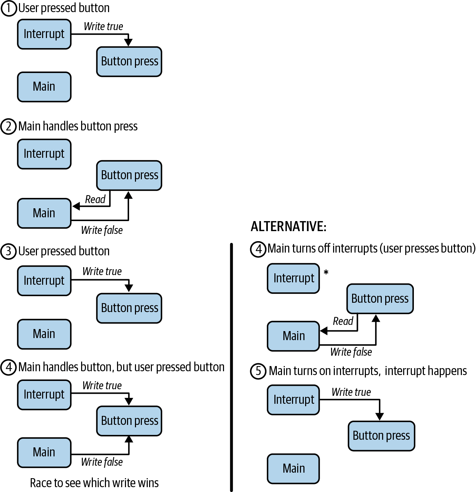

图 6-1. 共享内存中的竞态条件

图中文字：Interrupt＝中断；Main＝主函数；Button press＝按键变量；Read＝读取；Write true／Write false＝写入 true／写入 false。左侧步骤：①用户按下按键；②主函数处理按键；③用户再次按下按键；④主函数处理按键时，用户又按下了按键，此时两次写操作竞争，看哪次写入最终生效。右侧替代方案：④主函数关闭中断，此时用户按下按键；⑤主函数重新开启中断，挂起的中断随即发生。

<!-- source: pdf=173; section=6.1.2; unit=race-consequence; source_units=p0173_b002_u00 -->
在这个例子里，根据中断与按键协同工作的方式，系统很可能漏掉一次按键操作：如果中断在设置变量的竞争中抢先完成，主函数就会清除这个本来应该保持置位的变量。在这个特定系统中，这只会给用户带来一点小烦恼，但在更关键的系统里，竞态条件可能导致不安全的情况。

<!-- source: pdf=174; section=6.1.3; unit=protect-reads; source_units=p0174_b000_u00,p0174_b001_u00 -->

<a id="src-p174"></a>

### 避免竞态条件 {#ch06-toc-004}

我们需要一种办法，禁止多个任务写入同一块内存。可能出问题的并不只有写操作；主循环既要读取表示按键发生变化的变量，也要读取按键的值。如果这两次读取之间发生中断，按键的值就可能在两次读取之间改变。

<!-- source: pdf=174; section=6.1.3; unit=critical-section; source_units=p0174_b002_u00 -->
只要读写任务间共享的内存，就会形成代码的临界区（critical section），也就是访问共享资源（内存或设备）的代码。必须保护这个共享资源，使得同一时刻只有一个任务能够修改它。这称为互斥（mutual exclusion），常缩写为 mutex。互斥机制有时通过信号量（semaphore）、邮箱（mailbox）或消息队列（message queue）来实现。

<!-- source: pdf=174; section=6.1.3; unit=atomic; source_units=p0174_b003_u00 -->
在有操作系统的系统中，如果两个任务都在运行，并且都不是中断，就可以使用互斥锁来表示哪个任务拥有资源。这种机制可以简单到只用一个变量，表示这个资源或全局变量当前是否可用。不过，如果两个任务中有一个是中断，我们已经看到，即使一个布尔值也不安全，所以资源所有权的改变必须是原子的。原子操作（atomic action）是系统中任何其他活动都无法打断的操作。

<!-- source: pdf=174; section=6.1.3; unit=disable-interrupts; source_units=p0174_b004_u00 -->
从这里开始，我们将着重讨论这样的系统：任务可以被中断打断，但除此之外会一直运行，直到主动交出控制权。在这种情况下，在访问共享全局变量时禁止中断，就能避免竞态条件。不过，这样做也有缺点：关掉中断后，系统无法同样迅速地响应按键，因为必须等到离开临界区。关闭中断会增加系统的延迟（latency），也就是响应所需的时间。

<!-- source: pdf=174; section=6.1.3; unit=realtime; source_units=p0174_b005_u00 -->
讨论实时系统时，延迟十分重要。实时系统必须在固定的时间内响应事件。虽然所要求的响应时间取决于具体系统，但通常以微秒或毫秒计量。延迟增加时，从事件发生到系统察觉事件所需的时间也会增加，因此从事件发生到作出响应的总时间随之增加。

<!-- source: pdf=174; section=6.1.4; unit=priority-inversion; source_units=p0174_b006_u00,p0174_b007_u00 -->
### 优先级反转 {#ch06-toc-005}

某些处理器允许中断具有不同优先级，就像操作系统为进程和线程分配优先级一样。这种灵活性虽然很有用，也可能给自己带来很多麻烦。图 6-2 展示了操作系统中优先级反转（priority inversion）的典型定义。高优先级进程因为需要访问低优先级进程所持有的资源而暂停，这是可以接受的。然而，如果一个中优先级进程开始运行，它可能阻止低优先级进程完成对资源的使用，而这个资源正是高优先级任务所需要的。于是，中优先级任务阻塞了高优先级任务。

<!-- source: pdf=175; section=6.1.4; unit=figure-6-2; source_units=p0175_b001_u00 -->

<a id="src-p175"></a>

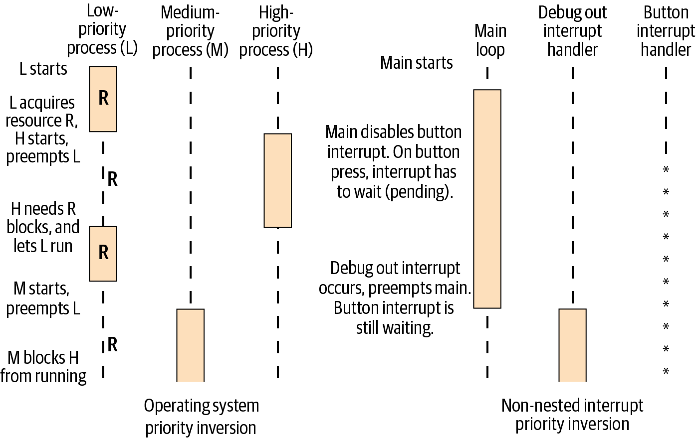

图 6-2. 操作系统与中断中的优先级反转，竞争资源 R

图中文字：左图为“操作系统中的优先级反转”，三列依次是低优先级进程 L、中优先级进程 M、高优先级进程 H。顺序为：L 开始；L 获取资源 R，H 开始并抢占 L；H 需要 R，因而阻塞，让 L 运行；M 开始并抢占 L；M 阻止 H 运行。右图为“非嵌套中断中的优先级反转”，三列依次是主循环、调试输出中断处理程序、按键中断处理程序。主函数开始；主函数禁用按键中断，按键按下时，中断只能等待，处于挂起状态；调试输出中断发生并抢占主函数，按键中断仍在等待。

<!-- source: pdf=175; section=6.1.4; unit=priority-example; source_units=p0175_b002_u00 -->
例如，假设我们有高优先级的按键中断，以及低优先级的主循环。主函数访问按键变量时，会关闭按键中断，以避免竞态条件。后来，我们又添加了一个中断，通过通信端口输出调试数据。这应该是一个中优先级的后台任务，是需要完成、但不应妨碍系统处理按键的工作。然而，如果这个调试任务中断了主循环，它恰恰就会妨碍按键处理。

<!-- source: pdf=175; section=6.1.4; unit=priority-fix; source_units=p0175_b003_u00 -->
处理器最重要的工作是什么？那就应该具有最高优先级。如果有人问调试输出是否比按键更重要，我们会回答“不”。既然如此，处理器为什么运行的是调试中断，而不是按键处理程序？在这个例子中，一个简单的解决办法是：当按键中断发生时，禁用所有中断，或者禁用所有优先级低于按键处理程序的中断。

<!-- source: pdf=175; section=6.1.4; unit=priority-caution; source_units=p0175_b004_u00 -->
接下来研究没有操作系统时管理任务的各种方法时，要留意那些会使处理器无意间运行非最高优先级任务的情况。

<!-- source: pdf=176; section=6.2; unit=state-pattern-definition; source_units=p0176_b000_u00,p0176_b001_u00 -->

<a id="src-p176"></a>

## 状态机 {#ch06-toc-006}

当系统中有不止一件事情在进行时，保持系统有条理的一种方法是使用状态机（state machine）。这是一种标准的软件模式，在嵌入式系统中应用广泛。根据《设计模式：可复用面向对象软件的基础》（Design Patterns: Elements of Reusable Object-Oriented Software），状态模式的意图是“允许对象在内部状态改变时改变它的行为。对象看起来似乎改变了它的类”。

<!-- source: pdf=176; section=6.2; unit=state-context; source_units=p0176_b002_u00 -->
说得简单些，调用状态机时，它会根据当前状态，执行它认为应该执行的工作。它不会每次都做同一件事，而是根据上下文改变行为；上下文由环境和状态机的历史，也就是内部状态组成。如果这些说法听上去太抽象、太理论化，还有一种更容易理解状态机的方式：流程图。

<!-- source: pdf=176; section=6.2; unit=state-diagram; source_units=p0176_b003_u00 -->
几乎任何状态机都可以用流程图表示。反过来，能用流程图解决的问题，大概最终也会成为状态机。状态机也可以表示为有限状态自动机（finite state automata），如图 6-3 所示：每个状态是一个圆，而状态之间的改变，也就是状态转换（state transition），用箭头表示。

<!-- source: pdf=176; section=6.2; unit=figure-6-3; source_units=p0176_b005_u00 -->
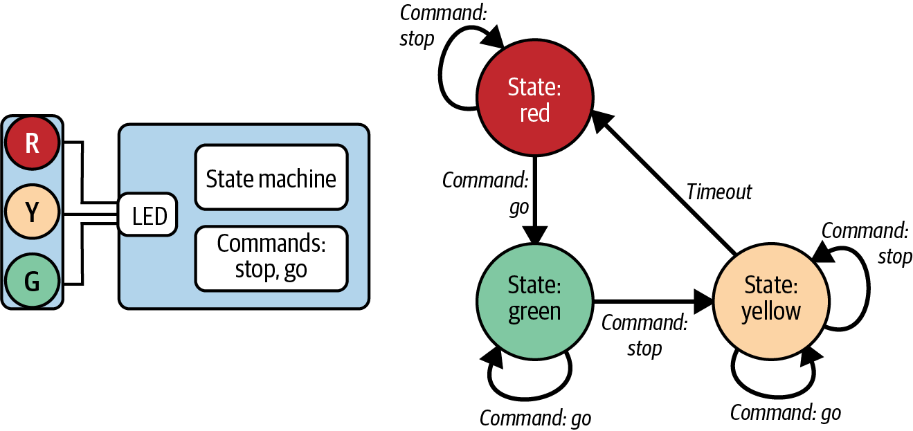

图 6-3. 交通信号灯系统

图中文字：R／Y／G＝红／黄／绿；State machine＝状态机；Commands: stop, go＝命令：停止、通行；State: red／green／yellow＝红灯／绿灯／黄灯状态；Command: stop／go＝停止／通行命令；Timeout＝超时。

<!-- source: pdf=176; section=6.2; unit=events-matter; source_units=p0176_b006_u00 -->
下一节将逐一讨论图中的元素。图中的箭头与圆同样重要。状态机不仅关乎系统可能处于哪些状态，也关乎系统要处理哪些事件。

<!-- source: pdf=176-177; section=6.2.1; unit=stoplight-example; source_units=p0176_b007_u00,p0176_b008_u00,p0177_b001_u00 -->

<a id="src-p177"></a>

### 状态机示例：交通信号灯控制器 {#ch06-toc-007}

要把状态机讲清楚，我们需要一个比闪烁 LED 加按键稍微复杂些的例子。图 6-3 展示了一个交通信号灯控制器。红灯亮着时，如果控制器收到通行消息，就会将信号灯变为绿灯。控制器收到停止消息时，会让黄灯亮一段时间，然后变为红灯。我们的实现方式是：只要没有人需要信号灯改变，它就一直保持绿灯。可以假定，交叉道路有车辆到达时，就会生成停止命令。

<!-- source: pdf=177; section=6.2.1; unit=yellow-go; source_units=p0177_b002_u00 -->
其中有一个状态转换，也就是每根箭头所表示内容的正式名称，有点微妙。黄灯亮着时，如果控制器收到通行消息，不应把灯变回绿色。黄灯应该变为红灯，而不是绿灯，所以通行消息只会让信号灯继续停留在黄灯阶段。这个细节就是状态机可能带来的陷阱之一。对于每种状态下可能发生的每个事件，你都必须做好准备，包括极少发生的情况，甚至包括本不该出现、却可能因错误而出现的情况。

<!-- source: pdf=177; section=6.2.1; unit=state-event-identification; source_units=p0177_b003_u00 -->
使用状态机时，第一步是找出状态，以及能够改变状态的事件。对于这样简单的系统，最好的办法就是画图。确定状态（红、黄、绿）之后，再看它们之间的联系。停止和通行命令本来应该分别只出现在绿灯和红灯状态。不过，这些命令来自系统外部，是异步的，因此每个状态都应该能够处理它们，即使命令出现得不合时宜。这里，处理不合时宜命令的最简单方法是忽略它们，也就是画一条回到对应状态自身的环路。

<!-- source: pdf=177; section=6.2.1; unit=invalid-event-note; source_units=p0177_b004_u00 -->
 如果发生了不合时宜的事件，也许产生某种错误会更好。请自行判断。

<!-- source: pdf=177-178; section=6.2.2; unit=state-centric-code; source_units=p0177_b005_u00,p0177_b006_u00,p0177_b007_u00,p0177_b008_u00,p0178_b000_u00 -->

<a id="src-p178"></a>

### 以状态为中心的状态机 {#ch06-toc-008}

多数人认为状态机就是一大段 if-else 语句或 switch 语句：

```text
while (1) {
  look for event
  switch (state) {
  case (green light):
    if (event is stop command)
      turn off green light
      turn on yellow light
      set state to yellow light
      start timer
    break;
  case (yellow light):
    if (event is timer expired)
      turn off yellow light
      turn on red light
      set state to red light
    break;
  case (red light):
    if (event is go command)
      turn off red light
      turn on green light
      set state to green light
    break;
  default (unhandled state)
    error!
  }
}
```

<!-- source: pdf=178; section=6.2.2; unit=state-centric-form; source_units=p0178_b001_u00,p0178_b002_u00 -->
这里的状态机采用以下形式：

```text
case (current state):
  if event valid for this state
    handle event
    prepare for new state
    set new state
```

<!-- source: pdf=178; section=6.2.2; unit=sibling-states; source_units=p0178_b003_u00 -->
状态机可以改变自己的上下文，也就是进入新状态。这意味着每个状态都需要了解与它并列的其他状态。

<!-- source: pdf=178; section=6.2.3; unit=hidden-transitions; source_units=p0178_b004_u00,p0178_b005_u00 -->
### 隐藏转换的状态中心式状态机 {#ch06-toc-009}

实现状态机的另一种方法，是把状态转换信息与状态机分离。从理论上说，这比上一节的模型更好，因为封装程度更高，依赖更少。前一种模型迫使每个状态都知道如何、以及何时触发从它能够到达的其他各个状态。本节将介绍的模型，则由某个更高层的系统记录各个状态能到达哪些其他状态。我把它称为“下一状态”函数。它处理所有状态，将系统置于应当进入的下一状态。通过创建这个函数，就可以把每种状态下执行的动作与状态转换分开。

<!-- source: pdf=178; section=6.2.3; unit=hidden-general; source_units=p0178_b006_u00,p0178_b007_u00 -->
它的一般形式如下：

```text
case (state):
  make sure current state is actively doing what it needs
  if event valid for this state
    call next state function
```

<!-- source: pdf=178; section=6.2.3; unit=hidden-green; source_units=p0178_b008_u00,p0178_b009_u00 -->
在信号灯的例子里，这个模型会使每个状态的代码更简单，而且几乎所有状态的代码都会很相似。例如，绿灯状态如下：

```text
case (green light):
  turn on green light (even if it is already on)
  if (event is stop)
    turn off green light
    call next state function
  break;
```

<!-- source: pdf=179; section=6.2.3; unit=next-state-code; source_units=p0179_b000_u00,p0179_b001_u00 -->

<a id="src-p179"></a>

发生变化时，应调用下一状态函数。它的代码看起来会很熟悉，因为与上一节一样，它也是一个简单的 switch 语句：

```text
next state function:
    switch (state) {
    case (green light):
      set state to yellow light
      break;
    case (yellow light):
      set state to red light
      break;
    case (red light):
      set state to green light
      break;
```

<!-- source: pdf=179; section=6.2.3; unit=hidden-benefit; source_units=p0179_b002_u00 -->
现在，查看状态和查看转换各有一个地方，而两者都很简单。在这个例子中，状态转换与事件无关，这正是适合采用这种实现方式的一个迹象。

<!-- source: pdf=179; section=6.2.3; unit=hidden-limits; source_units=p0179_b003_u00 -->
这个模型并不总是最好的。例如，如果黄灯状态下收到通行命令会返回绿灯状态，那么下一状态函数就会同时依赖当前状态和事件。这种方法的目标是隐藏转换，而不是让代码晦涩难懂。有时，把所有内容放在一起更好，如“以状态为中心的状态机”一节所述。

<!-- source: pdf=179; section=6.2.4; unit=event-centric-general; source_units=p0179_b004_u00,p0179_b005_u00,p0179_b006_u00 -->
### 以事件为中心的状态机 {#ch06-toc-010}

实现状态机的另一种方法，是换一个角度，让事件控制流程。采用这种方式时，每个事件都有一组与之关联的条件判断：

```text
case (event):
  if state transition for this event
    go to new state
```

<!-- source: pdf=179; section=6.2.4; unit=event-centric-example; source_units=p0179_b007_u00,p0179_b008_u00 -->
例如：

```text
switch (event)
case (stop):
  if (state is green light)
    turn off green light
    go to next state
  // else do nothing
  break;
```

<!-- source: pdf=179-180; section=6.2.4; unit=event-centric-function; source_units=p0179_b009_u00,p0180_b000_u00 -->

<a id="src-p180"></a>

对大多数状态机来说，switch 语句与状态很自然地对应起来，但在某些情况下，像这里这样把状态机与事件关联，代码可能更清楚。这些函数仍可能需要 switch 语句，来处理对当前状态的依赖：

```text
function to handle stop event
  if (state == green light)
    turn off green light
    go to next state
```

<!-- source: pdf=180; section=6.2.4; unit=housekeeping; source_units=p0180_b001_u00 -->
与以状态为中心的几种方案不同，以事件为中心的状态机实现可能不方便执行例行维护工作，例如在黄灯状态检查是否超时。如果系统需要定期维护，可以把例行维护也作为一个事件；或者，继续使用上一节展示的状态中心式实现。

<!-- source: pdf=180; section=6.2.5; unit=state-pattern-methods; source_units=p0180_b002_u00,p0180_b003_u00,p0180_b004_u00,p0180_b004_u01,p0180_b005_u00,p0180_b005_u01,p0180_b006_u00,p0180_b006_u01,p0180_b007_u00,p0180_b007_u01,p0180_b008_u00,p0180_b008_u01 -->
### 状态模式 {#ch06-toc-011}

用面向对象的方式实现状态机时，可以把每个状态视为一个对象，并在对象中创建处理每个事件的方法。例子中的每个状态对象都会包含以下成员函数：

- Enter：进入状态时调用，点亮这个状态对应的灯。
- Exit：离开状态时调用，熄灭这个状态对应的灯。
- EventGo：根据当前状态，以适当的方式处理通行事件。
- EventStop：处理停止事件。
- Housekeeping：定期调用，让状态检查是否发生变化，例如是否超时。

<!-- source: pdf=180-181; section=6.2.5; unit=context-class; source_units=p0180_b009_u00,p0180_b010_u00,p0180_b011_u00,p0180_b012_u00,p0181_b000_u00,p0181_b001_u00,p0181_b002_u00,p0181_b003_u00 -->

<a id="src-p181"></a>

一个称为上下文（context）的高层对象记录各个状态，并调用相应函数。它必须提供一种方式，让状态能够指出需要进行状态转换。和前面一样，各个状态可以彼此知晓并作出适当选择；也可以隐藏转换，让状态只表明需要进入下一状态。我们的系统很直接，一个简单的下一状态函数就够了。这个类的伪代码如下：

```text
class Context {
  class State Red, Yellow, Green;
  class State Current;
constructor:
  Current = Red;
  Current.Enter();
destructor:
  Current.Exit();
Go:
  if (Current.Go() indicates a state change)
    NextState();
Stop:
  if (Current.Stop() indicates a state change)
    NextState();
Housekeeping:
  if (Current.Housekeeping() indicates a state change)
    NextState();
NextState:
  Current.Exit();
  if (Current is Red)    Current = Green;
  if (Current is Yellow) Current = Red;
  if (Current is Green)  Current = Yellow;
  Current.Enter();
}
```

<!-- source: pdf=181; section=6.2.5; unit=objects-replace-switch; source_units=p0181_b004_u00 -->
让每个状态都能以完全相同的方式处理，就能使系统摆脱 switch 语句，把过去由条件判断完成的工作交给对象。

<!-- source: pdf=181; section=6.2.6; unit=table-driven-intro; source_units=p0181_b005_u00,p0181_b006_u00 -->
### 表驱动状态机 {#ch06-toc-012}

流程图和状态图有助于构思状态机，但要记录状态机并给出完整定义，更简单的方法是使用表格。

<!-- source: pdf=181; section=6.2.6; unit=table-description; source_units=p0181_b007_u00 -->
图 6-4 的示例表格中，每个状态占一行，包含一个动作和多个事件。动作列描述处于该状态时应当发生什么，也就是具体应该点亮哪盏灯。其余各列说明：系统处于某个状态而某个事件发生时，需要执行什么转换。通常，转换只是进入一个新状态，并执行与新状态关联的动作。

<!-- source: pdf=181; section=6.2.6; unit=figure-6-4; source_units=p0181_b009_u00 -->
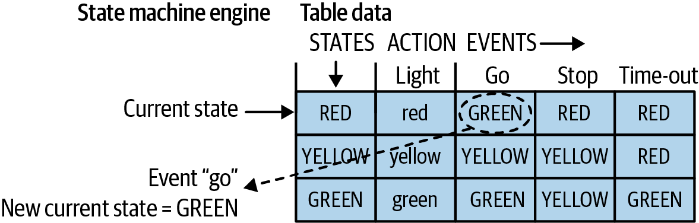

图 6-4. 以数据表表示的状态机

图中文字：State machine engine＝状态机引擎；Table data＝表数据；Current state＝当前状态；Event “go”＝“通行”事件；New current state = GREEN＝新的当前状态为绿灯。表中的全部对应项如下：

| 状态 | 动作：点亮的灯 | 事件：通行 | 事件：停止 | 事件：超时 |
| --- | --- | --- | --- | --- |
| 红灯 | 红 | 绿灯 | 红灯 | 红灯 |
| 黄灯 | 黄 | 黄灯 | 黄灯 | 红灯 |
| 绿灯 | 绿 | 绿灯 | 黄灯 | 绿灯 |

<!-- source: pdf=182; section=6.2.6; unit=toy-sidebar; source_units=p0182_b001_u00 -->

<a id="src-p182"></a>

 我开发儿童玩具时，那些玩具通常有 30 个或更多按键，包括字母、音量、控制等。这样的表格能帮助我们找出流程图里没有处理的事件。即使某个按键在某种状态下无效，也总会有人在某个地方莫名其妙地按下它。所以，这些表格不仅有助于实现和文档编写，对设计游戏玩法也至关重要。

<!-- source: pdf=182; section=6.2.6; unit=table-engine; source_units=p0182_b002_u00,p0182_b003_u00,p0182_b004_u00 -->
在这里用表格定义系统，提示我们也可以在代码中将它定义为数据表。这样就不必编写一大块复杂代码，而会得到几个更小、更简单的部分：

- 一个数据表，说明某个状态下要执行的动作，以及发生事件时应进入哪个状态。
- 一个引擎，读取数据表并按表中的指示执行。

<!-- source: pdf=182; section=6.2.6; unit=reusable-engine; source_units=p0182_b005_u00 -->
最好的一点是，引擎可以复用，因此如果要实现许多复杂的状态机，这会是个很好的方案。

<!-- source: pdf=182; section=6.2.6; unit=table-entry-code; source_units=p0182_b006_u00,p0182_b007_u00 -->
交通信号灯这个问题略显简单，不太值得用这种方法实现，不过它是一个直观的例子。先从表中各项包含的信息开始：

```c
struct sStateTableEntry {
  tLight light;       // all states have associated lights
  tState goEvent;     // state to enter when go event occurs
  tState stopEvent;   // ... when stop event occurs
  tState timeoutEvent;// ... when timeout occurs
};
```

<!-- source: pdf=182; section=6.2.6; unit=event-handler-code; source_units=p0182_b008_u00,p0182_b009_u00 -->
除了每个表项的下一个事件，我还加入了与当前状态对应的灯，这样每个状态就能用完全相同的方式处理。（如果有许多十分相似的状态，这种状态机方法就特别出色。）把灯放进状态表，意味着事件处理程序对每个状态所做的事情都一样：

```c
// event handler
void HandleEventGo(struct sStateTableEntry *currentState){
  // turn off the light (unless we're just going to turn it back on)
  if (currentState->light != currentState->go.light) {
    LightOff(currentState->light);
  }
  currentState = currentState->go;
  LightOn(currentState->light);
  StartTimer();
}
```

<!-- source: pdf=182-183; section=6.2.6; unit=table-code; source_units=p0182_b010_u00,p0183_b000_u00,p0183_b001_u00 -->

<a id="src-p183"></a>

实际的数据表又是什么样呢？首先需要定义数据表中的顺序：

```c
typedef enum { kRedState = 0, kYellowState = 1, kGreenState = 2 } tState;
struct sStateTableEntry stateTable[] = {
  { kRedLight,    kGreenState,  kRedState,    kRedState},   // Red
  { kYellowLight, kYellowState, kYellowState, kRedState},   // Yellow
  { kGreenLight,  kGreenState,  kYellowState, kGreenState}, // Green
}
```

<!-- source: pdf=183; section=6.2.6; unit=generate-table; source_units=p0183_b002_u00 -->
手工输入这张表很麻烦，而且很容易因为差一错误（off-by-one error）而出问题。不过，如果状态机是电子表格中的一张表，并且能保存成逗号或制表符分隔的变量文件，就可以用一个小脚本替你生成数据表。把状态机整理成电子表格，感觉有点像作弊，但当状态和事件数量很多时，这是一项很强大的技术。

<!-- source: pdf=183; section=6.2.6; unit=dense-view; source_units=p0183_b003_u00 -->
将状态机写成表格，可以紧凑地呈现信息，让你一眼看清整个状态机。这不仅有助于发现漏洞，也就是未处理的状态与事件组合，还能让你看出产品是否以一致的方式处理事件。

<!-- source: pdf=183; section=6.2.6; unit=complex-table; source_units=p0183_b004_u00,p0183_b005_u00,p0183_b005_u01,p0183_b005_u02 -->
表格也可以展示更复杂的交互，详细说明需要发生什么。然而，随着复杂程度增加，表格会失去直接转化为数据的能力，可能需要回到前面介绍的某一种以控制流语句为核心的实现机制。例如，如果给交通信号灯增加一些细节和错误检测，情况就会变得更复杂：

| 状态／事件 | 命令：通行 | 命令：停止 | 超时 |
| --- | --- | --- | --- |
| 红灯 | 转为绿灯 | 不执行任何操作 | 无效，记录错误；不执行任何操作 |
| 黄灯 | 不清除事件，推迟到红灯状态处理 | 不执行任何操作 | 转为红灯 |
| 绿灯 | 不执行任何操作 | 转为黄灯，设置定时器 | 无效，记录错误；不执行任何操作 |

<!-- source: pdf=183; section=6.2.6; unit=table-documentation; source_units=p0183_b006_u00 -->
即使状态机无法实现为数据表驱动的系统，用表格表示它也能提供比流程图更好的文档。

<!-- source: pdf=183; section=6.2.7; unit=implementation-preference; source_units=p0183_b007_u00,p0183_b008_u00 -->
### 选择状态机的实现方式 {#ch06-toc-013}

前面展示的每种状态机方案，虽然实现方式不同，但提供的功能相同。我偏爱表驱动状态机。不仅因为可以复用驱动通用状态机引擎的代码，也因为我发现，封装起来的状态更容易测试。

<!-- source: pdf=183-184; section=6.2.7; unit=unit-testing; source_units=p0183_b009_u00,p0183_b010_u00,p0184_b000_u00 -->

<a id="src-p184"></a>

如果把上下文与状态分开，单元测试就可以调用各个状态函数。如果状态中需要上下文，单元测试可以传入一个包含上下文信息的结构体，并在状态相关代码运行之后验证上下文的任何变化。

用单元测试验证每个状态的功能，会使代码更健壮。无论采用哪种实现方式，都能这样做，只要保持状态的封装，让测试代码能够调用各个状态；理想情况下，测试代码不需要知道上下文，或者将上下文以结构体的形式传给状态。

<!-- source: pdf=184; section=6.2.7; unit=be-lazy; source_units=p0184_b001_u00 -->
考虑实现方式时，不妨偷点懒。选择代码量最少的方案。如果它们都差不多，就选择重复代码最少的方案。如果某种实现能让你复用一段代码而无需复制，那对你的系统来说，它就是更好的实现。如果仍然无法决定，就考虑哪种形式最容易让别人读懂。

<!-- source: pdf=184; section=6.2.7; unit=state-machine-maintenance; source_units=p0184_b002_u00 -->
状态机的强大之处，在于它让代码能够根据历史（状态）和环境（事件）来行动。然而，正因为会根据这些因素作出不同反应，状态机也可能很难维护，导致意大利面条式代码，以及随意查看时不易察觉的状态间依赖。另一方面，实现反应式系统并没有更好的方法，也没有哪种方法能让这种固有的复杂性更容易维护。文档是关键，因此在前面几节中，我先重点介绍了便于人理解的状态机表示方式，再展示代码实现。

<!-- source: pdf=184; section=6.3; unit=watchdog-opening; source_units=p0184_b003_u00,p0184_b004_u00 -->
## 看门狗 {#ch06-toc-014}

我们在调度器一节开头提到过红灯闪烁状态。它的目标是在系统故障时，把系统置于安全模式。但我们怎么知道系统发生了故障呢？

<!-- source: pdf=184; section=6.3; unit=communication-watchdog; source_units=p0184_b005_u00 -->
软件可以监测距离上一次通信过了多久。如果在长得不合理的一段时间内，都没有看到停止或通行命令，就可以作出相应反应。从比喻的角度说，它就像看门狗，防止灾难性故障。不过，在嵌入式领域，“看门狗”这个词其实有更加具体的含义。

<!-- source: pdf=184; section=6.3; unit=hardware-watchdog; source_units=p0184_b006_u00 -->
大多数处理器或复位电路都具备看门狗定时器（watchdog timer）功能：如果处理器没有执行某个动作，例如翻转一根 I/O 线或写入某个特定寄存器，就会将处理器复位。看门狗系统等待处理器发出信号，表明一切正常。如果在合理的时间内没有收到这样的信号，看门狗就会让处理器复位；这个时间通常可以配置。

<!-- source: pdf=184; section=6.3; unit=fail-safe; source_units=p0184_b007_u00 -->
目标是让系统即使发生故障，也能以安全的方式失效，即故障安全（fail-safe）。没人希望系统故障，但我们必须面对现实。软件会崩溃，安全关键软件也会崩溃。设计和开发系统时，我们努力避免崩溃。但除非你无所不知，否则软件总会以出乎意料的方式失效。宇宙射线、松动的电线都是现实，而且许多嵌入式系统必须能够自力更生。软件挂起时，它们不能等别人来重启系统，甚至可能根本没有人监控。如果系统无法从某些错误中恢复，通常最好重新启动，使系统进入良好状态。

<!-- source: pdf=185; section=6.3; unit=bad-watchdog-uses; source_units=p0185_b000_u00,p0185_b001_u00,p0185_b002_u00,p0185_b003_u00 -->

<a id="src-p185"></a>

使用看门狗并不意味着可以不处理正常错误；它只是用于重新启动那些否则无法恢复的系统。有些用法可以使看门狗更加有效。不过，我们先看看基于本章前面模型的几种不太理想的做法，它们会降低看门狗的作用：

- 设置一个定时器中断，其触发间隔比看门狗超时时间略短。如果在定时器中断中服务看门狗，即使系统困在无限循环里，也永远不会复位。这违背了看门狗的目的。绝不要这样做。
- 在延迟函数（DelayMs）中服务看门狗，理由是处理器这时没有做其他事。代码各处都会有延迟函数，所以看门狗会经常得到服务。然而，如果处理器卡在一段恰好有延迟的代码中，系统就不会按应有的方式复位。
- 把服务看门狗的代码放在处理器执行起来比较费时的地方，例如运行时间最长的五六个函数中。将看门狗代码散布各处，会削弱看门狗的作用，而且代码可能在其中某处崩溃，导致系统挂起。

<!-- source: pdf=185; section=6.3; unit=one-service-point; source_units=p0185_b004_u00 -->
看门狗的目标，是提供一种判断系统任意部分是否崩溃的方法。理想情况下，只在一个地方服务看门狗，而且代码经过这个地方，就能表明所有子系统都按预期运行。一般来说，这个地方就是主循环。即使因此需要延长看门狗的超时时间，让它监视整个系统，也比只监视部分系统、但缩短恢复时间要好。

<!-- source: pdf=185; section=6.3; unit=lower-level-service; source_units=p0185_b005_u00 -->
遗憾的是，某些系统无法把看门狗如此干净地隔离开。当必须在更底层的代码中向看门狗发送信号时，要意识到这段代码是危险区域：这里可能发生无法恢复的错误，使系统挂起。必须额外关注这段代码，判断可能出现什么问题，并尽量防止它们发生。

<!-- source: pdf=185; section=6.3; unit=watchdog-debug; source_units=p0185_b006_u00 -->
一般来说，电路板初始调试或使用调试器时，不应让看门狗处于活动状态，否则系统会在遇到断点后复位。提供一种简单的方式关闭看门狗，会方便调试。如果有日志机制，而且看门狗已经开启，务必在启动时输出一条消息说明这一点。进行生产测试时，这是绝不能忘记启用的功能之一。另一种方法是每次服务看门狗时翻转 LED，让系统有一个从外部很容易看到的心跳，告诉用户一切都在按预期工作。

<!-- source: pdf=186; section=6.3; unit=watchdog-terminology-title; source_units=p0186_b000_u00 -->

<a id="src-p186"></a>

### 看门狗术语 {#ch06-toc-016}

<!-- source: pdf=186; section=6.3; unit=kick-dog; source_units=p0186_b001_u00 -->
服务看门狗，使它不触发复位，传统上叫作“踢狗”（kicking the dog）。

<!-- source: pdf=186; section=6.3; unit=pet-company; source_units=p0186_b002_u00 -->
我在一家允许带宠物的小公司工作时，这个说法曾引起一场风波。午饭时看狗狗们玩耍，很开心，也让人放松。然而有一天，我们正在为一位大客户审阅代码做准备，CEO 看到主循环中的 KickTheDog() 函数，当场火冒三丈。他斩钉截铁地说，在我们公司，任何狗，不管是真实的还是虚拟的，都不许踢。绝对不许。

<!-- source: pdf=186; section=6.3; unit=pet-dog-rename; source_units=p0186_b003_u00 -->
我们把函数名重构为 PetTheDog()。重要会议当天，客户看到这个政治正确的安全保障时，忍不住偷笑。我不确定术语是从什么时候开始变化的，但在后来的这些年中，我看到“踢”得少了，“抚摸”“喂养”或者“遛”看门狗的说法多了。你想怎么叫都可以，但你总不会真的踢一只狗，对吧？

<!-- source: pdf=186; section=6.3; unit=three-lessons; source_units=p0186_b004_u00 -->
这里有三个心得：（1）标准事物的术语也会改变；（2）用词很重要；（3）永远不要让 CEO 看你的代码。

<!-- source: pdf=186; section=6.4; unit=main-loops-intro; source_units=p0186_b005_u00,p0186_b006_u00 -->
## 主循环 {#ch06-toc-015}

本章先介绍了一些重要的 RTOS 术语。虽然我并没有假定系统中存在 RTOS，但这些概念同样适用于裸机。接着，我们介绍了许多组织状态机的方式。这些都很好，但究竟该怎样动手开始呢？

<!-- source: pdf=186; section=6.4; unit=main-loop-choices; source_units=p0186_b007_u00 -->
我们通常从主循环开始。和状态机一样，主循环也有许多组织方式。它们各有优缺点，因此你需要确定哪一种最适合自己。

<!-- source: pdf=186; section=6.4.1; unit=arduino-structure; source_units=p0186_b008_u00,p0186_b009_u00,p0186_b010_u00 -->
### 轮询与等待

我喜欢 Arduino 简单明了的程序结构：

```text
setup:
  init
loop:
  toggle LED
  delay
```

<!-- source: pdf=186-187; section=6.4.1; unit=hidden-main; source_units=p0186_b011_u00,p0187_b000_u00 -->

<a id="src-p187"></a>

在幕后，Arduino 开发环境会加入一个 main 函数，它调用 setup 函数进行初始化。这个隐藏的 main 函数还会执行所需的其他电路板和处理器初始化。你的 setup 和隐藏的初始化都完成后，它就开始一个无限循环，每轮调用你的 loop 函数；需要时，也可能调用它自己的一组函数。图 6-5 展示了系统各部分如何交互。开发环境把细节藏了起来，但在某个地方，总有一个 main 函数。

<!-- source: pdf=187; section=6.4.1; unit=own-main; source_units=p0187_b001_u00,p0187_b002_u00 -->
不需要别人替我们做这些；我们可以自己编写 main：

```text
main:
  init
  while (1)
    toggle LED
    delay
```

<!-- source: pdf=187; section=6.4.1; unit=figure-6-5; source_units=p0187_b004_u00 -->
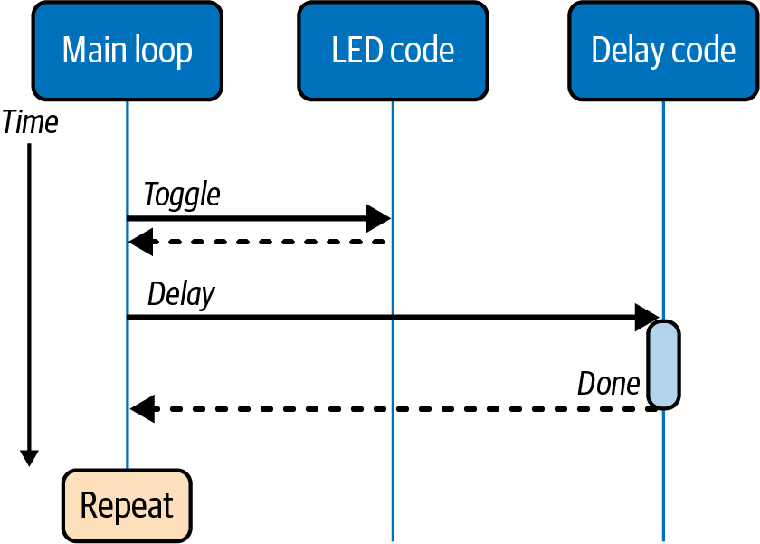

图 6-5. 最简单的主循环：翻转 LED

图中文字：Main loop＝主循环；LED code＝LED 代码；Delay code＝延迟代码；Time＝时间；Toggle＝翻转；Delay＝延迟；Done＝完成；Repeat＝重复。

<!-- source: pdf=187; section=6.4.1; unit=add-io; source_units=p0187_b005_u00,p0187_b006_u00 -->
主循环一开始就是这样简单。当然，这盏闪烁的灯实在太无聊，所以我要给它加点东西：

```text
main:
  init
  while (1)
    read inputs
    write outputs
    toggle LED
    delay
```

<!-- source: pdf=187; section=6.4.1; unit=io-meaning; source_units=p0187_b007_u00 -->
注意，“读取输入”和“写入输出”在代码中也可以是别的事情：检查命令处理接口的函数；根据当前时间或轮询到的按键更新状态机的地方；或者，把已有输入转换为所需输出的代码。图 6-6 展示了这个循环中各项操作发生的顺序。

<!-- source: pdf=187; section=6.4.1; unit=blocking; source_units=p0187_b008_u00 -->
这个循环中，一切都按预期进行，但有一个大问题：它是阻塞的。系统执行延迟时，如果有输入到来，必须等到下一轮循环才能处理。如果需要迅速处理输入，这种方法可能就行不通。

<!-- source: pdf=188; section=6.4.1; unit=figure-6-6; source_units=p0188_b001_u00 -->

<a id="src-p188"></a>

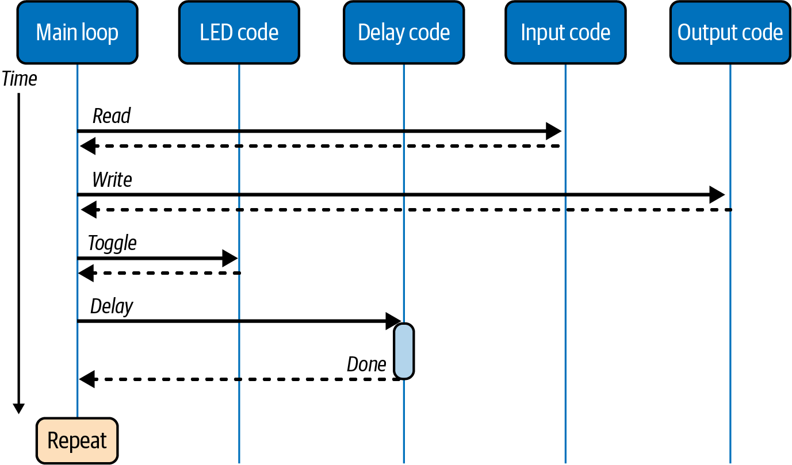

图 6-6. 阻塞式主循环

图中文字：Main loop＝主循环；LED code＝LED 代码；Delay code＝延迟代码；Input code＝输入代码；Output code＝输出代码；Time＝时间；Read＝读取；Write＝写入；Toggle＝翻转；Delay＝延迟；Done＝完成；Repeat＝重复。

<!-- source: pdf=188; section=6.4.2; unit=timer-main; source_units=p0188_b002_u00,p0188_b003_u00,p0188_b004_u00 -->
### 定时器中断 {#ch06-toc-017}

既然定时器中断可以完成翻转 LED 的工作，用延迟来阻塞处理器就显得很笨：

```text
timer interrupt: toggle LED
main:
  init
  while (1)
    read inputs
    write outputs
    pet watchdog
```

<!-- source: pdf=188; section=6.4.2; unit=short-toggle; source_units=p0188_b005_u00 -->
翻转 I/O 引脚耗时很少，可以放心放进中断中。

<!-- source: pdf=188; section=6.4.2; unit=timer-downside; source_units=p0188_b006_u00 -->
缺点之一是 LED 不再与读写相关；它只能告诉我们，定时器中断在按固定间隔触发。不过，我加入了看门狗，以确保循环按预期持续运行。对应的时序图（图 6-7）显示，LED 代码与其他代码分离了。系统复杂性增加，但局部复杂性降低，main 不必再关心 LED，两者相互平衡。

<!-- source: pdf=188; section=6.4.2; unit=timer-assumptions; source_units=p0188_b007_u00 -->
这种方法假定读取输入和写入输出不会互相阻塞，而且各自都足够快，不会干扰另一方的时序。

<!-- source: pdf=189; section=6.4.2; unit=figure-6-7; source_units=p0189_b001_u00 -->

<a id="src-p189"></a>

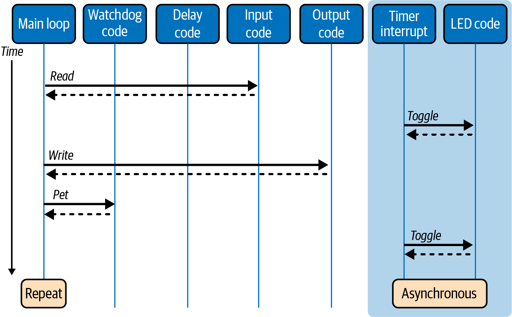

图 6-7. 定时器中断控制 LED 的主循环

图中文字：Main loop＝主循环；Watchdog code＝看门狗代码；Delay code＝延迟代码；Input code＝输入代码；Output code＝输出代码；Timer interrupt＝定时器中断；LED code＝LED 代码；Time＝时间；Read＝读取；Write＝写入；Pet＝喂看门狗；Toggle＝翻转；Repeat＝重复；Asynchronous＝异步。

<!-- source: pdf=189; section=6.4.3; unit=interrupts-question; source_units=p0189_b002_u00,p0189_b003_u00 -->
### 中断包办一切 {#ch06-toc-018}

但如果做不到呢？如果有时必须立即运行输入处理，不能等输出完成自己的工作，又该怎么办？

<!-- source: pdf=189; section=6.4.3; unit=interrupts-all-code; source_units=p0189_b004_u00,p0189_b005_u00,p0189_b006_u00 -->
假定输入数据可用时能够产生中断，就可以让中断负责复制输入数据。它可能是一个发出中断、开始发送数据的传感器，也可能是一条通信通道，允许在缓冲区半满时产生中断。输出端或许有一条通信通道，发送需要时间，但准备好接收下一条消息时会通过中断通知你。那么，让中断完成所有工作会怎样？

```text
timer interrupt: toggle LED
data available interrupt: copy data in
output ready interrupt: copy data out
main:
  init
  set up interrupts
  while (1)
    pet watchdog
    sleep
```

<!-- source: pdf=190; section=6.4.3; unit=decoupling; source_units=p0190_b000_u00 -->

<a id="src-p190"></a>

这种做法有很多好处。子系统解耦很好，因为它实现了关注点分离：每个中断各司其职，不依赖其他中断。另外，中断会指出事情何时发生，因此主循环可以休眠，直到被中断唤醒。这对功耗很有好处，第 13 章会详细讨论。

<!-- source: pdf=190; section=6.4.3; unit=asynchronous-flow; source_units=p0190_b001_u00 -->
如图 6-8 的时序图所示，每段代码都是异步的，该什么时候发生就什么时候发生，不依赖彼此。好吧，基本上不依赖。如果中断唤醒了处理器，中断服务程序（ISR）会运行，然后直接返回主循环中 sleep 调用之后的位置。在我的例子里，接下来会喂看门狗，然后再次休眠。异步方式的缺点是执行流程更难理解，调试也因此困难得多。

<!-- source: pdf=190; section=6.4.3; unit=figure-6-8; source_units=p0190_b003_u00 -->
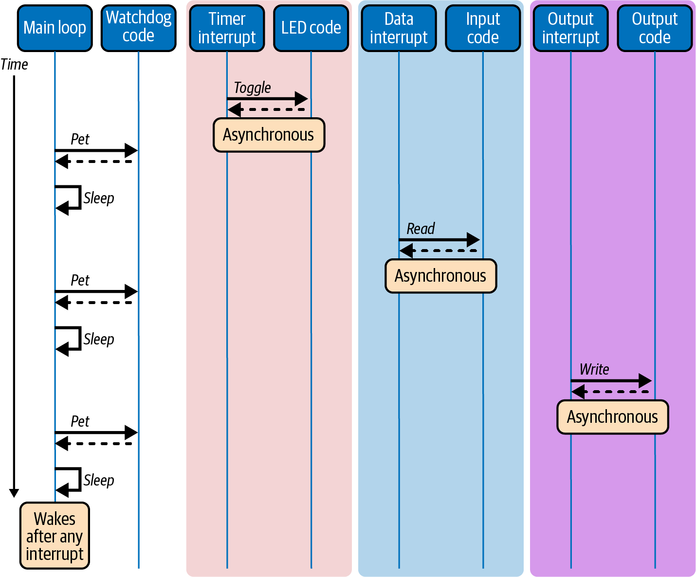

图 6-8. 由中断完成所有工作的主循环

图中文字：Main loop＝主循环；Watchdog code＝看门狗代码；Timer interrupt＝定时器中断；LED code＝LED 代码；Data interrupt＝数据中断；Input code＝输入代码；Output interrupt＝输出中断；Output code＝输出代码；Time＝时间；Pet＝喂看门狗；Sleep＝休眠；Toggle＝翻转；Read＝读取；Write＝写入；Asynchronous＝异步；Wakes after any interrupt＝任何中断发生后都会唤醒。

<!-- source: pdf=191; section=6.4.3; unit=interrupt-duration; source_units=p0191_b000_u00 -->

<a id="src-p191"></a>

由于中断会在需要时发生，只要没有其他中断阻止它们运行，响应时间，也就是系统延迟，应该很短。如果中断耗时太长，优先级和漏中断就可能成为问题。

<!-- source: pdf=191; section=6.4.3; unit=copy-too-long; source_units=p0191_b001_u00 -->
当然，中断本来就应该简短。复制一大堆数据通常并不快；事实上，这恰恰是我们希望避免在中断服务程序中做的事情。

<!-- source: pdf=191; section=6.4.4; unit=interrupt-events-code; source_units=p0191_b002_u00,p0191_b003_u00,p0191_b004_u00,p0191_b005_u00 -->
### 中断产生事件 {#ch06-toc-019}

另一种办法是设置一个变量，告诉 main 该做什么。这样既能保持中断简短，让处理器休眠，也能使系统及时响应当前需求：

```text
timer interrupt: set global led_change variable
data available interrupt: set global data_available
output ready interrupt: set global output_ready
main:
  init
  while (1)
    if led_change: toggle led; led_change = false
    if data_available: copy input; data_available = false
    if output_ready: copy output; output_ready = false
    pet watchdog
    sleep
```

<!-- source: pdf=191; section=6.4.4; unit=globals-order; source_units=p0191_b006_u00 -->
这会在代码里增加一堆全局变量，而这通常很容易造成意大利面条式代码。不过，事件顺序的不确定性减小了，因为可以使用这些全局变量控制执行顺序，例如只有在 data_available 之后才运行 output_ready。中断仍然是异步的，但逻辑已放到正常执行流程中，所以可以增加几个日志调用，让调试容易得多。

<!-- source: pdf=191; section=6.4.4; unit=still-sleep; source_units=p0191_b007_u00 -->
而且，处理器仍然可以休眠，因为中断会将它唤醒。

<!-- source: pdf=191; section=6.4.4; unit=volatile-and-atomic; source_units=p0191_b008_u00 -->
伪代码中没有展示两个重要要点，本书前面已经提到过。首先，全局变量是 volatile 的，防止编译器的优化器将它们消除，因为从编译器对主循环的理解来看，这些事件变量从来没有发生变化。其次，只能在禁用中断时修改这些全局变量，以避免竞态条件。

<!-- source: pdf=191; section=6.4.4; unit=state-machine-nod; source_units=p0191_b009_u00 -->
如果你觉得这段满是 if 语句的代码看起来像一个状态机，那就谢谢你认真阅读到这里。

<!-- source: pdf=192; section=6.4.4; unit=event-diagram-intro; source_units=p0192_b000_u00 -->

<a id="src-p192"></a>

图 6-9 展示了中断创建事件、主循环处理事件的过程。注意，中断是异步的，因此 main 会处理接下来发生的任何事件，并没有特定顺序。

<!-- source: pdf=192; section=6.4.4; unit=figure-6-9; source_units=p0192_b002_u00 -->
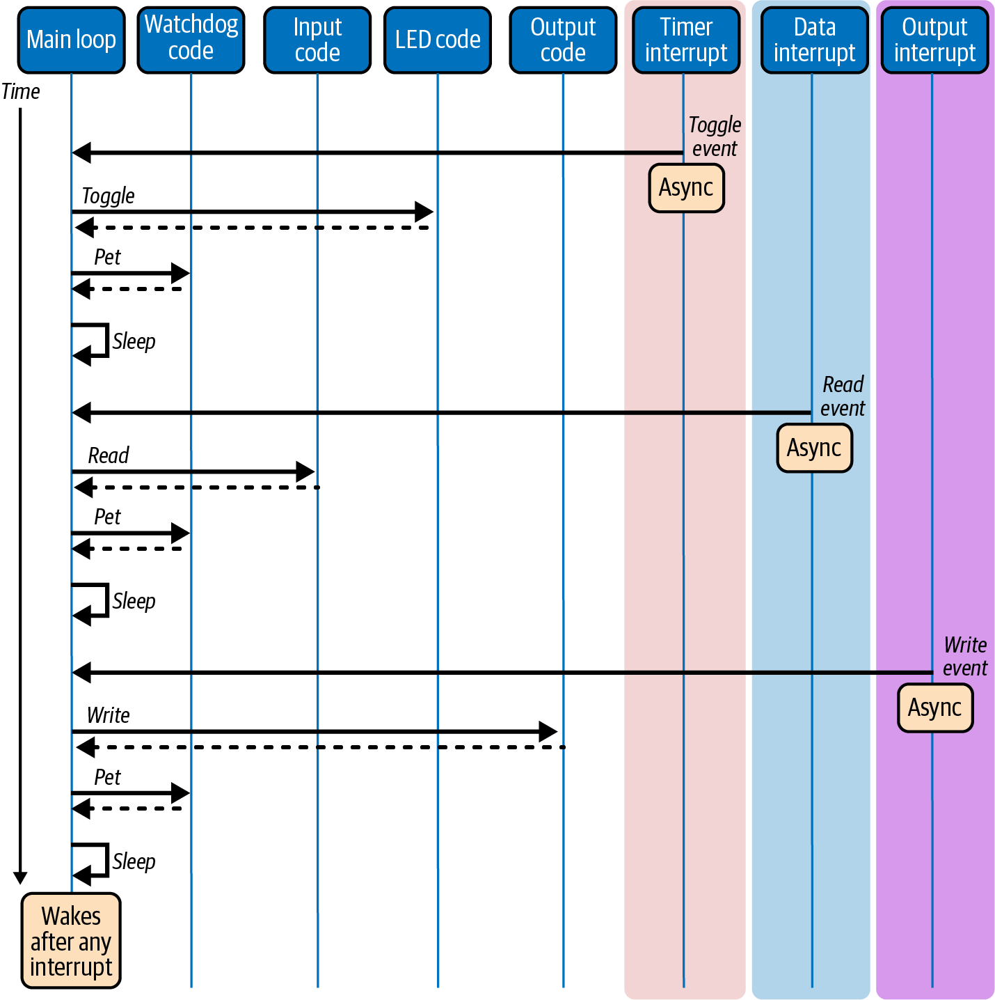

图 6-9. 中断发出事件信号，由主循环处理

图中文字：Main loop＝主循环；Watchdog code＝看门狗代码；Input code＝输入代码；LED code＝LED 代码；Output code＝输出代码；Timer interrupt＝定时器中断；Data interrupt＝数据中断；Output interrupt＝输出中断；Time＝时间；Toggle event＝翻转事件；Read event＝读取事件；Write event＝写入事件；Toggle＝翻转；Read＝读取；Write＝写入；Pet＝喂看门狗；Sleep＝休眠；Async＝异步；Wakes after any interrupt＝任何中断发生后都会唤醒。

<!-- source: pdf=193; section=6.4.5; unit=small-scheduler-code; source_units=p0193_b000_u00,p0193_b001_u00,p0193_b002_u00,p0193_b003_u00 -->

<a id="src-p193"></a>

### 极小型调度器 {#ch06-toc-020}

第 5 章中的极小型调度器又怎样呢？用这种形式表示会是什么样？如前所述，它遍历任务列表，在某个任务该运行时，调用与之关联的回调函数。它完全基于时间：

```text
system tick interrupt: increment current time
main:
  init
  while (1)
    for each task
      if time to run task
        call task callback function
        set new time to run task
    pet watchdog
```

<!-- source: pdf=193; section=6.4.5; unit=run-to-completion; source_units=p0193_b004_u00 -->
采用这种方法时，每个任务都会运行到完成。它是一次函数调用，因此可以被中断打断，例如系统时钟节拍中断，也叫 systick，但不能被其他任务打断。它必须完成，下一个任务才能运行。这也意味着，如果某个任务耗时很长，排在它后面的函数可能会延迟，而且可能所有任务都接连执行完之后，才轮到喂看门狗。虽然所有任务在调度器同一轮迭代中都运行的情况很少见，但仍然必须把看门狗定时器的超时时间设得足够长，以容纳这种可能性。

<!-- source: pdf=193; section=6.4.5; unit=preemption; source_units=p0193_b005_u00 -->
如果你觉得这完全正常，我也同意；不过，RTOS 可以采用抢占式（preemptive）调度，意味着更重要的任务能够打断较不重要的任务，使用处理器。通常每次调用与 RTOS 相关的函数时，RTOS 调度器都会寻找这样的机会。

<!-- source: pdf=193; section=6.4.5; unit=simple-main-scheduler; source_units=p0193_b006_u00 -->
但这个小调度器在 main 中运行，并不做什么花哨的事情。一个任务完成后，就从它的函数返回。随后处理器可以做其他事，例如继续执行下一个已经准备好运行的任务。

<!-- source: pdf=193; section=6.4.5; unit=scheduler-sleep; source_units=p0193_b007_u00 -->
处理器也可以休眠，只要能安排一个唤醒中断，在下一个任务准备好运行时触发。大多数定时器支持这种做法，但并非全部。如果不支持，系统就必须在每次新的 systick 中断发生时醒来。

<!-- source: pdf=193; section=6.4.5; unit=scheduler-diagram-intro; source_units=p0193_b008_u00 -->
图 6-10 的时序图展示了这一过程。注意，各个任务相对于彼此是异步的，不必按图中显示的顺序执行。每个任务的执行取决于它需要多久运行一次。

<!-- source: pdf=194; section=6.4.5; unit=figure-6-10; source_units=p0194_b001_u00 -->

<a id="src-p194"></a>

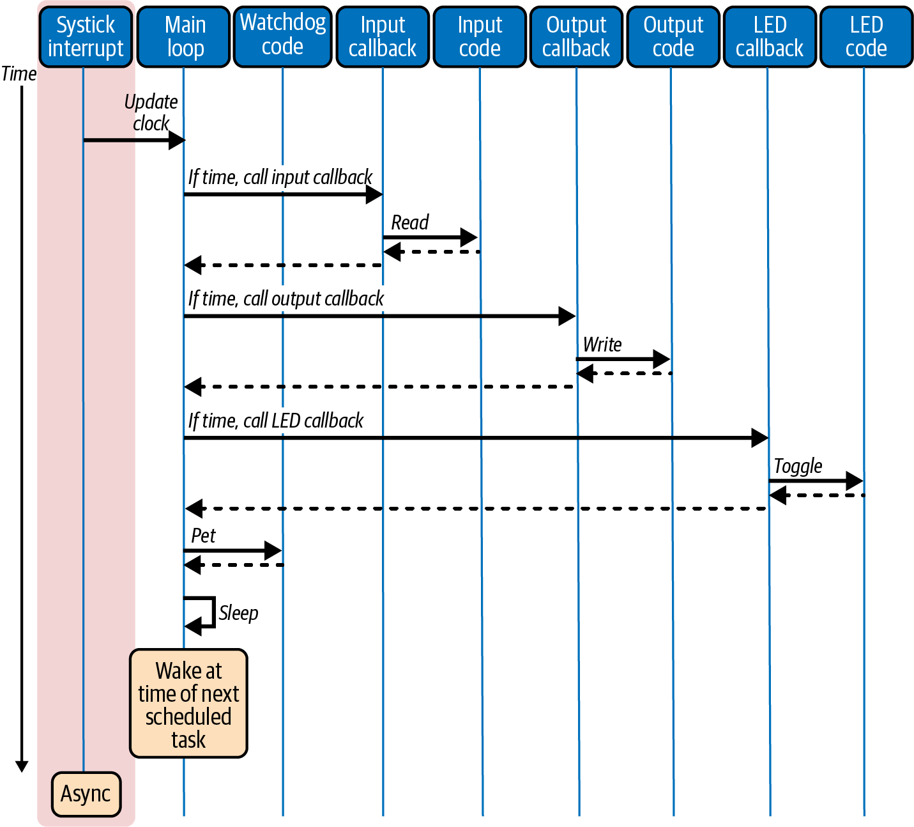

图 6-10. 极小型调度器驱动所有任务，在规定时间运行它们

图中文字：Systick interrupt＝系统节拍中断；Main loop＝主循环；Watchdog code＝看门狗代码；Input callback＝输入回调；Input code＝输入代码；Output callback＝输出回调；Output code＝输出代码；LED callback＝LED 回调；LED code＝LED 代码；Time＝时间；Update clock＝更新时钟；If time, call input／output／LED callback＝时间到了就调用输入／输出／LED 回调；Read＝读取；Write＝写入；Toggle＝翻转；Pet＝喂看门狗；Sleep＝休眠；Async＝异步；Wake at time of next scheduled task＝下一个已调度任务到时唤醒。

<!-- source: pdf=194; section=6.4.5; unit=extra-interrupts; source_units=p0194_b002_u00 -->
并非所有事情都必须经过调度器；你可以有其他中断。例如，数据可用中断可以改变任务列表，让输入回调立即执行；确切地说，是在调度器下一次检查这个任务是否准备好运行时执行。

<!-- source: pdf=194; section=6.4.5; unit=hybrids; source_units=p0194_b003_u00 -->
另外，LED 仍然可以由一个独立的定时器中断翻转。上述任何一种主循环风格都没有不可变通的硬性规定；允许混搭。

<!-- source: pdf=194-195; section=6.4.6; unit=active-objects-intro; source_units=p0194_b004_u00,p0194_b005_u00,p0195_b001_u00 -->

<a id="src-p195"></a>

### 主动对象 {#ch06-toc-021}

我还想介绍一种主循环风格。如果把极小型调度器的同步式简单性，也就是不在中断里执行的简单性，与一切都在中断中执行时那种出色的关注点分离结合起来，就得到了主动对象（active objects）。这种方法需要真正独立的任务，因此有 RTOS 才能发挥作用。不过，我经常在厂商提供的嵌入式系统演示代码里看到它，尤其是使用蓝牙或状态机的代码。这属于框架代码：你需要把自己的函数和任务加到已有系统中。

<!-- source: pdf=195; section=6.4.6; unit=active-goal; source_units=p0195_b002_u00 -->
其目标是让中断占用极少时间，让一切完全异步，并尽可能使每段代码相互独立。这样，你的代码就不会干扰要集成进去的那个系统。

<!-- source: pdf=195; section=6.4.6; unit=inversion-control-code; source_units=p0195_b003_u00,p0195_b004_u00,p0195_b005_u00,p0195_b006_u00,p0195_b007_u00 -->
主动对象的一个关键特征是控制反转（inversion of control）。系统并不是由你的代码控制，而是由框架负责，它需要你时会调用你：

```text
timer interrupt: send event to timer task
timer task:
  while (1)
    wait for event message
    if message is toggle LED, toggle LED
data available interrupt: send event to data task
data task:
  while (1)
    wait for event message
    if message is data available,
      handle data
      send output ready to output task
output task:
 while (1)
    wait for message
    if message is output ready,
      output data
main:
  init
  while (1)
    pet watchdog
    sleep
```

<!-- source: pdf=195; section=6.4.6; unit=message-contract; source_units=p0195_b008_u00 -->
虽然表面上更复杂，但每个任务都专注于自己的工作。每个任务保持数据私有：任务之间只能通过异步填入消息的消息队列通信，尽量彼此自主。我头几次看到主动对象时，觉得重复工作很多：为了追踪事件消息如何穿过多个任务、最终由正确的任务处理，必须深入挖掘厂商代码。不过，从厂商的角度看，事件是一种契约，无需了解你的代码，就能告诉你当前发生了什么。

<!-- source: pdf=195; section=6.4.6; unit=hollywood-note; source_units=p0195_b009_u00 -->
 控制反转常被称为好莱坞原则：别打电话给我们，我们会打给你。

<!-- source: pdf=196; section=6.4.6; unit=message-pump; source_units=p0196_b000_u00 -->

<a id="src-p196"></a>

识别主动对象的一个好办法，是看任务是否围绕消息泵（message pump）组织。通常，先有一段等待消息的代码，然后是一个大型 switch 语句，根据收到的消息事件进行处理。事件处理完毕后，任务就返回等待。任务不应执行任何阻塞调用；它只在等待消息这一个位置等待。并非所有代码都遵循这一规则，有些系统允许通过延迟或其他 RTOS 调用交出控制权。不过，让消息泵成为唯一的阻塞点，是一种良好实践。

<!-- source: pdf=196; section=6.4.6; unit=active-diagram-intro; source_units=p0196_b001_u00 -->
图 6-11 展示了系统各个组件相互分离的程度：尽量减少依赖，并且只允许任务通过特定方法通信。

<!-- source: pdf=196; section=6.4.6; unit=figure-6-11; source_units=p0196_b003_u00 -->
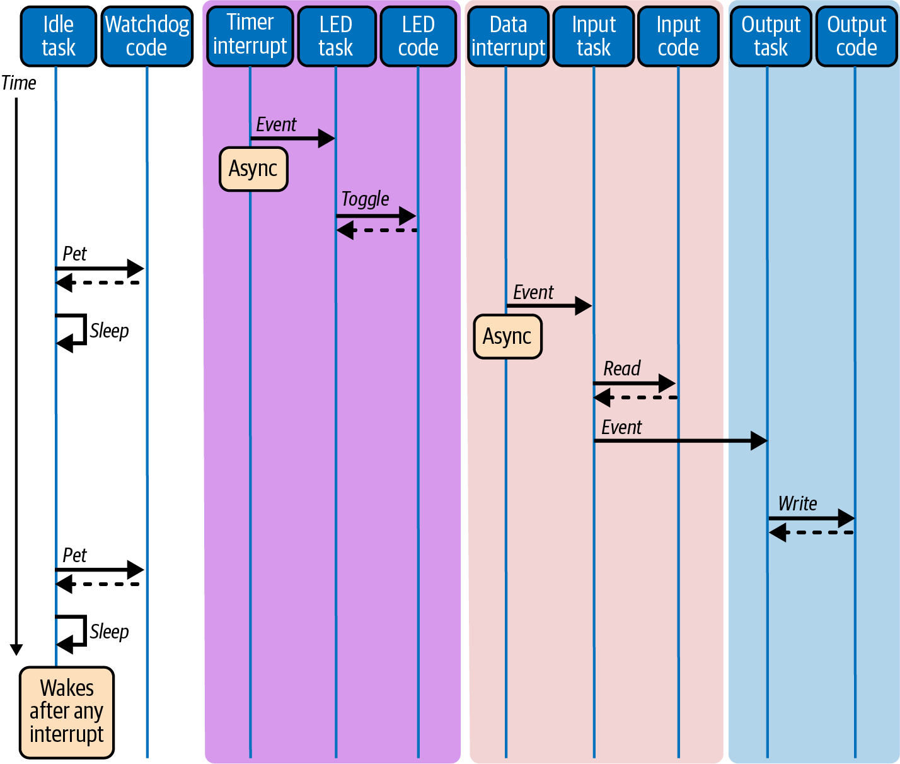

图 6-11. 主动对象作为操作系统中的真正任务运行，通过消息泵分离任务间依赖

图中文字：Idle task＝空闲任务；Watchdog code＝看门狗代码；Timer interrupt＝定时器中断；LED task＝LED 任务；LED code＝LED 代码；Data interrupt＝数据中断；Input task＝输入任务；Input code＝输入代码；Output task＝输出任务；Output code＝输出代码；Time＝时间；Event＝事件；Async＝异步；Toggle＝翻转；Read＝读取；Write＝写入；Pet＝喂看门狗；Sleep＝休眠；Wakes after any interrupt＝任何中断发生后都会唤醒。

<!-- source: pdf=197; section=6.4.6; unit=actor-pattern; source_units=p0197_b000_u00 -->

<a id="src-p197"></a>

主动对象也称为Actor 设计模式（actor design pattern）。这些主动对象通常实现为事件驱动的状态机。如果你还记得第 4 章中的依赖注入，它在理念上与控制反转也有很多共同之处。我很想说术语不重要，原则才重要，不过这些行话确实让原则更容易讨论。

<!-- source: pdf=197; section=6.4.6; unit=star-trek; source_units=p0197_b001_u00 -->
你也许觉得这些技术术语让人头大，并没有那么重要。但谁知道呢，哪天你也许会闯进《星际迷航》的一集里，必须靠一个精心设计的主动对象拯救企业号。

<!-- source: pdf=197; section=6.5; unit=os-reading; source_units=p0197_b002_u00,p0197_b003_u00 -->
## 延伸阅读 {#ch06-toc-022}

没有操作系统地运行嵌入式系统，也就是在裸机上运行，并不意味着可以不了解操作系统原理。恰恰相反，因为要自己完成这些工作，你需要更了解操作系统如何运作，才能重新实现所需的部分。操作系统方面的好书很多，我最喜欢的是 Andrew Tannenbaum 的经典教材 Operating Systems: Design and Implementation（Pearson）。免费的资源则可以看看 [OSDev Wiki](https://osdev.org/Main_Page)。

<!-- source: pdf=197; section=6.5; unit=old-processor-reading; source_units=p0197_b004_u00 -->
我还建议找一本讲小型处理器编程的老书，最好是 1980 年或更早出版的。例如，我有一本 Rodnay Zaks 写的 Programming the 6502，第 3 版（Sybex）。图书馆或旧书店可能找得到。这类书去掉了现代处理器外围那些让它们更好用的包装，让你了解处理器还比较简单时是怎样工作的。另外，读起来也很有意思，因为它们假设读者已经知道的内容，与现在的用户手册很不一样；我的那本书就是从“什么是编程？”开始的。

<!-- source: pdf=197; section=6.5; unit=reusable-classes-reading; source_units=p0197_b005_u00 -->
嵌入式软件工程师有时更多地关注需要学习的硬件细节，或与设备应用有关的算法。优秀的软件技术并非新事物。介绍良好软件实践的最佳入门资料之一，是 Ralph Johnson 和 Brian Foote 在 1988 年发表的论文[“Designing Reusable Classes”](https://oreil.ly/ZA-zZ)。如果想读，可以在网上免费找到。

<!-- source: pdf=197; section=6.5; unit=samek-reading; source_units=p0197_b006_u00 -->
Quantum Leaps 的 Miro Samek 热心倡导主动对象模式，以及在嵌入式系统中编写优秀软件，可参见 [Quantum Leaps 网站](https://state-machine.com)的“Resources”部分。他的书和博客文章包含大量出色的信息，而他的 YouTube 视频尤其具有指导意义，因为他会一边讲解，一边编写系统代码。

<!-- source: pdf=198; section=6.6; unit=interview-question; source_units=p0198_b000_u00,p0198_b001_u00 -->

<a id="src-p198"></a>

## 面试题：十字路口的交通信号灯控制

一个小城市认为，某个十字路口已经繁忙到不能再只靠停车标志，需要升级为交通信号灯。市政管理人员请你编写信号灯代码。一共有四组信号灯，每组都有红、黄、绿三个灯泡。还有四个车辆传感器，可以判断是否有车辆停在灯前。你从哪里开始？请讲讲你的设计，然后写一些伪代码。（在这期间，我已经画好了一个像图 6-12 那样的十字路口。条件允许时，我一般会直接画在应聘者的纸上。）

<!-- source: pdf=198; section=6.6; unit=figure-6-12; source_units=p0198_b003_u00 -->
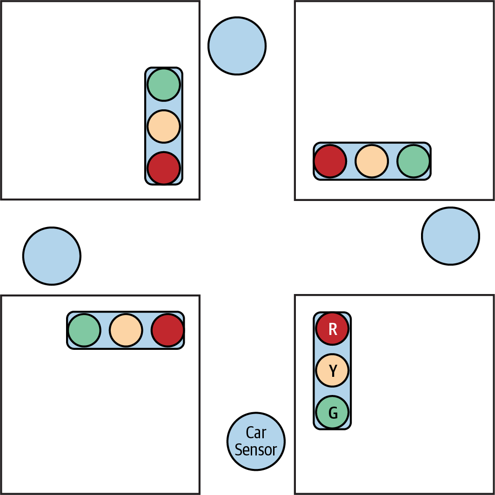

图 6-12. 小城市中的十字路口

图中文字：Car Sensor＝车辆传感器；R／Y／G＝红／黄／绿。

<!-- source: pdf=198; section=6.6; unit=interview-direction; source_units=p0198_b004_u00 -->
这个问题让应聘者能够主导交流。如果想谈设计模式，可以谈的很多；如果想跳过设计，谈定时器或传感硬件，也可以。

<!-- source: pdf=199; section=6.6; unit=clarify-note; source_units=p0199_b001_u00 -->

<a id="src-p199"></a>

 问题不清楚时，应聘者应该澄清。在这道题中，应该问有没有左转信号灯：没有，路口很小，城市暂时不需要。有些人还会问人行横道的问题，初期开发同样不处理。

<!-- source: pdf=199; section=6.6; unit=half-problem; source_units=p0199_b002_u00 -->
非常出色的应聘者会发现，问题实际上只有表面看上去的一半。目标并不是控制四组信号灯，因为其中每两组总是同步的。

<!-- source: pdf=199; section=6.6; unit=naming; source_units=p0199_b003_u00 -->
和我的所有面试题一样，命名非常重要。我之所以在他们的纸上画图，就是为了鼓励他们往图中补充自己的信息。好的命名方式包括用方位表示路口方向，例如南北和东西；使用符合场景的名称，例如 First 和 Main；或者用纸面上的位置，例如左右和上下。在给图中各个元素命名之前，任何伪代码都只会是一团乱麻。

<!-- source: pdf=199; section=6.6; unit=initial-state; source_units=p0199_b004_u00 -->
一旦开始深入问题，我希望听到对状态机、自动机或流程图的讨论。我想看到示意图或流程图。有些人会卡在初始状态上，因为大家往往都想从“最先发生什么”开始。不过，这个例子里的初始状态相对不太重要；当然，如果有人问，我会建议从全部红灯的状态开始。

<!-- source: pdf=199; section=6.6; unit=curveballs; source_units=p0199_b005_u00 -->
他们把基本框架理清后，我通常会加几个出其不意的问题，不过优秀的应聘者往往在我发问之前就已经处理了它们。

<!-- source: pdf=199; section=6.6; unit=broken-sensor; source_units=p0199_b006_u00 -->
首先，如果传感器坏了怎么办？或者，如果城市希望照顾自行车，而自行车不会触发车辆传感器，怎么办？这就需要在状态机中添加一个定时器，避免路口永远困在某个状态里。

<!-- source: pdf=199; section=6.6; unit=all-red-safety; source_units=p0199_b007_u00 -->
其次，这个路口因为有人抢黄灯，已经发生了很多事故。能否做点什么，提高系统的安全性？提示：增加一个短暂的全部红灯状态，让车辆先驶离路口，再进入下一个绿灯状态。

<!-- source: pdf=199; section=6.6; unit=quality-interview; source_units=p0199_b008_u00 -->
因为这道面试题本质上只是一个逻辑问题，我也经常突然拿它来问其他工程师，特别是在质量部门工作的人：“你会怎样为这个控制器编写测试计划？”