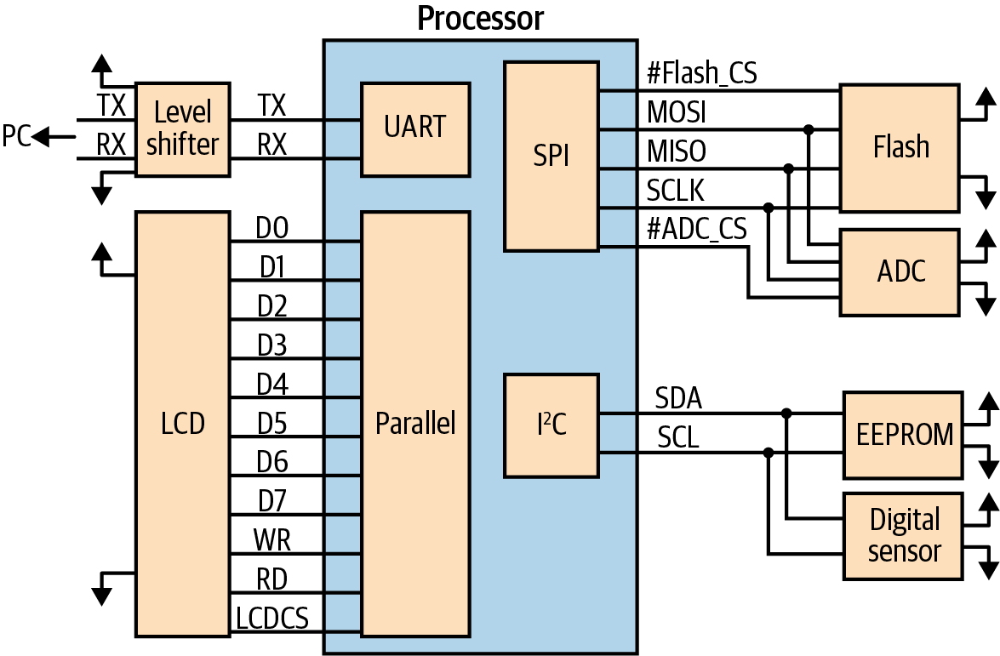
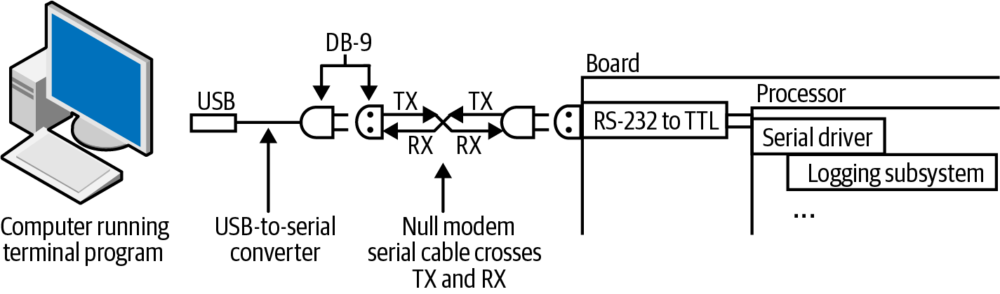
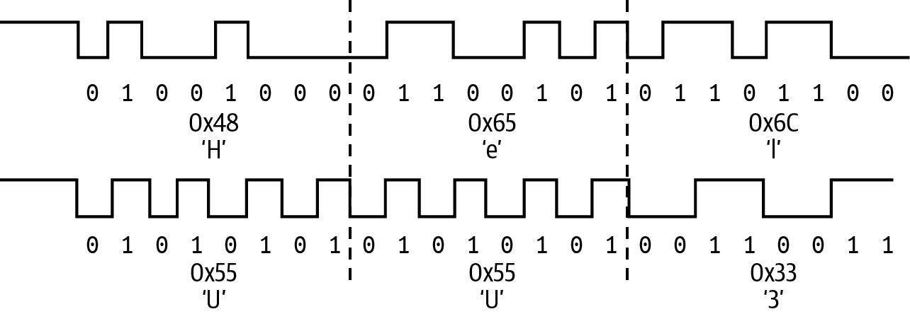
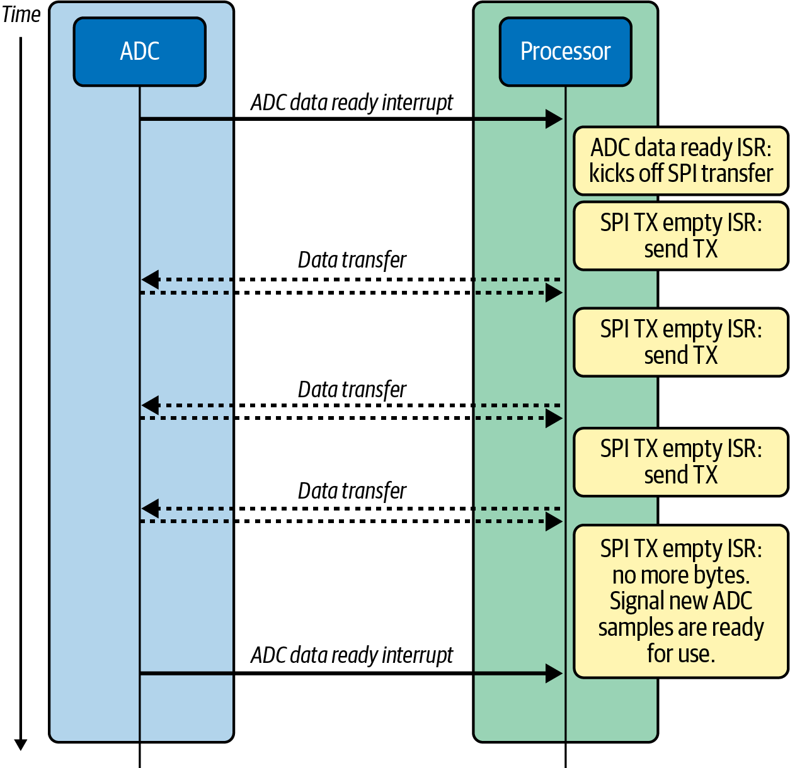
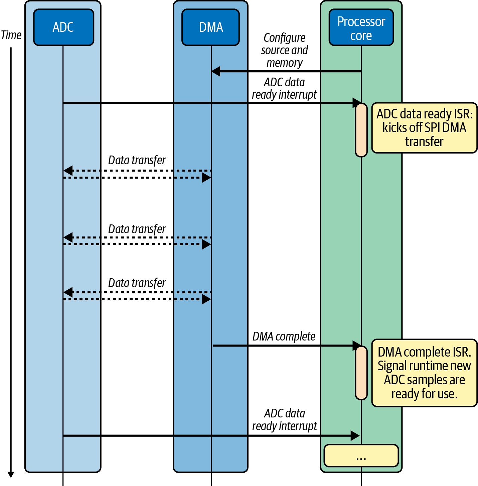
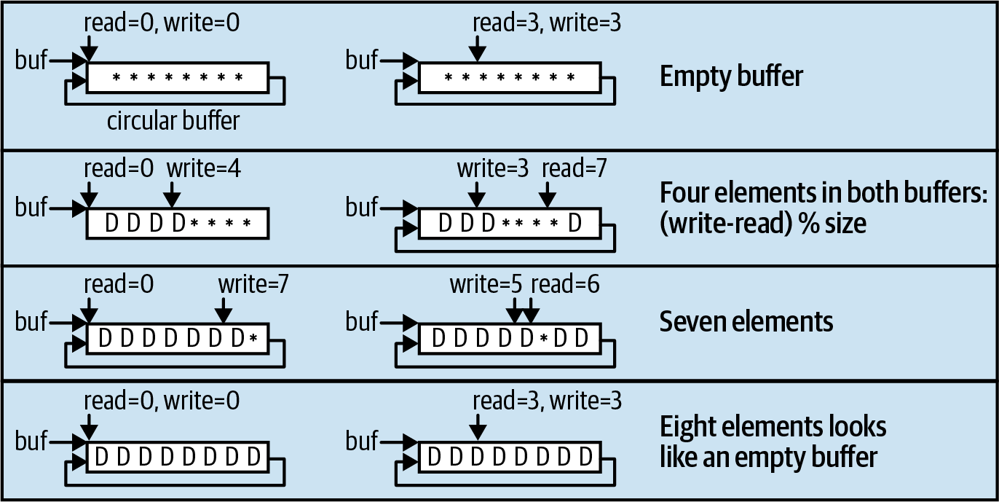
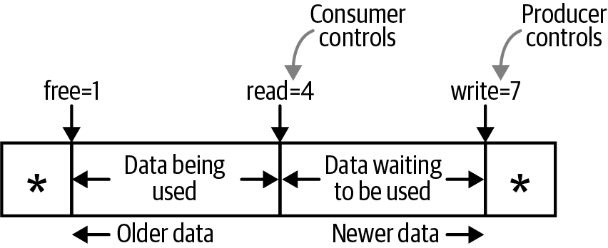
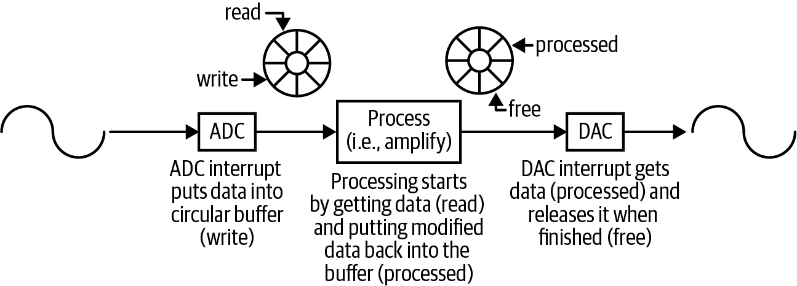

<!-- source: pdf=201; section=7; unit=title; source_units=p0201_b001_u00 -->

<a id="src-p201"></a>

# 第 7 章 与外设通信 {#ch07}

<!-- source: pdf=201; section=7; unit=peripheral-definition; source_units=p0201_b002_u00 -->
外设（peripheral）是处理器内核之外、与处理器通信的任何东西。外设的形态和大小各不相同。由于处理器内核可以直接访问处理器内部的内存，内存几乎算不上外设，不过内存也可以位于芯片外部。

<!-- source: pdf=201; section=7; unit=best-interface-question; source_units=p0201_b003_u00 -->
那么，与外设通信的最佳方式是什么：UART、SPI、I²C，还是别的？我经常被问到这个问题。所以，我们来谈谈为什么这个问题没有答案。我需要用一整章来解释。

<!-- source: pdf=201; section=7; unit=chapter-purpose; source_units=p0201_b004_u00 -->
本书到目前为止已经研究了处理器内部发生的事情。在构建系统之前，还需要考虑其他组件里发生了什么。与其他组件通信，是理解这些问题的起点。我想告诉你，在决定使用哪种通信方式，或者编写通信驱动程序时，应该关注什么。

<!-- source: pdf=201; section=7; unit=hal-drivers; source_units=p0201_b005_u00 -->
大多数情况下，你最终会使用处理器硬件抽象层（hardware abstraction layer，HAL）提供的驱动程序。你需要根据外部设备的数据手册和处理器手册配置它。不过，遇到一种没有现成易用驱动的新通信方式时，这种办法就行不通了。因此，我们来看看一些经常使用的协议和方法，借此识别在新协议中应该关注哪些重要部分。

<!-- source: pdf=201-202; section=7.1; unit=serial-definition; source_units=p0201_b006_u00,p0201_b007_u00,p0202_b002_u00 -->

<a id="src-p202"></a>

## 串行通信 {#ch07-toc-001}

从最宽泛的定义来说，串行通信（serial communication）就是通过一条通信通道，一次发送一个比特的数据，通常是通过一根实实在在的导线。[^ch7-1] 按照这个定义，就连以太网也是串行通信的一种形式。我们把定义缩小一点：串行协议是能够通过通用同步／异步收发器（universal synchronous/asynchronous receiver/transmitter，USART，读作“use-art”）实现的协议。这样说大概也没帮上多大忙，对吧？我先定义几个术语，再看看最常见的串行通信方式。

<!-- source: pdf=201; section=7.1; unit=footnote-1; source_units=p0201_b000_u00 -->
[^ch7-1]: 与之相对的是并行通信，其中每个比特都有专用的通信通道。

<!-- source: pdf=202; section=7.1; unit=uart-default; source_units=p0202_b003_u00 -->
如果要在设备与计算机之间连接一根串口线，UART（读作“you-art”）实现的就是这种场合默认采用的协议。

<!-- source: pdf=202; section=7.1; unit=torx-sidebar; source_units=p0202_b004_u00 -->
 即使高端互联网路由器，也往往有用于配置或调试的串口。串口不仅实现成本低，而且有点像梅花螺丝刀：大多数人根本不知道自己看到的是什么。

<!-- source: pdf=202; section=7.1; unit=sync-asymmetric; source_units=p0202_b005_u00 -->
UART（通用异步收发器，universal asynchronous received/transmitter）比 USART 少了一个 S，所以在继续之前，先退一步谈谈术语。S 表示同步（synchronous），也就是说时钟是与数据分离的独立信号。异步（asynchronous）通道使用隐含时钟，通常通过起始位和停止位表示通信何时进行，因此会降低带宽。由于隐含时钟需要容许一定的时序误差，同步总线可以比异步总线运行得更快。通常，时钟的产生者也控制总线，使它成为非对称（asymmetric）通道。一般只有总线控制器能够发起数据传输。

<!-- source: pdf=202; section=7.1; unit=duplex; source_units=p0202_b006_u00 -->
考虑串口时，另一个重要因素是有两根导线用于通信，分别发送和接收，还是只有一根，根据轮到哪一方说话来切换方向。使用两根导线叫作全双工（full duplex）；共享一根导线叫作半双工（half duplex）。I²C 和 1-Wire 总线是最常见的两种半双工协议。当然，半双工通信的调试稍微复杂些，因为通过示波器或逻辑分析仪，无法确定字节来自哪一块芯片。

<!-- source: pdf=202; section=7.1; unit=timing-diagrams-note; source_units=p0202_b007_u00 -->
 外设数据手册中的时序图，通常是让通信驱动正常工作的关键。第一次调通驱动时，要准备花一些时间设置示波器，尝试重现那些时序图，以验证驱动程序。第 3 章有关于数据手册和示波器的建议。

<!-- source: pdf=203; section=7.1; unit=bus-questions; source_units=p0203_b001_u00,p0203_b002_u00,p0203_b003_u00,p0203_b004_u00,p0203_b005_u00,p0203_b006_u00,p0203_b007_u00,p0203_b008_u00 -->

<a id="src-p203"></a>

遇到新的通信总线时，需要关注以下问题：

- 通信时钟如何产生？是异步的，由所有参与方事先约定，还是同步的，在总线的一根导线上显式传送？如果是同步的，时钟产生者是否还有其他特殊职责？
- 通信是对称的，也就是任何一方都能说话，还是非对称的，只有总线控制器能发起通信？
- 是全双工，具有足够的 I/O 让各方发送数据，还是半双工，各方轮流通过共享 I/O 发送数据？
- 需要多少根硬件信号线？
- 是点对点，还是存在点对多点通信？寻址是在协议中完成，还是通过片选完成？
- 系统的最大吞吐量是多少？每秒能够传输多少个数据位？其中多少是开销？
- 信号能传多远？

<!-- source: pdf=203; section=7.1; unit=question-goal; source_units=p0203_b009_u00 -->
提出这些问题，是为了弄清楚使用这条通信总线实现驱动程序需要多长时间。

<!-- source: pdf=203; section=7.1; unit=example-code-note; source_units=p0203_b010_u00 -->
 许多处理器会附带示例代码，尤其是通信驱动程序的示例。有时这些代码很优秀，有时却只是让它能运行的示例，并不能稳健地工作。如果要把这些代码纳入项目，一定要审查它们。

<!-- source: pdf=203; section=7.1; unit=bus-introduction; source_units=p0203_b011_u00 -->
讲完高层术语和一般性问题，我们来看看一些常用总线是怎样工作的。记住，这仍然只是入门介绍。最终还是需要查阅外设数据手册，了解外设需要什么，再查阅处理器手册，了解如何提供这些条件。

<!-- source: pdf=203; section=7.1; unit=figure-7-1-intro; source_units=p0203_b012_u00 -->
图 7-1 比较了一些最常见总线和外设所需的信号线数量。

<!-- source: pdf=204; section=7.1; unit=figure-7-1; source_units=p0204_b002_u00 -->

<a id="src-p204"></a>



图 7-1. 外设通信方式比较

图中文字：Processor＝处理器；Level shifter＝电平转换器；Parallel＝并行接口；Flash＝闪存；Digital sensor＝数字传感器；LCD＝液晶显示器；ADC＝模数转换器；EEPROM＝电可擦除可编程只读存储器；TX／RX＝发送／接收；D0–D7＝数据线；WR／RD＝写／读控制；LCDCS＝LCD 片选；#Flash_CS／#ADC_CS＝闪存／ADC 片选；MOSI、MISO、SCLK、SDA、SCL 等信号标识保留。

<!-- source: pdf=204; section=7.1.1; unit=ttl-levels; source_units=p0204_b003_u00,p0204_b004_u00 -->
### TTL 串行通信 {#ch07-toc-002}

我们已经看到，“串行”一词有多种含义，可以指许多协议。即使最常见的串行接口，也就是系统与计算机之间的接口，也有好几个名字。前面提到的 UART，就是处理器中实现这个接口的部分。不过，它输出的是 TTL 电平的串行信号。按照定义，TTL（transistor-transistor logic，晶体管—晶体管逻辑）表示 0–5 V。但实际上，它指的是处理器数字 I/O 所使用的电压电平，可以是 0–5 V、0–3 V、0–1.8 V 等。

<!-- source: pdf=204; section=7.1.1; unit=tx-rx; source_units=p0204_b005_u00 -->
虽然还可以有其他信号，参见“RS-232 串行通信”，但最重要的信号是发送（TX）和接收（RX）。只用这两根线，就能让嵌入式系统与计算机通信。注意，两个系统各有 TX 和 RX，因此需要交叉连接，将每一端的 TX 接到另一端的 RX。

<!-- source: pdf=204; section=7.1.1; unit=crossing-note; source_units=p0204_b006_u00 -->
 忘记交叉连接 TX 和 RX，是我遇到过最常见的硬件问题。如果某个组件在通信总线上没有响应，检查 TX 和 RX，或者时钟与数据线，是否接对。

<!-- source: pdf=204; section=7.1.1; unit=ftdi-cable; source_units=p0204_b007_u00 -->
要把电路板连接到计算机，需要一根 USB 转串口线，有时也按生产厂商的名字叫作 FTDI 线。务必选择 TTL 端电压适合处理器的线缆。

<!-- source: pdf=204-205; section=7.1.1; unit=ttl-osi; source_units=p0204_b008_u00,p0205_b001_u00 -->

<a id="src-p205"></a>

这种串行通信位于 OSI 模型的物理层和数据链路层，稍后的“通信的分层模型（OSI）”会详细介绍。它没有内置寻址机制，因此只能在两方之间建立通信，也就是对称的点对点通信。

<!-- source: pdf=205; section=7.1.1; unit=serial-configuration; source_units=p0205_b002_u00 -->
它使用隐含时钟，也就是异步通信，所以双方必须约定波特率（每秒比特数）、奇偶校验、起始位和停止位的数量，以及流控制。虽然通常根本不使用流控制，但也可以通过 UART 的其他信号线在硬件中实现，或通过 Xon/Xoff 协议在软件中实现。本章“延伸阅读”提供了说明这些约定的资源。

<!-- source: pdf=205; section=7.1.1; unit=8n1-note; source_units=p0205_b003_u00 -->
 要与处理器的调试串口通信，通常应选择 8 个数据位、无奇偶校验、1 个停止位、无流控制。这常缩写为“8N1，无流控”。

<!-- source: pdf=205; section=7.1.1; unit=baud-rates; source_units=p0205_b004_u00 -->
波特率通常介于 2,400 和 115,200 之间，尽管也可以高达 921,600。某些波特率尤其常用：9,600、19,200 和 115,200。由于时钟是隐含的，两台设备，也就是处理器和计算机，必须配置为相同的波特率。

<!-- source: pdf=205; section=7.1.1; unit=serial-throughput; source_units=p0205_b005_u00 -->
由于每个数据字节都要附带起始位和停止位，大多数串行连接以字节计的吞吐量，大约等于波特率除以 10。如果波特率为每秒 19,200 比特，系统每秒大约能发送和接收 1,920 字节。相比之下，标准的 100 兆比特以太网，根据协议不同，吞吐量约为每秒 11 兆字节；1 吉比特以太网也已经很常见了。串口很慢。

<!-- source: pdf=205; section=7.1.2; unit=rs232-intro; source_units=p0205_b006_u00,p0205_b007_u00 -->
### RS-232 串行通信 {#ch07-toc-003}

RS-232 与 TTL 串行通信类似，只有电气特性不同，对软件没有影响。过去说“串口”，通常指带有 DB-9 连接器的 RS-232 端口。信号电压是 ±12 V。图 7-2 展示了嵌入式开发中串口线的一种常见用法。虽然 RS-232 定义了八种信号，外加地线，但最重要的还是发送和接收线；它们从处理器出来时是 TTL 信号。

<!-- source: pdf=205; section=7.1.2; unit=figure-7-2; source_units=p0205_b009_u00 -->


图 7-2. 从嵌入式系统到 PC 的串行连接

图中文字：Computer running terminal program＝运行终端程序的计算机；USB-to-serial converter＝USB 转串口转换器；Null modem serial cable crosses TX and RX＝空调制解调器串口线将 TX 与 RX 交叉连接；Board＝电路板；RS-232 to TTL＝RS-232 转 TTL；Processor＝处理器；Serial driver＝串口驱动程序；Logging subsystem＝日志子系统；DB-9、USB、TX、RX 为原信号或接口标识。

<!-- source: pdf=206; section=7.1.2; unit=handshaking; source_units=p0206_b000_u00 -->

<a id="src-p206"></a>

不过，如果连接的是蜂窝数据调制解调器或串口转以太网转换器，可能还需要 UART 的其他一些信号线，指示每台设备何时准备好接收数据，具体来说，就是用于硬件流控的 RTS/CTS 握手。即使时钟是隐含的，也需要指定哪一端是总线控制器，因为这些信号并非完全对称。在 RS-232 中，总线控制器通常是计算机，称为数据终端设备（data terminal equipment，DTE）；另一端则是数据通信设备（data communication equipment，DCE）。没错，几乎每种协议都会给类似的东西起不同的名字。

<!-- source: pdf=206; section=7.1.2; unit=rs232-distance; source_units=p0206_b001_u00 -->
RS-232 的电压相对较高，足有 12 V，这意味着信号能够传输相当远的距离才会劣化。使用普通串口线或空调制解调器线（null modem cable），可以传输最远 50 英尺（15 米）。特殊的低电容线缆，可以把距离提高到约 20 倍。

<!-- source: pdf=206; section=7.1.2; unit=rs232-longevity; source_units=p0206_b002_u00 -->
RS-232 好像早就存在了，而且仍被广泛使用。虽然每次有以太网、USB 等新协议取而代之时，总有人预言它即将消亡，但它总会重新回来，因为软件容易实现，硬件成本也低。

<!-- source: pdf=206; section=7.1.sidebar; unit=embedded-layers; source_units=p0206_b003_u00,p0206_b004_u00,p0206_b005_u00,p0206_b006_u00,p0206_b007_u00,p0206_b008_u00 -->
### 通信的分层模型（OSI）

通信协议通常采用分层方式，让我们可以分别讨论各个部分。在嵌入式系统中，通常只涉及以下几层：

- 电气层：TTL 与 RS-232 的电压不同，尽管导线数量相同。
- 比特和字节如何流动：前面提到的那些术语，如同步、对称、双工等。
- 数据包和网络：一组组数据如何到达目的地，稍后详述。

<!-- source: pdf=206; section=7.1.sidebar; unit=osi-purpose; source_units=p0206_b009_u00 -->
标准的开放系统互连（Open Systems Interconnection，OSI）模型，是把通信协议作为一系列层次来讨论的方法，参见表 7-1。每一层都为上一层提供某种功能，逐层构建通信通道。

<!-- source: pdf=206; section=7.1.sidebar; unit=osi-complexity; source_units=p0206_b010_u00 -->
不需要死记硬背。这个模型远比大多数嵌入式系统所需的复杂，但了解大型、复杂的通信通道如何工作，也能帮助你理解小型通道。

<!-- source: pdf=207; section=7.1.sidebar; unit=table-7-1; source_units=p0207_b001_u00,p0207_b002_u00,p0207_b002_u01,p0207_b004_u00,p0207_b003_u00,p0207_b006_u00,p0207_b005_u00,p0207_b007_u00,p0207_b008_u00,p0207_b009_u00,p0207_b010_u00,p0207_b011_u00,p0207_b012_u00,p0207_b013_u00,p0207_b014_u00,p0207_b015_u00,p0207_b016_u00,p0207_b017_u00,p0207_b018_u00 -->

<a id="src-p207"></a>

表 7-1. OSI 模型

| 层 | 功能 | 这一层需要回答的问题 | PC 的以太网中的对应项 |
| --- | --- | --- | --- |
| 1. 物理层 | 提供电气和物理规范 | 处理器与外设通过多少根导线连接？电压是多少？速度是多少？ | 以太网电缆 |
| 2. 数据链路层 | 描述字节如何在物理导线上流动 | 字节是否有奇偶校验？每帧发送和接收多少位？ | 以太网（802.xx） |
| 3. 网络层 | 把可变长度的信息，也就是数据包，从一处送到另一处 | 每个系统如何寻址？这一层如何把大块数据拆分并重新组合为通信通道能够承载的数据量？ | IP |
| 4. 传输层 | 可靠地移动数据块，即使这些块大于低层能够处理的大小 | 即使导线上出现毛刺，如何保证数据仍能被收到？如何从错误中恢复？ | TCP |
| 5. 会话层 | 管理本地应用与远程应用之间的连接 | 数据如何从这里发送到那里？ | 套接字 |
| 6. 表示层 | 为数据提供结构，还可能进行加密 | 数据发送时如何组织？ | TLS 和 SSL |
| 7. 应用层 | 接收用户与软件的交互，并据此构造通信请求 | 按下一个按钮时应该发送什么命令？ | HTTP |

<!-- source: pdf=207; section=7.1.3; unit=spi-deficiencies; source_units=p0207_b019_u00,p0207_b020_u00 -->
### SPI {#ch07-toc-004}

RS-232 和 TTL 串行通信有一些不足：比特流中约 20% 是开销；两端都必须知道配置，例如波特率和奇偶校验；RX/TX 必须交叉连接也很烦，因为哪根线是 RX 或 TX，取决于观察的角度。

<!-- source: pdf=207-208; section=7.1.3; unit=spi-signals; source_units=p0207_b021_u00,p0207_b022_u00,p0207_b023_u00,p0208_b001_u00,p0208_b002_u00 -->

<a id="src-p208"></a>

我们也可以使用 SPI，它用四根导线将处理器连接到 SPI 外设：

- MISO（Micro-In Sensor-Out，微处理器输入、传感器输出；旧称 Master-In Slave-Out，主输入、从输出[^ch7-2]），或 SDI（Serial Data In，串行数据输入）：总线控制器的接收线，控制器通常就是微处理器。
- MOSI（Micro-Out Sensor-In，微处理器输出、传感器输入；旧称 Master-Out Slave-In，主输出、从输入），或 SDO（Serial Data Out，串行数据输出）：总线控制器的发送线，控制器通常就是微处理器。
- SCK、CLK 或 SCLK（Clock，时钟）：由控制器产生，是通信双方使用的时钟。
- CS（Chip Select，片选），或 SS（Sensor Select，传感器选择；旧称 Slave Select，从设备选择）：每个外设一根，由总线控制器产生，通常为低电平有效。

<!-- source: pdf=207; section=7.1.3; unit=footnote-2; source_units=p0207_b000_u00 -->
[^ch7-2]: 术语很重要。控制器还可以称为主导者（principal）、主机（host）、主设备（primary）；外设还可以称为代理（agent）、工作者（worker）、从属设备（subordinate）、次级设备（secondary）。

<!-- source: pdf=208; section=7.1.3; unit=spi-synchronous; source_units=p0208_b003_u00 -->
SPI 是一种同步、非对称协议，由控制器提供时钟。SPI 的一个特别之处是，只要时钟在运行，控制器和外设都必须发送数据，双方总是在交换数据，即使其中一方没有什么重要内容要说。

<!-- source: pdf=208; section=7.1.3; unit=clocking-out; source_units=p0208_b004_u00 -->
有时，控制器没有需要发送的命令，却必须发送一个字节，才能接收一个字节。想要迫使外设发送数据时，传统上会发送 0xFF。这叫作通过时钟“移出”（clocking out）数据。

<!-- source: pdf=208; section=7.1.3; unit=oscillator-precision; source_units=p0208_b005_u00 -->
RS-232 使用隐含时钟，因此通信双方都需要相对精确的振荡器，否则可能失去同步。SPI 由控制器提供时钟，所以不要求任何一方有精密振荡器。控制器大概仍然有某种振荡器，但无需那么精确，因此可以更便宜。

<!-- source: pdf=208; section=7.1.3; unit=spi-clock-rate; source_units=p0208_b006_u00 -->
时钟速度可以很慢，只有几十 Hz，也可以很快，最高达到 100 MHz。时钟速度就是波特率，而且没有开销，因此 8 MHz 时钟可以达到 1 MB/秒，比 RS-232 快得多；在高时钟速度下，甚至可以与以太网相比。最终，时钟速度可以是处理器能够产生、特定外设能够接收的任意速度。不必非得精确运行在 8 MHz；8.1234 MHz 或 7.9876 MHz 都可以。时钟运行得这么快的另一面，是传不了很远。SPI 信号通常不会离开电路板。

<!-- source: pdf=208; section=7.1.3; unit=spi-chip-select; source_units=p0208_b007_u00 -->
协议定义了片选信号，所以只要每个外设都有一根 CS 线，多个外设通常就可以共享一条 SPI 总线。

<!-- source: pdf=208; section=7.1.3; unit=shared-spi-note; source_units=p0208_b008_u00 -->
 检查外设数据手册；并不是所有外设都能在共享总线上好好配合。

<!-- source: pdf=208; section=7.1.3; unit=spi-driver; source_units=p0208_b009_u00 -->
SPI 驱动程序甚至比 RS-232 驱动更容易实现。唯一棘手的地方，是弄清楚数据应当在时钟上升沿还是下降沿有效，也就是时钟极性和相位。外设数据手册会说明它的要求，处理器手册则会告诉你用哪些寄存器配置。

<!-- source: pdf=209; section=7.1.3; unit=wikipedia-note; source_units=p0209_b001_u00 -->

<a id="src-p209"></a>

 如果数据手册说得不够清楚，可以看看[维基百科的 SPI 页面](https://en.wikipedia.org/wiki/Serial_Peripheral_Interface)。许多协议在维基百科上解释得最好，而且往往比简短的数据手册更详细。

<!-- source: pdf=209; section=7.1.4; unit=bitbang-intro; source_units=p0209_b002_u00,p0209_b003_u00 -->
### 软件模拟时序驱动 {#ch07-toc-005}

SPI 接口十分规整、有条理，因此经常通过软件模拟时序（bit-banging）来实现。软件模拟时序驱动直接使用 I/O 线完成通信接口的工作，而不使用处理器内置的寄存器。说实话，任何串行接口都可以用这种驱动实现，但它消耗的处理能力远多于处理器内置接口。不过，有时处理器没有实现所需通信方式的硬件接口，就只好自己来做。

<!-- source: pdf=209; section=7.1.4; unit=bitbang-steps; source_units=p0209_b004_u00,p0209_b005_u00,p0209_b006_u00,p0209_b007_u00,p0209_b008_u00,p0209_b009_u00,p0209_b010_u00,p0209_b011_u00 -->
要自己实现 SPI 接口：

1. 准备三根未使用的 I/O 线，以及一个内置定时器。片选线的工作方式与处理器自带接口相同，所以这里不计入。
2. 设置定时器，让中断频率等于时钟速度的四倍。例如，通信速率为 2 MHz 时，中断频率为 8 MHz。四次中断各有用途：
   - 翻转 I/O 线。
   - 向 MOSI 写入一个输出位。
   - 翻转 I/O 线。
   - 从 MISO 读取一个输入位。
3. 每处理八位，也就是 32 次中断，开始一个新字节。

<!-- source: pdf=209; section=7.1.4; unit=bitbang-timing; source_units=p0209_b012_u00 -->
注意，每个完整时钟周期都需要写入一位并读取一位。不过，外设数据手册大概会告诉你，安全读取时刻与安全写入时刻相隔半个时钟周期，因此定时器中断频率需要达到预期通信时钟频率的四倍。

<!-- source: pdf=209; section=7.1.4; unit=bitbang-overhead; source_units=p0209_b013_u00 -->
总的来说，每次中断不需要做太多事，但中断数量很多，意味着大量的上下文切换。

<!-- source: pdf=209; section=7.1.5; unit=i2c-intro; source_units=p0209_b014_u00,p0209_b015_u00 -->
### I²C 与 TWI

I²C 是 inter-integrated circuit（集成电路间总线）的缩写，读作“eye-squared-see”或“eye-two-see”。I²C 有时也叫 TWI，即“two-wire interface，双线接口”。和 SPI 一样，I²C 总线上有一个控制器提供时钟并发起交互。不过，与 SPI 不同，I²C 总线可以有多个控制器。控制器甚至可以转换角色，让外设来主导交互。

<!-- source: pdf=210; section=7.1.5; unit=i2c-lines; source_units=p0210_b001_u00 -->

<a id="src-p210"></a>

I²C 源于这样一个问题：把许多东西连接起来，最少能用几根导线？它只用两条连接：SCL（serial clock line，串行时钟线）传时钟，SDA（serial data line，串行数据线）传数据。数据在同一根线上双向传输，所以它是半双工协议。

<!-- source: pdf=210; section=7.1.5; unit=i2c-complexity; source_units=p0210_b002_u00 -->
硬件设计简单的代价，是软件更复杂。不仅如此，它还是一种多点协议，允许多个外设和多个控制器，因此规定了寻址机制，超出了 OSI 的第 1 层（物理层）和第 2 层（数据链路层），进入第 3 层（网络层）。另一方面，I²C 使用得相当广泛，应该能够找到帮助实现驱动的示例代码。

<!-- source: pdf=210; section=7.1.5; unit=i2c-state-machine; source_units=p0210_b003_u00 -->
I²C 驱动程序或处理器硬件总会包含状态机，以应对在控制器发送与外设发送之间切换总线方向的复杂性。控制器首先发送一个 7 位地址，并指出要从外设读取，还是向外设写入，以此开始通信。拥有该地址的外设随后发送确认（acknowledgment，ACK）。接着，控制器向外设发送命令，或者从外设读取，交互就这样继续。通信完成时，控制器发送停止位。

<!-- source: pdf=210; section=7.1.5; unit=i2c-addresses; source_units=p0210_b004_u00 -->
连接到总线上的组件数量受地址空间和总线电容限制。许多组件允许用上拉电阻设置地址的最后几位，这样同一种器件就可以有多个实例接到总线上。另一种方式是，同一组件提供略有区别的型号，对应不同的 I²C 地址。

<!-- source: pdf=210; section=7.1.5; unit=i2c-speeds; source_units=p0210_b005_u00 -->
常见的 I²C 总线速度为 100 Kb/秒（标准模式）和 10 Kb/秒（低速模式）。它是同步的，因此控制器会发送时钟，而这些频率不必非常精确。有些外设支持更快的速度：400 Kb/s、1 Mb/s，甚至 3.4 Mb/s。[^ch7-3]

<!-- source: pdf=210; section=7.1.5; unit=footnote-3; source_units=p0210_b000_u00 -->
[^ch7-3]: 记住，“b”表示比特，“B”表示字节，几乎总是如此。所以从 Mb 换算为 MB，要除以 8。

<!-- source: pdf=210; section=7.1.5; unit=i2c-throughput; source_units=p0210_b006_u00 -->
虽然 I²C 总线有一些固有开销，例如总线仲裁以及起始位和停止位，但如果移动的是大量数据，例如从 ADC（analog-to-digital converter，模数转换器）或 EEPROM 读取数据，这些开销占通信量的比例就小到可以忽略。因此，在标准模式下，I²C 总线可以达到 12.5 KB/s 的吞吐量。

<!-- source: pdf=210; section=7.1.5; unit=i2c-distance; source_units=p0210_b007_u00 -->
I²C 一般不用于与远距离外设通信，不过在电缆使信号严重劣化之前，可以传输几米；也可以使用收发器和特殊电缆延长距离。由于这个协议只需要两根导线就能连接多个外设，所以电缆只需四根线：SDA、SCL、电源和地。

<!-- source: pdf=211; section=7.1.6; unit=onewire-intro; source_units=p0211_b000_u00,p0211_b001_u00 -->

<a id="src-p211"></a>

### 1-Wire {#ch07-toc-006}

I²C 其实还拿不到“串行信号线最少奖”，因为还有名副其实的 1-Wire 总线。它通过一根导线提供低速数据通信和电源。好吧，还需要地线。它在概念上与 I²C 类似：有控制器、仲裁，以及包含状态机的软件驱动，不过它使用 16.3 Kb/s 的隐含时钟。虽然数据速率相当低，但可以用于较长距离，最远 10 m；采用特殊电缆时可达 100 m。

<!-- source: pdf=211; section=7.1.6; unit=onewire-authentication; source_units=p0211_b002_u00 -->
和 I²C 一样，这条总线可用于许多类型的外设，包括存储器、传感器、ADC 和 DAC。除了简单的温度传感器之外，1-Wire 最常见的应用就是身份认证芯片，用于认证系统中可替换部件的来源。例如，如果你在制造打印机墨盒，或其他任何形式的耗材，希望阻止竞争对手制造可以直接替换的产品，1-Wire 安全认证芯片就能要求耗材先向固件发送正确密码，才允许使用。

<!-- source: pdf=211; section=7.1.6; unit=parasitic-power; source_units=p0211_b003_u00 -->
虽然与设备通信实际上不可能真的只有一根线，但有些设备使用寄生供电（parasitic power），把通信线当作电源，因此电缆只需两根线：数据／电源，以及地。

<!-- source: pdf=211; section=7.1.7; unit=parallel-code; source_units=p0211_b004_u00,p0211_b005_u00,p0211_b006_u00 -->
### 并行通信 {#ch07-toc-007}

并行通信（parallel communication）只是指使用多根 I/O 线，以便同时向外设发送或从外设接收多个比特。一次在总线上放置 8 位或 16 位，就可以非常快速地通信。并行总线的数据位几乎总是集中在同一组 I/O 引脚上。这样，只需把数据字节写入 I/O 寄存器，就能设置所有位。你不必像第 4 章那样只设置单个位：

```c
P1OUT |= BIT2;        // IO1_2 high
```

<!-- source: pdf=211; section=7.1.7; unit=parallel-byte-code; source_units=p0211_b007_u00,p0211_b008_u00 -->
而是可以一次修改多根 I/O 线：

```c
P1OUT |= data & 0xFF; // put 8 bits on parallel bus: IO1_0 to IO_7
```

<!-- source: pdf=211; section=7.1.7; unit=parallel-cost; source_units=p0211_b009_u00 -->
并行接口往往会提高芯片价格。I/O 线要占用硅片面积，而硅片面积与芯片制造成本成正比；不过，对许多芯片来说，RAM 占用的硅片面积比 I/O 线更大。

<!-- source: pdf=211-212; section=7.1.7; unit=display-bandwidth; source_units=p0211_b010_u00,p0212_b001_u00 -->

<a id="src-p212"></a>

并行接口往往用于数据吞吐量要求很高的东西，例如显示器和外部存储器，这些组件稍后会介绍。一块 320×480 像素的小型彩色 LCD，每屏需要 450 KB；这是更新整屏时的数据量，通常并不会这样做。

若刷新率至少为 30 Hz，就需要移动约 13 MB/s（105.5 Mb/s）的数据，超过 SPI 能够处理的速度。不过，如果使用 8 位宽的并行总线，每根信号线的比特率就降为 13 Mb/s。数据分布在整条总线上，因此并行线越多，吞吐量就越高。

<!-- source: pdf=212; section=7.1.7; unit=parallel-write-sequence; source_units=p0212_b002_u00,p0212_b003_u00,p0212_b004_u00,p0212_b005_u00,p0212_b006_u00,p0212_b007_u00 -->
纯并行总线往往是半双工的，使用控制线指示数据传输方向，也就是读线和写线，并通过片选线指示总线是否连接到某块芯片。控制线往往也充当系统时钟，因此一次写入交互大致如下：

1. 撤销写控制线的有效状态。
2. 选中芯片。
3. 在并行总线上设置要传输的数据。
4. 使写控制线有效。
5. 返回步骤 2，直到所有数据传输完毕。

<!-- source: pdf=212; section=7.1.7; unit=parallel-timing; source_units=p0212_b008_u00 -->
检查外设数据手册中的时序，确定这些步骤之间是否需要延迟。总体而言，实现并行总线很容易，难度与 SPI 驱动相当。不过调试稍难，因为要查看的信号线太多。

<!-- source: pdf=212; section=7.1.7; unit=parallel-spi; source_units=p0212_b009_u00 -->
注意，并行总线可以与其他协议结合，通常是 SPI，让两根或四根 MOSI 数据引脚并行工作，从而发送更多数据。

<!-- source: pdf=212; section=7.1.7; unit=debug-io-note; source_units=p0212_b010_u00 -->
 如果设计时还有空闲 I/O 线，就把它们引到排针或测试点上。可以把错误码或事件码写到这些 I/O 线上，组成一条用于调试、甚至性能剖析的并行总线。把这些线接到逻辑分析仪，就可以窥见系统在做什么，而且不会像串口输出那样改变时序。

<!-- source: pdf=212; section=7.1.8; unit=dual-quad-opening; source_units=p0212_b011_u00,p0212_b012_u00 -->
### 双线与四线 SPI {#ch07-toc-008}

把并行总线与 SPI 总线结合，会得到什么？一种发送数据更快的东西。

<!-- source: pdf=212; section=7.1.8; unit=dual-spi; source_units=p0212_b013_u00 -->
普通 SPI 使用 MISO 和 MOSI 通信，而支持双线 SPI 总线的组件，会在某些操作中把这两根线都改为输入，或者都改为输出，让数据传输量翻倍。操作完成时，总线恢复正常的全双工工作方式。

<!-- source: pdf=212; section=7.1.8; unit=quad-spi; source_units=p0212_b014_u00 -->
四线 SPI 总线有四个引脚发送数据。其中两个引脚起初是 MISO 和 MOSI，然后在某些操作中变成四线并行总线，以普通 SPI 四倍的速度传输数据。

<!-- source: pdf=213; section=7.1.9; unit=usb-complexity; source_units=p0213_b000_u00,p0213_b001_u00 -->

<a id="src-p213"></a>

### USB {#ch07-toc-009}

前面提到的所有串行协议，如果没有对应硬件，只要处理能力足够，都可以用软件模拟时序实现。USB 我可不想这样尝试，因为它相当复杂，电气方面的事情也更多。它是异步系统，使用隐含时钟，最多支持 127 个设备。根据版本不同，它可以是全双工，也可以是半双工。不过它始终是非对称的，只是这里通常使用“主机”（host）和“设备”（device）这两个术语，而不是“控制器”和“外设”。

<!-- source: pdf=213; section=7.1.9; unit=usb-speed; source_units=p0213_b002_u00 -->
它也很快，根据版本不同，速度为 1.5、12、480 或 4,000 Mb/s。电缆可以达到中等长度，约五米，仍保持信号完整性。USB 使用差分信号（differential signals），从而能够在较长电缆上实现高吞吐量；差分信号需要两倍数量的导线，因此能传得更远。

<!-- source: pdf=213; section=7.1.9; unit=usb-power; source_units=p0213_b003_u00 -->
USB 不仅提供通信，也提供电源，供电功率取决于 USB 版本。因此，消费者把手机或相机插入计算机的 USB 端口，就能给它们供电。

<!-- source: pdf=213; section=7.1.9; unit=usb-stack; source_units=p0213_b004_u00 -->
和以太网一样，USB 交互通常复杂到值得使用操作系统，或者使用一个远超简单驱动程序范畴的 USB 协议栈。此外，USB 应用通常会实现全部或大多数 OSI 层次，参见“通信的分层模型（OSI）”旁栏。

<!-- source: pdf=213; section=7.1.10; unit=protocol-comparison; source_units=p0213_b005_u00,p0213_b006_u00,p0213_b007_u00,p0213_b008_u00,p0213_b009_u00,p0213_b010_u00,p0213_b011_u00,p0213_b012_u00 -->
### 考虑其他协议 {#ch07-toc-010}

希望你已经看出不同串行协议的共通之处。没必要死记硬背每种协议是什么。拿到外设数据手册时，它会告诉你有什么要求；处理器手册会告诉你怎样实现。如果没有，维基百科大概会给你一个软件模拟时序驱动的伪代码。目标是思考哪些因素会让协议容易或难以实现。几个要点如下：

- 需要的层次越多，实现就越复杂。许多协议并不能整齐地套进 OSI 模型，但了解这个框架仍有助于估算。
- 点对点比网络容易，因为网络需要地址。
- 半双工比全双工困难，因为必须切换通信方向。
- 同步比异步容易，因为你确切知道什么时候会收到一个字节。
- 总线上有一个控制器，也就是非对称通信，通常比没有任何一方掌控、需要自己协调谁可以说话的情况更容易。
- 显式时钟比隐含时钟容易。

<!-- source: pdf=214; section=7.1.10; unit=smartcard-question; source_units=p0214_b000_u00 -->

<a id="src-p214"></a>

假设需要为智能卡实现一个接触式接口。智能卡使用 ISO-7816，它是一种半双工、点对点、非对称协议，由控制器提供时钟，范围为 1–5 MHz。实现驱动程序会有多难？

<!-- source: pdf=214; section=7.1.10; unit=smartcard-estimate; source_units=p0214_b001_u00 -->
根据这些信息，看起来它比 SPI 复杂，但比 I²C 简单。计划估算时再多加一点时间，因为这个协议相对少见，你大概找不到好的示例代码。那么，如果我告诉你，它实现了四个或更多 OSI 层次，尽管经过了一定简化，又会怎样？这应该让你的实现时间估计至少提高到三倍。

<!-- source: pdf=214; section=7.1.10; unit=rs485-comparison; source_units=p0214_b002_u00 -->
再看看更偏工业用途的协议，比如 RS-485。它为长距离传输而设计，可以是全双工，也可以是半双工。全双工时，它是异步的。时钟是隐含的，范围为 100 kHz–10 MHz，而且只规定了物理层和数据链路层。通常会有总线控制器，但并非必需。仅根据这些信息，实现它的难度听上去像是 RS-232 和 I²C 的结合。

<!-- source: pdf=214; section=7.1.10; unit=commonality-benefit; source_units=p0214_b003_u00 -->
如果能发现不同协议的共通之处，那么一旦编写过类似的实现，再实现新协议时，就知道会遇到什么。

<!-- source: pdf=214; section=7.1.11; unit=ascii-intro; source_units=p0214_b004_u00,p0214_b005_u00 -->
### ASCII 字符

如果新串口驱动的测试代码发出的第一个单词是“Hello”，可别指望调试时在示波器上看到一只电子手向你挥手。字母会转换成数字，通常按照 ASCII 字符编码方案转换为 8 位数字。

<!-- source: pdf=214; section=7.1.11; unit=ascii-table; source_units=p0214_b006_u00,p0214_b006_u01 -->
| 字母 | H | e | l | l | o |
| --- | --- | --- | --- | --- | --- |
| ASCII | 0x48 | 0x65 | 0x6C | 0x6C | 0x6F |

<!-- source: pdf=214; section=7.1.11; unit=hello-waveform; source_units=p0214_b007_u00 -->
因此，当发送线上开始出现“Hello”时，首先是 H，也就是 0x48，二进制形式为 01001000。由于 ASCII 只使用七位，共 128 个字符，第一位总是 0，所以很容易在示波器上找到 ASCII 字符。在图 7-3 中，我让传输开始时保持高电平，以显示数据的下降沿，这样就更容易知道自己看到了数据流中的哪个位置。如果协议有片选信号，也可以通过在片选上触发来观察信号起点。

<!-- source: pdf=214; section=7.1.11; unit=uu3-waveform; source_units=p0214_b008_u00 -->
或者，可以选择一些更容易在示波器上辨认的字母。我喜欢“UU3”。每个 U 都是 0x55，意味着每隔一位就有一位置位，因此看起来像时钟信号。3 碰巧对应 0x33，也就是二进制 00110011，所以看起来像速度减半的时钟。

<!-- source: pdf=215; section=7.1.11; unit=figure-7-3; source_units=p0215_b002_u00 -->

<a id="src-p215"></a>



图 7-3. ASCII“Hello”与 UU3 的比较

图中保留字符、十六进制值与波形位序：上行为“Hello”的起始部分，下行为“UU3”；H 对应 0x48，e 对应 0x65，l 对应 0x6C，U 对应 0x55，3 对应 0x33。

<!-- source: pdf=215; section=7.1.11; unit=ascii-memory; source_units=p0215_b003_u00,p0215_b004_u00 -->
学习 ASCII 表很像学习摩尔斯电码。如果经常使用，就很方便；如果只是出于好玩而学，别指望长久记住。另一方面，如果最后变成每年大约编写一个串口驱动，你可能就会开始记住其中的要点。ASCII 表的安排很有逻辑，所以只记重要内容会更容易：

```text
'0' -> 0x30
'A' -> 0x41
'a' -> 0x61
```

<!-- source: pdf=215; section=7.1.11; unit=ascii-increments; source_units=p0215_b005_u00 -->
数字和字母从这些起点依次递增，因此数字 3 对应 0x33。我的简记法无法告诉你标点和控制字符在哪里，但已经足以概括这张表：万一被困在某处，只有一个 LED 可以通信，你也能据此与另一位嵌入式工程师交流。

<!-- source: pdf=215; section=7.1.11; unit=unicode-note; source_units=p0215_b006_u00 -->
 虽然 ASCII 是嵌入式系统中最普遍的编码方案，但它无法把其他语言的字符放进 8 位字中。Unicode 使用 16 位，有时更多。如果产品要国际化，请判断 Unicode 是否适合你。

<!-- source: pdf=215; section=7.3; unit=practice-intro; source_units=p0215_b007_u00,p0215_b008_u00 -->
## 通信实践 {#ch07-toc-011}

阅读数字传感器的数据手册时，首要关注的问题之一，是如何与它通信。处理器是否具备传感器所需的通信方式？这有助于实现；如果处理器提供 HAL，也大概有助于驱动程序的实现。

<!-- source: pdf=215; section=7.3; unit=external-adc-start; source_units=p0215_b009_u00 -->
考虑一个通过 SPI 连接到处理器的外部 ADC。ADC 就是模数转换器；第 8 章会进一步解释它实际做什么。再加上 ADC 的器件型号，这些信息似乎就足够开始了。

<!-- source: pdf=216; section=7.3; unit=communication-efficiency; source_units=p0216_b000_u00 -->

<a id="src-p216"></a>

确实足够开始。不过，要让通信高效，还需要考虑几件事。通过一个外部 ADC 的例子，我可以说明使用驱动程序和 FIFO 时的一些细节。许多数字传感器的通信模式都非常相似。另外，虽然示例中使用 SPI，其他通信方式也有类似的考虑因素。

<!-- source: pdf=216; section=7.3.1; unit=adc-spi-configuration; source_units=p0216_b001_u00,p0216_b002_u00,p0216_b003_u00,p0216_b004_u00,p0216_b005_u00,p0216_b006_u00,p0216_b007_u00 -->
### 外部 ADC 示例：通过 SPI 处理数据就绪 {#ch07-toc-012}

首先要进行配置。先按参考手册的说明设置 I/O，让 SPI 子系统能够工作。然后按照 ADC 的要求配置 SPI 子系统。配置步骤如下：

1. 将片选、时钟和 MOSI 对应的 I/O 引脚设为输出，将 MISO 设为输入。
2. 将这些 I/O 引脚分配给 SPI 功能。
3. 按照 ADC 数据手册配置 SPI：串行时钟速率、时钟极性（CPOL）和时钟相位（CPHA）、数据帧长度等。

最初，在电路板初始调试或原型测试期间，你很可能会轮询传感器，向它请求信息，确认所有连接正常。不过，等待 SPI 通信完成效率很低，因此可能需要用中断处理 SPI 字节的发送和接收。

4. 将 SPI 中断设置为在发送缓冲区为空时触发。

<!-- source: pdf=216; section=7.3.1; unit=adc-polling; source_units=p0216_b008_u00 -->
即使有 SPI 中断协助通信，从 ADC 获得的数据仍然是按需请求的。需要设置 SPI 缓冲区，向 ADC 发送命令，开始转换，也就是采集数据。然后不断向 ADC 发送命令，询问完成了没有。等它完成，最后再设置读取数据的 SPI 命令。来来回回太多了；我们更希望在 ADC 准备好发送时，直接得到数据。

<!-- source: pdf=216; section=7.3.1; unit=data-ready-interrupt; source_units=p0216_b009_u00 -->
但怎么知道数据已经准备好了呢？ADC 或其他数字传感器通常会有一根中断线，指示数据已经准备好，可以读取。配置完成后，这根 I/O 线会在处理器上触发中断。虽然实现时很可能只是一个通用 I/O 中断，但讨论传感器时，我们把它称为数据就绪中断（data ready interrupt）。

<!-- source: pdf=216-217; section=7.3.1; unit=data-ready-actions; source_units=p0216_b010_u00,p0216_b011_u00,p0217_b000_u00,p0217_b001_u00 -->

<a id="src-p217"></a>

数据就绪中断会启动 SPI 交互，请求 ADC 发送数据。在中断中，或者根据 main 中的事件标志，代码会：

1. 用要发送给 ADC 的信息填充发送缓冲区。这可能包含发给 ADC 的命令，包括请求数据和开始下一次转换。
2. 在 SPI 中配置用于发送和接收的缓冲区，以及要发送的字节数。
3. 启用 SPI 发送缓冲区空中断。

<!-- source: pdf=217; section=7.3.1; unit=tx-empty-transfer; source_units=p0217_b002_u00 -->
最后一步会使 TX 空中断发生，发送缓冲区的内容被发出，接收缓冲区被填入数据。当指定数量的字节发送完毕，主循环应收到一个标志，表示传输已完成，以便处理这些数据。图 7-4 展示了传输过程。

<!-- source: pdf=217; section=7.3.1; unit=figure-7-4; source_units=p0217_b004_u00 -->


图 7-4. ADC 数据就绪中断启动 SPI 通信以接收数据的通信时序示例

图中文字：Time＝时间；Processor＝处理器；ADC data ready interrupt＝ADC 数据就绪中断；ADC data ready ISR: kicks off SPI transfer＝ADC 数据就绪 ISR：启动 SPI 传输；SPI TX empty ISR: send TX＝SPI 发送空 ISR：发送 TX 数据；Data transfer＝数据传输；SPI TX empty ISR: no more bytes. Signal new ADC samples are ready for use.＝SPI 发送空 ISR：没有更多字节，通知新的 ADC 采样值已经准备好，可以使用。

<!-- source: pdf=217; section=7.3.2; unit=fifo-intro; source_units=p0217_b005_u00,p0217_b006_u00 -->
### 有 FIFO 就用它 {#ch07-toc-013}

与数字传感器通信，最慢的方式通常是软件模拟时序驱动。只有别无他法时才应采用。再快一档，是使用处理器的通信机制，例如集成的 SPI 或 I²C 外设总线，在每次中断中发送或接收一个字节。

<!-- source: pdf=218; section=7.3.2; unit=fifo-definition; source_units=p0218_b001_u00 -->

<a id="src-p218"></a>

如果硬件支持先进先出（first in, first out，FIFO）队列，系统还能更快。它提供一个小缓冲区，让数据先积累一些，再由你处理。FIFO 队列可能属于处理器，也可能属于数字传感器，或者两者都有，但不要同时使用两者。

<!-- source: pdf=218; section=7.3.2; unit=fifo-transmit; source_units=p0218_b002_u00 -->
使用 FIFO 很简单。要发送数据，就写入发送保持寄存器（transmit holding register，THR）。写入这个地址，就把数据送入发送 FIFO。数据到达 FIFO 队列末端，并且发送器可用时，就会被发出去。与环形缓冲区不同，不需要处理指针；只需写 THR 来填充 FIFO，数据最终就会出现在引脚上。当外设连续发送存储在 FIFO 中的数据时，处理器可以做其他事情。

<!-- source: pdf=218; section=7.3.2; unit=fifo-receive; source_units=p0218_b003_u00 -->
这些系统通常同时有发送 FIFO 和接收 FIFO。要从接收 FIFO 取得数据，先用状态寄存器确认有数据可用，再读取接收缓冲寄存器（receive buffer register，RBR），取得 FIFO 中最早的数据。

<!-- source: pdf=218; section=7.3.2; unit=shared-register-note; source_units=p0218_b004_u00 -->
 发送寄存器与接收寄存器，也就是 THR 和 RBR，可以是同一个寄存器，根据执行的是写操作还是读操作来改变角色。

<!-- source: pdf=218; section=7.3.2; unit=fifo-flags; source_units=p0218_b005_u00 -->
处理器中的 FIFO 使用一组标志通知软件。状态标志通常包括满、空、半满、半空。如果你在想 FIFO 是不是也有乐观派和悲观派之分：通常接收缓冲区报告半满，发送缓冲区报告半空。这些水位可以用来中断处理器。

<!-- source: pdf=218; section=7.3.2; unit=fifo-threshold; source_units=p0218_b006_u00 -->
有些处理器允许指定触发中断的水位。为了获得最大吞吐量，需要确定处理器响应中断所需的最长时间，也就是延迟，以及在这段时间内能发送多少数据。例如，假设希望在 SPI 总线上保持稳定的数据流。如果 SPI 运行在 10 MHz，而响应中断最多需要 3 微秒，就需要在 FIFO 还剩 4 字节时收到中断：10 MHz 时钟 → 1.25 MB/s → 0.8 μs/字节；3 微秒延迟 ÷ 0.8 μs/字节 → 3.75 字节。

<!-- source: pdf=218; section=7.3.2; unit=fifo-balance; source_units=p0218_b007_u00 -->
发送中断通常会用已有数据填满 FIFO。接收 FIFO 中断则会取出全部数据，放到软件能够使用的位置，通常是环形缓冲区。目标是平衡触发水位，以最少的中断维持连续数据流。

<!-- source: pdf=219; section=7.3.2; unit=fifo-depth; source_units=p0219_b000_u00 -->

<a id="src-p219"></a>

处理器手册或组件数据手册会更详细地介绍如何配置 FIFO。FIFO 的深度通常为 8 或 16 字节。但如果 FIFO 深度不受这种限制呢？如果 FIFO 更像环形缓冲区，能按需要使用 RAM 呢？

<!-- source: pdf=219; section=7.3.3; unit=dma-intro; source_units=p0219_b001_u00,p0219_b002_u00 -->
### 直接存储器访问（DMA）更快 {#ch07-toc-014}

支持直接存储器访问（direct memory access，DMA）的处理器，能够传输的数据量远多于只实现 FIFO 的处理器。

<!-- source: pdf=219; section=7.3.3; unit=dma-bypass; source_units=p0219_b003_u00 -->
没有 DMA 时，处理器必须读取每一份数据，并把它存入内存。每传输一个字节，从外设读取数据并存入缓冲区时，都会产生软件开销。DMA 绕过处理器，不运行软件就能传输数据。

<!-- source: pdf=219; section=7.3.3; unit=dma-count; source_units=p0219_b004_u00 -->
使用 DMA 时，给处理器一个指针，以及要读取或写入的字节数。接收时，处理器从外设读取数据到指定内存，直到达到指定字节数，再中断软件。类似地，发送时，处理器把数据从缓冲区移到外设，计数完成后产生中断。

<!-- source: pdf=219; section=7.3.3; unit=dma-setup; source_units=p0219_b005_u00 -->
DMA 很像另一个线程替你处理数据。运行时很方便，不过设置起来可能很麻烦。查阅处理器手册中的 DMA 寄存器：发送指针寄存器，也就是要向设备写出的缓冲区；发送计数；接收指针寄存器；以及接收计数。如果数据是分块到来，而不是连续数据流，可以使用只有一个通道的 DMA 控制器。如果数据连续到来，可能需要把数据从 DMA 控制器复制到另一个位置，让软件有时间处理。

<!-- source: pdf=219; section=7.3.3; unit=ping-pong; source_units=p0219_b006_u00 -->
为避免复制，因为复制会低效地消耗处理器周期和 RAM，许多 DMA 实现可以在两个缓冲区之间交替工作。这样，软件可以使用其中一个缓冲区，同时处理器把外设数据传入另一个缓冲区，或者从中传出。这种在两个缓冲区之间来回交替的方式，称为乒乓缓冲（ping-pong buffer）。

<!-- source: pdf=219; section=7.3.3; unit=dma-use-cases; source_units=p0219_b007_u00 -->
DMA 用于吞吐量很高的外设，也用于多核处理器的核间通信。如果知道将接收多少字节，或者要发送一整块数据，而不是零星几个字节，DMA 就是降低处理器开销的好办法，让处理器看起来比实际更快。

<!-- source: pdf=220; section=7.3.4; unit=adc-dma-init; source_units=p0220_b000_u00,p0220_b001_u00,p0220_b002_u00,p0220_b003_u00,p0220_b004_u00 -->

<a id="src-p220"></a>

### 外部 ADC 示例：SPI 与 DMA {#ch07-toc-015}

初始化与前面一样，先把 I/O 设为属于处理器 SPI 功能的输入和输出。下一步是配置 DMA，使其与 SPI 子系统配合：

1. 找到正确的 DMA 通道，以及通信方式对应的外设地址，本例是 SPI。
2. 设置传输方向：输入是外设到内存；输出是内存到外设。
3. 配置 DMA 应在何时产生中断，通常是在 DMA 缓冲区为空、半满或全满时，取决于输入还是输出。

<!-- source: pdf=220; section=7.3.4; unit=adc-dma-buffers; source_units=p0220_b005_u00,p0220_b006_u00,p0220_b007_u00,p0220_b008_u00,p0220_b009_u00,p0220_b010_u00 -->
系统开始运行后，需要设置 SPI 传输。对于 ADC，大概会包含以下信息：

- 希望发送或接收的字节数。
- 发送缓冲区地址。
- 是否递增传输缓冲区地址，还是反复发送同样的数据。
- 接收缓冲区地址。
- 是否递增接收缓冲区地址，还是忽略传入的数据。

<!-- source: pdf=220; section=7.3.4; unit=adc-dma-interrupts; source_units=p0220_b011_u00 -->
ADC 数据就绪中断发生时，ISR 会启用 DMA 通道，使其开始工作。DMA 完成中断发生时，它会通知运行中的代码，传输已经完成。参见图 7-5。

<!-- source: pdf=220; section=7.3.4; unit=adc-dma-next; source_units=p0220_b012_u00 -->
处理传输完成消息时，很可能要使用另一个接收缓冲区，重新配置 DMA。这样就有时间处理刚刚接收完成的缓冲区。如果处理完了，就可以休眠或做其他事情，等待整个过程再次发生。

<!-- source: pdf=221; section=7.3.4; unit=figure-7-5; source_units=p0221_b001_u00 -->

<a id="src-p221"></a>



图 7-5. ADC 中断启动 SPI DMA 通信的通信时序示例

图中文字：Time＝时间；Processor core＝处理器内核；Configure source and memory＝配置源与内存；ADC data ready interrupt＝ADC 数据就绪中断；ADC data ready ISR: kicks off SPI DMA transfer＝ADC 数据就绪 ISR：启动 SPI DMA 传输；Data transfer＝数据传输；DMA complete＝DMA 完成；DMA complete ISR. Signal runtime new ADC samples are ready for use.＝DMA 完成 ISR：通知运行中的程序，新的 ADC 采样值已经准备好，可以使用。

<!-- source: pdf=221; section=7.3.4; unit=dma-tradeoff; source_units=p0221_b002_u00 -->
DMA 至少增加了一层配置复杂性，但减少了用于处理内存的处理器周期。你需要判断这种取舍是否值得。

<!-- source: pdf=222; section=7.3.5; unit=buffering-comparison-intro; source_units=p0222_b000_u00,p0222_b001_u00 -->

<a id="src-p222"></a>

### 数字通信缓冲方案比较

FIFO 和 DMA 到底有多重要？我们来比较一下，实现一个运行在 1 MHz、每次传输 8 位，也就是一个字节的 SPI 接口，需要多少处理器时间。

<!-- source: pdf=222; section=7.3.5; unit=hardware-spi-quote; source_units=p0222_b002_u00,p0222_b003_u00,p0222_b004_u00 -->
最慢的实现是软件模拟时序的 SPI 驱动。再快一档，是硬件支持的接口。如果处理器数据手册写着类似下面的内容：

一个串行外设接口（SPI），数据长度可编程为 8 至 16 位，四个外部外设片选。

那就说明处理器内置了 SPI。可以把它配置为运行在 1 MHz。有时无法完全精确，取决于处理器时钟及分频器的使用方式，但通常能足够接近。然后要配置为每交换一个字节就产生一次中断，也就是每 8 µs 一次，频率为 125 kHz（1 MHz ÷ 8 位）。

<!-- source: pdf=222; section=7.3.5; unit=hardware-spi-isr; source_units=p0222_b005_u00 -->
在中断中，需要从接收寄存器取得字节，放进某种缓冲区，还需要把下一个字节放进发送寄存器。不仅每次中断比软件模拟时序方案更短，而且中断次数也少得多。

<!-- source: pdf=222; section=7.3.5; unit=fifo-full-frequency; source_units=p0222_b006_u00 -->
当然，如果 FIFO 深度为 16 字节，中断频率只需 7.8 kHz（125 kHz ÷ 16）。准确地说，在 FIFO 完全满时触发中断，才可以这样。不过，这意味着，如果中断未能在 8 µs 内，也就是下一个字节到来之前，开始腾空 FIFO，通信就会跟不上。

<!-- source: pdf=222; section=7.3.5; unit=fifo-half-frequency; source_units=p0222_b007_u00 -->
为了留出更多余地，可以在 FIFO 半满时产生中断。中断频率会提高到 15.6 kHz，不过在通信跟不上之前，有更多可用时间，达到 64 µs。

<!-- source: pdf=222; section=7.3.5; unit=fifo-copy-cost; source_units=p0222_b008_u00 -->
每次中断，都需要把接收 FIFO 中的字节移到另一块 RAM 中，并把要发送的字节移入发送 FIFO。

<!-- source: pdf=222; section=7.3.5; unit=dma-big-buffer; source_units=p0222_b009_u00 -->
现在来看 DMA。如果目标是最大化吞吐量，就把 RAM 分成两部分：一小块用于局部变量，一大块用于乒乓缓冲区。如果有 32 KB RAM，可以给变量留 2 KB，再分配两个各 15 KB 的乒乓缓冲区。这意味着每秒只会收到八次中断，留出了充足时间真正处理数据。

<!-- source: pdf=222; section=7.3.5; unit=overhead-comparison; source_units=p0222_b010_u00 -->
表 7-2 仅比较中断开销造成的处理量差异，假定每次中断只有 10 个周期的开销，这已经非常少。我没有给 DMA 分配巨大的缓冲区，而是采用比较合理的 512 字节。注意，实现软件模拟时序方案，需要的处理器速度是相应 DMA 方案的 16,000 多倍。这还只是开销！软件模拟时序驱动比 DMA 中断更复杂；DMA 中断只需切换指针、设置标志，让处理过程对已经填满的缓冲区进行操作。

<!-- source: pdf=223; section=7.3.5; unit=table-7-2; source_units=p0223_b000_u00,p0223_b001_u00,p0223_b002_u00,p0223_b003_u00,p0223_b004_u00,p0223_b005_u00,p0223_b006_u00,p0223_b007_u00 -->

<a id="src-p223"></a>

表 7-2. DMA 究竟快多少？

| 缓冲方式 | 软件模拟时序接口 | 硬件外设接口 | 16 字节 FIFO，半满时中断 | 使用 512 字节缓冲区的 DMA |
| --- | --- | --- | --- | --- |
| 每秒用于中断上下文切换的处理器周期数，每次中断开销为 10 个周期 | 4,000 万 | 125 万 | 15.6 万 | 2,440 |
| 相对软件模拟时序接口的速度倍数 | 1 | 32 | 256 | 16,384 |

<!-- source: pdf=223; section=7.4; unit=circular-intro; source_units=p0223_b008_u00,p0223_b009_u00 -->
## 环形缓冲区 {#ch07-toc-016}

我前面说 FIFO 类似环形缓冲区，是因为希望你已经听说过环形缓冲区。不过，在嵌入式系统中，可能需要根据自己的具体需求，亲手实现一个。让我再解释一下环形缓冲区是什么。

<!-- source: pdf=223; section=7.4; unit=circular-fifo; source_units=p0223_b010_u00 -->
环形缓冲区（circular buffer）是数据驱动系统中的关键实现手段。与第 5 章提到的后进先出（LIFO）栈不同，环形缓冲区是先进先出（FIFO）的。

<!-- source: pdf=223; section=7.4; unit=producer-consumer; source_units=p0223_b011_u00 -->
数据生产者以某个速率把数据放入环形缓冲区，消费者以相同的平均速率取出数据。不过，消费者可以成块取出，而生产者则一点一点放入。这让处理器能够在数据积累到算法所需大小的过程中，处理其他事情。也可以反过来：生产者把一大块数据放入环形缓冲区，再以稳定速率读出，供给系统的另一个部分。

<!-- source: pdf=223; section=7.4; unit=circular-pointers; source_units=p0223_b012_u00 -->
环形缓冲区需要记录一块内存、它的长度、下一个到来元素应放在哪里，即 write 或 start，以及下一个元素应从哪里取出，即 read 或 end。参见图 7-6。注意，读指针在写指针前面时，更容易理解环形缓冲区。这对每个人都一样；大多数常见环形缓冲区错误，都发生在读写指针越过彼此的时候，尽管软件大约有一半时间都处于这种情况。

<!-- source: pdf=223; section=7.4; unit=empty-full; source_units=p0223_b013_u00 -->
缓冲区为空时，读指针等于写指针，很容易检查。不过问题在于，缓冲区满时，读指针也等于写指针。

<!-- source: pdf=223; section=7.4; unit=full-design-options; source_units=p0223_b014_u00 -->
一种选择是，写指针距离读指针还差一个位置时，就认定缓冲区已满。这容易理解，也容易实现，但会浪费一个元素大小的内存。另一种可能的方案是增加一个变量记录长度：入队函数递增长度，出队函数递减长度。这样，就用一个变量换回了环形缓冲区中的一个位置。是否值得，取决于缓冲区元素的大小。

<!-- source: pdf=224; section=7.4; unit=figure-7-6; source_units=p0224_b001_u00 -->

<a id="src-p224"></a>



图 7-6. 环形缓冲区中的指针示例

图中文字：circular buffer＝环形缓冲区；Empty buffer＝空缓冲区；Four elements in both buffers: (write-read) % size＝两个缓冲区中各有四个元素，数量为 (write-read) % size；Seven elements＝七个元素；Eight elements looks like an empty buffer＝八个元素时看起来与空缓冲区相同。buf、read、write 为代码标识，图中数值保持原样。

<!-- source: pdf=224; section=7.4; unit=interrupt-safety; source_units=p0224_b002_u00 -->
通常，环形缓冲区的一方使用者是中断，可以是生产者，也可以是消费者，而另一方不是中断。第 5 章已经展示，当中断代码与非中断代码试图修改同一个变量时，会发生各种有趣的事情。如果通过保留一个空元素来判断缓冲区是否已满，就能把生产者的变量与消费者的变量隔离开，使环形缓冲区具备中断安全性，前提是读写指针以原子方式更新。否则，查询可用数据长度时会得到无效结果。不过，由于指针到达缓冲区末尾时要回绕，原子操作可能难以实现。

<!-- source: pdf=224; section=7.4; unit=circular-structure; source_units=p0224_b003_u00,p0224_b004_u00 -->
嵌入式系统中最常见的实现，是把环形缓冲区长度限制为 2 的幂，以避免这个问题。因此，先从使用下面这种结构体的实现开始：

```c
struct sCircularBuffer {
  tElement *buf;    // block of memory
  uint16_t size;    // must be a power of two
  uint16_t read;    // holds current read position: 0 to (size-1)
  uint16_t write;   // holds current write position: 0 to (size-1)
};
```

<!-- source: pdf=224-225; section=7.4; unit=wrapped-subtraction-code; source_units=p0224_b005_u00,p0224_b006_u00,p0225_b000_u00,p0225_b001_u00 -->

<a id="src-p225"></a>

在初始化函数中，把缓冲区指针指向一块内存，它能容纳的元素数量必须是 2 的幂。还需要把 size 设为这块内存的长度，并把 read 和 write 偏移量设为零。之后，只需再实现几个函数。第一个大概最难理解：它通过回绕减法，确定环形缓冲区中可用数据的长度。

```c
uint16_t CBLengthData(struct sCircularBuffer *cb){
  /*        **********
     |-----|----------|-------|
          read      write
  */
  int32_t length = cb->write - cb->read;
  if (length >= 0) {return length;}
  /*
     bbbbbb           aaaaaaaa
     |-----|----------|-------|
         write      read
  */
  return (cb->size – cb->write) +    /* aaaa */
            (cb->read);              /* bbbbb */
}
```

<!-- source: pdf=225; section=7.4; unit=masked-subtraction-code; source_units=p0225_b002_u00,p0225_b003_u00,p0225_b004_u00 -->
实际上，这个实现没有用到“缓冲区大小必须是 2 的幂”这一限制。更高效的实现如下：

```c
uint16_t CBLengthData(struct sCircularBuffer *cb){
   return ((cb->write – cb->read) & (cb->size - 1));
}
```

<!-- source: pdf=225; section=7.4; unit=unsigned-length; source_units=p0225_b005_u00 -->
尽管 read 和 write 变量都是无符号的，按位与运算仍能保证长度正确；下面的旁栏解释原因。

<!-- source: pdf=225; section=7.4.sidebar; unit=signed-representation; source_units=p0225_b006_u00,p0225_b007_u00,p0225_b008_u00 -->
### 有符号数的表示

你已经了解无符号二进制数，可以参见“二进制和十六进制运算”复习。“这个数需要多少位？”介绍了 8 位或 16 位变量能够容纳的最大数值；有符号数的最大值总是无符号数的一半，因为符号要占用一位。用一位编码符号有几种方式；想想十进制中，我们是在数值左边加上符号。二进制的一种方法，是让最左边的一位，也就是最高有效位，表示符号，其余位表示数值：

```text
snnn nnnn = <1-bit sign> <7-bit number>
0000 0000 = +0
0000 0001 = +1
…
0111 1111 = +127
1000 0000 = -0
1000 0001 = -1
1111 1111 = -127
```

<!-- source: pdf=225; section=7.4.sidebar; unit=negative-zero; source_units=p0225_b009_u00 -->
注意，这里既有 0，也有 −0。许多编码都有这种情况，略显古怪，也有一点低效。

<!-- source: pdf=225; section=7.4.sidebar; unit=sign-magnitude-limit; source_units=p0225_b010_u00 -->
不过，计算机通常并不采用这种符号加数值的编码来存储数字，因为另一种编码能够使处理更快。

<!-- source: pdf=226; section=7.4.sidebar; unit=twos-complement; source_units=p0226_b000_u00,p0226_b001_u00 -->

<a id="src-p226"></a>

这种巧妙的方法叫作二进制补码（two’s complement）。在这种表示中，最左边的一位仍然保存符号，正数也依然按你预期的方式编码。不过，负数的编码方法是：将所有位取反，再在结果上加一。

```text
snnn nnnn = <1-bit sign> <7-bit number>
0000 0000 = 0
0000 0001 = +1
…
0111 1111 = +127
1000 0000 = -128
1000 0001 = -127
…
1111 1110 = -2
1111 1111 = -1
```

<!-- source: pdf=226; section=7.4.sidebar; unit=opposites-add; source_units=p0226_b002_u00,p0226_b003_u00 -->
我觉得“取反再加一”的规则不容易记住。不过，补码巧妙的地方在于：把一个数与它的相反数相加，两者就会完全抵消。

```text
  0000 0001 = 1
  1111 1111 = -1
  --------------
1 0000 0000 = 0 (and a carry bit)
```

<!-- source: pdf=226; section=7.4.sidebar; unit=addition-power; source_units=p0226_b004_u00 -->
总能通过加法来计算，不必为减法执行不同的操作，这使这种数值编码非常强大。

<!-- source: pdf=226; section=7.4.sidebar; unit=unsigned-minus-one-code; source_units=p0226_b005_u00,p0226_b006_u00 -->
记住，−1 等价于无符号数的最大值。如果写下这样的代码：

```c
uint8_t value = -1; // set to highest value this
                    // unsigned type can hold
```

<!-- source: pdf=226; section=7.4.sidebar; unit=unsigned-decrement-code; source_units=p0226_b007_u00,p0226_b008_u00 -->
value 就会是 255（0xFF）。要得出其他无符号数，就从 −1 开始正常地减下去：

```text
-1 = 0xFF = 1111 1111
-2 = 0xFE = 1111 1110
-3 = 0xFD = 1111 1101
-4 = 0xFC = 1111 1100
…
```

<!-- source: pdf=226; section=7.4.sidebar; unit=modulo-example; source_units=p0226_b009_u00,p0226_b010_u00 -->
看看这种编码如何用于本章的模运算。例如，cb->write 为 5，cb->read 为 6，cb->size 为 8 时，回绕减法的各步如下：

```text
  (cb->write – cb->read) & (cb->size - 1)
= (    5     –     6   ) & (    8    - 1)
= (          -1        ) & (      7     )
= (      1111 1111     ) & (  0000 0111 )
=  0000 0111 = 7
```

<!-- source: pdf=227; section=7.4.sidebar; unit=mask-sign; source_units=p0227_b001_u00 -->

<a id="src-p227"></a>

长度为 2 的幂，使得按位与运算能够消除符号信息，留下正确结果。

<!-- source: pdf=227; section=7.4; unit=enqueue-code; source_units=p0227_b002_u00,p0227_b003_u00,p0227_b004_u00 -->
空缓冲区会返回长度零。满缓冲区的长度则为 (cb->size-1)。记住这一点，入队函数就很容易编写：

```c
enum eError CBWrite(struct sCircularBuffer *cb, tElement data){
  if (CBLengthData(cb) == (cb->size-1)) { return eErrorBufferFull;}
  cb->buf[cb->write] = data;
  cb->write = (cb->write + 1) & (cb->size - 1); // must be atomic
  return eSuccess;
}
```

<!-- source: pdf=227; section=7.4; unit=atomic-assignment; source_units=p0227_b005_u00 -->
修改 write 变量必须由一条指令完成。不过，只有设置 write 变量这一步需要原子性；准备工作，即 (write+1) 和 (size-1)，可以由多条指令完成。这些变量声明为 uint16_t，因此，如果代码运行在 16 位处理器上，设置 write 变量就是原子的；在 8 位处理器上则不是。对于 32 位处理器，uint16_t 写指令通常是单次操作，但并非总是如此。

<!-- source: pdf=227; section=7.4; unit=overflow-policy; source_units=p0227_b006_u00 -->
还要注意，这个环形缓冲区会拒绝可能导致缓冲区溢出的数据。这又回到了希望系统怎样失效的问题。你希望像这段代码一样拒绝新数据，还是丢弃一些旧数据，为新数据腾出空间？处理跟不上时，你的策略是什么？现在我仍然选择返回错误，但你有其他方案可以考虑。

<!-- source: pdf=227; section=7.4; unit=dequeue-code; source_units=p0227_b007_u00,p0227_b008_u00,p0227_b009_u00 -->
从缓冲区取出元素也类似，只不过操作的是 read 偏移量，而不是 write 偏移量：

```c
enum eError CBRead(struct sCircularBuffer *cb, tElement *data){
  if (CBLengthData(cb) == 0) { return eErrorBufferEmpty;}
  *data = cb->buf[cb->read];
  cb->read = (cb->read + 1) & ( cb->size - 1);
  return eSuccess;
}
```

<!-- source: pdf=227; section=7.4; unit=modulo-cost-note; source_units=p0227_b010_u00 -->
 如果不把缓冲区大小限制为 2 的幂，就需要额外检查或模运算来使指针回绕。模运算和除法一样，是相对较慢的运算，不是你希望在中断中做的事情。第 12 章会进一步介绍，哪些数学运算在嵌入式处理器上快，哪些慢。

<!-- source: pdf=227-228; section=7.4; unit=copy-overhead; source_units=p0227_b011_u00,p0228_b000_u00 -->

<a id="src-p228"></a>

注意，数据元素被从缓冲区复制到了另一个位置。一般来说，复制内存并不能很好地利用嵌入式系统，因为复制动作会消耗有限的处理器周期，而同一份信息保留两份副本，又会消耗有限内存。为什么不直接把数据留在原处呢？

<!-- source: pdf=228; section=7.4; unit=free-pointer; source_units=p0228_b001_u00 -->
可以给环形缓冲区再加一个指针，表示哪些数据已经空闲，可以由写指针使用。不过，缓冲区从这里开始就复杂起来了，这也是你可能该拿出纸笔或走到白板前的时候。对许多环形缓冲区问题，画出各种可能方案后，答案就容易看清得多，参见图 7-7。

<!-- source: pdf=228; section=7.4; unit=figure-7-7; source_units=p0228_b003_u00 -->


图 7-7. 带多个指针的环形缓冲区

图中文字：Consumer controls＝由消费者控制；Producer controls＝由生产者控制；Data being used＝正在使用的数据；Data waiting to be used＝等待使用的数据；Older data＝较旧数据；Newer data＝较新数据；free=1、read=4、write=7 为图中指针位置。

<!-- source: pdf=228; section=7.4; unit=free-lengths; source_units=p0228_b004_u00,p0228_b005_u00,p0228_b006_u00,p0228_b007_u00 -->
脑中理清楚之后，代码就会很简单。首先，在结构体中增加一个 free 变量，并将它初始化为零。接着，大概需要知道不同数据区域的长度：

- 有多少空间空闲，可以写入？用 free 减去 write，进行回绕减法。
- 有多少数据可以读取？用 write 减去 read，进行回绕减法。
- 有多少数据当前已被取出供读取？用 read 减去 free，进行回绕减法。

<!-- source: pdf=228; section=7.4; unit=free-code; source_units=p0228_b008_u00,p0228_b009_u00,p0228_b010_u00 -->
处理 free 指针很直接。代码用完取出的那个元素后，只需把指针向前推进，越过该元素，写指针就可以再次使用它：

```c
enum eError CBFree(struct sCircularBuffer *cb){
  if (CBLengthReadData(cb) == 0) { return eErrorBufferEmpty;}
  cb->free = (cb->free + 1) & (cb->size-1);
  return eSuccess;
}
```

<!-- source: pdf=228; section=7.4; unit=free-in-order; source_units=p0228_b011_u00 -->
注意，没有把元素传给这个函数，因为释放元素总是按顺序进行。另外，它与 CBRead 和 CBWrite 函数非常相似；它们都遵循相同原则。

<!-- source: pdf=228-229; section=7.4; unit=in-place; source_units=p0228_b012_u00,p0229_b000_u00 -->

<a id="src-p229"></a>

你可能不仅想读取缓冲区的某些部分。许多数据处理步骤都适合原地修改。一旦掌握了用多个指针管理环形缓冲区的方法，就可能想继续使用它们来避免复制。这样的精简会使系统更快。

<!-- source: pdf=229; section=7.4; unit=adc-dac-pipeline; source_units=p0229_b001_u00 -->
图 7-8 展示了处理过程可能如何进行。ADC 对模拟数据采样，数字数据以恒定速率写入环形缓冲区。从缓冲区取数据的速率可能不同，因为处理是分块进行的，会一次处理多个采样值；或者因为数据排队积累时，处理器在做别的事情。处理模块读取并修改数据，可以把数据放入另一个环形缓冲区，供 DAC 输出，也可以放回同一个环形缓冲区，或者原地修改。DAC 输出处理后的数据后，对应环形缓冲区元素就空闲了，可以再次使用。

<!-- source: pdf=229; section=7.4; unit=figure-7-8; source_units=p0229_b003_u00 -->


图 7-8. 从 ADC 到 DAC 的数据驱动系统：多个指针指向同一个环形缓冲区

图中文字：Process (i.e., amplify)＝处理，例如放大；ADC interrupt puts data into circular buffer (write)＝ADC 中断把数据放入环形缓冲区（write）；Processing starts by getting data (read) and putting modified data back into the buffer (processed)＝处理从取得数据（read）开始，再把修改后的数据放回缓冲区（processed）；DAC interrupt gets data (processed) and releases it when finished (free)＝DAC 中断取得数据（processed），完成后释放（free）。read、write、processed、free 为指针标识。

<!-- source: pdf=229; section=7.4; unit=processed-pointer; source_units=p0229_b004_u00 -->
实现这样的系统，需要再添加一个名为 processed 的指针。由于各个指针相互独立地移动，再加一个相当直接。代码与添加 CBRead 或 CBWrite 时几乎一样。别忘了再添加一个新的长度函数。

<!-- source: pdf=229; section=7.5; unit=fifo-dma-reading; source_units=p0229_b005_u00,p0229_b006_u00 -->
## 延伸阅读 {#ch07-toc-017}

想看 FIFO 与 DMA 的实现对比，可以找 [James Lynch 关于 Atmel AT91SAM7 串行通信的文章](http://www.sparkfun.com/datasheets/DevTools/SAM7/at91sam7%20serial%20communications.pdf)。

<!-- source: pdf=229; section=7.5; unit=circular-reading; source_units=p0229_b007_u00 -->
Embedded Artistry 有一篇[很出色、篇幅很长的环形缓冲区博客文章](https://oreil.ly/3u7-0)，还附有包含可运行代码的 GitHub 仓库。

<!-- source: pdf=229; section=7.5; unit=wikipedia-reading; source_units=p0229_b008_u00 -->
遇到任何新的串行接口时，我通常先去维基百科。各种协议都有许多变体，设备数据手册可能充斥着缩写和复杂的时序图。维基百科能给我一个概览，让我从整体上理解这些内容。

<!-- source: pdf=230; section=7.6; unit=interview-question; source_units=p0230_b000_u00,p0230_b001_u00 -->

<a id="src-p230"></a>

## 面试题：选择处理器

你会怎样为我们的下一代平台选择处理器？

<!-- source: pdf=230; section=7.6; unit=listening-skills; source_units=p0230_b002_u00 -->
这个问题涉及多个方面，首先是基本检查应聘者的倾听能力。他们知道我们制造什么吗？对公司是否有足够兴趣，愿意花时间做些研究？我絮絮叨叨介绍当前系统时，他们有没有在认真听？

<!-- source: pdf=230; section=7.6; unit=design-skills; source_units=p0230_b003_u00 -->
接着，就转向检查设计能力和经验水平。我希望候选人知道该问哪些问题：当前平台的瓶颈是什么，我们怎样识别出这些瓶颈？他们应该针对系统中的处理类型和带宽需求提出具体问题，帮助自己更好地理解任务。

<!-- source: pdf=230; section=7.6; unit=check-assumptions; source_units=p0230_b004_u00 -->
大多数公司不希望产品功能倒退，因此，从“需要比上一代设计更多的处理能力、更多 RAM 和更多代码空间”这一假设出发，相对稳妥。不过，我希望候选人核实这些假设。理想情况下，讨论这些问题时，他们应该说明可以怎样减轻处理器负担，因为外设经常占用多得不合理的处理器开销。

<!-- source: pdf=230; section=7.6; unit=product-goals; source_units=p0230_b005_u00 -->
好的候选人也会考虑新平台背后的目标，也就是我们为什么要寻找新平台。有产品视角的候选人，往往比视野较局限的人更合适。因此，我希望他们询问产量与成本目标。出色的候选人还会询问，在开发周期中，需求是否预期会有重大变化，以判断应该选择通用处理器，还是可以选择用途非常专门的型号。

<!-- source: pdf=230; section=7.6; unit=popular-part; source_units=p0230_b006_u00 -->
我希望候选人谈到使用流行器件的优势，也就是有广泛的编译器、调试器、工具链，甚至 RTOS 支持的器件。听到他们考虑交货周期以及预期停产时间，也很好。提示：别在快要停产的芯片上启动一个新平台。好的候选人还会提到，希望新处理器位于某个处理器系列的中间档位，为未来平台留出空间，也可能通过改用功能较少的型号来降低成本。

<!-- source: pdf=230; section=7.6; unit=selection-method; source_units=p0230_b007_u00 -->
处理器选择很难，因为决策涉及许多因素。我不指望有人来参加一天的面试，就能提出新处理器的选型建议。大多数人并不会把各家微处理器厂商的产品系列都记在脑中。如果他们立刻提出某个具体型号，我会把它视为他们最近工作内容的线索。接下来，我通常会问，为什么他们认为这条路适合我们的特定产品。目标是让他们告诉我会怎样选择，而不是给出实际选择。在面试中，人们面对问题采用的方法，远比他们提出的答案更有意思。