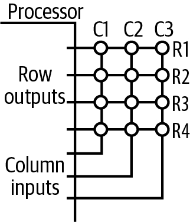
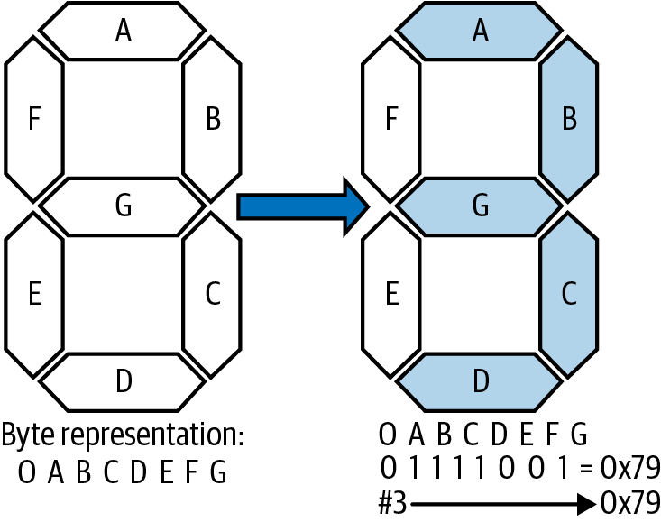
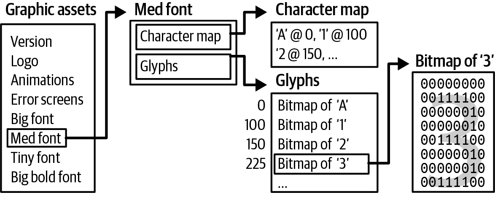
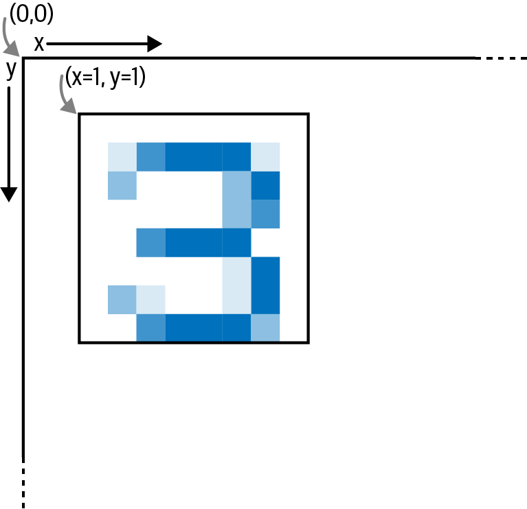
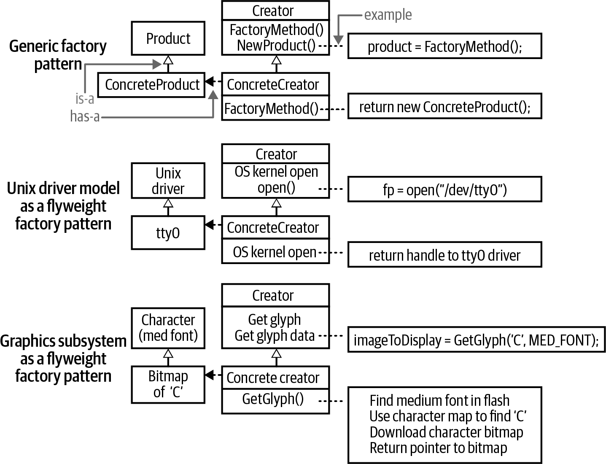
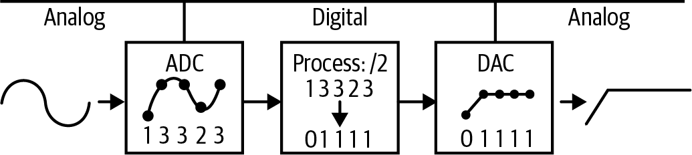
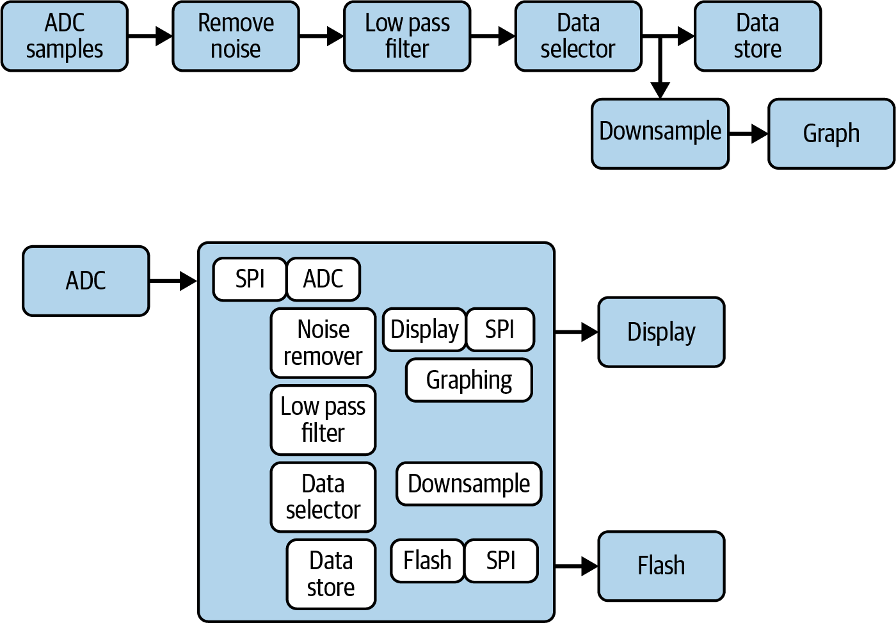
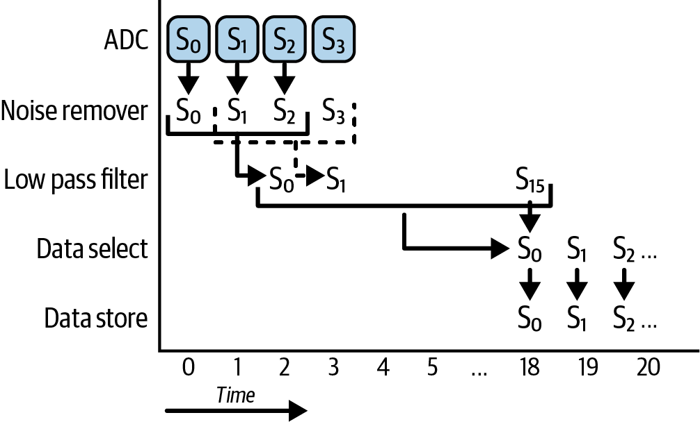
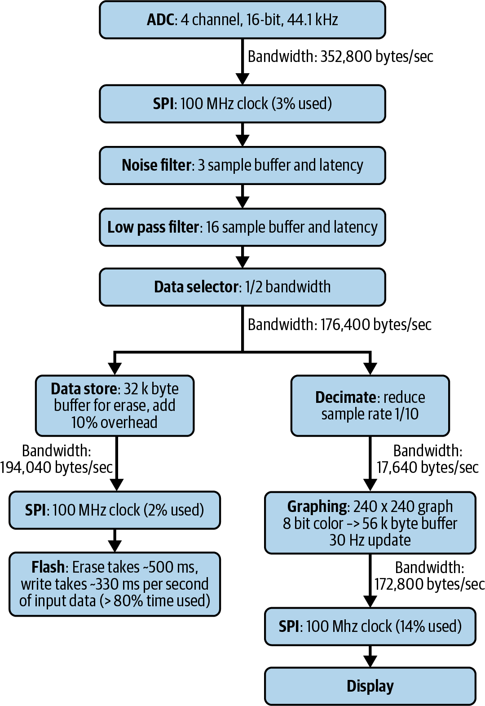

<!-- source: pdf=231; section=8; unit=p0231_b000_u00 -->

<a id="src-p231"></a>

# 第 8 章 组建系统 {#ch08}

<!-- source: pdf=231; section=8; unit=p0231_b001_u00 -->
本书前面探讨了处理器内部的工作原理。现在，要构建一个系统，我们还需要考虑系统中其他元件的工作情况。与其他元件通信只是开始。下一步是熟悉常见外设、数据处理方法，以及使系统适应不同需求的设计模式。

<!-- source: pdf=231; section=8; unit=p0231_b002_u00 -->
使用外设所需的信息最终都要到它们的数据手册中查找，不过，外设之间存在足够多的共性，能让你逐渐知道该寻找什么。

<!-- source: pdf=231; section=8; unit=p0231_b003_u00 -->
然而，组建系统不只是把各个部分连接起来；你必须开始把系统看作一组协同工作的部件。本章最后会给出一些数据处理和组织算法的建议。

<!-- source: pdf=231; section=8.1; unit=p0231_b004_u00 -->
## 按键矩阵 {#ch08-toc-001}

<!-- source: pdf=231; section=8.1; unit=p0231_b005_u00 -->
第 4 章介绍了通过简单 I/O 接口连接的按钮。不过，如果有很多按钮（例如一个键盘），并不需要为每个按钮分配一根 I/O 线。可以把输入线组成矩阵，让有限的 I/O 发挥出超乎预期的作用。按键矩阵（key matrix）有两种实现方法：当你希望外设成本低时，可以采用行列扫描；而查理复用（Charlieplexing，也称三态复用）的成本较高，却能尽量减少所需的 I/O 线数量。

<!-- source: pdf=231; section=8.1; unit=p0231_b006_u00 -->
采用行列扫描，只需 M + N 根线就能实现一个 M × N 矩阵。因此，要实现一个有 12 个键的数字键盘，可以使用 3 × 4 矩阵，只占用 7 根线（远少于直接使用 I/O 所需的 12 根线）。当然，矩阵输入需要更复杂的软件。

<!-- source: pdf=231-232; section=8.1; unit=p0231_b007_u00,p0232_b000_u00 -->

<a id="src-p232"></a>

在电路中，每个按钮分别连接一行和一列（而不像直接 I/O 接口那样，把输入引脚通过按钮接地）。初始化时，将所有行连接配置为输出，并设为高电平。然后，将所有列连接配置为输入，启用内部上拉电阻。

<!-- source: pdf=232; section=8.1; unit=p0232_b001_u00 -->
注意，把按钮组成矩阵意味着必须对它们进行轮询。虽然可以设置定时器中断来完成轮询，但不能依靠处理器中断来通知你某个输入何时发生了变化。软件需要不断循环扫描各行。

<!-- source: pdf=232; section=8.1; unit=p0232_b002_u00 -->
扫描（读取）按键状态时，先把某一行置为低电平，读取各列的输入，再把这一行置为高电平，然后转到下一行。如果某个按钮被按下，读取它所在列时就会得到低电平。你需要把行列值映射为按钮的实际含义。图 8-1 是采用行列扫描的部分原理图。每个圆圈代表一个按钮。

<!-- source: pdf=232; section=8.1; unit=p0232_b004_u00 -->


图 8-1　行列扫描式按键矩阵

图中文字：Processor＝处理器；Row outputs＝行输出；Column inputs＝列输入；C1～C3 为列，R1～R4 为行。

<!-- source: pdf=232; section=8.1; unit=p0232_b005_u00 -->
查理复用同样需要软件扫描。这种方法以最初提出它的工程师 Charles Allen 命名，并通过一篇应用笔记流传开来。与行列矩阵方法相比，查理复用需要更多的电子元件（二极管）。直接驱动用 N 个引脚接收 N 路输入，行列矩阵用 M + N 个引脚接收 M × N 路输入，而查理复用只需 N 个引脚就能获得（N² − N）路输入。

<!-- source: pdf=232; section=8.1; unit=p0232_b006_u00 -->
对于有 12 个按钮的数字键盘，只需 4 根 I/O 线和 12 个二极管（如果不在意能否检测到多个按钮同时按下，二极管也许还可以更少）。虽然它的软件比行列矩阵复杂，但只要逐步处理就行，通常用状态机实现。首先，将所有相关引脚设为输入。然后依次处理每个引脚：把该引脚设为输出并置为高电平，读取其他引脚（这些引脚作为输入）；接着把这个输出置为低电平，再读取其他引脚；最后将这个引脚恢复为输入。等每个引脚都轮流作为输出之后，就可以查表（或计算），确定哪个按钮被按下了。

<!-- source: pdf=232; section=8.1; unit=p0232_b007_u00 -->
维基百科上有相关代码，而本书的代码仓库还链接了一些网站，它们通过动画演示这两种按键矩阵，并提供各自的完整原理图。

<!-- source: pdf=233; section=8.1; unit=p0233_b001_u00 -->

<a id="src-p233"></a>

>  同时按下多个按钮时，这两种方法都可能产生奇怪而错误的结果。

<!-- source: pdf=233; section=8.1; unit=p0233_b002_u00 -->
行列矩阵和查理复用不仅可用于输入（按钮），也可用于输出（LED）。两种情况下的方法相同。因此，一旦理解了矩阵，就会发现很多可以用到它们的地方。

<!-- source: pdf=233; section=8.2; unit=p0233_b003_u00 -->
## 段式显示器 {#ch08-toc-002}

<!-- source: pdf=233; section=8.2; unit=p0233_b004_u00 -->
第 4 章已经花了不少篇幅介绍单个 LED，甚至使用 PWM 控制来调暗它们。你接下来见到的最基本的显示器，很可能就是七段显示器（seven-segment display）。大多数七段显示器的段位排列如图 8-2 所示。

<!-- source: pdf=233; section=8.2; unit=p0233_b006_u00 -->


图 8-2　采用标准段位顺序的七段显示器（沿顺时针方向依次为 ABCDEF，中央横段为 G）

图中文字：Byte representation＝字节表示。各段按 0 A B C D E F G 排列；显示数字 3 时，对应 0 1 1 1 1 0 0 1＝0x79。

<!-- source: pdf=233; section=8.2; unit=p0233_b007_u00 -->
每一段的 LED 都可以用一个字节中的一位来表示（多出的那一位有时用于某些显示器上的小数点段）。各段按顺序访问，通常从最高有效位到最低有效位排列为 abcdefg（有时则是 gfedcba）。因此，要在显示器上显示 3，就需要点亮 abcdg 各段的 LED，并关闭 fe 两段的 LED。使用 abcdefg 顺序时，若以十六进制表示，就应向显示器写入 0x79，以显示数字 3。

<!-- source: pdf=233; section=8.2; unit=p0233_b008_u00 -->
这里的具体实现并不是特别重要。关键思想是：把显示器上供人阅读的数据，与代码中使用的表示方式解耦。你需要习惯在显示器的表示方式和软件其他部分之间进行映射。

<!-- source: pdf=234; section=8.2; unit=p0234_b002_u00 -->

<a id="src-p234"></a>

退一步说，你还记得太阳能计算器吗？就是那种有 8 位 LCD 显示屏、每位都是七段显示的计算器。它们在 20 世纪 60 年代还是令人惊叹的技术，到 80 年代却已成了免费赠品。它们还有至少 17 个按钮。合计可能有 81 个不同的状态项（17（按钮）+ 8（位数）× 7（每个字符的段数）+ 8（小数点）），但其中的处理器并没有 81 根 I/O 线。

<!-- source: pdf=234; section=8.2; unit=p0234_b003_u00 -->
正如“按键矩阵”一节所述，可以把按钮输入组成矩阵：17 个按钮只需 9 根线（4 × 5），而且还能“免费”多得到 3 个按钮位置。同样的方法也可以把显示输出组成矩阵。

<!-- source: pdf=234; section=8.2; unit=p0234_b004_u00 -->
采用行列扫描时，要在屏幕上显示 8 个带小数点的字符（64 段），可以使用 8 × 8 矩阵，因此只需 16 根 I/O 线。

<!-- source: pdf=234; section=8.2; unit=p0234_b005_u00 -->
对于按钮，响应时间取决于行数，因为检查各列的时间被分成了与行数相同数量的时间片。对于输出，时间片决定了每一段能点亮多久。因此，使用 8 × 8 LED 阵列时，每个 LED 只有 1/8 的时间处于点亮状态。大多数 LED 都足够亮，因此这没什么关系。但对于 LCD（例如太阳能计算器中的显示器），有限的导通时间可能使各段显得暗淡而难以看清，尤其是在电量不足时。

<!-- source: pdf=234; section=8.2; unit=p0234_b006_u00 -->
 LCD 各段的驱动方式不像 LED 那样，只要保持恒定的“开启”状态就行。虽然 LCD 也可以通过矩阵来驱动，但由于需要变化的交流信号，实现起来更困难。通常你会使用 LCD 控制器，但如果想尝试矩阵驱动（或只是想理解得更深入），可以查阅[意法半导体的应用笔记 AN1447](http://www.st.com/stonline/books/pdf/docs/8187.pdf)。

<!-- source: pdf=234; section=8.2; unit=p0234_b007_u00 -->
8 × 8 矩阵非常方便，因为它与字符映射十分契合。既可以每次为某个字符的所有段供电，也可以先为所有字符的 a 段供电，再为所有 b 段供电，依此类推。两种方式都行得通。只要显示刷新足够快（遍历所有段的频率高于 30 Hz），用户就不会察觉。

<!-- source: pdf=234; section=8.2; unit=p0234_b008_u00 -->
>  更新太慢，显示就会闪烁。我觉得 30 Hz 是个不错的频率。测试系统时，不妨把视线落在它旁边，因为周边视野更容易察觉运动。

<!-- source: pdf=235; section=8.3; unit=p0235_b000_u00 -->

<a id="src-p235"></a>

## 像素显示器 {#ch08-toc-003}

<!-- source: pdf=235; section=8.3; unit=p0235_b001_u00 -->
遗憾的是，每个字符只有 7 段，能表示的内容十分有限。对于英文应用，可以选用 14 段显示器，让字母显示得比较像样（也可以用 16 段显示器来涵盖拉丁字母和阿拉伯数字）。再往下发展，索性使用点阵显示器，用点组成数字、字符和图形。不过，“点”听起来太平凡了。叫它们“图像元素”（picture elements）吧。唉，又太长了，还是叫像素（pixels）吧。

<!-- source: pdf=235; section=8.3; unit=p0235_b002_u00 -->
现在，数字 3 与显示器上呈现的内容之间的映射，可能比 3 与 0x79 的关系还要远。屏幕上要显示的每个东西都需要一个位图（bitmap），用来描述哪些位打开、哪些位关闭。无论来自位图还是由代码生成（例如曲线图），任何放到屏幕上的图像单元都称为字形（glyph）。

<!-- source: pdf=235; section=8.3; unit=p0235_b003_u00 -->
所有位图合在一起称为图形资源（graphic assets）。图形资源通常分成字体和其他图形（图片、标志等）。字体是一组表示字符集（通常为 ASCII 字符集）的字形。与前面一样，设计显示子系统的目标是让数据的图像表示与数据本身保持松耦合。这样，在更换画面、为系统换一种外观，以及把显示子系统复用于另一款产品时，就会灵活得多。

<!-- source: pdf=235; section=8.3.1; unit=p0235_b004_u00 -->
### 显示资源 {#ch08-toc-004}

<!-- source: pdf=235; section=8.3.1; unit=p0235_b005_u00 -->
图 8-3 展示了组织图形资源的一种方式。首先要有一张数据表，通常还配有头文件，用来指明标志的位置，或者动画的偏移量。为文件（以及资源列表）设置版本号十分重要，因为如果它们发生变化而软件并不知情，屏幕上可能就会显示乱七八糟的内容。

<!-- source: pdf=235; section=8.3.1; unit=p0235_b007_u00 -->


图 8-3　图形子系统的组织结构

图中文字：Graphic assets＝图形资源；Version＝版本；Logo＝标志；Animations＝动画；Error screens＝错误画面；Big font＝大号字体；Med font＝中号字体；Tiny font＝极小号字体；Big bold font＝大号粗体；Character map＝字符映射表；Glyphs＝字形；Bitmap of ‘A’、‘1’、‘2’、‘3’＝字符 A、1、2、3 的位图。字符映射表将字符映射到偏移量，如 ‘A’ @ 0、‘1’ @ 100、‘2’ @ 150；字形表中的 3 位于偏移量 225。

<!-- source: pdf=236; section=8.3.1; unit=p0236_b000_u00 -->

<a id="src-p236"></a>

要在屏幕上显示数字 3，首先必须知道要显示哪一种形式的 3：位图是小小的，还是占满整个屏幕？是粗体还是斜体？这些选择分别对应资源中的不同字体集。确定字体之后，需要从字符映射到位图，通常是搜索字符映射表，得到该字形位图的偏移量。

<!-- source: pdf=236; section=8.3.1; unit=p0236_b001_u00 -->
位图可以按单色形式存储（每像素 1 位），如图 8-3 所示。不过，看看其中那些浪费的数据，它们是可以压缩的。压缩可能加快从资源存储位置（通常是片外闪存）读取数据的速度。但解压缩又成了处理器要多做的一件事，可能会拖慢新字形的显示。

<!-- source: pdf=236; section=8.3.1; unit=p0236_b002_u00 -->
一种可能完全不会拖慢处理器的压缩方式是游程编码（run-length encoding，RLE）。对于连续相同的数据，它只存储一个数据值和一个计数，而不逐个重复存储像素。如果屏幕上有大量相同颜色的区域，这种方式就非常合适。例如，一串白色像素（W）和黑色像素（B）可能是 WWWWBBWWW，编码后就是 W4B2W3。如果数据按每像素 1 位存储（整幅图只有黑白两色），这样做并不能节省空间。但如果图像是每像素 1 字节（或者 2、3 字节），RLE 就能以很小的处理器开销提供显著的压缩效果。

<!-- source: pdf=236; section=8.3.1; unit=p0236_b003_u00 -->
显示子系统最终需要把大量数据从一个地方搬到另一个地方。单色位图相当小。图 8-3 中数字 3 的字形宽 8 像素、高 8 像素，只需 8 字节就能表示。不过，那些生硬的锯齿边缘很可能看起来很糟糕。要改善外观，可以加入抗锯齿（antialiasing）处理，通过放置灰度像素来柔化边缘。图 8-4 对数字 3 的位图做了少许平滑处理。它使用 5 个灰度级，因此每像素需要 3 位。

<!-- source: pdf=236; section=8.3.1; unit=p0236_b005_u00 -->


图 8-4　字符的抗锯齿处理：为每个像素使用更多数据，使其具有灰度，而不只是黑白两色

<!-- source: pdf=237; section=8.3.1; unit=p0237_b001_u00 -->

<a id="src-p237"></a>

加入抗锯齿之后，位图就不再是单色的了。可以使用每像素 2 位、4 位，甚至 8 位来描述抗锯齿效果。采用每像素 8 位编码，数字 3 的字形会占用 64 字节，虽然仍然很小，但空间开销已经开始一路上涨。之前，整套 A～Z、a～z、0～9 的单色字体不到 500 字节就能装下，现在却接近 4 KB，而且字母还只有 8 像素高。一旦换成 2.4 英寸 LCD 显示器（24 位彩色，240 × 320 像素），每幅画面就可能占用多达 225 KB。

<!-- source: pdf=237; section=8.3.1; unit=p0237_b002_u00 -->
编写显示子系统通常意味着要优化代码，确保处理这些数据吞吐的部分不会造成屏幕显示问题。大多数 LCD 都会自动刷新，也就是显示硬件会重新绘制屏幕上的数据。在数据发生变化之前，LCD 会一遍又一遍地用同一幅图像刷新屏幕。如果数据在一次刷新进行到一半时发生变化，就会出现画面撕裂（tearing），一半是新图像，一半是旧图像。要彻底消除撕裂，需要让图像更新与屏幕刷新同步，并在下一次刷新之前把所有像素都设置为目标值（要在如此短的时间内传输全部数据，可能相当困难）。

<!-- source: pdf=237; section=8.3.1; unit=p0237_b003_u00 -->
注意，如何把资源打包到存储介质中十分重要。除了压缩方面的考量，存储方式还必须适合可用空间、图形资源存储器（通常是闪存）与处理器之间的接口，以及 LCD 与处理器之间的接口。还有一个问题也可能冒出来：如果由于机电结构要求，显示器必须倒着装进产品外壳怎么办？这可能需要在前期多做一些处理，把资源换一个方向存放，但总比每次读取资源时都让处理器把它上下左右翻转一遍要好。

<!-- source: pdf=237; section=8.3.1; unit=p0237_b004_u00 -->
 身为嵌入式系统专家，并不意味着可以免于编写打包数据资源的程序。既然使用这些信息的人是你，如果能掌控图形的存储方式，你就会发现日子轻松得多。“外部闪存”一节会进一步讨论这一点。

<!-- source: pdf=237; section=8.3.1; unit=p0237_b005_u00 -->
最后，位图准备好、即将发送到屏幕时，还需要知道把它放在哪里。图 8-5 展示了屏幕上的数字 3 字形。

<!-- source: pdf=238; section=8.3.1; unit=p0238_b001_u00 -->

<a id="src-p238"></a>



图 8-5　显示器上的数字 3

图中坐标：左上角为（0,0），x 轴向右、y 轴向下；字形的放置位置为（x=1, y=1）。

<!-- source: pdf=238; section=8.3.1; unit=p0238_b002_u00 -->
这些步骤总结如下：

<!-- source: pdf=238; section=8.3.1; unit=p0238_b003_u00,p0238_b004_u00,p0238_b005_u00,p0238_b006_u00,p0238_b007_u00,p0238_b008_u00 -->
1. 确定要在屏幕上显示什么，以及显示在何处。
2. 在资源中找到正确的字体。
3. 在字体中找到该字符。
4. 读取位图，必要时进行解压缩。
5. 将位图复制到显示缓冲区中的正确位置。
6. 把缓冲区发送给显示器，最好是在上一次刷新刚结束时。

<!-- source: pdf=238; section=8.3.1; unit=p0238_b009_u00 -->
要显示标志或其他固定图形，只需把第 2 步和第 3 步合并为一步：查找该图像字形。

<!-- source: pdf=238; section=8.3.2; unit=p0238_b010_u00 -->
### 可变的数据？享元模式与工厂模式 {#ch08-toc-005}

<!-- source: pdf=238; section=8.3.2; unit=p0238_b011_u00 -->
将字符和图像字形存储起来，需要显示时再取出的做法，对应一种设计模式：享元模式（flyweight pattern）。不过，我刚才的描述把它和工厂模式（factory pattern）混在了一起，因此更准确的名称是享元工厂模式（flyweight factory pattern）。下面把两者理清，让你分别理解它们，也能把这些概念用于 LCD 以外的场景。

<!-- source: pdf=239; section=8.3.2; unit=p0239_b001_u00 -->

<a id="src-p239"></a>

享元模式的典型例子是一份包含许多字符的文档。每个字符都是一个对象，描述字符的大小，并封装一幅位图。在非嵌入式环境中，人们很容易想为每个字符分别实例化一个对象。最终，当字符足够多时，系统就会变得迟缓。在嵌入式设备中，我们不会遇到这个问题，因为 RAM 从来就没有充裕到能让我们这样自找麻烦。解决办法是指向该字符对象的一个唯一实例（对我们而言，它位于闪存中）。

<!-- source: pdf=239; section=8.3.2; unit=p0239_b002_u00 -->
这就是这种模式：如果有大量反复使用的东西，就创建一个实例池（每种对象一个实例），并指向池中的实例，而不是直接为每一个对象分别实例化。每个共享对象称为享元，即 flyweight（这里指拳击中最轻的重量级，而不是增加飞轮惯性的配重）。各个享元之间必须具有较强的可替换性，不过它们可以描述自身的状态（例如，字符可以描述自己的宽度，因为不同字符的宽度并没有可预测的规律）。

<!-- source: pdf=239; section=8.3.2; unit=p0239_b003_u00 -->
工厂模式稍微复杂一些，核心是工厂方法（factory method）。还记得第 2 章的 Unix 驱动模型吗？几乎所有驱动都实现相同的接口（open、close、read、write、ioctl）。如果编写的程序要使用某个驱动，就像打开文件（/dev/tty0）一样打开它。驱动被实例化后返回给你，表面上是一个通用句柄，底层却代表一个串口。工厂方法（open）知道如何创建属于某个通用类型（类）的具体部件（子类）。所有具体部件都实现相同的接口（该类的接口）。

<!-- source: pdf=239; section=8.3.2; unit=p0239_b004_u00 -->
如果上一段让你觉得有些吃力，图 8-6 也许能帮上忙。图中先展示经典的工厂模式图，下面是 Unix 驱动模型的例子，再下面是 LCD 图形的例子。工厂模式往往用十分面向对象的方式实现，具体子类是某个类的实例化形式。创建者类（调用工厂方法的代码）控制整个过程。

<!-- source: pdf=239; section=8.3.2; unit=p0239_b005_u00 -->
>  图 8-6 使用 UML（Unified Modeling Language，统一建模语言）。这是一种很有用的可视化语言，用于描述软件，尤其是面向对象的软件。它既可以很简单（例如这里），也可以复杂得多，甚至成为一种可以解释执行的语言。

<!-- source: pdf=240; section=8.3.2; unit=p0240_b001_u00 -->

<a id="src-p240"></a>



图 8-6　工厂模式与享元工厂模式示例

图中文字与对应关系：
- Generic factory pattern＝通用工厂模式；Product＝产品；ConcreteProduct＝具体产品；Creator＝创建者；ConcreteCreator＝具体创建者；is-a＝“是一种”关系；has-a＝“拥有”关系；example＝示例。FactoryMethod()、NewProduct()、product = FactoryMethod(); 和 return new ConcreteProduct(); 为图中方法与调用示例。
- Unix driver model as a flyweight factory pattern＝作为享元工厂模式的 Unix 驱动模型；Unix driver＝Unix 驱动；OS kernel open＝操作系统内核的 open；return handle to tty0 driver＝返回 tty0 驱动的句柄；调用示例为 fp = open("/dev/tty0")。
- Graphic subsystem as a flyweight factory pattern＝作为享元工厂模式的图形子系统；Character (med font)＝字符（中号字体）；Bitmap of ‘C’＝字符 C 的位图；Get glyph＝获取字形；Get glyph data＝获取字形数据；调用示例为 imageToDisplay = GetGlyph('C', MED_FONT);。具体创建步骤为：在闪存中找到中号字体，通过字符映射表找到 C，下载字符位图，返回指向位图的指针。

<!-- source: pdf=240; section=8.3.2; unit=p0240_b002_u00 -->
工厂模式就在你身边无处不在，它把具体实例与通用的抽象概念解耦。这种模式很贴近现实世界，因此名字也很贴切。想象你有一座真正的工厂。它足够灵活，可以制造几种相似产品（产品类）中的任意一种。工厂里有一台机器（创建者）。今天，你把一个模板（工厂方法）装进机器，将它配置成制造链轮（具体产品）。按下“开”按钮，工厂就会生产链轮。明天，你可以换掉模板，改为制造小装置（另一种具体产品），由另一个模板（工厂方法）来保证产出。

<!-- source: pdf=240; section=8.3.2; unit=p0240_b003_u00 -->
在采用享元的图形软件中，按下“开”按钮更像是软件请求一个字形。在享元工厂模式中，工厂部分负责管理享元，确保它们得到正确共享，并把字符与屏幕上的显示方式解耦。

<!-- source: pdf=240; section=8.4; unit=p0240_b004_u00 -->
## 外部闪存 {#ch08-toc-006}

<!-- source: pdf=240; section=8.4; unit=p0240_b005_u00 -->
前面已经略微介绍了存储器，以及如何把它分为易失性存储器（volatile memory，系统关闭后内容丢失）和非易失性存储器（nonvolatile memory，断电重启后内容仍保留）。RAM 是最主要的易失性存储器形式。

<!-- source: pdf=241; section=8.4; unit=p0241_b001_u00 -->

<a id="src-p241"></a>

非易失性存储器主要有两类：EEPROM 和闪存。EEPROM 的容量通常较小，每个字节都可以单独写入。它们的使用相当直接，通常只靠数据手册就足以让开发顺利进行。

<!-- source: pdf=241; section=8.4; unit=p0241_b002_u00 -->
>  C/C++ 中的 volatile 关键字与易失性存储器的概念不同。这个关键字告诉编译器：“这个变量可能在当前运行的代码之外发生变化”；而易失性存储器是指断电后会丢失内容的存储器。

<!-- source: pdf=241; section=8.4; unit=p0241_b003_u00 -->
闪存由扇区（或页）组成，每个扇区必须整体擦除（闪存容量越大，扇区也越大）。扇区擦除之后，就可以逐字节写入闪存。这一要求增加了不少复杂性。

<!-- source: pdf=241; section=8.4; unit=p0241_b004_u00 -->
不过，闪存非常有用，部分原因是它的容量可以非常大。你很可能会把显示资源存放在那里。闪存也适合保存那些偶尔才变化的一点数据，例如系统复位的原因。如果系统长期采集数据，却较少向其他地方上传，也可以用闪存来存储数据。甚至可以在其中使用文件系统。（固件更新要到第 9 章才会讨论，不过那里也会提到闪存。）

<!-- source: pdf=241; section=8.4; unit=p0241_b005_u00 -->
闪存几乎总是通过 SPI 控制，因为 SPI 是常见协议中最快的一种。甚至 SD 卡也可以通过 SPI 访问。

<!-- source: pdf=241; section=8.4.1; unit=p0241_b006_u00 -->
### 显示资源 {#ch08-toc-007}

<!-- source: pdf=241; section=8.4.1; unit=p0241_b007_u00 -->
起初，可以把显示资源编译进代码，其中包括一套小字体。有一些在线工具和 Python 脚本能将图像转换成 C 代码，也就是一个常量数组，表示屏幕上的哪些像素会点亮（或者这些像素是什么颜色）。

<!-- source: pdf=241; section=8.4.1; unit=p0241_b008_u00 -->
处理器板载闪存的容量也许足够支撑一块只做几件简单事情的小显示屏。不过，一旦听到“动画”或“国际化”这样的词，就应该计划使用 SPI 闪存来存储字体和图像信息。

<!-- source: pdf=241; section=8.4.1; unit=p0241_b009_u00 -->
图 8-3 展示了一种不错的显示资源架构，但实际实现中还有几个难点。首先，显示资源需要多大空间？这不仅取决于显示器尺寸，也取决于所需的字形和字体。

<!-- source: pdf=241; section=8.4.1; unit=p0241_b010_u00 -->
是否需要所有字母、数字和符号？英文需要 94 个，如果还要支持其他语言，则需要更多（法语、意大利语、德语和西班牙语还要另外 94 个）。每种字体的每种尺寸（像素高度和宽度）都需要一套。它们是 1 位色深，还是为了美观而经过抗锯齿处理？

<!-- source: pdf=242; section=8.4.1; unit=p0242_b000_u00 -->

<a id="src-p242"></a>

考虑一种包含 94 个字符、尺寸为 8 × 6、使用 8 位灰度的字体：

<!-- source: pdf=242; section=8.4.1; unit=p0242_b001_u00,p0242_b002_u00 -->
- 字体空间＝字符数 × 像素高度 × 像素宽度 × 颜色位深
- 字体空间＝94 × 8 × 6 × 8＝36,096 位＝4,512 字节

<!-- source: pdf=242; section=8.4.1; unit=p0242_b003_u00 -->
不过，即使做了抗锯齿，这种字体也只适合很小的文字。对于中等尺寸的屏幕，我们可能使用 30 × 40 的字符。94 个字符、16 位颜色，会占用 220 KB。字体可能占用大量空间，甚至超过代码本身。

<!-- source: pdf=242; section=8.4.1; unit=p0242_b004_u00 -->
因此，显示资源常常存放在外部 SPI 闪存中，按需载入处理器，再传输到显示接口。令人意外的是，第一步反而是最困难的步骤之一：

<!-- source: pdf=242; section=8.4.1; unit=p0242_b005_u00,p0242_b006_u00,p0242_b007_u00,p0242_b008_u00,p0242_b009_u00,p0242_b010_u00,p0242_b011_u00,p0242_b012_u00,p0242_b013_u00,p0242_b014_u00,p0242_b015_u00,p0242_b016_u00,p0242_b017_u00,p0242_b018_u00 -->
1. 计算显示资源需要多少空间：
   a. 需要多少种字体？分别多大？每像素多少位？
   b. 还需要多少其他字形、图标或图像？分别多大？彩色还是单色？
   c. 将它们加总，并尽量至少多留 25% 的空间以备扩展。
2. 确定如何访问数据：
   a. 通信总线发送一位数据需要多长时间？
   b. 显示器接收一位数据需要多长时间？
   c. 取前两者的最大值，更新整个屏幕需要多长时间？（显示像素数 × 每位的最大耗时）
   d. 如果有动画或快速变化的区域（例如旋转的“思考中”圆圈），更新屏幕的这一部分需要多长时间？（像素数 × 每位的最大耗时）
3. 获取资源文件，即屏幕上每个字母和字形的实际图像。理想情况下，这些文件还会附带某种设备模型，让你知道如何组织数据、如何在屏幕上放置图标。需要让程序能够使用这些数据。我通常会编写一个 Python 脚本，完成以下工作：
   a. 把图像文件名映射为代码中的标识符。
   b. 把代码中的标识符映射到闪存位置（通常相对于显示资源分配区域的起始位置）。
   c. 添加字形在屏幕上应放置何处的其他元数据（如果有默认位置）。在元数据中加入宽度和高度会很有帮助。
   d. 按照上述顺序，将资源的图像数据打包到一个二进制文件中。

<!-- source: pdf=243; section=8.4.1; unit=p0243_b000_u00 -->

<a id="src-p243"></a>

到这一步，你大概会得到一个头文件，其中列出了代码用来指明屏幕显示内容的标识符。这个标识符列表通常会指向它们在打包后的二进制文件中的偏移位置（以及应用需要的其他属性，不过这些属性也可以放在二进制文件中）。此外，你还会得到一个二进制文件，里面紧凑地放着所有资源。

<!-- source: pdf=243; section=8.4.1; unit=p0243_b001_u00 -->
下一步，把这些内容烧写到显示资源闪存中。这又是一个听上去简单、本来也应该简单，却很可能让你不得不多写代码的步骤。我通常最终会做出一个用于调试或生产的命令行，从串口接收数据，再写入 SPI 闪存。在生产环节，也可能使用专用闪存编程器，绕过处理器直接烧写。

<!-- source: pdf=243; section=8.4.1; unit=p0243_b002_u00 -->
此时，你可能已经准备好回去编写显示代码，做那些更有成就感的工作了。不过，我强烈建议再花几分钟，把资源打包脚本完善一些。它属于那种我常以为只是临时用用，结果却会反复使用许多次的东西。

<!-- source: pdf=243; section=8.4.2; unit=p0243_b003_u00 -->
### 模拟 EEPROM 与 KV 存储 {#ch08-toc-008}

<!-- source: pdf=243; section=8.4.2; unit=p0243_b004_u00 -->
希望你的闪存没有被显示资源塞满，因为它还有其他用途。前面提到过 EEPROM：它是一种非易失性存储器，容量比闪存小，使用也更直接。使用 EEPROM 时，通常会列出一组地址，并规定每个地址存放什么数据。

<!-- source: pdf=243; section=8.4.2; unit=p0243_b005_u00,p0243_b005_u01 -->
| 地址 | 数据 | 大小 |
|---|---|---|
| 0 | 序列号 | 4 字节 |
| 4 | 设备上次启动的时间 | 4 字节 |
| 8 | 上次重新启动的原因 | 1 字节 |
| 9 | 自首次启动以来的启动次数 | 3 字节 |
| 12 | … | |

<!-- source: pdf=243; section=8.4.2; unit=p0243_b006_u00 -->
每次系统复位时，都可以更新启动状态信息。这不会改变设备的序列号（“当然啦！”你会这么说，不过请继续读下去，先别理会那令人不安的背景音乐）。

<!-- source: pdf=243; section=8.4.2; unit=p0243_b007_u00 -->
从某个角度看，这是一个根据地址查找数据的微型数据库。代码中某处会有一个头文件，把 EEPROM 地址映射为你想访问的数据，于是便可以这样写：

<!-- source: pdf=243; section=8.4.2; unit=p0243_b008_u00 -->
```c
uint32_t sn = readEeprom(constSerialNumberAddr, constSerialNumberSize);
```

<!-- source: pdf=243; section=8.4.2; unit=p0243_b009_u00 -->
或者：

<!-- source: pdf=243; section=8.4.2; unit=p0243_b010_u00 -->
```c
writeEeprom(constLastBootTimeAddr, constLastBootTimeSize, (void*) & currentTime);
```

<!-- source: pdf=243; section=8.4.2; unit=p0243_b011_u00 -->
然而，与闪存相比，EEPROM 价格高、容量小，而且速度慢。

<!-- source: pdf=244; section=8.4.2; unit=p0244_b000_u00 -->

<a id="src-p244"></a>

另一方面，闪存在写入之前必须先擦除，而且只能按块擦除，一块通常有几千字节。此外，如果反复擦除或写入同一个位置，闪存就会磨损失效（EEPROM 也会如此，不过它们通常能承受更多次循环）。

<!-- source: pdf=244; section=8.4.2; unit=p0244_b001_u00 -->
解决方案是键值存储（key-value store，KV store，也称模拟 EEPROM）。为一项数据选择一个键（通常是一个数字），然后通过该键查找数据：这又是一个微型数据库。

<!-- source: pdf=244; section=8.4.2; unit=p0244_b002_u00 -->
不过，数据不再放在闪存中的固定地址，而是成为一个列表的一部分，由处理器遍历列表来查找匹配的键。因此，为某个键写入新数据时，会先找到旧数据并将其标记为无效，然后把新数据追加到列表末尾。

<!-- source: pdf=244; section=8.4.2; unit=p0244_b003_u00 -->
对 KV 存储进行读写访问都需要时间，它们内部还包含状态机，用来确定当前处于查找、擦除、写入循环的哪个阶段。此外，由于必须维护数据列表（其中包括已失效的数据），KV 存储占用的空间比单纯的数据大得多：至少需要两个闪存块，以便擦除其中一个块时，数据还能保存在另一个块中。

<!-- source: pdf=244; section=8.4.2; unit=p0244_b004_u00 -->
我不建议自行编写 KV 存储，因为许多处理器和 RTOS 厂商已经提供了相关代码。查找时，两个名称都要搜索：KV store 是软件工程的说法，emulated EEPROM 是硬件工程的说法。两者都能让你找到实现相同功能的代码。

<!-- source: pdf=244; section=8.4.3; unit=p0244_b005_u00 -->
### 小型文件系统 {#ch08-toc-009}

<!-- source: pdf=244; section=8.4.3; unit=p0244_b006_u00 -->
在闪存上建立文件系统，也会遇到与 KV 存储相同的问题：必须按块擦除闪存，而且不能频繁写入相同地址。有些闪存的寿命约为一万次擦写循环。如果每秒更新某个地址的数据一次，闪存的寿命就不到 20 分钟（10,000 次写入 / 60 秒/分钟＝16.7 分钟）。

<!-- source: pdf=244; section=8.4.3; unit=p0244_b007_u00 -->
闪存失效时不会着火，而是某些位会“卡住”。例如，向一个地址写入 0x55（“U”），读回来却可能是 0x57（“W”）。大量使用闪存时，代码需要检测这些卡住的位，并把相应区域标记为坏区，以后不再使用。

<!-- source: pdf=244; section=8.4.3; unit=p0244_b008_u00 -->
闪存文件系统需要能承受掉电，避免更新周期中随机发生的故障导致文件丢失。它们还需要处理磨损均衡（wear leveling），均匀使用分配到的所有块，并识别坏块、绕过坏块。哦，它们还必须适合我们的系统，不能占用太多内存或处理器周期。

<!-- source: pdf=245; section=8.4.3; unit=p0245_b002_u00 -->

<a id="src-p245"></a>

RTOS 的一大优点是，它通常能提供闪存文件系统。另外也有许多裸机文件系统（我最喜欢的是众多开源文件系统之一 littlefs）。[^ch08-1]

<!-- source: pdf=245; section=8.4.4; unit=p0245_b003_u00 -->
### 数据存储 {#ch08-toc-010}

<!-- source: pdf=245; section=8.4.4; unit=p0245_b004_u00 -->
SPI 闪存的另一个常见用途，是存储设备采集的数据。对于持续产生数据流、却集中批量读出数据的系统，这尤其有用。例如通过蓝牙连接的计步器或地震传感器：传感器定期获取数据，但只有建立连接时才会传输。

<!-- source: pdf=245; section=8.4.4; unit=p0245_b005_u00 -->
可以使用文件系统来存储数据，但这样往往会产生过多开销，带来不必要的闪存访问，以及不可预测的擦除周期。我已经提过，闪存需要整扇区擦除。我大概还应该说，擦除闪存感觉上简直要等到天荒地老：有时要几十毫秒！

<!-- source: pdf=245; section=8.4.4; unit=p0245_b006_u00 -->
遗憾的是，在这里几十毫秒已经非常长了。假设你以 20 kHz 记录数据，即每秒 20,000 个样本。样本之间的时间间隔与频率成反比：

<!-- source: pdf=245; section=8.4.4; unit=p0245_b007_u00 -->
采样间隔＝1 / 采样频率＝1 / 20 kHz＝0.05 ms

<!-- source: pdf=245; section=8.4.4; unit=p0245_b008_u00 -->
如果器件的最大擦除时间为 25 ms，那么，在等待闪存完成擦除、可以写入新样本的过程中，设备可能已经采集了 500 个样本。因此，代码必须为采样子系统分配足以存储 500 个样本的 RAM（具体容量取决于样本大小）。

<!-- source: pdf=245; section=8.4.4; unit=p0245_b009_u00 -->
 与前面的显示更新问题一样，要确保处理器和闪存能够完成所需的工作，这些数字必不可少。本章末尾还会进一步讨论吞吐量计算器，但请从现在起就习惯一个事实：这件事需要做一些数学计算。电子表格是你的好朋友。（[本书的 GitHub 仓库](https://github.com/eleciawhite/making-embedded-systems)中有示例。）

<!-- source: pdf=245; section=8.4.3; unit=p0245_b000_u00 -->
[^ch08-1]: littlefs 很不错，因为它解释了自身做出的许多权衡。可以在 [GitHub](https://github.com/littlefs-project/littlefs) 上找到它。

<!-- source: pdf=246; section=8.4.4; unit=p0246_b000_u00 -->

<a id="src-p246"></a>

除了计算闪存速度如何影响 RAM 的大小，还需要确定给数据存储区分配多少空间。下面几个问题可以帮助你理清思路：

<!-- source: pdf=246; section=8.4.4; unit=p0246_b001_u00,p0246_b002_u00,p0246_b003_u00,p0246_b004_u00,p0246_b005_u00 -->
- 采样率和样本大小是多少？
- 是连续采样，还是突发式采样？如果是后者，最长的一次突发持续多久？
- 应该多久提取一次数据？两次传输之间最长可以间隔多久？
- 传输后就擦除，还是保留数据以供将来再次读取，直到闪存写满？
- 如果数据一直没有被提取，应该怎么办？是用新数据覆盖它，还是保留旧数据？

<!-- source: pdf=246; section=8.4.4; unit=p0246_b006_u00 -->
你可能还需要与具体应用有关的其他信息（样本是在什么时间采集的？算法是否将它识别为值得关注的样本？采样地点在哪里？等等）。描述数据的数据称为元数据（metadata）。计算数据存储容量时，很容易忘记这一点。要为随数据保存的元数据预留一些开销（如果不确定，10% 是一个不错的起始值）。

<!-- source: pdf=246; section=8.4.4.sidebar; unit=p0246_b007_u00 -->
#### 时间戳的烦恼

<!-- source: pdf=246; section=8.4.4.sidebar; unit=p0246_b008_u00 -->
时间戳是最常见的元数据。好的时间戳需要在占用空间、准确度和分辨率之间取得平衡。用一个 32 位计数器表示上次启动以来的毫秒数，非常诱人，但你会发现，2³² 毫秒只有 49 天。一个简单的节拍计数器并不足够。

<!-- source: pdf=246; section=8.4.4.sidebar; unit=p0246_b009_u00 -->
可能需要实时时钟（real-time clock，RTC）。有 RTC，就意味着需要电池或类似电池的电容器。电池耗尽时，当前时间就会丢失。哦，首次使用时，以及电池耗尽之后，还得设置时间。对于数据采集，我建议始终使用 UTC，因为你真的不会想处理时区和夏令时。

<!-- source: pdf=246; section=8.4.4.sidebar; unit=p0246_b010_u00 -->
RTC 的准确度取决于输入时钟的准确度。温度降低时，时钟会走得更慢。RTC 通常比较准确，但并不完美。

<!-- source: pdf=246; section=8.4.4.sidebar; unit=p0246_b011_u00 -->
试图让不同设备保持同步，会带来各种头痛的问题。通常应该由服务器主导，并能够校正设备时间；但如果这样还不够好，可能就需要 GPS 来获得更准确的时间源（这样还得能看见天空）。许多 GPS 模块会输出每秒一个脉冲的 PPS（pulse-per-second）信号，可以用它校正 RTC。

<!-- source: pdf=247; section=8.4.4.sidebar; unit=p0247_b000_u00 -->

<a id="src-p247"></a>

总之，虽然把时间戳的问题留到以后再解决很有诱惑力，但它会影响整个系统，因此是设计中不可忽略的一部分。另一种办法是：干脆永远别碰时间问题。

<!-- source: pdf=247; section=8.4.4; unit=p0247_b001_u00 -->
认识到擦除时间的麻烦，并估算出所需容量之后，下一个坏消息是：系统一定会在最糟糕的时刻断电。一个棘手的边界情况是，数据已经传输完毕，但系统还没来得及把闪存标记为可擦除就复位了。接收端能处理重复数据吗？

<!-- source: pdf=247; section=8.4.4; unit=p0247_b002_u00 -->
擦除时断电可能导致数据损坏。这种情况很难判定，但一种解决办法是在闪存的另一个区域维护修改列表。在存放修改列表的闪存扇区中，先写入即将擦除的块地址，再执行擦除，最后在修改列表中追加擦除完成的记录。启动时遍历列表，查找那些有开始标记却没有相应擦除完成标记的操作。这个列表迟早也会写满，需要擦除，因此要为修改列表分配两个扇区。

<!-- source: pdf=247; section=8.4.4; unit=p0247_b003_u00 -->
写入闪存时同样可能断电。也可以使用同一个修改列表，但如果每次只写少量数据，先写修改列表、再写数据、然后又写修改列表，会变得相当繁琐。我更建议加入校验和，用来验证一个数据块是否完整写入。应该多频繁地这样做，取决于应用：断电时允许丢失多少数据？如果每一个样本都很重要，就使用较小的数据块。如果重新上电后本来就要几秒钟才会有数据可用，那么较大的数据块大概也没问题。

<!-- source: pdf=247; section=8.4.4; unit=p0247_b004_u00 -->
数据存储还需要考虑数据提取。连接建立后，读出缓存数据需要多长时间？此时是否还在采集新数据？闪存读取很快，因此大概不会有问题，但需要核算数字才能确定。（“计算需求：速度与供给”一节会进一步讨论。）

<!-- source: pdf=247; section=8.4.4; unit=p0247_b005_u00 -->
不过，说了这么多数据存储，我们究竟在存什么数据呢？这就轮到传感器登场了。

<!-- source: pdf=247; section=8.5; unit=p0247_b006_u00 -->
## 模拟信号 {#ch08-toc-011}

<!-- source: pdf=247; section=8.5; unit=p0247_b007_u00 -->
按钮可以算作一种传感器。与按钮通信的方法和与传感器通信的方法类似，面临的选择也类似（例如中断还是轮询）。不过，按钮只有按下和未按下两种状态，而传感器能提供各种各样的数据：高、低、1.45、10,342.81、12、43，或者超出范围。读到什么，取决于使用的传感器。

<!-- source: pdf=248; section=8.5; unit=p0248_b001_u00 -->

<a id="src-p248"></a>

>  你的系统可以拥有自己的输入传感器，同时又作为另一个系统的传感器。

<!-- source: pdf=248; section=8.5; unit=p0248_b002_u00 -->
麦克风像人的耳朵一样，以模拟形式拾取音频。可以使用 ADC（有时称为 A2D）将现实世界的模拟信号转换为便于软件处理的数字形式。软件可以对数字数据做许多事情：监测模拟流中的事件、滤波，或者通过 DAC（也称 D2A）将其重新转换为模拟信号。信号处于模拟形式时，就可以通过扬声器播放。图 8-7 展示了一个简单系统。

<!-- source: pdf=248; section=8.5; unit=p0248_b004_u00 -->


图 8-7　模拟—数字—模拟系统

图中文字：Analog＝模拟；Digital＝数字；ADC＝模数转换器；DAC＝数模转换器；Process: /2＝处理：除以 2。输入样本 1 3 3 2 3 经过整数除法后变成 0 1 1 1 1，再转回模拟输出。

<!-- source: pdf=248; section=8.5; unit=p0248_b005_u00 -->
无论当前是数字形式还是模拟形式，信号都是你实际想听到的东西。噪声则让软件难以正确识别信号。系统的一个目标，是让信号相对于噪声足够强，从而获得较高的信噪比（signal-to-noise ratio，SNR）。

<!-- source: pdf=248; section=8.5; unit=p0248_b006_u00 -->
数字信号处理（digital signal processing）是一种把数据从模拟形式转成数字形式的软件技术，通常还会对数据做一些处理，以理解其中的含义。有时，数据经过变换，会呈现为另一种形式。这种变换往往把数据转换成正弦波的组合，因为正弦波便于计算。这些正弦波对应着不同的频率（可以想想电台频率或音乐的音高）。因此，这种转换称为变换到频域。

<!-- source: pdf=248; section=8.5; unit=p0248_b007_u00 -->
图 8-7 将每个整数样本除以 2，以减小信号。得到的模拟声音应该更轻（受到衰减），但对于这么小的数字，整数除法并不是个好主意，因此信号发生的畸变比预期更大。（在 ADC 输入端接收更强的信号，或者让 ADC 采样更多位，可以减轻整数运算带来的这个问题。）

<!-- source: pdf=248; section=8.5; unit=p0248_b008_u00 -->
这个例子有点傻，因为无需把输入数字化，也能得到更好的衰减效果。更常见的情况是，数据要经过多个处理阶段，例如滤波（降低噪声或增强信号的某个特征）、压扩（companding，衰减响亮的部分和/或提升安静的部分），以及卷积（convolution，找出隐藏在另一个信号中的信号）。

<!-- source: pdf=249; section=8.5; unit=p0249_b001_u00 -->

<a id="src-p249"></a>

ADC 和 DAC 的特性由采样频率（工作速度）和位数描述。8 位 ADC 的数字信号有 256 个等级，16 位 ADC 则有 65,536 个等级。具体需要什么取决于应用，但这两个数字会约束处理器速度和所需 RAM 容量，进而影响整个软件系统的组织方式。系统处理数据的速度称为吞吐量（throughput）或带宽（bandwidth）。

<!-- source: pdf=249; section=8.5; unit=p0249_b002_u00 -->
有些处理器专为信号处理而设计，称为数字信号处理器（digital signal processor，DSP）。它们具有特殊的处理器指令，处理信号时比通用处理器快得多。

<!-- source: pdf=249; section=8.5; unit=p0249_b003_u00 -->
在嵌入式系统的所有领域中，信号处理是我的最爱。不过，它本身就足以写成一整本书。好吧，应该是两本，因为你既需要理解数学（傅里叶很有趣），又要知道如何把它应用到现实问题中（快速傅里叶变换！）。

<!-- source: pdf=249; section=8.5; unit=p0249_b004_u00 -->
我不希望你读完这短短一节，就以为自己已经能做出很棒的模拟系统了。例如，我还没有讨论采样和奈奎斯特频率。你要么已经了解这些内容，要么就需要远比这段简短介绍更充分的学习。我会在“延伸阅读”中推荐我最喜欢的信号处理书籍。

<!-- source: pdf=249; section=8.5; unit=p0249_b005_u00 -->
本节从麦克风讲起，但模拟传感器的种类多种多样：运动传感器（加速度计、陀螺仪、磁力计）、气象传感器（风、湿度、温度）、视觉传感器（摄像头、红外探测器……），还可以一直列下去。你可能只有五种感官，但你的系统可以拥有更多。

<!-- source: pdf=249; section=8.5; unit=p0249_b006_u00 -->
>  我曾听一位电子工程师说：“所有传感器都是温度传感器，只不过有的比别的更好。”这话没错。传感器即使本来测量的是别的量，也会对环境温度作出响应。应当预期需要对系统做温度校准；如果不需要，就松一口气吧。

<!-- source: pdf=249; section=8.6; unit=p0249_b007_u00 -->
## 数字传感器 {#ch08-toc-012}

<!-- source: pdf=249; section=8.6; unit=p0249_b008_u00 -->
如果模拟传感器和信号处理的玄妙世界让你有些紧张，我很抱歉。数字传感器会讨你喜欢得多。数字传感器会替你完成模数转换，理想情况下，直接给出你所需的数据。与模拟传感器一样，数字传感器的种类也多得惊人。虽然数字传感器通常比对应的模拟传感器略贵，但这笔钱往往值得花，因为它们能产生有实际意义的样本，为处理器分担大量工作，而且不容易受到外部噪声影响（参见“EMI：电磁干扰”）。数字传感器还可能集成滤波器和温度补偿。

<!-- source: pdf=250; section=8.6.sidebar; unit=p0250_b001_u00 -->

<a id="src-p250"></a>

#### EMI：电磁干扰

<!-- source: pdf=250; section=8.6.sidebar; unit=p0250_b002_u00 -->
信号沿导线传播时，会拾取周围所有带时钟的东西产生的噪声。等等，你说，我的系统里也有时钟？事实上，很可能还不止一个。

<!-- source: pdf=250; section=8.6.sidebar; unit=p0250_b003_u00 -->
因此，不能指望模拟系统完全没有噪声。模拟信号经过的导线就像天线，会拾取周围各种东西产生的杂波。电子工程师可以对信号进行屏蔽，降低它对噪声的敏感性（通常是在信号周围加一个接地的亮闪闪的金属盒，称为法拉第笼）。不过，你仍然可能需要担心噪声问题。

<!-- source: pdf=250; section=8.6.sidebar; unit=p0250_b004_u00 -->
 虽然数字信号向环境中发出的噪声更多，但它们对外部噪声源的抵抗力也更强。

<!-- source: pdf=250; section=8.6.sidebar; unit=p0250_b005_u00 -->
有时，要解决问题，首先得找到产生噪声的罪魁祸首。这可能很难。如果噪声并非来自系统外部，那么任意通信路径、任意外设，甚至处理器本身，都可能是来源。更糟糕的是，它也可能是其中若干项共同干扰的结果，造成难以复现的错误。内部辐射噪声还不是唯一的问题。

<!-- source: pdf=250; section=8.6.sidebar; unit=p0250_b006_u00 -->
在电路板初始调试之后、项目结束之前的某个时候，电子工程师会把系统拿去进行电磁兼容性（electromagnetic compatibility，EMC）测试。不同国家对产品在境内使用所需满足的法规（以及认证流程）有不同要求。在美国，如果系统中有超过 9 kHz 的时钟，就需要接受 EMC 测试，确保它不会辐射出干扰通信的信号（以符合 FCC 第 15 部分的要求）。

<!-- source: pdf=250; section=8.6.sidebar; unit=p0250_b007_u00 -->
测试时，会把设备放进电波暗室，在许多射频频点上进行监测，看其发射的噪声是否超过允许水平。准备硬件初始调试用的软件时，可能还需要制作一个 EMC 测试版本，让所有通信路径尽可能快地传输数据，产生密集的通信活动，以确认设备不会向外辐射太多干扰。

<!-- source: pdf=250; section=8.6.sidebar; unit=p0250_b008_u00 -->
同一家 EMC 测试实验室通常也能用不同频率的电磁信号照射设备，检查它是否容易受到某个频段噪声的影响。

<!-- source: pdf=250; section=8.6; unit=p0250_b009_u00 -->
阅读数字传感器的数据手册时，首先应关注如何与它通信。处理器是否支持传感器所需的通信方式？接下来的问题围绕吞吐量展开：软件能跟上传感器发来的数据量吗？将对数据做什么处理？需要多长时间？如何知道数据已经准备好？

<!-- source: pdf=251; section=8.7; unit=p0251_b000_u00 -->

<a id="src-p251"></a>

## 数据处理 {#ch08-toc-013}

<!-- source: pdf=251; section=8.7; unit=p0251_b001_u00 -->
到目前为止，我们已经看过数据的产生者和消费者，也看过如何发送和接收数据。不过，在这两者之间，还有一些环节没有补齐。要做出优秀的系统，理解如何在软件中搬运数据至关重要。下面先从系统层面处理数据的全貌讲起，再逐步深入具体机制。

<!-- source: pdf=251; section=8.7; unit=p0251_b002_u00 -->
第 5 章介绍了事件驱动系统：传感器被触发，从而产生事件，事件又导致系统状态改变，事情便这样发生了。不过，并非所有嵌入式系统都能（或都应该）组织成事件循环和状态机。

<!-- source: pdf=251; section=8.7; unit=p0251_b003_u00 -->
有一类问题的目标是：获取数据、处理数据、利用结果做点什么，然后重复。在这样的数据驱动系统（data-driven system）中，没有事件，只有不断增长、等着软件处理的数据堆。理想情况下，系统处理数据的速度应该比数据生成的速度稍微快一点。数据驱动系统的例子包括：

<!-- source: pdf=251; section=8.7; unit=p0251_b004_u00,p0251_b005_u00,p0251_b006_u00,p0251_b007_u00,p0251_b008_u00 -->
- 飞机的黑匣子，持续记录音频和遥测数据。
- 枪声定位传感器，监听周围环境。识别到脉冲式声音时，它会生成一个事件，发送给主机。
- 侦察卫星，记录图像数据、进行压缩，并在进入链路站的通信范围时将数据发送回地球。
- MP3 播放器，从音频存储器读取数据、解压缩，再把各个位送入 DAC，生成在你耳中听起来像音乐的信号。
- 自动跟随系统，读取位置并调整车辆速度。

<!-- source: pdf=251; section=8.7; unit=p0251_b009_u00 -->
观察数据流，就能理解一个数据驱动系统。数据速率，以及必须以多快的速度处理数据，是系统的主要特征。

<!-- source: pdf=251; section=8.7; unit=p0251_b010_u00 -->
重新启动和错误可能使系统落后于数据。对于这类系统，妥善地应对失效十分重要。如果系统因为错误而跟不上数据，是应该跳过一部分数据以赶上进度，还是先简化处理，直到系统恢复正常？遗漏数据会有什么后果？

<!-- source: pdf=251-252; section=8.7; unit=p0251_b011_u00,p0252_b001_u00 -->

<a id="src-p252"></a>

好在，由于数据处理是重复性的，实现数据驱动系统相当直接。考虑图 8-7 描述的模数系统：数字数据来自 ADC，经过衰减，再由 DAC 输出。通常可以将系统分为数据生产者（ADC）和数据消费者（DAC）。两者必须保持一种禅意般的平衡。只要处理器通过运行算法、将数据发送给 DAC，能够跟上 ADC 的速度，系统就可以一直运行下去。

<!-- source: pdf=252; section=8.7; unit=p0252_b002_u00 -->
> 大多数系统同时包含事件驱动和数据驱动的成分。思考你的系统时，试着弄清楚哪些方面分别属于哪一类。这样可以分别实现它们，从而化解软件中的一部分复杂性。

<!-- source: pdf=252; section=8.7.1; unit=p0252_b003_u00 -->
### 更换算法：策略模式 {#ch08-toc-014}

<!-- source: pdf=252; section=8.7.1; unit=p0252_b004_u00 -->
有时，代码的执行路径需要随环境变化。如果你想到第 3 章的命令模式中已经介绍过一种根据主机命令改变代码行为的方法，那你想得没错。命令模式用于短期的命令/响应变化，而策略模式（strategy pattern）用于较长期的变化，通常涉及数据处理。《设计模式：可复用面向对象软件的基础》给出的正式定义是，策略模式用来“定义一组算法，将每个算法分别封装，并使它们可以互换。策略模式让算法能够独立于使用它的客户端而变化。”

<!-- source: pdf=252; section=8.7.1; unit=p0252_b005_u00 -->
考虑图 8-7 中的数据驱动系统：模拟数据由 ADC 数字化，经处理器衰减，再通过 DAC 转回模拟形式。如果你不确定是否要衰减信号呢？如果想把它反相呢？或者放大信号？又或者在它上面叠加另一个信号？

<!-- source: pdf=252; section=8.7.1; unit=p0252_b006_u00 -->
可以使用状态机，但这样会有些笨拙。每一轮处理，代码都必须根据状态变量检查该使用哪一个算法。

<!-- source: pdf=252; section=8.7.1; unit=p0252_b007_u00 -->
另一种实现方法是使用指向数据处理函数（或对象）的指针。需要定义好函数接口，确保每个数据处理函数都接受相同的参数，并返回相同的数据类型。如果能做到这一点，就可以根据命令改变指针，从而改变整个系统的工作方式（或者只改变系统某个小部分处理数据的方式）。

<!-- source: pdf=252; section=8.7.1; unit=p0252_b008_u00 -->
 有些嵌入式系统资源限制太严格，无法在运行中更换算法。不过，在开发过程中，你很可能仍会希望借助策略模式的思想切换算法。策略模式有助于把数据与代码分离，并为不同算法规定相对严格的接口。

<!-- source: pdf=252-253; section=8.7.1; unit=p0252_b009_u00,p0253_b000_u00 -->

<a id="src-p253"></a>

一种相关模式是模板模式（template pattern）。模板提供算法的骨架，同时允许各步骤发生变化（但不改变算法结构）。这些步骤通常不是函数指针，而是算法组织方式的一部分。在我们的数据驱动系统中，可以建立如下模板：

<!-- source: pdf=253; section=8.7.1; unit=p0253_b001_u00,p0253_b002_u00 -->
```cpp
class Template {
private:
  struct sCircularBuffer *cb;

public:
  enum eErrorCode sample();
  enum eErrorCode processData();
  enum eErrorCode output();
}
```

<!-- source: pdf=253; section=8.7.1; unit=p0253_b003_u00 -->
虽然这些函数的原型相同，但与策略模式不同，它们不能互换。相反，它们勾勒了系统的工作流程。对于所描述的系统，模板的一个实例会让 ADC 采样数据，对数据进行放大，再由 DAC 输出结果。模板的具体实例可以覆写默认实现的某些部分，甚至所有部分。例如，默认实现规定的顺序为“ADC—处理—DAC”，那么该类的测试版本可以覆写 sample 函数，让它从文件读取数据，同时保留另外两个函数。

<!-- source: pdf=253; section=8.7.1; unit=p0253_b004_u00 -->
当然，可以组合使用不同模式。下面是在模板骨架中嵌入策略模式的例子：

<!-- source: pdf=253; section=8.7.1; unit=p0253_b005_u00 -->
```cpp
class Template {
private:
  struct sCircularBuffer *cb;
public:
  enum eErrorCode sample();
  enum eErrorCode (*processData)();
  enum eErrorCode output();
}
```

<!-- source: pdf=253; section=8.7.1; unit=p0253_b006_u00 -->
面向对象软件有继承（inheritance）的概念，即一个实例“是”（is-a）某种对象的具体版本。模板模式与之相似（模板是一系列这样的步骤）。另一种方法是组合（composition），即软件“拥有”（has-a）某种对象的具体版本。策略模式更接近这种方式（它们提供一个可调用的函数）。组合比继承灵活，因为改变对象拥有什么，比改变对象是什么更容易。不过，在运行时构建（组合）系统，可能并不是对有限资源的最佳利用方式。应根据自己的系统权衡取舍。

<!-- source: pdf=253; section=8.7.2; unit=p0253_b007_u00 -->
### 算法阶段：流水线与过滤器 {#ch08-toc-015}

<!-- source: pdf=253-254; section=8.7.2; unit=p0253_b008_u00,p0254_b000_u00 -->

<a id="src-p254"></a>

有时，处理数据需要多个步骤。流水线（pipeline）是一种设计模式，每个处理步骤的输出，就是下一步骤的输入。常见的类比是装配线：半成品在各个工位之间移动；也可以类比洗一批衣服。这些过程都有多个阶段，必须完成当前阶段，才能继续下去。这些步骤称为过滤器（filter，尽管它们不一定等同于信号处理中的滤波器！），也可以称为阶段或处理单元。

<!-- source: pdf=254; section=8.7.2; unit=p0254_b001_u00 -->
如图 8-8 所示，假设有一个采集数据的系统，例如心率监测器：

<!-- source: pdf=254; section=8.7.2; unit=p0254_b002_u00,p0254_b003_u00,p0254_b004_u00,p0254_b005_u00,p0254_b006_u00,p0254_b007_u00,p0254_b008_u00 -->
1. ADC 以样本的形式向系统输入数据。
2. 处理样本以去除噪声。
3. 样本再经过低通滤波器，去除另一类噪声。
4. 某个算法环节选择要保留的两个数据通道。
5. 缩减并滤波后的数据写入数据存储区。
6. 缩减并滤波后的数据进行降采样。
7. 降采样后的数据以滚动窗口曲线图的形式显示在屏幕上。

<!-- source: pdf=254; section=8.7.2; unit=p0254_b010_u00 -->


图 8-8　心率监测器示例的流水线视图（上）和软件框图（下）

图中文字：ADC samples＝ADC 样本；Remove noise／Noise remover＝去噪；Low pass filter＝低通滤波器；Data selector＝数据选择器；Data store＝数据存储；Downsample＝降采样；Graph／Graphing＝绘制曲线；Display＝显示器／显示；Flash＝闪存。下图中的 SPI、ADC、显示、闪存等模块展示相应的软件接口及连接关系。

<!-- source: pdf=254-255; section=8.7.2; unit=p0254_b011_u00,p0255_b001_u00 -->

<a id="src-p255"></a>

去噪和低通滤波都是流水线的一部分。ADC 的每个样本都会经过这些处理：一个样本输入，一个修改后的样本输出，形成连续的数据流。需要注意，样本必须按接收顺序处理。为实现这一点，有些过滤器需要缓冲样本，因此输入一个样本时，输出的是一个更早的样本。缓冲会带来数据延迟（类似于系统延迟，只不过针对的是数据）。如图 8-9 所示，每经过一个过滤器，延迟都会累积。

<!-- source: pdf=255; section=8.7.2; unit=p0255_b002_u00 -->
修改后的数据准备送入数据存储区时，可以将其分成数据块，以减少闪存访问。不再每次只写一个样本，而是一次写入多个样本。

<!-- source: pdf=255; section=8.7.2; unit=p0255_b003_u00 -->
>  也可以把流水线看作消息队列：各过滤阶段处理每条消息，再把结果写入另一个消息队列。

<!-- source: pdf=255; section=8.7.2; unit=p0255_b005_u00 -->


图 8-9　流水线的时空图：跟踪样本 0 经过 3 点去噪滤波器和 16 点低通滤波器，直到数据选择器与数据存储区；每经过一个带缓冲的流水线单元，延迟都会累积

图中文字：Noise remover＝去噪器；Low pass filter＝低通滤波器；Data select＝数据选择；Data store＝数据存储；Time＝时间。S₀、S₁、S₂、S₃……表示依次进入各阶段的样本。

<!-- source: pdf=255; section=8.7.2; unit=p0255_b006_u00 -->
虽然可以把存储看作流水线的一部分，但它是终点，是消费者，而不是过滤器。数据还可能继续流向其他过滤器：

<!-- source: pdf=255; section=8.7.2; unit=p0255_b007_u00,p0255_b008_u00,p0255_b009_u00 -->
- 查找滤波后数据的最大值和最小值。
- 如果最大值与最小值之差足够大，值得关注，就对低通滤波后的数据进行卷积处理，找出值得关注的事件从何时开始。
- 报告事件时间和相关特征（例如最小值和最大值）。

<!-- source: pdf=255; section=8.7.2; unit=p0255_b010_u00 -->
这些过滤器与前面的不同，因为它们处理的是窗口化的数据：你要的不是有史以来的最小值和最大值，而是较短时间内的特征。例如，你可能认为心率不会超过每分钟 250 次，并据此选择窗口大小。窗口常常相互重叠，以免感兴趣的事件恰好落在两个窗口的边界上。

<!-- source: pdf=256; section=8.7.2; unit=p0256_b000_u00 -->

<a id="src-p256"></a>

如果去查找流水线设计模式，或管道与过滤器设计模式（pipes and filters design pattern），可能会看到这样的说明：它主要适用于有多个处理器、能够并行执行各个过滤阶段的情况。将处理过程拆分为不同过滤器，是把工作分摊出去的好方法。

<!-- source: pdf=256; section=8.7.2; unit=p0256_b001_u00 -->
我可以保证，流水线模式在嵌入式环境中非常有用。与状态机一样，大多数系统都有可以看作流水线的部分。流水线模式提供了一种很好的思考方式，让你理解数据如何流经系统：速度是多少，是连续吞吐还是按窗口分块，以及数据的大小如何变化。这样思考数据流，就可以把各过滤器拆开单独测试，让它们更易读，也可能更容易复用。

<!-- source: pdf=256; section=8.8; unit=p0256_b002_u00 -->
## 计算需求：速度与供给 {#ch08-toc-016}

<!-- source: pdf=256; section=8.8; unit=p0256_b003_u00 -->
人很容易陷入系统的底层细节：想办法把 I²C 传感器样本放进环形缓冲区，再输出到 SPI 闪存，随后计算曲线并发送到显示器。每一个环节都需要专门的软件。

<!-- source: pdf=256; section=8.8; unit=p0256_b004_u00 -->
不过，随着你做更多系统设计，也必须考虑系统层面的问题。本章一直零零散散地留下了一些线索，现在该把它们串起来了。

<!-- source: pdf=256; section=8.8; unit=p0256_b005_u00 -->
目标是根据产品功能确定各器件的规格（或根据可用器件调整产品功能）。与流水线一样，关键是把系统中一个部分的输出连接到下一个部分的输入。

<!-- source: pdf=256; section=8.8; unit=p0256_b006_u00 -->
我经常使用电子表格来判断系统的各个部分能否衔接起来。

<!-- source: pdf=256; section=8.8.1; unit=p0256_b007_u00 -->
### 数据带宽 {#ch08-toc-017}

<!-- source: pdf=256; section=8.8.1; unit=p0256_b008_u00 -->
回到图 8-8 的心脏监测器，ADC 提供数据。但究竟是什么样的数据？

<!-- source: pdf=256; section=8.8.1; unit=p0256_b009_u00,p0256_b010_u00,p0256_b011_u00 -->
- 采样率是多少？每秒多少个样本？通常以赫兹（Hz）表示。
- 每个样本包含多少个数据通道？
- 每个样本有多大？通常以位表示。

<!-- source: pdf=256; section=8.8.1; unit=p0256_b012_u00 -->
假设有一个通过 SPI 连接的四通道 16 位 ADC，以 44.1 kHz 采样。系统每秒要处理多少数据？

<!-- source: pdf=256; section=8.8.1; unit=p0256_b013_u00 -->
带宽＝采样率 × 通道数 × 样本大小＝44,100 × 4 × 16＝352,800 字节/秒

<!-- source: pdf=257; section=8.8.1; unit=p0257_b000_u00 -->

<a id="src-p257"></a>

考虑 SPI 时钟时，必须接收这么多数据。SPI 时钟是否足够快，能够传输这些数据？（暂时假设 DMA 正在工作，因此传输开销很小。）

<!-- source: pdf=257; section=8.8.1; unit=p0257_b001_u00 -->
传输时钟（最低）＝带宽（以位表示）＝352,800 × 8＝2.8 MHz

<!-- source: pdf=257; section=8.8.1; unit=p0257_b002_u00 -->
如果 SPI 总线还与其他外设共享，速度仍然够吗？即使另一个外设是显示器呢？或者闪存呢？这些都要累加起来，因此需要确定每个设备占用了总 SPI 带宽的多大比例。要同时计算通常情况下（标称）的数值，以及最坏情况下的数值，确保留有余量。

<!-- source: pdf=257; section=8.8.1; unit=p0257_b003_u00 -->
到目前为止讨论的是连续采样。也可能存在突发式样本，例如记录一个持续 4 秒、值得关注的事件。这样得到的记录片段总大小为：

<!-- source: pdf=257; section=8.8.1; unit=p0257_b004_u00 -->
片段大小＝带宽 × 时长＝352,800 × 4＝1.3 MB

<!-- source: pdf=257; section=8.8.1; unit=p0257_b005_u00 -->
如果处理器只有 512 KB RAM，这该怎么办？是否需要片外 RAM 作为临时存储？（它使用 SPI 吗？需要将其计入时钟速度的计算吗？）

<!-- source: pdf=257; section=8.8.1; unit=p0257_b006_u00 -->
能否以足够快的速度写入闪存来保存数据？如果目标是记录数据（无论是否采用突发式方式），就需要重新查阅闪存数据手册，确认它能否跟上。把数据吞吐量统一表示为字节/秒，有助于累计共享总线的负载，以及比较不同资源。

<!-- source: pdf=257; section=8.8.1; unit=p0257_b007_u00 -->
然后，怎样把数据从设备中取出来？（第 10 章会进一步讨论。）读出数据的同时，是否还必须继续采样？

<!-- source: pdf=257; section=8.8.1; unit=p0257_b008_u00 -->
图 8-10 展示了这个系统的一部分速度与供给信息。每一步的计算，都包含在[本书 GitHub 仓库](https://github.com/eleciawhite/making-embedded-systems)的 Speeds and Feeds Calculator 中。

<!-- source: pdf=257; section=8.8.1; unit=p0257_b009_u00 -->
对于每条总线和每个外设，都需要估计实际使用了可用吞吐能力的多少。有些总线很简单，例如一条利用率很低、只连接了几个简单传感器的 I²C 总线，大概连计算器都不用拿出来。然后，每个处理单元都需要缓冲区，保存处理所需的样本。不过，嵌入式系统是为特定用途构建的应用，而且往往对成本敏感，因此，除非能证明有必要，否则物料清单（BOM）上可能不会允许额外 RAM 和更快的 SPI 器件。

<!-- source: pdf=258; section=8.8.1; unit=p0258_b001_u00 -->

<a id="src-p258"></a>



图 8-10　将系统视为一系列具有输入、输出、缓冲区，以及必须维持的带宽的单元

图中文字与参数：
- ADC：4 通道、16 位、44.1 kHz；带宽：352,800 字节/秒。
- SPI：100 MHz 时钟（使用 3%）。
- 去噪滤波器：3 个样本的缓冲与延迟。
- 低通滤波器：16 个样本的缓冲与延迟。
- 数据选择器：带宽减半；输出带宽：176,400 字节/秒。
- 数据存储分支：用于擦除的 32 kbyte 缓冲区，另加 10% 开销；带宽：194,040 字节/秒。SPI：100 MHz 时钟（使用 2%）。闪存：擦除约需 500 ms，每秒输入数据的写入约需 330 ms（占用超过 80% 的时间）。
- 抽取分支：采样率降为 1/10；带宽：17,640 字节/秒。绘图：240 × 240 的曲线图、8 位颜色，约需 56 kbyte 缓冲区，30 Hz 更新；带宽：172,800 字节/秒。SPI：100 MHz 时钟（使用 14%），最后输出到显示器。

<!-- source: pdf=258; section=8.8.2; unit=p0258_b002_u00 -->
### 存储器吞吐量与缓冲 {#ch08-toc-018}

<!-- source: pdf=258; section=8.8.2; unit=p0258_b003_u00 -->
大多数微处理器片上同时具有易失性存储器（RAM）和非易失性存储器（闪存）。这样很方便，但对于很多应用来说仍然不够。外部 RAM 常用于缓冲数据、预先准备待显示的画面，或临时保存数据。显示资源、文件系统、长期数据存储和固件更新则常放在外部闪存中。

<!-- source: pdf=259; section=8.8.2; unit=p0259_b000_u00 -->

<a id="src-p259"></a>

存储器最终往往成为共享资源，由系统的不同部分使用。回想第 2 章，共享资源会增加系统和代码的复杂性，因此需要互斥锁。此外，闪存可能因为正在擦除，或访问较大的显示资源而处于忙碌状态。当多个任务等待闪存系统完成命令时，这里可能因优先级反转而导致系统锁死。

<!-- source: pdf=259; section=8.8.2; unit=p0259_b001_u00 -->
内部存储器的访问同样需要时间，但通常不是问题，除非你试图榨出处理器的每一个周期，或正在写入内部闪存（通常用于固件更新）。如果太多不同子系统都想访问闪存的不同部分，外部存储器就可能成为瓶颈。正如“外部闪存”一节所述，擦除比写入耗时更长，写入又比读取更慢。因此，如果 KV 存储的擦除发生得不是时候，可能延误数据存储的写入，或显示资源的读取。

<!-- source: pdf=259; section=8.8.2; unit=p0259_b002_u00 -->
查看可用的存储器类型时，需要估计每一种将使用多少，以确定是否有足够空间满足预定用途。

<!-- source: pdf=259; section=8.8.2; unit=p0259_b003_u00 -->
考察存储器时，可以问以下问题：

<!-- source: pdf=259; section=8.8.2; unit=p0259_b004_u00,p0259_b005_u00,p0259_b006_u00,p0259_b007_u00 -->
- 容量有多大？别被以兆位（Mb）而不是兆字节（MB）表示的容量迷惑！
- 读取和写入存储器各需要多长时间？这可能同时取决于通信带宽和存储器本身的特性。
- 每次必须擦除多大范围？一次擦除操作需要多长时间？
- 可以重写多少次？闪存能够擦除并重写的次数是有限的。

<!-- source: pdf=259; section=8.8.2; unit=p0259_b008_u00 -->
我们常常从协议角度思考外设如何连接到处理器，但在系统设计中，这些连接更多关系到各个单元中的数据如何流动，也就是要考察带宽和缓冲区。设备可用存储器的类型与速度，会对应用形成约束。

<!-- source: pdf=259; section=8.9; unit=p0259_b009_u00 -->
## 延伸阅读 {#ch08-toc-019}

<!-- source: pdf=259; section=8.9; unit=p0259_b010_u00 -->
本章涉及许多内容，因此，如果你想深入某个具体领域，我有很多参考资料可以推荐。正如本书其他地方提到的，Erich Gamma 等人的《设计模式：可复用面向对象软件的基础》（Design Patterns: Elements of Reusable Object-Oriented Software）和 Eric Freemen 等人的[《Head First 设计模式》（Head First Design Patterns）](https://www.oreilly.com/library/view/head-first-design/9781492077992/)，都是理解设计模式的优秀参考书。

<!-- source: pdf=259-260; section=8.9; unit=p0259_b011_u00,p0260_b000_u00 -->

<a id="src-p260"></a>

信号处理与电机控制所依赖的数学有很多共同之处（拉普拉斯变换和傅里叶变换）。如果在学校没有学过这些内容（或者已经想不起来），可以考虑去上一门课。这类知识并不适合只靠读书来学。但如果你还是打算这样做，那么经典教材是 Alan V. Oppenheim 等人所著的《信号与系统》（Signals and Systems，Prentice-Hall 出版）。

<!-- source: pdf=260; section=8.9; unit=p0260_b001_u00 -->
也可以直接转向实际应用，读一本非常出色的书：Steven W. Smith 所著的《科学家和工程师的数字信号处理指南》（The Scientist and Engineer’s Guide to Digital Signal Processing，California Technical Publishing 出版）。这本书也可以[在网上免费阅读](https://dspguide.com)。

<!-- source: pdf=260; section=8.9; unit=p0260_b002_u00 -->
如果真的想理解流水线，可以看看 [GStreamer](https://oreil.ly/ptOqg)，它是一个用于音频和视频处理的开源工具。它的能力强得惊人，复杂程度也高得吓人。

<!-- source: pdf=260; section=8.9; unit=p0260_b003_u00 -->
[本书配套的 GitHub 仓库](https://github.com/eleciawhite/making-embedded-systems)中有一份电子表格，展示了“计算需求：速度与供给”一节中的计算。

<!-- source: pdf=260; section=8.9.sidebar; unit=p0260_b004_u00 -->
### 面试问题：设计一个系统

<!-- source: pdf=260; section=8.9.sidebar; unit=p0260_b005_u00 -->
设计传感器系统时，你会考虑哪些因素？

<!-- source: pdf=260; section=8.9.sidebar; unit=p0260_b006_u00 -->
有时，面试题的目的，是确认应聘者会不会提问。当然，他们可以直接列出答案：电源、连接方式、工作环境、关键程度、准确度、成本，等等。我当然也希望他们提到流水线和带宽。

<!-- source: pdf=260; section=8.9.sidebar; unit=p0260_b007_u00 -->
不过，我真正想看到的，是他们何时停止回答我的问题，开始提出自己的问题。一个人不再只是作出反应，而是开始好奇时，会有一种很特别的变化。这无法强求，尤其是在紧张的面试中。但可以通过这样的面试题，引导它出现。

<!-- source: pdf=260; section=8.9.sidebar; unit=p0260_b008_u00 -->
他们提出的问题，会照亮他们思考系统的方式。最初的那些问题会体现他们的经历。

<!-- source: pdf=260; section=8.9.sidebar; unit=p0260_b009_u00 -->
我得承认，遇到这个问题，我会抛出一大串问题作为回应：

<!-- source: pdf=260-261; section=8.9.sidebar; unit=p0260_b010_u00,p0260_b011_u00,p0260_b012_u00,p0260_b013_u00,p0260_b014_u00,p0261_b000_u00,p0261_b001_u00,p0261_b002_u00,p0261_b003_u00,p0261_b004_u00,p0261_b005_u00,p0261_b006_u00 -->

<a id="src-p261"></a>

- 设计对象是由同类传感设备组成的分布式网络，还是单个设备？
- 如果它要与另一个系统通信，信息是连续流动还是突发传输？无法通信时应该怎么做？如果长时间无法通信呢？
- 传感器需要什么程度的精密度和准确度？输出又需要什么程度？
- 是否要监测信号中的异常？是否要存储数据？
- 可能需要哪些处理？有多少处理能力可用？信号需要多大程度的变换？数据在本地还是远程处理？各阶段允许多大延迟？
- 指定了哪些传感器？为什么选择它们？它们有哪些失效机制？
- 传感是按固定间隔进行、按需进行，还是响应某件事而发生？
- 它需要在什么环境下工作？是否有尺寸方面的要求？将如何安装？
- 使用什么电源？是否必须依靠电池运行？
- 它的运行对某件事是否至关重要？如果失效，会有什么后果？低电量或其他故障应该如何处理？
- 预算是多少？成本目标是什么？
- 用户是谁？

<!-- source: pdf=261; section=8.9.sidebar; unit=p0261_b007_u00 -->
一开始就提出的细致问题，很可能反映了此前项目中“哪些事不能做”的经验。你随时可以追问某一点为何重要，进一步深入。希望你能听到一个至今仍让他们惦记的项目。

<!-- source: pdf=261; section=8.9.sidebar; unit=p0261_b008_u00 -->
更重要的是，这些问题表明他们会提问。我并不打算声称不存在愚蠢的问题。但提问说明对方在思考，而不是被动地接收信息，或机械地作答。问题是投入其中的表现。即使看起来很傻的问题，也能说明这一点。而且，很多问题并不像听起来那样傻，只是提问者所处的参照框架不同。

<!-- source: pdf=261; section=8.9.sidebar; unit=p0261_b009_u00 -->
（感谢 [Embedded.fm](http://Embedded.fm) Slack 社区成员分享对这个问题的看法！）