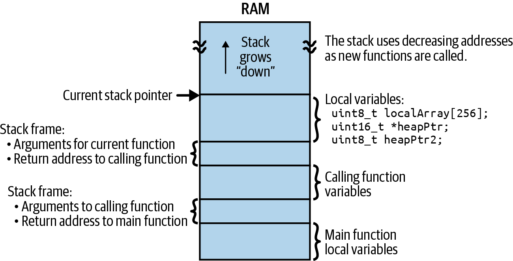

<!-- source: pdf=263; section=9; unit=p0263_b000_u00 -->

<a id="src-p263"></a>

# 第 9 章 遇上麻烦 {#ch09}

<!-- source: pdf=263; section=9; unit=p0263_b001_u00 -->
前面已经讨论了边开发边测试和单元测试的重要性。不过，有时还是会有缺陷。而且，要是知道哪里出了问题，你早就修好了。除非你正坐在海滩上读这本书（我推荐这样读），否则你大概是在为眼下的问题寻找具体建议。如果我坐在你身边，脑中的检查清单会是这样：

<!-- source: pdf=263; section=9; unit=p0263_b002_u00,p0263_b003_u00,p0263_b004_u00,p0263_b005_u00,p0263_b006_u00,p0263_b007_u00,p0263_b008_u00,p0263_b009_u00,p0263_b010_u00 -->
- 通电了吗？你确定？
- 你确定设备正在运行的代码，就是你以为的那一份吗？
- 能否只测试系统中出问题的那一部分？
- 查过芯片的勘误表了吗？核对过芯片型号了吗？
- 如果问题时有时无，会不会是时序错误？或者栈溢出？
- 是否与未初始化的变量有关？把变量改为全局变量，会让情况变好还是变坏？
- 能否关闭优化，看看问题是否还会出现？
- 看过映射文件（map file）了吗？（第 11 章会进一步讨论。）
- 如果情况紧急（而且错误随机出现、毫无道理），会不会是地环路问题？

<!-- source: pdf=263; section=9; unit=p0263_b011_u00 -->
你会惊讶地发现，很多问题在最初几步就能找到。这些问题都来自经验：犯错、失败、再试一次，以及终于找到原因，却后悔没早点检查那里。

<!-- source: pdf=263; section=9; unit=p0263_b012_u00 -->
建立自己的检查清单，熟悉自己常遇到的问题。下面会更详细地介绍我清单中的许多项目，而你的清单也应该随着经验不断增长。

<!-- source: pdf=264; section=9; unit=p0264_b001_u00 -->

<a id="src-p264"></a>

总体而言，我不想讨论那些通过编译器警告、代码审查、单元测试和调试器单步执行就能找到的错误。我想讨论的是优化、不可能出现的缺陷、硬故障和内存所带来的真正麻烦。不过，在进入这些内容之前，还得先简短说说编译器。

<!-- source: pdf=264; section=9.1; unit=p0264_b002_u00 -->
## 与编译器优化较量 {#ch09-toc-001}

<!-- source: pdf=264; section=9.1; unit=p0264_b003_u00 -->
我最糟糕的缺陷似乎总是拼写错误，是那些眼睛明明扫过却看不出问题的地方。因此，我很喜欢编译器警告，尤其是提醒我在条件表达式中写了赋值操作的那一种：

<!-- source: pdf=264; section=9.1; unit=p0264_b004_u00 -->
```c
if (i = OH_NO_THIS_IS_WRONG) {}
```

<!-- source: pdf=264; section=9.1; unit=p0264_b005_u00 -->
本来想写的却是：

<!-- source: pdf=264; section=9.1; unit=p0264_b006_u00 -->
```c
if (i == YES_I_MEANT_TO_DO_THIS) {}
```

<!-- source: pdf=264; section=9.1; unit=p0264_b007_u00 -->
编译器或静态检查工具（linter）能告诉你这些问题，是一份礼物。好好利用它们。尽可能启用所有编译器警告，再修掉所有警告。这是调试代码的第一步。

<!-- source: pdf=264; section=9.1; unit=p0264_b008_u00 -->
 我知道，厂商提供的代码并不总能毫无警告地编译通过。我认为除非非改不可（通常是出于认证要求），否则不应该修改它。因为修改之后，再更新到厂商代码的新版本会很麻烦，所以建议用注释标出改动，便于移植这些修改：

<!-- source: pdf=264; section=9.1; unit=p0264_b009_u00 -->
```c
// START_MY_COMPANY_MODIFICATION
…
// END_MY_COMPANY_MODIFICATION
```

<!-- source: pdf=264; section=9.1; unit=p0264_b009_u01 -->
另一种做法是保留一份未经修改的厂商代码，并将自己的代码改动保存为源代码版本控制的补丁文件。

<!-- source: pdf=264; section=9.1; unit=p0264_b010_u00 -->
难查的缺陷与编译器之间，有一类问题源于编译器优化。编译器会重新组织代码，让它运行得更快。许多变量会被放进寄存器，而且很早就被消除。

<!-- source: pdf=264; section=9.1; unit=p0264_b011_u00 -->
突然间，你再也没法顺着代码逐行执行了，因为调试器会到处跳，反映的是优化后的操作顺序，而不是一行接着一行。当你查看某个变量的值时，调试器还会告诉你，它不存在。

<!-- source: pdf=264; section=9.1; unit=p0264_b012_u00 -->
更糟的是，有时一打开优化，代码就开始做出奇怪（而且错误）的事情。这几乎从来都不是编译器的错。别再怪编译器了。真的，是你的代码有问题。很遗憾。

<!-- source: pdf=265; section=9.1; unit=p0265_b001_u00 -->

<a id="src-p265"></a>

>  偶尔，也会是语言本身的问题。对于语言中的未定义行为（undefined behavior），编译器可以按自己认为合适的方式实现，因此不同编译器会做出不同的事情。编译器作者试图实现尽可能巧妙的优化时，这类问题最容易显现。

<!-- source: pdf=265; section=9.1; unit=p0265_b002_u00 -->
优化本来就应该改变时序：它会让系统更快。遗憾的是，如果代码依赖一点点延迟，或者依赖精确的操作顺序，那么启用优化后就会出问题。

<!-- source: pdf=265; section=9.1; unit=p0265_b003_u00 -->
更常见的问题与变量有关。

<!-- source: pdf=265; section=9.1; unit=p0265_b004_u00 -->
优化器会删除它认为没有用的代码。如果你没有使用某个变量，它就会删除这个变量，即使它是一个全局变量，例如在中断中设置、在循环中监测的标志。不启用优化时，编译器会容忍这种低效做法：两个函数读写一个看起来从未被使用的变量。但一旦要求编译器聪明一点，它就会注意到这个循环很傻，里面什么也没发生。因此，既不必运行循环，也不必保留标志变量（尽管你我都知道，中断会在主循环的作用范围之外修改这个变量）：

<!-- source: pdf=265; section=9.1; unit=p0265_b005_u00,p0265_b006_u00,p0265_b007_u00,p0265_b008_u00 -->
```c
#include <stdio.h>

int global = 0; // without volatile here, the while loop below may
                // be optimized out

void isr(void) {
  global = 1;
}

int main(void)
{
    global = 0;
    while (1) {
        if (global == 1)
        {
            printf("Interrupt occurred!");
        }
    }
}
```

<!-- source: pdf=265; section=9.1; unit=p0265_b009_u00 -->
启用优化时，代码中那些（被认为）没有使用的部分会被删除。

<!-- source: pdf=265; section=9.1; unit=p0265_b010_u00 -->
最后，优化会改变处理变量的方式，常常暴露出初始化和内存越界问题。不进行优化时，变量可能都放在 RAM 中，分布得比较宽松。一旦被安排进更紧凑的空间，它们的值就更容易被差一错误（off-by-one error）覆盖，或者字节对齐突然变得至关重要。

<!-- source: pdf=266; section=9.1; unit=p0266_b000_u00 -->

<a id="src-p266"></a>

> 未初始化的全局变量和静态变量，会在代码初始化时被设为零。函数的局部变量不会！未初始化的函数变量包含随机值！

<!-- source: pdf=266; section=9.1; unit=p0266_b001_u00 -->
因此，如果一段代码在启用优化后开始异常：

<!-- source: pdf=266; section=9.1; unit=p0266_b002_u00,p0266_b003_u00,p0266_b004_u00,p0266_b005_u00 -->
- 确保中断代码和非中断代码共同使用的变量都标记为 volatile。
- 暂时把变量改成全局变量（从而让它们全部初始化为零）。
- 暂时在数组末尾增加空间，检查是否存在差一错误。
- 让系统慢下来（临时周期性地加入延迟，或用一个定时器触发中断，消耗一点时间）。

<!-- source: pdf=266; section=9.1; unit=p0266_b006_u00 -->
如果其中任何一种方法让代码恢复正常，就找到了开始深入调查问题的方向。

<!-- source: pdf=266; section=9.1; unit=p0266_b007_u00 -->
大量使用优化之后，可能遇到更难以言说的麻烦。无论是随机崩溃还是随机行为，都没人喜欢海森堡缺陷（Heisenbug）：只要注释掉一条调试用 printf 后重新编译，或者赶上一个晴天，它就消失了。

<!-- source: pdf=266; section=9.2; unit=p0266_b008_u00 -->
## 不可能出现的缺陷 {#ch09-toc-002}

<!-- source: pdf=266; section=9.2; unit=p0266_b009_u00 -->
本来就不应该有什么不可能出现的缺陷。而且，代码本来就应该第一次编译就通过、第一次运行就正常。“应该”真是个傻词。

<!-- source: pdf=266; section=9.2; unit=p0266_b010_u00 -->
处理“不可能出现的缺陷”的关键，是让它变得可能：停止琢磨它为什么不可能发生，转而深入研究它究竟是如何发生的。有两种方法可以做到这一点。

<!-- source: pdf=266; section=9.2; unit=p0266_b011_u00 -->
第一种方法是专注于复现缺陷。第二种方法是专注于解释缺陷。两种方法都应该使用，在一条路上卡住时，就切换到另一条。

<!-- source: pdf=266; section=9.2.1; unit=p0266_b012_u00 -->
### 复现缺陷 {#ch09-toc-003}

<!-- source: pdf=266; section=9.2.1; unit=p0266_b013_u00 -->
对于第一条路径，第一步是复现缺陷，这似乎不言而喻，但它却是关键一步。哪怕你得单脚跳着学鸡叫，也必须让缺陷再次出现。一次又一次。如果正是按照某些步骤复现了缺陷，那么即使这些步骤看起来不该有关系，也必须记录下来。做到这一点后，再继续下面的步骤：

<!-- source: pdf=266-267; section=9.2.1; unit=p0266_b014_u00,p0266_b015_u00,p0267_b001_u00,p0267_b002_u00,p0267_b003_u00,p0267_b004_u00 -->

<a id="src-p267"></a>

1. 复现缺陷。
2. 用最少的代码复现缺陷。
3. 回到最后一个正常工作的版本：它仍然正常吗？能找到缺陷是何时引入的吗？
4. 让缺陷能按命令（或在启动时）复现，这样就不用做十个步骤才能重现它。尽量减少复现步骤。
5. 做过探索性的修改之后，你确定正在运行的代码，就是你以为的那一份吗？
6. 这些真的是复现缺陷所需的最少代码吗？

<!-- source: pdf=267; section=9.2.1; unit=p0267_b005_u00 -->
得到最小代码集之后，就可能把问题发布到厂商网站上，或者使用调试器探索根本原因，或者请别人帮忙。

<!-- source: pdf=267; section=9.2.1; unit=p0267_b006_u00 -->
不过，更有可能的是，还没走到第 6 步，你就已经卡住了。这时需要换一种策略。

<!-- source: pdf=267; section=9.2.2; unit=p0267_b007_u00 -->
### 解释缺陷 {#ch09-toc-004}

<!-- source: pdf=267; section=9.2.2; unit=p0267_b008_u00 -->
有人向我求助排查缺陷时，我做的第一件事，是请对方解释原本想做什么。如今，他们自言自语说到一半就转身走开，我已经不再惊讶了。

<!-- source: pdf=267; section=9.2.2; unit=p0267_b009_u00 -->
解释缺陷有助于更好地理解它，并发现自己的意图与实际发生的情况之间的脱节。相比复现缺陷，这是一种更偏重思考的行动。步骤如下：

<!-- source: pdf=267; section=9.2.2; unit=p0267_b010_u00,p0267_b011_u00,p0267_b012_u00,p0267_b013_u00,p0267_b014_u00,p0267_b015_u00 -->
1. 描述缺陷的症状。
2. 解释它如何有可能表现成这个样子。列出所有可能的原因（别拿地环路来凑数，不过宇宙射线可以）。
3. 向一只鸭子解释这个缺陷，以及你已经尝试过什么。[^ch09-1] 如果意识到忘了尝试某件事，就记下来。
4. 记录什么改动带来了什么影响。（第三次修改或第四次测试之后，你就记不住了。）
5. 弄清楚与最后一份已知正常的代码相比，发生了什么变化。
6. 请人做代码审查。

<!-- source: pdf=267; section=9.2.2; unit=p0267_b016_u00 -->
描述问题似乎很容易，但光说“它不能正常工作”是不够的。什么不能正常工作？与预期有何不同？是否只发生在某个代码版本中？是否只发生在某一块电路板上？要说得具体。

<!-- source: pdf=267; section=9.2.2; unit=p0267_b000_u00 -->
[^ch09-1]: 我的桌上一直放着一个毛绒玩具。别人需要一位友善的倾听者时，我就把它借出去。后来我惊讶地发现，这其实是一种正式的调试技术，叫作橡皮鸭调试法（rubber duck debugging）。我更喜欢自己的毛绒恐龙，不过各有所爱。

<!-- source: pdf=268; section=9.2.2; unit=p0268_b000_u00 -->

<a id="src-p268"></a>

第二步先假定缺陷确实存在（这比听起来更难），然后建议通过归纳推理寻找原因。它与大多数调试过程相反：不是找出问题的那个原因，而是试着找出所有可能的原因。甚至可以更进一步：如果你是故意想让这种情况发生，会怎么做？

<!-- source: pdf=268; section=9.2.2; unit=p0268_b001_u00 -->
光靠解释缺陷，能走到的地方终究有限。你可以提出很多理论和想法，但接下来就需要获取一些数据，这意味着要回去复现缺陷。无法度量的东西，也就无法修复。

<!-- source: pdf=268; section=9.3; unit=p0268_b002_u00 -->
## 制造混乱与硬故障 {#ch09-toc-005}

<!-- source: pdf=268; section=9.3; unit=p0268_b003_u00 -->
硬故障（hard fault）是一种中断，由处理器检测到与代码执行有关的、可能具有灾难性后果的问题而引发。这类中断通常是不可屏蔽中断（nonmaskable interrupt，NMI；不能禁用）。那么，怎样制造硬故障呢？

<!-- source: pdf=268; section=9.3; unit=p0268_b004_u00 -->
哦，你以为我要告诉你如何避免硬故障？才不是。要理解处理器为什么给你送来情书（异常），最好的办法就是：趁你还不必一边手忙脚乱地修代码时，先看看这些情书长什么样。

<!-- source: pdf=268; section=9.3; unit=p0268_b005_u00 -->
> 尽管调试硬故障很痛苦，还是该庆幸有它们。至少有东西在试着告诉你哪里出了问题。

<!-- source: pdf=268; section=9.3; unit=p0268_b006_u00 -->
接下来会展示一些硬故障、它们如何发生，以及处理器能提供什么信息。这份清单并不全面，而且其中某些故障可能不会由你的系统产生。

<!-- source: pdf=268; section=9.3; unit=p0268_b007_u00 -->
运行这些糟糕的示例代码，可以帮助你了解：当代码做出糟糕的事情时，系统会如何响应。

<!-- source: pdf=268; section=9.3.1; unit=p0268_b008_u00 -->
### 除以零 {#ch09-toc-006}

<!-- source: pdf=268; section=9.3.1; unit=p0268_b009_u00 -->
显然，除以零是不对的。据可靠消息，如果有人成功做到了这一点，就会产生一个奇点，形成黑洞，吞噬整个银河系（也可能是整个宇宙；我怎么知道呢？）。

<!-- source: pdf=268; section=9.3.1; unit=p0268_b010_u00 -->
```c
int divide_by_zero(void)
{
    int a = 1;
    int c = 0;
    int b = a/c;
    return b; // forces compiler to actually run this
}
```

<!-- source: pdf=268; section=9.3.1; unit=p0268_b011_u00 -->
那么，调用这段代码会怎样？在 Linux 机器上，会得到一个异常终止的进程（SIGSEGV、SIGFPE，或某个 SIG 开头的信号）。

<!-- source: pdf=268-269; section=9.3.1; unit=p0268_b012_u00,p0269_b000_u00 -->

<a id="src-p269"></a>

在 Cortex-M 上，如果配置与控制寄存器（SCB->CCR）没有被设置为在除零时触发故障，结果会是零。反之，如果 CCR 被设置为报告这些错误，就会在用法故障状态寄存器（usage fault status register）中置位 DIVBYZERO 位，进而触发硬故障。这是一种不可屏蔽中断，很可能让处理器当场停住。它可能引起复位，也可能等待看门狗定时器触发复位。

<!-- source: pdf=269; section=9.3.1; unit=p0269_b001_u00 -->
除非你深入检查过代码，否则硬故障处理程序很可能会进入一个占位用的中断处理程序，而它所做的只是复位或无限循环。

<!-- source: pdf=269; section=9.3.1; unit=p0269_b002_u00 -->
当然，这段除零示例代码做了什么，一眼就能看出来。但如果它埋在成千上万行复杂的信号处理代码中，就没那么容易了。处理器故障处理程序（它们和中断处理程序一样，也位于向量表中）的目标，通常是缩小问题发生时处理器执行位置的范围。利用栈，可以找出故障发生之前处理器执行到了哪里。稍后的“创建核心转储”一节会进一步讨论。

<!-- source: pdf=269; section=9.3.2; unit=p0269_b003_u00 -->
### 与不存在的东西对话 {#ch09-toc-007}

<!-- source: pdf=269; section=9.3.2; unit=p0269_b004_u00 -->
我们都知道，不能访问 NULL 指针。当然不能。但为什么？

<!-- source: pdf=269; section=9.3.2; unit=p0269_b005_u00 -->
嗯，NULL 指针就是值被设为零的指针。这个零是一个内存地址。它可能是处理器闪存的起始地址，也可能什么都没有：一个没有对应实际存储器的地址。

<!-- source: pdf=269; section=9.3.2; unit=p0269_b006_u00 -->
把指针设为 NULL，是为了让我们知道这个指针不应被使用。看看下面这段糟糕的代码：

<!-- source: pdf=269; section=9.3.2; unit=p0269_b007_u00,p0269_b008_u00,p0269_b009_u00 -->
```c
int* global_ptr_to_null = NULL;
int* global_ptr_uninitialized;

void write_to_null(void) {
  int* ptr_to_null = NULL;   
  int* ptr_uninitialized;   

  *global_ptr_to_null  = 10;      /* tries to write to address zero */
  *global_ptr_uninitialized = 10; /* tries to write to address zero */
  *ptr_to_null  = 10;             /* tries to write to address zero */
  *ptr_uninitialized = 10;        /* tries to write ?? somewhere ?? */
   // … rest of function
```

<!-- source: pdf=269; section=9.3.2; unit=p0269_b010_u00 -->
global_ptr_uninitialized 是一个未初始化的全局变量。全局变量有个容易被忽略的特点：它们会自动（隐式地）设为零，与那些显式设为 NULL 的变量相同。

<!-- source: pdf=269; section=9.3.2; unit=p0269_b011_u00 -->
如果地址零对应闪存，或者根本没有对应实际存储器，向它写入就可能导致硬故障，可能是数据访问故障或总线故障，具体取决于处理器、硬故障配置寄存器，以及存储器配置。

<!-- source: pdf=269; section=9.3.2; unit=p0269_b012_u00 -->
这不仅适用于 NULL。如果处理器配置为检测这类问题，那么向任何没有对应实际存储器的地址写入，都可能触发故障。

<!-- source: pdf=270; section=9.3.2; unit=p0270_b000_u00 -->

<a id="src-p270"></a>

代码中的最后一个指针 ptr_uninitialized 尤其麻烦。它的值可能是任何东西，包括一个有效内存地址。这比硬故障更糟。除非运气好，那个地址无关紧要或者无效，否则通过这个指针写入，可能有时还真能成功。它指向哪里，取决于栈上当前是什么内容，这与说“取决于随机情况”差不了多少。

<!-- source: pdf=270; section=9.3.2.sidebar; unit=p0270_b001_u00 -->
#### 观察点：数据断点

<!-- source: pdf=270; section=9.3.2.sidebar; unit=p0270_b002_u00 -->
观察点（watchpoint）是一种断点：它在某个内存地址被访问时停下，而不是等程序计数器到达目标位置才停下。

<!-- source: pdf=270; section=9.3.2.sidebar; unit=p0270_b003_u00 -->
由硬件（处理器）实现时，观察点非常好用。代码修改指定内存位置时，调试器就会停下。

<!-- source: pdf=270; section=9.3.2.sidebar; unit=p0270_b004_u00 -->
如果处理器不支持观察点（或者你用了太多观察点），数据断点就会变成软件观察点：调试器在每个时钟周期检查是否正在访问该内存。这样非常慢，调试会变得相当困难。

<!-- source: pdf=270; section=9.3.2.sidebar; unit=p0270_b005_u00 -->
观察点有多少、效果如何，取决于微处理器。不过，只要有，它们对于查找栈溢出和内存错误就极其方便。

<!-- source: pdf=270; section=9.3.3; unit=p0270_b006_u00 -->
### 执行未定义指令 {#ch09-toc-008}

<!-- source: pdf=270; section=9.3.3; unit=p0270_b007_u00 -->
在这一系列“只能故意玩玩、绝不能无意间运行”的示例中，下一个登场的是坏代码。这不是普通程度的坏代码，而是处理器根本无法执行的代码：

<!-- source: pdf=270; section=9.3.3; unit=p0270_b008_u00,p0270_b009_u00 -->
```c
void (*fun_ptr)(void);    // global defaults to zero
void call_null_pointer_function(void)
{
  fun_ptr(); /* will execute code at address zero */
}

int illegal_instruction_execution(void) {
  int instruction = 0xE0000000;
  int (*bad_instruction)(void) = (int(*)())(&instruction);
  return bad_instruction();
}
```

<!-- source: pdf=270; section=9.3.3; unit=p0270_b010_u00 -->
call_null_pointer_function 会执行地址零处的代码。对于存储器从地址零开始的系统，第一项通常是复位处理程序的地址。这个地址值本身会是一条有效指令吗？还是会触发一个表示指令无效的硬故障？

<!-- source: pdf=271; section=9.3.3; unit=p0271_b000_u00 -->

<a id="src-p271"></a>

illegal_instruction_execution 函数把 0xE0000000 当作指令执行。在我当前的处理器上，这不是一条有效指令，因此总会触发无效指令硬故障。这里的行为显而易见；当然，你不会在自己的代码中故意这样做。

<!-- source: pdf=271; section=9.3.3; unit=p0271_b001_u00 -->
这种情况通常是函数指针出错导致的。如果从 RAM 中运行代码（为了更新闪存，或者因为速度更快），内存问题就可能覆盖正在运行的代码，造成非法指令和其他形式的混乱。

<!-- source: pdf=271; section=9.3.4; unit=p0271_b002_u00 -->
### 不正确的内存访问（未对齐访问） {#ch09-toc-009}

<!-- source: pdf=271; section=9.3.4; unit=p0271_b003_u00 -->
假设有一个 32 位处理器，而你只想写入一个字节……等等，这怎么做到？如果处理器的寄存器是 32 位（4 字节）的，怎样访问一个字节？

<!-- source: pdf=271; section=9.3.4; unit=p0271_b004_u00 -->
这取决于处理器。许多处理器具有可以访问更小内存单元的指令。对于没有这类指令的处理器，编译器会截断 32 位值，使其适合放入一个 8 位值：

<!-- source: pdf=271; section=9.3.4; unit=p0271_b005_u00,p0271_b006_u00 -->
```c
uint8_t unaligned_access_ok(void)
{
    uint32_t bigVariable = 0xAABBCCDD;
    uint32_t  *ptr = &bigVariable;


    uint8_t  smallVariable = *ptr;
    return smallVariable;
}
```

<!-- source: pdf=271; section=9.3.4; unit=p0271_b007_u00 -->
不过，如果用指针做更复杂的事情，例如尝试访问数组中间、或紧凑排列的结构体中间的一个 32 位值，那就不只是编译期变量类型匹配的问题了。下面这段糟糕的代码，试图从一个 6 字节数组的中间取出 4 个字节：

<!-- source: pdf=271; section=9.3.4; unit=p0271_b008_u00 -->
```c
uint32_t unaligned_access_bad(void)
{
    uint8_t buffer[6] = {0xAA, 0xBB, 0xCC, 0xDD, 0xEE, 0xFF};
    uint8_t i = 1;
    uint32_t val_BB_to_EE = *((uint32_t *)( &buffer[i] ));
    return val_BB_to_EE;
}
```

<!-- source: pdf=271; section=9.3.4; unit=p0271_b009_u00 -->
这段代码可能正常工作：处理器可能会额外逐字节访问这个字节缓冲区，尽管这样比按字（32 位）访问慢得多。它也可能触发硬故障，让处理器抱怨内存未对齐或发生总线错误。还有一种可能是，编译器足够了解处理器，会生成所需的额外代码（让你方便一些，代价则是浪费处理器周期）。

<!-- source: pdf=272; section=9.3.4; unit=p0272_b000_u00 -->

<a id="src-p272"></a>

看到内存对齐错误时，应当寻找代码从字节数组中访问较大变量的情况。这个数组可能是一段数据流，也可能是一个固定的常量数组。

<!-- source: pdf=272; section=9.3.5; unit=p0272_b001_u00 -->
### 返回指向栈内存的指针 {#ch09-toc-010}

<!-- source: pdf=272; section=9.3.5; unit=p0272_b002_u00 -->
下面这段糟糕的代码有什么问题？

<!-- source: pdf=272; section=9.3.5; unit=p0272_b003_u00 -->
```c
int* dont_return_stack_memory(void) {
    int stack_memory[100];
    return stack_memory;
}
```

<!-- source: pdf=272; section=9.3.5; unit=p0272_b004_u00 -->
在“栈（与堆）”旁栏中，我用一幅图展示了栈如何由各个函数使用的内存组成。调用新函数时，局部变量和栈帧（stack frame）会加入栈中。参见图 9-1。

<!-- source: pdf=272; section=9.3.5; unit=p0272_b006_u00 -->


图 9-1　栈是函数调用和局部变量组成的临时列表

图中文字：RAM＝随机存取存储器；Stack grows “down”＝栈向“下”增长；每次调用新函数时，栈会使用更低的地址；Current stack pointer＝当前栈指针；Local variables＝局部变量；Calling function variables＝调用者函数的变量；Main function local variables＝主函数局部变量。上一个栈帧包含当前函数的参数和返回调用者函数的地址；下一个栈帧包含调用者函数的参数和返回主函数的地址。图中的局部变量示例为：

```c
uint8_t localArray[256];
uint16_t *heapPtr;
uint8_t heapPtr2;
```

<!-- source: pdf=272; section=9.3.5; unit=p0272_b007_u00 -->
不过，函数返回时，这些内存就都不再属于它了。它们会被下一个被调用函数的信息覆盖。栈上的内存是短暂的：函数运行时存在，函数返回后便消失。不能指望一个变量已经初始化为某个值；它的值就是上一次调用遗留在那个位置的内容。

<!-- source: pdf=272; section=9.3.5; unit=p0272_b008_u00 -->
上面代码的问题在于，stack_memory 变量只存在于该函数内部。把这块栈内存返回给调用者函数，就像递给它一颗手榴弹。另一次函数调用就会覆盖这些数据。更糟的是，如果到处传递这个指针，向它指向的内存写入，很可能破坏一个栈帧。栈帧是返回前一个调用函数的路线图。一旦丢失，处理器就会行为混乱，很可能最终以某种硬故障告终，不过在此之前已经制造了不少麻烦。

<!-- source: pdf=273; section=9.3.5; unit=p0273_b000_u00 -->

<a id="src-p273"></a>

不过，下面这个不算栈错误：

<!-- source: pdf=273; section=9.3.5; unit=p0273_b001_u00 -->
```c
int* dont_return_malloc_and_freed_memory(void) {
    int memory = malloc(100);
    free(memory);
    return memory;
}
```

<!-- source: pdf=273; section=9.3.5; unit=p0273_b002_u00 -->
我的意思是，这当然也不好。但没有谁在监控堆。当另一段代码分配到这块内存时，就会有两个不同的使用者访问同一个内存位置。这类缺陷不会受到特殊处理，因为它们不会触发相应的硬故障；对这块内存的修改可能并非本意，因此后果可能是灾难性的。

<!-- source: pdf=273; section=9.3.6; unit=p0273_b003_u00 -->
### 栈溢出与缓冲区溢出 {#ch09-toc-011}

<!-- source: pdf=273; section=9.3.6; unit=p0273_b004_u00 -->
你有没有想过，栈溢出错误为何会导致设备遭到入侵？下面这段糟糕的代码展示了，一个简单的姓名输入框如何可能让整个系统被接管：

<!-- source: pdf=273; section=9.3.6; unit=p0273_b005_u00,p0273_b006_u00 -->
```c
void unbounded_fill_from_input(char* name)
{
    int i = 0;
    char ch;
    ch = getchar();
    while (ch != '\n') { // wait for new line
        name[i] = ch; i++;
        ch = getchar();
    }
    name[i] = NULL; // NULL terminate string
}

void overflow_the_stack(void)
{
    char name[MAX_NAME_LENGTH];
    printf("Hello! Tell me your name: ");
    unbounded_fill_from_input(name);
    printf("Hello %s", name);
}
```

<!-- source: pdf=273; section=9.3.6; unit=p0273_b007_u00 -->
即使把 name 变量的大小 MAX_NAME_LENGTH 设得很大，也无济于事；只要输入的姓名长度超过 MAX_NAME_LENGTH，name 缓冲区就会溢出。接下来会怎样？

<!-- source: pdf=273; section=9.3.6; unit=p0273_b008_u00 -->
看看图 9-1，如果 localArray 写出自身边界（发生溢出），就可能覆盖 heapPtr 和 heapPtr2 的值。于是，它们就指向了某个随机位置。你将无法释放它们所指向的内存，而尝试向这些错误地址写入，则可能因为访问了处理器上不存在的存储器而触发硬故障。

<!-- source: pdf=274; section=9.3.6; unit=p0274_b001_u00 -->

<a id="src-p274"></a>

在当前示例中，name 是局部变量，因此位于栈上。随后调用 unbounded_fill_from_input，所以栈帧位于 name 缓冲区之后。除了局部变量，栈帧还告诉处理器应该返回哪里。懂行的黑客可以把栈帧中保存的返回地址换成另一个 RAM 地址。函数结束时，处理器就会跳到黑客提供的新返回地址，而这个地址很可能指向 RAM 中可运行的代码（他们输入的不是姓名，而是这段代码）。

<!-- source: pdf=274; section=9.3.6; unit=p0274_b002_u00 -->
>  许多编译器内置了栈破坏保护（stack-smashing protection，SSP）选项。调用函数时，它们会在栈上放置保护值（也称 canary，金丝雀值）。退出函数时，如果保护值被修改，就会调用失败处理函数，而不是正常返回。

<!-- source: pdf=274; section=9.3.6; unit=p0274_b003_u00 -->
无界输入和其他用户输入问题，除了缓冲区溢出，还可能造成栈溢出。用户输入常由递归函数解析。当函数调用过多时，就会发生栈溢出：过多的变量和栈帧最终填满链接器为栈分配的空间。其效果类似于缓冲区溢出，也包括黑客可以使栈指针移到他们想运行的代码上，而不是按你的意图执行。

<!-- source: pdf=274; section=9.3.6; unit=p0274_b004_u00 -->
不过，与缓冲区溢出一样，最常见的原因通常更简单：设计或实现中的错误。在 RAM 受限、采用 RTOS 的系统中，经常会出现栈溢出。每个任务都有自己的栈，但开发者忽略了实际所需的调用栈深度。

<!-- source: pdf=274; section=9.4; unit=p0274_b005_u00 -->
## 调试硬故障 {#ch09-toc-012}

<!-- source: pdf=274; section=9.4; unit=p0274_b006_u00 -->
一切都糟透了。现在怎么办？

<!-- source: pdf=274; section=9.4; unit=p0274_b007_u00 -->
如果知道事情在哪里出了问题，要弄清它是如何发生的就容易得多。好在硬故障可以帮助确定发生位置。具体方法因处理器而异，因此要查阅手册。下面先给出总体思路，再展示 Arm Cortex-M 处理器的代码。所需步骤是：

<!-- source: pdf=274; section=9.4; unit=p0274_b008_u00,p0274_b009_u00,p0274_b010_u00 -->
1. 找到处理器提供的信息，了解出了什么问题。
2. 找到栈，查看当时执行到了哪里（以及当时在做什么的一些线索）。
3. 把这些数据保存到 RAM 中的特殊位置，以便重新启动后记录下来。

<!-- source: pdf=275; section=9.4.1; unit=p0275_b001_u00 -->

<a id="src-p275"></a>

### 处理器寄存器：哪里出了问题？ {#ch09-toc-013}

<!-- source: pdf=275; section=9.4.1; unit=p0275_b002_u00 -->
一旦进入硬故障中断，就知道系统正处于某种不良、而且可能很脆弱的状态。第一步是保存这个状态，以便稍后确定出了什么问题。

<!-- source: pdf=275; section=9.4.1; unit=p0275_b003_u00 -->
这是至今仍几乎总要使用汇编的少数场景之一。幸运的是，它通常仍然放在 C/C++ 文件中，不过，硬故障处理程序的开头很可能会像这样：[^ch09-2]

<!-- source: pdf=275; section=9.4.1; unit=p0275_b004_u00 -->
```c
  __asm volatile(
      "tst lr, #4 \n"     // test bits in lr to determine which stack
                          // pointer to use
      "ite eq \n"         // conditional coming up next
      "mrseq r0, msp \n"  // if the bit was set, use msp stack register
      "mrsne r0, psp \n"  // else the bit was not set, use psp stack
                          // register
      "b fault_handler_c \n" // call the C function
)
```

<!-- source: pdf=275; section=9.4.1; unit=p0275_b005_u00 -->
嗯，这看上去已经够糟了，而 Cortex-M 处理器还有两个栈指针，让事情更复杂：主栈指针（main stack pointer，msp），以及进程栈指针（process stack pointer，psp），后者可由 RTOS 用来运行任务。总之，这段代码的作用是把栈指针传入 fault_handler_c 函数。这些汇编指令的目标，是让我们进入 C 代码，到了那里，事情看起来就没那么糟了。

<!-- source: pdf=275; section=9.4.1; unit=p0275_b006_u00 -->
下一步是确定发生了哪一种（或哪些）故障。Cortex-M 有几个故障状态寄存器，涵盖内存故障、总线故障和用法故障（例如除零）。翻阅文档、弄清每个寄存器的含义，看起来是件繁琐的工作，但处理器正拼命告诉你哪里出了问题。你必须去看。

<!-- source: pdf=275; section=9.4.1; unit=p0275_b007_u00 -->
先从一个非常简单的 C 处理程序开始：

<!-- source: pdf=275; section=9.4.1; unit=p0275_b008_u00 -->
```c
void fault_handler_c (unsigned long *hardfault_args){
    __asm("BKPT #0\n"); // Break into the debugger
    while(1) { ; }      // Spin until the watchdog resets
}
```

<!-- source: pdf=275-276; section=9.4.1; unit=p0275_b009_u00,p0276_b000_u00 -->

<a id="src-p276"></a>

连接调试器时，这段代码会触发一个断点（不过，断点那一行的语法可能因处理器和编译器的组合而异）。如果没有连接调试器，代码就会在 while 循环中空转。硬故障发生、调试器停下来之后，可以手动查看描述故障的处理器寄存器。运气好的话，调试器还会显示一份栈回溯，带你回到问题开始的地方。

<!-- source: pdf=275; section=9.4.1; unit=p0275_b000_u00 -->
[^ch09-2]: 如果你的硬故障处理程序是空的，可以参阅 Interrupt 博客的[《如何调试 ARM Cortex-M MCU 上的 HardFault》（“How to Debug a HardFault on an ARM Cortex-M MCU”）](https://oreil.ly/WJxT4)。它不仅是极好的资料，还提供了不错的硬故障处理代码。如果使用的不是 Cortex-M 处理器，可以上网搜索适合的硬故障处理程序。虽然这里会介绍各个步骤，但自行实现它们很耗时间。

<!-- source: pdf=276; section=9.4.1; unit=p0276_b001_u00 -->
一旦知道出了什么问题、发生在哪里，一切就好办了。通常如此。有时如此。也许吧。好吧，至少这是一个不错的起点，让你知道问题最终在哪里显现。可以顺着这条线索往回追，找到问题的源头。

<!-- source: pdf=276; section=9.4.1; unit=p0276_b002_u00 -->
不过，我们很少能如此轻松地调试。在自己桌上发生的问题，比现场的问题（或者任何不在自己桌上、没接调试器的地方发生的问题）容易查清得多。

<!-- source: pdf=276; section=9.4.2; unit=p0276_b003_u00 -->
### 创建核心转储 {#ch09-toc-014}

<!-- source: pdf=276; section=9.4.2; unit=p0276_b004_u00 -->
需要让代码给自己写一份备忘录，说明出了什么问题。（我们把这份备忘录称为核心转储，core dump。）这意味着要记录故障寄存器和栈信息。遗憾的是，处理器已经处于不良状态，此时把核心转储写入闪存，或通过某种通信方式发送出去，可能会带来更多麻烦。

<!-- source: pdf=276; section=9.4.2; unit=p0276_b005_u00 -->
解决办法如下：

<!-- source: pdf=276; section=9.4.2; unit=p0276_b006_u00,p0276_b007_u00,p0276_b008_u00 -->
- 将核心转储写入 RAM。
- 重新启动时，检查这块 RAM 中的信息。
- 清除这块 RAM，表明其内容不再有效。

<!-- source: pdf=276; section=9.4.2; unit=p0276_b009_u00 -->
这其实有点奇怪。刚上电时，RAM 处于无效状态（我们不知道里面全是零、全是一，还是两者的某种组合）。因此，核心转储需要某种有效性标记。

<!-- source: pdf=276; section=9.4.2; unit=p0276_b010_u00 -->
此外，复位时，在 C 启动代码（C Startup）运行之后，所有全局变量都会被清零，或被设为各自的初始化值。因此，不能把核心转储放进全局变量。也不能放在栈上，因为栈可能已经在硬故障过程中被破坏了（而且重启后的处理器怎么知道旧栈指针在哪里？）。出于同样的原因，也不能放在堆上。

<!-- source: pdf=276; section=9.4.2; unit=p0276_b011_u00 -->
因此，它不能放进 RAM。等等，不对，我们确实要把它放进 RAM，只是不放进上述任何一个区域。

<!-- source: pdf=276; section=9.4.2; unit=p0276_b012_u00 -->
我们要使个小手段：从处理器的整体 RAM 中“偷”出一部分，给它起个名字，再在 C 代码中链接到这个名字（或地址）。这块 RAM 仍属于处理器的普通 RAM，却不再属于程序的普通 RAM，因为我们将改变程序所看到的内存布局。

<!-- source: pdf=277; section=9.4.2; unit=p0277_b000_u00 -->

<a id="src-p277"></a>

这要从链接器文件开始。链接器文件属于嵌入式系统中那些鲜有人谈论的玄妙主题。下面先介绍链接器脚本，后面还会进一步讨论。

<!-- source: pdf=277; section=9.4.2.sidebar; unit=p0277_b001_u00 -->
#### 链接器脚本简介

<!-- source: pdf=277; section=9.4.2.sidebar; unit=p0277_b002_u00 -->
虽然在让代码运行起来的过程中，你可能见过链接器脚本（linker script），但它很可能是编译器或厂商 SDK 附带的文件，你还从未需要打开它。源代码经过编译和汇编之后，链接器会把目标文件（以及库）合并为可执行文件。得到的代码主要有四个段：

<!-- source: pdf=277; section=9.4.2.sidebar; unit=p0277_b003_u00 -->
- bss 段：包含未初始化的全局变量，放在 RAM 中。这个奇怪名称的由来是历史原因，这里不必深究。

<!-- source: pdf=277; section=9.4.2.sidebar; unit=p0277_b004_u00 -->
- Data 段：包含已初始化的全局变量，放在 RAM 中。数据段可以把 bss 作为一个子段，也可以包括堆和栈。

<!-- source: pdf=277; section=9.4.2.sidebar; unit=p0277_b005_u00 -->
- Text 段：包含代码和常量数据，可以放在只读存储器或 RAM 中。

<!-- source: pdf=277; section=9.4.2.sidebar; unit=p0277_b006_u00 -->
- Vector 段：文本段的一个特殊部分，包含用于处理中断的异常向量表。

<!-- source: pdf=277; section=9.4.2.sidebar; unit=p0277_b007_u00 -->
链接器读取一个文本脚本，确定输出文件的内存布局。要移动代码，或把缓冲区放在特定地址，就需要修改链接器脚本。不要从零开始写。构建可执行文件时，已经有一个链接器脚本，通常以 .ld 结尾。找到现有脚本，再修改它。（或者找一个专门针对你的处理器的示例，以它为起点。）

<!-- source: pdf=277; section=9.4.2.sidebar; unit=p0277_b008_u00 -->
例如，如果系统具有用于存储和运行代码的闪存，以及一些内部 RAM，那么内存映射可能如下表所示：

<!-- source: pdf=277; section=9.4.2.sidebar; unit=p0277_b009_u00,p0277_b010_u01,p0277_b010_u00,p0277_b011_u01,p0277_b011_u00 -->
| 地址 | 大小 | 存储器类型 | 可放置的段 |
|---|---|---|---|
| 0x000000 | 0x10000 | 只读存储器（闪存） | Text、vector |
| 0x010000 | 0x08000 | 处理器内部 RAM | Text、vector、data 和 bss |

<!-- source: pdf=277; section=9.4.2.sidebar; unit=p0277_b012_u00 -->
表示上述内存映射的简单链接器脚本如下：

<!-- source: pdf=277-278; section=9.4.2.sidebar; unit=p0277_b013_u00,p0278_b000_u00 -->

<a id="src-p278"></a>

```ld
SECTIONS
{
   /* Memory location is in Flash; place next commands at this location */
  . = 0x000000;
  Code : {
    *(.vectors) /* Put interrupt table at very first location in memory */
    *(.text)
  }
   /* Now put everything in RAM */
  . = 0x08000;
  Data : { *(.data) *(.bss)}
}
```

<!-- source: pdf=278; section=9.4.2.sidebar; unit=p0278_b001_u00 -->
脚本非常依赖顺序。. = 0x000000 这一行表示，游标（即下一个段将被放置的位置）位于 0x000000。接下来的几行说明，把 .vectors 和 .text 放进名为 Code 的段中。

<!-- source: pdf=278; section=9.4.2.sidebar; unit=p0278_b002_u00 -->
更复杂的链接器文件会定义存储器的大小和地址，这样，如果某个段装不进分配给它的空间，链接器就能报错。还要注意，这里指定了存储器的类型（可读、可写或可执行），以支持更多错误检查：

<!-- source: pdf=278; section=9.4.2.sidebar; unit=p0278_b003_u00 -->
```ld
MEMORY
{
  /* Define each memory region */
  Flash (rx)  : ORIGIN = 0x000000, LENGTH = 0x10000  /* 64k */
  Ram   (rwx) : ORIGIN = 0x010000, LENGTH = 0x08000  /* 32k */
}
SECTIONS
{
  Code : {
    *(.vectors)
    *(.text)
   } > Flash
  Data : { *(.data) *(.bss) } > Ram
}
```

<!-- source: pdf=278; section=9.4.2.sidebar; unit=p0278_b004_u00 -->
链接器脚本可能非常复杂。不要陷入细节，先关注地址，以及它们如何与表格对应。查阅这种语言的资料，从小改动开始，再查看程序输出的映射文件，了解改动的效果。（第 11 章会讨论如何阅读映射文件。）与许多脚本语言一样，很容易把链接器脚本越写越复杂，直到没人能看懂。务必小心。如果一开始拿到的链接器脚本就很难啃，可以参阅“延伸阅读”。

<!-- source: pdf=278; section=9.4.2; unit=p0278_b005_u00 -->
要创建核心转储，首先需要“偷”出一些 RAM，并把它链接到一个名字（_coredumpBuffer）：

<!-- source: pdf=278-279; section=9.4.2; unit=p0278_b006_u00,p0279_b000_u00 -->

<a id="src-p279"></a>

```ld
MEMORY
{
  /* Define each memory region */
  Flash   (rx)  : ORIGIN = 0x000000, LENGTH = 0x10000  /* 64k */
  Ram     (rwx) : ORIGIN = 0x010000, LENGTH = 0x07F00  /* most of 32k */
  DumpRAM (rwx) : ORIGIN = 0x017F00, LENGTH = 0xFF     /* 255 bytes */
}
SECTIONS
{
  Code : {
    *(.vectors)
    *(.text)
   } > Flash
  Data : { *(.data) *(.bss) } > Ram
  Coredump (NOLOAD) : {
    _coredumpBuffer = .;
  } > DumpRAM
}
```

<!-- source: pdf=279; section=9.4.2; unit=p0279_b001_u00 -->
至于如何在代码中使用 _coredumpBuffer 变量，很大程度上取决于编译器。下面是我见过的一种处理方法。_coredumpBuffer 变量来自链接器脚本，程序只需创建一个名为 sCoreDump 的专用结构体，用来访问该位置的数据：

<!-- source: pdf=279; section=9.4.2; unit=p0279_b002_u00 -->
```c
extern unsigned long _coredumpBuffer;
struct sCoreDump *gCoreDump = (struct sCoreDump *) &_coredumpBuffer;
```

<!-- source: pdf=279; section=9.4.2; unit=p0279_b003_u00 -->
至此，代码就可以通过 _coredumpBuffer 访问一块不会由常规 C 启动代码初始化的 RAM。这是从正常用途里划分出来的一块 RAM。（也就是说，如果为它分配的空间太多，以后可能遇到问题，不过这要留到第 11 章再考虑。）

<!-- source: pdf=279; section=9.4.3; unit=p0279_b004_u00 -->
### 使用核心转储 {#ch09-toc-015}

<!-- source: pdf=279; section=9.4.3; unit=p0279_b005_u00 -->
核心转储中应该放什么？一方面，能装多少就装多少；另一方面，处理器处于脆弱状态时，又应该尽量少做事。

<!-- source: pdf=279; section=9.4.3; unit=p0279_b006_u00 -->
先放一个已知值，表示核心转储有效（称它为核心转储键值吧；具体取什么值并不重要，只要不是全零或全一就行）。

<!-- source: pdf=279; section=9.4.3; unit=p0279_b007_u00 -->
接下来放入故障原因。手动调试之后，你应该已经找到描述各种可能异常的手册。再接着，记录事情出错时执行到了哪里。这可能需要解析栈回溯，本来应该很简单，但由于此刻正处于故障状态，事情往往会变得复杂。真正的目标是找到一组返回地址（通常位于 lr 链接寄存器中）。理想情况下，还应包含栈指针，以及传入各个函数的参数。实际上，根据编译器和处理器的不同，这种追踪可能相当麻烦。编译器也许有特殊功能，能够简化栈展开（unwinding the stack）。

<!-- source: pdf=279; section=9.4.3; unit=p0279_b008_u00 -->
最后，如果还有空间，就加入任何可能对系统很重要的信息。我最喜欢保存的信息之一，是最后一次输入电压的 ADC 读数，因为我曾把低电量问题误认为代码出了大灾难，费劲地调试过。

<!-- source: pdf=280; section=9.4.3; unit=p0280_b001_u00,p0280_b002_u00 -->

<a id="src-p280"></a>

```c
#define COREDUMP_KEY 0x0BADC04E

struct sCoreDump {
    uint32_t key;  // must equal COREDUMP_KEY for this to be valid
    uint32_t cause;
    uint32_t r0;
    uint32_t r1;
    uint32_t r2;
    uint32_t r3;
    uint32_t returnAddress;
    uint32_t stackPointer;
    int32_t  lastBattReading;
};
```

<!-- source: pdf=280; section=9.4.3; unit=p0280_b003_u00 -->
把所有数据装进这块秘密藏起来的 RAM 后，复位处理器。初始化完成后，再查找有效的核心转储键值。如果存在，就把转储记录下来，留待日后查看（写到闪存、通过串口打印，或传到互联网）。最后清除核心转储，以免下次复位时再次错误地报告同一个问题。

<!-- source: pdf=280; section=9.4.3; unit=p0280_b004_u00 -->
>  提交代码、发布给生产环节时，需要保留一份二进制文件。我强烈建议把 .map 文件与二进制文件一并提交，因为可以用它解码已发布代码的栈信息。第 11 章会进一步介绍映射文件。

<!-- source: pdf=280; section=9.5; unit=p0280_b005_u00 -->
## 只是非常难查的缺陷 {#ch09-toc-016}

<!-- source: pdf=280; section=9.5; unit=p0280_b006_u00 -->
许多人担心内存缺陷，这种担心是有道理的。让指针出错的方式实在太多，要在这方面建立信心并不容易。我愿意相信嵌入式软件更容易一些，因为我们面对的是真实的存储单元。你寻址的每一样东西，最终都对应硅片上实实在在的一组晶体管。

<!-- source: pdf=280; section=9.5; unit=p0280_b007_u00 -->
不过，指针终究是指针，需要练习。因为你与实际对象之间至少隔了一层，所以调试起来更难。我发现画图有帮助，另外还要确保自己想做的事，确实就是所写代码做的事。

<!-- source: pdf=280; section=9.5; unit=p0280_b008_u00 -->
我的大多数内存缺陷，都来自下面这些原因之一：

<!-- source: pdf=280; section=9.5; unit=p0280_b009_u00,p0280_b010_u00,p0280_b011_u00,p0280_b012_u00 -->
- 缓冲区溢出和差一错误，导致写入不属于自己的内存。
- 从函数中返回内存，导致栈被破坏。
- 栈溢出，通常源于递归或调用了太多函数。
- 未初始化的变量。

<!-- source: pdf=280-281; section=9.5; unit=p0280_b013_u00,p0281_b000_u00 -->

<a id="src-p281"></a>

调试内存问题时，我有一套小技巧。第一招是把变量改为静态变量或全局变量，看看是否与栈有关（或者与未初始化的变量有关）。注意：如果这样一改，问题消失了，并不意味着解决了问题，只是把它藏起来了；你仍然必须修复它。

<!-- source: pdf=281; section=9.5; unit=p0281_b001_u00 -->
第二招是在各个缓冲区之间添加额外缓冲区（红区，red zone）。用已知值填充它们（例如 0xdeadbeef 或 0xA5A5A5A5）。运行一段时间后，检查红区缓冲区中的数据是否被修改。如果被修改，就说明某个缓冲区越界了。

<!-- source: pdf=281; section=9.5; unit=p0281_b002_u00 -->
对栈也可以做类似的事：启动时用已知数据填充栈，运行足够长的时间后，再看看实际用了多少栈空间。栈到达的最高位置（位于红区数据尚未被修改的边缘）称为高水位标记（high-water mark），表示最大的栈使用量。

<!-- source: pdf=281; section=9.5; unit=p0281_b003_u00 -->
如果遇到奇怪的问题，可以试着增大栈，看看问题是否过更久才出现。反过来，缩小栈是否会让问题更早出现？复现缺陷，是把“不可能出现的缺陷”变成“只是非常难查的缺陷”的重要一步。

<!-- source: pdf=281; section=9.5; unit=p0281_b004_u00 -->
最后，把堆上分配的缓冲区（通过 malloc 和 new）替换为固定缓冲区。这样不仅能避免使用已释放的内存，也能缓解试图分配过多内存的问题（或堆已经碎片化时，试图分配大块内存的问题）。

<!-- source: pdf=281; section=9.6; unit=p0281_b005_u00 -->
## 耍聪明的后果 {#ch09-toc-017}

<!-- source: pdf=281; section=9.6; unit=p0281_b006_u00 -->
如果说硬故障是处理器写来求助的情书，那么编译器警告就是平平无奇的交通标志。你很容易漏看一个禁止转弯的标志，或者明知是黄灯还开过去。大多数时候，忽视警告并不会有什么后果，没什么大不了。

<!-- source: pdf=281; section=9.6; unit=p0281_b007_u00 -->
不过，本章讨论的许多硬故障，其实只要启用所有编译器警告，并逐个修复，就能提前发现。

<!-- source: pdf=281; section=9.6; unit=p0281_b008_u00 -->
花点时间清除那些看似无关紧要的编译器警告，这样才能看见真正极其重要的警告：

<!-- source: pdf=281; section=9.6; unit=p0281_b009_u00 -->
```text
hardfaults.c:51: 'ptr_uninitialized' is used uninitialized in this function
hardfaults.c:78: function returns address of local variable
```

<!-- source: pdf=281; section=9.6; unit=p0281_b010_u00 -->
因此，在复现了缺陷、解释了缺陷，并尝试了所有能想到的方法之后，也许该回头清理那些一直积攒着的警告了。更好的做法是，从一开始就别让它们积攒起来。

<!-- source: pdf=281; section=9.6; unit=p0281_b011_u00 -->
最后，你不是机器人。当注意力耗尽，陷入“一切都不会成功，而且全是我的错”的绝望深坑，或者实在想不出下一步还能试什么时，休息一下吧。去散个步，吃点东西，找人聊点别的，睡一觉。你的潜意识需要时间和空间来处理问题，而不是不停接收你塞给它的更多问题信息。

<!-- source: pdf=282; section=9.7; unit=p0282_b000_u00 -->

<a id="src-p282"></a>

## 延伸阅读 {#ch09-toc-018}

<!-- source: pdf=282; section=9.7; unit=p0282_b001_u00 -->
在[《终结嵌入式软件的黑暗时代：从处理器故障调试开始！》（“Ending the Embedded Software Dark Ages: Let’s Start with Processor Fault Debugging!”）](https://oreil.ly/7rV7x)中，Embedded Artistry 的 Phillip Johnston 完整介绍了调试过程：从手动追踪硬故障，到建立良好的处理程序，再到创建小型核心转储供日后使用。

<!-- source: pdf=282; section=9.7; unit=p0282_b002_u00 -->
该文链接了 Interrupt 博客的[《如何调试 ARM Cortex-M MCU 上的 HardFault》（“How to Debug a HardFault on an ARM Cortex-M MCU”）](https://oreil.ly/SEZNj)，这是一份最具实战性、可以动手照着做的资料。

<!-- source: pdf=282; section=9.7; unit=p0282_b003_u00 -->
[《为了乐趣与收益而破坏栈》（“Smashing the Stack for Fun and Profit”）](https://oreil.ly/MesK4)对栈和堆提供了更详细的介绍。

<!-- source: pdf=282; section=9.7; unit=p0282_b004_u00 -->
Miguel Young de la Sota 的文章[《那些你从来不想知道的链接器脚本知识》（“Everything You Never Wanted to Know About Linker Script”）](https://oreil.ly/buHw9)是一篇出色的链接器文件介绍。另一份优秀资料是 Thea Flowers 的文章[《注释最详尽的链接器脚本（大概吧）》（“The Most Thoroughly Commented Linker Script (Probably)”）](https://oreil.ly/LwKVW)。

<!-- source: pdf=282; section=9.7.sidebar; unit=p0282_b005_u00 -->
### 面试问题：喘口气

<!-- source: pdf=282; section=9.7.sidebar; unit=p0282_b006_u00 -->
我应该问你些什么？

<!-- source: pdf=282; section=9.7.sidebar; unit=p0282_b007_u00 -->
有时，面试会进行得一塌糊涂。有时是应聘者确实不合格，但有时，对方完全胜任，只是过分紧张，或者那天过得很糟。面试很累人，关系重大，而失败的可能性也高得令人难受。

<!-- source: pdf=282; section=9.7.sidebar; unit=p0282_b008_u00 -->
当面试明显走偏时，我会问应聘者，我应该问些什么。我希望让他们聊一些自己了解、也愿意分享的东西。有些应聘者一下子活跃起来，展现出对这个职位的兴趣和专业能力（只是对面试本身没那么感兴趣，也没那么拿手）。

<!-- source: pdf=282; section=9.7.sidebar; unit=p0282_b009_u00 -->
有人从应聘者角度向我请教面试策略时，我经常建议带一个能展示自己能力的项目去面试。这相当于在带来的硬件上挂了一个大大的“来问我这个！”的牌子。它让应聘者能够掌控面试的一部分，并把一部分谈话引向自己熟悉、也能畅谈的话题。

<!-- source: pdf=282; section=9.7.sidebar; unit=p0282_b010_u00 -->
无论是因为应聘者带来了项目，还是因为我决定让面试稍微缓一缓，让他们谈自己的项目往往都能增强信心。利用既定问题之间的这段短暂插曲，提醒自己：几乎没有人已经掌握了应聘岗位所需的一切。但对方可能拥有重要而有用的技能，甚至比你原以为需要的那些技能更加重要。