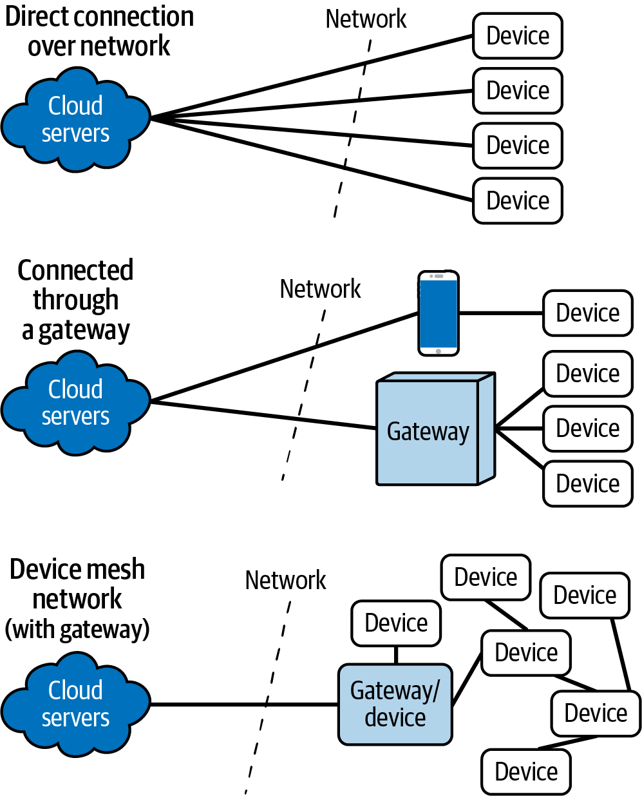
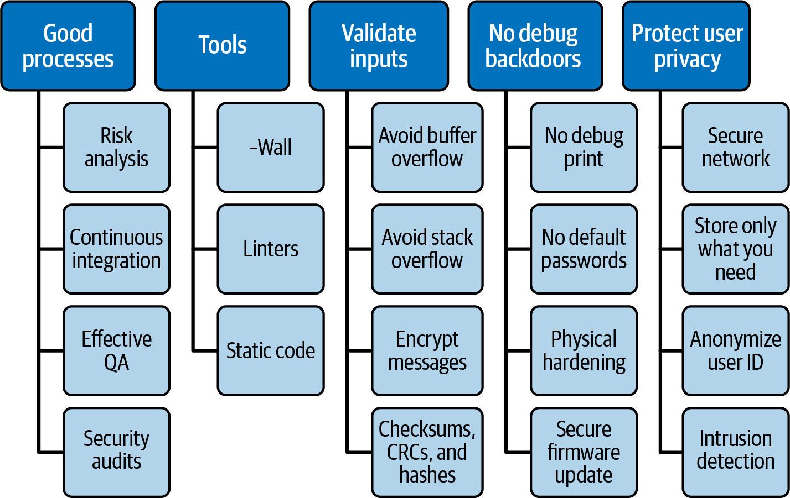
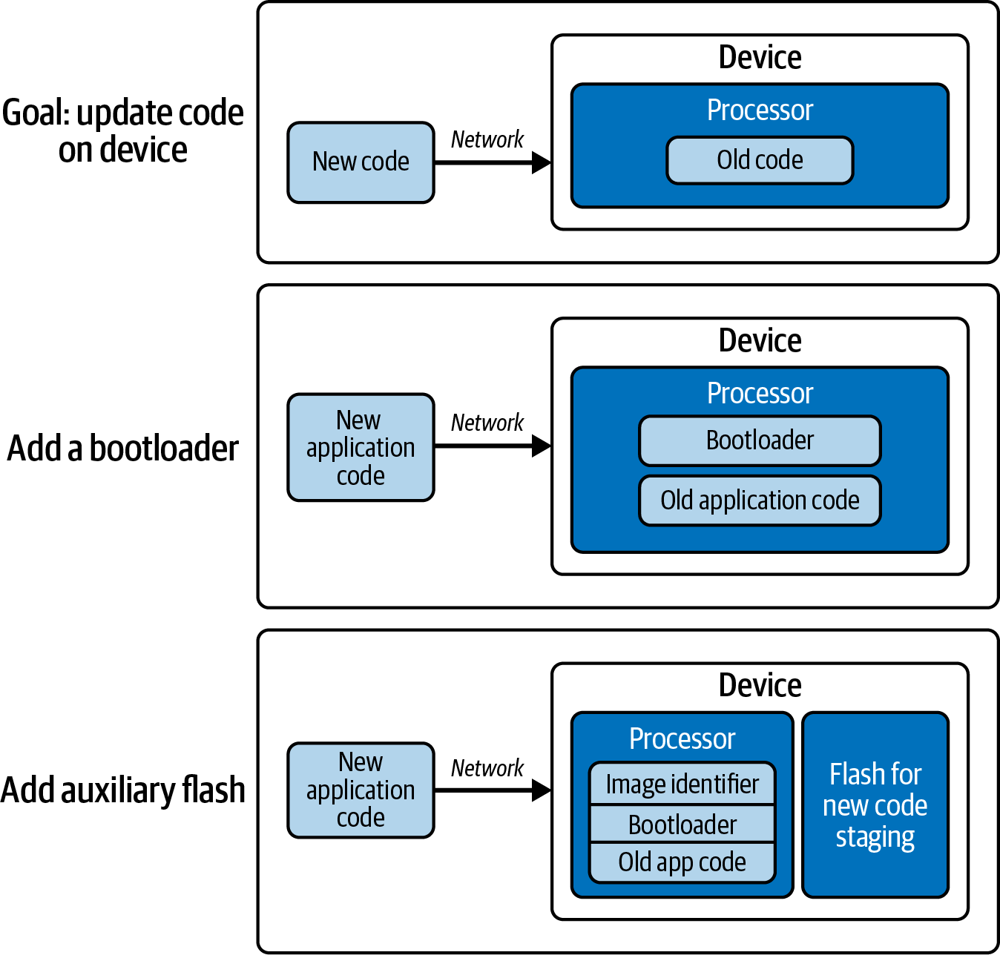
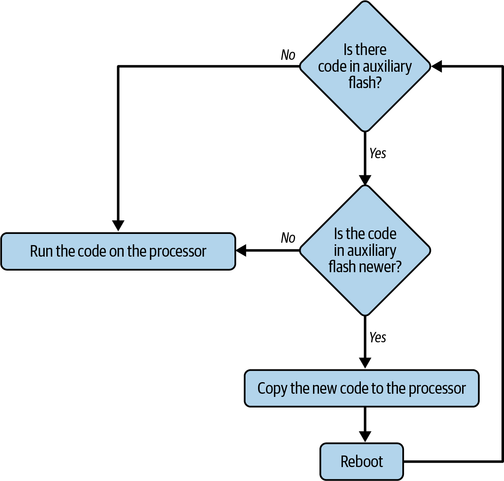
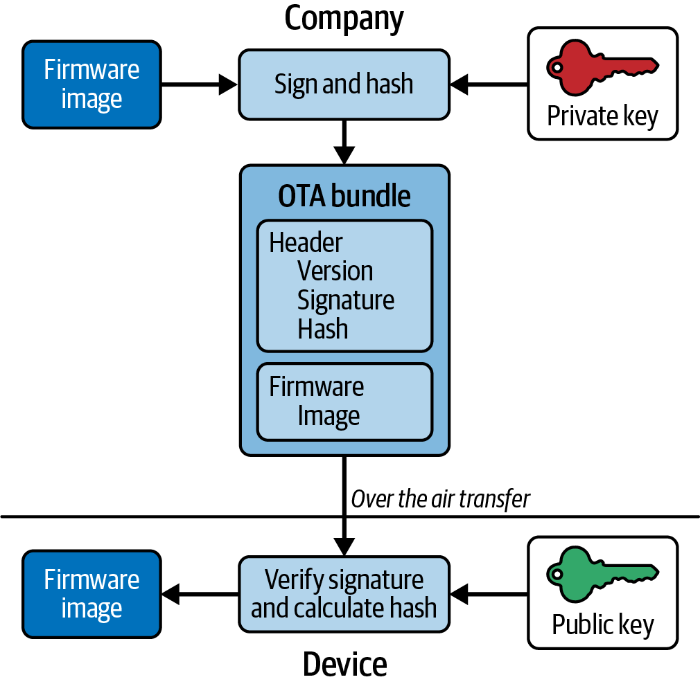
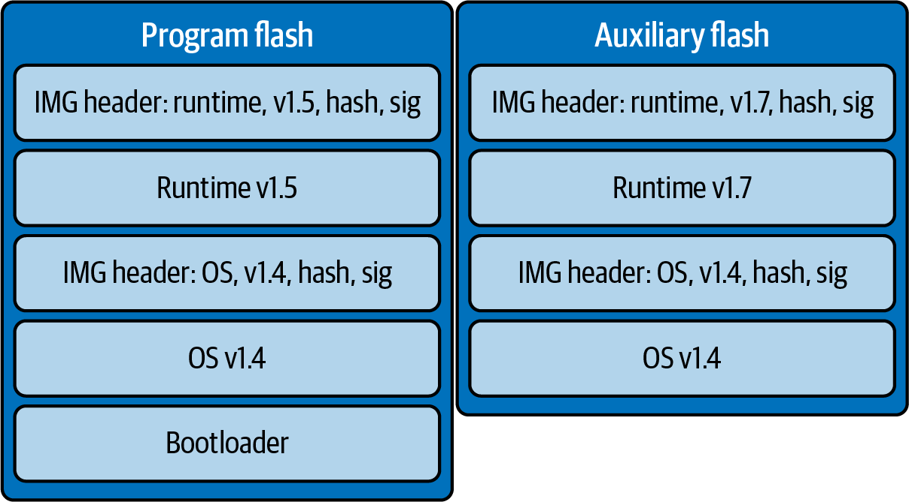
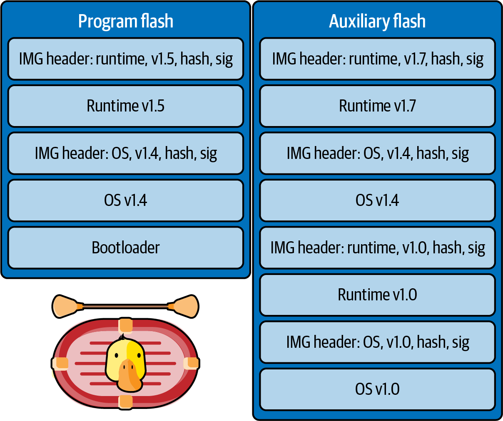
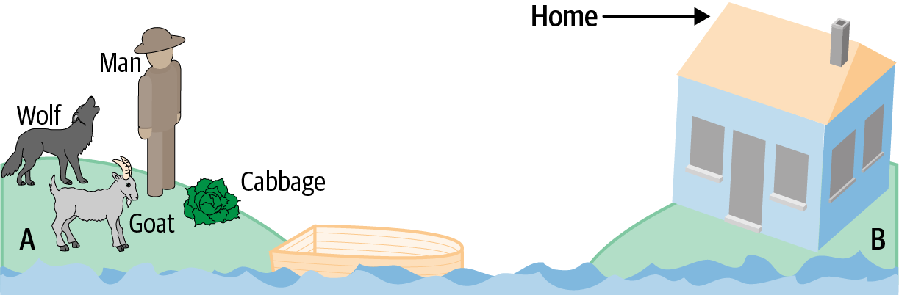

<!-- source: pdf=283; unit=p0283_b000_u00 -->

# 第 10 章 构建联网设备 {#ch10}

<!-- source: pdf=283; unit=p0283_b001_u00 -->
无论你做的是物联网（IoT）设备、无处不在的传感器、分布式系统，还是边缘计算，你的设备都要连接到一个更广阔的世界。这个世界可能是一个封闭系统，也可能是整个互联网。不管是哪一种，许多新的问题和功能都会一下子冒出来。

<!-- source: pdf=283; unit=p0283_b002_u00 -->
连接机制固然对系统设计很重要，但一旦连上了，你就需要考虑怎样向设备收发数据、怎样远程更新代码，以及怎样监测整个系统的健康状况。噢，当然，也别忘了安全。

<!-- source: pdf=283; unit=p0283_b003_u00 -->
## 远程连接 {#ch10-toc-001}

<!-- source: pdf=283; unit=p0283_b004_u00 -->
从处理器的角度看，云服务器或主机只是另一个与之通信的对象，和其他外设没什么两样。当然，主机可能会干预你的设备，例如修改处理器的代码，或者命令它把电机移动到另一个位置。但这些事情归根结底都是数字通信。

<!-- source: pdf=283; unit=p0283_b005_u00 -->
事实上，处理器通过数字接口向其发送字节的任何东西，都有自己的处理器。你通过 SPI 控制的电机，以及通过 I²C 读取的湿度传感器，各自都有处理器。对那些处理器而言，你的处理器就是主机。

<!-- source: pdf=283; unit=p0283_b006_u00 -->
正如每个外设都有接口文档一样，你的系统与主机之间的接口也应该有相当完备的文档，即使两端都由你掌控。有了写成文档的接口，两个系统就能各自独立变化，只要接口保持不变即可。至于实现，第3章中的命令解释器是一个不错的起点。

<!-- source: pdf=283-284; unit=p0283_b007_u00,p0284_b000_u00 -->

随着越来越多的日常物品进入联网世界，我们能够勾勒出越来越详尽的环境图景。无论是在你走进食品杂货店时向手机发送购物清单的冰箱，还是散布在森林中监测火灾的小型传感器，我们构建的都是分布式传感器网络。提高传感器的智能程度，能让每个传感器更好地应对其所在位置的异常情况，从而让整个网络更加稳健。信息可以返回主机，由主机汇总和处理，例如森林火灾传感器；也可以在没有主机的系统中，由各个部分贡献自己掌握的情况，共同生成信息，例如购买食品杂货的例子。

<!-- source: pdf=284; unit=p0284_b001_u00 -->
传感器网络的优势在于，各个组成部分共同协作，形成的信息作为一个整体更有价值。然而，这也是它的弱点：如果系统无法通信，它的用处就会小得多。此外，如果离线的传感器足够多，系统可能会退化到毫无用处的地步。

<!-- source: pdf=284; unit=p0284_b002_u00 -->
连接有许多实现方式。最容易理解的是把设备直接连接到云端，如图10-1上部所示。

<!-- source: pdf=284; unit=p0284_b004_u00 -->

图10-1　不同连接方式的拓扑结构，包括直接连接、网关设备和网状网络。

图中文字：Direct connection over network＝通过网络直接连接；Connected through a gateway＝通过网关连接；Device mesh network (with gateway)＝设备网状网络（带网关）；Cloud servers＝云服务器；Network＝网络；Device＝设备；Gateway＝网关；Gateway/device＝网关／设备。

<!-- source: pdf=285; unit=p0285_b001_u00 -->

### 直接连接：以太网与 WiFi {#ch10-toc-002}

<!-- source: pdf=285; unit=p0285_b002_u00 -->
以太网十分复杂，因此使用以太网通常意味着要有操作系统。本书并不假定你使用了嵌入式操作系统，所以我不会在这上面花太多笔墨。不过，随着系统变得更智能，以太网也变得更重要。得益于围绕以太网形成的标准基础设施，它很容易集成到大型系统中。虽然以太网属于数据链路层，但这也意味着还会有网络层和传输层，因此，你的软件会与某种网络协议打交道，通常是 TCP 或 UDP（用户数据报协议，User Datagram Protocol）。（TCP 提供可靠的通信通路，让数据总能到达，不过它比 UDP 复杂。）

<!-- source: pdf=285; unit=p0285_b003_u00 -->
如果通信对象是与处理器位于同一块电路板上的 LCD 控制器，通信的稳健性就没那么重要。然而，如果你的设备位于大洋中央，正在监测海啸，你可能就会希望它比串行通信更可靠一些。

<!-- source: pdf=285; unit=p0285_b004_u00 -->
如果使用无线网络，你肯定希望它足够可靠。无线电网络很难做。我的意思是，真的很难。墨菲，就是墨菲定律里的那位，最喜欢无线电网络了。

<!-- source: pdf=285; unit=p0285_b005_u00 -->
>  处理无线电网络最困难的事情之一，是它对环境的依赖。我知道有一种设备在11月安装时工作正常，但随着春天到来，却逐渐无法工作了：树叶会吸收 2.4 GHz 的无线电波。

<!-- source: pdf=285; unit=p0285_b006_u00 -->
联网系统有许多令人惊叹、引人入胜的应用。然而，面对优质无线电装置的成本，大多数公司都会退缩。这时总有人说：“干脆我们自己做吧。元器件又没那么贵。”我知道你很想赞同，因为你的产品很出色，而无线电部分的成本，是让它在市场上真正具有吸引力的一大障碍。我也曾这样想过：“能有多难呢？”把你能想象到的难度，至少再提高一个数量级吧。

<!-- source: pdf=285; unit=p0285_b007_u00 -->
无线电装置看起来再贵，也别重新发明轮子。把时间用来让系统正常工作。完成这一步之后，再通过自行实现以太网控制器或无线网络来降低产品成本。使用预先通过认证的无线电模块，是一条不错的捷径。

<!-- source: pdf=285; unit=p0285_b008_u00 -->
与此同时，你需要学习一些网络知识：数据包、路由器、网关、IP 地址、数据转发和网络拓扑图。这些内容本身就足以写一本书；相关建议见本章“延伸阅读”。

<!-- source: pdf=286; unit=p0286_b002_u00 -->

### 通过网关连接 {#ch10-toc-003}

<!-- source: pdf=286; unit=p0286_b003_u00 -->
联网传感器不一定直接连接云端，而可能选择通过网关（gateway）连接。网关是一种汇总和过滤数据的中间设备。为了便于讨论，我就把它称为智能手机吧。（也许到这本书出版时，智能手机已经过时，而你们已经用上超级智能手机了。我希望你们把它简称为 supes。）

<!-- source: pdf=286; unit=p0286_b004_u00 -->
智能手机通常比我们构建的嵌入式设备更通用。虽然智能手机可能通过 BLE（低功耗蓝牙，Bluetooth Low Energy）连接相机或计步器，但这些设备不需要知道彼此的存在。智能手机上会有针对特定设备的应用程序，在云服务与设备之间充当中介。

<!-- source: pdf=286; unit=p0286_b005_u00 -->
>  使用网关进行开发时，别忘了运行在网关上的软件！无论是手机应用，还是小型 Linux 系统，这些软件都是把整个系统黏合在一起的胶水。如果它不牢靠，系统就会散架。

<!-- source: pdf=286; unit=p0286_b006_u00 -->
网关通常会处理部分通信难题，例如确保数据正确传输，以及协助设备完成代码更新，后面很快会谈到这一点。然而，这意味着你需要定义设备与网关的通信方式。即便在 BLE GATT 这样结构完善的系统中，你仍然需要弄清哪些具体数据应当发往云端。有些数据需要传给系统用户，但总有一些数据是你为了了解设备健康状况而需要的，详见本章“管理大型系统”。

<!-- source: pdf=286; unit=p0286_b007_u00 -->
正如直接连接时需要了解网络管理一样，你也需要详细学习所用的连接方法。虽然我们都想直接使用这些协议，但它们并没有那么简单，而且为了优化系统的速度和功耗，你很可能需要深入研究。

<!-- source: pdf=286; unit=p0286_b008_u00 -->
>  第6章介绍过使用主动对象（active object）组织设备主循环的方法。BLE 芯片厂商经常用这种设计模式，把你的应用与它们的代码集成在一起。

<!-- source: pdf=286; unit=p0286_b009_u00 -->
### 通过网状网络连接 {#ch10-toc-004}

<!-- source: pdf=286; unit=p0286_b010_u00 -->
在网状网络（mesh network）中，节点，也就是你的设备，会尝试自行建立网络。如果你觉得学习如何配置直接联网已经很痛苦，想象一下设备连整个网络的拓扑结构都不知道时，这件事对它们来说会有多难。

<!-- source: pdf=287; unit=p0287_b000_u00 -->

一些常见的网状网络协议包括 Zigbee、Thread、BLE 和 Matter。有些网状网络会在首次启动时，或者由于某种超时而无法连接时进行配置。另一些则会定期重新配置，如果节点会四处移动，这就是必要的。

<!-- source: pdf=287; unit=p0287_b001_u00 -->
有些网状网络带有协调节点，它们对网络状况了解得更多，也承担更多构建网络的责任。这样一来，某些节点不必承担网络流量转发，就能节省电量。然而，这也限制了网络。类似的权衡还有很多，每种选择都有优点和缺点。

<!-- source: pdf=287; unit=p0287_b002_u00 -->
网状网络中的主要问题包括：

<!-- source: pdf=287; unit=p0287_b003_u00 -->
- 如何为每个节点建立通向云端、效率相当高的通信路径？

<!-- source: pdf=287; unit=p0287_b004_u00 -->
- 如何识别并恢复那些失去联系、无法连接相邻节点的节点？

<!-- source: pdf=287; unit=p0287_b005_u00 -->
- 系统应该只配置一次，或偶尔配置，以获得稳定的路径，还是应该经常配置，以跟上变化？

<!-- source: pdf=287; unit=p0287_b006_u00 -->
- 每个设备是否都始终开启并参与路由，还是可以通过休眠节省电量？

<!-- source: pdf=287; unit=p0287_b007_u00 -->
- 如何避免数据在网状网络中循环兜圈？

<!-- source: pdf=287; unit=p0287_b008_u00 -->
所有网状网络实现都在努力解决这些问题。创建系统时，你可能会想知道：能够传递多少数据、节点的数据多快能到达云服务器，以及节点之间可以相距多远。遗憾的是，这些数值会随网络配置而变化，答案并不能靠简单计算得出。网状网络虽然可以极其灵活，但它的复杂性使它只适用于特定情形。

<!-- source: pdf=287; unit=p0287_b009_u00 -->
#### 我们仍然使用调制解调器

<!-- source: pdf=287; unit=p0287_b010_u00 -->
有时，我们需要到达的地方，比上述那些柔弱的小网络技术所能触及的还要远。当我们需要深入幽暗之境，冒着人类毫无意义的传输可能唤醒潜伏在海底远古洞穴和隧道中诡异恐怖之物的风险时，就会重新求助于看起来更古老、更神秘的系统：蜂窝电话网络、卫星、基于音频的调制解调器，以及偶尔通过仪式和咒语打开的异次元裂缝。

<!-- source: pdf=287; unit=p0287_b011_u00 -->
为此，我们会用到一种可以追溯到1981年的简短文本语言，叫作 AT 命令。这是一系列控制调制解调器本身的命令，用来描述如何连接另一个调制解调器；理想情况下，另一个调制解调器连接着某种能接入互联网的东西。虽然还有其他更现代的调制解调器配置与通信方法，但 AT 命令很可能比我们所熟知的计算机存在得还要长久。

<!-- source: pdf=288; unit=p0288_b000_u00 -->

然而，从设备的角度看，与调制解调器的连接可能很直接：通过串行连接读写数据，就像通过命令行与调试端口交互一样。然后，数据就神奇地出现在你希望它到达的地方，往往通过一层以太网进行隧道传输，但看起来仍像串行命令行。

<!-- source: pdf=288; unit=p0288_b001_u00 -->
这种魔法是有代价的：

<!-- source: pdf=288; unit=p0288_b002_u00 -->
**金钱**

蜂窝和卫星调制解调器的使用费用相当高，发送和接收数据的带宽也有限。

<!-- source: pdf=288; unit=p0288_b003_u00 -->
**电量**

远程系统的电量往往有限，但大多数调制解调器仍然很耗电，因为它们得设法与文明世界联系。除非设备正在通信，或者到了预定的监听总部传输的时间窗口，否则通常会关闭调制解调器的电源。

<!-- source: pdf=288; unit=p0288_b004_u00,p0288_b005_u00 -->
**配置**

命令行看起来是个好主意，但要确定哪个调制解调器属于哪个设备，可能是一项挑战。当系统规模达到数千台时，管理方式也必须升级，不能再依赖共享驱动器上的 Excel 电子表格。

<!-- source: pdf=288; unit=p0288_b006_u00 -->
对于那些即使很可能没有 WiFi 覆盖、也需要始终保持可用的设备，调制解调器仍然是极好的选择，例如交通信号灯摄像头、远洋传感器和智能手机。

<!-- source: pdf=288; unit=p0288_b007_u00 -->
## 稳健的通信 {#ch10-toc-005}

<!-- source: pdf=288; unit=p0288_b008_u00 -->
能够连接云端之后，你要怎样发送数据呢？我知道，这个问题我之前问过，答案是：直接连接、通过网关、采用网状拓扑或网络，或者使用调制解调器。但“怎样”这个问题还要继续问下去，因为现在我问的是应用层通信协议。

<!-- source: pdf=288; unit=p0288_b009_u00 -->
通过 SPI 或 I²C 与 ADC 通信时，会采用一种有结构的交互方式：你发送的命令，通常称为寄存器，以及你可以读取的数据，有时还带 FIFO。从这个意义上说，你的设备向其他系统提供的接口是什么？

<!-- source: pdf=288; unit=p0288_b010_u00 -->
我想说的术语是数据序列化（data serialization）。数据会编码成人可以读懂的形式吗？也许是一个通过 HTTP 来回传递的 JSON 或 XML 文件？还是以二进制格式保存的紧凑布局 C 结构体？你会创建一个遵循类型—长度—值（type-length-value，TLV）这类格式的协议，还是开发一个更贴合自身应用的协议？

<!-- source: pdf=288; unit=p0288_b011_u00 -->
好消息是，你想怎么做都可以。坏消息也是这一点。

<!-- source: pdf=289; unit=p0289_b000_u00 -->

### 版本！ {#ch10-toc-006}

<!-- source: pdf=289; unit=p0289_b001_u00 -->
协议应该标明自己的版本。这可以通过一条专门的命令实现，也可以把版本嵌入每条命令。将来总有一天，云端和设备会运行不同版本的代码，需要协商双方都能使用哪个版本的协议。

<!-- source: pdf=289; unit=p0289_b002_u00 -->
### 校验和、CRC 与哈希 {#ch10-toc-007}

<!-- source: pdf=289; unit=p0289_b003_u00 -->
无论吞吐量是多少，你都需要知道，接收到的数据就是发送出去的数据。

<!-- source: pdf=289; unit=p0289_b004_u00 -->
最简单的校验和（checksum）形式，就是把相关的所有字节相加，忽略溢出。如果缓冲区为 {10, 20, 40, 60, 80, 90}，校验和就应该是 300。如果只使用8位校验和，它就变成 44（300 mod 256）。还有许多其他组合也能得到同样的和，例如 {44} 或 {11, 11, 11, 11, 0, 0}，但偶然发生这种情况的可能性不大；统计学告诉我们，如果所有字节都是随机的，这种可能性是 1/256。即使这样一个不起眼的8位校验和，在一两个字节遭到破坏时，也很可能救你一命，只要两个字节的损坏没有恰好相互抵消。

<!-- source: pdf=289; unit=p0289_b005_u00 -->
如果数据很多，1/256 就不是一个很理想的概率了。你可以把所有数据按16位字求和，这样，错误数据产生正确校验和的概率就低得多。注意，你需要按16位字对数据求和，而不是仅仅保留8位求和时溢出的部分。

<!-- source: pdf=289; unit=p0289_b006_u00 -->
错误的类型取决于存储器或通信通路。简单的校验和总能发现单个位的变化，但无法检测字节流中两个字节互换的情况。而且，如果多个字节都发生修改，错误可能会在校验和中相互抵消。在许多通信方式中，错误往往呈突发性，因此会同时破坏许多字节。

<!-- source: pdf=289; unit=p0289_b007_u00 -->
所以，人们说“校验和”时，往往指的是“CRC 值”。CRC 是循环冗余校验（cyclic redundancy check）的缩写，不过你不必记住它的全称。对于多字节错误和字节互换错误，CRC 比校验和提供的保护更多。CRC 背后的数学设计就是为了发现传输错误。不过，CRC 比简单求和需要更多计算能力。如果处理器本身没有 CRC 引擎，网上也有许多实现可用；代码线索见本章“延伸阅读”。

<!-- source: pdf=289; unit=p0289_b008_u00 -->
记住，校验和的主要目标是检测是否发生了错误。更复杂的方案可能会告诉你错误发生在哪里，甚至纠正小范围的错误。

<!-- source: pdf=289-290; unit=p0289_b009_u00,p0290_b002_u00 -->

与 CRC 类似，哈希函数（hash function）接收一块数据，生成一个代表这块数据、但更小的结果。这个结果有时称为摘要（digest），或者哈希值（hash）。哈希函数背后的数学设计，是为了区分不同的数据块。它更像唯一标识符，而不是错误检测器。（不过，如果充当唯一标识符的哈希值在传输后不匹配，就说明发生了错误。）

<!-- source: pdf=290; unit=p0290_b003_u00 -->
### 加密与身份认证 {#ch10-toc-008}

<!-- source: pdf=290; unit=p0290_b004_u00 -->
校验和与 CRC 都不是防黑客措施。也就是说，它们无法防止有人故意修改数据。针对这种情况，主要有两种保护形式。

<!-- source: pdf=290; unit=p0290_b005_u00 -->
加密（encryption）确保没有正确密钥和解密方法的人无法读取或修改你的数据。

<!-- source: pdf=290; unit=p0290_b006_u00 -->
>  某些处理器自带密码运算硬件加速功能。在用软件实现之前，先检查处理器手册。

<!-- source: pdf=290; unit=p0290_b007_u00 -->
身份认证（authentication）让你知道，软件正在与一个你认识的对象通信。打印机厂商希望确保墨盒来自已知来源，一部分原因是错误的墨水可能损坏打印机，另一部分原因是耗材有利可图。认证可以使用加密后的哈希值来充当数字签名。

<!-- source: pdf=290; unit=p0290_b008_u00 -->
 克隆耗材时，认证信息会被一并复制，让破解后的耗材在软件看来没有问题。对此，一种常见的防范措施是使用数据库，指出系统遇到同一序列号的次数是否超出了合理预期。

<!-- source: pdf=290; unit=p0290_b009_u00 -->
认证和加密都很难。这不同于复杂算法：理解算法后，测试好实现，就能大功告成。认证和加密是你永远不可能圆满做完的事情。当然，你也许正确实现了算法，但这并不意味着数据就是安全的。耗材或数据越有价值，就越有可能有人花时间逆向分析你的加密或认证方法。一个意志坚定的黑客最终会成功，尽管有时只能采用暴力攻击；要闯入制造厂房拿到源代码，可能还比破解128位 AES 密钥更容易。

<!-- source: pdf=290-291; unit=p0290_b010_u00,p0291_b001_u00 -->

你不可能负责锁住所有的门。你能期待的最好结果，就是代码足够稳健，挡住随手试探的攻击者，并给他们制造足够多的麻烦，让他们不再打你产品的主意。你的系统很可能没有太多处理能力。在一颗运行频率仅几 MHz 的8位处理器上，尝试实现 AES 或其他已被充分研究的加密算法，可能会让你举手投降，干脆铺上地毯欢迎黑客光临。

<!-- source: pdf=291; unit=p0291_b002_u00 -->
不过，并不是所有加密方法的处理负担都对称。有些算法解密比加密容易，或者反过来。把繁重的数学运算交给云服务器。另一种办法是，只对关键数据加密，其余保持明文，或者采用较低级别的加密。这也许会让代码更复杂，但如果要在“重要部分采用良好的加密”和“所有部分都采用平庸的加密”之间选择，我知道自己会选哪一个。

<!-- source: pdf=291; unit=p0291_b003_u00 -->
即便你不得不使用一种还不足以抵挡政府机构的加密算法，也要采用经过充分研究的算法。你的脑筋或许很灵，但自创的8位加密方案不会优于一种已经被充分研究的算法。使用最常见的算法之一：RSA、DES 或 AES。嵌入式系统可能不得不采用较短的密钥，但这样你至少能够估算破解密钥所需的时间，并向管理层提供对破解工作量的合理估计；如果你自行设计算法，可能就做不到这一点。（自行设计算法是个坏主意。）

<!-- source: pdf=291; unit=p0291_b004_u00 -->
### 风险分析 {#ch10-toc-009}

<!-- source: pdf=291; unit=p0291_b005_u00 -->
设计系统时，戴上恶意黑客的帽子想一想：你会怎样攻击这个系统？假设黑客知道算法，但不知道密钥。[^ch10-1] 下一节会介绍防止别人通过 JTAG 读取代码的方法。在这种情况下，获取密钥最容易的方法，是把芯片放到电子显微镜下读出代码这种相当困难的操作吗？还是说，另一个开发者曾用明文把密钥发给你，入侵者可以从邮件里读到它，或者通过访客账户登录源代码仓库取得它？认证和加密算法的有效性，取决于最薄弱的那个环节。

<!-- source: pdf=291; unit=p0291_b006_u00 -->
风险评估，就是弄清可能出什么问题，以及降低风险要花多少钱。它也包括考虑保留安全缺陷可能付出的代价：不仅是难堪和客户的不满，还有法律费用和集体诉讼。

<!-- source: pdf=291-292; unit=p0291_b007_u00,p0292_b000_u00 -->

先不说这种轻度的疑神疑鬼，保护系统确实很难。管理团队需要决定，愿意在制定保护数据或耗材安全的协议上投入多少时间和金钱。这既是技术决策，也是商业决策。而且，这还是一个长期决策：保持领先于黑客是一项持续的工作，而不是一次性的算法选择。

<!-- source: pdf=291; unit=p0291_b000_u00 -->
[^ch10-1]: 在密码学中，这称为柯克霍夫原则（Kerckhoffs’s principle）：即使系统中除密钥外的一切都为公众所知，密码系统也应该仍然安全。

<!-- source: pdf=292; unit=p0292_b001_u00 -->
就眼前而言，有很多面向系统设计和编码的“十大安全检查清单”。用起来吧；安全是一个始终在变化的领域。在工作过程中吸收不同视角很重要。

<!-- source: pdf=292; unit=p0292_b002_u00 -->
作为开发者，我们承受着在时间限制下交付项目的压力。黑客没有这个问题。感觉上，他们似乎总会赢。我们尽自己所能让情况变好，也就是让今天比昨天更好。仅此而已。

<!-- source: pdf=292; unit=p0292_b003_u00 -->
图10-2列出了在为安全、隐私和稳健性进行设计时，值得牢记的几个要点。

<!-- source: pdf=292; unit=p0292_b005_u00 -->

图10-2　为安全、隐私和稳健性进行设计，是一个持续的过程。

图中文字按列对应如下：

- Good processes＝良好的流程：Risk analysis＝风险分析；Continuous integration＝持续集成；Effective QA＝有效的质量保证；Security audits＝安全审计。
- Tools＝工具：-Wall；Linters＝代码检查工具；Static code＝静态代码。
- Validate inputs＝验证输入：Avoid buffer overflow＝避免缓冲区溢出；Avoid stack overflow＝避免栈溢出；Encrypt messages＝加密消息；Checksums, CRCs, and hashes＝校验和、CRC 和哈希。
- No debug backdoors＝不留调试后门：No debug print＝不输出调试打印；No default passwords＝不使用默认密码；Physical hardening＝物理防护加固；Secure firmware update＝安全的固件更新。
- Protect user privacy＝保护用户隐私：Secure network＝安全网络；Store only what you need＝只存储需要的数据；Anonymize user ID＝对用户 ID 进行匿名化；Intrusion detection＝入侵检测。

<!-- source: pdf=292; unit=p0292_b006_u00 -->
## 更新代码 {#ch10-toc-010}

<!-- source: pdf=292; unit=p0292_b007_u00 -->
不管你称它为空中更新（over-the-air update，OTA）、固件更新（firmware update，FWUP）、设备固件更新（device firmware update，DFU），还是下载代码，目标都是把新构建的映像放到远程系统上。这看起来应该很直接，本质上就是一次远程复制操作。可惜，事实恰好相反，一点也不直接，简直弯弯绕绕。复杂是有充分理由的：有许多功能和边界情况可能造成灾难性问题。每一处复杂设计，都在应对别人曾经遇到的问题。

<!-- source: pdf=293; unit=p0293_b000_u00 -->

先假定你有一个联网设备，带有代码空间和某种额外的闪存。图10-3展示了你希望发生的事情，以及由此引出的最初几个复杂化步骤。

<!-- source: pdf=293; unit=p0293_b002_u00 -->

图10-3　更新固件所需的复杂性不断增加，其中几个阶段会推动设计走向引导加载程序方案。

图中文字：Goal: update code on device＝目标：更新设备上的代码；Add a bootloader＝添加引导加载程序；Add auxiliary flash＝添加辅助闪存；New code＝新代码；New application code＝新应用代码；Network＝网络；Device＝设备；Processor＝处理器；Old code＝旧代码；Bootloader＝引导加载程序；Old application code／Old app code＝旧应用代码；Image identifier＝映像标识；Flash for new code staging＝用于暂存新代码的闪存。

<!-- source: pdf=293; unit=p0293_b003_u00 -->
最初，这只是一次简单复制。然而，设备正在运行，以便处理通信，而你不能覆盖一个正在运行的程序。你需要把代码拆成两部分：负责更新的引导加载程序（bootloader），以及实现所有实用功能的应用代码。

<!-- source: pdf=293; unit=p0293_b004_u00 -->
在图10-3的第二个例子中，引导加载程序需要处理通信，这往往需要大量代码，而应用本身也始终需要完成这项工作。

<!-- source: pdf=293; unit=p0293_b005_u00 -->
为了解决这个问题，在第三个例子中，旧应用可以取得新代码，并把它放进另一块存储器。随后，引导加载程序无需与外界交互就能更新代码，因此可以更简单。

<!-- source: pdf=294; unit=p0294_b000_u00 -->

在这样的系统中，如图10-4所示，启动时引导加载程序会：

<!-- source: pdf=294; unit=p0294_b001_u00 -->
1. 检查辅助闪存中是否有代码。

<!-- source: pdf=294; unit=p0294_b002_u00 -->
2. 将闪存中的代码版本与处理器当前的代码版本进行比较。

<!-- source: pdf=294; unit=p0294_b003_u00 -->
3. 如果两者相同，就调用当前代码，正常运行。

<!-- source: pdf=294; unit=p0294_b004_u00 -->
4. 如果闪存中的代码更新，就把它复制到处理器的存储器中。

<!-- source: pdf=294; unit=p0294_b005_u00 -->
5. 重新启动；之后系统会走到第3步，正常运行。

<!-- source: pdf=294; unit=p0294_b007_u00 -->

图10-4　启动时，引导加载程序会查看设备中的代码，以及设备可以取得的代码，以确定运行哪一份。随着附加检查的加入，你所用硬件抽象层（HAL）文档中的这张流程图可能会更加复杂。

图中文字：Is there code in auxiliary flash?＝辅助闪存中有代码吗？Is the code in auxiliary flash newer?＝辅助闪存中的代码更新吗？Run the code on the processor＝运行处理器中的代码；Copy the new code to the processor＝将新代码复制到处理器；Reboot＝重新启动；Yes＝是；No＝否。

<!-- source: pdf=294-295; unit=p0294_b008_u00,p0295_b001_u00 -->

最后这种引导加载程序模式有几个好处。第一，在最初那个由引导加载程序通过网络通信的例子中，连接或电源可能中断，使设备只完成了部分更新。第二，引导加载程序可以对新代码执行额外检查，验证新代码完好，并且由可信来源签名。第三，引导加载程序可以检查闪存中代码的有效性，在代码损坏时进行更新。最后，引导加载程序可以在把新代码写入处理器的同时，对它进行解密。

<!-- source: pdf=295; unit=p0295_b002_u00 -->
>  不要等到项目接近结束，才开始开发固件更新流程。这个功能至关重要，测试得越多越好。如果固件更新流程本身有缺陷，你可能无法在现场修复它，最终只能付出高昂代价召回和更换设备。

<!-- source: pdf=295; unit=p0295_b003_u00 -->
### 固件更新的安全性 {#ch10-toc-011}

<!-- source: pdf=295; unit=p0295_b004_u00 -->
把安全加入其中，往往会让代码更新的复杂度呈指数级增长。一般来说，要战胜如潮水般涌来的黑客是不可能的，但你可以提高随手试探式攻击的难度。第一步是确定你在保护什么：代码中的秘密算法？制造或验证耗材的能力？硬件的完整性？选择实现什么，取决于你的优先事项。

<!-- source: pdf=295; unit=p0295_b005_u00 -->
处理器或许能给你一点帮助。许多芯片提供代码读保护（code-read protection）。一旦开启，片上存储器就无法读取了。处理器仍然能够执行代码，但调试器或加载器无法读取代码空间。

<!-- source: pdf=295; unit=p0295_b006_u00 -->
代码读保护常常会限制处理器逐扇区擦除的能力。这样，更新代码之前，你就必须把它全部擦除。有些保护级别甚至根本不允许你写入新代码。

<!-- source: pdf=295; unit=p0295_b007_u00 -->
完成这一步之后，薄弱点就转移到了新代码的处理方式上。理想情况下，只有负责更新代码的可信同事能看到新代码，而且代码只通过安全网络传输。然而，我们通常无法保证这一点，因此必须为更新过程增加安全措施。

<!-- source: pdf=295; unit=p0295_b008_u00 -->
固件更新的安全包含两个部分：

<!-- source: pdf=295; unit=p0295_b009_u00 -->
- 保护设备，让硬件只能运行预期的代码

<!-- source: pdf=295; unit=p0295_b010_u00 -->
- 保护代码，让别人无法窥视内部

<!-- source: pdf=295; unit=p0295_b011_u00 -->
第一部分通常通过哈希和签名完成。与校验和一样，哈希用于验证代码的完整性，确保我们发送的映像，就是设备接收到的映像。签名表明新代码来自可信来源。代码通常还会加密，使其他人无法读取、反汇编和使用它。

<!-- source: pdf=295; unit=p0295_b012_u00 -->
原先我们只有新代码，现在固件包就变成了图10-5所示的样子。引导加载程序使用公钥验证签名并计算哈希值。如果检查通过，而且版本比当前应用更新，它就会解密并写入新代码。

<!-- source: pdf=296; unit=p0296_b001_u00 -->

图10-5　使用安全引导加载程序，意味着要创建经过签名和加密的固件包。

图中文字：Company＝公司；Firmware image＝固件映像；Sign and hash＝签名并计算哈希；Private key＝私钥；OTA bundle＝OTA 固件包；Header＝头部；Version＝版本；Signature＝签名；Hash＝哈希；Over the air transfer＝空中传输；Verify signature and calculate hash＝验证签名并计算哈希；Public key＝公钥；Device＝设备。

<!-- source: pdf=296; unit=p0296_b002_u00 -->
密码学已经取得长足进步。芯片厂商、编译器厂商、HAL 厂商以及实时操作系统（RTOS），都已经使嵌入式设备具备不错的安全性成为可能。请利用这些功能，而不是自行实现。

<!-- source: pdf=296; unit=p0296_b003_u00 -->
在这样的系统中，启动时引导加载程序会：

<!-- source: pdf=296; unit=p0296_b004_u00 -->
1. 检查辅助闪存中是否有代码。

<!-- source: pdf=296; unit=p0296_b005_u00 -->
2. 将闪存中的代码版本与处理器当前的代码版本进行比较。如果两者相同，就调用当前代码，正常运行。

<!-- source: pdf=296; unit=p0296_b006_u00 -->
3. 使用私钥检查闪存中代码的哈希和签名。如果不匹配，就擦除闪存中的代码并重新启动。

<!-- source: pdf=296; unit=p0296_b007_u00 -->
4. 如果闪存中的代码更新，就分段解密闪存中的代码，并逐段写入。

<!-- source: pdf=296; unit=p0296_b008_u00 -->
5. 重新启动；之后系统会走到第2步，正常运行。

<!-- source: pdf=297; unit=p0297_b000_u00 -->

有时，引导加载程序还会检查当前代码的哈希和签名。这能防止微处理器闪存损坏带来的问题。它可以用闪存中的完好代码覆盖有缺陷的代码。当然，如果处理器中的代码和闪存中的更新代码都已损坏，设备很可能陷入无限重启循环。

<!-- source: pdf=297; unit=p0297_b001_u00 -->
### 高安全性：每台设备使用独立密钥 {#ch10-toc-012}

<!-- source: pdf=297; unit=p0297_b002_u00 -->
为了获得最佳安全性，每台设备都应该有自己的密钥。这样，即使某个密钥泄露，或某台设备被破解，其他设备仍然安全。

<!-- source: pdf=297; unit=p0297_b003_u00 -->
然而，这意味着你必须在制造期间写入密钥，然后在产品的整个生命周期内保存序列号与密钥的对应关系。准备更新设备时，你还需要编写脚本，为每台设备分别创建空中更新固件包。服务器需要确保每个固件包都送到正确的设备上。

<!-- source: pdf=297; unit=p0297_b004_u00 -->
噢，还别忘了保护好所有这些密钥，数量可能对应数百万台设备。逐台设备加密，本质上也是一项数据管理工作，会带来相当多的额外劳动。

<!-- source: pdf=297; unit=p0297_b005_u00 -->
如何处理密钥，取决于系统对攻击者有多大吸引力。你必须评估风险，确定开发预算中有多少要用于保护设备免受恶意行为者的攻击。

<!-- source: pdf=297; unit=p0297_b006_u00 -->
### 多份代码

<!-- source: pdf=297; unit=p0297_b007_u00 -->
除应用和引导加载程序之外，系统中往往还有多份代码。可能有操作系统，或者厂商提供的其他二进制库；也可能采用需要两个固件映像的多核处理器。

<!-- source: pdf=297; unit=p0297_b008_u00 -->
这些代码可能都需要分别更新。可以想见，这会大大增加复杂度。图10-6左侧是处理器的程序闪存，显示它当前运行的内容；右侧是设备的辅助闪存，其中刚刚通过空中传输接收到更新。

<!-- source: pdf=297; unit=p0297_b009_u00 -->
重新启动时，引导加载程序会识别新代码、验证它、把它加载到程序闪存中，然后运行。

<!-- source: pdf=298; unit=p0298_b001_u00 -->

图10-6　处理器程序闪存运行应用、操作系统和引导加载程序的一个例子。辅助闪存中有一个新的运行时映像；如果有效，它将在下次启动时加载。

图中文字：Program flash＝程序闪存；Auxiliary flash＝辅助闪存；IMG header＝映像头部；runtime／Runtime＝运行时；OS＝操作系统；hash＝哈希；sig＝签名；Bootloader＝引导加载程序。左侧依次为“运行时映像头部，v1.5，哈希，签名”“运行时 v1.5”“操作系统映像头部，v1.4，哈希，签名”“操作系统 v1.4”“引导加载程序”；右侧依次为“运行时映像头部，v1.7，哈希，签名”“运行时 v1.7”“操作系统映像头部，v1.4，哈希，签名”“操作系统 v1.4”。

<!-- source: pdf=298; unit=p0298_b002_u00 -->
### 回退救生艇 {#ch10-toc-013}

<!-- source: pdf=298; unit=p0298_b003_u00 -->
更改设备上的代码，天然带有一些风险：设备可能在写入期间断电；源固件在进入辅助闪存时可能损坏；宇宙射线可能从天而降，等等。当设备规模增长到100万台时，固件更新失败的概率也会增加。

<!-- source: pdf=298; unit=p0298_b004_u00 -->
有一种办法可以降低把硬件变成砖头的可能性。如图10-7所示，可以把旧映像保留下来，以备不时之需。

<!-- source: pdf=298; unit=p0298_b005_u00 -->
辅助闪存中保存了运行时和操作系统的1.0版映像。它们在工厂中写入并保留下来，用于固件更新严重出错的情况。这本质上就是一艘救生艇，在撞上冰山时提供退路。恢复出厂设置往往是最后的手段，同时还会清除设备上保存的所有设置。用户会因为丢失数据而生气，但至少设备没有变成砖头。

<!-- source: pdf=299; unit=p0299_b001_u00 -->

图10-7　辅助闪存保存运行时和操作系统的其他版本，使设备能够恢复出厂设置。

图中文字：Program flash＝程序闪存；Auxiliary flash＝辅助闪存；IMG header＝映像头部；runtime／Runtime＝运行时；OS＝操作系统；hash＝哈希；sig＝签名；Bootloader＝引导加载程序。程序闪存依次保存运行时 v1.5 的头部与映像、操作系统 v1.4 的头部与映像，以及引导加载程序。辅助闪存依次保存运行时 v1.7、操作系统 v1.4、运行时 v1.0 和操作系统 v1.0；每个映像都有标明类型、版本、哈希和签名的头部。

<!-- source: pdf=299; unit=p0299_b002_u00 -->
### 分阶段部署 {#ch10-toc-014}

<!-- source: pdf=299; unit=p0299_b003_u00 -->
更新桌上那台设备的固件，通常不是什么大事；即使更新不顺利，一般也能用编程器修复。给团队中每个人的设备更新固件，可能会稍微困难一些。他们用各自的编程器更新时，会提出问题，而且很可能选错固件包，因为他们不知道自己当前运行哪个版本，也不知道要更新到哪个版本。

<!-- source: pdf=299; unit=p0299_b004_u00 -->
接下来，你为整个公司更新固件，让一些非工程人员充当测试版用户。这时，流程必须做到一键完成，或者完全不让用户察觉，否则用户就会抱怨。如果发生灾难性问题，大家虽然会恼火，但也能理解。毕竟，他们也是产品开发的一分子。如果实在有必要，还可以把所有设备收回来，更新为完好的固件。

<!-- source: pdf=299; unit=p0299_b005_u00 -->
一旦面向公众更新，这就不再可行了。远程设备可能根本无法接触到，例如卫星、深海设备等等。消费类设备可能数以百万计。一次糟糕的固件更新如果毁掉这些设备，后果将无法挽回。

<!-- source: pdf=300; unit=p0300_b000_u00 -->

你需要做的是规划分阶段部署（staged rollout）：每次向少量客户群体发送更新，找出在本地发现不了的缺陷。我遇到过一些在自己桌前看不出来的问题：

<!-- source: pdf=300; unit=p0300_b001_u00 -->
- 对客户而言正常的电源波动，却引发了海量警报

<!-- source: pdf=300; unit=p0300_b002_u00 -->
- 全球各地不同时区采用不同的夏令时方案

<!-- source: pdf=300; unit=p0300_b003_u00 -->
- GPS 读数解析错误，因为那些位置与我的桌子相距甚远

<!-- source: pdf=300; unit=p0300_b004_u00 -->
- 波士顿的盐雾造成 ADC 读数失常

<!-- source: pdf=300; unit=p0300_b005_u00 -->
- 某个特定生产批次的硬件耗电过快

<!-- source: pdf=300; unit=p0300_b006_u00 -->
即便管理层和市场部门希望尽快交付所有承诺的功能、修复所有缺陷，固件更新推进过快，仍可能造成无法解决的问题。

<!-- source: pdf=300; unit=p0300_b007_u00 -->
遗憾的是，出于成本原因，或者因为这件事由另一个团队负责，分阶段部署可能不在你的掌控之中。固件一旦发布，不管“发布”在你们公司意味着什么，通常就会有一台服务器向设备提供新固件，可能是主动推送，也可能是设备轮询获取更新。一般来说，让服务器跟踪哪些用户或用户群应该收到新更新，会更加复杂。

<!-- source: pdf=300; unit=p0300_b008_u00 -->
然而，要确保新固件不会更频繁地崩溃，也不会更快地耗尽电池，这样做是必要的。当然，增加新功能也可能耗尽电池，但那可能是因为用户在使用新功能，是一种好的耗电；增加更多诊断功能，也可能以不好的方式耗尽电池。仅凭统计数据，还不足以了解情况，你需要结合固件更新究竟包含什么来判断。

<!-- source: pdf=300; unit=p0300_b009_u00 -->
不过，统计数据确实不可少。我们先不谈更新，转而讨论如何监测大量设备。

<!-- source: pdf=300; unit=p0300_b010_u00 -->
## 管理大型系统 {#ch10-toc-015}

<!-- source: pdf=300; unit=p0300_b011_u00 -->
从几台扩展到几百台设备，令人兴奋。再往上扩大规模，则需要多得多的基础设施。

<!-- source: pdf=300; unit=p0300_b012_u00 -->
当设备达到100万台时，百万分之一的问题就会出现。要复现这些问题非常困难。问题可能出在某个特定 Android 版本的蓝牙协议栈；也可能是某人的磁力计读数看起来毫无道理，因为他真的身处南极；还可能是某天生产过程中留下的一颗小焊锡球。

<!-- source: pdf=300; unit=p0300_b013_u00 -->
确定问题发生的频率，可能比确定原因更重要。

<!-- source: pdf=301; unit=p0301_b001_u00 -->

监测产品的实际业务数据，与监测设备健康信息，是两回事。对于你的业务数据，除了提醒你注意校验和、加密和隐私，我实在说不了太多；但设备健康信息应该具备几个重要方面：

<!-- source: pdf=301; unit=p0301_b002_u00,p0301_b003_u00,p0301_b004_u00 -->
- 启动原因：设备重新启动时，它为什么重启？如果是硬故障（hard fault），就应该有相应跟踪信息，见第9章“调试硬故障”。如果是用户重启或电池耗尽，则应使用不同的代码来标明。
  - 用户频繁重启，可能说明设备挂起，或者有其他让用户烦恼的问题。
  - 与电池有关的重启增加，可能说明某项固件变化提高了耗电量。

<!-- source: pdf=301; unit=p0301_b005_u00 -->
- 电压随时间的变化，可以帮助你在耗电问题导致重启之前发现它。但电池寿命也取决于使用方式。要让电量监测有意义，你可能还需要同时记录活动时间与休眠时间。

<!-- source: pdf=301; unit=p0301_b006_u00 -->
- 心跳（heartbeat）是发送给服务器的小数据包，用来告诉服务器设备仍然存在、仍在运行。数据包的大小和发送频率取决于应用。更多心跳能带来更及时的信息，但也需要更多电量。心跳还可以包含固件版本和其他诊断信息；有些是为了调试而临时加入的，有些则会长期保留。

<!-- source: pdf=301; unit=p0301_b007_u00 -->
扩展到与大量设备通信，意味着要借助云服务提供仪表板或其他数据访问方式，以便在调试中使用这些数据。这有些奇怪，因为它看起来不像固件编程，但你仍然必须参与其中，跟踪哪些设备报到了、哪些崩溃了、哪些重新启动了以及为什么重启，还有哪些仍在运行旧固件。

<!-- source: pdf=301; unit=p0301_b008_u00 -->
最后，记录下来的崩溃和错误会变成统计问题。你不可能每天追查数百次崩溃。你会尝试复现最常见和最严重的那些。久而久之，你可能发现某些规律，例如设备每逢当地时区周二午夜就会崩溃。发现这些规律，很可能需要翻查数据库或 CSV 文件，也许要用 Python 脚本，或做一些复杂的电子表格处理。希望这些工作能帮助你找到方向，把工程时间花在最有成效的地方。

<!-- source: pdf=301; unit=p0301_b009_u00 -->
 有些服务能为你处理监测与分析的服务器端工作；可以查找设备运维（device operations）和设备群管理（fleet management）相关服务。

<!-- source: pdf=302; unit=p0302_b001_u00 -->

## 生产制造 {#ch10-toc-016}

<!-- source: pdf=302; unit=p0302_b002_u00 -->
最初的几台设备，很可能由你认识的某个人手工组装。最终，设备会交给制造商。更常见的是交给合同制造商（contract manufacturer，CM），由它为许多不同公司提供组装和包装服务。

<!-- source: pdf=302; unit=p0302_b003_u00 -->
CM 可能需要你编写软件，在出货前测试固件。目标始终是确定电路板或系统到底通过还是失败。CM 一般不喜欢模棱两可的数字，而更希望看到一个大大的绿灯或红灯。制造商不会替你调试；它们的目标是让生产线持续运转。

<!-- source: pdf=302; unit=p0302_b004_u00 -->
CM 需要知道如何为设备编程，最好一次处理多台，而不是一台一台来。它还需要为设备做出厂配置（provisioning），也就是写入安全密钥，使设备能够连接你的云服务。由于 CM 不是你公司的组成部分，为了不交出秘密，你可能最终选择在自己公司内完成最后的出厂配置。这往往成本更高，但正如前面所说，安全是昂贵的。

<!-- source: pdf=302; unit=p0302_b005_u00 -->
注意，出厂配置不同于入网设置（onboarding）；后者是客户拿到设备后，将它绑定到自己账户的过程。

<!-- source: pdf=302; unit=p0302_b006_u00 -->
 制造过程往往包含在无线电开启状态下测试设备的环节。如果设备很多，就可能产生干扰。虽然用锡箔和鞋盒就能做出一个还算不错的法拉第笼，但计划在如此嘈杂的环境中通过蓝牙更新固件，可能并不可行。

<!-- source: pdf=302; unit=p0302_b007_u00 -->
## 延伸阅读 {#ch10-toc-017}

<!-- source: pdf=302; unit=p0302_b008_u00 -->
网络管理本身就是一个领域。Peter L. Dordal 的在线书籍[《计算机网络导论》（An Introduction to Computer Networks）](https://intronetworks.cs.luc.edu)，是理解网络的极佳资源。对于我们这些只需要成为有知识的使用者的人来说，书中的导论[“网络概览”（An Overview of Networks）](https://oreil.ly/8lGsr)就很出色。[Practical Networking](https://oreil.ly/XDkUa) 在 YouTube 上的[“网络基础”（Networking Fundamentals）](https://oreil.ly/eZocP)播放列表，也是一个深入的学习资源。

<!-- source: pdf=302; unit=p0302_b009_u00 -->
如果想进一步了解组织消息的不同方式，可以看看 Memfault 的[“事件序列化”（Event Serialization）](https://oreil.ly/7QxvM)。

<!-- source: pdf=302; unit=p0302_b010_u00 -->
如果想了解 CRC 入门知识和一些代码，可以查找 Michael Barr 的 [CRC 实现代码](https://oreil.ly/0APFK)。

<!-- source: pdf=302; unit=p0302_b011_u00 -->
如果想进一步了解合同制造的运作方式，以及固件需要提供什么才能让它高效运作，可以看看 Alan Cohen 的[《从原型到产品：走向市场实用指南》（Prototype to Product: A Practical Guide for Getting to Market）](https://www.oreilly.com/library/view/prototype-to-product/9781449362959/)。

<!-- source: pdf=303; unit=p0303_b000_u00 -->

## 面试题：让山羊安全过河

<!-- source: pdf=303; unit=p0303_b001_u00 -->
一个男人正带着一只山羊、他那只驯服了一半的狼，以及一颗卷心菜回家。他们来到一条河边，桥却被冲毁了。恰好有一条船拴在他们这一侧岸边，但船很小，一次只能载这个男人和一个乘客。如果把山羊和狼单独留下，狼会吃掉山羊；如果把山羊和卷心菜单独留下，山羊会吃掉卷心菜。不过，狼不会吃卷心菜。他们怎样才能安全过河？见图10-8。

<!-- source: pdf=303; unit=p0303_b003_u00 -->

图10-8　把所有成员安全带回家。

图中文字：Man＝男人；Wolf＝狼；Goat＝山羊；Cabbage＝卷心菜；Home＝家；A、B＝河的两岸。

<!-- source: pdf=303; unit=p0303_b004_u00 -->
虽然这种题目很常见，但我强烈反对那些涉及山羊过河的面试题，所以我不会问这一题。基本上，如果工作需要我放山羊，那我并不怎么想要这份工作。

<!-- source: pdf=303; unit=p0303_b005_u00 -->
然而，加载代码与这个问题很相似。多个环节都存在危险和资源限制。你必须知道该留意什么，然后运用沿途学到的一点思维转弯，跨越到解决方案。我通常更愿意看人们如何思考，而不是看他们是否属于那个早就知道答案的小圈子。既然我不知道自己会从应聘者的回答中考察什么，那就直接给出解答吧。

<!-- source: pdf=303; unit=p0303_b006_u00 -->
这一题的窍门，是注意到山羊才是危险的那个，必须把它与另外两者隔开。如果这样界定问题，解法就更容易浮现出来。

<!-- source: pdf=303; unit=p0303_b007_u00 -->
男人最初与狼、山羊和卷心菜一起在 A 岸。他先带山羊到 B 岸，再返回 A 岸。然后把狼带到 B 岸，带卷心菜也可以，顺序无所谓。此时，他必须把山羊带回 A 岸，留在那里，再把卷心菜，或者狼，运到 B 岸。男人再返回 A 岸，接上山羊，回到 B 岸，接着带这支队伍继续赶路。

<!-- source: pdf=303; unit=p0303_b008_u00 -->
这个问题背后的窍门在于：只要事情做得正确，多跑几趟也无妨。更新固件与此很相似。