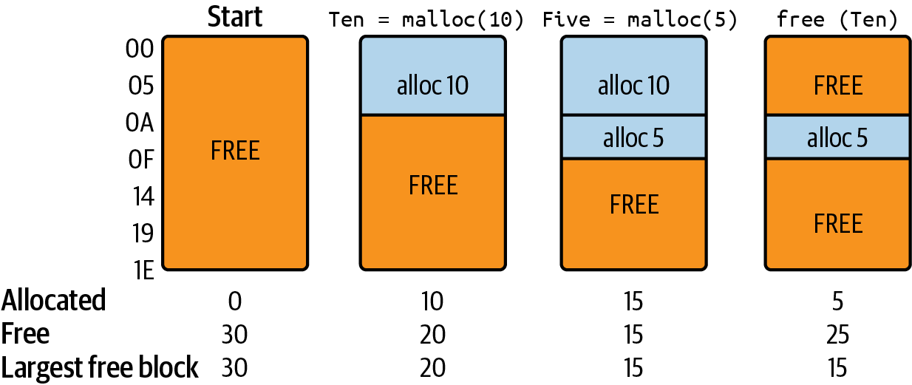
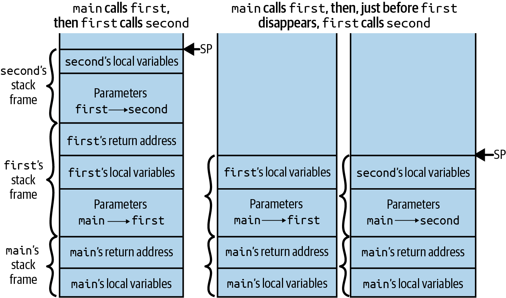
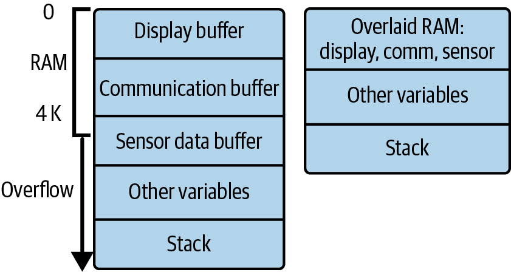
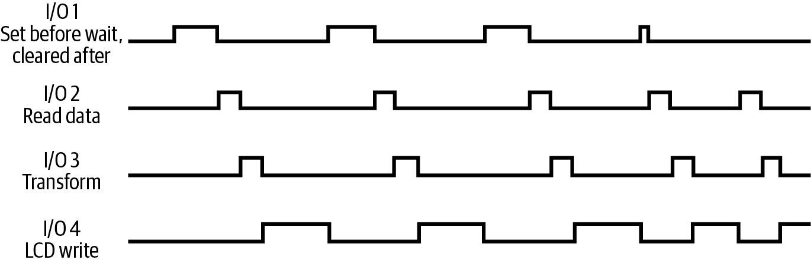
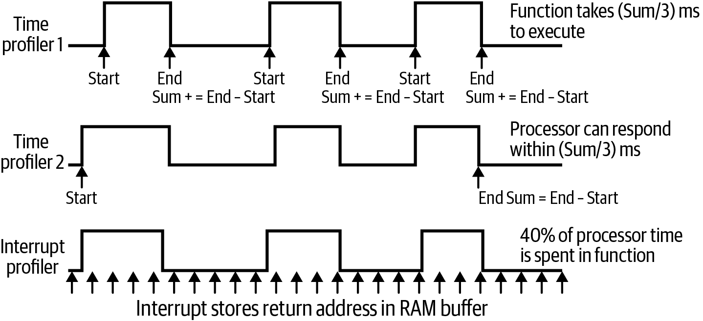
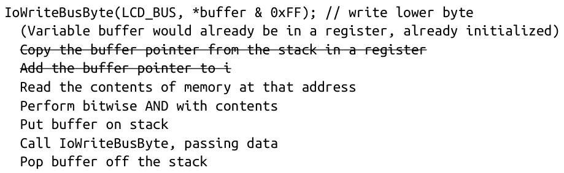
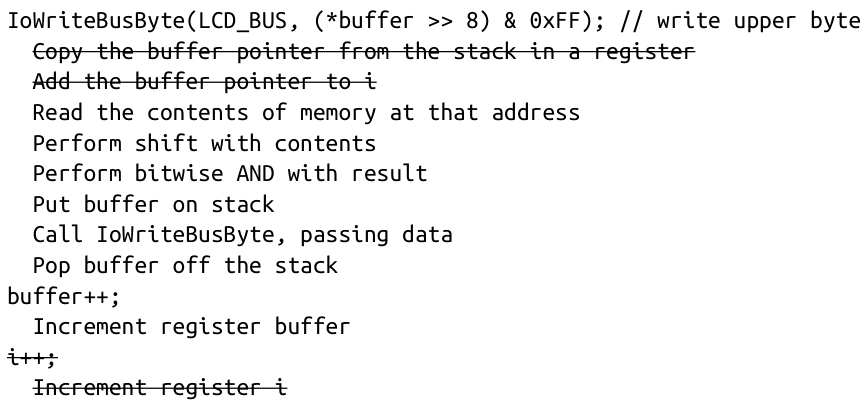

<!-- source: pdf=305; section=第11章 用更少的资源做更多的事; unit=p0305_b000_u00 -->

<a id="src-p305"></a>

# 第 11 章 用更少的资源做更多的事 {#ch11}

<!-- source: pdf=305; section=第11章 用更少的资源做更多的事; unit=p0305_b001_u00 -->
工程工作需要技术本领，以及对相关技术的深入理解。要写出优秀的嵌入式软件，还得更进一步：头脑要灵活善变，而且喜欢解谜。

<!-- source: pdf=305; section=第11章 用更少的资源做更多的事; unit=p0305_b002_u00 -->
如果系统具备你需要的一切，在这样的系统上实现需求，无非就是按部就班地干活，得出答案。有些方案比另一些更优雅，但大多数都能做得足够好，让产品顺利交付。当系统看起来无论如何也装不下你需要的所有东西时，事情才开始变得有趣。你当然可以在功能上妥协，可那还有什么乐趣呢？

<!-- source: pdf=305; section=第11章 用更少的资源做更多的事; unit=p0305_b003_u00 -->
对我来说，实现嵌入式系统最精彩的部分，就是找到恰到好处的一点调整，多省出几个处理器周期时的那种兴奋；是释放出8字节 RAM 时的激动；是在映射文件（map file）里翻找，发现一整个段可以收回来供自己的代码使用；也是意识到，只要再挤出几毫秒深度睡眠时间，自己的产品就能摘得梦寐以求的环保奖。

<!-- source: pdf=305; section=第11章 用更少的资源做更多的事; unit=p0305_b004_u00 -->
这一切的代价是，你很可能会让系统变得更加脆弱。例如，让原本互不耦合的两个子系统共用 RAM，虽然能省出内存，却也把它们关联了起来。隐藏的关联会让系统维护人员感到困惑、沮丧。代码不再模块化，子系统无法复用，灵活性也随之丧失。

<!-- source: pdf=305; section=第11章 用更少的资源做更多的事; unit=p0305_b005_u00 -->
本章讨论如何从系统中榨取更多能力。我们首先需要摸清自己拥有哪些资源，又需要哪些资源。有些资源优化技术允许用一种资源换取另一种资源。找出富余的资源，几乎与弄清稀缺资源都消耗到哪里去了一样重要。

<!-- source: pdf=305,306; section=第11章 用更少的资源做更多的事; unit=p0305_b006_u00,p0306_b001_u00 -->
最重要的资源之一是开发投入。你的时间很宝贵，需要权衡方案的价值与实现它所花的时间。例如，换用同一系列中容量更大、速度更快的芯片，会增加每一台设备的成本，但如果只生产少量设备，这可能是划算的选择；在内存与处理器周期之间做取舍，可能需要重构一部分代码；而逐行优化汇编代码，则要付出大量精力，还需要相应的技能。

<!-- source: pdf=306; section=需要更多代码空间; unit=p0306_b002_u00 -->

<a id="src-p306"></a>

## 需要更多代码空间 {#ch11-toc-001}

<!-- source: pdf=306; section=需要更多代码空间; unit=p0306_b003_u00 -->
在代码空间不足的系统上实现应用，就像要在一本太小的本子里写完学期论文。即使提前规划，试着算清每个论点应占多少篇幅，到头来仍不得不在最后一页把字写得极小，甚至连页边的空白都用上。本节将帮助你应对代码空间不足的问题。

<!-- source: pdf=306; section=阅读映射文件（第1部分）; unit=p0306_b004_u00 -->
### 阅读映射文件（第1部分） {#ch11-toc-002}

<!-- source: pdf=306; section=阅读映射文件（第1部分）; unit=p0306_b005_u00 -->
构建时，只要链接器报错，我的心就会一沉。编译器会给出各种友好的建议，挑挑我敲代码时的毛病；但链接器通常不开口，一开口往往就是要紧的事。

<!-- source: pdf=306; section=阅读映射文件（第1部分）; unit=p0306_b006_u00 -->
不过，只要知道该到哪里看，链接器也能提供丰富的信息。“链接器脚本入门”介绍了链接器的输入。作为输出的映射文件更容易阅读，尽管大多数开发人员对它仍然很陌生。

<!-- source: pdf=306; section=阅读映射文件（第1部分）; unit=p0306_b007_u00 -->
>  你可能需要配置链接器，使其输出映射文件。在可执行文件所在的目录里找找有没有 .map 文件。如果没有，请查阅编译器或链接器手册。

<!-- source: pdf=306; section=阅读映射文件（第1部分）; unit=p0306_b008_u00 -->
映射文件的格式取决于工具链。本节的示例来自 NXP LPC13xx 所用的、基于 GNU 的工具链。大多数映射文件包含的信息相同，只是顺序或格式可能不同。查看自己的文件时，需要做一些有依据的推断。如果不确定映射文件提供的是否就是自己要找的信息，可以试试这样做：先复制一份，然后修改代码、重新构建，再将生成的映射文件与原文件做差异比较。

<!-- source: pdf=306; section=阅读映射文件（第1部分）; unit=p0306_b009_u00 -->
LPC13xx 的 GNU 链接器首先列出纳入构建的库模块，以及是哪一个模块导致了它们的引入。在这个例子中，libcr_c.a 被纳入构建，是因为你的代码模块 aes256.c 调用了 memcpy()。注意，纳入的只是 libcr_c.a 库的一部分，具体来说是 memcpy.o：

<!-- source: pdf=306; section=阅读映射文件（第1部分）; unit=p0306_b010_u00 -->
```text
Archive member included because of file (symbol)
../lib/gcc/arm-none-eabi/4.3.3/../../../arm-none-eabi/lib/thumb2/libcr_c.a
                              (memcpy.o)./src/aes256.o (memcpy)
```

<!-- source: pdf=307; section=阅读映射文件（第1部分）; unit=p0307_b000_u00 -->

<a id="src-p307"></a>

如果发现某个库很大，这一部分能帮助你找到是哪部分代码调用了该库中的函数。然后就可以判断，这个代码模块是否确实需要进行那次调用，或者有没有办法绕开它。

<!-- source: pdf=307; section=阅读映射文件（第1部分）; unit=p0307_b001_u00 -->
映射文件接下来列出全局变量及其大小：

<!-- source: pdf=307; section=阅读映射文件（第1部分）; unit=p0307_b002_u00 -->
```text
Allocating common symbols
Common symbol       size              file
gNewFirmwareVersion
                    0x6               ./src/firmwareVersion.o
```

<!-- source: pdf=307; section=阅读映射文件（第1部分）; unit=p0307_b003_u00 -->
使用 static 关键字限制变量作用域，会让这些变量出现在映射文件较后面的位置，有时链接器根本不会列出它们。因此，如果文件中没有刚才那样的公共符号（common symbol），就说明你在消除全局变量这件事上做得不错。如果这里有大量数据，请回顾“用 C 进行面向对象编程”（原书第31页），再想想全局变量和文件变量的区别。

<!-- source: pdf=307; section=阅读映射文件（第1部分）; unit=p0307_b004_u00 -->
接下来列出没有被任何地方引用的代码的段、地址和大小。在 LPC13xx 的映射文件中，这一部分名为“Discarded input sections”（丢弃的输入段），它显示哪些函数和变量虽然让代码显得杂乱，却并不占用代码空间。未使用的代码之所以留在代码库中，往往是因为它们属于某个库、属于不想修改的厂商代码，或是只在特殊情况下才使用的测试代码。

<!-- source: pdf=307; section=阅读映射文件（第1部分）; unit=p0307_b005_u00 -->
内存映射中可以看到链接器脚本的对应内容：

<!-- source: pdf=307; section=阅读映射文件（第1部分）; unit=p0307_b006_u00 -->
```text
Memory Configuration
Name      Origin       Length      Attributes
Flash      0x00000000  0x00008000  xr
RAM        0x10000000  0x00002000  xrw
*default*  0x00000000  0xffffffff
```

<!-- source: pdf=307; section=阅读映射文件（第1部分）; unit=p0307_b007_u00 -->
尝试修改链接器配置时，这些信息很有用。有些映射文件还会给出各类资源已经使用的数量，这有助于判断距离资源耗尽还有多远。

<!-- source: pdf=307; section=阅读映射文件（第1部分）; unit=p0307_b008_u00 -->
映射文件的下一部分，是一长串枯燥的项目所含文件列表，跳过即可。

<!-- source: pdf=307; section=阅读映射文件（第1部分）; unit=p0307_b009_u00 -->
最终会看到一部分内容，列出每个函数、函数所在的地址、大小及其来源文件。它们按照在编译后映像中的出现顺序排列，通常按文件（模块）归在一起。函数列表从链接器文件中的第一个段开始。阅读映射文件时，不妨同时打开链接器输入 .ld 文件，这样就知道接下来应该看到什么。最上面一行给出段名（包含全部代码的 .text）、地址和段的大小：

<!-- source: pdf=307; section=阅读映射文件（第1部分）; unit=p0307_b010_u00 -->
```text
.text           0x00000000     0x7ccd
```

<!-- source: pdf=308; section=阅读映射文件（第1部分）; unit=p0308_b001_u00 -->

<a id="src-p308"></a>

除了经验和预期之外，并没有什么标志能告诉你，这一行比其他行更重要。前面“Memory Configuration”那段输出中的闪存总大小是 0x8000，即去掉长度数值前面多余的 0。这里可以看到，代码已经占去了几乎全部空间。

<!-- source: pdf=308; section=阅读映射文件（第1部分）; unit=p0308_b002_u00 -->
接下来，列表进一步展开代码段的内容：

<!-- source: pdf=308; section=阅读映射文件（第1部分）; unit=p0308_b003_u00 -->
```text
.text.Initialize
                0x0000037c       0x7c ./src/main.o
                0x0000037c                Initialize
 .text.main     0x000003f8       0xb4 ./src/main.o
                0x000003f8                main
```

<!-- source: pdf=308; section=阅读映射文件（第1部分）; unit=p0308_b004_u00 -->
在映射输出中，大多数函数都像这样占两行，信息略有重复。不过，通常可以通过链接器的命令行选项配置这种输出方式：

<!-- source: pdf=308; section=阅读映射文件（第1部分）; unit=p0308_b005_u00 -->
```text
.section.functionName   address    size        file
                        address                functionName
```

<!-- source: pdf=308; section=阅读映射文件（第1部分）; unit=p0308_b006_u00 -->
映射文件的这一部分显示每个函数的大小。减少占用空间的第一步，就是找出哪些部分特别大。占空间最多的部分有许多会是库，尤其是在使用浮点运算、C 的标准 I/O（scanf/printf）或 C++ 的 iostream 时。就连除法这样的运算符，最终也会调用函数：

<!-- source: pdf=308; section=阅读映射文件（第1部分）; unit=p0308_b007_u00 -->
```text
.text.__aeabi_ldiv0
  0x00006c6c  0x4   ../lib/gcc/arm-none-eabi/thumb2\libcr_eabihelpers.a(rtlib.o)
  0x00006c6c        __aeabi_ldiv0
.text.__bhs_ldivmod
  0x00006ec0  0x20c ../lib/gcc/arm-none-eabi/thumb2\libcr_eabihelpers.a(rtlib.o)
  0x00006ec0        __bhs_ldivmod
```

<!-- source: pdf=308; section=阅读映射文件（第1部分）; unit=p0308_b008_u00 -->
aeabi_ldiv0 函数只是一个包装层，因为它只有4字节，刚够跳转到另一个函数。而 bhs_ldivmod 则是一个实实在在的函数。有符号 long 整数除法要耗费程序 0x20c 字节，超过 main 函数大小的两倍。

<!-- source: pdf=308; section=阅读映射文件（第1部分）; unit=p0308_b009_u00 -->
>  有些映射文件不会这样直接给出函数大小，而是列出映像中各个函数的地址，需要你计算地址之差来得到大小。

<!-- source: pdf=308; section=阅读映射文件（第1部分）; unit=p0308_b010_u00 -->
占用代码空间的不只有函数。示例映射文件靠后的位置还有只读数据段：

<!-- source: pdf=309; section=阅读映射文件（第1部分）; unit=p0309_b001_u00 -->

<a id="src-p309"></a>

```text
*(.rodata*)
 .rodata.str1.1
                0x000070cc       0x36 ./src/main.o
.rodata         0x0000715c       0x10 ./src/aes256.o
.rodata.str1.1
                0x0000716c       0x35 ./src/aes256.o
```

<!-- source: pdf=309; section=阅读映射文件（第1部分）; unit=p0309_b002_u00 -->
这里，main 中有 0x36 字节的 str1.1，我可不会给变量取这样的名字。事实上，这是该编译器自动给字符串变量起的名字。因此，只要有常量字符串，例如“Hello world”，编译器就会把它们收集到同一个区域，放入只读数据段。除了 aes256.o 中的 0x35 字节字符串数据，前面的片段还显示了文件中一块未注明名称的数据，长度为 0x10。源文件的测试函数中，有一个使用静态初始值声明的变量：

<!-- source: pdf=309; section=阅读映射文件（第1部分）; unit=p0309_b003_u00 -->
```c
uint8_t buf[16] = {0xe5, 0xaa, 0x6d, 0xcb, 0x29, 0xb2, 0x71,
       0xae, 0x0e, 0xbc, 0xfa, 0x7a, 0xb2, 0x2b, 0x57, 0x59};
```

<!-- source: pdf=309; section=阅读映射文件（第1部分）; unit=p0309_b004_u00 -->
因为它位于函数内部，其他文件无法通过名字访问它。因此，映射文件不会显示变量名，但仍会列出这些常量，因为它们占用了可执行映像的空间。

<!-- source: pdf=309; section=阅读映射文件（第1部分）; unit=p0309_b005_u00 -->
所有常量都会占用空间，不管是在 #define 中声明，还是使用 const 关键字声明。全局常量通常能在映射文件中看到，而 #define 声明的常量最终会进入代码，因此不会以同样的方式单独列出。可以在映射文件的 .rodata 下看到用 const 声明的变量：

<!-- source: pdf=309; section=阅读映射文件（第1部分）; unit=p0309_b006_u00 -->
```text
.rodata        0x00007ab8      0x6A ./src/displayMap.o
               0x00007b8a            kBackgroundInfo
               0x00007bf4            kBorderInfo
```

<!-- source: pdf=309; section=阅读映射文件（第1部分）; unit=p0309_b007_u00 -->
有些部分可能写着 fill。这表明不同文件的数据之间出现了不对齐，通常是因为某个文件使用了小于处理器原生数据宽度的常量。例如，一个5字符长的字符串，在32位处理器上会占用1.25个字，因此链接器会填充3字节，通常填0。这些空间虽然浪费了，却很难收回来。除非真的每一字节都不可或缺，否则最好还是关注那些占用内存更多的地方。

<!-- source: pdf=309; section=阅读映射文件（第1部分）; unit=p0309_b008_u00 -->
映射文件的剩余部分充满了值得细读的 RAM 信息，稍后会讲到；此外还有调试信息，这些信息通常对你没什么用，不过调试设备很可能会用到。

<!-- source: pdf=309; section=阅读映射文件（第1部分）; unit=p0309_b009_u00 -->
>  如果映射文件的数据呈现方式不合你的需要，就自己写脚本解析它！读取映射文件，生成一张表格，让单元格的高度与函数大小成正比。用 Python 做这个相当容易，尤其是以 HTML 作为输出格式时。

<!-- source: pdf=310; section=逐项排除; unit=p0310_b001_u00 -->

<a id="src-p310"></a>

### 逐项排除 {#ch11-toc-003}

<!-- source: pdf=310; section=逐项排除; unit=p0310_b002_u00 -->
既然知道代码空间都用在了哪里，就可以开始缩减体积了。先从工具入手。除了通常用来让代码运行更快的各种优化级别，例如编译器选项 -O3，还有专门缩小代码的优化标志。例如，在 GCC 中，-Os 会尝试优化代码大小，而不是执行速度。仅此一步，可能就足以解决代码体积问题。

<!-- source: pdf=310; section=逐项排除; unit=p0310_b003_u00 -->
>  如果开启优化后运行结果发生变化，请检查所有变量是否都已初始化，以及需要 volatile 的变量是否已标上 volatile。偶尔，编译器会不支持某些少见但合法的特性，因此排除明显问题后，要查阅编译器手册。

<!-- source: pdf=310; section=逐项排除; unit=p0310_b004_u00 -->
如果编译器优化还不够，那么在寻找可节省空间的地方时，记一份成绩单很有用，这样就知道哪些改动带来的改善最大。它不仅能帮你摸清各种改善的效果，也有助于向同事说明取舍，例如：“没错，这段代码现在更难看了，但它节省了2 KB代码空间。”

<!-- source: pdf=310; section=逐项排除; unit=p0310_b005_u00 -->
如表11-1所示，建立一个电子表格，先填入基准数值。每做一次改动，就填一行，从而比较各次改动的价值。如果链接器输出的是十六进制数，可以让电子表格把它们转换成十进制，也可以反过来转换。

<!-- source: pdf=310; section=逐项排除; unit=p0310_b006_u00,p0310_b007_u00,p0310_b007_u01,p0310_b007_u05,p0310_b007_u03,p0310_b007_u02,p0310_b007_u04,p0310_b007_u09,p0310_b007_u07,p0310_b007_u06,p0310_b007_u08,p0310_b007_u11,p0310_b007_u10,p0310_b007_u12,p0310_b007_u13,p0310_b008_u01,p0310_b008_u00,p0310_b008_u02,p0310_b009_u00,p0310_b010_u00,p0310_b011_u00,p0310_b012_u00,p0310_b013_u00,p0310_b014_u00 -->
表11-1 优化成绩单示例

| 操作 | Text（代码） | Data（数据） | 合计 | 合计（十六进制） | 本次释放 | 累计释放 |
|---|---:|---:|---:|---|---:|---|
| 基准 | 31949 | 324 | 32273 | 7E11 | | |
| 注释掉测试代码 | 26629 | 324 | 26953 | 6949 | 5320 | （已撤销此改动） |
| 重新实现 abs() | 29845 | 324 | 30169 | 75D9 | 2104 | 2104 |
| 在初始化时计算 const 表 | 29885 | 244 | 30129 | 75B1 | 40 | 2144 |
| = 你的说明 | = .text 段大小 | = .data 段大小 | = 映像总大小 | = 映像总大小的十六进制值 | = 此次改动释放的字节数 | = 从开始至今释放的总字节数 |

<!-- source: pdf=310; section=逐项排除; unit=p0310_b015_u00 -->
这张表记录了尝试过的多个操作，包括注释掉一大块测试代码。如第3章所述，能在现场运行代码测试通常是件好事，但这些测试会占用宝贵的空间。虽然不希望削减功能，可是在考虑减少代码空间时，仍应牢记各项功能的相对重要性。

<!-- source: pdf=311; section=逐项排除; unit=p0311_b002_u00 -->

<a id="src-p311"></a>

>  “将代码体积缩小了40%”是简历上很亮眼的一笔。具体数字当然很好，但也要准备好解释自己是怎么做到的，以及考虑过哪些取舍。而且，解释不能只有“打开了编译器优化”！

<!-- source: pdf=311; section=库; unit=p0311_b003_u00 -->
### 库 {#ch11-toc-004}

<!-- source: pdf=311; section=库; unit=p0311_b004_u00 -->
查看内存映射时，先关注占用最多的部分。你可能会发现，一些意料之外的库也被引入了。顺着函数追踪下去，看看对这些库的调用来自哪里。

<!-- source: pdf=311; section=库; unit=p0311_b005_u00 -->
有些库是整体式的，只要使用其中任何一个函数，整个库就会被纳入；另一些库的粒度较细，只加载需要的函数。即使标准库也可能是整体式的，以至于仅仅使用内置的字符串复制函数，就会占用大量空间。映射文件会把这些空间大户显示出来。

<!-- source: pdf=311; section=库; unit=p0311_b006_u00 -->
很多时候，你可以自己写个函数来替代库。有时则需要设法绕过某种限制。下面给出几个常见例子，帮助你打开思路：

<!-- source: pdf=311; section=库; unit=p0311_b007_u00 -->
- 用定点（fixed-point）表示替代浮点（floating-point）数，见第12章。

<!-- source: pdf=311; section=库; unit=p0311_b008_u00 -->
- 用几个不接受可变参数的函数，例如 Log、LogWithNum，替代 printf。

<!-- source: pdf=311; section=库; unit=p0311_b009_u00 -->
- 用自己的实现替代 strcpy，从而排除字符串库。

<!-- source: pdf=311; section=库; unit=p0311_b010_u00 -->
- 用宏替代 abs 函数，消除对浮点数学库的依赖。

<!-- source: pdf=311; section=库; unit=p0311_b011_u00 -->
请记住，标准库里并没有什么魔法。开发环境附带的库，未必对你的设备最有效率。没有哪条规定说，你必须使用藏在工具目录中的那个标准库。只要去找，就能找到其他选择。

<!-- source: pdf=311; section=库; unit=p0311_b012_u00 -->
>  Embedded Artistry 有一个专门面向嵌入式系统的 [C 标准库 LibC，可在 GitHub 上找到](https://github.com/embeddedartistry/libc)。它提供经过精简的功能集，适用于资源限制极为严格的环境，设计上注重可移植性和快速完成初始调试。它的文档也很出色，代码值得一读，[相关的博客文章](https://embeddedartistry.com/blog/tag/libc/)同样有用。

<!-- source: pdf=312; section=库; unit=p0312_b001_u00 -->

<a id="src-p312"></a>

话虽如此，没有必要时就不要自己编写库。标准库和现成的库，在规范完善程度和测试充分程度上，往往胜过你在有限时间内写出来的版本。要善用别人已经投入的时间和精力。

<!-- source: pdf=312; section=函数与宏：哪个更小？; unit=p0312_b002_u00 -->
### 函数与宏：哪个更小？ {#ch11-toc-005}

<!-- source: pdf=312; section=函数与宏：哪个更小？; unit=p0312_b003_u00 -->
保持代码模块化对可读性至关重要。然而，每个函数都有代价，会增加代码空间、RAM 和处理器时间的消耗。其中，代码空间的代价很容易量化。

<!-- source: pdf=312; section=函数与宏：哪个更小？; unit=p0312_b004_u00 -->
例如，我需要一个占用空间较小的算法实现，用来求三个变量中的最小值，见示例11-1。

<!-- source: pdf=312; section=函数与宏：哪个更小？; unit=p0312_b005_u00 -->
示例11-1 三个数取最小值的算法

<!-- source: pdf=312; section=函数与宏：哪个更小？; unit=p0312_b006_u00 -->
```text
if a < b,
  if a < c, return a
  else, return c
else,
  if b < c, return b
  else, return c
```

<!-- source: pdf=312; section=函数与宏：哪个更小？; unit=p0312_b007_u00 -->
我写了一些代码，试验不同的实现方案。首先，把代码直接写在 main 函数里并编译，得到以字节计的基准代码大小。加上自动编译进来的其他零碎内容，总共接近3 KB。接着，我把实现改成一个宏：

<!-- source: pdf=312; section=函数与宏：哪个更小？; unit=p0312_b008_u00 -->
```c
#define min3(x, y, z) (((x)<(y))?(((x)<(z))?(x):(z)):(((y)<(z))?(y):(z)))
```

<!-- source: pdf=312; section=函数与宏：哪个更小？; unit=p0312_b009_u00 -->
>  不记得三元条件运算符了吗？它是 if 语句的简写形式：

<!-- source: pdf=312; section=函数与宏：哪个更小？; unit=p0312_b010_u00 -->
```text
  test ? value if test is true : value if test is false
```

<!-- source: pdf=312; section=函数与宏：哪个更小？; unit=p0312_b010_u01 -->
> 它不仅能使代码更加紧凑，有时还能促使编译器生成更优的代码。

<!-- source: pdf=312; section=函数与宏：哪个更小？; unit=p0312_b011_u00 -->
接着，我修改代码，让宏执行几次，以获得不同的代码空间大小。然后把宏改成函数，再做同样的测试。有一点很奇怪：无论使用内联函数、普通的文件内函数，还是外部函数，编译后的代码大小都相同。

<!-- source: pdf=313; section=函数与宏：哪个更小？; unit=p0313_b001_u00 -->

<a id="src-p313"></a>

>  inline 关键字本应让函数像宏一样，把代码复制到每一个使用位置。然而，inline 只是给编译器的建议，并非要求。编译器如何处理这项建议，十分依赖具体的编译器。通常会有编译器特定的 pragma来禁止内联，例如 GCC 中的 `__attribute__((noinline))`。

<!-- source: pdf=313; section=函数与宏：哪个更小？; unit=p0313_b002_u00 -->
记下大小之后，我打开优化，重新运行测试，并记录每种实现相对基准相差的字节数，见表11-2。在整个过程中，我都把所有变量标为 volatile，使编译器无法删除看起来没有副作用的代码，例如中间那些函数或宏调用。

<!-- source: pdf=313; section=函数与宏：哪个更小？; unit=p0313_b003_u00,p0313_b004_u00,p0313_b004_u01 -->
表11-2 优化成绩单：宏与函数相对于基准的差值

| 实现 | 调用1次 | 调用2次 | 调用3次 |
|---|---:|---:|---:|
| 宏 | 0 | 76 | 152 |
| 函数（文件内或外部） | 20 | 60 | 96 |
| 开启空间优化的宏 | −40 | 8 | 56 |
| 开启空间优化的函数 | −40 | −20 | 0 |

<!-- source: pdf=313; section=函数与宏：哪个更小？; unit=p0313_b005_u00 -->
表中最值得注意的是交叉点出现的位置：未优化时是调用2次，优化后则是调用1次。使用宏所占的空间，与把那行代码复制进函数所占的空间相同，本质上，预处理器就是在做查找替换。一旦多次调用 min3 宏，把它改成函数就会占用更少的代码空间。虽然函数调用通常能减小代码体积，但在讨论函数对 RAM 和处理器周期优化的影响时，还要回过头来考虑这个问题。

<!-- source: pdf=313; section=函数与宏：哪个更小？; unit=p0313_b006_u00 -->
宏还有一个勉强算得上优点的特点：它不进行类型检查。同一个宏可以用于整数、无符号整数或浮点数。如果需要对多种不同类型执行同一操作，就得比较多个函数所占的空间，与等效宏所占的空间。

<!-- source: pdf=313; section=函数与宏：哪个更小？; unit=p0313_b007_u00 -->
最后，更短的代码片段可能根本没有交叉点，因此用宏可能始终更好。不过，就连看似不起眼的“两变量取最小值”函数，也会在调用3次时出现交叉点，所以更小的代码片段恐怕真的非常小。交叉点取决于许多因素，包括处理器架构、编译器实现以及内存布局。你可能需要在自己的系统上做些试验，才能确定宏与函数在代码空间方面的取舍。

<!-- source: pdf=314; section=常量和字符串; unit=p0314_b001_u00 -->

<a id="src-p314"></a>

### 常量和字符串 {#ch11-toc-006}

<!-- source: pdf=314; section=常量和字符串; unit=p0314_b002_u00 -->
查看映射文件时，你可能发现调试字符串占用了大量代码空间。这确实是个两难问题，因为这些调试字符串提供了宝贵的信息，也起到了有用的注释作用。

<!-- source: pdf=314; section=常量和字符串; unit=p0314_b003_u00 -->
如果已经实现了日志 API，见“创建接口”（原书第27页），你就已经能在运行时按子系统分别开启或关闭调试。要去掉调试字符串，还需要更进一步，在编译时移除相应函数。

<!-- source: pdf=314; section=常量和字符串; unit=p0314_b004_u00 -->
下面这种常见写法，既能保留一定的灵活性和说明作用，又能关闭特定子系统的日志；本例中是电机子系统：

<!-- source: pdf=314; section=常量和字符串; unit=p0314_b005_u00 -->
```c
#define MOTOR_LOG 1 // set this to zero to turn off debugging
#if MOTOR_LOG
#define Log(level, str)             Log(eMotorLog, (level), (str))
#define LogWithNum(level, str, num) LogWithNum(eMotorLog, (level), (str), (num))
#else
#define Log(level, str)
#define LogWithNum(level, str)
#endif
```

<!-- source: pdf=314; section=常量和字符串; unit=p0314_b006_u00 -->
把 #define 中 MOTOR_LOG 的值改为0后，所有字符串都会在编译时被剔除，尽管代码看起来没有变化。按照“只改动自己正在处理的代码”这一原则，这段内容是 motor.c 的一部分。不过，也有一些系统会使用作用范围更广的 log.h，来允许或禁止各个子系统记录日志。不管采用哪种方式，如果忘了已经这样设置，却又试图在运行时开启调试，都可能让人有些懊恼。因此，需要在运行时灵活性与代码空间之间找到平衡。

<!-- source: pdf=314; section=常量和字符串; unit=p0314_b007_u00 -->
>  大幅增加复杂度，或许能换来更高的压缩率。如果确实需要知道系统中发生了什么，可以考虑使用一套宏机制，把字符串替换成常量，并用单独的脚本从代码中建立包含所有字符串的字典。输出看起来没什么用，但经过后处理脚本就能变得可读，而你可能因此节省大量代码空间。

<!-- source: pdf=314; section=常量和字符串; unit=p0314_b008_u00 -->
至于其他常量，为什么需要它们？真的非要不可吗？能不能在运行时算出这些数据，或将它们压缩？能否把信息移到另一种存储介质中，例如外部闪存或 EEPROM？有哪些选择取决于你的系统，不过，既然已经知道空间花在了哪里，就可以深入解决问题了。

<!-- source: pdf=315; section=需要更多 RAM; unit=p0315_b001_u00 -->

<a id="src-p315"></a>

## 需要更多 RAM {#ch11-toc-007}

<!-- source: pdf=315; section=需要更多 RAM; unit=p0315_b002_u00 -->
链接器报告代码空间不足，会令人焦虑；但如果它报告 RAM 资源不足，你反而应该松一口气，庆幸躲过了一劫。因为 RAM 不足的另一种表现，是系统随机崩溃。

<!-- source: pdf=315; section=需要更多 RAM; unit=p0315_b003_u00 -->
某些寻找更多代码空间的办法，对 RAM 也适用。不过，弄清 RAM 都消耗到了哪里更加困难。一些设计选择可以让这件事轻松一点。

<!-- source: pdf=315; section=移除 malloc; unit=p0315_b004_u00 -->
### 移除 malloc {#ch11-toc-008}

<!-- source: pdf=315; section=移除 malloc; unit=p0315_b005_u00 -->
要真正明白 RAM 都用在了哪里，就消除动态内存分配。

<!-- source: pdf=315; section=移除 malloc; unit=p0315_b006_u00 -->
由于编译器优化和寄存器的使用，有些局部变量很难看见，你可以把它们改成全局变量。这样，就能用链接器输出的内存映射确定 RAM 的使用位置。动态分配始终无法在映射文件中看到。

<!-- source: pdf=315; section=移除 malloc; unit=p0315_b007_u00 -->
>  如果系统使用带垃圾回收的语言，你可能根本无法弄清 RAM 的去向。对于用这类语言编写的嵌入式系统，应对 RAM 限制会困难得多。

<!-- source: pdf=315; section=移除 malloc; unit=p0315_b008_u00 -->
如果“让情况透明”还不足以说服你放弃动态分配，那么还有其他理由。如果有操作系统，malloc 会使应用变得不具有确定性。即使没有操作系统，malloc 也会使同一个函数根据堆的当前状态表现不同。假设有一个30字节的堆，虽然有点小，但便于举例；在某个函数中，先分配一个10字节缓冲区和一个5字节缓冲区，再释放10字节缓冲区，以便分配一个20字节缓冲区。这里有什么问题？比你想象的还多：

<!-- source: pdf=315; section=移除 malloc; unit=p0315_b009_u00 -->
浪费 RAM
: 堆需要用 RAM 保存一个数据结构，描述哪些内存正在使用。每次动态分配都会产生一定的元数据开销。

<!-- source: pdf=315; section=移除 malloc; unit=p0315_b010_u00 -->
损失处理器周期
: 管理堆并非毫无成本。在堆的数据结构中查找可用内存，通常使用二分查找，虽然相当快，但毕竟仍然需要查找。

<!-- source: pdf=315,316; section=移除 malloc; unit=p0315_b011_u00,p0316_b001_u00 -->
碎片化
: 如图11-1所示，分配了10字节和5字节缓冲区之后，堆的前一半已被占用。释放10字节缓冲区后，虽然有25字节可用，却没有一块连续空间能容纳20字节缓冲区，因此 malloc 无法分配缓冲区，会返回 NULL。混用不同大小的缓冲区，会使堆产生碎片。如果堆比变量大得多，而且很少或完全不进行小块分配，这个问题就不那么严重。不过，在嵌入式系统中，你大概没有使用大堆的余裕。

<!-- source: pdf=316; section=移除 malloc; unit=p0316_b003_u00 -->

<a id="src-p316"></a>



图11-1 堆碎片化的一个例子

图中文字：Start＝初始状态；FREE＝空闲；alloc 10＝已分配10字节；alloc 5＝已分配5字节。四列依次为初始状态、Ten = malloc(10)、Five = malloc(5)、free (Ten)。左侧地址标尺为十六进制 00、05、0A、0F、14、19、1E。下方各项为：

| 项目 | 初始状态 | Ten = malloc(10) 后 | Five = malloc(5) 后 | free (Ten) 后 |
|---|---:|---:|---:|---:|
| Allocated（已分配） | 0 | 10 | 15 | 5 |
| Free（空闲） | 30 | 20 | 15 | 25 |
| Largest free block（最大空闲块） | 30 | 20 | 15 | 15 |

<!-- source: pdf=316; section=移除 malloc; unit=p0316_b004_u00 -->
如果缓冲区用完后可以回收，除了使用内置动态分配系统，还有其他选择。如果需要两个缓冲区，例如一个供中断写入，另一个供普通代码读取，可以使用“直接存储器访问（DMA）更快”（原书第199页）介绍的乒乓缓冲区。如果有一个数据队列，可以实现环形缓冲区，见“环形缓冲区”（原书第203页）。如果所有缓冲区的大小相同，可以考虑分块分配器（chunk allocator），网上和维基百科中都有许多例子。不过，要避免重复造轮子。如果内存系统复杂到最终相当于重新实现 malloc，那就使用内置版本；对你的系统来说，它的好处很可能大于代价。

<!-- source: pdf=316; section=阅读映射文件（第2部分）; unit=p0316_b005_u00 -->
### 阅读映射文件（第2部分） {#ch11-toc-009}

<!-- source: pdf=316; section=阅读映射文件（第2部分）; unit=p0316_b006_u00 -->
回到映射文件，可以在 .data 和 .bss 段找到一些 RAM 信息。这些段并不总是显眼，可能需要搜索；它们看起来往往与放满函数的 text 段很相似。每个段都有一条汇总信息，显示已使用的总量：

<!-- source: pdf=316; section=阅读映射文件（第2部分）; unit=p0316_b007_u00 -->
```text
.data       0x10000000     0x144
…
.bss        0x10000000     0x1b7c
```

<!-- source: pdf=316; section=阅读映射文件（第2部分）; unit=p0316_b008_u00 -->
>  在某些映射文件中，.data 段叫作 .cinit。大多数链接器都相当遵循惯例，但如果看到不认识的内容，可能需要翻出链接器手册，或上网查找。

<!-- source: pdf=317; section=阅读映射文件（第2部分）; unit=p0317_b001_u00 -->

<a id="src-p317"></a>

回顾内存映射概览，也就是“需要更多代码空间”（原书第286页）中的内存配置，可以看到，这个程序已经占用了其 0x2000 字节 RAM 中的相当大一部分。

<!-- source: pdf=317; section=阅读映射文件（第2部分）; unit=p0317_b002_u00 -->
注意，这个合计不包含堆和栈，见“栈（和堆）”（原书第129页）。这个程序没有堆，因此剩余的 RAM 全部分配给栈。堆和栈的分配通常在链接器文件中完成，或通过传给链接器的参数指定。不使用 malloc 时，可以把堆的分配量设为0，或者只保留库所需要的大小。很长的函数调用链会使栈变大，尤其是在中间各次调用包含许多局部变量时。

<!-- source: pdf=317; section=阅读映射文件（第2部分）; unit=p0317_b003_u00 -->
要确定栈的大小，可以在调试构建中，先分配一个比预期更大的栈，并用哨兵模式（canary pattern），例如 0xDEADC0DE，将它填满。然后尽可能多地运行系统的各种功能，最后检查栈中有多少内容保持原样，据此判断可以减掉多少空间。实际分配的栈应比测得的大小稍大一些，我建议多留25%。栈溢出错误很难解决，留一点余量，就能免去处理它们的麻烦。如果有操作系统，每个线程都可能有自己的栈和堆。

<!-- source: pdf=317; section=阅读映射文件（第2部分）; unit=p0317_b004_u00 -->
>  嵌入式系统很少使用递归，因为可能还没求出答案，栈就已经耗尽了。

<!-- source: pdf=317; section=阅读映射文件（第2部分）; unit=p0317_b005_u00 -->
回到映射文件，.data 段包含已初始化变量的常量，.bss 则包含所有未初始化的全局变量和静态变量。.data 段中的变量还需要代码空间来保存初始值，这些值记录在 .rodata 段中。.bss 段中的变量只占用 RAM。其排列方式与函数的排列方式相似：

<!-- source: pdf=317; section=阅读映射文件（第2部分）; unit=p0317_b006_u00 -->
```text
.section      address    size        file
              address                global variable name
              address                global variable name
```

<!-- source: pdf=317; section=阅读映射文件（第2部分）; unit=p0317_b007_u00 -->
如果变量只在文件内可见，或是函数内的静态变量，就只显示大小和文件名：

<!-- source: pdf=317; section=阅读映射文件（第2部分）; unit=p0317_b008_u00 -->
```text
.bss           0x10001bb4       0x14 ./SharedSrc/i2c.o
```

<!-- source: pdf=317; section=阅读映射文件（第2部分）; unit=p0317_b009_u00 -->
与函数一样，这里也要寻找较大的变量，因为这些地方最有机会节省空间。把一个12字节数组缩小50%，可没有把一个200字节数组缩小50%那么让人兴奋。

<!-- source: pdf=318; section=寄存器与局部变量; unit=p0318_b001_u00 -->

<a id="src-p318"></a>

### 寄存器与局部变量 {#ch11-toc-010}

<!-- source: pdf=318; section=寄存器与局部变量; unit=p0318_b002_u00 -->
与全局变量不同，局部变量，也就是函数内部的变量，消耗了多少 RAM 更难估算。寄存器是 CPU 内部的存储单元。有些处理器不能直接对 RAM 执行运算，而必须先将 RAM 中的值加载到寄存器，对寄存器进行操作，再把结果存回 RAM。对于下面这样一行代码来说，要执行的指令可真不少：

<!-- source: pdf=318; section=寄存器与局部变量; unit=p0318_b003_u00 -->
```c
i++;
```

<!-- source: pdf=318; section=寄存器与局部变量; unit=p0318_b004_u00 -->
并非每种处理器都需要这样绕一大圈，但对任何处理器来说，使用寄存器都更快。统计 RAM 用量时，局部变量之所以难以计数，是因为许多局部变量从出现到消失，都只存在于寄存器中。

<!-- source: pdf=318; section=寄存器与局部变量; unit=p0318_b005_u00 -->
>  C 有一个 register 关键字，原本用于提示编译器，你认为哪些变量应该放入寄存器。但即使编译器实现了这个关键字，通常也会忽略它。

<!-- source: pdf=318; section=函数参数; unit=p0318_b006_u00 -->
#### 函数参数

<!-- source: pdf=318; section=函数参数; unit=p0318_b007_u00 -->
函数的输入参数常常放在寄存器中，而不是栈，也就是 RAM 中。如果函数只有少量参数，就能促使编译器这样做。一条不错的经验法则是，每个函数的参数少于4个。如果使用32位处理器，这里说的是4个32位变量，而不是把十几项数据塞进4个结构体中。

<!-- source: pdf=318; section=函数参数; unit=p0318_b008_u00 -->
事实上，如果使用 N 位处理器，就尽量坚持使用 N 位变量。更大的变量通常没有资格占用宝贵的寄存器。更小的变量往往也会增加处理器步骤，因为编译器会试图只访问你关心的那一部分。

<!-- source: pdf=318; section=函数参数; unit=p0318_b009_u00 -->
要使用寄存器，通常应按值传递参数。如果按引用或指针传递，发送的就是数据的地址。地址可能在寄存器中，但数据仍需要在 RAM 中访问。例如：

<!-- source: pdf=318; section=函数参数; unit=p0318_b010_u00 -->
```c
int variable= 10;
function(&variable);  /* this takes more RAM than passing by value
                        because variable has to be in RAM to have
                        an address */
```

<!-- source: pdf=318; section=函数参数; unit=p0318_b011_u00 -->
这条关于指针的建议有一个例外：向函数传递结构体。如果按值传递结构体，RAM 中很可能会有两份副本，一份是原始数据，另一份是栈上的副本。传递结构体指针，可以避免这种重复。

<!-- source: pdf=319; section=缩小作用范围; unit=p0319_b000_u00 -->

<a id="src-p319"></a>

#### 缩小作用范围

<!-- source: pdf=319; section=缩小作用范围; unit=p0319_b001_u00 -->
你大概熟悉命名空间，也就是编程语言规定变量有效的范围。变量可以是全局的，此时其命名空间作用域就是整个程序；也可以声明在文件、函数，甚至函数中特定的区域内，例如循环内部。然而，还存在另一种范围：代码实际使用该变量的区域。你可能在函数中定义了10个变量，使它们的命名空间覆盖整个函数，但如果每个变量只在有限的区域内使用，那么这里所说的作用范围就是那个区域，而不是整个函数。

<!-- source: pdf=319; section=缩小作用范围; unit=p0319_b002_u00 -->
为了最有效地使用寄存器，每个函数在任一时刻都应该只使用少量变量。开启优化后，编译器会调整代码的位置，以缩小变量的作用范围并释放寄存器。不过，你也可以帮助它理解代码的意图。来看一个简单而略显牵强的例子：下面的代码需要把数组的每个元素设为其在数组中的位置值；做了一些处理之后，又需要把数组重新初始化为原来的值，再继续执行：

<!-- source: pdf=319; section=缩小作用范围; unit=p0319_b003_u00 -->
```c
for (i=0;  i < MAX_ARRAY_LENGTH; i++) { array[i] = i; }
… /* do stuff to array, need to set it up again */
/* i still equals max array so subtract one and run through
   the loop again*/
for (i--; i >= 0; i--) { array[i] = i; }
```

<!-- source: pdf=319; section=缩小作用范围; unit=p0319_b004_u00 -->
程序员认为，不重新初始化 i 能节省几个周期。但按这样的写法，即使 i 的值其实并不重要，也必须跨越其他处理步骤一直记住它。变量的作用范围被无缘无故地扩大了。我们可以改写代码，让编译器在不使用 i 时不必保留它，从而把寄存器重新用于其他变量：

<!-- source: pdf=319; section=缩小作用范围; unit=p0319_b005_u00 -->
```c
for (i=0;  i < MAX_ARRAY_LENGTH; i++) { array[i] = i; }
… /* do stuff to array, need to set it up again */
for (i=0;  i < MAX_ARRAY_LENGTH; i++) { array[i] = i; }
```

<!-- source: pdf=319; section=缩小作用范围; unit=p0319_b006_u00 -->
在这个例子中，解决方法显而易见，而且代码也更清晰。不过，看看自己的代码，你能找到可以缩小变量作用范围的地方吗？也许可以先完成对一个变量的所有处理，再转去处理另一个？

<!-- source: pdf=319; section=缩小作用范围; unit=p0319_b007_u00 -->
不要担心函数里变量的总数。只要限制每个变量的作用范围，并限制每个范围内同时使用的变量总数，其余工作编译器自会处理。复用变量并不总是划算，尤其是在编译器无法识别某个旧变量已经改用于一个新范围时。

<!-- source: pdf=319; section=看看汇编代码; unit=p0319_b008_u00 -->
#### 看看汇编代码

<!-- source: pdf=319; section=看看汇编代码; unit=p0319_b009_u00 -->
你怎么知道，自己与编译器“心灵相通”的努力有没有成功？看看汇编代码。别，等等！不要跑！

<!-- source: pdf=320; section=看看汇编代码; unit=p0320_b001_u00 -->

<a id="src-p320"></a>

我并不是建议你为了这个去学汇编语言。好吧，也许可以稍微学着读一点。我绝不是建议你用汇编语言写程序，那是“用汇编语言编程”（原书第318页）要说的事。不过，通过查看列表文件（.lst），或在调试器中逐步执行汇编，你能更深入地了解编译器和自己的代码。一定要让高级语言代码与汇编同时显示。你的代码相当于汇编的注释，能告诉你它想做什么。你可能需要增加一个编译器选项来保留列表文件，可以上网或查阅编译器手册。

<!-- source: pdf=320; section=看看汇编代码; unit=p0320_b002_u00 -->
>  最初几次查看并逐步执行汇编代码时，确保编译时没有开启优化。优化产生的那些巧妙变化，并不适合拿来入门学习阅读汇编代码。

<!-- source: pdf=320; section=看看汇编代码; unit=p0320_b003_u00 -->
从这个新角度看代码时，要注意：编译器为速度优化时，会把最常使用的变量放入寄存器，免得每次访问都要加载和存储。如果能把编译器设为优化 RAM 用量，它则会把尽可能多的变量放进寄存器；某个经常使用的变量，如果作用范围很大，反而可能被留在 RAM 中。

<!-- source: pdf=320; section=函数调用链; unit=p0320_b004_u00 -->
### 函数调用链 {#ch11-toc-011}

<!-- source: pdf=320; section=函数调用链; unit=p0320_b005_u00 -->
在“栈（和堆）”（原书第129页）中，我们已经看到，每次函数调用都会增加栈的大小。假设有三个函数：main 调用 first，first 再调用 second。此时，栈的样子就如图11-2左侧所示。

<!-- source: pdf=320; section=函数调用链; unit=p0320_b006_u00 -->
处理器只有少量寄存器可用，因此其余内容都要放到栈上。调用函数并不会凭空获得额外的寄存器，整个系统的寄存器数量是固定的。所以，如果有一条函数调用链，先前函数的局部变量和参数就必须放到栈上，为最新的调用让路。即使某个参数或局部变量起初位于寄存器中，只要它的作用范围足够大，调用另一个函数时，它最终仍可能进入栈中。

<!-- source: pdf=320; section=函数调用链; unit=p0320_b007_u00 -->
如图11-2右侧所示，如果调整设计，使函数结构更加扁平，栈就可以更小。而且，随着寄存器利用率提高，每个栈帧也会更小。

<!-- source: pdf=321; section=函数调用链; unit=p0321_b001_u00 -->

<a id="src-p321"></a>



图11-2 栈中的函数调用链

图中文字：左侧为“main 调用 first，然后 first 调用 second”；右侧为“main 调用 first，随后，就在 first 退出之前，first 调用 second”。SP 表示栈指针。左侧自上而下是 second 的局部变量、first → second 的参数、first 的返回地址、first 的局部变量、main → first 的参数、main 的返回地址、main 的局部变量；左边的大括号分别标出 second、first 和 main 的栈帧。右侧中间一列自上而下是 first 的局部变量、main → first 的参数、main 的返回地址、main 的局部变量；最右一列自上而下是 second 的局部变量、main → second 的参数、main 的返回地址、main 的局部变量。

<!-- source: pdf=321; section=函数调用链; unit=p0321_b002_u00 -->
“函数调用函数就会消耗 RAM”这一规律有一个例外，叫作尾递归（tail recursion）。它其实不是真正的递归，别忘了，在 RAM 有限的环境里，递归可不是好事！所谓尾递归，是把调用下一个函数作为当前函数的最后一条语句，例如在 first 的最末尾调用 second。这样既可以保留模块的封装性，又能让栈保持较小。编译器会从栈中移除 first 的局部变量和参数，使 second 可以直接返回 main，而不必经过 first。虽然是 first 调用了 second，栈看起来却会像图11-2右侧那样。

<!-- source: pdf=321; section=函数调用链; unit=p0321_b003_u00 -->
另外，前面已经从代码大小的角度讨论过宏的取舍，但在减少 RAM 用量方面，宏扮演着不同的角色。宏根本不占用栈帧，因此有助于减少 RAM 占用，尤其是对于示例11-1那样的小函数。多花一点代码空间，可能就能减少 RAM 用量，并加快执行速度。

<!-- source: pdf=322; section=全局变量的利弊：RAM 与栈的取舍; unit=p0322_b001_u00 -->

<a id="src-p322"></a>

### 全局变量的利弊：RAM 与栈的取舍 {#ch11-toc-012}

<!-- source: pdf=322; section=全局变量的利弊：RAM 与栈的取舍; unit=p0322_b002_u00 -->
全局变量名声不好。它们参与制造过各种面条式代码，不断与莫名其妙的外部力量合谋操纵代码流程，而且根本不懂“可重入”这个词是什么意思。[^ch11-1]

<!-- source: pdf=322; section=全局变量的利弊：RAM 与栈的取舍; unit=p0322_b000_u00 -->
[^ch11-1]: 如果一个子程序可以在执行途中被中断，并且在上一次调用尚未完成之前，又能被安全地调用，那么它就是可重入的。更多内容见“可重入函数”（原书第134页）。

<!-- source: pdf=322; section=全局变量的利弊：RAM 与栈的取舍; unit=p0322_b003_u00 -->
使用全局变量的程序员，常常被指责懒惰。但偷懒和图方便，并不是使用全局变量的唯一原因。它们也有好的一面。

<!-- source: pdf=322; section=全局变量的利弊：RAM 与栈的取舍; unit=p0322_b004_u00 -->
不过，还是先多说一点它们的缺点。全局变量始终占用 RAM；访问它们，几乎总比访问局部的寄存器变量慢。所以，如果某个全局变量可以用局部变量替代，就把它改成局部变量。即使它最终被放到栈上而不是寄存器中，一旦程序执行离开它的作用域，这部分 RAM 就能腾出来供别处使用。

<!-- source: pdf=322; section=全局变量的利弊：RAM 与栈的取舍; unit=p0322_b005_u00 -->
全局变量什么时候能节省 RAM 呢？假设有一条函数调用链，某个变量在多个函数中都会用到，或者更糟糕，只在调用链的最末端才需要它。如果把这份数据作为参数，逐一传给调用链中的每个函数，而中间又有其他处理，编译器可能无法让它从头到尾都留在寄存器中。因为它是每个函数的参数，数据就会多次进入栈。全局变量存储在栈外，可以绕过这一过程。

<!-- source: pdf=322; section=巧妙的内存覆盖; unit=p0322_b006_u00 -->
### 巧妙的内存覆盖 {#ch11-toc-013}

<!-- source: pdf=322; section=巧妙的内存覆盖; unit=p0322_b007_u00 -->
你的系统是否有几个大缓冲区？我在一些系统上发现的特别庞大的缓冲区，包括显示缓冲区、通信缓冲区和传感器输入缓冲区。找到系统中的这些大缓冲区后，问问自己：它们是否都需要同时使用？

<!-- source: pdf=322; section=巧妙的内存覆盖; unit=p0322_b008_u00 -->
例如，显示缓冲区可能用于构建图像，之后一直闲置，直到下一次需要更新显示时，才重新构建。又或者，在等待感兴趣的事件时，传感器输入缓冲区并不需要使用；发现事件后，才需要整个缓冲区来排队保存数据，而在此之前，只需其中一小块。也可能你有一个很大的通信缓冲区，用于接收准备加载的新代码，但平常只需使用其中很小的一部分。这些情形听起来熟悉吗？

<!-- source: pdf=322,323; section=巧妙的内存覆盖; unit=p0322_b009_u00,p0323_b000_u00 -->
如果系统使用动态内存分配，这些子系统可能会分配和释放内存，避免长期占用 RAM 资源。不过，如果已经禁止动态内存分配，而使用分块分配器又显得小题大做，系统可能会受益于 RAM 覆盖（RAM overlay）。也就是让两个或更多子系统，共享为它们分配的部分或全部内存，但每次只允许其中一个使用。通过让资源兼任多种用途，就相当于获得了更多 RAM。图11-3展示了处理器上一块可用的4 KB RAM 缓冲区。不使用覆盖时，缓冲区会超出可用空间，系统无法编译；使用覆盖后，它们就放得下了。但是，子系统之间也产生了一种随便看一眼并不容易发现的依赖关系，因为你已经把封装性砸得粉碎。

<!-- source: pdf=323; section=巧妙的内存覆盖; unit=p0323_b002_u00 -->

<a id="src-p323"></a>



图11-3 模块之间共享 RAM 的例子；不使用覆盖时，缓冲区会超出可用的4 k RAM

图中文字：左侧标尺为0、RAM、4 K，下方 Overflow 表示溢出。未覆盖时，自上而下是 Display buffer（显示缓冲区）、Communication buffer（通信缓冲区）、Sensor data buffer（传感器数据缓冲区）、Other variables（其他变量）、Stack（栈）。覆盖后的右侧，自上而下是 Overlaid RAM: display, comm, sensor（重叠使用的 RAM：显示、通信、传感器）、Other variables（其他变量）、Stack（栈）。

<!-- source: pdf=323; section=巧妙的内存覆盖; unit=p0323_b003_u00 -->
实现内存覆盖有几种方法。最简单的是把缓冲区视为某个模块的私有资源，只允许通过一个函数访问，正如“创建接口”（原书第27页）中介绍的改进单例模式。另一种方法是实现一个由多个数组组成的 union，还可以附加一个所有者标记，指出当前由谁使用这块内存。

<!-- source: pdf=323; section=巧妙的内存覆盖; unit=p0323_b004_u00 -->
或者，为了让子系统少一些纠缠，可以修改链接器脚本，让 RAM 缓冲区彼此覆盖。这样消除了两个子系统之间的直接交互，但要求今后的开发人员都明白，这两个子系统不能同时运行，否则会造成灾难性的后果。

<!-- source: pdf=323; section=需要更快的速度; unit=p0323_b005_u00 -->
## 需要更快的速度 {#ch11-toc-014}

<!-- source: pdf=323; section=需要更快的速度; unit=p0323_b006_u00 -->
在所有值得投入宝贵开发时间的地方中，最糟糕的一种，可能就是费尽心思从处理器中再挤出几个周期。应尽量从系统设计阶段就避免陷入这种境地，例如选择处理器时留一些余量。不过，有时候确实必须让代码运行得更快，才能响应实时事件、增加另一个功能，或降低功耗，见第13章。

<!-- source: pdf=323,324; section=需要更快的速度; unit=p0323_b007_u00,p0324_b001_u00 -->
在深入开展系统调优之前，先对应用做性能剖析（profiling），确保把精力放在重要的部分。性能剖析不像阅读映射文件那么简单，但优化错了地方，依然是不明智的。例如，不去关注主循环中的问题，却把只在系统启动时运行一次的初始化时间削减一半。

<!-- source: pdf=324; section=性能剖析; unit=p0324_b002_u00 -->

<a id="src-p324"></a>

### 性能剖析 {#ch11-toc-015}

<!-- source: pdf=324; section=性能剖析; unit=p0324_b003_u00 -->
要知道该把优化代码的时间花在哪里，就得知道处理器周期都去了哪里。许多编译器和操作系统都内置了一些分析工具，包括性能剖析器。如果有这些工具，就学会使用它们。如果没有，也可以自己构建一个简易的性能剖析器，帮助了解情况。

<!-- source: pdf=324; section=性能剖析; unit=p0324_b004_u00 -->
在物理学中，海森堡不确定性原理指出，电子的动量和位置不可能同时被测知到任意精度。性能剖析也存在不确定性：越想精确知道每一段代码要运行多久，就越难知道整个程序执行的情况。也就是说，性能剖析器会改变代码的行为和时序。理解剖析器对代码产生的影响，是性能剖析的重要组成部分。

<!-- source: pdf=324; section=性能剖析; unit=p0324_b005_u00 -->
性能剖析通常从试着回答“处理器时间花在哪里”开始。深入某个函数后，还可以用同样的方法，判断该函数的哪一部分耗时最长，并继续向下分析。这里讨论的四种剖析器各有侧重，有助于从广度和深度两方面了解系统。

<!-- source: pdf=324; section=性能剖析; unit=p0324_b006_u00 -->
>  与代码空间和 RAM 的成绩单类似，也要用性能剖析器追踪哪些改动最有效。

<!-- source: pdf=324; section=I/O 线与示波器; unit=p0324_b007_u00 -->
#### I/O 线与示波器

<!-- source: pdf=324; section=I/O 线与示波器; unit=p0324_b008_u00 -->
如果有几根空闲 I/O 线接到了测试点，它们就能成为性能剖析的起点。进入关注的函数时，把一根输出线置高；离开时，再把它置低。在示波器上观察这些信号，就能看到每个函数耗时多久。

<!-- source: pdf=324; section=I/O 线与示波器; unit=p0324_b009_u00 -->
例如，有一个系统会等待数据就绪，读取数据，对其进行变换，然后把结果显示到 LCD 上：

<!-- source: pdf=324; section=I/O 线与示波器; unit=p0324_b010_u00,p0324_b011_u00 -->
```text
Interrupt sets data ready variable when data is available to be read

Main loop:
  Loop, waiting for data ready to be set
  Read the data in the buffer
  Transform data into information
  Write the information to the LCD
```

<!-- source: pdf=325; section=I/O 线与示波器; unit=p0325_b000_u00 -->

<a id="src-p325"></a>

如果有4根 I/O 线，在每个阶段分别置位和清零其中一根，结果可能如图11-4所示。每根 I/O 都恰好在前一个阶段结束时切换。通常不必给所有阶段都加上测量代码，也可以观察间隙。起初，一切看起来都很好：大部分时间用于等待数据就绪，以及把信息写入 LCD。最终，等待数据就绪的时间缩减为0，但其他任务的耗时仍然相同。

<!-- source: pdf=325; section=I/O 线与示波器; unit=p0325_b002_u00 -->


图11-4 使用示波器上的 I/O 信号进行性能剖析

图中文字：I/O 1，Set before wait, cleared after＝等待前置位，等待后清零；I/O 2，Read data＝读取数据；I/O 3，Transform＝变换；I/O 4，LCD write＝写入 LCD。

<!-- source: pdf=325; section=I/O 线与示波器; unit=p0325_b003_u00 -->
图中有两点很重要。第一，随着时间推移，LCD 写入刚完成，数据就已经就绪了。假设数据按固定间隔就绪，例如来自 ADC 的采样。等待数据的时间不断缩短，意味着系统开始跟不上，你将开始漏掉数据。第二，系统时间主要被最下面那项活动，也就是 LCD 写入占据。如果能解决它耗时过长的问题，系统也许就能跟上输入了。

<!-- source: pdf=325; section=I/O 线与示波器; unit=p0325_b004_u00 -->
I/O 信号剖析的妙处在于，可以在中断中置位和清零输出线。在中断服务程序中加入 I/O 变化会让系统变慢，但只会慢一点点。由此获得的系统性能信息，往往值得付出这点暂时减速的代价。

<!-- source: pdf=325; section=定时剖析器1：函数计时; unit=p0325_b005_u00 -->
#### 定时剖析器1：函数计时

<!-- source: pdf=325; section=定时剖析器1：函数计时; unit=p0325_b006_u00 -->
对于中断较少的系统，实现剖析器的另一种办法，是测量一段代码运行所需的时间。在“系统节拍”（原书第143页）中，我介绍了如何构建系统时钟来测量操作耗时。我们编写了 TimeNow 函数，返回处理器启动以来经过的毫秒数。用它构建一个简单的定时剖析器，可能如下所示：

<!-- source: pdf=325,326; section=定时剖析器1：函数计时; unit=p0325_b007_u00,p0326_b001_u00,p0326_b002_u00 -->
```c
struct sProfile {
  uint32_t count;
  tTime    sum;
  tTime    start;
  tTime    end;
} ;
void main(){
  struct sProfile profile;
  ...

 profile.count = 0;
 profile.sum = 0;
 while (1) {
    profile.start = TimeNow();
    ImportantFunction();
    profile.end = TimeNow();
    profile.sum += profile.end - profile.start;
    profile.count++;
    if (profile.count == PROFILE_COUNT_PRINT) {
      LogWithNum(eProfiler, eDebug, "Important Function profile: ", profile.sum);
      profile.count = 0;
      profile.sum = 0;
     }
   ... // continue with other main loop functions
  }
}
```

<!-- source: pdf=326; section=定时剖析器1：函数计时; unit=p0326_b003_u00 -->

<a id="src-p326"></a>

被剖析的函数 ImportantFunction 应比定时器节拍更长，最低也要达到两倍，最好至少为10倍。同样关键的是，与被测函数相比，剖析函数 TimeNow 本身消耗的处理时间应可以忽略不计。

<!-- source: pdf=326; section=定时剖析器1：函数计时; unit=p0326_b004_u00 -->
注意，累加和日志记录都放在剖析器的测量范围之外。尽量只对关心的操作进行采样，不要把性能剖析所附带的各种工作也算进去。如果不确定是否已经排除了剖析器的开销，可以试着把关注的函数注释掉，只测量获取开始和结束时间的操作。如果剖析器工作正常，结果应始终为0。

<!-- source: pdf=326; section=定时剖析器1：函数计时; unit=p0326_b005_u00 -->
>  如果有几个函数都值得关注，而你正在决定把开发时间花在哪里，可以使用3个或4个剖析器变量，监测代码的不同区域。

<!-- source: pdf=326; section=定时剖析器1：函数计时; unit=p0326_b006_u00 -->
最后，使用大量样本可以平均掉细微差异，例如短暂而间歇发生的中断。多次采样也会随着整数数值增大而略微提高精度。例如，单次采样可能得到函数耗时10 ms；但采样一千次，合计可能为10,435 ms，表明平均耗时为10.4 ms。

<!-- source: pdf=326; section=定时剖析器1：函数计时; unit=p0326_b007_u00 -->
图11-5展示了这种函数计时剖析器如何每次测量一个关注区域。

<!-- source: pdf=327; section=定时剖析器1：函数计时; unit=p0327_b001_u00 -->

<a id="src-p327"></a>



图11-5 定时剖析器与中断剖析器的比较

图中文字：Time profiler 1＝定时剖析器1；每次从 Start（开始）测到 End（结束），并执行 Sum += End − Start，函数执行耗时为 (Sum/3) ms。Time profiler 2＝定时剖析器2；从最初的 Start（开始）测到第三次的 End（结束），Sum = End − Start，处理器可在 (Sum/3) ms 内响应。Interrupt profiler＝中断剖析器；下方箭头表示中断把返回地址存入 RAM 缓冲区，所示函数占用了40%的处理器时间。

<!-- source: pdf=327; section=定时剖析器2：响应计时; unit=p0327_b002_u00 -->
#### 定时剖析器2：响应计时

<!-- source: pdf=327; section=定时剖析器2：响应计时; unit=p0327_b003_u00 -->
如果想剖析的函数比定时器节拍短得多，可以为剖析器采用更短的定时器节拍，也可以改变采样方式。例如，下面的示例剖析整个主循环，因为直到计数器达到目标值，剖析器才停止计时，如图11-5中间所示。如果需要在一定时间内响应事件，这种方法可能提供很有价值的信息：

<!-- source: pdf=327; section=定时剖析器2：响应计时; unit=p0327_b004_u00 -->
```c
profile.count = 0;
profile.start = TimeNow();
while (1) {
  ImportantFunction();
  profile.count++;
  if (profile.count == PROFILE_COUNT_PRINT) {
    profile.end = TimeNow();
    profile.sum = profile.end - profile.start;
    LogWithNum(eProfiler, eDebug, "Important Function profile: ", profile.sum);
    profile.count = 0;
    profile.start = TimeNow();
    }
  ... // other main loop functions are also part of the profile
}
```

<!-- source: pdf=327; section=定时剖析器2：响应计时; unit=p0327_b005_u00 -->
这个定时剖析器对结果的影响更大，因为它在被测区域内部递增计数器，并将其与常量比较。如果循环运行得很快，这些操作就可能不能忽略。和前面一样，可以把主循环中除剖析器以外的所有内容都注释掉，检查这一假设。测出这个数值后，就能在最终分析中减去剖析器自身的基线开销。

<!-- source: pdf=328; section=定时剖析器2：响应计时; unit=p0328_b000_u00 -->

<a id="src-p328"></a>

如图11-5所示，这种剖析器让你从更长的时间跨度观察系统时序。两种定时剖析方法都会打断代码的原有流程，通常只作为临时代码，在收集完所需信息后就移除。以这种方式给代码插入测量逻辑很直接，因此按需重新加上它们，通常比一直留下来拖慢代码，或让后来的维护人员摸不着头脑更好。

<!-- source: pdf=328; section=采样剖析器; unit=p0328_b001_u00 -->
#### 采样剖析器

<!-- source: pdf=328; section=采样剖析器; unit=p0328_b002_u00 -->
如果系统由中断驱动，性能剖析会更困难。不过，只要能为它分配一块 RAM，就可以利用定时器中断实现采样剖析器（sampling profiler）。

<!-- source: pdf=328; section=采样剖析器; unit=p0328_b003_u00 -->
首先，创建一个与系统其他活动异步的定时器中断。例如，如果已有10 Hz 和15 Hz 的中断，新定时器就不要设为1、2、3或5 Hz，而应设成类似1.7 Hz 的频率，使其他任何基于时间的中断频率都不是它的整数倍。这样能确保结果不受周期性函数的偏置影响。图11-5显示了两个函数与自定义定时器的相对时序，图底部的小箭头就是这个定时器。

<!-- source: pdf=328; section=采样剖析器; unit=p0328_b004_u00 -->
随后，每次发生剖析器定时中断时，都把返回指针保存到这块 RAM 中。为此，需要了解处理器的栈帧格式，可能还需要一点汇编知识。返回指针能告诉你，定时器触发中断时，哪段代码正在运行。RAM 缓冲区填满后，停止定时器，输出地址列表。拿到这份返回地址列表，就可以利用映射文件找出这些地址位于映像中的什么位置。脚本语言能大大帮助你解析映射文件，并统计剖析器在每个函数中采到样本的次数。这样就能算出每个函数占用了多少比例的处理器时间。

<!-- source: pdf=328; section=采样剖析器; unit=p0328_b005_u00 -->
当处理器允许中断嵌套，而且只有剖析器定时器被允许打断其他中断时，这种方法效果最好。如果还有其他不可屏蔽中断，结果中就看不到它们。

<!-- source: pdf=328; section=采样剖析器; unit=p0328_b006_u00 -->
这种采样剖析器不会专门拖慢某一个函数，但会给整个系统带来一点额外负担。输出地址列表可能带来更大的负担，具体取决于实现。这样的剖析器很容易长期留在代码中，不需要时关闭定时器和输出函数即可。

<!-- source: pdf=328; section=优化处理器周期; unit=p0328_b007_u00 -->
### 优化处理器周期 {#ch11-toc-016}

<!-- source: pdf=328; section=优化处理器周期; unit=p0328_b008_u00 -->
弄清哪些东西在拖慢系统后，就可以探索有哪些优化选择。一定要先打开编译器优化。自己需要做的微调越少，代码就越好。

<!-- source: pdf=329; section=优化处理器周期; unit=p0329_b000_u00 -->

<a id="src-p329"></a>

接着，尽量让大多数变量进入寄存器。即使函数调用链很长，变量在调用另一个函数时最终仍要放上栈，只要至少在较小的作用范围内能留在寄存器中，代码就会更快。

<!-- source: pdf=329; section=优化处理器周期; unit=p0329_b001_u00 -->
做完这些基本工作，再考虑下面几节的技术。

<!-- source: pdf=329; section=存储器时序; unit=p0329_b002_u00 -->
#### 存储器时序

<!-- source: pdf=329; section=存储器时序; unit=p0329_b003_u00 -->
等待状态（wait state）是高效利用处理器资源的一大障碍。许多类型的存储器访问速度跟不上处理器的运行速度。为了从这样的存储器获取信息，处理器必须等待一定数量的处理器周期，以弥补时序差异。存储器有相应的等待状态数。例如，如果代码从具有4个等待状态的闪存运行，每次需要一条新指令时，处理器都必须等待4个时钟周期。

<!-- source: pdf=329; section=存储器时序; unit=p0329_b004_u00 -->
需要指出的是，4个等待状态的存储器，并不总意味着代码比在1个等待状态的存储器上慢4倍。处理器可以通过指令流水线减轻慢速存储器的影响，也就是在执行当前指令的同时，查取后续指令。如果流水线级数大于等待状态数，只有在流水线停顿时，存储器才会拖慢执行。停顿通常发生在 if 语句之类的分支，以及函数调用处，因为处理器不能直接假定接下来会执行内存中的下一条指令。

<!-- source: pdf=329; section=存储器时序; unit=p0329_b005_u00 -->
知道各类存储器有多少个等待状态后，就可以通过把代码移到更快的存储器来加速执行。例如，如果零等待状态 RAM 比通常使用的程序闪存更快，就可以把某个关键函数复制过去。如果只是偶尔需要这个函数，还可以让它与另一个缓冲区覆盖使用同一片内存。需要该函数时，再把它从代码空间复制到 RAM 中。不过，需要做些性能剖析，确认复制开销能够被它在 RAM 中惊人的速度提升所抵消。许多编译器支持关键字 ramfunc、pragma 或宏，让你指定函数存储在代码空间中，但在启动时，由 main 之前运行的启动代码加载到 RAM。通常还需要修改链接器文件，将该段放入 RAM。请为此查阅那本不常翻的编译器手册，而不是常放在手边的处理器手册。

<!-- source: pdf=329; section=变量大小; unit=p0329_b006_u00 -->
#### 变量大小

<!-- source: pdf=329; section=变量大小; unit=p0329_b007_u00 -->
使用8位处理器时，很容易理解，采用更大的变量会消耗更多处理器周期。虽然看起来没那么直观，在位宽较大的处理器上使用较小变量，也可能产生不必要的开销。要获得最佳效果，局部变量的大小应与寄存器匹配。

<!-- source: pdf=329,330; section=变量大小; unit=p0329_b008_u00,p0330_b001_u00 -->
当编译器需要把局部变量从原生的32位变量缩减成8位 char 或16位 short 时，它必须进行符号扩展，这意味着每次操作都需要两条指令；对于无符号变量，则要额外用一条指令进行零扩展。时时刻刻考虑这种琐碎层次的优化，是编译器的工作。不过，平常尽量使用原生类型来实现变量，可以给它更好的提示。

<!-- source: pdf=330; section=变量大小; unit=p0330_b002_u00 -->

<a id="src-p330"></a>

同样，在大部分处理过程中，尽量使用同一种类型的变量。类型转换是在浪费处理器时间，有符号与无符号之间的转换也应尽可能避免。

<!-- source: pdf=330; section=变量大小; unit=p0330_b003_u00 -->
>  有符号 int 与无符号 int 比较时，会转换成无符号 int。因此，一个值为小负数的有符号变量，如果贸然与无符号变量比较，很可能被当成数值更大的值。除非确实需要负数，否则就坚持使用无符号变量。

<!-- source: pdf=330; section=最后再看一次函数调用链; unit=p0330_b004_u00 -->
#### 最后再看一次函数调用链

<!-- source: pdf=330; section=最后再看一次函数调用链; unit=p0330_b005_u00 -->
函数会让代码运行变慢，因为处理器要把数据压入栈以切换上下文，而且通常还必须重新填满流水线。当然，函数让代码可维护，通常也让代码更正确，所以不要把函数全消灭掉。然而，追求封装除了好处，也会带来代价。

<!-- source: pdf=330; section=最后再看一次函数调用链; unit=p0330_b006_u00 -->
以 LCD 显示驱动为例。LCD 驱动经常需要优化，因为数据必须在屏幕刷新之前准备好。如果没有其他控制手段，而 LCD 缓冲区中只准备好部分数据，在下一个刷新周期到来之前，屏幕就可能出现撕裂，同时显示部分旧图像和部分新图像。示例驱动对应一块240 × 320像素的 LCD，每个像素为16位，意味着有2¹⁶种颜色。向整个屏幕或屏幕的一部分放置图像时，驱动从 RAM 缓冲区读取数据，再将它送到由 GPIO 控制的8位宽并行总线上。最初的代码如下：

<!-- source: pdf=330,331; section=最后再看一次函数调用链; unit=p0330_b007_u00,p0330_b008_u00,p0330_b009_u00,p0331_b001_u00,p0331_b002_u00,p0331_b003_u00 -->
```c
// in Lcd.c
void LcdWriteBuffer(uint16_t* buffer, uint16_t bufLength){

  int i = 0;
  while (bufLength) {
    LcdWriteBus(buffer[i] & 0xFF);        // write lower byte
    LcdWriteBus((buffer[i] >> 8) & 0xFF); // write upper byte
    i++;
    bufLength--;
  }
}
void LcdWriteBus(uint8_t data){

  IoClear(LCD_SELECT_N);          // select the chip
  IoWriteBusByte(LCD_BUS, data);  // write to the I/O lines
  IoSet(LCD_SELECT_N)             // deselect the chip
}

// in Io.c
IoWriteBusByte(uint32_t io, uint8_t data){

  // ioBus was configured during initialization
  ioBus[io] = data;
}
```

<!-- source: pdf=331; section=最后再看一次函数调用链; unit=p0331_b004_u00 -->

<a id="src-p331"></a>

代码不少，把它们这样放在一起，或许就能看出一些优化机会。如果代码分散在多个文件中，就不那么容易发现了。

<!-- source: pdf=331; section=最后再看一次函数调用链; unit=p0331_b005_u00 -->
>  找到一个似乎值得优化的位置时，要把它所在的整条调用链放在一起看。

<!-- source: pdf=331; section=最后再看一次函数调用链; unit=p0331_b006_u00 -->
每次写入都选中再取消选中 LCD，实在没必要。LcdWriteBus 函数不得不这样做，因为它不知道周围还在发生什么。但 LcdWriteBuffer 函数知道，自己要发送大量数据。虽然代码的其他部分很可能还会使用 LcdWriteBus，但 LcdWriteBuffer 不再调用它，而是自己实现相应操作：

<!-- source: pdf=331; section=最后再看一次函数调用链; unit=p0331_b007_u00,p0331_b008_u00 -->
```c
//in lcd.c
void LcdWriteBuffer(uint16_t* buffer, uint16_t bufLength){

  int i;
  IoClear(LCD_SELECT_N);                       // select the chip
  while (bufLength) {
    IoWriteBusByte(LCD_BUS, buffer[i]);        // write lower byte
    IoWriteBusByte(LCD_BUS, (buffer[i] >> 8)); // write upper byte
    i++;
    buffLength--;
  }
  IoSet(LCD_SELECT_N)                          // deselect the chip
}
```

<!-- source: pdf=331; section=最后再看一次函数调用链; unit=p0331_b009_u00 -->
这样就消除了函数调用链中的一环。函数会运行得更快，而且编译器不可能替你完成这项优化。你所做的，只不过是把代码从一个函数复制到另一个函数，并不需要出卖灵魂什么的。不过，如果 LcdWriteBus 中有缺陷，现在 LcdWriteBuffer 中很可能也有。也许应该在两个函数中各加一条注释，互相指向对方，让维护者知道两个地方都要改。

<!-- source: pdf=331; section=最后再看一次函数调用链; unit=p0331_b010_u00 -->
从这里开始，这条路就更加容易失去控制。调用链中的下一个函数是 IoWriteBusByte。它只有一行 C 代码，但底层会通过间接寻址写入 I/O 寄存器。每次调用都要做这件事，尽管每次都是把字节写到相同的 LCD I/O 线上。

<!-- source: pdf=332; section=最后再看一次函数调用链; unit=p0332_b000_u00 -->

<a id="src-p332"></a>

这看起来很容易修改。然而，I/O 函数在 I/O 模块中，而不是 LCD 模块中。如果改掉这一点，代码虽然更快，可移植性却更差，因为 LCD 与硬件之间将不再有抽象层。值得吗？你面对的情况是只需要再省几个周期，还是非得省下大量周期不可？

<!-- source: pdf=332; section=最后再看一次函数调用链; unit=p0332_b001_u00 -->
大幅改善往往代价高昂。即使现在改起来很快，随着系统灵活性降低、理解它所需的信息增多，未来仍要投入更多开发时间。后来的人看不出其中的取舍，只会被代码绊住，问你为什么把它弄得这么难看。

<!-- source: pdf=332; section=最后再看一次函数调用链; unit=p0332_b002_u00 -->
还有另一种选择。把 IoWriteBusByte 改成宏，既能保留模块边界，又能消除栈操作。宏会多占一点代码空间，尤其是当其他许多函数也使用 IoWriteBusByte 时。更糟的是，指针访问仍在消耗处理器周期。不过，在考虑进一步破坏封装之前，先想想其他选择。

<!-- source: pdf=332; section=想想实际执行的指令; unit=p0332_b003_u00 -->
#### 想想实际执行的指令

<!-- source: pdf=332; section=想想实际执行的指令; unit=p0332_b004_u00 -->
如果你就是处理器，面对这两次 IoWriteBusByte 调用，也就是两次读取 buffer[i]，然后递增 i 的指令，会发生什么？虽然机器代码依赖具体处理器，我们仍然可以估计每行代码需要哪些步骤：

<!-- source: pdf=332; section=想想实际执行的指令; unit=p0332_b005_u00 -->
```text
IoWriteBusByte(LCD_BUS, buffer[i] & 0xFF); // write lower byte
  (Variable i would already be in a register, already initialized)
  Copy the buffer pointer from the stack into a register
  Add the buffer pointer to i
  Read the contents of memory at that address
  Perform bitwise AND with contents
  Put i on stack
  Call IoWriteBusByte, passing data
  Pop i off the stack
```

<!-- source: pdf=332; section=想想实际执行的指令; unit=p0332_b006_u00 -->
```text
 IoWriteBusByte(LCD_BUS, (buffer[i] >> 8) & 0xFF); // write upper byte
  Copy the buffer pointer from the stack in a register
  Add the buffer pointer to i
  Read the contents of memory at that address
  Perform shift with contents
  Perform bitwise AND with result
  Put i on stack
  Call IoWriteBusByte, passing data
  Pop i off the stack
```

<!-- source: pdf=332; section=想想实际执行的指令; unit=p0332_b007_u00 -->
```text
i++;
  Increment register i
```

<!-- source: pdf=333; section=想想实际执行的指令; unit=p0333_b000_u00 -->

<a id="src-p333"></a>

我把过程拆成了很细的步骤。虽然有些汇编语言能够合并其中某些指令，但大多数还会需要额外的几条。目标是像微处理器一样思考。只要这样做，即使偶尔判断有误，也能写出更好、更容易优化的代码。沿着这个思路，如果不必把索引加到缓冲区指针上，效率就会更高：

<!-- source: pdf=333; section=想想实际执行的指令; unit=p0333_b001_u00 -->
```text
IoWriteBusByte(LCD_BUS, *buffer & 0xFF); // write lower byte
  (Variable buffer would already be in a register, already initialized)
  Copy the buffer pointer from the stack in a register
  Add the buffer pointer to i
  Read the contents of memory at that address
  Perform bitwise AND with contents
  Put buffer on stack
  Call IoWriteBusByte, passing data
  Pop buffer off the stack
```


版式还原说明：原文将本段第3行“Copy the buffer pointer from the stack in a register”和第4行“Add the buffer pointer to i”加上删除线，表示去除这些步骤。上方逐字文本保留这些行；下图保留原始删除线。



<!-- source: pdf=333; section=想想实际执行的指令; unit=p0333_b002_u00 -->
```text
IoWriteBusByte(LCD_BUS, (*buffer >> 8) & 0xFF); // write upper byte
  Copy the buffer pointer from the stack in a register
  Add the buffer pointer to i
  Read the contents of memory at that address
  Perform shift with contents
  Perform bitwise AND with result
  Put buffer on stack
  Call IoWriteBusByte, passing data
  Pop buffer off the stack
buffer++;
  Increment register buffer
i++;
  Increment register i
```


版式还原说明：原文将本段第2行“Copy the buffer pointer from the stack in a register”、第3行“Add the buffer pointer to i”，以及最后两行“i++;”和“Increment register i”加上删除线，表示去除这些步骤。上方逐字文本保留这些行；下图保留原始删除线。



<!-- source: pdf=333; section=想想实际执行的指令; unit=p0333_b003_u00 -->
这并没有真正改变什么重要的东西，只是在提示编译器，可以作出哪些选择来提高速度。有些编译器足够聪明，通过分析原代码就能得到同样的结果。

<!-- source: pdf=333; section=想想实际执行的指令; unit=p0333_b004_u00 -->
眼前的经验是：尽可能使用指针运算，例如 buffer++，而不是数组和索引。指针运算会少用一点 RAM，也为编译器优化提供更清晰的路径。更深一层的经验是，理解代码如何被翻译成机器语言，并让编译器更容易找到更快的做法。Compiler Explorer 对此很有帮助，更多信息见“延伸阅读”（原书第320页）。

<!-- source: pdf=333; section=减少循环中的计算; unit=p0333_b005_u00 -->
#### 减少循环中的计算

<!-- source: pdf=333; section=减少循环中的计算; unit=p0333_b006_u00 -->
接下来呢？理想情况下，我们希望循环中少做一些计算。移位和按位与的代价相对较低，但每次循环都做，累积起来也不少。如果缓冲区是字节缓冲区，而不是字缓冲区，就不必做这些运算：

<!-- source: pdf=334; section=减少循环中的计算; unit=p0334_b001_u00,p0334_b002_u00 -->

<a id="src-p334"></a>

```c
void LcdWriteBuffer(uint16_t* buffer, uint16_t bufLength)
{
  uint8_t *byteBuffer = (uint8_t *) buffer;
  // buffer is now a buffer of bytes.
  // This works only if your endian-ness matches what the
  // hardware expects
  bufLength = bufLength*2;

  IoClear(LCD_SELECT_N);         // select the chip
  while (bufLength) {
    IoWriteBusByte(LCD_BUS, *byteBuffer);
    bufLength--; byteBuffer++;
  }
  IoSet(LCD_SELECT_N)            // deselect the chip
}
```

<!-- source: pdf=334; section=减少循环中的计算; unit=p0334_b003_u00 -->
现在，代码依赖处理器的一项特征，即端序（endianness），因而不再具有可移植性。不过，这项修改大概能加快代码。别忘了，内存访问的数据宽度很重要。对8位芯片来说，这项修改会显著提高速度。对32位芯片呢？至少不应该慢太多，因为原先已经在做前面那些位操作了。现在至少是让编译器尽其所能进行优化。可能获得多少改善，取决于你的架构。

<!-- source: pdf=334; section=减少循环中的计算; unit=p0334_b004_u00 -->
通常，缩小循环体是个好办法，让每次迭代都执行完全相同的一组操作也是如此。尽量不要在循环中放 if 语句，因为它们会扰乱流水线，让一切慢下来。

<!-- source: pdf=334; section=减少循环中的计算; unit=p0334_b005_u00 -->
然而，前面的循环中仍然有一个条件语句 while。到了这一步，它可能占用了不可忽略的周期数。如果逐步查看汇编代码，可能会发现，这个循环在写入字节、递减和递增几个寄存器，并检查某个寄存器是否不为0。

<!-- source: pdf=334; section=减少循环中的计算; unit=p0334_b006_u00 -->
>  与0比较，比与其他常量比较成本更低，更远低于与变量比较。让循环索引倒数递减。虽然只省下一两条指令，但这是个好习惯。

<!-- source: pdf=334; section=旁栏：制作花生酱果酱三明治; unit=p0334_b007_u00 -->
#### 旁栏：制作花生酱果酱三明治

<!-- source: pdf=334; section=旁栏：制作花生酱果酱三明治; unit=p0334_b008_u00 -->
如果身边有5～9岁的孩子，可以做一个有趣的实验。让他们假装拥有一个机器人，由你来扮演，并且想制作一个花生酱果酱三明治，也就是 PB&J。这个机器人非常笨，所以他们必须给出完整、详细的指令。

<!-- source: pdf=334,335; section=旁栏：制作花生酱果酱三明治; unit=p0334_b009_u00,p0335_b000_u00 -->
机器人已经会抓住并拿起物品，例如面包、花生酱、果酱、面包和涂抹刀，但不知道如何把它们组合成一个三明治。有哪些步骤？它们又该怎样衔接？当孩子写下或说出这些步骤时，机器人严格按照字面意思执行每条命令，结果往往是一团糟，而不是三明治。

<!-- source: pdf=335; section=旁栏：制作花生酱果酱三明治; unit=p0335_b001_u00 -->

<a id="src-p335"></a>

把制作 PB&J 的过程拆开，是让孩子稍微理解软件编写过程的一种有趣方式。还有一个好处：在他们成功做出三明治之前，你可以一直像 Dalek 那样说“无法计算”。

<!-- source: pdf=335; section=旁栏：制作花生酱果酱三明治; unit=p0335_b002_u00 -->
感谢 Walter 和 Emma Stockwell，允许我拿他们的两个儿子 Alasdair 和 Toby 做这个实验。

<!-- source: pdf=335; section=循环展开; unit=p0335_b003_u00 -->
#### 循环展开

<!-- source: pdf=335; section=循环展开; unit=p0335_b004_u00 -->
到了这里，再看这个函数中循环部分的汇编，大约10条指令中，判断是否为0可能占一条，bufLength 的递减又占一条。也就是说，20%的时间都花在循环开销上。

<!-- source: pdf=335; section=循环展开; unit=p0335_b005_u00 -->
编译器无法消除这些开销，但你更了解实际情况，更清楚代码想要完成什么。例如，你知道字节数是偶数，因为本来就是你这样安排的。因此，不必每一趟都检查循环条件，每隔一趟检查一次即可：

<!-- source: pdf=335; section=循环展开; unit=p0335_b006_u00,p0335_b007_u00,p0335_b008_u00 -->
```c
void LcdWriteBuffer(uint16_t* buffer, uint16_t bufLength){

  // Use a buffer of bytes. This works only if your endian-ness
  // is correct.
  uint8_t *byteBuffer = (uint8_t *) buffer;
  bufLength = bufLength*2;


  IoClear(LCD_SELECT_N);         // select the chip
  while (bufLength) {
    IoWriteBusByte(LCD_BUS, *byteBuffer);
    byteBuffer++;
    IoWriteBusByte(LCD_BUS, *byteBuffer);
    byteBuffer++;
    bufLength--;
  }
  IoSet(LCD_SELECT_N)            // deselect the chip
}
```

<!-- source: pdf=335,336; section=循环展开; unit=p0335_b009_u00,p0336_b000_u00 -->
假如这个循环原来写出一个16位像素需要10条指令，现在只需8条。我们消除了一次对 bufLength 的递增，以及一次与0的比较，提升了20%，真不错！这种循环展开（loop unrolling）过程，通过在循环体中复制代码来减少迭代次数。如此大的改善，通常没这么容易得到。现在回过头来，即使已经改成宏，IoWriteBusByte 仍然是循环中消耗周期最多的部分。我们就到此为止，因为如前所述，它访问的是另一个文件中的变量；就保持模块化而言，继续改动它会更加过分。

<!-- source: pdf=336; section=循环展开; unit=p0336_b001_u00 -->

<a id="src-p336"></a>

为什么我不在意去掉函数开头对 bufLength 的乘法？原因与我从未提议为了削减 IoClear 和 IoSet 而破坏模块化相同。减少循环外的代码，重要性要低得多，因为它只运行一次，或每次函数调用运行一次。

<!-- source: pdf=336; section=循环展开; unit=p0336_b002_u00 -->
优化时，要把注意力放在循环和重复执行的操作上。

<!-- source: pdf=336; section=循环展开; unit=p0336_b003_u00 -->
介绍 LCD 函数时，我提过屏幕是240 × 320像素。能不能让一个函数不使用任何条件判断，就写出整个屏幕的数据？当然可以，而且会比有条件判断时更快。不过，当你粘贴到第12,243份下面这样的代码，却忘记数到哪里时，恐怕就要郁闷了：

<!-- source: pdf=336; section=循环展开; unit=p0336_b004_u00 -->
```c
IoWriteBusByte(LCD_BUS, *byteBuffer); byteBuffer++;
```

<!-- source: pdf=336; section=循环展开; unit=p0336_b005_u00 -->
更糟的是，编译时你可能会发现，所有这些重复指令都有代价：代码空间。

<!-- source: pdf=336; section=旁栏：向商科学生解释优化; unit=p0336_b006_u00 -->
#### 旁栏：向商科学生解释优化

<!-- source: pdf=336; section=旁栏：向商科学生解释优化; unit=p0336_b007_u00 -->
归根结底，优化是一个经济学问题。一开始，你拥有一个与系统相关的资产组合，主要资产是 RAM、处理器周期和代码空间。功耗以及处理器支持的外设，也可能构成一些辅助资产。流动性最强的资产是开发时间，所以可以把它看成钱。一旦把这些资产投入，也就是分配给系统的某些部分，就失去了将它们用于其他子系统的机会。

<!-- source: pdf=336; section=旁栏：向商科学生解释优化; unit=p0336_b008_u00 -->
如果最初选定的一组投资没有带来预期回报，也许能够收回一部分已经花掉的资源，但为此需要向项目投入更多开发时间。随着开发不断推进，重新调整分配会越来越昂贵，也越来越不可能。在设计一开始就作出正确判断，结果可能就如同在市场低点买入，而不是赔得血本无归。

<!-- source: pdf=336; section=旁栏：向商科学生解释优化; unit=p0336_b009_u00 -->
要作出真正有利的战略性交易，就必须从资产和负债的角度理解资源。遗憾的是，系统的资产组合并不是一份已经精心包装好、寄到家门口的投资说明书。要准确、精确地理解它，需要花费大量时间，也就是金钱。有些领域估算一下就足够，另一些则需要深入调查，也就是性能剖析。

<!-- source: pdf=336,337; section=旁栏：向商科学生解释优化; unit=p0336_b010_u00,p0337_b000_u00 -->
系统的资产在一定程度上可以互换。例如，可以用 RAM 换取处理器周期或代码空间，当然需要一些开发时间来促成这笔交易。有时不必交换任何资源，只要多投入开发时间，就能减少负债。然而，任何一种资源的总量都是固定的；某种资源可能稀缺到，无论投入多少开发时间和其他资产，都无法再多挤出一点。

<!-- source: pdf=337; section=旁栏：向商科学生解释优化; unit=p0337_b001_u00 -->

<a id="src-p337"></a>

考虑不同优化策略时，也要考虑投入资产所伴随的高昂机会成本。购买期货几乎总比购买股票便宜。同样，在设计阶段选择资源，比等到最后一刻才意识到自己已负债累累、难以补救，要便宜得多。

<!-- source: pdf=337; section=旁栏：向商科学生解释优化; unit=p0337_b002_u00 -->
感谢 Jane Muschenetz 帮我完善这个类比中的商业部分！

<!-- source: pdf=337; section=查找表; unit=p0337_b003_u00 -->
#### 查找表

<!-- source: pdf=337; section=查找表; unit=p0337_b004_u00 -->
优化从来没有免费的午餐。即使只是打开编译器优化，也要花开发时间，因为调试器的工作方式不再和从前一样。逐行单步执行时，调试器不会显示大多数变量，也就是被编译器移除的那些变量；执行位置还会跳来跳去，因为编译器重新排列了汇编指令。

<!-- source: pdf=337; section=查找表; unit=p0337_b005_u00 -->
循环展开是用代码空间换速度，用宏替代函数同样如此。这些交换都可以反向进行，因此，如果需要更多代码空间，就可以考虑把展开的循环收拢起来，并消除宏。

<!-- source: pdf=337; section=查找表; unit=p0337_b006_u00 -->
除了宏，还有一种在处理器周期与代码空间或 RAM 之间进行取舍的办法：查找表（lookup table）。它存储针对某个参数进行操作所需的值。运行中的代码需要这些信息时，不再现场计算，而是到表中寻找结果，通常只需一个简单的索引。

<!-- source: pdf=337; section=查找表; unit=p0337_b007_u00 -->
举个简单例子，如果需要把128个 ASCII 字符转换为对应的 Unicode 字符，可以将它们放入表中，直接查出结果。不过，查找表的用途远不止于此。许多复杂算法，例如加密中的 AES，都有两种实现：一种使用查找表，速度快、体积大；另一种现场计算所需值，速度慢、体积小。第12章会极其详细地介绍，如何生成查找表来减少计算开销。

<!-- source: pdf=337; section=查找表; unit=p0337_b008_u00 -->
查找表可以存放在代码空间中，表中的值在编译时或编译前算出；也可以放在 RAM 中。如果 RAM 访问很快，等待状态较少，或者 RAM 充裕而代码空间不足，可以在初始化时计算表，那么后一种方式就很有用。如果表中的值需要随情况变化，例如网络路由器在需要另一种协议时，查找表也要改变，这种方式同样有用。

<!-- source: pdf=338; section=查找表; unit=p0338_b001_u00 -->

<a id="src-p338"></a>

>  用 switch 语句替代 if-else 时，编译器可能会生成查找表。看看汇编代码，就能知道它是否这样做了，以及是否真的节省了资源。

<!-- source: pdf=338; section=用汇编语言编程; unit=p0338_b002_u00 -->
#### 用汇编语言编程

<!-- source: pdf=338; section=用汇编语言编程; unit=p0338_b003_u00 -->
查看汇编代码是优化的重要环节。即使一开始不懂所用汇编语言中各条指令的含义，在调试器中跟着关键函数走一遍，也能帮助你弄清处理器实际上在做什么。理解之后，也许就能调整高级语言代码，让编译器更高效地完成工作。

<!-- source: pdf=338; section=用汇编语言编程; unit=p0338_b004_u00 -->
话虽如此，你的时间很宝贵。不要用汇编语言编程。真的，这不是个好主意。写出来的代码通常乱作一团，几乎总是从头重写比维护更容易，即使对原作者也是如此。这并不是说重写很容易，而是说那些代码可能根本读不懂。汇编代码的维护，往往表现为大规模重构，也就是全部重写、修掉旧缺陷，但毫无疑问又会写出新缺陷。

<!-- source: pdf=338; section=用汇编语言编程; unit=p0338_b005_u00 -->
不过，如果某个函数真的、真的必须快得惊人，而且编译器显然没有尽其所能，那么，用汇编写点代码也会有些乐趣，就像上班时偷偷玩俄罗斯方块那样。

<!-- source: pdf=338; section=用汇编语言编程; unit=p0338_b006_u00 -->
先从高级语言代码开始，理解编译器生成的汇编。接着打开优化，真正弄懂编译器新生成的汇编。你比编译器聪明，也掌握更多系统知识，但编译器几乎肯定比你更懂汇编语言。在动手调整编译器生成的汇编之前，先让它向你展示，它认为什么最重要。

<!-- source: pdf=338; section=用汇编语言编程; unit=p0338_b007_u00 -->
最大的秘诀就是：不要从白纸开始。从编译器给出的汇编入手，再继续改进。把等效的高级语言代码作为注释粘贴到汇编代码中，让未来的自己还能记起每一部分的目标。

<!-- source: pdf=339; section=总结; unit=p0339_b001_u00 -->

<a id="src-p339"></a>

## 总结 {#ch11-toc-017}

<!-- source: pdf=339; section=总结; unit=p0339_b002_u00 -->
我无法给出一份包罗万象的优化技术清单。它们取决于处理器和编译器，更重要的是，取决于需求与可用资源。我能说的是，如果项目已经到了尾声，你还在寻找廉价的办法把代码缩小40%，那就说明你严重误判了硬件资源的容量。不过，我也犯过这样的错误。

<!-- source: pdf=339; section=总结; unit=p0339_b003_u00 -->
优化始于良好的设计，最好还能多留一点余量，以防未来的功能比原先计划的更大、更慢、更加消耗 RAM。即使项目已经接近结束，仍然需要一些备用资源，用于修复缺陷和应对硬件变化。

<!-- source: pdf=339; section=总结; unit=p0339_b004_u00 -->
>  在医疗及安全相关产品中，这份余量需要更大。重新编译代码是一个文书工作繁重的过程，哪怕只是改动微不足道的一行。如果为了实现这项改动，你需要再多1字节 RAM 或再省几个处理器周期，结果却改了50行，那么文书工作与测试量就会呈指数增长。

<!-- source: pdf=339; section=总结; unit=p0339_b005_u00 -->
虽然尽可能压缩资源用量颇有乐趣，但回报会递减。最初10%的改善应该不太困难，接下来的10%可能就要花两倍的时间，之后依此类推。先定一个目标，不要远远超出目标继续优化。

<!-- source: pdf=339; section=总结; unit=p0339_b006_u00 -->
优化必然涉及取舍。可以让子系统共享资源，但每这样做一次，产品的稳健性就会下降一点，对下一个修改它的人而言，也会更脆弱一点。把项目交给另一支团队时，还得解释“千万不要改子系统 X，否则会改变子系统 Y 极其精密的时序”，这种场面实在令人难堪。

<!-- source: pdf=339; section=总结; unit=p0339_b007_u00 -->
更善用开发时间的办法，是寻找运用成熟、理解充分的算法进行优化的机会。不断阅读书籍和博客，学习如何解决常见以及不那么常见的问题。在经过验证的算法上投入时间，很值得。与其重新发明轮子，不如把别人的轮子打磨得更好。

<!-- source: pdf=340; section=总结; unit=p0340_b000_u00 -->

<a id="src-p340"></a>

最后一点：系统调优往往被留到开发周期末尾，有时甚至在第一轮测试完成之后。我听过的理由是，功能应先正常工作，再进行调优。然而，在系统资源限度内开展工作的过程，应在开发期间就做好规划，并始终维持。产品即将交付时才引入复杂改动，会导致系统不稳定。需要权衡过早优化的风险，例如翻遍全部汇编列表，寻找编译器哪里本可以少用一条指令；同时也要考虑尽早优化的益处，使改动能够接受充分测试，并影响其他设计决策。

<!-- source: pdf=340; section=延伸阅读; unit=p0340_b001_u00 -->
## 延伸阅读 {#ch11-toc-018}

<!-- source: pdf=340; section=延伸阅读; unit=p0340_b002_u00 -->
你有没有做过一件事，每次看到都感到开心？我做过一场[关于内存映射的演讲](https://embedded.fm/blog/mapfiles)，就让我很开心。那场演讲以及我为它制作的图，都能让我发笑。我很愿意与你分享。

<!-- source: pdf=340; section=延伸阅读; unit=p0340_b003_u00 -->
虽然我已经尽力提供一些工具，帮助你处理最大的问题，但通常总还能再挤出一点资源。想了解更多优化技术，可以查阅处理器厂商的应用笔记和编译器手册。Atmel 为其一款8位处理器写过一篇特别好的应用笔记：[AVR035: Efficient C Coding for AVR（面向 AVR 的高效 C 编码）](https://oreil.ly/R-uM1)。

<!-- source: pdf=340; section=延伸阅读; unit=p0340_b004_u00 -->
另一个展示如何充分榨取有限资源的优秀资料，是 [Stanford Graphics Bithacks 网站](https://oreil.ly/__M8F)。它展示了如何利用不同资源实现不同算法。

<!-- source: pdf=340; section=延伸阅读; unit=p0340_b005_u00 -->
Charles Wier 和 James Noble 的 [Small Memory Software（小内存软件）](https://oreil.ly/z4yqW)，介绍了专门面向内存受限系统的设计模式。其中许多模式是具体策略，例如在结构体中使用位掩码、让调用方函数处理接口中的内存、实现内存池等。虽然书中对早期操作系统的讨论显露出年代感，但减少内存用量的建议仍然适用。这本书可以在线免费阅读。

<!-- source: pdf=340; section=延伸阅读; unit=p0340_b006_u00 -->
若要比较这些不同实现的效果，或比较你自己的不同版本，可以看看 [Compiler Explorer](https://godbolt.org)。它也叫 Godbolt，这个名字来自其创建者 Matt Godbolt。这个网页工具能编译函数，并显示汇编输出，支持许多编译器和语言。汇编带有说明，并与源代码交错显示，目的是让你看到编码选择如何影响汇编。这个工具仍在成长，功能也在不断扩展。

<!-- source: pdf=341; section=面试题：反转一个字节的位序; unit=p0341_b000_u00 -->

<a id="src-p341"></a>

### 面试题：反转一个字节的位序

<!-- source: pdf=341; section=面试题：反转一个字节的位序; unit=p0341_b001_u00 -->
先在内存有限的条件下，把一个字节中各位的顺序倒转。完成后，去掉内存限制，修改代码，使其尽可能快。

<!-- source: pdf=341; section=面试题：反转一个字节的位序; unit=p0341_b002_u00 -->
面试时，如果应聘者先用一个简单方案慢慢做起，我并不介意。优化应该让位于正确性：

<!-- source: pdf=341; section=面试题：反转一个字节的位序; unit=p0341_b003_u00 -->
```c
uint8_t SwapBitsInByte(uint8_t input) {
  uint8_t output=0;
  for (uint8_t i = 0; i < 8; i++) { // for every bit in the byte
    if (input & (1 << i)) { // need to set the bit in the output
      output |= 1 << (7-i);
    }
  }
  return output;
}
```

<!-- source: pdf=341; section=面试题：反转一个字节的位序; unit=p0341_b004_u00 -->
一般来说，我在面试中不会纠结语法，那是编译器的工作。不过，在这道题里，括号很重要，因为位移运算符的优先级低于加法和减法。如果应聘者忽略了这一点，我会问问运算符优先级。并不是每个人都能记住它，虽然弄错后可能会把代码搞得一团糟。保险起见，不妨处处都加上括号。

<!-- source: pdf=341; section=面试题：反转一个字节的位序; unit=p0341_b005_u00 -->
理想情况下，程序员应该检查自己的代码，代入几个值走一遍，确保按这些指令执行确实能得到正确结果。这就像在脑中做单元测试。我喜欢看到应聘者在写代码时，甚至动笔前，就这样检查。

<!-- source: pdf=341; section=面试题：反转一个字节的位序; unit=p0341_b006_u00 -->
看解答时，我很重视命名，包括函数名和变量名。有用的注释也很好。例如，“// set the bit in the output”放在 if 语句上也许有帮助，但放在真正设置该位的那一行，大概就没什么用了。

<!-- source: pdf=341; section=面试题：反转一个字节的位序; unit=p0341_b007_u00 -->
用变量实现这个问题，是一个不错的起点。不过，通过循环展开，有一种只用一个变量就能直接完成的方法。如果应聘者提到，两个变量以及输入参数很可能都位于寄存器中，我可以指出，多占一个寄存器，可能就意味着另一个变量被挤到了栈上。尽管需要这样补充，应聘者能注意到这一点，仍然会获得很高的评价。

<!-- source: pdf=341; section=面试题：反转一个字节的位序; unit=p0341_b008_u00 -->
至于题目的第二部分，我认识的人中，没几个能在面试现场成功想出来。这属于那种必须事先知道的窍门：使用查找表。如果能分配256字节，放在 RAM 还是代码空间取决于哪种更快，那么要快速找到一个字节位序反转后的结果，只需把这个字节的值作为索引，查找字节数组：

<!-- source: pdf=341,342; section=面试题：反转一个字节的位序; unit=p0341_b009_u00,p0342_b000_u00 -->
```c
uint8_t SwapBitInByte(uint8_t input) {
   const uint8_t lookup_table[256] = {0x00, 0x80, 0x40, 0xC0... 0x7F, 0xFF};
   return lookup_table[input];
}
```

<!-- source: pdf=342; section=面试题：反转一个字节的位序; unit=p0342_b001_u00 -->

<a id="src-p342"></a>

在代码空间比时间更充裕的嵌入式系统中，常常会使用这项技术。我希望到了这里，应聘者已经提到，自己会去查找算法，确保获得一个在设计约束下相当接近最优的方案。

<!-- source: pdf=342; section=面试题：反转一个字节的位序; unit=p0342_b002_u00 -->
对于题目的第一部分，还有一个更优的解法。不必借助临时变量，逐位进行倒序排列，而是先交换每对相邻位，再交换相邻的两位组，最后交换两个半字节（nibble），整个过程都不需要临时变量，我猜还能少用一个寄存器：

<!-- source: pdf=342; section=面试题：反转一个字节的位序; unit=p0342_b003_u00 -->
```c
uint8_t SwapBitInByte(uint8_t val) {
  val = ( ( val & 0x55 ) << 1 ) | ( ( val & 0xAA ) >> 1 );
  val = ( ( val & 0x33 ) << 2 ) | ( ( val & 0xCC ) >> 2 );
  val = ( ( val & 0x0F ) << 4 ) | ( ( val & 0xF0 ) >> 4 );
  return val;
}
```

<!-- source: pdf=342; section=面试题：反转一个字节的位序; unit=p0342_b004_u00 -->
我不会指望应聘者当场想出这个办法。我自己也是从 Henry S. Warren 的 Hacker’s Delight（Addison-Wesley 出版）中改编来的。不过，现在我倒很想让以后的应聘者解释这段代码做了什么，以及如何让它更快，希望他们能想到查找表。