<!-- source: pdf=343; section=第12章 数学; unit=p0343_b000_u00 -->

<a id="src-p343"></a>

# 第 12 章 数学 {#ch12}

<!-- source: pdf=343; section=第12章 数学; unit=p0343_b001_u00 -->
上一章讨论资源之间的取舍时，你必须在 RAM、代码空间和处理器周期之间做出选择。这些资源能相互交换的余地终究有限。有时，你需要让代码运行得更快。虽然我不知道你的系统会有什么需求，但仍然能猜到，你需要实现一些数学运算（毕竟这是处理器的强项）。

<!-- source: pdf=343; section=第12章 数学; unit=p0343_b002_u00 -->
系统做的事情越少，完成这些事情所需的资源也越少。我们有时会把很重要的准确度（accuracy），与可能追求过头的精度（precision）混为一谈。如果能够量化预期的数据范围和误差预算，就可以用一些实用方法，降低各种算法中不必要的精度，从而节省 RAM 和处理器周期。

<!-- source: pdf=343; section=准确度与精度; unit=p0343_b003_u00 -->
### 准确度与精度

<!-- source: pdf=343; section=准确度与精度; unit=p0343_b004_u00 -->
准确度衡量的是答案有多正确。精度则是答案显示了多少位数字。两者都有高低之分：一个答案可能比另一个更准确，也可能更精细，或两者兼具。真正准确的答案懂得自身的局限。例如，电子的质量是多少？

<!-- source: pdf=343; section=准确度与精度; unit=p0343_b005_u00,p0343_b005_u01 -->
| 电子的质量 | 准确吗？ | 精度高吗？ |
|---|---|---|
| 12.12345124 kg | 不准确 | 高得荒唐 |
| 10⁻³⁰ kg | 比 12 kg 准确得多，对大多数讨论而言也足够准确 | 不高 |
| 9.109 × 10⁻³¹ kg | 更准确了 | 高 |
| 9.1090000001 × 10⁻³¹ kg | 与上一个答案的准确度相同 | 高得毫无用处 |
| (9.1092 +/– 0.0002) × 10⁻³¹ kg | 准确，是目前最好的答案 | 高 |

<!-- source: pdf=344; section=准确度与精度; unit=p0344_b001_u00 -->

<a id="src-p344"></a>

精度也可能只是噪声。如果额外增加的精度位没有任何意义，它们只会徒增系统的复杂度，耗用宝贵的 RAM，并浪费处理器周期。在实现复杂算法、对数据进行数学运算时，你需要确定：究竟要多少精度，才能让产品保持足够的准确度。

<!-- source: pdf=344; section=识别快操作与慢操作; unit=p0344_b002_u00 -->
## 识别快操作与慢操作 {#ch12-toc-001}

<!-- source: pdf=344; section=识别快操作与慢操作; unit=p0344_b003_u00 -->
要优化系统，让数学运算执行得更快，你需要对编译器和处理器多一些了解。弄清楚哪些操作执行得快，以及哪些操作虽然只占一行代码，编译后却要用上两个库和多得离谱的处理量，你才有优化系统的依据。

<!-- source: pdf=344; section=识别快操作与慢操作; unit=p0344_b004_u00 -->
那么，加法和减法很快。位移通常也很快。除法非常慢。任何涉及浮点数的运算都慢得要命，除非你有浮点单元（floating-point unit，FPU）。

<!-- source: pdf=344; section=识别快操作与慢操作; unit=p0344_b005_u00 -->
乘法呢？在数字信号处理器（DSP）上，乘法很快：乘法和加法合在一条指令里完成（MAC，即乘累加，multiply-accumulate）。在非 DSP 处理器上（例如 Arm 或你的 PC），乘法的速度介于加法和除法之间，不过更接近加法。

<!-- source: pdf=344; section=识别快操作与慢操作; unit=p0344_b006_u00 -->
>  对许多处理器来说，除法不像其他算术运算那样有内置的硬件支持。在这些处理器上，除法运算符会调用一个库函数，而且通常相当大；查看映射文件就能看出来。

<!-- source: pdf=344; section=识别快操作与慢操作; unit=p0344_b007_u00 -->
一个操作能够用一行代码来描述，并不意味着处理器执行它的时间很短。第7章提过，取模运算适合用于环形缓冲区。如果你想每隔 n 次循环做一件事，取模也很有用：

<!-- source: pdf=344; section=识别快操作与慢操作; unit=p0344_b008_u00 -->
```c
for (i=0; i<100; i++) {
  if ((i%10) == 0) {
    printf("%d percent done.", i);
  }
}
```

<!-- source: pdf=344; section=识别快操作与慢操作; unit=p0344_b009_u00 -->
不过，那个 %10 实际上隐藏着一次除法，是一条开销相对较大的指令（虽然远不及 printf 的处理开销，但那是另外一回事）。如果把间隔设为 2 的幂，就能用廉价的、单条指令即可完成的按位逻辑操作来替代取模（原因见“有符号数的表示”，原书第 205 页）：

<!-- source: pdf=345; section=识别快操作与慢操作; unit=p0345_b000_u00 -->

<a id="src-p345"></a>

```c
for (i=0; i<100; i++) {
  if (!(i & 0x07)) { // this will print out every 8th pass
    printf("%d percent done.", i);
  }
}
```

<!-- source: pdf=345; section=识别快操作与慢操作; unit=p0345_b001_u00 -->
一般来说，当移位位数为常量时，位移只需一个处理器周期。如果能让常量保持为 2 的幂，就可以用整数移位替代算术操作，廉价地完成除法和乘法。（后面的“模拟浮点数”一节，原书第 345 页，会更详细地讨论这一点。）

<!-- source: pdf=345; section=识别快操作与慢操作; unit=p0345_b002_u00 -->
使用常量比使用变量更快。但必须是真正的常量（C 语言中的 #define），而不是常量变量（const）；对于后者，大多数编译器会将它载入寄存器，而不是直接把数值放进汇编文件。现在你知道，为什么嵌入式系统程序员依然离不开那些难看的 #define 语句了。

<!-- source: pdf=345; section=识别快操作与慢操作; unit=p0345_b003_u00 -->
这样的规则还有很多，你会随着时间逐渐掌握。一旦熟悉了处理器和编译器的细节，再考虑系统真正需要什么、应当怎样实现，其中很多事情就成了常识。下面来看一个常见的系统示例，看看不同的选择会怎样改变算法。

<!-- source: pdf=345; section=求平均值; unit=p0345_b004_u00 -->
### 求平均值 {#ch12-toc-002}

<!-- source: pdf=345; section=求平均值; unit=p0345_b005_u00 -->
对许多信号，你需要计算平均值（average，也称 mean）和标准差（standard deviation）。有时它们就是输出结果；有时则只是用来做一次合理性检查，确保信号没有被噪声过度破坏。

<!-- source: pdf=345; section=求平均值; unit=p0345_b006_u00 -->
使用 N 点滚动平均（rolling average）时，你计算的是最近 N 个点的平均值。甚至不必每次都把它们全部加起来再做除法；只要加上新点、减去最旧的点即可（就像 FIFO）：

<!-- source: pdf=345; section=求平均值; unit=p0345_b007_u00 -->
```c
newAverage = lastAverage + (newSample/length) - (oldestSample/length);
```

<!-- source: pdf=345; section=求平均值; unit=p0345_b008_u00 -->
不过，每一步都得做除法。而且，如果要对大量数值较小的样本求平均，除法可能会截断结果，得到不准确的平均值（参见旁栏“整数运算的缺点”，原书第 328 页）。

<!-- source: pdf=345; section=求平均值; unit=p0345_b009_u00 -->
滚动平均的另一个缺点是：在最旧的样本退出平均值计算之前，你必须完整保留样本缓冲区。如果平均值涉及的样本很多，这个 RAM 缓冲区可能会很大。

<!-- source: pdf=345; section=求平均值; unit=p0345_b010_u00 -->
先别急着优化，退后一步想想系统的需求。每个时间步都需要一个新的平均值吗？还是可以在一段时间内使用同一个值？如果是后者，也许可以用分块平均（block average）来代替滚动平均。分块平均会不断累加样本，直到需要平均值时，再重新开始计算：

<!-- source: pdf=346; section=求平均值; unit=p0346_b000_u00 -->

<a id="src-p346"></a>

```c
struct sAve {
  int32_t blockSum;
  uint16_t numSamples;
};
void ClearAverage(struct sAve *ave) {
  ave->blockSum = 0;
  ave->numSamples = 0;
}
void AddSampleToAverage(struct sAve *ave, int16_t newSample) {
  ave->blockSum += newSample;
  ave->numSamples++;
}
int16_t GetAverage(struct sAve *ave) {
  int16_t average = ave->blockSum/ave->numSamples;
  ClearAverage(ave);
  return average;
}
```

<!-- source: pdf=346; section=求平均值; unit=p0346_b001_u00 -->
图12-1展示了一组样本及其滚动平均（5 个样本）和分块平均（同样是 5 个样本）。注意，每当分块平均发生变化时，它都与该时刻的滚动平均结果相同。滚动平均变化得更快，因此在另外 4 个时间步里，它能更准确地反映数据。如果你只在每第 5 个（或第 100 个）时间步需要平均值，那么分块平均与滚动平均同样准确，而 RAM 和处理器周期的开销却低得多。

<!-- source: pdf=346; section=求平均值; unit=p0346_b003_u00 -->
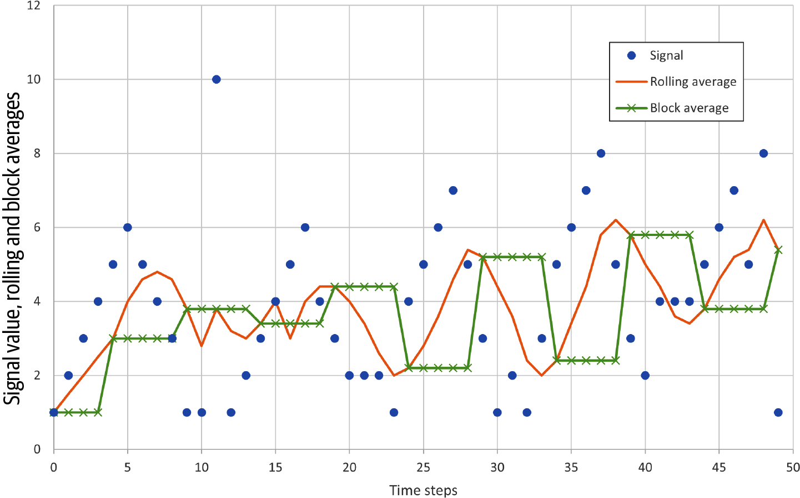

图12-1：滚动平均会跟踪每一个样本，而分块平均会在几个样本期间保持不变。

图中文字：横轴 Time steps 为时间步；纵轴 Signal value, rolling and block averages 为信号值、滚动平均与分块平均。Signal 为信号；Rolling average 为滚动平均；Block average 为分块平均。

<!-- source: pdf=347; section=不同的平均方法：累积平均与中位数; unit=p0347_b000_u00 -->

<a id="src-p347"></a>

### 不同的平均方法：累积平均与中位数 {#ch12-toc-003}

<!-- source: pdf=347; section=不同的平均方法：累积平均与中位数; unit=p0347_b001_u00 -->
有一种滚动平均的实现方式，既不需要 RAM 缓冲区，也不必不断重新求和：累积平均（cumulative average）把过去的所有值都当作等于平均值。每个新值按下面的方式计算：

<!-- source: pdf=347; section=不同的平均方法：累积平均与中位数; unit=p0347_b002_u00 -->
```c
int16_t UpdatedCumulativeAverage(int16_t prevAve, int16_t newSample, 
                                 int16_t numSamples) 
{
  int32_t sum = (numSamples-1) * prevAve;
  sum += newSample;
  return (sum/numSamples);
}
```

<!-- source: pdf=347; section=不同的平均方法：累积平均与中位数; unit=p0347_b003_u00 -->
虽然它并不完全等于算术平均值，但通常十分接近，如图12-2所示。它对信号突变的反应往往稍慢一些，变化速度比滚动平均慢。

<!-- source: pdf=347; section=不同的平均方法：累积平均与中位数; unit=p0347_b005_u00 -->
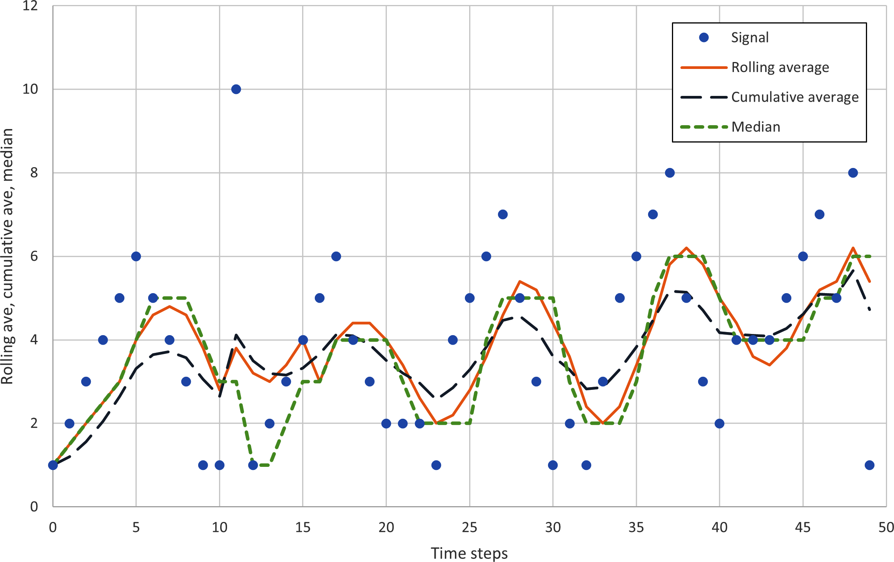

图12-2：滚动平均表示信号的 5 点算术平均值。累积平均的计算简单得多。中位数需要更多计算，但能抵抗毛刺。

图中文字：横轴 Time steps 为时间步；纵轴 Rolling ave, cumulative ave, median 为滚动平均、累积平均和中位数。Signal 为信号；Rolling average 为滚动平均；Cumulative average 为累积平均；Median 为中位数。

<!-- source: pdf=347,348; section=不同的平均方法：累积平均与中位数; unit=p0347_b006_u00,p0348_b000_u00 -->
另一种取平均的方法是中位数（median），目标是取出居中的值。这会消除数据中的离群值和短暂毛刺（比如图12-2样本数据中那个值为 10 的点）。不过，这需要将数据排序后选取中间值，因此要消耗更多 RAM（保留全部数据）和更多处理量（排序远比加减法昂贵）。另一方面，如果你的 ADC 偶尔会因为无线电干扰而出现毛刺，中值滤波器就很好用，只要把规模保持在 3 点或 5 点这样的小范围内即可。

<!-- source: pdf=348; section=整数运算的缺点; unit=p0348_b001_u00 -->

<a id="src-p348"></a>

### 整数运算的缺点

<!-- source: pdf=348; section=整数运算的缺点; unit=p0348_b002_u00 -->
4/4 是多少？1。很好。5/4 呢？嗯，在处理器看来，仍然是 1。6/4 和 7/4 也一样。整数除法会截断数值，就像对浮点数执行 floor() 函数一样。这可能会引发严重问题。

<!-- source: pdf=348; section=整数运算的缺点; unit=p0348_b003_u00 -->
例如，假设为了省去一次不必要的除法，你把滚动平均优化成这样：

<!-- source: pdf=348; section=整数运算的缺点; unit=p0348_b004_u00 -->
```c
newAverage = lastAverage + ((newSample- oldestSample)/length);
```

<!-- source: pdf=348; section=整数运算的缺点; unit=p0348_b005_u00 -->
如果样本的数值都差不多，算出来的平均值就会错得离谱。

<!-- source: pdf=348; section=整数运算的缺点; unit=p0348_b006_u00 -->
图12-3展示了 3 种不同形式的滚动平均。第一种是浮点版本，可以相当好地跟踪信号（当然会有一点延迟）。第二种是前面的示例实现，但存在整数截断，因为最旧和最新的样本分别除以了长度。它跟踪得还算不错，但可以看出一些误差。最后一种就是刚刚给出的实现，同样存在截断。它省下了一步开销很大的除法，结果却毫无用处。

<!-- source: pdf=348; section=整数运算的缺点; unit=p0348_b007_u00 -->
你希望节省资源，而不是制造无用的结果。

<!-- source: pdf=348; section=整数运算的缺点; unit=p0348_b009_u00 -->
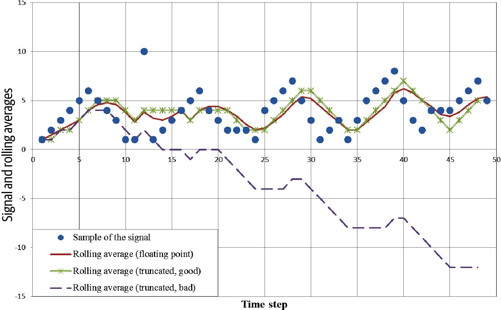

图12-3：截断导致滚动平均失效。

图中文字：横轴 Time step 为时间步；纵轴 Signal and rolling averages 为信号与滚动平均。Sample of the signal 为信号样本；Rolling average (floating point) 为滚动平均（浮点）；Rolling average (truncated, good) 为滚动平均（截断，效果良好）；Rolling average (truncated, bad) 为滚动平均（截断，效果不佳）。

<!-- source: pdf=349; section=整数运算的缺点; unit=p0349_b000_u00 -->

<a id="src-p349"></a>

解决方法说起来很简单：应该用大得多的数去除以小得多的数；两者的数量级不应该相近。

<!-- source: pdf=349; section=整数运算的缺点; unit=p0349_b001_u00 -->
实现起来就没有说起来那么容易了。如果预先知道会遇到这个问题，可以选择放大分子的数值（也就是把每个样本都乘以某个固定常量）。对于求平均，只要所乘的常量大于参与平均的样本数就够了。这对我们的例子很合适。得到的平均值也会按这个倍数放大，所以如果需要取回真实值，之后还得除以这个乘数。如果只是比较数值，就完全不必再做除法，因为它们之间的相对大小是正确的。

<!-- source: pdf=349; section=整数运算的缺点; unit=p0349_b002_u00 -->
你可以选择任意常量，只要乘完之后的样本没有大到超出变量能容纳的范围。除法可能造成下溢，而乘法可能造成上溢，同样会导致奇怪的行为。这意味着你需要知道预期接收的数据范围。利用对系统的了解进行优化非常有用，但也可能让系统变得脆弱，以至于看似微小的变化（例如输入范围变化 10%）就会导致错误。

<!-- source: pdf=349; section=整数运算的缺点; unit=p0349_b003_u00 -->
因此，整数运算的缺点在于：你必须知道并依赖输入值的范围，才能确保精度不足不会损害准确度。

<!-- source: pdf=349; section=使用现成算法; unit=p0349_b004_u00 -->
## 使用现成算法 {#ch12-toc-004}

<!-- source: pdf=349; section=使用现成算法; unit=p0349_b005_u00 -->
现在，你对哪些操作快已经有了一点感觉（加法、位移，也许还有乘法）。接下来我要告诉你，在需要用尽可能少的资源实现算法时，最重要的一件事：查资料。如果是标准算法，就上网搜索，或者找一本数值算法手册。如果已经有人花费时间和精力，解释了如何减少处理器周期或 RAM 用量，就利用他们的成果。一定要注意版权，不过大多数教学资料本来就是供人使用的。网上能找到许多算法优化方面的内容，但“延伸阅读”（原书第 352 页）中介绍的一些可靠资料，也值得摆在书架上，以备不时之需。

<!-- source: pdf=349; section=使用现成算法; unit=p0349_b006_u00 -->
一个算法可能有好几种实现方式，但只有一两种能够节省你想保住的资源。以标准差为例。

<!-- source: pdf=349,350; section=使用现成算法; unit=p0349_b007_u00,p0350_b001_u00 -->
标准差（σ）表示一组样本偏离这组样本平均值的程度。计算标准差时，要用到组中的每个样本（x<sub>i</sub>）、这一组的均值或平均值（x<sub>mean</sub>），以及样本数（N），计算方法见公式12-1（虽然不太直观，但其中的两个公式是等价的）。

<!-- source: pdf=350; section=使用现成算法; unit=p0350_b002_u00,p0350_b003_u00,p0350_b003_u01,p0350_b004_u00,p0350_b003_u02,p0350_b005_u00,p0350_b005_u01,p0350_b005_u02,p0350_b005_u03 -->

<a id="src-p350"></a>

公式12-1：计算标准差的两个等价公式

![σ = √[(1/N) ∑ᵢ₌₁ᴺ (xᵢ − xₘₑₐₙ)²]；σ = √[(1/N) ∑ᵢ₌₁ᴺ (xᵢ²) − xₘₑₐₙ²]](../assets/figures/equation_12-1.png)

<!-- source: pdf=350; section=使用现成算法; unit=p0350_b006_u00 -->
怎样让这个计算更适合嵌入式系统呢？先看平方根部分。最简单的答案就是：不求平方根。虽然这样会改变结果的数值，但它所提供的、关于样本变动程度的信息并不会改变。因为很多人都这样做，未开平方根的标准差有一个名字，叫作方差（variance）。[^ch12-1]

<!-- source: pdf=350; section=使用现成算法; unit=p0350_b007_u00 -->
（想想看，仅仅重新定义目标，我们就已经省下了多少处理器周期！）

<!-- source: pdf=350; section=使用现成算法; unit=p0350_b008_u00 -->
一开始，我们可以基本按照公式原样实现方差计算：

<!-- source: pdf=350; section=使用现成算法; unit=p0350_b009_u00,p0350_b010_u00 -->
```c
floatGetVariance(int16_t* samples, uint16_t numSamples, int16_t mean) {
  uint32_t sumSquares = 0;
  int32_t tmp;
  uint32_t i;

  for (i = 0; i < numSamples; i++) {
    tmp = samples[i] - mean;
    sumSquares += tmp*tmp;
  }
  return ((float) sumSquares / numSamples);
}
```

<!-- source: pdf=350; section=使用现成算法; unit=p0350_b011_u00 -->
注意，均值是作为参数传入函数的。这一块数据的均值已经算好了。另一段代码已经查看过每个样本，因此这个函数是在第二次遍历数据。除了两次执行循环效率不高以外，你还得把全部数据保存在缓冲区里，这很可能是在浪费 RAM。

<!-- source: pdf=350; section=使用现成算法; unit=p0350_b012_u00 -->
不过，和分块平均一样，你也可以一边处理样本，一边计算方差。公式12-1中的第二个公式更清楚地说明了这一点。注意，这种方差计算还会顺便算出分块平均，不需要额外代价：

<!-- source: pdf=350,351; section=使用现成算法; unit=p0350_b013_u00,p0351_b000_u00 -->
```c
struct sVar {
  int32_t sum;
  uint64_t sumSquares;
  uint16_t numSamples;
};
void AddSampleToVariance (struct sVar *var, int16_t newSample) {
  var->sum += newSample;
  var->sumSquares += newSample*newSample;
  var->numSamples++;
}
float GetVariance(struct sVar *var, float *average) {
  float variance;
  *average = (float) var->sum / var->numSamples; 
  variance = (var->sumSquares - (var->sum * (*average)))
                       / (var->numSamples-1); 
  return variance;
}
```

<!-- source: pdf=350; section=使用现成算法; unit=p0350_b000_u00 -->
[^ch12-1]: 如果你不熟悉方差（或任何数学运算）的定义，就去查一查。[Wikipedia](https://en.wikipedia.org/wiki/Variance) 是很好的起点。其中还有一个[“Algorithms for calculating variance”（方差计算算法）](https://en.wikipedia.org/wiki/Algorithms_for_calculating_variance)页面，介绍了各种实现技巧，也包括这里讨论的方法。

<!-- source: pdf=351; section=使用现成算法; unit=p0351_b001_u00 -->

<a id="src-p351"></a>

这种实现有一个问题：sumSquares 变量可能变得很大（样本很多时，连 sum 都可能相当大）。假设函数采用的不是代码中的有符号 16 位样本，而是有符号 8 位样本。如果有两个样本，值都为 127，那么 sumSquares 就是 32,258，几乎需要 15 位。当有 5 个样本都取最大值时，就需要 17 位来保存 sumSquares，这意味着得换用 32 位变量。如果使用 16 位数值，sumSquares 就需要是 64 位变量。使用大变量会耗费 RAM 和处理器周期。

<!-- source: pdf=351; section=使用现成算法; unit=p0351_b002_u00 -->
两遍遍历的实现不会出现这个问题，因为每个样本都减去 mean，可以使平方和保持在相对较小的范围内。不过，有一种办法既不需要很大的中间变量，也不必对数据进行两次遍历：

<!-- source: pdf=351; section=使用现成算法; unit=p0351_b003_u00 -->
```c
struct sVar {
  int16_t mean;
  int32_t M2;
  uint16_t numSamples;
};
void AddSampleToVariance(struct sVar *var, int16_t newSample) {
  int16_t delta = newSample - var->mean;
  var->numSamples++;
  var->mean += delta/var->numSamples;
  var->M2 += delta * (newSample - var->mean); // uses the new mean
}
uint16_t GetVariance(struct sVar *var, int16_t *average) {
  uint16_t variance = var->M2/var->numSamples;
  *average = var->mean; // running average already calculated
  // get ready for the next block
  var->numSamples =0; var->mean = 0; var->M2 = 0;
  return variance;
}
```

<!-- source: pdf=352; section=使用现成算法; unit=p0352_b001_u00 -->

<a id="src-p352"></a>

我觉得自己大概想不出这个办法，尤其是在一心想着怎样看出系统中的样本偏离均值多少的时候。就连 Donald E. Knuth 也将这个方法归功于另一位作者 B. P. Welford 的一篇文章。

<!-- source: pdf=352; section=使用现成算法; unit=p0352_b002_u00 -->
再仔细看看这段代码。保存方差的中间变量，只需要使用位宽为样本两倍的变量（因此，样本若为 8 位，M2 可以是 16 位）。这种方法允许用与数据相同位宽的变量保存均值（而前面的 sum 变量大小取决于样本数）。不过，代码的可读性变差了，而且如果改变 AddSampleToVariance 中语句的顺序，它就会出错。它还在每次处理中执行一次除法；更糟的是，计算 mean 的除法可能会造成问题，因为 delta 很可能很小，小到整数截断可能使均值变成零。

<!-- source: pdf=352; section=使用现成算法; unit=p0352_b003_u00 -->
没错，凡事都有代价。有时，试图节省处理器周期就像想紧紧攥住一个气球：你抓得越紧，气球的其他部分就越会从指缝间鼓出来。如果采用一个已经得到充分理解的算法，那么很可能有人已经替你分析过它会怎样失效。

<!-- source: pdf=352; section=使用现成算法; unit=p0352_b004_u00 -->
>  如果你确实需要标准差，而不是方差，有许多近似求平方根的方法。Wikipedia 的[“Methods of Computing Square Roots”（平方根计算方法）](https://en.wikipedia.org/wiki/Methods_of_computing_square_roots)页面列出了 10 多种。选一两种，再用性能分析工具将它们与你的编译器数学库做比较。

<!-- source: pdf=352; section=设计算法与修改算法; unit=p0352_b005_u00 -->
## 设计算法与修改算法 {#ch12-toc-005}

<!-- source: pdf=352; section=设计算法与修改算法; unit=p0352_b006_u00 -->
有时，你的算法超出了简单数学运算的范围，却又不是能从书中找到现成做法的东西。实现各种处理器密集型操作，有许多技巧可用。掌握一些基本组成部分后，你就能自行优化。就像做菜一样，知道的菜谱越多，改动成功的可能性就越大。

<!-- source: pdf=352; section=对多项式提取公因式; unit=p0352_b007_u00 -->
### 对多项式提取公因式 {#ch12-toc-006}

<!-- source: pdf=352; section=对多项式提取公因式; unit=p0352_b008_u00 -->
假设某个计算可以这样实现：

<!-- source: pdf=352; section=对多项式提取公因式; unit=p0352_b009_u00 -->
```c
y = A*x + B*x + C*x;
```

<!-- source: pdf=352; section=对多项式提取公因式; unit=p0352_b010_u00 -->
这需要 3 次乘法和 2 次加法。如果对多项式提取公因式，就只需要 2 次加法和 1 次乘法：

<!-- source: pdf=352; section=对多项式提取公因式; unit=p0352_b011_u00 -->
```c
y = (A + B + C)*x;
```

<!-- source: pdf=353; section=对多项式提取公因式; unit=p0353_b002_u00 -->

<a id="src-p353"></a>

好多了。再来看一个非线性例子，用提取公因式来减轻处理负担。这不过是把多项式由外到内重新整理一遍：

<!-- source: pdf=353; section=对多项式提取公因式; unit=p0353_b003_u00 -->
```text
A*x³+B*x²+Cx  ==>  ((Ax+B)x+C)x
```

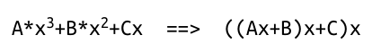

<!-- source: pdf=353; section=对多项式提取公因式; unit=p0353_b004_u00 -->
在左边，如果先将 x 立方再乘以 A，依此类推，就需要进行 9 次乘法和 2 次加法。换成另一种写法，相同的答案只需 3 次乘法和 2 次加法就能得到。多项式的组织方式对尽量减少处理器周期非常重要。[^ch12-2]

<!-- source: pdf=353; section=对多项式提取公因式; unit=p0353_b000_u00 -->
[^ch12-2]: 这种方法叫作霍纳法（Horner’s scheme），由数学家 William George Horner 提出。

<!-- source: pdf=353; section=泰勒级数; unit=p0353_b005_u00 -->
### 泰勒级数 {#ch12-toc-007}

<!-- source: pdf=353; section=泰勒级数; unit=p0353_b006_u00 -->
多项式很重要，因为它是对算法中复杂步骤进行建模的一种方式。泰勒级数（Taylor series）将函数表示为无穷多项的和。它适用于大多数函数，包括三角函数（正弦、余弦、正切、反正弦等）、更复杂的多项式（x⁻¹）、平方根和对数。在无穷级数中加入的项越多，结果的精度就越高（也越准确）。反过来看也一样：要得到足够准确的函数值，并不需要无穷多项。

<!-- source: pdf=353; section=泰勒级数; unit=p0353_b007_u00 -->
为一般的多项式构造泰勒级数，需要相当多的数学知识，超出了本书的范围（远不止霍纳法那一点小技巧）。不过，这些算法很容易查到。例如，可以用正弦函数的泰勒级数展开来替代正弦函数（见公式12-2）。

<!-- source: pdf=353; section=泰勒级数; unit=p0353_b008_u00,p0353_b009_u00,p0353_b010_u00,p0353_b011_u00,p0353_b012_u00,p0353_b013_u00,p0353_b014_u00 -->
公式12-2：正弦函数的泰勒级数，并用霍纳法重新排列

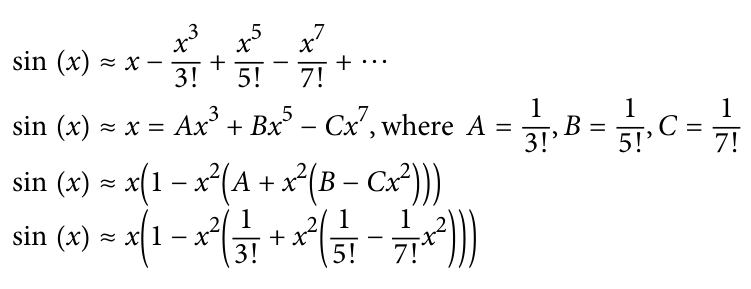

式中，where 意为“其中”。〔待确认：本式的等号与部分符号依原书保留。〕

<!-- source: pdf=353; section=泰勒级数; unit=p0353_b015_u00 -->
>  本节的所有角度都以弧度表示。记住，π 弧度 = 180°。

<!-- source: pdf=353,354; section=泰勒级数; unit=p0353_b016_u00,p0354_b001_u00 -->
对于包含 4 项的泰勒级数，自变量在 π 与 –π 之间时，误差很小（0.000003）。如果这个误差仍然太大，可以加入泰勒级数的下一项（+x⁹/9!），以提高准确度。或者，如果能够接受更大的误差范围（特别是在 +/–π 的边缘附近），就可以使用更少的项。

<!-- source: pdf=354; section=泰勒级数; unit=p0354_b002_u00 -->

<a id="src-p354"></a>

>  物理学家常常只取第一项，用 sin(x)=x 来近似。x 越接近 0，效果越好。

<!-- source: pdf=354; section=泰勒级数; unit=p0354_b003_u00 -->
和前面一样，要真正做好优化，就得了解输入以及系统能够接受的误差。如果输入范围是 –0.2π 到 0.2π，而你要求的准确度是 10%，就可以采用物理学家的近似法。如果要求误差小于 1%，则可以使用泰勒展开的前两项。泰勒级数让你能够在处理能力与应用所需的准确度之间做出权衡（见图12-4）。

<!-- source: pdf=354; section=泰勒级数; unit=p0354_b005_u00 -->
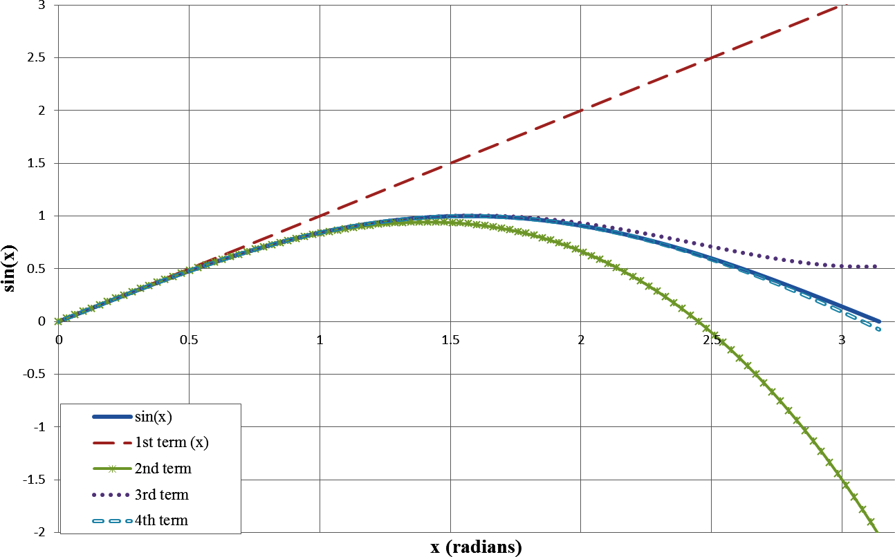

图12-4：正弦泰勒级数采用不同项数时的准确度。

图中文字：横轴 x (radians) 为 x（弧度）；纵轴为 sin(x)。图例中 sin(x) 为正弦函数；1st term (x) 为第 1 项（x）；2nd term、3rd term、4th term 分别为取到第 2、3、4 项。

<!-- source: pdf=354; section=泰勒级数; unit=p0354_b006_u00 -->
由于只用乘法和加法，泰勒级数对处理器的负担相对较轻。代入常量，并使用霍纳法，就可以将正弦的前 4 项（以浮点形式）实现为：

<!-- source: pdf=354,355; section=泰勒级数; unit=p0354_b007_u00,p0355_b000_u00 -->
```c
xSq = x*x;
sinX = x * (1 - xSq * (INVERSE_THREE_FACTORIAL + xSq *
           (INVERSE_FIVE_FACTORIAL - INVERSE_SEVEN_FACTORIAL * xSq)));

// or taking it apart and writing multiple steps, starting with
// the end and moving toward the front:
tmp = - INVERSE_SEVEN_FACTORIAL * xSq;
tmp = xSq * (INVERSE_FIVE_FACTORIAL + tmp);
tmp = xSq * (-INVERSE_THREE_FACTORIAL + tmp);
sinX = x * (1 - tmp);
```

<!-- source: pdf=355; section=泰勒级数; unit=p0355_b001_u00 -->

<a id="src-p355"></a>

为什么这里必须使用浮点数？因为 INVERSE_THREE_FACT 以及其他常量必须介于 0 和 1 之间。不过，有办法绕过这个问题。

<!-- source: pdf=355; section=除以常量; unit=p0355_b002_u00 -->
### 除以常量 {#ch12-toc-008}

<!-- source: pdf=355; section=除以常量; unit=p0355_b003_u00 -->
除法是开销相对较大的算术步骤。不过，除以常量时，有些捷径可走。以正弦的泰勒级数为例，假设需要除以 3!，也就是 3 × 2 × 1 = 6。这并不难：

<!-- source: pdf=355; section=除以常量; unit=p0355_b004_u00 -->
```c
uint16_t DivideThreeFactorial(uint16_t input) {
  const uint16_t denominator = 6;
  return input/denominator;
}
```

<!-- source: pdf=355; section=除以常量; unit=p0355_b005_u00 -->
暂时先不管 x 位于 +/–π 之间这件事，拿一个更大的数来试试。如果输入是 245，整数运算的结果就是 40（浮点运算则为 245 / 6 = 40.833）。这里我暂时不关心截断，只关心除法本身。有没有办法让它更快？

<!-- source: pdf=355; section=除以常量; unit=p0355_b006_u00 -->
移位要快得多。遗憾的是，6 不是 2 的幂。不过，1/6 也可以用其他形式表示，例如 2/12。我们想找到“某个乘数/2 的幂”这种形式，使它至少在很小的误差范围内等于 1/6（0.166667）。这样就可以用分子乘以输入，再将结果移位，完成除法。我们把一次除法换成一次乘法和一次移位。表12-1列出了一些乘数、与之对应的 2 的幂除数，以及产生的误差。

<!-- source: pdf=355,356; section=除以常量; unit=p0355_b007_u00,p0355_b008_u00,p0355_b008_u01,p0356_b001_u00,p0356_b001_u01 -->
表12-1：用 2 的幂作除数来近似 1/6

| 乘数 | 除数 | 等效移位位数 | 结果 | 误差 % |
|---:|---:|---:|---:|---:|
| 1 | 6 | 无 | 0.166666667 | 0 |
| 3 | 16 | 4 | 0.1875 | 12.5 |
| 5 | 32 | 5 | 0.15625 | 6.2 |
| 11 | 64 | 6 | 0.171875 | 3.1 |
| 21 | 128 | 7 | 0.164063 | 1.5 |
| 43 | 256 | 8 | 0.167969 | 0.78 |
| 85 | 512 | 9 | 0.166016 | 0.39 |
| 171 | 1,024 | 10 | 0.166992 | 0.19 |
| 341 | 2,048 | 11 | 0.166504 | 0.09 |
| 683 | 4,096 | 12 | 0.166748 | 0.04 |

<!-- source: pdf=356; section=除以常量; unit=p0356_b002_u00 -->

<a id="src-p356"></a>

注意，表中的移位每增加一位，误差就减半。因此，除以 3! 的函数可以这样实现：

<!-- source: pdf=356; section=除以常量; unit=p0356_b003_u00,p0356_b004_u00 -->
```c
#define DIVIDE_THREE_FACT_MULT 171
#define DIVIDE_THREE_FACT_SHIFT 10

int16_t DivideThreeFactorial(int16_t input) {
  int32_t tmp = input* DIVIDE_THREE_FACT_MULT;
  return (tmp >> DIVIDE_THREE_FACT_SHIFT);
}
```

<!-- source: pdf=356; section=除以常量; unit=p0356_b005_u00 -->
输入和输出都是 16 位，但需要一个 32 位变量来保存乘法结果。即使用上更大的临时变量，这个函数的开销仍然比除法小。大概如此。

<!-- source: pdf=356; section=除以常量; unit=p0356_b006_u00 -->
>  如果不做最后的移位，结果的精度可能比经过截断的除法更高。使用这个值时，必须记住它已经被乘以了 1,024。

<!-- source: pdf=356; section=除以常量; unit=p0356_b007_u00 -->
不过，这种实现有一个很大的缺点：必须事先知道除数，才能构造这个函数。虽然只要需要除以常量，这种方法就有用，但它还不够通用，无法让所有除法都消失。

<!-- source: pdf=356; section=缩放输入; unit=p0356_b008_u00 -->
### 缩放输入 {#ch12-toc-009}

<!-- source: pdf=356; section=缩放输入; unit=p0356_b009_u00 -->
正弦函数接收 –π 到 π 之间的输入，输出 -1 到 1 之间的值。如果想避开浮点数，这些都很难处理。不过，可以把所有量都乘以一个常量，以得到比普通整数更细的分辨率。例如，若想消除正弦函数中的浮点数，可以将输入范围改为 +/–(1,024*π)，再对输出放大了 1,024 倍这件事进行补偿。

<!-- source: pdf=356; section=缩放输入; unit=p0356_b010_u00 -->
对于满足 f(Ax) = Af(x) 的数学运算，优化很简单，只需使用缩放后的输入。即便函数满足的是 f(Ax) = f(A)f(x)，消除缩放因子也很直接：除以 f(A) 即可。不过，正弦函数不满足这些条件，无法轻易消除缩放因子。

<!-- source: pdf=356; section=缩放输入; unit=p0356_b011_u00 -->
因此，我们需要确保泰勒展开的每一项都乘以 1,024，而且只能乘一次。这意味着，每当 x 与 x 相乘时，都必须除以 1,024，避免缩放因子也随输入值一起被平方：

<!-- source: pdf=357; section=缩放输入; unit=p0357_b000_u00 -->

<a id="src-p357"></a>

```c
xSq = (x*x) >> 10;  // right-shift by 10 is equal to divide by 1,024
tmp = - DivideSevenFactorial(xSq);
tmp = (xSq * (INVERSE_FIVE_FACTORIAL + tmp)) >> 10;
tmp = (xSq * (-INVERSE_THREE_FACTORIAL + tmp)) >> 10;
sinX = x - ((x * tmp)>>10);
```

<!-- source: pdf=357; section=缩放输入; unit=p0357_b001_u00 -->
好消息是，经过缩放，有些步骤中的除法变得更容易了。所有量都必须乘以缩放因子，包括常量。我们不再乘以 1/3!（实质上是除以 6），而是乘以 1,024/3!，约等于 171。由于 5! 等于 120，将 1,024/120 的结果（8.533）取整为 8 时，误差会更大。最后一项的分母（7! = 5,040）仍然很大，所以还需要真正做一些除法，不过仍然是除以常量。由于它是个小常量，会带来一些误差，如图12-5所示。

<!-- source: pdf=357; section=缩放输入; unit=p0357_b003_u00 -->
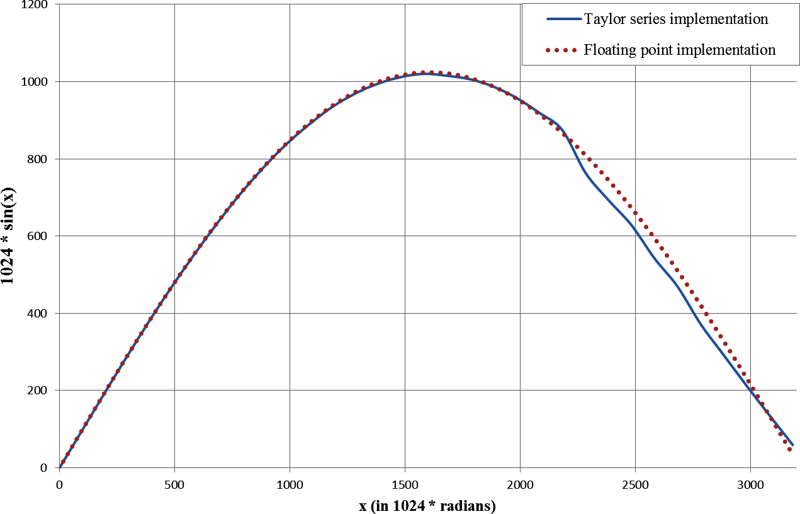

图12-5：泰勒级数中缩放输入带来的误差（0 到 π）。

图中文字：横轴 x (in 1024 * radians) 为 x（以 1024 * 弧度为单位）；纵轴为 1024 * sin(x)。Taylor series implementation 为泰勒级数实现；Floating point implementation 为浮点实现。

<!-- source: pdf=357; section=缩放输入; unit=p0357_b004_u00 -->
有办法减轻这些误差（例如用更大的数进行缩放）。在实现改动时，你需要了解误差是从哪里进入系统的。和性能分析一样，大部分时间都应该花在最大的误差来源上，而不是去优化影响很小的因素。

<!-- source: pdf=357; section=缩放输入; unit=p0357_b005_u00 -->
缩放以及用移位实现除法的思路，在定点运算（fixed-point math）中很常见。它们将帮助我们构造一种完全避开浮点数的方法。不过，在此之前，先来看看一种非常流行的节省处理器周期的办法。

<!-- source: pdf=358; section=查找表; unit=p0358_b000_u00 -->

<a id="src-p358"></a>

### 查找表 {#ch12-toc-010}

<!-- source: pdf=358; section=查找表; unit=p0358_b001_u00 -->
正如第11章所提到的（其面试题中还有更详细的讨论），查找表（lookup table）快得惊人，只需占用一点代码空间。

<!-- source: pdf=358; section=查找表; unit=p0358_b002_u00 -->
不过，要使用查找表，必须知道输入范围和可接受的误差。在泰勒展开中，这些因素决定要计算多少项；在查找表中，它们决定表里需要多少个条目。

<!-- source: pdf=358; section=隐式输入; unit=p0358_b003_u00 -->
#### 隐式输入

<!-- source: pdf=358; section=隐式输入; unit=p0358_b004_u00 -->
查找表的每个条目需要两项信息：输入（x）和输出（y）。但并非所有查找表都要求把两者都存入表中。对于隐式输入（implicit input）查找表，条目在数组中的位置就代表输入值。例如，下面是一张正弦查找表，输入以毫弧度表示（–π/1,000 到 +π/1,000），输出也按 1,000 倍缩放。（查找表减少了移位的需求，也就减少了对 2 的幂运算的依赖，因此缩放方式往往更便于人阅读。）

<!-- source: pdf=358; section=隐式输入; unit=p0358_b005_u00 -->
```c
const int16_t sinLookup[] = {
  -58,   // x =  -3200
  -335,  // x =  -2800
  -676,  // x =  -2400
  -910,  // x =  -2000
  -1000, // x =  -1600
  -933,  // x =  -1200
  -718,  // x =  -800
  -390,  // x =  -400
   0,    // x =  0
   389,  // x =  400
   717,  // x =  800
   932,  // x =  1200
   999,  // x =  1600
   909,  // x =  2000
   675,  // x =  2400
   334,  // x =  2800
  -59    // x =  3200
};
```

<!-- source: pdf=358; section=隐式输入; unit=p0358_b006_u00 -->
泰勒展开涵盖所有可能的输入（尽管我只展示了 0 到 π），而这张表只覆盖 –π 到 π 的范围。如果给泰勒展开输入 2π，它仍然能工作。查找表可不是这样；你必须知道输入范围。

<!-- source: pdf=358; section=隐式输入; unit=p0358_b007_u00 -->
使用这张表时，需要算出与输入对应的索引。做法是减去表中的最小值，再除以表的步长：

<!-- source: pdf=358; section=隐式输入; unit=p0358_b008_u00 -->
```c
uint8_t index = (x - (-3200))/400;
y = sinLookup[index];
```

<!-- source: pdf=359; section=隐式输入; unit=p0359_b000_u00 -->

<a id="src-p359"></a>

等等，既然现在又要做除法，我们为什么还要拼命优化正弦函数？说得对。表的步长不仅影响表的精度，也可能改变所需的处理量。选择不是 2 的幂的步长，是个糟糕的决定。如果选 512，表只会稍微小一点（精度低一点），处理过程却会更短：

<!-- source: pdf=359; section=隐式输入; unit=p0359_b001_u00 -->
```c
uint8_t index = (x - (-3145))>>9; // use #defs, not magic numbers!
y = sinLookup[index];
```

<!-- source: pdf=359; section=隐式输入; unit=p0359_b002_u00 -->
表中只有 13 个条目，精度并不高，但结果会准确吗？图12-6展示了数据点，以及它们在这一计算中会落到哪里。默认情况下，查表结果存在偏移（图中的三角形）。如果查得的数值对应于所覆盖区间的中心，表就会更准确，如图中的 × 所示。无论哪种方式，得到的都是阶梯状近似；但可以让阶梯围绕目标输出居中，从而降低误差。

<!-- source: pdf=359; section=隐式输入; unit=p0359_b004_u00 -->
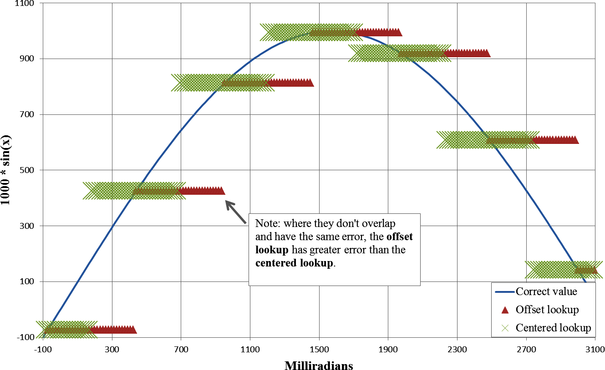

图12-6：比较正弦偏移查找表的输出与偏移半个步长后的居中查找表输出。

图中文字：横轴 Milliradians 为毫弧度；纵轴为 1000 * sin(x)。Correct value 为正确值；Offset lookup 为偏移查找；Centered lookup 为居中查找。图内注释：注意，在它们没有重合且具有相同误差的地方，偏移查找的误差大于居中查找。〔待确认：原图注释的措辞存在矛盾，依原文保留。〕

<!-- source: pdf=359; section=隐式输入; unit=p0359_b005_u00 -->
为此不必修改表本身，只需改变索引。实际上，只要在计算索引时加上半个步长：

<!-- source: pdf=359; section=隐式输入; unit=p0359_b006_u00 -->
```c
uint8_t index = (x - (-3145 - 256))>>9;
y = sinLookup[index];
```

<!-- source: pdf=360; section=隐式输入; unit=p0360_b001_u00 -->

<a id="src-p360"></a>

>  加上半个步长，让结果居中的做法，几乎存在于每一张实现良好的查找表中。

<!-- source: pdf=360; section=隐式输入; unit=p0360_b002_u00 -->
一旦改变了有效范围，我建议让注释同时说明范围和取值：

<!-- source: pdf=360; section=隐式输入; unit=p0360_b003_u00 -->
```c
#define BASE_SIN_LOOKUP (-3124 - 256)
#define SHIFT_SIN_LOOKUP 9
const int16_t sinLookup[] = {
  3,     // x @ -3145, for range -3401  to  -2888
  -487,  // x @ -2633, for range -2889  to  -2376
  -853,  // x @ -2121, for range -2377  to  -1864
  -1000, // x @ -1609, for range -1865  to  -1352
  -890,  // x @ -1097, for range -1353  to  -840
  -553,  // x @ -585,  for range -841   to  -328
  -73,   // x @ -73,   for range -329   to  182
  425,   // x @ 493,   for range 183    to  695
  813,   // x @ 951,   for range 695    to  1207
  994,   // x @ 1463,  for range 1207   to  1719
  919,   // x @ 1975,  for range 1719   to  2231
  608,   // x @ 2487,  for range 2231   to  2743
  142,   // x @ 2999,  for range 2743   to  3255
};
```

<!-- source: pdf=360; section=隐式输入; unit=p0360_b004_u00 -->
注意，这张新表的步长为 512，共有 13 个条目。其数值如图12-7所示。这张表不仅覆盖预期输入（–π 到 +π），还稍微多覆盖了一些。不过，如果有可能收到超出表范围的数据，就应加入验证输入的代码。毕竟，如果输入是 2π，索引就会是 19，超出表的范围。然而，在 C/C++ 中访问 sinLookup[19] 可能仍然能执行，却会得到完全错误的结果（也可能直接让系统崩溃）。

<!-- source: pdf=361; section=隐式输入; unit=p0361_b002_u00 -->

<a id="src-p361"></a>

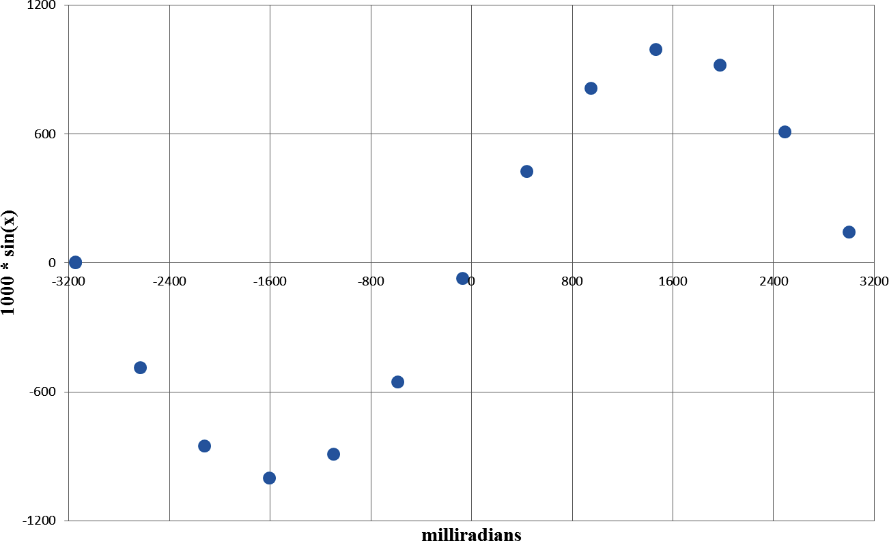

图12-7：正弦查找表中的点。

图中文字：横轴 milliradians 为毫弧度；纵轴为 1000 sin(x)。

<!-- source: pdf=361; section=线性插值; unit=p0361_b003_u00 -->
#### 线性插值

<!-- source: pdf=361; section=线性插值; unit=p0361_b004_u00 -->
即使对查找表做了居中偏移，有时你仍然希望结果比“用一个数代表某个输入范围”更准确。这时，线性插值（linear interpolation）可能是个办法。

<!-- source: pdf=361; section=线性插值; unit=p0361_b005_u00 -->
>  也可以采用其他插值方法。要权衡多项式拟合所增加的计算需求，与使用更大查找表所需的代码空间。

<!-- source: pdf=361; section=线性插值; unit=p0361_b006_u00 -->
如图12-8所示，线性插值并不难，只是用到一点你可能有一阵子没用过的代数知识。你需要从查找表中取两个值：一个在当前输入之下，另一个在它之上。图中的目标是求出某个特定 x 值对应的输出，因此使用了最接近的两个点。由于输入和输出是关联的，做插值时，我觉得把它们当作点、而不是彼此独立的数值，会更简单：

<!-- source: pdf=361; section=线性插值; unit=p0361_b007_u00 -->
```c
struct sPoint {
  int16_t x;
  int16_t y
};
```

<!-- source: pdf=362; section=线性插值; unit=p0362_b001_u00 -->

<a id="src-p362"></a>

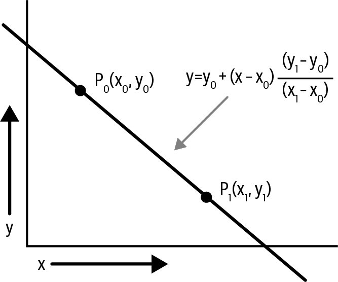

图12-8：线性插值。

图中文字：两个端点为 P₀(x₀, y₀) 和 P₁(x₁, y₁)，坐标轴为 x 和 y；直线上点的公式为 y = y₀ + (x − x₀)(y₁ − y₀)/(x₁ − x₀)。

<!-- source: pdf=362; section=线性插值; unit=p0362_b002_u00 -->
线性插值代码只涉及简单的数学运算；只要确保乘法过程中不发生位宽溢出即可：

<!-- source: pdf=362; section=线性插值; unit=p0362_b003_u00 -->
```c
// This linear interpolation code does:
// y = p0.y + ((x-p0.x)*(p1.y-p0.y))/(p1.x-p0.x);
// but in a bit-safe way.
int16_t Interpolate(struct sPoint p0, struct sPoint p1, int16_t x) {
  int16_t y;
  int32_t tmp; // start and end with int16s,
               // but can need a larger intermediate
  tmp = (x - p0.x);
  tmp *= (p1.y - p0.y);
  tmp /= (p1.x - p0.x);
  y = p0.y + tmp; // now safe to go back to 16 bits
  return (y);
}
```

<!-- source: pdf=362; section=线性插值; unit=p0362_b004_u00 -->
即使输入不在这两个点之间，这种方法也能使用。如果输入刚好超出表的范围，可以用表中的最后两个点，向末尾之外进行插值（但准确度可能会下降）。

<!-- source: pdf=362; section=线性插值; unit=p0362_b005_u00 -->
注意，线性插值用到了除法。你是在用一些处理器周期，换取更小表格（代码空间）所能提供的更高准确度。把查找表的 x 步长设为 2 的幂，就能避开除法（我在上一张正弦查找表中就是这么做的）。此时除数是 2 的幂，因此除法可以变成移位。

<!-- source: pdf=362,363; section=线性插值; unit=p0362_b006_u00,p0363_b001_u00 -->
虽然查表依赖表本身，插值却可以与它保持一层独立关系。当你通过优化消除除法时，插值函数就开始依赖表中的数据了。如果有多张表，就需要多个插值函数（或者用一个参数描述移位位数）。要小心，这会降低代码的可读性，而且将数据与代码绑在一起会使代码更加脆弱。如果确实需要节省这些处理器周期，这也许是最好的办法。但代码会因此变得纠缠不清。

<!-- source: pdf=363; section=在表中显式保存输入; unit=p0363_b002_u00 -->

<a id="src-p363"></a>

#### 在表中显式保存输入

<!-- source: pdf=363; section=在表中显式保存输入; unit=p0363_b003_u00 -->
对于某些函数，可以允许步长变化，并在各点之间插值，从而建立更小或更准确的表。正弦函数靠近中心的部分很接近直线，图12-7中可以看到这一点。我们完全可以去掉最靠近中心的 3 个点，交给线性插值来处理（这也就是 x 较小时，sin(x) = x 这种近似如此流行的原因）。即使在最外侧的边缘，也可以去掉一个样本；真正需要更多点的，是那些难处理的弯曲部分。

<!-- source: pdf=363; section=在表中显式保存输入; unit=p0363_b004_u00 -->
有时，查找表会采用可变步长，以降低某些区域的误差。区域之间可以使用线性插值，如图12-9所示。

<!-- source: pdf=363; section=在表中显式保存输入; unit=p0363_b005_u00 -->
>  如果需要根据环境来建立表格，例如校准传感器所受的温度影响，通常会使用显式输入查找表。x 值是通过热敏电阻（也就是温度传感器）读取的温度，y 值则是相对于预期值的偏移量。

<!-- source: pdf=363; section=在表中显式保存输入; unit=p0363_b007_u00 -->
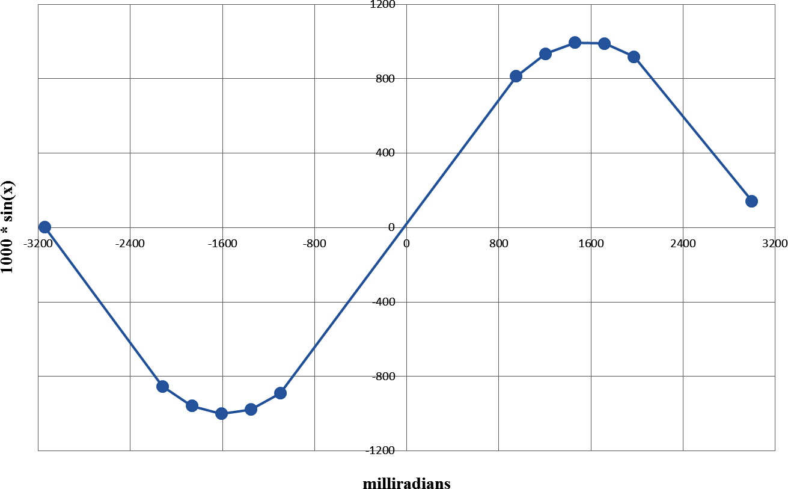

图12-9：在显式查找表的各点之间使用线性插值。

图中文字：横轴 milliradians 为毫弧度；纵轴为 1000 * sin(x)。

<!-- source: pdf=364; section=在表中显式保存输入; unit=p0364_b000_u00 -->

<a id="src-p364"></a>

现在，查找表的大小几乎翻了一倍，因为除了数值以外，还必须放入其覆盖范围的起点。它占用了更多代码空间，但我们在最需要的区域获得了更高的准确度：

<!-- source: pdf=364; section=在表中显式保存输入; unit=p0364_b001_u00 -->
```c
struct sPoint sinLookup[] ={
  { -3145 , 3 },
  { -2121 , -853 },
  { -1865 , -958 },
  { -1609 , -1000 },
  { -1353 , -977 },
  { -1097 , -890 },
  { 951 , 813 },
  { 1207 , 934 },
  { 1463 , 994 },
  { 1719 , 989 },
  { 1975 , 919 },
  { 2999 , 142 }
};
```

<!-- source: pdf=364; section=在表中显式保存输入; unit=p0364_b002_u00 -->
遗憾的是，使用显式表意味着必须搜索各个条目，才能找到正确的输入范围。只要表是有序的，搜索就很直接。目标是找到 x 值最接近目标、但又不超过目标的表项索引：

<!-- source: pdf=364; section=在表中显式保存输入; unit=p0364_b003_u00,p0364_b004_u00 -->
```c
int SearchLookupTable(int32_t target, struct sPoint const *table, int tableSize) 
{
  int i;
  int bestIndex = 0;

  for (i=0; i<tableSize; i++) {
    if (target > table[i].x) {
      bestIndex = i;
    } else {
      return bestIndex;
    }
  }
  return bestIndex;
}
```

可以将它与插值配合使用：

```c
  index = SearchLookupTable (x, sinLookup, sizeof(sinLookup));
  if (index+1 < sizeof(sinLookup)) {
    y = interpolate(x, sinLookup[index], sinLookup [index + 1]);
  } else {
    y = interpolate(x, sinLookup[index-1], sinLookup [index]);
  }
```

<!-- source: pdf=364; section=在表中显式保存输入; unit=p0364_b005_u00 -->
与隐式输入不同，这种方法允许输入超出表的范围。它会使用前两个点（输入小于表中第一个条目时），或最后两个点（输入大于最后一个查找点时）进行线性插值。

<!-- source: pdf=365; section=模拟浮点数; unit=p0365_b000_u00 -->

<a id="src-p365"></a>

## 模拟浮点数 {#ch12-toc-011}

<!-- source: pdf=365; section=模拟浮点数; unit=p0365_b001_u00 -->
线性插值并不总适合非线性曲线。即使使用查找表，如果曲线弯曲得很厉害，或者关心的范围非常大，可能仍然需要实现必要的数学运算来求解。

<!-- source: pdf=365; section=模拟浮点数; unit=p0365_b002_u00 -->
例如，许多传感器需要根据制造时确定的参数做某种补偿，比如温度补偿。温度补偿方程可能如下所示：

<!-- source: pdf=365; section=模拟浮点数; unit=p0365_b003_u00 -->
```text
y = Ax² + Bx + C
```

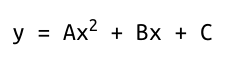

<!-- source: pdf=365; section=模拟浮点数; unit=p0365_b004_u00 -->
变量 x 是来自 10 位 ADC 的输入值；A、B 和 C 是制造过程中作为校准步骤一部分而设定的补偿参数；y 则是补偿后的传感器值。补偿参数取决于传感器，所以最小值和最大值来自数据手册规定的容差。图12-10展示了不同补偿参数下的一些可能结果。虽然这些曲线看上去比较接近直线，但尝试使用线性插值仍可能带来过大的误差。

<!-- source: pdf=365; section=模拟浮点数; unit=p0365_b006_u00 -->
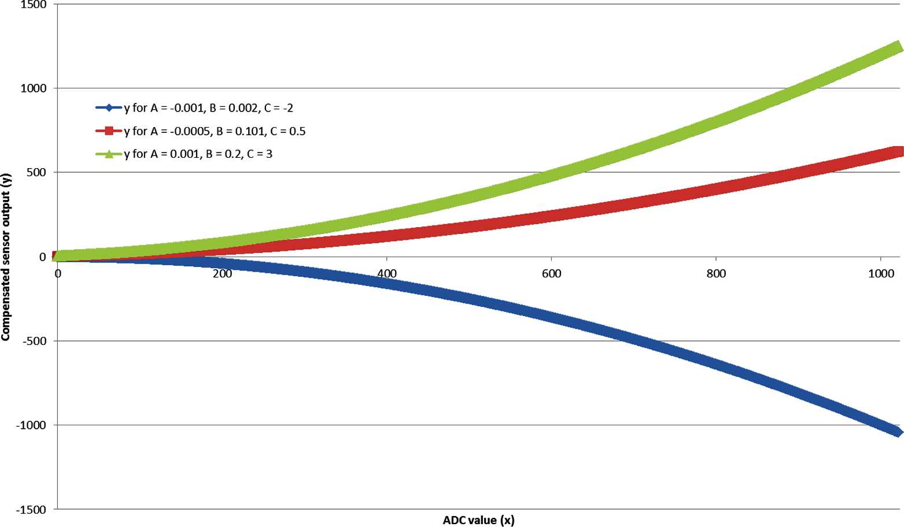

图12-10：对 ADC 输入进行温度补偿。

图中文字：横轴 ADC value (x) 为 ADC 值（x）；纵轴 Compensated sensor output (y) 为补偿后的传感器输出（y）。三条曲线分别为：A = -0.001、B = 0.002、C = -2 时的 y；A = -0.0005、B = 0.101、C = 0.5 时的 y；A = 0.001、B = 0.2、C = 3 时的 y。

<!-- source: pdf=365,366; section=模拟浮点数; unit=p0365_b007_u00,p0366_b001_u00 -->
不过，补偿参数是浮点数。对于没有硬件浮点支持的处理器（嵌入式应用中最常见的正是这类处理器），浮点运算开销非常大。与整数运算相比，浮点运算慢得要命。每次操作都会调用一个库函数，而且这个库非常大。即便所需的浮点运算很简单，体积也可能相当可观。例如，我在将两个数相加时查看了映射文件。对于以空间为优化目标的编译器，把一次整数加法改成浮点加法，会占用 532 字节代码空间（用来加入库函数 __aeabi_fadd 和 __aeabi_fsub，尽管我只用了加法函数）。

<!-- source: pdf=366; section=模拟浮点数; unit=p0366_b002_u00 -->

<a id="src-p366"></a>

>  标准输入输出函数（例如 printf 和 iostream）通常包含浮点处理。即使代码中没有使用浮点数，只要用了这些库函数，代码中仍然会包含浮点数学库。检查映射文件！

<!-- source: pdf=366; section=模拟浮点数; unit=p0366_b003_u00 -->
除非确有充分理由（或处理器有 FPU 来完成运算），否则就该像躲瘟疫一样避开浮点数。如果避不开，可以模拟它们。前面我已经逐步引出了实现方法：通过移位来除以常量，并对输入进行缩放。不过，本节会一步一步讲解，最后再回到温度补偿的例子。

<!-- source: pdf=366; section=有理数; unit=p0366_b004_u00 -->
### 有理数 {#ch12-toc-012}

<!-- source: pdf=366; section=有理数; unit=p0366_b005_u00 -->
要理解这个思路，可以回想小学时，你的生活中还没有浮点数。甚至在会写 0.25 之前，我们就已经知道四分之一块派是什么，也知道它可以写成四分之一（1/4）。任何有理数（rational number）都可以写成分数（分子与分母的比值）。即使是无理数，也可以用较大的分母来近似，以减小误差。（例如，π 常用 22/7 来近似。）

<!-- source: pdf=366; section=有理数; unit=p0366_b006_u00 -->
如果到此为止，并不会有多大改进（除法很慢）。但我们已经通过对应于 2 的幂的移位绕开了除法。之前没有给这个技巧命名，它叫作二进制缩放（binary scaling），是我们模拟浮点数（fake floating-point numbers）的基础。我们先采用 32 位分子和 8 位指数。指数表示向左（正值）或向右（负值）移动的位数。

<!-- source: pdf=366; section=有理数; unit=p0366_b007_u00 -->
先定义一个用来保存这些值的结构体：

<!-- source: pdf=366; section=有理数; unit=p0366_b008_u00 -->
```c
struct sFakeFloat {
  int32_t num;  // numerator
  int8_t shift; // right-shift values (use negative for left-shift)
}
```

<!-- source: pdf=366; section=有理数; unit=p0366_b009_u00 -->
这个结构体保存的数，表示如下：

<!-- source: pdf=366; section=有理数; unit=p0366_b010_u00 -->
```text
floatingPointValue = num / 2ˢʰⁱᶠᵗ       // (In terms of math)
floatingPointValue = num >> shift;    // in the actual code
```

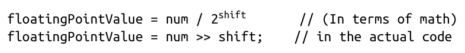

<!-- source: pdf=366; section=有理数; unit=p0366_b011_u00 -->
现在来看几个例子。先回到四分之一块派。分子是 1，分母已经是 2 的幂：

<!-- source: pdf=367; section=有理数; unit=p0367_b000_u00 -->

<a id="src-p367"></a>

```c
struct sFakeFloat oneFourth = {1, 2}; // 1/4 = 1/2²
```

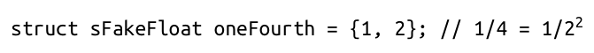

<!-- source: pdf=367; section=有理数; unit=p0367_b001_u00 -->
负的 shift 值会改变移位方向。用这种表示法，也可以重写数值 4：

<!-- source: pdf=367; section=有理数; unit=p0367_b002_u00 -->
```text
struct sFakeFloat four = {1, -2};
floatingPointValue = four.num >> four.shift ==> 1/(2⁽⁻²⁾) ==> 1 * 2² ==> 4
```

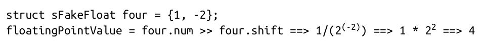

<!-- source: pdf=367; section=有理数; unit=p0367_b003_u00 -->
模拟浮点数还可以处理大于 32 位数值（或者分子所用位宽）能够保存的数。结果的精度会低于直接使用更大变量的情况。例如，假设要保存一百亿零一（10,000,000,001）。将它除以 8，就能装进有符号 32 位整数：

<!-- source: pdf=367; section=有理数; unit=p0367_b004_u00 -->
```c
struct sFakeFloat notQuiteTenBillionOne = { 1250000000, -3 };
```

<!-- source: pdf=367; section=有理数; unit=p0367_b005_u00 -->
做完除法后，最后一位丢失了，因此得到的值只有一百亿。但它与正确值的相对误差不超过一百亿分之一，对许多应用来说已经够好了。

<!-- source: pdf=367; section=精度; unit=p0367_b006_u00 -->
### 精度 {#ch12-toc-013}

<!-- source: pdf=367; section=精度; unit=p0367_b007_u00 -->
在上一节展示的结构体中，假设分子采用 24 位，分母的 shift 采用 8 位。这样可以把所有内容方便地放进一个 32 位变量，但可能降低精度。前面已经看到，大数可能会丢失数位，而大小更普通的数也可能发生同样的事情。

<!-- source: pdf=367; section=精度; unit=p0367_b008_u00 -->
例如，12.345 可以表示为 49/4，误差是 0.095。增大分母的移位值可以提高精度，但分母过大又会导致分子溢出。表12-2列出了一些可选方案。

<!-- source: pdf=367; section=精度; unit=p0367_b009_u00,p0367_b010_u00,p0367_b011_u00,p0367_b012_u00,p0367_b013_u00,p0367_b014_u00 -->
表12-2：用二进制缩放表示数值 12.345

| 分子 | 分子所需位数 | 分母的移位值 | 等效浮点数 | 误差 |
|---:|---:|---:|---:|---:|
| 12 | 4 | 0 | 12 | 0.345 |
| 25 | 5 | 1 | 12.5 | 0.155 |
| 99 | 7 | 3 | 12.375 | 0.030 |
| 395 | 9 | 5 | 12.34375 | 0.00125 |
| 12,641 | 14 | 10 | 12.34472656 | 0.000273 |
| 12,944,671 | 24 | 20 | 12.34500027 | 2.67E–07 |
| 414,229,463 | 29 | 25 | 12.345 | 1.19E–09 |
| 1,656,917,852 | 31 | 27 | 12.345 | 1.19E–09 |

<!-- source: pdf=368; section=精度; unit=p0368_b000_u00 -->

<a id="src-p368"></a>

因此，增大分母的移位值可以减小误差，但也需要增加分子的位数。这又回到了两个问题：系统对这项数学运算能容忍多大的误差？算法中的乘法和加法又可能把数值变得多大？

<!-- source: pdf=368; section=精度; unit=p0368_b001_u00 -->
接下来，我会展示这些模拟浮点数的工作方式。不过，你不应该亲自实现它们。请在数学库中查找“fixed-point”（定点）或“Q numbers”（Q 数）。

<!-- source: pdf=368; section=加法（以及减法）; unit=p0368_b002_u00 -->
### 加法（以及减法） {#ch12-toc-014}

<!-- source: pdf=368; section=加法（以及减法）; unit=p0368_b003_u00 -->
来看看一对模拟浮点变量如何相加。回想小学学过的分数运算，把数加到一起之前，得先通分。在这里，就是要让 shift 值相同，一般做法是在相加之前，将较小的数左移。

<!-- source: pdf=368; section=加法（以及减法）; unit=p0368_b004_u00 -->
最好的解释方式就是走一遍例子。这里用一个字节来保存模拟浮点数的分子。需要的数值范围不大时，这样做很有用。回看表12-2中 12.345 的表示，使用 7 位时，误差是 0.030，也就是不到 1%。（另外，使用 8 位分子，你我就都能在脑海中想象每一步发生了什么，看出溢出，而不必记住一大串巨大的数值。）

<!-- source: pdf=368; section=加法（以及减法）; unit=p0368_b005_u00 -->
```c
struct sFakeFloat {
  int8_t num;
  int8_t shift;
};
```

<!-- source: pdf=368; section=加法（以及减法）; unit=p0368_b006_u00 -->
这个例子只展示正数加法，不过，减法和负数的处理方式大体相同。首先，给模拟浮点数设置一些初值：

<!-- source: pdf=368; section=加法（以及减法）; unit=p0368_b007_u00 -->
```c
struct sFakeFloat a = { 99, 3 };  // 12.375, not quite 12.345
struct sFakeFloat b = {111, 5 };  // 3.46875, not quite 3.456
struct sFakeFloat result;
```

<!-- source: pdf=368; section=加法（以及减法）; unit=p0368_b008_u00 -->
接下来，求出最小公分母，以便将它们相加。当所有分母都是 2 的幂时，求最小公分母很容易。在下面的代码里，如果 b.shift 大于 a.shift，就会得到所需的左移。如果 a.shift 大于 b.shift，也很方便：会得到负数位的左移，转变为所需的右移。（shift 字段本质上是一个对数。）

<!-- source: pdf=368; section=加法（以及减法）; unit=p0368_b009_u00 -->
```c
int16_t tmp = a.num;
tmp = tmp << (b.shift - a.shift);
```

<!-- source: pdf=368,369; section=加法（以及减法）; unit=p0368_b010_u00,p0369_b000_u00 -->
必须使用更大的临时变量，否则结果可能溢出并被截断。注意，可能溢出的不仅是分子。分母部分（b.shift - a.shift）必须小于 8 位（因此其中一个或两个值为负时，可能发生溢出）。为了避免溢出，除了把分母较小的变量向左移，可能还得把分母较大的变量向右移（除以 2，并损失精度）。

<!-- source: pdf=369; section=加法（以及减法）; unit=p0369_b001_u00 -->

<a id="src-p369"></a>

在确认分子之和小到足以放进结果变量之前，先把它保存在临时变量中：

<!-- source: pdf=369; section=加法（以及减法）; unit=p0369_b002_u00 -->
```c
tmp = tmp + b.num;
```

<!-- source: pdf=369; section=加法（以及减法）; unit=p0369_b003_u00 -->
此时，shift 值是两者中较大的一个（b.shift = 5），临时变量是 507，对于 8 位变量来说太大了。必须不断把分子变小（除以 2），直到临时变量能够安全地放回现有位宽的变量中：

<!-- source: pdf=369; section=加法（以及减法）; unit=p0369_b004_u00 -->
```c
result.shift = b.shift;
while (tmp > INT8_MAX || tmp < -INT8_MAX) {
   tmp = tmp >> 1;
   result.shift--;
}
result.num = tmp;       // 15.84375, close to ideal of 15.831
```

<!-- source: pdf=369; section=加法（以及减法）; unit=p0369_b005_u00 -->
最后，我们得到了一个表示两个浮点数相加结果的值。

<!-- source: pdf=369; section=加法（以及减法）; unit=p0369_b006_u00 -->
结果的分子是 126，shift 是 3，等效浮点数为 15.75。目标值是 15.84，但在这种模拟浮点精度下，只能接近到这个程度。

<!-- source: pdf=369; section=乘法（以及除法）; unit=p0369_b007_u00 -->
### 乘法（以及除法） {#ch12-toc-015}

<!-- source: pdf=369; section=乘法（以及除法）; unit=p0369_b008_u00 -->
乘法比加法稍微简单一些，因为不必让分母相同。分数运算中，只需分别将分子与分子、分母与分母相乘，就能得到答案（例如，2/3 × 5/4 = 10/12）。

<!-- source: pdf=369; section=乘法（以及除法）; unit=p0369_b009_u00 -->
两个模拟浮点数相乘时，先安全地将分子相乘，再将分母相乘（大致如此）。

<!-- source: pdf=369; section=乘法（以及除法）; unit=p0369_b010_u00 -->
同样，先把其中一个数的分子放进更大的临时变量，以免溢出。加法需要检查大小，而这里可以确定，两个 32 位变量相乘的结果不会超过 64 位。然后，将这个临时变量乘以第二个数的分子。

<!-- source: pdf=369; section=乘法（以及除法）; unit=p0369_b011_u00 -->
shift 值并不等于分母，而是分母的指数：

<!-- source: pdf=369; section=乘法（以及除法）; unit=p0369_b012_u00 -->
```text
denominator = 2ˢʰⁱᶠᵗ;
```

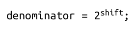

<!-- source: pdf=369; section=乘法（以及除法）; unit=p0369_b013_u00 -->
移位值是一个对数（例如，位位置 5 表示 2⁵，也就是 32）。因此，无须将移位值相乘，只需将它们相加。如果算出的分子超出可用位数，就不断右移，直到能够容纳。

<!-- source: pdf=370; section=乘法（以及除法）; unit=p0370_b000_u00 -->

<a id="src-p370"></a>

这个乘法例子里，我们重新使用 int32_t 保存分子：

<!-- source: pdf=370; section=乘法（以及除法）; unit=p0370_b001_u00 -->
```c
struct sFakeFloat {
  int32_t num;
  int8_t shift;
} ;
struct sFakeFloat a = { 1656917852,  27 }; // 12.345
struct sFakeFloat b = { 128, 8};   // 0.5
struct sFakeFloat result;
```

<!-- source: pdf=370; section=乘法（以及除法）; unit=p0370_b002_u00 -->
本例会给变量设置精确的值，以便检查每个阶段的处理过程。（虽然二分之一用 {1, 1} 就能轻易表示。）

<!-- source: pdf=370; section=乘法（以及除法）; unit=p0370_b003_u00 -->
前面提到的临时变量，其位数至少要等于两个分子的位数之和。因为使用的是 32 位分子，所以临时变量必须是 64 位。如果分子采用 16 位，就至少需要 32 位来保存乘积。注意，你的处理器可能并不原生支持 64 位整数，因此使用它会带来一些开销，但远远比不上使用 float 或 double 类型变量的开销：

<!-- source: pdf=370; section=乘法（以及除法）; unit=p0370_b004_u00 -->
```c
int64_t tmp;
tmp = a.num;
tmp = tmp * b.num;
```

<!-- source: pdf=370; section=乘法（以及除法）; unit=p0370_b005_u00 -->
乘法分成两步进行，是为了先把变量提升到更大的位宽。如果直接将两个分子相乘，那么结果在提升并存入 int64_t 之前，仍然是 int32_t。必须先提升，再相乘：

<!-- source: pdf=370; section=乘法（以及除法）; unit=p0370_b006_u00 -->
```c
result.shift = a.shift + b.shift;
while (tmp > INT32_MAX || tmp < -INT32_MAX) {
  tmp = tmp >> 1;
  result.shift--;
}
results.num = tmp;
```

<!-- source: pdf=370; section=乘法（以及除法）; unit=p0370_b007_u00 -->
和加法一样，只要分子的乘积还装不进结果分子，就需要减小 shift，以避免溢出。对于本例中的数值，循环会将 shift 减小 8 次。

<!-- source: pdf=370; section=乘法（以及除法）; unit=p0370_b008_u00 -->
还可以确保移位值不会使 shift 变量溢出：

<!-- source: pdf=370; section=乘法（以及除法）; unit=p0370_b009_u00 -->
```c
tmp = a.shift + b.shift;
ASSERT(tmp < INT8_MAX);
result.shift = tmp;
```

<!-- source: pdf=370; section=乘法（以及除法）; unit=p0370_b010_u00 -->
运算结果为 6.1725 {1656917852, 28}。

<!-- source: pdf=370; section=乘法（以及除法）; unit=p0370_b011_u00 -->
除法稍微复杂一些，但基本思路与乘法相同。它将分子相除，并把移位值相减，而不是相加。

<!-- source: pdf=371; section=乘法（以及除法）; unit=p0371_b001_u00 -->

<a id="src-p371"></a>

>  我们用于加法和乘法的算法，有时会因为精度不足而产生误差。因此，需要限制变量的大小，或者把这些错误返回给调用函数。认识到这里展示的二进制缩放算法的局限，是你的职责之一。

<!-- source: pdf=371; section=乘法（以及除法）; unit=p0371_b002_u00 -->
> 如果对将要处理的数值有充分的先验了解，就能处理溢出，并验证系统的稳定性，结果也会最好。你可以做一个非常通用的库，处理所有可能的情况，但这样有可能重新实现一套浮点数，连同它的全部开销一起搬回来。审视算法时，需要知道变量的范围（最小值和最大值），以及在每个时刻处理它们所需的精度。

<!-- source: pdf=371; section=机器学习; unit=p0371_b003_u00 -->
## 机器学习 {#ch12-toc-016}

<!-- source: pdf=371; section=机器学习; unit=p0371_b004_u00 -->
机器学习（machine learning，ML）在计算的各个领域都越来越普遍。这是一个庞大的领域，将统计方法应用于分类、检测和控制系统等各种问题。数据科学与算法开发远远超出了本书范围（“延伸阅读”，原书第 352 页，提供了一些建议）。在小型设备上能用机器学习解决的问题，与联网设备或较大型设备上能解决的问题有很大差别。

<!-- source: pdf=371; section=机器学习; unit=p0371_b005_u00 -->
开发机器学习系统通常可以分为几个阶段：

<!-- source: pdf=371; section=机器学习; unit=p0371_b006_u00,p0371_b007_u00,p0371_b008_u00,p0371_b009_u00,p0371_b010_u00 -->
- 数据收集（及清洗）
- 特征识别
- 算法设计
- 训练
- 推理

<!-- source: pdf=371; section=机器学习; unit=p0371_b011_u00 -->
嵌入式设备最常参与的是推理（inference）阶段：新数据进入系统，经过已经训练好的黑箱，得到一个与过去全部数据和训练有关的答案。训练通常需要更多处理器资源。（有些训练可以在设备上进行，但通常速度较慢，或者规模小得多。）

<!-- source: pdf=371; section=机器学习; unit=p0371_b012_u00 -->
在系统开发过程中，机器学习部分往往由另一个团队开发。恕我直言，这些团队常常没有资源约束的概念。他们生活在大数据以及装有巨型 GPU 的服务器机架的世界里。只有 32 k RAM 可用这种事，在他们看来简直可笑。

<!-- source: pdf=372; section=机器学习; unit=p0372_b000_u00 -->

<a id="src-p372"></a>

通常，作为嵌入式系统开发者，你会拿到算法以及让它运行所需的训练输出。你要在设备上实现算法，按需要进行优化（并尽可能利用现有工具和库！）。

<!-- source: pdf=372; section=机器学习; unit=p0372_b001_u00 -->
能够把优化后代码的输出与原始算法进行对照测试，这一点至关重要。不同的工具和优化可能造成变化。一些最流行的技术（神经网络）对看似微小的改动极其敏感（这可能表明算法调校不当，但那是另一个话题）。每次重新训练算法后，你也都需要能够测试，因此要让测试过程简单直接。

<!-- source: pdf=372; section=机器学习; unit=p0372_b002_u00 -->
对于联网设备，甚至可以把推理也从设备移到云端。设备接收数据后，将它们归纳成特征，再发送到云端，由更大的算法进行处理。

<!-- source: pdf=372; section=机器学习; unit=p0372_b003_u00 -->
最后，机器学习算法往往很消耗资源，因此难以用于资源受限的环境。传统算法的表现常常相当不错，而且调试和处理边界情况都要容易得多。

<!-- source: pdf=372; section=去查现成的答案！; unit=p0372_b004_u00 -->
## 去查现成的答案！ {#ch12-toc-017}

<!-- source: pdf=372; section=去查现成的答案！; unit=p0372_b005_u00 -->
优化处理器使用时，最重要的一点是：只要可能，就到其他资料中寻找答案。优化算法可能很有趣，但如果目的是得到答案，就去找现成的库。在 Arm Cortex-M 芯片上，可以使用 CMSIS DSP Software Library，其中有大量向量运算、三角函数、电机控制和统计函数。

<!-- source: pdf=372; section=去查现成的答案！; unit=p0372_b006_u00 -->
CMSIS 也有用于神经网络和其他机器学习功能的库。如果想找其他机器学习工具，可以看看针对微处理器优化的 TinyML。

<!-- source: pdf=372; section=延伸阅读; unit=p0372_b007_u00 -->
## 延伸阅读 {#ch12-toc-018}

<!-- source: pdf=372; section=延伸阅读; unit=p0372_b008_u00 -->
我希望有一天能坐下来，把 Donald Knuth 的《计算机程序设计艺术》（The Art of Computer Programming）从头到尾读完。我那偏学究的一面有点惊讶：怎么还没做完这件事？更务实（呃，其实是懒惰）的另一面则说服我，只在需要时查找所需内容，不要被书里那些有趣又闪闪发光的东西分散太多注意力。无论读没读过，这本书都应该出现在你的书架上：Donald E. Knuth 著，The Art of Computer Programming, Volume 2, Seminumerical Algorithms（《计算机程序设计艺术》第2卷：半数值算法，Addison-Wesley）。

<!-- source: pdf=372,373; section=延伸阅读; unit=p0372_b009_u00,p0373_b000_u00 -->
也可以选择一本数值算法手册，以获得更具体的实现信息。我推荐 William H. Press 等人编写的 Numerical Recipes: The Art of Scientific Computing，第3版（《数值算法：科学计算的艺术》，Cambridge University Press）。类似书籍也有针对特定语言的版本（C、C++、Java 等）。

<!-- source: pdf=373; section=延伸阅读; unit=p0373_b001_u00 -->

<a id="src-p373"></a>

对我而言，最好的机器学习入门书是 Aurélien Géron 的 [Hands-On Machine Learning with Scikit-Learn and TensorFlow](https://www.oreilly.com/library/view/hands-on-machine-learning/9781491962282/)（《Scikit-Learn 与 TensorFlow 机器学习实战》，O’Reilly）。TensorFlow 与用 C 给设备编程相差很大，但作者非常出色地把视野从神经网络拓展到其他类型的机器学习。在开始接触 TensorFlow 之前，我已经研究过机器学习；因此，如果你觉得 Géron 的书太学术，我也听说 François Chollet 的 Deep Learning with Python（《Python 深度学习》，Manning）很不错。

<!-- source: pdf=373; section=延伸阅读; unit=p0373_b002_u00 -->
对于设备端机器学习，可以看看 Pete Warden 和 Daniel Situnayake 的 [TinyML](https://www.oreilly.com/library/view/tinyml/9781492052036/)（O’Reilly）。这一领域有大量工作正在推进，因此一定要找最新版本，并查看网上最新的教程。

<!-- source: pdf=373; section=延伸阅读; unit=p0373_b003_u00 -->
在深度嵌入式这一层面，可以读 Henry Warren 的 Hacker’s Delight（Addison-Wesley Professional）。这本书翻起来很有意思，简直像一本收录了略带吓人的优化技巧的魔法书。编译器设计者通常需要了解这些东西。你希望别人能够阅读和复用你的代码，所以不要在这个层面的优化上走得太远。

<!-- source: pdf=373; section=面试题：处理非常大的数; unit=p0373_b004_u00 -->
### 面试题：处理非常大的数

<!-- source: pdf=373; section=面试题：处理非常大的数; unit=p0373_b005_u00 -->
用你选择的语言，编写一个把 1 到 10 相加的程序。应聘者每完成一部分，就提出一个新问题：怎样把它改成通用实现，能够从 1 加到 N？可以做哪些优化？这种实现本身有哪些限制？如果输入可以是任意长度，要怎样修改？（感谢 Rob Calhoun 提供这道题！）

<!-- source: pdf=373; section=面试题：处理非常大的数; unit=p0373_b006_u00 -->
应聘者开始解答第一个问题时，会不会创建一个通过参数来指定求和终点的函数（从 1 到 N）？这比一上来就把 1 到 10 硬编码进去要好。接着，我会看输入和输出变量的大小。使用整数或 long 变量都可以，但他们能解释这些选择对代码施加了什么限制吗？他们用的是无符号变量还是有符号变量，能解释为什么无符号变量更合适吗？

<!-- source: pdf=373; section=面试题：处理非常大的数; unit=p0373_b007_u00 -->
如果他们不知道从 1 加到 N 的求和公式是 N × (N + 1) / 2，我会引导他们推出来，通常会写下 1、2、3、4、5、6，再把 1 + 6、2 + 5、3 + 4 配成对。只要应聘者思路清醒、能推导出来，不知道这个公式并不会扣分。但如果打断别人，即使面对反例仍坚持一个错误公式，就要扣分了（这种情况比你想象的更常见）。

<!-- source: pdf=373; section=面试题：处理非常大的数; unit=p0373_b008_u00 -->
接下来，再回到变量大小的问题。N × (N + 1) / 2 相对于 N 会有多大？如果 N 是 16 位整数，输出需要多大？如果 N 是 64 位呢？我会适当提示，确保他们知道 (2<sup>16</sup>)<sup>2</sup> 就是 2<sup>(16 × 2)</sup>。

<!-- source: pdf=374; section=面试题：处理非常大的数; unit=p0374_b000_u00 -->

<a id="src-p374"></a>

最后，到了这道题真正有趣的部分：如果输入最大可以达到 2⁶⁴，他们会怎样修改实现？现在输出可以用什么来保存？如果选择双精度浮点数，我们就来讨论浮点数的局限。这里没有错误答案，但我会继续加码：如果需要处理更大的数呢？我会把问题限制在几百位或几千位，并始终限定不超过一百万个十六进制数位。

<!-- source: pdf=374; section=面试题：处理非常大的数; unit=p0374_b001_u00 -->
这时，应聘者该如何修改函数？我会带着他们构造输入缓冲区和输出缓冲区所用的数据结构（到这一步，他们应该已经知道输出缓冲区该设为多大：输入的两倍），以及函数原型。

<!-- source: pdf=374; section=面试题：处理非常大的数; unit=p0374_b002_u00 -->
我会留意线程安全，以及是否遗漏了对字节串长度的跟踪，并在需要时展开讨论。最后，让他们尽可能多地实现以下计算：从输入数组读取任意长度整数，计算 (N × N – 1) / 2，再写入输出数组。如果有些吃力，我会建议使用 8 位机器，因为这样更容易画出来。

<!-- source: pdf=374; section=面试题：处理非常大的数; unit=p0374_b003_u00 -->
根据应聘者表现出的能力，这个问题可以向不同方向深入，揭示他们的优点和不足。即使只完成其中一部分，也很容易就用掉整场面试的时间。