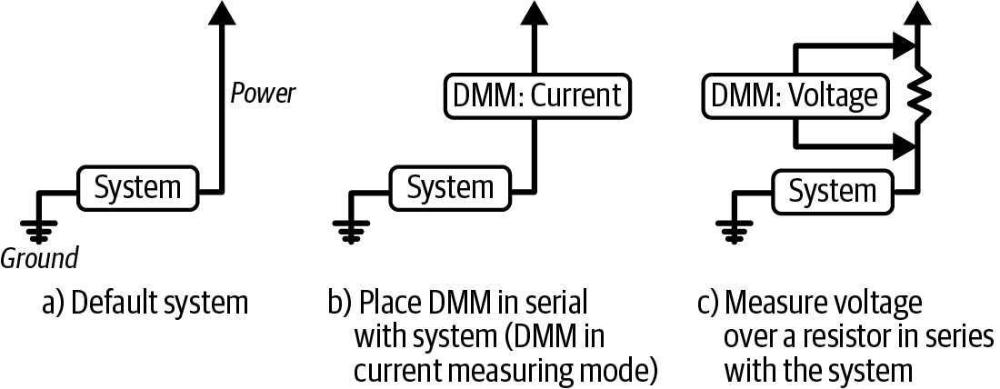
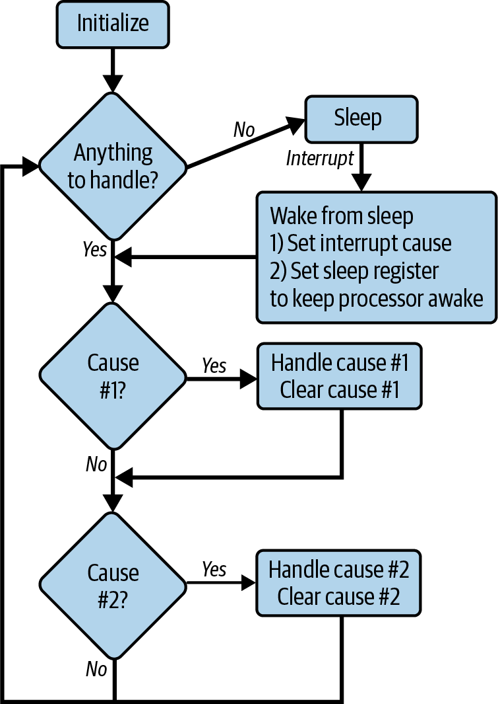

<!-- source: pdf=375; section=第13章 降低功耗; unit=p0375_b001_u00 -->

<a id="src-p375"></a>

# 第 13 章 降低功耗 {#ch13}

<!-- source: pdf=375; section=第13章 降低功耗; unit=p0375_b002_u00 -->
无论你是在开发能装进口袋的设备，还是想通过减少公司的碳足迹来拯救世界，降低系统功耗所花的时间，都可能比实现产品功能多一个数量级。要让系统节能，选对所有硬件元件是极其重要的一环。不过，处理器很可能是系统中耗电最多的部件之一，因此软件也能在节电方面发挥很大作用。

<!-- source: pdf=375; section=第13章 降低功耗; unit=p0375_b003_u00 -->
降低功耗和成本的压力，让我们选择了那些资源不足、无法从容实现产品功能的处理器。你本身是一项相对昂贵的资源，因此，只有在产品数量足够多、能摊薄你的时间成本时，花你的时间去节省处理器成本才是合理的。

<!-- source: pdf=375; section=第13章 降低功耗; unit=p0375_b004_u00 -->
>  你的成本有多高？把你的年薪除以一千，所得结果就大致是你每小时给公司带来的成本，其中包括工资、福利、办公场地，以及各种积少成多的小开支。假设你的年薪是 1,000 美元，那么你每小时大约值 1 美元。如果花 3.50 美元买一件工具能节省四小时，通常就值得。当然，资本支出（现金）和沉没成本（你的工资）还是有区别的。因此，尽管这是个不错的经验法则，即使你说明每天节省 30 秒的成本收益，老板也未必会让你买一辆滑板车，方便你从工位滑到休息室。

<!-- source: pdf=375,376; section=第13章 降低功耗; unit=p0375_b005_u00,p0376_b000_u00 -->
另一方面，周期数、RAM 和代码空间都压到最低限度的处理器，比资源充裕的处理器更省电。正如第11章所说，你可能想把功耗优化到“尽可能低”，但这需要无限长的时间。先给系统设定一个可量化的目标。让电气工程团队在元件选型时做好他们的那部分工作，然后利用本章介绍的要点进一步降低功耗。

<!-- source: pdf=376; section=理解功耗; unit=p0376_b001_u00 -->

<a id="src-p376"></a>

## 理解功耗 {#ch13-toc-001}

<!-- source: pdf=376; section=理解功耗; unit=p0376_b002_u00 -->
所有电路都可以用电阻来建模，不过，这有点像说所有微分方程都可以用线性模型来表示。话虽没错，但根据具体情况，你可能会看到相当大的误差。不过，这仍是个不错的起点。功率以瓦特为单位，与系统所用电流的平方成正比：

<!-- source: pdf=376; section=理解功耗; unit=p0376_b003_u00 -->
P = I² * R  
功率 =（电流）² * 电阻  
瓦特（W）=（安培（A））² * 欧姆（Ω）

<!-- source: pdf=376; section=理解功耗; unit=p0376_b004_u00 -->
既然将系统建模为一个电阻，只要着力降低电流，就能降低功耗。另一种理解功率的方式，是把它看作电压与电流的乘积：

<!-- source: pdf=376; section=理解功耗; unit=p0376_b005_u00 -->
P = V * I  
功率 = 电压 * 电流  
瓦特（W）= 伏特（V）* 安培（A）

<!-- source: pdf=376; section=理解功耗; unit=p0376_b006_u00 -->
因此，尽管系统其他部分以 3 V 或 5 V 运行，处理器内核却可能以 1.8 V 运行。内核需要很大的电流，所以较低的电压意味着较低的功耗。根据电气工程的金科玉律——欧姆定律（Ohm’s law），这两种看待功率的方式是等价的：

<!-- source: pdf=376; section=理解功耗; unit=p0376_b007_u00 -->
V = I * R  
电压 = 电流 * 电阻  
伏特（V）= 安培（A）* 欧姆（Ω）

<!-- source: pdf=376; section=理解功耗; unit=p0376_b008_u00 -->
欧姆定律还能帮你做很多事。如果这番简述让你对它产生了兴趣，可以看看[“延伸阅读”](#src-p390)里推荐的电气工程读物。

<!-- source: pdf=376; section=理解功耗; unit=p0376_b009_u00 -->
还有一个有用的公式，用来计算能量：

<!-- source: pdf=376; section=理解功耗; unit=p0376_b010_u00 -->
W = P * T  
功或能量 = 功率 * 时间  
焦耳（J）= 瓦特（W）* 秒

<!-- source: pdf=376; section=理解功耗; unit=p0376_b011_u00 -->
终于有一个包含时间的公式了。它的意思基本上是：如果要设计一个节能系统，可以尽量降低它所用的功率，也可以尽量缩短它通电的时间。

<!-- source: pdf=376; section=理解功耗; unit=p0376_b012_u00 -->
要减少能量（做功），就需要降低功率或缩短通电时间，也可以两者都做。要降低功率，就必须降低电流，或者改变系统、减小其电阻（P = I² * R）。要降低功率，就需要降低电压或电流（P = V * I）。

<!-- source: pdf=377; section=理解功耗; unit=p0377_b000_u00 -->

<a id="src-p377"></a>

总之，要减少设备所消耗的能量，就得降低电压、电阻、电流和时间。这些量并非全都相互独立，欧姆定律已经告诉了我们这一点；不过，暂且把它们当作独立的量，尝试逐一降低：

<!-- source: pdf=377; section=理解功耗; unit=p0377_b001_u00 -->
降低电压
: 一般是选择工作电压更低的元件，例如以 1.8 V 工作的处理器和外设。

<!-- source: pdf=377; section=理解功耗; unit=p0377_b002_u00 -->
减小电阻
: 同样涉及元件选型，例如选用新型 MEMS 传感器，而不是老式机械传感器。

<!-- source: pdf=377; section=理解功耗; unit=p0377_b003_u00 -->
降低电流
: 与前两项有关，但这里也有一些实用的软件方法，比如 GPIO 设置，以及你可能在处理器手册或应用笔记中找到的功能。

<!-- source: pdf=377; section=理解功耗; unit=p0377_b004_u00 -->
缩短时间
: 可以通过尽可能多地关闭系统的各个部分来实现。

<!-- source: pdf=377; section=测量功耗; unit=p0377_b005_u00 -->
### 测量功耗 {#ch13-toc-002}

<!-- source: pdf=377; section=测量功耗; unit=p0377_b006_u00 -->
很难优化你无法测量的东西。你必须知道如何测量功耗，而低功耗设备的测量可能很困难；功耗越低，测量就越困难。

<!-- source: pdf=377; section=测量功耗; unit=p0377_b007_u00 -->
测量电流最简单的方法之一是使用电源。贵一些的电源会直接给出读数。不过，事情并没有这么简单。

<!-- source: pdf=377; section=测量功耗; unit=p0377_b008_u00 -->
首先，你得断开编程器／调试器，以及连接命令行的串口。原则上，不能有任何其他东西连接到被测系统。例如，JTAG 编程器可能会给处理器供电，但这部分电来自计算机，而不是电源。串口虽然不供电，但计算机和被测系统的供电方式不同，地电位的差异也可能改变测量结果。

<!-- source: pdf=377; section=测量功耗; unit=p0377_b009_u00 -->
因此，第一步是断开所有连接。系统应当只接一根电源线和一根地线。

<!-- source: pdf=377; section=测量功耗; unit=p0377_b010_u00 -->
对于低功耗系统，睡眠状态下的读数很可能低于普通电源能测量的范围，稍后会详细介绍这些睡眠状态。

<!-- source: pdf=377,378; section=测量功耗; unit=p0377_b011_u00,p0378_b001_u00 -->
第3章建议你给自己配一台数字万用表（digital multimeter，DMM）。如果买的是一台好表，就能像图13-1 的 b）所示那样直接测量电流。大多数便宜的 DMM 都能测量毫安（mA）量级的电流。由低功耗处理器和少量外围芯片组成的小型嵌入式系统，会消耗数十到数百毫安。因此，用 DMM 测量正在运行的系统电流很方便。不过，如果你要查看睡眠模式下的功耗，可能就需要测量更小的电流。一台好的 DMM 或许能测到数百微安（μA），但你可能还需要更高的分辨能力。

<!-- source: pdf=378; section=测量功耗; unit=p0378_b003_u00 -->

<a id="src-p378"></a>



图13-1．测量电流的两种方法

图中文字：Power 为电源，Ground 为地，System 为系统；DMM: Current 为 DMM 电流测量模式，DMM: Voltage 为 DMM 电压测量模式。a）原始系统；b）将 DMM 与系统串联，DMM 置于电流测量模式；c）测量与系统串联的电阻两端的电压。

<!-- source: pdf=378; section=测量功耗; unit=p0378_b004_u00 -->
要用我的 DMM 测量功耗水平，我得先把表笔插到表上的另一个插孔里。（我经常忘记这一步。）接着，我得大概知道要测多大的电流：μA、mA，还是 10A。如果量程选得过高，而系统电流太小，DMM 就会显示零。反过来，如果系统电流超出了 DMM 设定的量程，我可能会把万用表弄坏，或者至少得换一根保险丝。

<!-- source: pdf=378; section=测量功耗; unit=p0378_b005_u00 -->
>  这件事有很多种出错方式，所以请阅读万用表的使用手册，或者看看 YouTube 上的相关视频。

<!-- source: pdf=378; section=串联电阻与负担电压; unit=p0378_b006_u00 -->
#### 串联电阻与负担电压

<!-- source: pdf=378; section=串联电阻与负担电压; unit=p0378_b007_u00 -->
更安全的电流测量方法是在系统中串联一只小电阻，如图13-1 的 c）所示。将 DMM 切换到电压模式，电压是它更擅长测量的量。你可能需要调整电阻值，让电压落在 DMM 能读出的范围内。然后应用欧姆定律：

<!-- source: pdf=378; section=串联电阻与负担电压; unit=p0378_b008_u00 -->
电流 = 电压 / 电阻

<!-- source: pdf=378; section=串联电阻与负担电压; unit=p0378_b009_u00 -->
表13-1 列出了一些可能的组合，帮助你理解。根据预期测得的电流大小，你可能需要调整电阻值。

<!-- source: pdf=379; section=串联电阻与负担电压; unit=p0379_b002_u00,p0379_b003_u00,p0379_b004_u00,p0379_b005_u00,p0379_b006_u00,p0379_b007_u00 -->

<a id="src-p379"></a>

表13-1．使用不同电阻测量系统中的电流

| 预期电流 | 电路中的电阻 | DMM 测得的电压 | 说明 |
|---|---|---|---|
| 12 mA | 1 Ω | 0.012 V | 大多数 DMM 都能轻松测出 |
| 23 μA | 1 Ω | 0.000023 V | 大多数 DMM 都无法读出 |
| 34 μA | 10 Ω | 0.00034 V | 很好的 DMM 或许能读出 |
| 45 μA | 100 Ω | 0.0045 V | 再次落入大多数 DMM 的测量能力范围，但电阻已变得太大 |

<!-- source: pdf=379; section=串联电阻与负担电压; unit=p0379_b008_u00 -->
串联电阻法之所以有效，是因为电路的第一部分，也就是被测系统，和电路的第二部分，也就是电阻，必须流过相同大小的电流。[^ch13-1] 因此，测得电阻的电流，就得到了系统的电流。

<!-- source: pdf=379; section=串联电阻与负担电压; unit=p0379_b009_u00 -->
以前处理器还没有这么省电时，这种方法好用得多。如今，电阻的阻值可能已经占到系统电阻的相当大一部分。电阻既要足够大，才能测出微小的睡眠电流，又要足够小，不能让它自己成了耗电大户，干扰测量。

<!-- source: pdf=379; section=串联电阻与负担电压; unit=p0379_b010_u00 -->
一旦出现这种情况，电阻就不再只是一件测量工具，而是成了测量结果中的重要组成部分。它自己抢了戏，给系统添了负担。这会让你误判系统的表现。

<!-- source: pdf=379; section=串联电阻与负担电压; unit=p0379_b011_u00 -->
整套电阻测量过程，恰好就是我的万用表内部在做的事，也正因此，我必须告诉它要测量什么。实际上，移动表笔就是在指定使用哪只电阻。只要电流还在毫安或数十微安量级，一台数字电源或一台 30 美元的电压表就能给出令人满意的测量结果。

<!-- source: pdf=379; section=串联电阻与负担电压; unit=p0379_b012_u00 -->
由于电阻本身也耗电，你可以只在开发板上使用它，而在生产板上装一只零欧姆电阻，也就是通常所说的“导线”。

<!-- source: pdf=379; section=串联电阻与负担电压; unit=p0379_b013_u00 -->
>  电阻有一定的精度。测完电流消耗后，关闭系统电源，再用 DMM 测量电阻的实际阻值。

<!-- source: pdf=379; section=串联电阻与负担电压; unit=p0379_b000_u00 -->
[^ch13-1]: 这就是基尔霍夫电流定律（Kirchhoff’s current law）。

<!-- source: pdf=380; section=串联电阻与负担电压; unit=p0380_b000_u00 -->

<a id="src-p380"></a>

遗憾的是，万用表只能测量眼下这一瞬间的电流，也就是静态消耗。如果系统有睡眠状态，或者我们想观察电流变化，真正需要的就是示波器之类的工具，这样才能看到功率水平变化时短暂的小波动。

<!-- source: pdf=380; section=电流变化与数量级问题; unit=p0380_b001_u00 -->
#### 电流变化与数量级问题

<!-- source: pdf=380; section=电流变化与数量级问题; unit=p0380_b002_u00 -->
设备运行时可能耗电很多，进入睡眠后，耗电量却可能大幅下降，让电池维持很长时间。想把这两种情况都测出来并不容易。它们可能相差若干个数量级，因此需要截然不同的电阻值。而且请记住，用错电阻值，或插错 DMM 插孔，最终可能会烧断保险丝，甚至损坏工具。

<!-- source: pdf=380; section=电流变化与数量级问题; unit=p0380_b003_u00 -->
功耗分析工具（power profiler）可以提供帮助；这类专用工具能在不同量程下测量电流。它们可能很贵，但能替你处理负担电压和数量级差异的问题。

<!-- source: pdf=380; section=面向低功耗的设计; unit=p0380_b004_u00 -->
### 面向低功耗的设计 {#ch13-toc-003}

<!-- source: pdf=380; section=面向低功耗的设计; unit=p0380_b005_u00 -->
测量功耗对于充分发挥系统性能至关重要，不过，降低功耗的几种方法都涉及选对元件。在设计阶段，就必须确定功耗预算，以及它是否符合应用需求。

<!-- source: pdf=380; section=面向低功耗的设计; unit=p0380_b006_u00 -->
对于电池供电的应用，要估算电池实际占据的空间，并判断其成本是否在预算内。这两个因素能帮助你选择适合系统的电池类型。

<!-- source: pdf=380; section=面向低功耗的设计; unit=p0380_b007_u00 -->
电池有额定电压和容量。一节碱性 AA 电池的标称电压为 1.5 V，容量约为 3,000 mAh（毫安时）。因此，容量不是用功率来标定的，而是用持续一段时间所能提供的电流来标定的。

<!-- source: pdf=380; section=面向低功耗的设计; unit=p0380_b008_u00 -->
如果系统开启时需要 30 mA 电流，工作电压为 1.5 V，那么一节 AA 电池应该能维持大约 4 天（3,000 mAh/30 mA = 100 小时）。如果系统需要 300 mA，就应该能维持大约 10 小时。

<!-- source: pdf=380; section=面向低功耗的设计; unit=p0380_b009_u00 -->
但是，如果系统消耗 3,000 mA，AA 电池就撑不到一小时了。因为，就像把系统视作电阻一样，这个经验法则也有适用限度。电池的数据手册会说明它的容量、化学体系、峰值放电电流以及其他特性。

<!-- source: pdf=380,381; section=面向低功耗的设计; unit=p0380_b010_u00,p0381_b000_u00 -->
容量决定了设备两次充电或换电池之间能工作多久。不过，要计算这个时间，得先找出系统中最可能耗电的部分。回到第2章的硬件框图，列出主要元件。选定一些具体器件，开始估算它们的电流消耗。这些电流可以相加：如果屏幕消耗 12 mA，处理器全速运行时消耗 0.6 mA，那么两者合计消耗 12.6 mA，前提是它们在相同电压下工作。

<!-- source: pdf=381; section=面向低功耗的设计; unit=p0381_b001_u00 -->

<a id="src-p381"></a>

把元件及其电流消耗列进电子表格时，你会发现，元件的电流消耗会随着工作状态而变化：关闭的屏幕可能消耗 0 mA，睡眠中的处理器可能只消耗 80 μA 左右。设备本身很可能也有更高层次的状态，“开启”和“睡眠”是最容易辨认的两种。如果你在做联网传感器，无线电模块的耗电可能足够高，值得单独设置一个“高功耗”系统状态，尤其是在发射时。机器人系统也可能需要根据移动距离和速度设置不同的状态。

<!-- source: pdf=381; section=面向低功耗的设计; unit=p0381_b002_u00 -->
注意，这些通常不是软件流程图中的状态。设备状态的粒度一般粗得多，更像用户能看到的工作模式。

<!-- source: pdf=381; section=面向低功耗的设计; unit=p0381_b003_u00 -->
把不同的设备状态作为电子表格中的各列，就能计算每个状态的电流消耗。然后确定各状态持续的时间，算出平均消耗。或者，也可以根据可用的电流额度，反过来确定每种状态能持续多久。

<!-- source: pdf=381; section=面向低功耗的设计; unit=p0381_b004_u00 -->
总之，设计低功耗应用时，需要回答以下问题：

<!-- source: pdf=381; section=面向低功耗的设计; unit=p0381_b005_u00,p0381_b006_u00,p0381_b007_u00,p0381_b008_u00,p0381_b009_u00 -->
- 电池的成本预算是多少？体积可以有多大？
- 两次充电或换电池之间要间隔多久？
- 主要的耗电元件有哪些？
- 系统有哪些状态？每个状态的功耗是多少？
- 按照电池使用目标，每个状态能持续多久？如果不够，请重新检查其他问题的答案。

<!-- source: pdf=381; section=离开房间时请关灯; unit=p0381_b010_u00 -->
## 离开房间时请关灯 {#ch13-toc-004}

<!-- source: pdf=381; section=离开房间时请关灯; unit=p0381_b011_u00 -->
降低功耗最简单的方法，就是关闭不需要的元件。缺点是，等到需要它们时，它们还没有准备好；让它们恢复工作既会增加一些耗电，也会增加事件响应延迟。你需要研究这些取舍；我通常用电子表格来帮助权衡节电收益。

<!-- source: pdf=381; section=离开房间时请关灯; unit=p0381_b012_u00 -->
下面几节将详细介绍一些关闭元件或降低其耗电的方法。

<!-- source: pdf=382; section=关闭外设; unit=p0382_b001_u00 -->

<a id="src-p382"></a>

### 关闭外设 {#ch13-toc-005}

<!-- source: pdf=382; section=关闭外设; unit=p0382_b002_u00 -->
检查原理图和设计方案时，要考虑处理器能够控制什么，以及该怎样设计系统，才能关闭不需要的外设。例如，如果有外部 RAM，也许可以先将数据移到本地存储位置，再关闭该 RAM 的电源，而不是让它长时间保持通电。

<!-- source: pdf=382; section=关闭外设; unit=p0382_b003_u00 -->
处理器外部的芯片如果没有电源，就不会消耗电流。如果处理器无法控制它的电源线，让外设一直处于复位状态，应该也能几乎消除电流消耗，但请检查外设的数据手册！这不如断电彻底，但比让外设一直运行要好。

<!-- source: pdf=382; section=关闭外设; unit=p0382_b004_u00 -->
许多芯片在复位后需要一段时间才能恢复工作，所以关闭它们会带来一些额外开销。目标是让元件关闭足够长的一段时间。ADC 属于复位时间较长的一类外设，但它们往往也是耗电大户，因此，花时间权衡功耗与上电时间通常是值得的。

<!-- source: pdf=382; section=关闭未使用的 I/O; unit=p0382_b005_u00 -->
### 关闭未使用的 I/O {#ch13-toc-006}

<!-- source: pdf=382; section=关闭未使用的 I/O; unit=p0382_b006_u00 -->
如果有闲置的 I/O，将它们配置为带内部下拉的输入，可以节省一点电流。如果芯片没有内部下拉，可以尝试将其设为三态，也就是既不上拉也不下拉，仅仅悬空；或者将其设为低电平输出。如果这些办法不适合，带上拉的输入所产生的漏电流也仍然相当小。

<!-- source: pdf=382; section=关闭未使用的 I/O; unit=p0382_b007_u00 -->
>  一听到 pull-up，你只记得健身房里折磨人的引体向上吗？关于上拉和下拉的更多信息，请参阅第3章。

<!-- source: pdf=382; section=关闭未使用的 I/O; unit=p0382_b008_u00 -->
对于连接到已断电元件的 I/O，优先选择的顺序也是一样：带下拉的输入、低电平输出、带上拉的输入。这样配置一个 I/O 可能省不了多少电，但如果数量很多，一点点节省也能积少成多。另一方面，如果系统中的某些 I/O 已有外部上拉或下拉电阻，就应将内部设置与它们保持一致，或者去掉多余的外部电阻。与外部电阻互相对抗只会浪费电。

<!-- source: pdf=383; section=关闭未使用的 I/O; unit=p0383_b002_u00 -->

<a id="src-p383"></a>

>  如果有外设已断电或处于复位状态，将处理器的其他 I/O 连接到它时要小心。不要让这些线路保持上拉或高电平。芯片内部通常有保护二极管，高电平信号可能通过它们反向供电，损坏芯片。

<!-- source: pdf=383; section=关闭处理器子系统; unit=p0383_b003_u00 -->
### 关闭处理器子系统 {#ch13-toc-007}

<!-- source: pdf=383; section=关闭处理器子系统; unit=p0383_b004_u00 -->
除了将 I/O 设置为低功耗状态，通常还可以关闭处理器中整个不需要的子系统，比如：你真的在用第二个 SPI 端口吗？处理器手册会告诉你它是否支持这项功能。有时可以关闭全部功能，这是最好的情况；有时只能关闭该外设的时钟，这也相当不错。

<!-- source: pdf=383; section=降速以节省能量; unit=p0383_b005_u00 -->
### 降速以节省能量 {#ch13-toc-008}

<!-- source: pdf=383; section=降速以节省能量; unit=p0383_b006_u00 -->
降低时钟频率可以省电。对所有你能控制的时钟来说都是如此，尤其是处理器时钟。不过，处理器时钟越慢，可用于运行代码的处理器周期就越少。这就是第11章为什么花那么多篇幅讨论代码优化，尽管面向处理器速度的优化往往会降低代码的质量，包括健壮性、可读性和可调试性。通常，要把系统功耗降低 10%，最直接的方法就是将时钟频率降低约 10%。换句话说，芯片的功耗与它的运行频率成正比。

<!-- source: pdf=383; section=降速以节省能量; unit=p0383_b007_u00 -->
如果处理器必须始终开启，例如持续监测环境，那么能否降速可能就是实现低功耗的关键。有些嵌入式操作系统会自动进行频率调节（frequency scaling），尽可能高效用电，同时在需要时仍能提供足够速度。没有操作系统也能做到这一点。不必在整个频率范围内连续调节，你可以创建慢速、中速和快速模式，根据事件改变性能等级。不过，就像跑步比赛一样，这里需要在两种策略之间寻找平衡：像乌龟那样降低处理器速度，却让它运行更久；或者像兔子那样短时间冲刺，然后睡觉。

<!-- source: pdf=383; section=处理精度不同的多个时钟源; unit=p0383_b008_u00 -->
#### 处理精度不同的多个时钟源

<!-- source: pdf=383; section=处理精度不同的多个时钟源; unit=p0383_b009_u00 -->
许多节能系统都有一个慢时钟，能够在低功耗模式下驱动处理器，通常由 32 kHz 振荡器产生。[^ch13-2] 在低功耗状态下，这个慢时钟用于让系统的一部分继续工作，通常会驱动实时时钟（real-time clock，RTC），让系统即使在“关机”时也知道当前时间。

<!-- source: pdf=383; section=处理精度不同的多个时钟源; unit=p0383_b000_u00 -->
[^ch13-2]: 实际上，通常使用的是 32.768 kHz 振荡器，这样用一个 15 位计数器就能计满 1 秒。

<!-- source: pdf=384; section=处理精度不同的多个时钟源; unit=p0384_b000_u00 -->

<a id="src-p384"></a>

这类系统也有晶体产生的快时钟，它的功耗更高、准确度更高，温度引起的误差也更小。你可以用高准确度的时钟来校正低准确度时钟的误差，这也称为时基补偿（time base compensation）或对定时源进行驯服（disciplining）。目标是确定低准确度时钟的实际值与期望值之间的差异。

<!-- source: pdf=384; section=处理精度不同的多个时钟源; unit=p0384_b001_u00 -->
这个例子里，假设快时钟为 50 MHz。要确定补偿量，先将慢时钟接到捕获定时器的输入端。接着，用更准确的快时钟设置一个每秒触发一次的定时器中断。当一秒定时器到期时，慢时钟应该已在捕获计数器上产生 32,768 个节拍。不过，实际值很可能会相差几个，具体取决于环境温度和 32 kHz 时钟的制造工艺。利用这个偏差，就可以在系统睡眠期间发生的 32 kHz 时钟周期数与 50 MHz 时钟周期数之间进行换算，或者在 32 kHz 周期数与实际时间之间换算。例如，假设在补偿时，每一秒周期捕获到了 32,760 个节拍，而这一秒应当等于 50 M 个晶体时钟周期。现在，处理器就可以按 32 kHz 时钟每秒产生 32,760 个周期来计算。

<!-- source: pdf=384; section=处理精度不同的多个时钟源; unit=p0384_b002_u00 -->
最终结果不会比你拥有的最准确时钟更准确。事实上，结果很可能更差，因为你无法确定补偿值是否本应包含小数部分，比如 32,760.5。还记得第5章的抖动吗？它在这里同样适用。此外，温度变化时，补偿量也会变化，因此需要定期重新补偿，频率取决于产品所要求的定时准确度。精密时钟未必就是快时钟。使用 GPS 进行定位和授时的系统可以获得 PPS 信号。这是一个非常准确、精密的时钟，但它太慢，无法驱动系统。不过，仍然可以用与前面大致相同的方法来校正其他时钟：

<!-- source: pdf=384; section=处理精度不同的多个时钟源; unit=p0384_b003_u00,p0384_b004_u00,p0384_b005_u00 -->
1. 在 PPS 信号到来时触发中断。
2. 测量自上一次 PPS 中断以来经过了多少个系统节拍，可以是处理器节拍或定时器节拍。
3. 据此调整系统定时。

<!-- source: pdf=384; section=处理精度不同的多个时钟源; unit=p0384_b006_u00 -->
（感谢 Matthew Hughes 建议补充时钟补偿的内容！）

<!-- source: pdf=384; section=让处理器进入睡眠; unit=p0384_b007_u00 -->
## 让处理器进入睡眠 {#ch13-toc-009}

<!-- source: pdf=384; section=让处理器进入睡眠; unit=p0384_b008_u00 -->
即使时钟很慢，处理器仍然在耗电。降速有所帮助，但如果代码的大量时间都在等待某件事发生呢？

<!-- source: pdf=384; section=让处理器进入睡眠; unit=p0384_b009_u00 -->
许多面向低功耗系统设计的处理器，在不需要工作时可以进入节能的睡眠状态。它们通过中断来得知何时应当醒来。

<!-- source: pdf=385; section=让处理器进入睡眠; unit=p0385_b000_u00 -->

<a id="src-p385"></a>

在计算机上，睡眠（sleep）是一种待机模式：处理停止运行，但内存仍然供电。这样，操作系统就能快速唤醒，从离开时的位置继续运行。另一种方式是休眠（hibernation），将 RAM 的内容写到磁盘或其他非易失性存储器中。从休眠中唤醒需要更长时间，但系统处于该状态时耗电更少；根据计算机的型号，甚至可能几乎不耗电。

<!-- source: pdf=385; section=让处理器进入睡眠; unit=p0385_b001_u00 -->
大多数嵌入式处理器也提供类似的一系列睡眠选项。有些处理器划分得很细，另一些则只提供一种低功耗模式。按功耗由高到低排列，处理器手册中可能会介绍以下几种模式：

<!-- source: pdf=385; section=让处理器进入睡眠; unit=p0385_b002_u00 -->
降速
: 有些处理器不止能够调节工作频率，还允许把时钟降到几百赫兹。

<!-- source: pdf=385; section=让处理器进入睡眠; unit=p0385_b003_u00 -->
空闲或睡眠
: 关闭处理器内核，但让已启用的定时器、外设和 RAM 继续工作。任何中断都可以让处理器恢复正常运行。

<!-- source: pdf=385; section=让处理器进入睡眠; unit=p0385_b004_u00 -->
深度睡眠或浅度休眠
: 除了关闭处理器内核，还可以配置关闭部分片上外设，甚至可能全部关闭。要注意，不要关闭那个负责产生中断、唤醒处理器的子系统。

<!-- source: pdf=385; section=让处理器进入睡眠; unit=p0385_b005_u00 -->
深度休眠或掉电
: 由处理器决定关闭哪些片上外设，通常几乎全部关闭。RAM 通常会处于不稳定状态，但处理器寄存器得以保留，因此系统启动时不需要初始化。通常只有唤醒引脚或一小部分中断能重新启动处理器。

<!-- source: pdf=385; section=让处理器进入睡眠; unit=p0385_b006_u00,p0385_b007_u00 -->
断电
: 处理器不保留任何存储内容，从完全清空的状态重新启动。

<!-- source: pdf=385; section=让处理器进入睡眠; unit=p0385_b008_u00 -->
越深的睡眠模式，处理器的功耗越低，但唤醒时间也越长，从而增加系统延迟。你得花些时间阅读用户手册，确定在满足产品需求的前提下，如何达到尽可能低的功耗水平。

<!-- source: pdf=385; section=让处理器进入睡眠; unit=p0385_b009_u00 -->
唤醒中断可以来自按钮、定时器、其他芯片，例如 ADC 转换完成信号，也可以来自通信总线上的活动。具体取决于处理器，以及所处的睡眠等级。

<!-- source: pdf=385; section=让处理器进入睡眠; unit=p0385_b010_u00 -->
确定处理器能够睡眠之后，该如何设计系统，充分利用这一能力呢？接下来就讨论这个问题。

<!-- source: pdf=386; section=基于中断的代码流程模型; unit=p0386_b000_u00 -->

<a id="src-p386"></a>

### 基于中断的代码流程模型 {#ch13-toc-010}

<!-- source: pdf=386; section=基于中断的代码流程模型; unit=p0386_b001_u00 -->
对功耗敏感的应用来说，理解基于中断的代码流程模型至关重要。[“主循环”](ch06_zh.md#src-p186)一节介绍了如何组织代码，利用中断和事件，尽量延长睡眠时间。

<!-- source: pdf=386; section=基于中断的代码流程模型; unit=p0386_b002_u00 -->
微处理器不再空转，而是把时间用于睡眠；只有中断发生时才醒来，处理中断，然后再次睡眠。目标是让处理器尽可能长时间地睡眠，从而获得尽可能高的能效。图13-2 用流程图说明了基于中断的代码流程模型。

<!-- source: pdf=386; section=基于中断的代码流程模型; unit=p0386_b004_u00 -->


图13-2．基于中断的代码流程图

图中文字：Initialize 为初始化；Anything to handle? 为是否有待处理事项；Yes／No 为是／否；Sleep 为睡眠；Interrupt 为中断；Wake from sleep 为从睡眠中唤醒；1）Set interrupt cause 为设置中断原因；2）Set sleep register to keep processor awake 为设置睡眠寄存器，使处理器保持唤醒；Cause #1?／Cause #2? 为是否有原因 1／原因 2；Handle cause #1／#2 为处理原因 1／2；Clear cause #1／#2 为清除原因 1／2。

<!-- source: pdf=386; section=基于中断的代码流程模型; unit=p0386_b005_u00 -->
中断可以由外设产生，表示它需要处理器关注。例如，ADC 完成数据转换后，需要处理器读取结果并启动下一次转换。在其他系统中，中断可能由用户按下按钮，或者传感器值超过阈值而产生。中断也可以由内部产生，例如由定时器触发。

<!-- source: pdf=386,387; section=基于中断的代码流程模型; unit=p0386_b006_u00,p0387_b000_u00 -->
中断发生时，处理器唤醒并调用相应的中断服务程序（ISR）。ISR 设置一个标志来指明唤醒原因，并修改睡眠寄存器，使处理器保持唤醒。ISR 返回后，由于睡眠寄存器已设为唤醒，主循环便开始运行。主循环检查每一个可能的标志，发现某个标志已置位时，就运行相应的处理函数，同时清除该标志。主循环执行完毕且所有标志都已清除后，处理器重新进入睡眠模式。图13-2 用需要检查的两个处理函数说明了这一基本思路。

<!-- source: pdf=387; section=基于中断的代码流程模型; unit=p0387_b001_u00 -->

<a id="src-p387"></a>

假设你有一个能睡眠的处理器。要做实验，可以从定时器中断入手。在中断流程模型中，它很常见，因为定时器能唤醒处理器，完成必要的例行维护。先让处理器在不睡眠的情况下运行，设置一个中断，使它翻转一根输出线或一个 LED 的状态。频率无所谓，不过慢一点更好。我建议每秒大约两次（2 Hz）。按照[“测量功耗”](#src-p377)一节的方法测量系统电流。

<!-- source: pdf=387; section=基于中断的代码流程模型; unit=p0387_b002_u00 -->
现在，让处理器在两次中断之间睡眠。从外部看，处理器的行为没有变化。不过，测量系统电流时，读数应该会变小。小多少取决于系统的很多方面。例如，我用采用 G2231 处理器的 Texas Instruments（TI，德州仪器）MSP430 Launchpad 开发套件做过这个实验。处理器在 while 循环中等待下一次定时器中断时，系统功耗为 9 mW，也就是在 3 V 下消耗 3 mA。当我让它进入低功耗模式，而不是在 while 循环中空转时，结果发生了显著变化。我使用的是第三级睡眠模式，这个处理器共有四级。不过，即使串联手边的一只 100 Ω 电阻，我那台便宜的 DMM 也测不出电阻两端的任何压降。在电流为 3 mA、使用 100 Ω 电阻时，我测得的压降约为 300 mV。当然，电流越低，电压也越低。但我的 DMM 不够灵敏，无法测出低功耗状态下的值。

<!-- source: pdf=387; section=基于中断的代码流程模型; unit=p0387_b003_u00 -->
数据手册告诉我，这种状态下的电流应当约为 0.9 μA，功率为 2.7 μW。要测量它，我需要额外的专用工具，或者大得多的电阻，可能得用 100 kΩ，也可能两者都需要。用于翻转 LED 的定时器中断肯定有一段时间消耗了 3 mA，但处理器唤醒、设置定时器标志、在主循环中翻转 LED，然后重新睡眠，快得还来不及在我的表上产生一点波动。记住，能效既与电流有关，也与时间有关。

<!-- source: pdf=387; section=基于中断的代码流程模型; unit=p0387_b004_u00 -->
TI Launchpad 套件中的处理器就是为睡眠时实现超低功耗而设计的，因此换成其他器件，效果未必如此显著。

<!-- source: pdf=387; section=深入看看主循环; unit=p0387_b005_u00 -->
### 深入看看主循环 {#ch13-toc-011}

<!-- source: pdf=387; section=深入看看主循环; unit=p0387_b006_u00 -->
把中断的处理工作放在主循环中，就能让中断服务程序保持简短，因为它们只需设置几个标志，然后退出。冗长的中断处理往往会降低系统响应能力。此外，让处理过程经过主循环也有助于调试，因为系统的运行围绕着睡眠，以及最近几次中断设置的标志展开。如果每次循环都能输出 cause 变量，你就能清楚地看到系统在做什么。注意，在执行唤醒处理器的那个中断所对应的处理函数时，还可能发生其他中断。

<!-- source: pdf=388; section=深入看看主循环; unit=p0388_b001_u00 -->

<a id="src-p388"></a>

把标志放在一个或两个变量的各个位中，就能很容易地检查是否已经处理完所有中断：

<!-- source: pdf=388; section=深入看看主循环; unit=p0388_b002_u00,p0388_b003_u00,p0388_b004_u00 -->
```c
volatile uint16_t gInterruptCause = 0; // Bitmasked flags that describe
                                       // which interrupt has occurred

void main(){
    uint16_t cause;
    Initialize();
    while (1) { // atomic interrupt-safe read of gInterruptCause
        InterruptsOff();
        cause = gInterruptCause;
        InterruptsOn();

        while (cause) {
            // each handler will clear the relevant bit in
            // gInterruptCause
            if (cause & 0x01) { HandleSlowTimer();}
            if (cause & 0x02) { HandleADCConversion();}
            // while awake, make sure the watchdog stays happy
            FeedWatchdog();
            InterruptsOff();
            cause = gInterruptCause;
            InterruptsOn();        
        }
        // need to read the cause register again without allowing
        // any new interrupts:
        InterruptsOff();
        if (gInterruptCause == 0) {
            InterruptsOn();
            // an interrupt will cause a wake-up and
            // run the while loop
            GoToSleep();
         }
        InterruptsOn();
    }
} // end main
```

<!-- source: pdf=388; section=深入看看主循环; unit=p0388_b005_u00 -->
中断本身只需设置标志并修改睡眠寄存器，让 CPU 在中断返回后保持唤醒。处理函数会完成必要操作，并以中断安全的方式清除原因寄存器 gInterruptCause 中的相应位。

<!-- source: pdf=388; section=深入看看主循环; unit=p0388_b006_u00 -->
>  记住，由于竞态条件的存在，中断相关工作可能很棘手。关于中断的更多建议，请参阅第5章。

<!-- source: pdf=389; section=深入看看主循环; unit=p0389_b001_u00 -->

<a id="src-p389"></a>

如果系统有多种功耗模式，需要在主循环结束时决定进入哪一种，就可能得检查散布在整个系统中的许多状态。例如，某个外设正忙、不能关闭，或者通信总线仍然活跃时，可能就得等它们完成之后，才能进入功耗更低的睡眠状态。一种办法是设置一个电源管理模块，维护一张已注册函数指针的表。每个可能阻止某些睡眠等级的模块都注册一个回调。考虑接下来进入哪个睡眠状态时，调用表中的所有函数，让它们否决某些睡眠等级。

<!-- source: pdf=389; section=处理器看门狗; unit=p0389_b002_u00 -->
### 处理器看门狗 {#ch13-toc-012}

<!-- source: pdf=389; section=处理器看门狗; unit=p0389_b003_u00 -->
在[“看门狗”](ch06_zh.md#src-p184)一节，我谈过看门狗的重要性，也谈过为什么不应该用定时器中断来喂看门狗。如今系统完全以中断为基础，你又该如何让看门狗保持满意呢？

<!-- source: pdf=389; section=处理器看门狗; unit=p0389_b004_u00 -->
在最浅的几级睡眠中，处理器很可能会让看门狗继续运行。处理器或许允许你配置：是让看门狗在处理器睡眠时继续运行，这会在睡眠期间消耗一些电，还会迫使处理器醒来喂狗；还是让看门狗随处理器一起睡眠，代价是系统失去一种故障保护机制。认识到这项取舍，有助于为系统做出正确决定。

<!-- source: pdf=389; section=处理器看门狗; unit=p0389_b005_u00 -->
如果让看门狗保持开启，可能就需要设置一个定时器，在看门狗超时前唤醒处理器。这与我前面的建议背道而驰。不过，在这里，看门狗不仅在确认系统是否正常运行，也在确认系统能否正常从睡眠中唤醒。

<!-- source: pdf=389; section=处理器看门狗; unit=p0389_b006_u00 -->
>  对于带内部看门狗的处理器，你可能不必担心：深度睡眠会自动禁用看门狗。

<!-- source: pdf=389; section=避免频繁唤醒; unit=p0389_b007_u00 -->
### 避免频繁唤醒 {#ch13-toc-013}

<!-- source: pdf=389; section=避免频繁唤醒; unit=p0389_b008_u00 -->
每次唤醒都会让芯片付出一些额外开销，而且睡得越深，开销越大，因此应避免频繁唤醒。如果某项低优先级任务没有硬实时要求，就让它搭另一项任务的便车。这样，唤醒处理器的开销就能分摊到多项任务上。

<!-- source: pdf=389; section=避免频繁唤醒; unit=p0389_b009_u00 -->
虽然用定时器执行例行维护很有用，但更好的做法可能是：检查是否已过了足够长的时间，可以执行低优先级任务，然后重设定时器，从而省掉一次唤醒。

<!-- source: pdf=390; section=协同工作的处理器; unit=p0390_b000_u00 -->

<a id="src-p390"></a>

### 协同工作的处理器 {#ch13-toc-014}

<!-- source: pdf=390; section=协同工作的处理器; unit=p0390_b001_u00 -->
让一个小型、高能效的处理器监视重要信号，必要时再唤醒一个更大的处理器，是很常见的做法。在这种情况下，较大处理器的唤醒需要消耗更多电力；如果它运行着操作系统，还可能需要更多时间。因此，由小处理器负责例行维护：检查是否有按钮被按下，查看是否出现了提示系统应关机的低电量状况，或者根据预设的闹钟唤醒大处理器。

<!-- source: pdf=390; section=协同工作的处理器; unit=p0390_b002_u00 -->
在这样的系统中，两个处理器都会尽可能长时间地睡眠，但系统设计成由小处理器先对中断进行分流：它可以选择自己处理，也可以唤醒那位更大的搭档。

<!-- source: pdf=390; section=延伸阅读; unit=p0390_b003_u00 -->
## 延伸阅读 {#ch13-toc-015}

<!-- source: pdf=390; section=延伸阅读; unit=p0390_b004_u00 -->
正如第3章所说，想轻松入门电子学，我推荐 [Make: Electronics](https://www.oreilly.com/library/view/make-electronics/9781449377267/)。这本书循序渐进地介绍如何搭建系统以及如何焊接，读起来很轻松。

<!-- source: pdf=390; section=延伸阅读; unit=p0390_b005_u00 -->
如果想更深入、严肃地学习电气工程，Paul Horowitz 和 Winfield Hill 合著的 The Art of Electronics（Cambridge University Press）是一本奠基性的著作，其地位类似于第12章讨论的 Knuth 的 The Art of Computer Programming。

<!-- source: pdf=390; section=延伸阅读; unit=p0390_b006_u00 -->
如果你的水平介于上述两者之间，希望更直观地理解模拟元件，可以试试 Kenn Amdahl 的 There Are No Electrons: Electronics for Earthlings（Clearwater Publishing）。这本趣味十足的书跳出了把电子学比作水管的模型，用另一套故事来说明电阻和电容如何工作。

<!-- source: pdf=390; section=延伸阅读; unit=p0390_b007_u00 -->
本书的 [GitHub 仓库](https://github.com/eleciawhite/making-embedded-systems)包含一个名为 Power_consumption_Wordy_ring.xlx 的工作表，展示了两种角度的计算过程：从工程角度出发，由元件和测量读数逐步推导，确定功能；以及从设计角度出发，先明确使用目标，再结合这些目标与元件信息确定功能。

<!-- source: pdf=391; section=面试题：冰箱灯亮着吗？; unit=p0391_b000_u00 -->

<a id="src-p391"></a>

## 面试题：冰箱灯亮着吗？

<!-- source: pdf=391; section=面试题：冰箱灯亮着吗？; unit=p0391_b001_u00 -->
在两分钟内，你能想出多少种不同的方法，判断关上冰箱门后，里面的灯是否熄灭？请不要损坏冰箱。（感谢 Jen Costillo 提供这道题。）

<!-- source: pdf=391; section=面试题：冰箱灯亮着吗？; unit=p0391_b002_u00 -->
这道题看重的是所提供方案的数量和创造性。它不是一道特别考深度的题，尽管如果我想挖得更深，会再追问。很多人都会想到一些常见的方案，例如：

<!-- source: pdf=391; section=面试题：冰箱灯亮着吗？; unit=p0391_b003_u00,p0391_b004_u00,p0391_b005_u00,p0391_b006_u00,p0391_b007_u00 -->
- 录一段视频
- 使用无线光传感器，想必还得由电池供电
- 使用太阳能板充电器，分别在门打开和关闭的情况下放置一段时间，再检查电池电量
- 禁用制冷组件，让冰箱只消耗少量电力，然后比较开门与关门时的电流差异
- 打开门，按下关门检测按钮，看看会发生什么

<!-- source: pdf=391; section=面试题：冰箱灯亮着吗？; unit=p0391_b008_u00 -->
我会根据应聘者提出的方案数量、独特性、所作的隐含假设，以及他们如何运用科学方法解决问题来评分。我希望看到他们注意时间与成本方面的取舍，不过，更希望他们把时间花在想出不同答案上。

<!-- source: pdf=391; section=面试题：冰箱灯亮着吗？; unit=p0391_b009_u00 -->
面对这道题，应聘者似乎会有三类反应。第一类，也是最糟的一类，只能想出其中一种办法，即使提示也想不出其他方案。第二类最常见：先想出一个方案，每次调整其中一点，逐步得到另一个方案。他们一般能攒出足够多的方案，还经常能用几个非常有创意的点子让我惊喜。最后一类反应，只能说是有点疯狂。这类人最有趣，而且只要他们也能拿出几个较为合理的答案，就是最适合一起共事的人。

<!-- source: pdf=391; section=面试题：冰箱灯亮着吗？; unit=p0391_b010_u00 -->
有个人提出了一种统计方法：先弄来 100 台冰箱，其中 50 台开着门，50 台关着门。测出开门冰箱中灯泡的平均故障间隔时间（mean time between failure，MTBF）。然后打开之前关着的所有门，等那些灯泡坏掉。如果它们从开门到坏掉所用的时间，与最初就开门的灯泡大致相同，就说明关门时灯是灭的。

<!-- source: pdf=391; section=面试题：冰箱灯亮着吗？; unit=p0391_b011_u00 -->
用这种方法测试冰箱灯，未必合理，也未必容易在合理时间内完成，但有时这类方法会非常有效。它凭额外的创造性获得了加分。