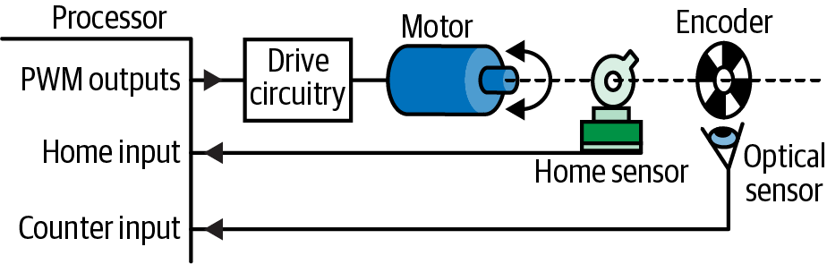
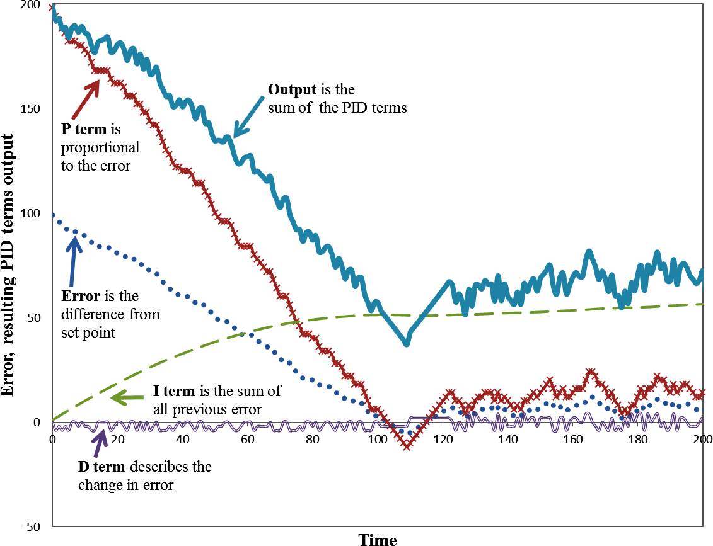
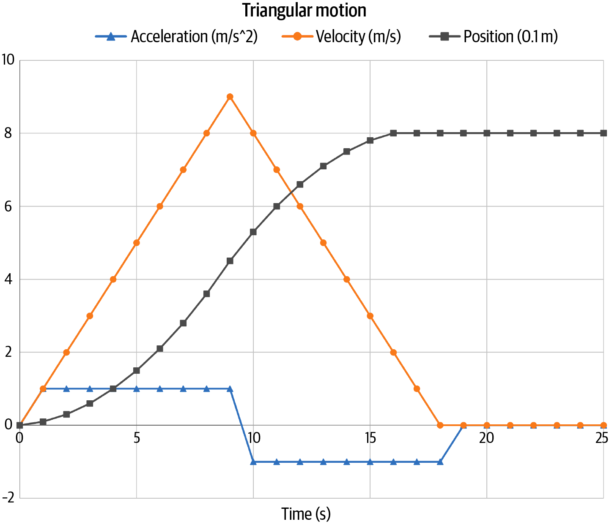
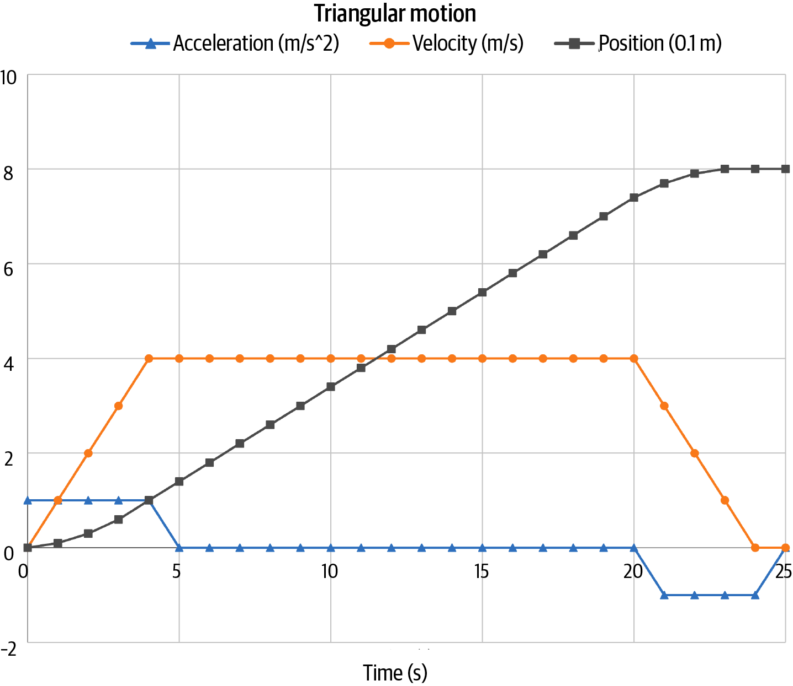
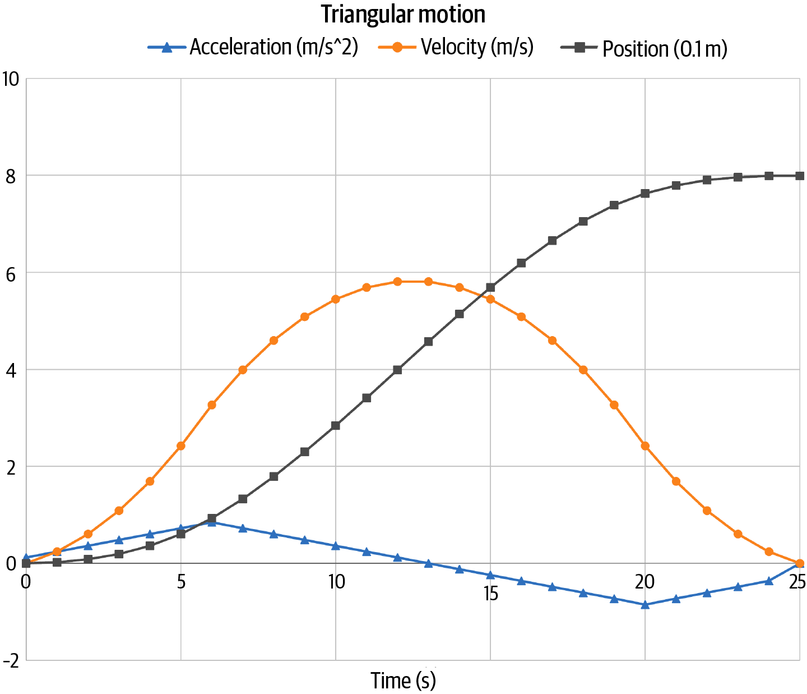

<!-- source: pdf=393; unit=p0393_b000_u00 -->

<a id="src-p393"></a>

# 第 14 章 电机与运动 {#ch14}

<!-- source: pdf=393; unit=p0393_b001_u00 -->
第一次让电机在我的软件控制下动起来的那一刻，我爱上了嵌入式系统。它不只是让灯闪烁、感知环境。让自己的代码改变世界，有一种神奇的魅力。

<!-- source: pdf=393; unit=p0393_b002_u00 -->
从那以后，为了再次找回那种兴奋感，我已经引发过许多小火灾。如果你的硬件做得好，软件也足够留心，也许你就能从我的发现中吸取经验，而不必亲自重演。

<!-- source: pdf=393; unit=p0393_b003_u00 -->
## 产生运动 {#ch14-toc-001}

<!-- source: pdf=393; unit=p0393_b004_u00 -->
执行器（actuator）是软件对周围环境施加机械影响的手段。最简单的执行器是电磁铁（solenoid），它有点像反过来使用的按钮。它是一种能移动金属部件的电磁装置：把控制信号设为高电平，它就处在一个位置；设为低电平，它就处在另一个位置。这种装置适合用来锁住东西，或者开关阀门。

<!-- source: pdf=393; unit=p0393_b005_u00 -->
触觉反馈器件（haptics）通常是压电蜂鸣器或振动电机，用作用户界面的一部分，例如手机的振动模式。它们往往也只有开关两种状态，但有时你可以用不同频率驱动它们，在产生振动的同时发出乐音。（压电器件也可以用作扬声器，不过会稍微复杂一些。）

<!-- source: pdf=393; unit=p0393_b006_u00 -->
不过，如果使用的电机不只会开关或哼一段小曲，移动东西就有趣得多了。

<!-- source: pdf=393-394; unit=p0393_b007_u00,p0394_b002_u00 -->

<a id="src-p394"></a>

无论是制造双足机器人，还是沿传送带移动一个小零件，电机都让系统真正参与到现实世界中。电机很棒，你绝对应该试一试，但要做好电机控制，需要另写一本书。我会列出一些需要注意的事项，不过能提供的，只是对电机的简要入门介绍。

<!-- source: pdf=394; unit=p0394_b003_u00 -->
 正如可以通过购买数字传感器来简化实现，有些电机组件也包含电机控制器芯片，能够执行适合该类电机的控制算法。控制器会向处理器提供简单的 API，同时提高电机的精度并延长寿命。

<!-- source: pdf=394; unit=p0394_b004_u00 -->
电机有许多类型，选择时会受到设备寿命、转矩（torque，也就是转动的力量）、能量效率和功耗等特性的影响。

<!-- source: pdf=394; unit=p0394_b005_u00 -->
步进电机（stepper motor）是一种常见选择，不过价格可能相对较高。步进电机可以精确定位，并保持在那个位置，具有较高的保持转矩。它是最容易使用的电机，因为可以在开环（open loop）方式下运行，不需要任何反馈机制。步进电机依靠多个磁体来转动电机轴，因此需要多条 I/O 线。给相应的 I/O 线通电，就会让轴向前迈到下一个位置，这可能会造成一点顿挫。如果希望电机沿一个方向平滑转动，就需要让 I/O 线按照数据手册规定的复杂节奏“跳舞”；这种舞步叫作换相（commutation）。

<!-- source: pdf=394; unit=p0394_b006_u00 -->
电机家族的另一端是有刷直流电机（brushed DC motor）。它非常便宜，通常只需要一条 I/O 线；如果希望它能反转，则需要两条。电机速度取决于施加的电压。你可以使用脉宽调制（PWM），获得比“关闭”和“全速运行”这种二选一更多的控制余地。电机通常不喜欢以数字方式突然开关，因此，使用 PWM 和一些相对简单的驱动电路，得到更平滑的速度曲线，就能延长电机寿命；我们在第4章已经见过 PWM 控制。直流电机的一个难点，是让它精确停在你想要的位置；为此，往往需要反馈控制系统。

<!-- source: pdf=394; unit=p0394_b007_u00 -->
 有刷直流电机的转矩取决于电流。但处理器能提供的电流，大概只够驱动一台很弱小的直流电机，而且电流浪涌可能损坏 I/O 线。因此，这些 I/O 线需要经过一些额外电路，让驱动力更足。

<!-- source: pdf=394-395; unit=p0394_b008_u00,p0395_b001_u00 -->

<a id="src-p395"></a>

无刷电机（brushless motor）的寿命通常更长，因为它既没有步进电机那样的顿挫，也没有相互接触的部件，即电刷。和步进电机一样，它需要几条 I/O 线协同工作才能转动。和有刷直流电机一样，控制速度比控制位置容易。无刷电机节能、安静，价格通常介于特性相近的步进电机和有刷直流电机之间。最后，无刷电机既可以是直流电机，也可以使用交流电。直线电机（linear motor）与无刷电机类似，只不过它沿直线运动，而不是绕圈转动。它也类似于电磁铁，但控制粒度更细。

<!-- source: pdf=395; unit=p0395_b002_u00 -->
 扬声器中的音圈，就是无刷直流直线电机的一个例子。如果手头有闲置扬声器，可以试着把电池接在两端，观察它在直流下的动作。（注意：取决于扬声器和电池，这可能损坏扬声器，所以先从小的开始。）

<!-- source: pdf=395; unit=p0395_b003_u00 -->
还有一种非常重要的电机类型：伺服电机（servo motor）是包含控制器的步进或直流电机，控制器提供内置的反馈机制。从本质上说，伺服电机并不只是电机，而是包含电机的小型系统。你可以买伺服电机，也可能正在把它作为自己系统的一部分来构建。

<!-- source: pdf=395; unit=p0395_b004_u00 -->
## 位置编码 {#ch14-toc-002}

<!-- source: pdf=395; unit=p0395_b005_u00 -->
对于电机系统，第二件最重要、必须弄清的事是：你怎么知道它何时到达目标位置？对于步进电机，可以从当前位置数出到达目标位置需要的步数。可是，你又怎么知道起点在哪里呢？

<!-- source: pdf=395; unit=p0395_b006_u00 -->
如果位置反馈方法给出的是绝对位置，直接读取即可。然而，许多系统使用更便宜的位置传感器，只能给出相对位置，所以你需要知道这把尺子的起点在哪里。

<!-- source: pdf=395; unit=p0395_b007_u00 -->
大多数电机，无论是否为步进电机，都有一个原点传感器（home sensor），用来指示电机行程中某个特定位置的绝对位置。原点通常位于行程的极端位置，例如最左端或最底部，不过有时也在行程中央，而不是某一端。寻找原点，就是让电机朝那个方向缓慢移动，直到检测到原点；有时使用光学传感器或接触开关来检测。如果原点位于一个极端，它就作为系统的零点，其他位置都从这里开始计数。电机一旦到达原点，就可以通过相对定位，开始向某个位置移动。

<!-- source: pdf=395; unit=p0395_b008_u00 -->
步进电机的相对位置根据电机步数计算。其他类型的电机则需要另一类传感器，叫作编码器（encoder）。它通常是光学编码器，利用一系列交替区域，例如黑／白、反光／哑光、不透明／透明，让软件能够把信号当作数字输入来处理。

<!-- source: pdf=396; unit=p0396_b000_u00 -->

<a id="src-p396"></a>

直线编码器（linear encoder）测量电机沿直线的位置，通常是增量式的，因此软件必须跟踪它相对于原点的位置。

<!-- source: pdf=396; unit=p0396_b001_u00 -->
旋转编码器（rotary encoder）测量电机轴的角度。随着位置精度提高，它们可能变得复杂。旋转编码器通常具有多圈交替图案。例如，三圈需要三个传感器，连接到三个 GPIO。在代码中，你会得到三位数据，从而知道电机处在八个（2³）位置中的哪一个，把圆周分成八等份来测量，这样的准确度并不高。但如果电机每转一整圈只移动 1 mm，也许就足够了。

<!-- source: pdf=396; unit=p0396_b002_u00 -->
图14-1展示了一个简单的电机系统，其中有几条 PWM 控制线通向电机。电机转动时，编码器也随之转动；虚线表示包含齿轮等部件的机械黑盒。光学传感器观察编码器上的黑白区域。传感器连接到处理器中的计数器，用来测量相对位置。

<!-- source: pdf=396; unit=p0396_b003_u00 -->
最初，电机会执行回原点过程（homing procedure），沿一个方向移动，直到在原点传感器上检测到所需的信号边沿。到达后，软件就能使用编码器开始对位置变化计数。处理器很可能带有执行这类计数的功能；请查看用户手册中的“计数器／定时器”部分。

<!-- source: pdf=396; unit=p0396_b005_u00 -->


图14-1　电机与编码器系统。

图中文字：Processor＝处理器；PWM outputs＝PWM 输出；Home input＝原点输入；Counter input＝计数器输入；Drive circuitry＝驱动电路；Motor＝电机；Home sensor＝原点传感器；Encoder＝编码器；Optical sensor＝光学传感器。

<!-- source: pdf=396; unit=p0396_b006_u00 -->
## 使用 PWM 驱动简单的直流电机 {#ch14-toc-003}

<!-- source: pdf=396; unit=p0396_b007_u00 -->
对于直流电机，速度与供给它的电压成正比。它们通常用 PWM 控制，如图14-1所示。PWM 占空比越高，平均电压就越高，电机转得也越快。

<!-- source: pdf=396; unit=p0396_b008_u00 -->
不过，输出 PWM 的处理器 GPIO 绝不能直接连接电机。电机所需的电流，远远超过处理器 I/O 线能够提供的电流。

<!-- source: pdf=397; unit=p0397_b002_u00 -->

<a id="src-p397"></a>

GPIO 的 PWM 输出应当经过一个晶体管，[^ch14-1] 由它接通或断开来自大电流电源的电压。理解它们最简单的方式，是把它们想成自动门：代码通过 I/O 引脚“按下” FET 时，它就在电机与电源之间打开一条通路。如果不这样做，处理器引脚，甚至整个处理器，很可能会损坏，没准还会把里面的“魔法烟雾”放出来。

<!-- source: pdf=397; unit=p0397_b003_u00 -->
如果希望电机反向转动，就需要让电压变为负值。这通常要用到 H 桥（H-bridge）：一种电路，或者电机驱动芯片中的一部分，使电压能够为正或为负，从而让电机正转或反转。

<!-- source: pdf=397; unit=p0397_b004_u00 -->
电压控制电机的速度，而电流控制转矩，也就是转动的力量。从完全静止开始启动，对直流电机来说很费劲；它想保持原样。因此，要让它动起来，需要相当大的电流。直流电机就像赖在沙发上不肯动的人。所以，无论是在加速，还是在克服相反方向的力，产生转矩都需要大量电流。

<!-- source: pdf=397; unit=p0397_b005_u00 -->
正如第13章所述，系统中的电流是相加的。如果处理器运行时消耗 3 mA，而电机消耗 2 A，系统就至少需要 2.003 A。在带电机的低功耗系统中，电机通常是最大的耗电者。

<!-- source: pdf=397; unit=p0397_b006_u00 -->
电机会吸收，也就是灌入，大量电流：它需要这些电流才能运动。大多数系统会把微处理器和电机的供电分开，以避免问题。注意，电机开始运动时需要克服惯性，这意味着电流可能突然猛增。这种浪涌电流（inrush current）会造成很多问题，包括拉低系统电压，从而可能使处理器复位。电池供电的系统尤其容易受影响，因为低电量时能够提供的电流，可能与充满电时不同。

<!-- source: pdf=397; unit=p0397_b007_u00 -->
>  电池串联可以提供更高的电压；电池并联可以提供更大的电流。

<!-- source: pdf=397-398; unit=p0397_b008_u00,p0398_b001_u00 -->

<a id="src-p398"></a>

那么，你需要多大的电流呢？如果有电机数据手册，先读一读。对于简单的直流电机，可以使用第13章“测量功耗”中介绍的工具：基本上，就是借助电源测量电机吸取的电流。这样可能得不到精确的浪涌电流值，但能让你大致了解预期电流的量级。

<!-- source: pdf=397; unit=p0397_b000_u00 -->
[^ch14-1]: 这些晶体管是处理器外部的芯片。大体上可以分为双极结型晶体管（BJT）和场效应晶体管（FET）。每一类又有多个子类型，例如绝缘栅双极型晶体管（IGBT）和金属氧化物半导体场效应晶体管（MOSFET）。这些术语对某些人来说意义重大，但你我忘掉它们也没关系。

<!-- source: pdf=398; unit=p0398_b002_u00 -->
 找出电机最大电流的一种方法，是让它堵转，也就是强迫它停止运动，不过这对电机不好，所以不要经常这样做。

<!-- source: pdf=398; unit=p0398_b003_u00 -->
### 急动度及更高阶导数（Jerk、Snap、Crackle、Pop）

<!-- source: pdf=398; unit=p0398_b004_u00 -->
首先，我们需要一些运动方程：

<!-- source: pdf=398; unit=p0398_b005_u00 -->
```text
distance = velocity * time
velocity = acceleration * time
```

<!-- source: pdf=398; unit=p0398_b006_u00 -->
把这些式子换个写法：

<!-- source: pdf=398; unit=p0398_b007_u00 -->
```text
velocity = distance / time
acceleration  = velocity / time
```

<!-- source: pdf=398; unit=p0398_b008_u00 -->
然后，我们就可以说一些听起来很聪明的话，比如速度是位移，也就是距离的导数，加速度是速度的导数。这只不过是说，速度表示距离如何随时间变化；加速度表示速度如何随时间变化。

<!-- source: pdf=398; unit=p0398_b009_u00 -->
转矩则不同，它与旋转和力有关，其中力遵循牛顿定律：

<!-- source: pdf=398; unit=p0398_b010_u00 -->
```text
force = mass * acceleration
```

<!-- source: pdf=398; unit=p0398_b011_u00 -->
我把转矩理解为那股“劲儿”：电机克服阻力转动的能力。阻力可能来自我把电机固定在原地，也可能来自卡住的齿轮。低转矩电机会停在那里，发热，也许还发出声响；高转矩电机则会从我手中挣脱转动，或者碾坏卡住的齿轮。

<!-- source: pdf=398; unit=p0398_b012_u00 -->
由于转矩与质量和加速度都有关系，转矩更高的电机不仅能够移动质量更大的物体，也能更快地改变速度。

<!-- source: pdf=398; unit=p0398_b013_u00 -->
不过，我并不想讨论转矩。我想说的是，加速度的导数叫作急动度（jerk）。这个名字很贴切：加速度快速变化的电机会产生顿挫运动。它还会造成振动，以及额外的电机磨损。平滑地改变加速度，可以减少急动度。

<!-- source: pdf=398; unit=p0398_b014_u00 -->
急动度的导数是 snap，snap 的导数是 crackle，crackle 的导数是 pop。做电机工作不必知道这些，或者说，如果你确实需要知道，那已经超出了我的电机经验。不过，这不是很酷吗？

<!-- source: pdf=399; unit=p0399_b000_u00 -->

<a id="src-p399"></a>

## 电机控制 {#ch14-toc-004}

<!-- source: pdf=399; unit=p0399_b001_u00 -->
在前馈控制（feed-forward control，也叫开环控制）中，你根据对电机工作方式的预期，命令它移动到某处。例如，对于步进电机，可以告诉它走100步，它就会照做。每一步的大小是已知的，所以你有充分理由相信，自己知道它的位置。

<!-- source: pdf=399; unit=p0399_b002_u00 -->
在反馈控制（feedback control，也叫闭环控制）中，你用传感器测量电机正在做什么，再根据测量结果，改变发送给电机的命令或电压。然而，这并不像“让它一直走，到达位置后再叫它停下”那么简单。到那时，电机已经越过目标位置了。你可以叫它退回来，但随后又会越过一次。除非你是在摇哄婴儿，否则肯定不想让它这样来回往复。

<!-- source: pdf=399; unit=p0399_b003_u00 -->
### PID 控制 {#ch14-toc-005}

<!-- source: pdf=399; unit=p0399_b004_u00 -->
处理这个问题最常见的方式，是采用 PID 控制。PID 分别代表比例（proportional）、积分（integral）和微分（derivative）。每一项处理问题的一部分，三者合起来，就能告诉你该向电机输送多少功率，通常以 PWM 输出水平表示。这个过程从测量误差开始：误差就是电机当前位置，即过程值（process value，PV），与希望它到达的位置，即设定值（set point，SP），之间的位置差。

<!-- source: pdf=399; unit=p0399_b005_u00 -->
比例项很容易理解，就是一个常数乘以位置误差：

<!-- source: pdf=399; unit=p0399_b006_u00 -->
```c
error = goalPosition – currentPosition;
PID.proportionalTerm = PID.proportionalConstant * error;
```

<!-- source: pdf=399; unit=p0399_b007_u00 -->
因此，电机离目标很远时，软件就给它充足的动力；接近目标时，就减小动力。有时这样就够了。然而，在远离目标时让电机一上来就以全功率启动，会造成顿挫，这对它不好。此外，它仍可能越过目标，在目标位置附近振荡。或者，如果误差很小，比例项永远无法给电机足够的动力让它真正移动，于是它会卡在一个不完全正确的位置，这就是稳态误差（steady state error）。

<!-- source: pdf=399; unit=p0399_b008_u00 -->
积分项通过随时间累加误差，来帮助解决这些问题：

<!-- source: pdf=399; unit=p0399_b009_u00 -->
```c
PID.integralSum += error;
PID.integralTerm = PID.integralConstant * PID.integralSum;
```

<!-- source: pdf=399-400; unit=p0399_b010_u00,p0400_b000_u00 -->

<a id="src-p400"></a>

积分项不仅像比例项一样与误差大小成正比，还会考虑误差已经持续了多久。刚向电机发出移动命令时，误差存在的时间还很短。但经过 PID 控制循环的几个周期后，如果电机还没有接近目的地，积分项就会补上一股劲儿，让它朝目标加速。不过，这有点像动量。一旦积分项开始起作用，它就容易造成超调，甚至比单独使用比例项时更严重。尽管由于积分项的作用，控制器最终会回到目标位置，不再振荡，也没有固定误差，但最好还是不要越过目标。这时就轮到微分项出场了：

<!-- source: pdf=400; unit=p0400_b001_u00 -->
```c
PID.derivativeTerm = PID.derivativeConstant * (error – previousError);
```

<!-- source: pdf=400; unit=p0400_b002_u00 -->
这样，当误差减小时，控制器就会减小输出。这相当于增加一点摩擦，来平衡比例项和积分项；通常，在误差项变小时，它会抵消 PI 两项的部分作用。

<!-- source: pdf=400; unit=p0400_b003_u00 -->
PID 控制器的输出，就是这三项相加。输出随后传给电机驱动代码，由它转换成 PWM 占空比。图14-2展示了系统接到前往某个设定值，也就是某个位置的命令时，各项与输出之间调节得相当好的相互作用。注意，系统输出会反馈给控制器，因此这是一个反馈系统。既然如此，它就可能不稳定。比例控制过强，会让电机振荡，也叫振铃；积分控制过强，电机则可能在冲过目标位置时把自己撞得粉碎。

<!-- source: pdf=400; unit=p0400_b005_u00 -->


图14-2　PID 对设定值变化的响应，例如电机接到前往新位置的命令。输出信号传给电机驱动器，后者将它除以2，并作为 PWM 占空比输出。

图中文字：Time＝时间；Error, resulting PID terms output＝误差及由此产生的 PID 各项输出；P term is proportional to the error＝P 项与误差成正比；Output is the sum of the PID terms＝输出为 PID 各项之和；Error is the difference from set point＝误差是与设定值之差；I term is the sum of all previous error＝I 项是此前所有误差之和；D term describes the change in error＝D 项描述误差的变化。坐标刻度保留在原图中。

<!-- source: pdf=401; unit=p0401_b002_u00 -->

<a id="src-p401"></a>

误差信号往往带有噪声。如果噪声太大，微分项就可能产生随机结果。失控的反馈系统会做出危险的事情。

<!-- source: pdf=401; unit=p0401_b003_u00 -->
>  考虑在设计中加入限位开关（limit switch）。与原点传感器类似，限位开关能够识别绝对位置，不过它们通常安装在电机可能发生故障或失控的位置。

<!-- source: pdf=401; unit=p0401_b004_u00 -->
不过，在许许多多的工程问题中，PID 控制器都能提供良好的解决方案。我在电机、加热器和弹簧系统建模中都用过 PID。这种控制方法应用广泛，也已被充分理解，可以把它看作一种工程设计模式。而且，从前面的代码片段就能看出，用软件实现它很简单。

<!-- source: pdf=401; unit=p0401_b005_u00 -->
可是，那些常数呢？就是那些决定每个 PID 项在输出中占多大权重的常数。弄清它们的过程既痛苦，又有一个专门的名字，叫作整定（tuning）。这个领域确实提供了一些简单指导：先用比例控制，把效果调得相当好；再加入微分控制，让超调更平缓；然后，如果有必要，再加入积分控制，消除较小的误差。但到了项目本该结束的三周后，你可能还在咒骂那个给你这条建议的人，因为他说只要调调参数，电机就能正常工作。

<!-- source: pdf=401; unit=p0401_b006_u00 -->
也有一些数学工具能帮助整定，例如 Ziegler–Nichols 方法。尽管数学计算乏味，还需要估计某些输入，因为现实世界并不符合理想数学模型，我仍建议在反复试验之外，也使用这些工具。不过，这些方法往往要求你以严谨的方式深入理解问题。

<!-- source: pdf=401; unit=p0401_b007_u00 -->
注意，PID 的概念相当标准化，但实现各不相同。例如，微分项对误差信号中的噪声很敏感，因此许多实现会对多个样本的误差取平均。这样能增强微分项抵御噪声引发失常行为的能力，但也会降低它对系统的响应速度。为了改善性能、处理特定系统的问题，类似的小调整还有几十种。

<!-- source: pdf=401; unit=p0401_b008_u00 -->
 到这里，我提供的信息已经足以让你惹出危险，但还不足以让你把工作做好。本章“延伸阅读”推荐了一些资源，帮助你实现和整定 PID 控制器，也介绍其他一些控制方法。

<!-- source: pdf=402; unit=p0402_b000_u00 -->

<a id="src-p402"></a>

## 运动曲线 {#ch14-toc-006}

<!-- source: pdf=402; unit=p0402_b001_u00 -->
你希望电机怎样移动？先忘掉 PID 那些东西，想象自己坐在一辆小汽车里，驾驶着这台电机。你踩油门和刹车的脚是不是很重？一路猛加速，到一半路程后再猛减速？

<!-- source: pdf=402; unit=p0402_b002_u00 -->
这种运动叫作三角形运动曲线（triangular motion profile），见图14-3。你会以最快速度到达，但这对电机好吗？对乘客呢？

<!-- source: pdf=402; unit=p0402_b004_u00 -->


图14-3　先采用最大加速度，再采用最大减速度，可以最快到达，但会让零部件很吃力。

图中文字：Triangular motion＝三角形运动；Acceleration (m/s^2)＝加速度（m/s²）；Velocity (m/s)＝速度（m/s）；Position (0.1m)＝位置（0.1 m）；Time (s)＝时间（s）。坐标刻度保留在原图中。

<!-- source: pdf=402; unit=p0402_b005_u00 -->
因此，另一种选择是更温和一点：梯形运动（trapezoidal motion）。图14-4中可以看到，到达同一个位置需要更长时间，但电机不必从最大正加速度猛然变到最大负加速度。记住，急动度是加速度的导数，在电机上表现为顿挫或振动。

<!-- source: pdf=403; unit=p0403_b002_u00 -->

<a id="src-p403"></a>



图14-4　在梯形运动曲线中，系统加速到合理的速度，稍晚一些到达目标位置。

图中文字：Triangular motion＝三角形运动；Acceleration (m/s^2)＝加速度（m/s²）；Velocity (m/s)＝速度（m/s）；Position (0.1m)＝位置（0.1 m）；Time (s)＝时间（s）。坐标刻度保留在原图中。

<!-- source: pdf=403; unit=p0403_b003_u00 -->
注意，速度与输入电压有关，因此即便有位置反馈，控制速度也往往比控制位置容易。编写运动曲线代码时，通常需要从速度，也就是电压，以及时间的角度来考虑目标位置。这就是为什么“三角形”和“梯形”描述的是速度曲线的形状，而不是位置曲线的形状。

<!-- source: pdf=403; unit=p0403_b004_u00 -->
>  许多处理器厂商会提供针对处理器特性调优的电机控制库。请查看它们的应用笔记。这些库很可能会替你完成数学计算，让你直接进行点到点的位置移动，而不必操心速度和加速度。

<!-- source: pdf=404; unit=p0404_b000_u00 -->

<a id="src-p404"></a>

更好的曲线会让加速度更加平滑，把急动度降低到不再重要的程度。这通常叫作 S 曲线（S-curve），如图14-5所示。

<!-- source: pdf=404; unit=p0404_b002_u00 -->


图14-5　S 曲线运动减少顿挫，使运动平滑得多。

图中文字：Triangular motion＝三角形运动；Acceleration (m/s^2)＝加速度（m/s²）；Velocity (m/s)＝速度（m/s）；Position (0.1m)＝位置（0.1 m）；Time (s)＝时间（s）。坐标刻度保留在原图中。

<!-- source: pdf=404; unit=p0404_b003_u00 -->
S 曲线运动所需的时间比三角形运动曲线更长，但可能比梯形运动曲线更快，取决于电机的最高目标速度。

<!-- source: pdf=404; unit=p0404_b004_u00 -->
## 我讨厌电机的十件事 {#ch14-toc-007}

<!-- source: pdf=404; unit=p0404_b005_u00 -->
我爱电机。它们能做那么多事：电机可以关门，可以让机器人移动，可以把液体泵入 DNA 扫描仪，也可以为电动自行车提供助力。它们的应用无穷无尽，令人着迷。

<!-- source: pdf=404; unit=p0404_b006_u00 -->
但电机也有一些让我讨厌的地方：

<!-- source: pdf=405; unit=p0405_b000_u00 -->

<a id="src-p405"></a>

**伺服甚至不算一种电机，除非说的是模型舵机。**

与直流电机、无刷直流电机或步进电机不同，伺服只是任何带位置反馈的电机系统，并没有统一标准。例外是模型舵机，也叫 RC 舵机，它们有两根电源线和一根控制线，利用电位器对电机进行简单的反馈控制。

<!-- source: pdf=405; unit=p0405_b001_u00 -->
**电机会让处理器复位。**

如果电机电源与处理器电源相连，电机动作可能会使处理器供电电压下陷，造成欠压（brownout）。这可能导致复位，或者涉及硬故障的古怪行为。

<!-- source: pdf=405; unit=p0405_b002_u00 -->
处理器电源需要与电机电源隔离，两者之间要有充分的去耦；去耦通常意味着很多电容器。还必须使用 MOSFET 或其他晶体管电路，保护处理器上的 GPIO，避免受到电机吸取的电流，以及电机启动时产生的瞬态影响。

<!-- source: pdf=405; unit=p0405_b003_u00 -->
**电机的能量效率不高。**

<!-- source: pdf=405; unit=p0405_b004_u00 -->
一个带有200个 5 mA LED 的系统，可能需要约 1 A 的供电，而一台小电机大概就需要这么多。使用电机时，功耗预算很可能大部分都花在电机上。

<!-- source: pdf=405; unit=p0405_b005_u00 -->
**电机及其驱动芯片会发热。**

所有那些电力总要去往某处，而且并不会全部变成运动。很多功率消耗在驱动芯片上，它们会热到把自己的焊锡熔开，虽然这通常意味着电路设计有问题。换相不完善会造成许多问题，卡滞和堵转也一样。

<!-- source: pdf=405; unit=p0405_b006_u00 -->
**电机会弄坏东西。**

根据所用的齿轮传动，电机可能太快或太有力。于是，当你不小心发出一条不该发的命令，比如，哎呀，忘了检查负的 PWM 值，零件突然就会飞遍房间。电机没有保护人身安全的紧急停止功能，除非我们为它开发出来。

<!-- source: pdf=405; unit=p0405_b007_u00 -->
**电机启动时可能吸取过大的电流。保持位置时也会。碰到一粒想玩玩的灰尘时也会。**

直流电机在启动和堵转时会消耗大量电流。步进电机在静止，也就是保持位置时，会消耗大量电流。

<!-- source: pdf=405; unit=p0405_b008_u00 -->
通常的经验法则是：电源提供和吸收电流的能力，需要达到正常满载所需最大电流的三倍。许多电源根本不能吸收电流。

<!-- source: pdf=405-406; unit=p0405_b009_u00,p0406_b000_u00 -->

<a id="src-p406"></a>

例如，把一台直流电机直接接到线性稳压器上。电机可以正常启动，但关闭时，稳压器无法吸收从负载返回的电流。这就是为什么要用缓冲二极管（snubber diode），把反向电流引到安全的地方，远离稳压器。没有缓冲二极管，反向电流就会造成电压尖峰。H 桥是解决这个问题的一种更讲究的方式。

<!-- source: pdf=406; unit=p0406_b001_u00 -->
带有“噪声电刷”的直流电机，由于电刷与电枢间歇性接触，每秒会自行通断许多次。所以，这并不是只有停机时才会发生的现象，而是一直在发生。

<!-- source: pdf=406; unit=p0406_b002_u00 -->
**电机会起火。**

<!-- source: pdf=406; unit=p0406_b003_u00 -->
硬件要花钱，组装也要时间。小小的编码问题，可能导致代价高昂而且危险的后果。好吧，也经常会有很好笑的后果，但那不该列在“我为什么讨厌电机”这张清单里。向电气工程师（EE）承认，因为没有禁用调试 UART 中断就尝试控制电机，结果又炸掉了一个 FET，嗯，我经历过，也很同情你。先做好最底层的工作，打牢基础，再尝试花哨的运动曲线。

<!-- source: pdf=406; unit=p0406_b004_u00 -->
**电机控制可以简单得不得了，也可以难得根本做不成。**

电机控制是一整个研究领域。如果幸运，你负担得起一台好的伺服电机，它能按命令到达目标，而且配有足以支持所有必要运动的功率电路。如果不幸运，嗯，在你努力弄清换相为什么总差那么一点、FET 为什么不断炸掉的过程中，换相倒是能在示波器上画出很漂亮的波形。

<!-- source: pdf=406; unit=p0406_b005_u00 -->
**尖酸的二极管（snippy diodes）、势利的二极管（snobby diodes）、缓冲二极管（snubber diodes）、续流二极管（flyback diodes）、瞬态抑制二极管（TSD）、直通电流（shoot through current）。说到底，整个模拟电子学。**

电机用电力来转动，对吧？停下来时会发生什么？电力不会突然消失；电机猛然停止时，可能会把一点电力送回电路。这对电路不好，因此电气工程师会加入缓冲或续流二极管，防止损坏。注意：如果电机能够双向转动，而且你使用了 H 桥，那么其中已经有缓冲二极管了。

<!-- source: pdf=406; unit=p0406_b006_u00 -->
实际上，电子电路的行为都不像我们假装的那样瞬时、干净利落，而电机系统往往会打破这些幻想。FET 导通需要时间。当有多个 FET 时，例如 H 桥，它们有时需要一定时间才能改变状态，这可能导致撬棒式短路（crowbar）：卡在不良状态，通常是把电源与地短接，为你的设备带来世界末日。

<!-- source: pdf=406-407; unit=p0406_b007_u00,p0407_b000_u00 -->

<a id="src-p407"></a>

**这些问题中，只有五个与你的电机子系统有关。**

“电机”这个词很像“传感器”。不同类型之间当然有相似之处，但差异也同样多。仅仅说“电机”，还不足以知道它会对系统产生什么影响。电机采用不同的驱动机制，例如 PWM、通信，或者执行 PWM 或换相的驱动芯片。位置反馈也有许多形式。

<!-- source: pdf=407; unit=p0407_b001_u00 -->
电机的选择取决于应用。你需要明确转矩、速度、准确度、精密度、成本、寿命和控制机制方面的目标。好消息是，你有许多选择。坏消息也是，你有许多选择。

<!-- source: pdf=407; unit=p0407_b002_u00 -->
## 延伸阅读 {#ch14-toc-008}

<!-- source: pdf=407; unit=p0407_b003_u00 -->
Adafruit 有一份[电机选型指南](https://oreil.ly/E0d4V)，列出了每种类型的优缺点，并附有一系列更具体的教程，介绍如何运行各类电机。

<!-- source: pdf=407; unit=p0407_b004_u00 -->
控制理论不是胆小者的领域。不过，孩子们也在学习它，因为 FIRST 机器人竞赛需要这些知识。因此，我不打算推荐自己通常会建议的那些严谨、数学密集的大部头，而是鼓励你看看：

<!-- source: pdf=407; unit=p0407_b005_u00 -->
- [CTRL ALT FTC](https://ctrlaltftc.com) 是一套面向 FIRST Tech Challenge 的完整控制理论课程，包含代码、图解、视频和练习。它从基本的开关控制讲起，逐步推进到 PID 控制器、运动曲线以及更高级的主题。

<!-- source: pdf=407; unit=p0407_b006_u00 -->
- [WPILib 的“高级控制”（Advanced Controls）文档](https://oreil.ly/x5HWm)介绍了这个库的工作方式，这很棒；但更重要的是，它说明所有这些内容如何协同工作，这些知识可以用在你自己的系统上。

<!-- source: pdf=407; unit=p0407_b007_u00 -->
如果希望通过书籍学习电机控制和其他控制方案，我喜欢 Ken Dutton、Steve Thompson 和 Bill Barraclough 合著的《控制工程的艺术》（The Art of Control Engineering，Addison-Wesley）。它的数学内容比必要程度稍多一些，但对实际实现仍然相当有用。

<!-- source: pdf=407; unit=p0407_b008_u00 -->
许多处理器厂商的应用笔记，都包含如何用它们的产品控制电机的信息。其中可能介绍已经为你写好的库，也可能讲解理论。更多来自不同厂商的信息，见本书的 [GitHub 仓库](https://github.com/eleciawhite/making-embedded-systems)。

<!-- source: pdf=407; unit=p0407_b009_u00 -->
## 面试题：教教我

<!-- source: pdf=407; unit=p0407_b010_u00 -->
H 桥是如何工作的？

<!-- source: pdf=407; unit=p0407_b011_u00 -->
我曾在一家特别想加入的小公司经历过一场糟糕的面试。我很适合那个岗位，也和那位资深电气工程师一见如故。接着，一位初级电气工程师走进来，开始问我现代 C++ 语言特性的问题，而我很确定，他们使用的嵌入式编译器并不支持那些特性。

<!-- source: pdf=407-408; unit=p0407_b012_u00,p0408_b000_u00 -->

<a id="src-p408"></a>

无论相对于我、那位电气工程师，还是整个行业，她都非常资浅。她很可能是第一次担任面试官，为了准备，她在网上查了一些问题，都是 C++ 的细枝末节。但她并不理解它们，只知道我给出的不是网上想要的答案。而那位电气工程师就在旁边看着，跟着我点头，而不是跟着她。我实际上是在她的上司面前贬低她的问题，她因此越来越沮丧。

<!-- source: pdf=408; unit=p0408_b001_u00 -->
这里有两个教训。

<!-- source: pdf=408; unit=p0408_b002_u00 -->
第一，别学我；我没有得到那份工作，是因为我对她很刻薄。我本该设法帮助她理解，为什么那些问题不相关，也许还可以为下一次面试建议一些不同的问题。作为资深工程师，你的职责是帮助初级工程师。

<!-- source: pdf=408; unit=p0408_b003_u00 -->
第二，如果你要面试一个自己并不具备相关领域知识的岗位，就别装懂。我已经证明了自己具备那份工作所需的技术能力，她本该考察的是我们能否一起工作。

<!-- source: pdf=408; unit=p0408_b004_u00 -->
有趣的是，仅仅几个月之后，就轮到我面试电气工程师候选人了。除了基础电子学之外，我想不出该问什么，才能在对方答错时引导他们。我最后问了 H 桥，因为每次弄明白这电路，我最多也就能保持大约两周的理解。重要的是，应聘者能向我解释清楚，又不让我觉得自己很蠢。面试之后，我还可以查找答案，根据自己新获得的理解，确认网上的说法也认为它讲得通。

<!-- source: pdf=408; unit=p0408_b005_u00 -->
本质上，我利用自己的无知，帮助自己找到能够向他们学习的人，而不是指望装成专家蒙混过关。

<!-- source: pdf=408; unit=p0408_b006_u00 -->
写给那位如今很可能已拥有精彩职业生涯的初级电气工程师：谢谢你让我意识到，我作为面试官的目标之一，是找出自己想一起工作，以及不想一起工作的人。而且，对于当时把你弄哭这件事，我至今仍然非常、非常抱歉。